# HOR：人相关关系抽取与500张随机图片测试

## 任务与输入输出

输入一张图片，检测并编号其中的人和其他物体，使用已有 RelateAnything 官方权重预测有向关系，返回主语编号、主语类别、关系、宾语编号、宾语类别与分数。筛选条件为关系任一端是 person；人与人关系单独标记。

采用 Faster R-CNN ResNet50 FPN V2 官方 COCO 检测权重，检测阈值0.35，单图最多40个检测框；关系输入分辨率448，CUDA BF16，关系词表沿用 PSG 的56个谓词。检测器以 CUDA FP32 执行。

对保留的全部框枚举所有有向非自身物体对，然后筛选人相关关系。每对分别保留11个空间谓词中的最高分与45个其他谓词中的最高分，合并排序后最多输出50项。该分组沿用显式配置；动作组也包含 carrying、wearing 等语义关系，空间/动作标签仅用于组织输出。

分数为 sigmoid(predicate_logit + pair_logit)，仅用于排序。本任务没有在 HOR 上校准概率或验证置信度阈值，默认保留候选以方便尽量发现关系。高分也可能有错误；数量达到50不代表存在50条真实交互。

## 抽样与实验设计

随机种子 `20261025`，从本地公开 PSG test 的2179张图片中均匀无放回抽取500张。抽样使用标准库 random.Random(seed).sample；图片顺序、文件名和配置保存在 sample_manifest.json。抽样不读取关系真值，也不按人物数量或模型表现选择图片。

三组实验使用完全相同的500张图：

1. `detected`：只使用图片检测框与检测类别，完成可直接用于新图片的流程。
2. `gt_boxes`：使用 PSG 提供的真实框和类别识别人，完整枚举物体对，测量框已知条件下的关系能力。
3. `official400`：使用同一真实框，恢复400候选预算，再筛选人相关关系，诊断有限候选预算的影响。

所有模型前向均设置 targets=None。真实关系仅用于预测完成后的评测。人物类别用于识别哪些关系需要输出，关系模型本身只接收图像和框。枚举更多物体对会改变关系之间的注意力上下文，因此 HOR 的枚举模式具有自身的预测结果。

## 测试集构成与检测结果

| 项目 | 数量或比例 |
|---|---|
| GT 人物框 | 1156 |
| 自动检测人物框 | 1621 |
| IoU≥0.5且类别正确的人物框命中 | 961 |
| 人物框召回率 | 83.13% |
| GT 包含人物的图片 | 262 |
| 自动检测包含人物的图片 | 288 |
| GT 有人的图片中检测到人的图片 | 256 |
| GT 没有标注人物的图片 | 238 |
| GT 无人但检测到人的图片 | 32 |
| 人相关GT涉及的去重端点 | 1129 |
| 同类别且IoU≥0.5匹配的端点 | 798 |
| 关系端点召回率 | 70.68% |
| 位于检测器类别范围内的GT端点 | 895 |
| 类别范围内端点的匹配数量 | 798 |
| 类别范围内端点的召回率 | 89.16% |

500张中有262张标注人物，252张包含至少一条人相关关系标注。这两个数量采用不同计数条件；没有关系标注的图片继续处理与展示。

GT 人数仅统计当前 PSG 转换版本保留的框。GT 无人的图片检测到人，需结合图像判断其正确性；未标注对象可能仍真实存在。

检测器只覆盖 COCO 物体类别，PSG 中的道路、草地、天空、墙壁等区域可能缺少检测框。这类关系端点缺失会直接限制图片输入流程的召回率。

## 完整关系召回结果

| 框与候选模式 | 输出规则 | 有 GT 图片 | 人相关 GT | R@20 | R@50 | mR@50 | 汇总 R@50 | 命中 GT |
|---|---|---|---|---|---|---|---|---|
| detected | 空间/动作各一项 | 252 | 968 | 22.91% | 24.48% | 19.93% | 22.73% | 220 |
| detected | 每对一个谓词 | 252 | 968 | 19.56% | 20.61% | 17.88% | 18.60% | 180 |
| gt_boxes | 空间/动作各一项 | 252 | 968 | 41.76% | 45.77% | 34.77% | 44.11% | 427 |
| gt_boxes | 每对一个谓词 | 252 | 968 | 35.07% | 36.56% | 30.82% | 35.02% | 339 |
| official400 | 空间/动作各一项 | 252 | 968 | 41.53% | 45.63% | 35.36% | 44.01% | 426 |
| official400 | 每对一个谓词 | 252 | 968 | 35.18% | 36.33% | 30.47% | 34.71% | 336 |

R@K：每张有对应 GT 的图片中，前K条候选命中的去重人相关 GT 比例，再对图片取平均。mR@K：先计算每张图每类谓词的召回，再按谓词类别平均。汇总 R@K：全部命中数量除以全部去重 GT 数量。无对应 GT 的图片不进入这些分母，继续计入500张处理数量。

自动检测匹配同时要求主语、宾语框各自 IoU≥0.5、类别一致且谓词一致，方向必须相同。真实框模式直接比较原始编号与谓词。框编号从0开始；同图检测模式和GT模式各自编号，禁止直接跨模式比较编号。

本任务使用人相关候选自己的 Top50，且允许一对两个类型的谓词；指标名称在本报告中对应 HOR 协议。先前论文复现的全图单谓词 Top50 具有不同的输出范围。

## 人与其他物体、人与人及关系方向

| 模式 | GT 分组 | 有GT图片 | GT数量 | R@50 | mR@50 |
|---|---|---|---|---|---|
| detected | human_nonhuman | 250 | 842 | 25.48% | 20.73% |
| detected | human_human | 68 | 126 | 17.16% | 4.47% |
| detected | human_subject | 249 | 892 | 26.35% | 20.70% |
| detected | human_object | 115 | 202 | 15.13% | 7.47% |
| gt_boxes | human_nonhuman | 250 | 842 | 48.49% | 35.31% |
| gt_boxes | human_human | 68 | 126 | 25.49% | 20.44% |
| gt_boxes | human_subject | 249 | 892 | 46.97% | 34.86% |
| gt_boxes | human_object | 115 | 202 | 32.51% | 22.42% |

方向分组可以重叠：人与人关系同时属于人作为主语和人作为宾语。分组评测沿用同一份人相关 Top50 输出。

## 失败阶段

| 模式 | hit50 | endpoint_missing_or_wrong_class | endpoints_collapsed_to_same_box | pair_not_selected | wrong_predicate | rank_below50 |
|---|---|---|---|---|---|---|
| detected | 220 | 437 | 1 | 0 | 284 | 26 |
| gt_boxes | 427 | 0 | 0 | 0 | 505 | 36 |
| official400 | 426 | 0 | 0 | 4 | 504 | 34 |

endpoint_missing_or_wrong_class：GT端点没有同类别且 IoU≥0.5 的预测框。endpoints_collapsed_to_same_box：两个GT端点只能匹配同一个检测框，无法组成非自身物体对。pair_not_selected：存在两个不同的匹配端点，但该人相关物体对未进入候选。wrong_predicate：端点与候选存在，但对应类型的最佳谓词错误。rank_below50：该类型最佳谓词正确但未进入 Top50。

## 谓词类别明细

| 谓词 | GT 数量 | 自动检测命中 | 真实框命中 | 自动检测类别召回 | 真实框类别召回 |
|---|---|---|---|---|---|
| over | 23 | 2 | 11 | 9.09% | 50.00% |
| in front of | 80 | 6 | 16 | 7.21% | 19.15% |
| beside | 85 | 22 | 36 | 22.52% | 41.13% |
| on | 62 | 19 | 49 | 34.47% | 78.41% |
| in | 29 | 11 | 17 | 28.57% | 50.79% |
| attached to | 32 | 0 | 0 | 0.00% | 0.00% |
| hanging from | 2 | 0 | 0 | 0.00% | 0.00% |
| on back of | 7 | 0 | 0 | 0.00% | 0.00% |
| going down | 7 | 0 | 1 | 0.00% | 16.67% |
| walking on | 44 | 0 | 27 | 0.00% | 57.14% |
| running on | 16 | 0 | 7 | 0.00% | 39.74% |
| crossing | 5 | 0 | 4 | 0.00% | 75.00% |
| standing on | 96 | 1 | 53 | 0.62% | 50.41% |
| lying on | 5 | 2 | 1 | 50.00% | 33.33% |
| sitting on | 40 | 13 | 27 | 37.88% | 70.71% |
| flying over | 2 | 1 | 1 | 50.00% | 50.00% |
| jumping over | 2 | 0 | 0 | 0.00% | 0.00% |
| jumping from | 7 | 0 | 0 | 0.00% | 0.00% |
| wearing | 48 | 21 | 26 | 45.83% | 54.63% |
| holding | 86 | 48 | 58 | 57.18% | 66.20% |
| carrying | 23 | 8 | 10 | 37.50% | 42.50% |
| looking at | 77 | 15 | 21 | 21.67% | 28.89% |
| guiding | 3 | 0 | 0 | 0.00% | 0.00% |
| eating | 5 | 1 | 2 | 20.00% | 40.00% |
| feeding | 3 | 1 | 1 | 33.33% | 33.33% |
| biting | 1 | 0 | 0 | 0.00% | 0.00% |
| catching | 8 | 3 | 3 | 37.50% | 37.50% |
| picking | 5 | 0 | 1 | 0.00% | 20.00% |
| playing with | 7 | 0 | 1 | 0.00% | 16.67% |
| chasing | 4 | 0 | 0 | 0.00% | 0.00% |
| cleaning | 1 | 0 | 0 | 0.00% | 0.00% |
| playing | 33 | 0 | 0 | 0.00% | 0.00% |
| touching | 12 | 0 | 1 | 0.00% | 9.09% |
| pulling | 5 | 2 | 2 | 40.00% | 40.00% |
| cooking | 1 | 1 | 1 | 100.00% | 100.00% |
| talking to | 15 | 3 | 5 | 23.08% | 34.62% |
| throwing | 5 | 1 | 3 | 20.00% | 60.00% |
| slicing | 1 | 0 | 0 | 0.00% | 0.00% |
| driving | 15 | 1 | 1 | 6.67% | 6.67% |
| riding | 40 | 31 | 31 | 83.61% | 78.89% |
| about to hit | 6 | 0 | 0 | 0.00% | 0.00% |
| kicking | 2 | 2 | 2 | 100.00% | 100.00% |
| swinging | 9 | 4 | 5 | 50.00% | 62.50% |
| entering | 1 | 0 | 0 | 0.00% | 0.00% |
| exiting | 1 | 0 | 1 | 0.00% | 100.00% |
| enclosing | 2 | 0 | 1 | 0.00% | 50.00% |
| leaning on | 5 | 1 | 1 | 20.00% | 20.00% |

## 可查验案例

[500张图片完整索引](500张图片索引.md)逐图提供两个模式的编号框、全部物体信息、全部 Top50 候选和逐条GT失败阶段。[逐图结果CSV](逐图结果.csv)可按人物数量、召回率或输出数量筛选。

### 图片 0077：2315602.jpg

自动检测命中 2/2，R@50=100.00%；真实框命中 2/2，R@50=100.00%。

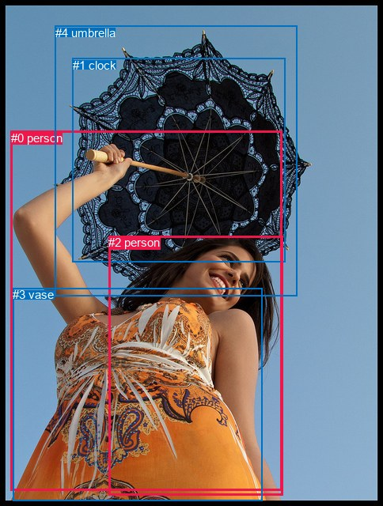

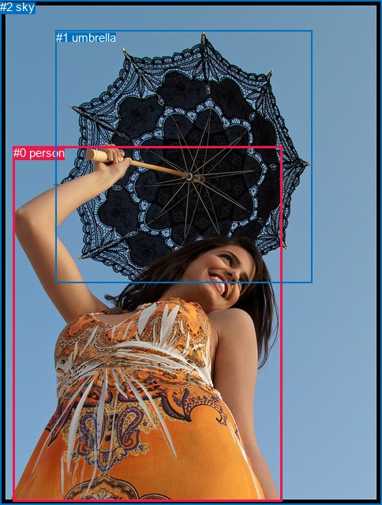

全部人相关 GT：

| 关系 |
|---|
| #0 person → holding → #1 umbrella |
| #1 umbrella → over → #0 person |

自动检测前10条候选：

| 候选关系 | 排序分数 |
|---|---|
| #0 person → holding → #4 umbrella | 0.99333 |
| #0 person → holding → #1 clock | 0.99317 |
| #0 person → wearing → #3 vase | 0.99128 |
| #2 person → wearing → #3 vase | 0.98664 |
| #2 person → holding → #4 umbrella | 0.98553 |
| #2 person → holding → #1 clock | 0.98347 |
| #0 person → in → #3 vase | 0.94597 |
| #2 person → in → #3 vase | 0.92984 |
| #3 vase → on → #0 person | 0.88299 |
| #3 vase → on → #2 person | 0.82753 |

真实框前10条候选：

| 候选关系 | 排序分数 |
|---|---|
| #0 person → holding → #1 umbrella | 0.99485 |
| #0 person → holding → #2 sky | 0.86731 |
| #2 sky → over → #0 person | 0.86542 |
| #0 person → in → #2 sky | 0.83665 |
| #0 person → in → #1 umbrella | 0.82213 |
| #1 umbrella → over → #0 person | 0.72423 |
| #1 umbrella → holding → #0 person | 0.61439 |
| #2 sky → holding → #0 person | 0.39675 |

详细错误阶段和全部输出：[图片 0077](cases/0077.md)。

### 图片 0664：2345357.jpg

自动检测命中 2/2，R@50=100.00%；真实框命中 2/2，R@50=100.00%。

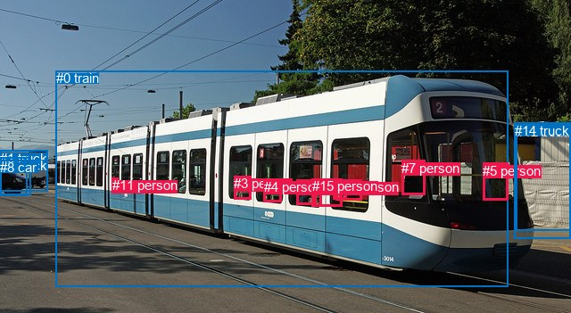

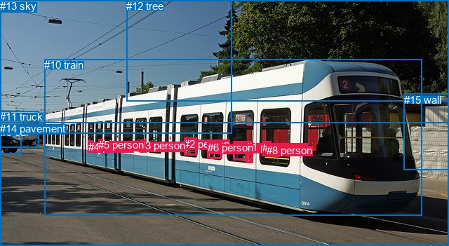

全部人相关 GT：

| 关系 |
|---|
| #0 person → in → #10 train |
| #1 person → in → #10 train |

自动检测前10条候选：

| 候选关系 | 排序分数 |
|---|---|
| #10 person → riding → #0 train | 0.98532 |
| #13 person → in → #0 train | 0.98455 |
| #9 person → in → #0 train | 0.98444 |
| #2 person → in → #0 train | 0.98424 |
| #15 person → in → #0 train | 0.98413 |
| #10 person → in → #0 train | 0.98337 |
| #4 person → in → #0 train | 0.98280 |
| #13 person → riding → #0 train | 0.98242 |
| #3 person → in → #0 train | 0.98115 |
| #7 person → in → #0 train | 0.98102 |

真实框前10条候选：

| 候选关系 | 排序分数 |
|---|---|
| #8 person → in → #10 train | 0.98401 |
| #0 person → in → #10 train | 0.98393 |
| #1 person → in → #10 train | 0.98254 |
| #6 person → in → #10 train | 0.98103 |
| #7 person → in → #10 train | 0.98025 |
| #7 person → riding → #10 train | 0.98001 |
| #2 person → in → #10 train | 0.97801 |
| #3 person → riding → #10 train | 0.97736 |
| #5 person → riding → #10 train | 0.97720 |
| #1 person → riding → #10 train | 0.97602 |

详细错误阶段和全部输出：[图片 0664](cases/0664.md)。

### 图片 0847：2353823.jpg

自动检测命中 2/2，R@50=100.00%；真实框命中 2/2，R@50=100.00%。

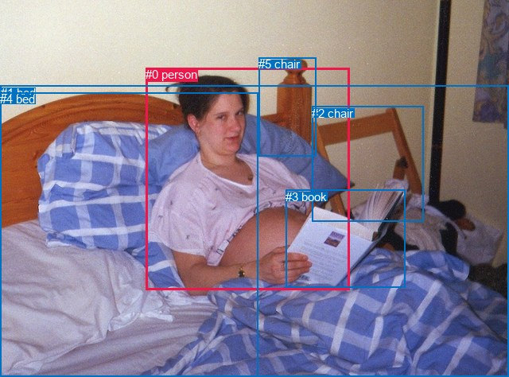

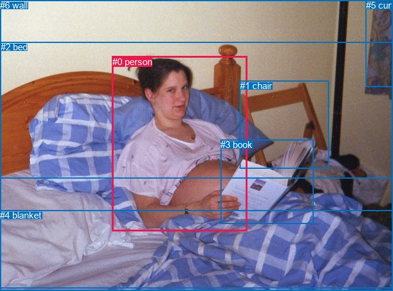

全部人相关 GT：

| 关系 |
|---|
| #0 person → lying on → #2 bed |
| #0 person → holding → #3 book |

自动检测前10条候选：

| 候选关系 | 排序分数 |
|---|---|
| #0 person → lying on → #1 bed | 0.99621 |
| #0 person → holding → #3 book | 0.99451 |
| #0 person → lying on → #4 bed | 0.99220 |
| #0 person → on → #1 bed | 0.94730 |
| #2 chair → beside → #0 person | 0.94131 |
| #0 person → on → #4 bed | 0.93395 |
| #0 person → leaning on → #2 chair | 0.85661 |
| #5 chair → beside → #0 person | 0.83881 |
| #0 person → beside → #5 chair | 0.83770 |
| #3 book → in front of → #0 person | 0.68959 |

真实框前10条候选：

| 候选关系 | 排序分数 |
|---|---|
| #0 person → holding → #3 book | 0.99433 |
| #0 person → lying on → #2 bed | 0.99363 |
| #0 person → lying on → #4 blanket | 0.98923 |
| #0 person → on → #2 bed | 0.97052 |
| #0 person → on → #4 blanket | 0.94451 |
| #1 chair → beside → #0 person | 0.86923 |
| #0 person → leaning on → #1 chair | 0.74171 |
| #0 person → on → #3 book | 0.67186 |
| #3 book → in front of → #0 person | 0.57292 |
| #0 person → leaning on → #6 wall | 0.55419 |

详细错误阶段和全部输出：[图片 0847](cases/0847.md)。

### 图片 0023：1159863.jpg

自动检测命中 0/1，R@50=0.00%；真实框命中 1/1，R@50=100.00%。

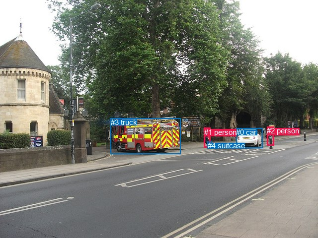

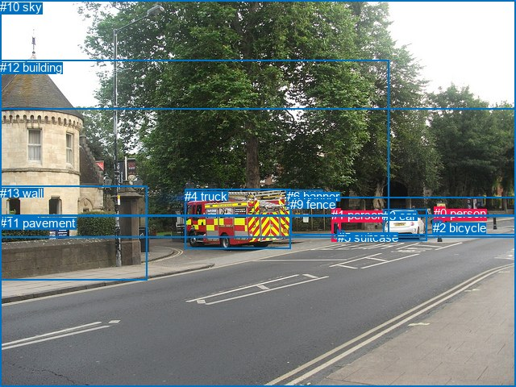

全部人相关 GT：

| 关系 |
|---|
| #0 person → on → #7 road |

自动检测前10条候选：

| 候选关系 | 排序分数 |
|---|---|
| #1 person → holding → #4 suitcase | 0.98055 |
| #2 person → holding → #4 suitcase | 0.95448 |
| #2 person → walking on → #0 car | 0.89825 |
| #1 person → walking on → #3 truck | 0.89262 |
| #2 person → walking on → #3 truck | 0.81457 |
| #2 person → beside → #0 car | 0.80109 |
| #1 person → in → #4 suitcase | 0.73633 |
| #1 person → beside → #3 truck | 0.69037 |
| #2 person → holding → #1 person | 0.62091 |
| #0 car → driving on → #2 person | 0.57605 |

真实框前10条候选：

| 候选关系 | 排序分数 |
|---|---|
| #1 person → crossing → #7 road | 0.99293 |
| #1 person → crossing → #11 pavement | 0.99291 |
| #1 person → carrying → #5 suitcase | 0.98381 |
| #0 person → wearing → #2 bicycle | 0.97874 |
| #0 person → crossing → #7 road | 0.97371 |
| #1 person → walking on → #9 fence | 0.97261 |
| #0 person → crossing → #11 pavement | 0.97039 |
| #0 person → walking on → #9 fence | 0.93042 |
| #0 person → in → #2 bicycle | 0.92151 |
| #2 bicycle → on → #0 person | 0.89389 |

详细错误阶段和全部输出：[图片 0023](cases/0023.md)。

### 图片 0047：1592228.jpg

自动检测命中 0/3，R@50=0.00%；真实框命中 3/3，R@50=100.00%。

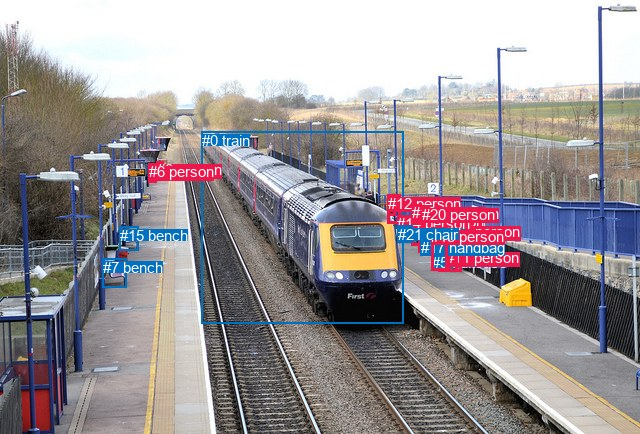

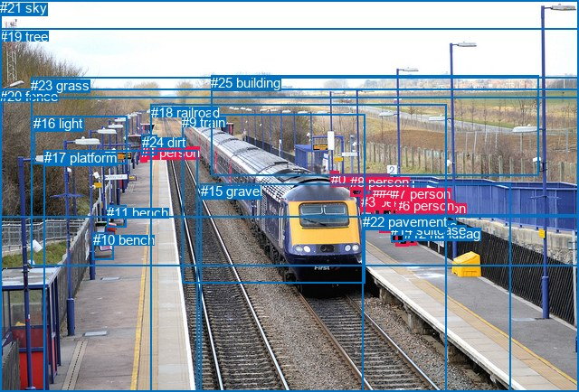

全部人相关 GT：

| 关系 |
|---|
| #1 person → standing on → #17 platform |
| #5 person → carrying → #12 handbag |
| #5 person → standing on → #22 pavement |

自动检测前10条候选：

| 候选关系 | 排序分数 |
|---|---|
| #13 person → wearing → #11 person | 0.97811 |
| #18 person → wearing → #5 suitcase | 0.97288 |
| #1 person → pushing → #18 person | 0.97042 |
| #20 person → looking at → #0 train | 0.96952 |
| #8 person → looking at → #0 train | 0.96705 |
| #19 person → looking at → #0 train | 0.96684 |
| #12 person → looking at → #0 train | 0.96455 |
| #14 person → looking at → #0 train | 0.96282 |
| #4 person → carrying → #17 handbag | 0.96000 |
| #2 person → looking at → #0 train | 0.95716 |

真实框前10条候选：

| 候选关系 | 排序分数 |
|---|---|
| #5 person → carrying → #12 handbag | 0.97209 |
| #4 person → carrying → #13 suitcase | 0.97002 |
| #6 person → carrying → #14 suitcase | 0.96235 |
| #6 person → carrying → #12 handbag | 0.95828 |
| #0 person → on → #20 fence | 0.94537 |
| #6 person → standing on → #22 pavement | 0.93510 |
| #5 person → standing on → #22 pavement | 0.93060 |
| #3 person → looking at → #9 train | 0.93034 |
| #4 person → standing on → #15 gravel | 0.92582 |
| #3 person → looking at → #18 railroad | 0.92521 |

详细错误阶段和全部输出：[图片 0047](cases/0047.md)。

### 图片 0163：2319267.jpg

自动检测命中 0/2，R@50=0.00%；真实框命中 2/2，R@50=100.00%。

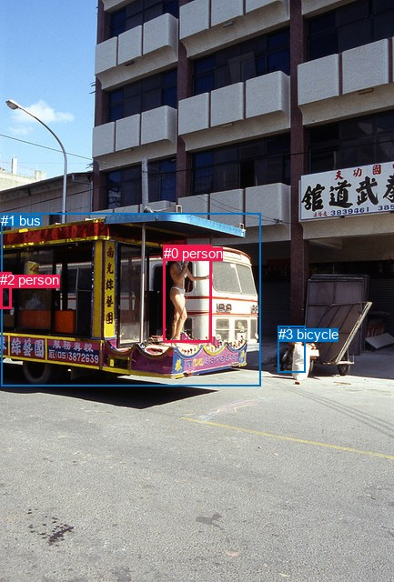

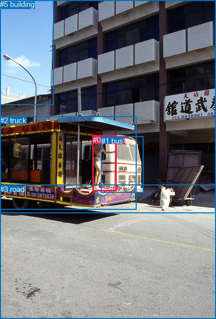

全部人相关 GT：

| 关系 |
|---|
| #0 person → on → #2 truck |
| #0 person → standing on → #2 truck |

自动检测前10条候选：

| 候选关系 | 排序分数 |
|---|---|
| #2 person → riding → #1 bus | 0.98724 |
| #0 person → riding → #1 bus | 0.98374 |
| #0 person → on → #1 bus | 0.94956 |
| #2 person → in → #1 bus | 0.90859 |
| #1 bus → carrying → #0 person | 0.68209 |
| #3 bicycle → looking at → #0 person | 0.66749 |
| #3 bicycle → beside → #0 person | 0.62029 |
| #1 bus → carrying → #2 person | 0.52171 |
| #0 person → looking at → #3 bicycle | 0.45442 |
| #2 person → looking at → #0 person | 0.39549 |

真实框前10条候选：

| 候选关系 | 排序分数 |
|---|---|
| #0 person → standing on → #2 truck | 0.96795 |
| #0 person → on → #2 truck | 0.95972 |
| #0 person → beside → #1 bus | 0.89179 |
| #0 person → standing on → #1 bus | 0.85593 |
| #0 person → on → #3 road | 0.85531 |
| #1 bus → beside → #0 person | 0.67200 |
| #0 person → standing on → #3 road | 0.63861 |
| #0 person → in → #5 building | 0.33540 |
| #4 sky → over → #0 person | 0.21848 |
| #2 truck → carrying → #0 person | 0.19668 |

详细错误阶段和全部输出：[图片 0163](cases/0163.md)。

## 当前流程的能力与限制

500张共输出 10824 条自动检测候选，174 张达到50条上限。无候选图片 212 张。完整人相关物体对的两类预测保存在 JSONL 中，可在本地查看 Top50 之外的候选。

当前关系词表固定56类，可以覆盖拿着、骑着、穿着、看着、站在、坐在等关系。检测漏框、40框上限、固定词表、空间/动作各保留一个谓词和 Top50 上限都会限制完整性。同类型内同时发生的多个动作可能被最高分动作替代。

自动检测框的严格 R@50 为24.48%，只检查框位置与谓词、忽略物体类别时为25.67%。严格指标中的检测类别错误会额外影响关系匹配。

PSG 标注存在未标注关系，预测与GT不一致的候选需要人工核查。本次报告提供可重复的召回测试和原始证据；候选列表的真实正确率与所有实际交互的完整率仍需独立人工标注。

PSG 图像来源与 COCO 检测预训练可能重叠，因此检测结果用于验证当前管线，不构成检测器在独立图像域的泛化评测。真实框模式提供额外标注信息，实际新图片使用自动检测模式。

## 运行与资源记录

| 项目 | 实测 |
|---|---|
| created | 2026-10-25T10:58:57.381435+08:00 |
| images | 500 |
| total_seconds | 73.8082670000149 |
| inference_and_artifact_seconds | 70.2878434000304 |
| peak_GPU_allocated_GiB | 0.8770804405212402 |
| GPU | NVIDIA GeForce RTX 5070 Ti |
| python | 3.12.11 |
| torch | 2.13.0+cu130 |
| torchvision | 0.28.0+cu130 |
| relation_dtype | CUDA autocast BF16 |
| detector_dtype | CUDA FP32 |
| verified_checkpoint_tensors | 416 |
| official_commit | 06766fdf56752ca535fc9b971fca99ce563676d0 |
| command | ['D:\\relateAny\\.venv-eval\\Scripts\\python.exe', 'D:\\relateAny\\HOR\\run_500.py'] |
| config_sha256 | ada85c1f10e7c040fd9e643fbc6fede5e6b352ae48e1198cce709520bdf369b5 |

运行时间包含两组真实框前向、自动检测与关系前向、张量保存和1000张编号图保存；可直接用于新图的自动流程仅包含检测与关系两个步骤。模型初始化和权重摘要记录在 runtime.json。

命令与执行日志见 `HOR/output/run.log`。脚本、配置、样本清单和原始输出均保留在 HOR。

<!-- HOR_COMPLETE_RESULTS -->

## 完整成果与核验附件

[成果检查与交付说明](成果检查与交付说明.md)提供全部19组评测、500份逐图完整对照、单张图片实例和核验记录。报告配图位于 reports/assets，可随仓库直接查阅。
