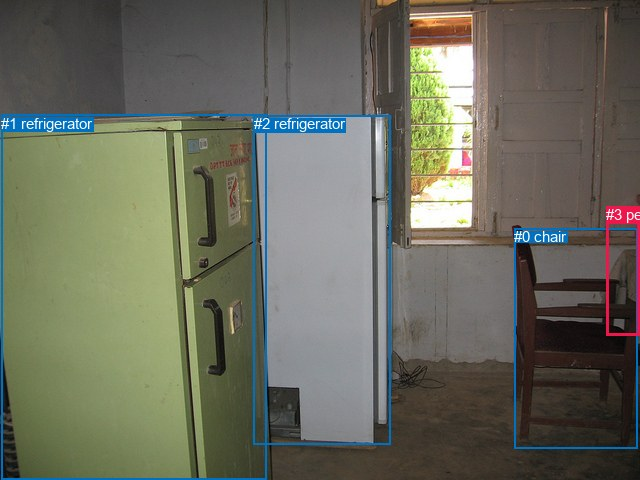
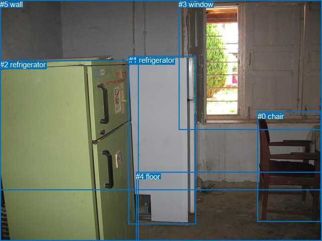

# 图片 0003：107915.jpg

随机样本序号：212。图片 SHA256：`4cde21e74bd39dc0fedff67ee01242c84574e08b6739bf3188180b5c35b250ca`。

红色框表示人，蓝色框表示其他物体。两个模式分别保留自身框编号，可依据位置比较对应对象。

## 自动检测框与输出

人的框编号：`[3]`。状态：`ok`。

### 自动检测全部物体框

| 编号 | 类别 | 是否为人 | 检测分数 | 像素坐标 xyxy |
|---|---|---|---|---|
| 0 | chair | False | 0.9982 | 514.5, 228.3, 637.4, 448.3 |
| 1 | refrigerator | False | 0.9974 | 1.2, 114.5, 266.5, 480.0 |
| 2 | refrigerator | False | 0.9959 | 253.6, 115.4, 390.4, 444.6 |
| 3 | person | True | 0.4382 | 606.3, 206.3, 639.2, 335.2 |

### 自动检测 Top50 人相关候选

评分物体对：12；人相关物体对：6；输出关系：12。

| 排名 | 主语编号与类别 | 关系 | 宾语编号与类别 | 类型 | 人与人 | 排序分数 | 原始融合 logit |
|---|---|---|---|---|---|---|---|
| 1 | #0 chair | beside | #3 person | spatial | False | 0.90083 | 2.2065 |
| 2 | #3 person | beside | #0 chair | spatial | False | 0.85253 | 1.7546 |
| 3 | #0 chair | sitting on | #3 person | semantic | False | 0.84596 | 1.7033 |
| 4 | #3 person | holding | #0 chair | semantic | False | 0.73251 | 1.0074 |
| 5 | #2 refrigerator | beside | #3 person | spatial | False | 0.45822 | -0.1675 |
| 6 | #3 person | beside | #2 refrigerator | spatial | False | 0.30056 | -0.8446 |
| 7 | #1 refrigerator | in front of | #3 person | spatial | False | 0.11958 | -1.9965 |
| 8 | #2 refrigerator | standing on | #3 person | semantic | False | 0.08913 | -2.3243 |
| 9 | #3 person | beside | #1 refrigerator | spatial | False | 0.06227 | -2.7120 |
| 10 | #3 person | holding | #2 refrigerator | semantic | False | 0.05426 | -2.8582 |
| 11 | #1 refrigerator | standing on | #3 person | semantic | False | 0.02714 | -3.5793 |
| 12 | #3 person | holding | #1 refrigerator | semantic | False | 0.00784 | -4.8402 |

### 自动检测逐条人相关 GT 核验

本图没有人相关 GT，R@50 无分母；预测候选继续展示。

## 真实框与输出

人的框编号：`[]`。

### 真实框全部物体框

| 编号 | 类别 | 是否为人 | 检测分数 | 像素坐标 xyxy |
|---|---|---|---|---|
| 0 | chair | False | GT | 512.0, 223.0, 638.0, 442.0 |
| 1 | refrigerator | False | GT | 256.0, 111.0, 390.0, 446.0 |
| 2 | refrigerator | False | GT | 0.0, 120.0, 275.0, 480.0 |
| 3 | window | False | GT | 355.0, 0.0, 640.0, 258.0 |
| 4 | floor | False | GT | 270.0, 343.0, 640.0, 480.0 |
| 5 | wall | False | GT | 0.0, 0.0, 640.0, 378.0 |

### 真实框 Top50 人相关候选

评分物体对：0；人相关物体对：0；输出关系：0。

| 排名 | 主语编号与类别 | 关系 | 宾语编号与类别 | 类型 | 人与人 | 排序分数 | 原始融合 logit |
|---|---|---|---|---|---|---|---|

### 真实框逐条人相关 GT 核验

本图没有人相关 GT，R@50 无分母；预测候选继续展示。

## 全部人相关 GT

| 主语编号与类别 | 关系 | 宾语编号与类别 |
|---|---|---|

原始记录、全部人相关物体对的两项预测与分项分数见 [逐图证据 JSON](../evidence/cases/0003.json)。全部56类 logits 保留于本机 HOR/output/random500/logits/。

<!-- HOR_COMPLETE_RESULTS -->

## 六组条件的完整输出对照

以下保留同一图片三种框与候选模式、两种谓词输出规则的全部 Top50。框编号各自在所属模式内解释。

### 自动检测框完整枚举：空间与语义各保留一个谓词

| 排名 | 主语编号与类别 | 谓词 | 宾语编号与类别 | 分组 | 排序分数 | predicate logit | pair logit |
|---|---|---|---|---|---|---|---|
| 1 | #0 chair | beside | #3 person | spatial | 0.9008301 | 2.5043392 | -0.2978575 |
| 2 | #3 person | beside | #0 chair | spatial | 0.8525262 | 2.5032983 | -0.7487447 |
| 3 | #0 chair | sitting on | #3 person | semantic | 0.8459595 | 2.0011134 | -0.2978575 |
| 4 | #3 person | holding | #0 chair | semantic | 0.7325143 | 1.7561612 | -0.7487447 |
| 5 | #2 refrigerator | beside | #3 person | spatial | 0.4582240 | 1.4498019 | -1.6172965 |
| 6 | #3 person | beside | #2 refrigerator | spatial | 0.3005621 | 0.4575133 | -1.3021357 |
| 7 | #1 refrigerator | in front of | #3 person | spatial | 0.1195751 | -0.6157184 | -1.3807418 |
| 8 | #2 refrigerator | standing on | #3 person | semantic | 0.0891320 | -0.7069826 | -1.6172965 |
| 9 | #3 person | beside | #1 refrigerator | spatial | 0.0622703 | -1.3167577 | -1.3952198 |
| 10 | #3 person | holding | #2 refrigerator | semantic | 0.0542586 | -1.5560718 | -1.3021357 |
| 11 | #1 refrigerator | standing on | #3 person | semantic | 0.0271373 | -2.1985931 | -1.3807418 |
| 12 | #3 person | holding | #1 refrigerator | semantic | 0.0078434 | -3.4449840 | -1.3952198 |

没有人相关 GT，本条件的召回率无分母。

### 自动检测框完整枚举：每对只保留一个谓词

| 排名 | 主语编号与类别 | 谓词 | 宾语编号与类别 | 分组 | 排序分数 | predicate logit | pair logit |
|---|---|---|---|---|---|---|---|
| 1 | #0 chair | beside | #3 person | single | 0.9008301 | 2.5043392 | -0.2978575 |
| 2 | #3 person | beside | #0 chair | single | 0.8525262 | 2.5032983 | -0.7487447 |
| 3 | #2 refrigerator | beside | #3 person | single | 0.4582240 | 1.4498019 | -1.6172965 |
| 4 | #3 person | beside | #2 refrigerator | single | 0.3005621 | 0.4575133 | -1.3021357 |
| 5 | #1 refrigerator | in front of | #3 person | single | 0.1195751 | -0.6157184 | -1.3807418 |
| 6 | #3 person | beside | #1 refrigerator | single | 0.0622703 | -1.3167577 | -1.3952198 |

没有人相关 GT，本条件的召回率无分母。

### 真实框完整枚举：空间与语义各保留一个谓词

| 排名 | 主语编号与类别 | 谓词 | 宾语编号与类别 | 分组 | 排序分数 | predicate logit | pair logit |
|---|---|---|---|---|---|---|---|

没有人相关 GT，本条件的召回率无分母。

### 真实框完整枚举：每对只保留一个谓词

| 排名 | 主语编号与类别 | 谓词 | 宾语编号与类别 | 分组 | 排序分数 | predicate logit | pair logit |
|---|---|---|---|---|---|---|---|

没有人相关 GT，本条件的召回率无分母。

### 真实框400候选：空间与语义各保留一个谓词

| 排名 | 主语编号与类别 | 谓词 | 宾语编号与类别 | 分组 | 排序分数 | predicate logit | pair logit |
|---|---|---|---|---|---|---|---|

没有人相关 GT，本条件的召回率无分母。

### 真实框400候选：每对只保留一个谓词

| 排名 | 主语编号与类别 | 谓词 | 宾语编号与类别 | 分组 | 排序分数 | predicate logit | pair logit |
|---|---|---|---|---|---|---|---|

没有人相关 GT，本条件的召回率无分母。
