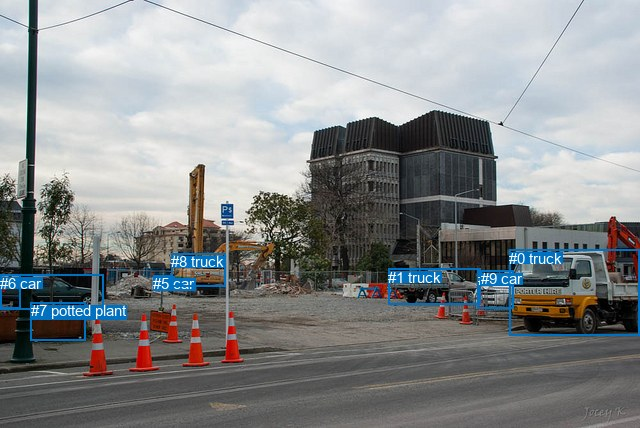
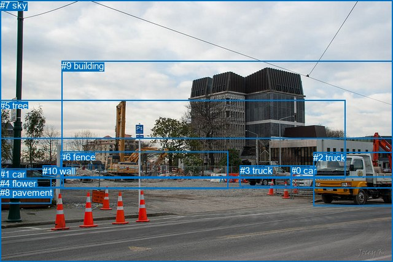

# 图片 0006：1159321.jpg

随机样本序号：79。图片 SHA256：`f4a69620b9c578112bdac7b7007aaa75d79e4b77e6b96318aa8b1a7defb3d4e5`。

红色框表示人，蓝色框表示其他物体。两个模式分别保留自身框编号，可依据位置比较对应对象。

## 自动检测框与输出

人的框编号：`[]`。状态：`no_person`。

### 自动检测全部物体框

| 编号 | 类别 | 是否为人 | 检测分数 | 像素坐标 xyxy |
|---|---|---|---|---|
| 0 | truck | False | 0.9912 | 509.5, 249.6, 640.0, 335.6 |
| 1 | truck | False | 0.9694 | 388.2, 268.8, 480.3, 304.5 |
| 2 | car | False | 0.9453 | 0.4, 274.9, 103.1, 309.1 |
| 3 | car | False | 0.9025 | 477.6, 270.9, 513.9, 308.6 |
| 4 | car | False | 0.8041 | 153.4, 276.0, 174.6, 285.4 |
| 5 | car | False | 0.6187 | 153.0, 275.3, 170.4, 282.2 |
| 6 | car | False | 0.5359 | 0.1, 274.8, 20.3, 308.8 |
| 7 | potted plant | False | 0.5073 | 30.5, 302.2, 85.5, 340.5 |
| 8 | truck | False | 0.4891 | 171.0, 253.3, 225.4, 286.9 |
| 9 | car | False | 0.4580 | 480.7, 270.0, 513.6, 285.6 |

### 自动检测 Top50 人相关候选

评分物体对：0；人相关物体对：0；输出关系：0。

| 排名 | 主语编号与类别 | 关系 | 宾语编号与类别 | 类型 | 人与人 | 排序分数 | 原始融合 logit |
|---|---|---|---|---|---|---|---|

### 自动检测逐条人相关 GT 核验

本图没有人相关 GT，R@50 无分母；预测候选继续展示。

## 真实框与输出

人的框编号：`[]`。

### 真实框全部物体框

| 编号 | 类别 | 是否为人 | 检测分数 | 像素坐标 xyxy |
|---|---|---|---|---|
| 0 | car | False | GT | 474.0, 270.0, 513.0, 306.0 |
| 1 | car | False | GT | 0.0, 276.0, 104.0, 307.0 |
| 2 | truck | False | GT | 510.0, 249.0, 640.0, 337.0 |
| 3 | truck | False | GT | 391.0, 270.0, 476.0, 304.0 |
| 4 | flower | False | GT | 0.0, 291.0, 84.0, 333.0 |
| 5 | tree | False | GT | 0.0, 164.0, 562.0, 292.0 |
| 6 | fence | False | GT | 99.0, 248.0, 372.0, 309.0 |
| 7 | sky | False | GT | 0.0, 0.0, 640.0, 227.0 |
| 8 | pavement | False | GT | 0.0, 306.0, 640.0, 428.0 |
| 9 | building | False | GT | 100.0, 99.0, 640.0, 289.0 |
| 10 | wall | False | GT | 69.0, 271.0, 92.0, 288.0 |

### 真实框 Top50 人相关候选

评分物体对：0；人相关物体对：0；输出关系：0。

| 排名 | 主语编号与类别 | 关系 | 宾语编号与类别 | 类型 | 人与人 | 排序分数 | 原始融合 logit |
|---|---|---|---|---|---|---|---|

### 真实框逐条人相关 GT 核验

本图没有人相关 GT，R@50 无分母；预测候选继续展示。

## 全部人相关 GT

| 主语编号与类别 | 关系 | 宾语编号与类别 |
|---|---|---|

原始记录、全部人相关物体对的两项预测与分项分数见 [逐图证据 JSON](../evidence/cases/0006.json)。全部56类 logits 保留于本机 HOR/output/random500/logits/。

<!-- HOR_COMPLETE_RESULTS -->

## 六组条件的完整输出对照

以下保留同一图片三种框与候选模式、两种谓词输出规则的全部 Top50。框编号各自在所属模式内解释。

### 自动检测框完整枚举：空间与语义各保留一个谓词

| 排名 | 主语编号与类别 | 谓词 | 宾语编号与类别 | 分组 | 排序分数 | predicate logit | pair logit |
|---|---|---|---|---|---|---|---|

没有人相关 GT，本条件的召回率无分母。

### 自动检测框完整枚举：每对只保留一个谓词

| 排名 | 主语编号与类别 | 谓词 | 宾语编号与类别 | 分组 | 排序分数 | predicate logit | pair logit |
|---|---|---|---|---|---|---|---|

没有人相关 GT，本条件的召回率无分母。

### 真实框完整枚举：空间与语义各保留一个谓词

| 排名 | 主语编号与类别 | 谓词 | 宾语编号与类别 | 分组 | 排序分数 | predicate logit | pair logit |
|---|---|---|---|---|---|---|---|

没有人相关 GT，本条件的召回率无分母。

### 真实框完整枚举：每对只保留一个谓词

| 排名 | 主语编号与类别 | 谓词 | 宾语编号与类别 | 分组 | 排序分数 | predicate logit | pair logit |
|---|---|---|---|---|---|---|---|

没有人相关 GT，本条件的召回率无分母。

### 真实框400候选：空间与语义各保留一个谓词

| 排名 | 主语编号与类别 | 谓词 | 宾语编号与类别 | 分组 | 排序分数 | predicate logit | pair logit |
|---|---|---|---|---|---|---|---|

没有人相关 GT，本条件的召回率无分母。

### 真实框400候选：每对只保留一个谓词

| 排名 | 主语编号与类别 | 谓词 | 宾语编号与类别 | 分组 | 排序分数 | predicate logit | pair logit |
|---|---|---|---|---|---|---|---|

没有人相关 GT，本条件的召回率无分母。
