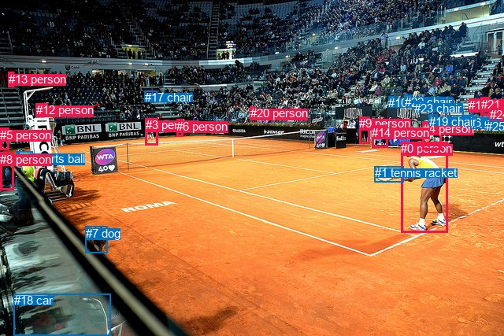
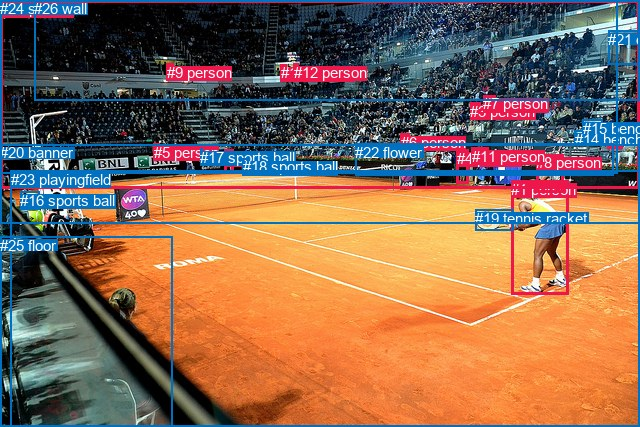

# 图片 0010：1159449.jpg

随机样本序号：71。图片 SHA256：`870b74cbc65a7dce64ddacc0b8a1641bca728bf3aa6e9599541fe5932e22098b`。

红色框表示人，蓝色框表示其他物体。两个模式分别保留自身框编号，可依据位置比较对应对象。

## 自动检测框与输出

人的框编号：`[0, 3, 4, 5, 6, 8, 9, 11, 12, 13, 14, 20, 21, 24]`。状态：`ok`。

### 自动检测全部物体框

| 编号 | 类别 | 是否为人 | 检测分数 | 像素坐标 xyxy |
|---|---|---|---|---|
| 0 | person | True | 0.9995 | 509.5, 180.5, 568.5, 295.1 |
| 1 | tennis racket | False | 0.9966 | 475.9, 211.3, 512.6, 231.3 |
| 2 | sports ball | False | 0.9796 | 20.5, 192.6, 41.4, 210.5 |
| 3 | person | True | 0.9673 | 184.6, 150.2, 200.0, 184.1 |
| 4 | person | True | 0.8441 | 536.7, 154.6, 560.2, 190.9 |
| 5 | person | True | 0.8053 | 0.0, 162.7, 11.6, 190.5 |
| 6 | person | True | 0.7395 | 224.3, 151.7, 232.6, 173.0 |
| 7 | dog | False | 0.6867 | 108.7, 287.7, 136.9, 321.0 |
| 8 | person | True | 0.6310 | 0.0, 194.0, 17.3, 241.4 |
| 9 | person | True | 0.5876 | 456.3, 148.4, 469.7, 182.7 |
| 10 | chair | False | 0.5825 | 493.1, 122.1, 501.6, 129.5 |
| 11 | person | True | 0.5748 | 595.1, 125.1, 609.0, 140.5 |
| 12 | person | True | 0.5403 | 45.5, 131.2, 60.5, 148.9 |
| 13 | person | True | 0.4981 | 10.8, 91.9, 17.4, 110.6 |
| 14 | person | True | 0.4872 | 472.2, 159.6, 492.8, 187.9 |
| 15 | chair | False | 0.4737 | 597.9, 149.0, 611.2, 161.6 |
| 16 | chair | False | 0.4731 | 586.8, 146.6, 600.0, 160.4 |
| 17 | chair | False | 0.4682 | 183.5, 115.3, 199.8, 119.2 |
| 18 | car | False | 0.4624 | 18.0, 373.2, 140.6, 427.0 |
| 19 | chair | False | 0.4269 | 544.6, 145.7, 555.0, 151.9 |
| 20 | person | True | 0.4227 | 317.9, 135.3, 323.4, 142.1 |
| 21 | person | True | 0.4198 | 610.9, 123.8, 622.8, 146.8 |
| 22 | chair | False | 0.3722 | 513.6, 120.7, 522.7, 127.8 |
| 23 | chair | False | 0.3720 | 526.3, 128.6, 537.0, 135.5 |
| 24 | person | True | 0.3657 | 621.9, 137.2, 638.6, 154.1 |
| 25 | chair | False | 0.3516 | 617.0, 151.9, 633.0, 164.0 |

### 自动检测 Top50 人相关候选

评分物体对：650；人相关物体对：518；输出关系：50。

| 排名 | 主语编号与类别 | 关系 | 宾语编号与类别 | 类型 | 人与人 | 排序分数 | 原始融合 logit |
|---|---|---|---|---|---|---|---|
| 1 | #0 person | holding | #1 tennis racket | semantic | False | 0.99632 | 5.6020 |
| 2 | #2 sports ball | on | #5 person | spatial | False | 0.94327 | 2.8110 |
| 3 | #24 person | sitting on | #25 chair | semantic | False | 0.88319 | 2.0230 |
| 4 | #8 person | holding | #2 sports ball | semantic | False | 0.87628 | 1.9576 |
| 5 | #0 person | in | #1 tennis racket | spatial | False | 0.86685 | 1.8734 |
| 6 | #3 person | on | #17 chair | spatial | False | 0.86086 | 1.8224 |
| 7 | #7 dog | looking at | #0 person | semantic | False | 0.85682 | 1.7891 |
| 8 | #21 person | sitting on | #11 person | semantic | True | 0.84155 | 1.6698 |
| 9 | #8 person | on | #5 person | spatial | True | 0.83315 | 1.6082 |
| 10 | #21 person | sitting on | #24 person | semantic | True | 0.82460 | 1.5479 |
| 11 | #3 person | standing on | #17 chair | semantic | False | 0.81979 | 1.5149 |
| 12 | #8 person | sitting on | #5 person | semantic | True | 0.80780 | 1.4358 |
| 13 | #4 person | looking at | #0 person | semantic | True | 0.80772 | 1.4353 |
| 14 | #24 person | in | #25 chair | spatial | False | 0.80103 | 1.3928 |
| 15 | #8 person | on | #2 sports ball | spatial | False | 0.79432 | 1.3512 |
| 16 | #21 person | in | #15 chair | spatial | False | 0.78767 | 1.3110 |
| 17 | #21 person | in | #24 person | spatial | True | 0.77434 | 1.2330 |
| 18 | #2 sports ball | on | #8 person | spatial | False | 0.74451 | 1.0695 |
| 19 | #21 person | in | #11 person | spatial | True | 0.74389 | 1.0663 |
| 20 | #4 person | wearing | #19 chair | semantic | False | 0.73838 | 1.0376 |
| 21 | #11 person | on | #16 chair | spatial | False | 0.73737 | 1.0323 |
| 22 | #2 sports ball | sitting on | #5 person | semantic | False | 0.72560 | 0.9724 |
| 23 | #11 person | in | #15 chair | spatial | False | 0.72318 | 0.9603 |
| 24 | #21 person | in | #25 chair | spatial | False | 0.72018 | 0.9454 |
| 25 | #24 person | sitting on | #21 person | semantic | True | 0.70578 | 0.8750 |
| 26 | #6 person | on | #17 chair | spatial | False | 0.68946 | 0.7976 |
| 27 | #25 chair | on | #24 person | spatial | False | 0.66168 | 0.6708 |
| 28 | #21 person | sitting on | #15 chair | semantic | False | 0.65966 | 0.6618 |
| 29 | #4 person | holding | #1 tennis racket | semantic | False | 0.65611 | 0.6460 |
| 30 | #11 person | sitting on | #16 chair | semantic | False | 0.64170 | 0.5827 |
| 31 | #12 person | on | #5 person | spatial | True | 0.64109 | 0.5801 |
| 32 | #13 person | on | #12 person | spatial | True | 0.62583 | 0.5144 |
| 33 | #21 person | in | #16 chair | spatial | False | 0.61494 | 0.4681 |
| 34 | #25 chair | sitting on | #24 person | semantic | False | 0.60258 | 0.4162 |
| 35 | #8 person | looking at | #0 person | semantic | True | 0.60111 | 0.4101 |
| 36 | #3 person | playing | #6 person | semantic | True | 0.60110 | 0.4100 |
| 37 | #9 person | standing on | #14 person | semantic | True | 0.59400 | 0.3805 |
| 38 | #24 person | in | #21 person | spatial | True | 0.58503 | 0.3434 |
| 39 | #21 person | sitting on | #16 chair | semantic | False | 0.58257 | 0.3333 |
| 40 | #24 person | sitting on | #11 person | semantic | True | 0.56782 | 0.2730 |
| 41 | #3 person | playing | #1 tennis racket | semantic | False | 0.55787 | 0.2325 |
| 42 | #11 person | sitting on | #15 chair | semantic | False | 0.55745 | 0.2308 |
| 43 | #13 person | on | #5 person | spatial | True | 0.55683 | 0.2283 |
| 44 | #21 person | sitting on | #25 chair | semantic | False | 0.55597 | 0.2248 |
| 45 | #24 person | sitting on | #15 chair | semantic | False | 0.54553 | 0.1826 |
| 46 | #4 person | in | #19 chair | spatial | False | 0.54542 | 0.1822 |
| 47 | #13 person | on | #17 chair | spatial | False | 0.54349 | 0.1744 |
| 48 | #2 sports ball | on | #12 person | spatial | False | 0.54250 | 0.1704 |
| 49 | #24 person | on | #15 chair | spatial | False | 0.54018 | 0.1611 |
| 50 | #16 chair | on | #11 person | spatial | False | 0.53708 | 0.1486 |

### 自动检测逐条人相关 GT 核验

R@50：25.00%；命中 1/4。

| GT 主语编号 | GT 关系 | GT 宾语编号 | 结果阶段 | 匹配预测主语编号 | 匹配预测宾语编号 |
|---|---|---|---|---|---|
| 1 | looking at | 17 | endpoint_missing_or_wrong_class | [0] | [] |
| 1 | holding | 19 | hit50 | [0] | [1] |
| 1 | standing on | 23 | endpoint_missing_or_wrong_class | [0] | [] |
| 8 | running on | 23 | endpoint_missing_or_wrong_class | [4] | [] |

## 真实框与输出

人的框编号：`[0, 1, 2, 3, 4, 5, 6, 7, 8, 9, 10, 11, 12, 13]`。

### 真实框全部物体框

| 编号 | 类别 | 是否为人 | 检测分数 | 像素坐标 xyxy |
|---|---|---|---|---|
| 0 | person | True | GT | 224.0, 150.0, 233.0, 173.0 |
| 1 | person | True | GT | 511.0, 181.0, 568.0, 295.0 |
| 2 | person | True | GT | 608.0, 124.0, 623.0, 148.0 |
| 3 | person | True | GT | 470.0, 103.0, 480.0, 115.0 |
| 4 | person | True | GT | 457.0, 150.0, 468.0, 183.0 |
| 5 | person | True | GT | 154.0, 144.0, 160.0, 153.0 |
| 6 | person | True | GT | 401.0, 134.0, 410.0, 145.0 |
| 7 | person | True | GT | 483.0, 95.0, 495.0, 110.0 |
| 8 | person | True | GT | 536.0, 154.0, 563.0, 192.0 |
| 9 | person | True | GT | 167.0, 64.0, 173.0, 76.0 |
| 10 | person | True | GT | 281.0, 64.0, 287.0, 77.0 |
| 11 | person | True | GT | 472.0, 148.0, 488.0, 163.0 |
| 12 | person | True | GT | 294.0, 64.0, 299.0, 75.0 |
| 13 | person | True | GT | 1.0, 0.0, 640.0, 188.0 |
| 14 | bench | False | GT | 575.0, 131.0, 597.0, 135.0 |
| 15 | bench | False | GT | 583.0, 120.0, 603.0, 128.0 |
| 16 | sports ball | False | GT | 20.0, 192.0, 39.0, 210.0 |
| 17 | sports ball | False | GT | 200.0, 149.0, 202.0, 151.0 |
| 18 | sports ball | False | GT | 243.0, 158.0, 250.0, 166.0 |
| 19 | tennis racket | False | GT | 475.0, 210.0, 513.0, 231.0 |
| 20 | banner | False | GT | 0.0, 144.0, 640.0, 223.0 |
| 21 | door | False | GT | 608.0, 31.0, 640.0, 65.0 |
| 22 | flower | False | GT | 355.0, 144.0, 613.0, 176.0 |
| 23 | playingfield | False | GT | 11.0, 171.0, 640.0, 427.0 |
| 24 | stairs | False | GT | 0.0, 0.0, 617.0, 173.0 |
| 25 | floor | False | GT | 0.0, 237.0, 172.0, 427.0 |
| 26 | wall | False | GT | 34.0, 0.0, 640.0, 101.0 |

### 真实框 Top50 人相关候选

评分物体对：702；人相关物体对：546；输出关系：50。

| 排名 | 主语编号与类别 | 关系 | 宾语编号与类别 | 类型 | 人与人 | 排序分数 | 原始融合 logit |
|---|---|---|---|---|---|---|---|
| 1 | #1 person | holding | #19 tennis racket | semantic | False | 0.99648 | 5.6459 |
| 2 | #11 person | standing on | #22 flower | semantic | False | 0.98708 | 4.3357 |
| 3 | #21 door | in | #13 person | spatial | False | 0.98292 | 4.0526 |
| 4 | #12 person | in | #13 person | spatial | True | 0.97992 | 3.8877 |
| 5 | #10 person | in | #13 person | spatial | True | 0.97878 | 3.8313 |
| 6 | #12 person | in | #24 stairs | spatial | False | 0.97374 | 3.6133 |
| 7 | #26 wall | in | #13 person | spatial | False | 0.97112 | 3.5154 |
| 8 | #10 person | in | #24 stairs | spatial | False | 0.97050 | 3.4934 |
| 9 | #0 person | on | #23 playingfield | spatial | False | 0.96916 | 3.4475 |
| 10 | #4 person | standing on | #23 playingfield | semantic | False | 0.96629 | 3.3558 |
| 11 | #4 person | standing on | #22 flower | semantic | False | 0.96585 | 3.3423 |
| 12 | #9 person | in | #13 person | spatial | True | 0.96439 | 3.2989 |
| 13 | #8 person | standing on | #22 flower | semantic | False | 0.96272 | 3.2512 |
| 14 | #8 person | standing on | #23 playingfield | semantic | False | 0.96183 | 3.2267 |
| 15 | #24 stairs | in | #13 person | spatial | False | 0.96140 | 3.2152 |
| 16 | #9 person | hanging from | #26 wall | spatial | False | 0.96109 | 3.2069 |
| 17 | #12 person | hanging from | #26 wall | spatial | False | 0.96097 | 3.2036 |
| 18 | #12 person | standing on | #26 wall | semantic | False | 0.95633 | 3.0863 |
| 19 | #9 person | in | #24 stairs | spatial | False | 0.95352 | 3.0210 |
| 20 | #10 person | in | #26 wall | spatial | False | 0.95201 | 2.9875 |
| 21 | #1 person | on | #23 playingfield | spatial | False | 0.95138 | 2.9739 |
| 22 | #10 person | standing on | #26 wall | semantic | False | 0.94669 | 2.8769 |
| 23 | #8 person | standing on | #20 banner | semantic | False | 0.94111 | 2.7713 |
| 24 | #1 person | standing on | #23 playingfield | semantic | False | 0.94087 | 2.7671 |
| 25 | #4 person | standing on | #20 banner | semantic | False | 0.93905 | 2.7348 |
| 26 | #12 person | standing on | #24 stairs | semantic | False | 0.93220 | 2.6210 |
| 27 | #22 flower | in | #13 person | spatial | False | 0.93112 | 2.6040 |
| 28 | #8 person | on | #23 playingfield | spatial | False | 0.92897 | 2.5710 |
| 29 | #12 person | standing on | #13 person | semantic | True | 0.92610 | 2.5283 |
| 30 | #11 person | standing on | #20 banner | semantic | False | 0.92418 | 2.5005 |
| 31 | #0 person | standing on | #23 playingfield | semantic | False | 0.91620 | 2.3918 |
| 32 | #13 person | in | #24 stairs | spatial | False | 0.91273 | 2.3474 |
| 33 | #10 person | standing on | #24 stairs | semantic | False | 0.91194 | 2.3375 |
| 34 | #10 person | standing on | #13 person | semantic | True | 0.90685 | 2.2758 |
| 35 | #0 person | on | #20 banner | spatial | False | 0.90683 | 2.2756 |
| 36 | #0 person | in | #13 person | spatial | True | 0.90585 | 2.2640 |
| 37 | #9 person | standing on | #26 wall | semantic | False | 0.89323 | 2.1242 |
| 38 | #2 person | sitting on | #15 bench | semantic | False | 0.87549 | 1.9504 |
| 39 | #2 person | sitting on | #14 bench | semantic | False | 0.87513 | 1.9471 |
| 40 | #4 person | on | #23 playingfield | spatial | False | 0.85802 | 1.7990 |
| 41 | #11 person | leaning on | #22 flower | spatial | False | 0.85788 | 1.7978 |
| 42 | #0 person | standing on | #20 banner | semantic | False | 0.85522 | 1.7762 |
| 43 | #0 person | in | #24 stairs | spatial | False | 0.85286 | 1.7572 |
| 44 | #15 bench | in | #13 person | spatial | False | 0.84692 | 1.7106 |
| 45 | #2 person | in | #13 person | spatial | True | 0.84438 | 1.6912 |
| 46 | #7 person | in | #13 person | spatial | True | 0.83769 | 1.6412 |
| 47 | #9 person | standing on | #24 stairs | semantic | False | 0.83005 | 1.5860 |
| 48 | #8 person | looking at | #1 person | semantic | True | 0.81936 | 1.5120 |
| 49 | #8 person | on | #22 flower | spatial | False | 0.81149 | 1.4597 |
| 50 | #8 person | on | #20 banner | spatial | False | 0.80920 | 1.4448 |

### 真实框逐条人相关 GT 核验

R@50：50.00%；命中 2/4。

| GT 主语编号 | GT 关系 | GT 宾语编号 | 结果阶段 | 匹配预测主语编号 | 匹配预测宾语编号 |
|---|---|---|---|---|---|
| 1 | looking at | 17 | wrong_predicate | [1] | [17] |
| 1 | holding | 19 | hit50 | [1] | [19] |
| 1 | standing on | 23 | hit50 | [1] | [23] |
| 8 | running on | 23 | wrong_predicate | [8] | [23] |

## 全部人相关 GT

| 主语编号与类别 | 关系 | 宾语编号与类别 |
|---|---|---|
| #1 person | looking at | #17 sports ball |
| #1 person | holding | #19 tennis racket |
| #1 person | standing on | #23 playingfield |
| #8 person | running on | #23 playingfield |

原始记录、全部人相关物体对的两项预测与分项分数见 [逐图证据 JSON](../evidence/cases/0010.json)。全部56类 logits 保留于本机 HOR/output/random500/logits/。

<!-- HOR_COMPLETE_RESULTS -->

## 六组条件的完整输出对照

以下保留同一图片三种框与候选模式、两种谓词输出规则的全部 Top50。框编号各自在所属模式内解释。

### 自动检测框完整枚举：空间与语义各保留一个谓词

| 排名 | 主语编号与类别 | 谓词 | 宾语编号与类别 | 分组 | 排序分数 | predicate logit | pair logit |
|---|---|---|---|---|---|---|---|
| 1 | #0 person | holding | #1 tennis racket | semantic | 0.9963230 | 4.8625665 | 0.7394126 |
| 2 | #2 sports ball | on | #5 person | spatial | 0.9432660 | 2.7174621 | 0.0935125 |
| 3 | #24 person | sitting on | #25 chair | semantic | 0.8831891 | 1.9020824 | 0.1209011 |
| 4 | #8 person | holding | #2 sports ball | semantic | 0.8762751 | 2.1053095 | -0.1476894 |
| 5 | #0 person | in | #1 tennis racket | spatial | 0.8668522 | 1.1339955 | 0.7394126 |
| 6 | #3 person | on | #17 chair | spatial | 0.8608567 | 2.2130651 | -0.3906419 |
| 7 | #7 dog | looking at | #0 person | semantic | 0.8568169 | 2.8112965 | -1.0221964 |
| 8 | #21 person | sitting on | #11 person | semantic | 0.8415525 | 1.7787127 | -0.1088878 |
| 9 | #8 person | on | #5 person | spatial | 0.8331544 | 1.5928783 | 0.0152720 |
| 10 | #21 person | sitting on | #24 person | semantic | 0.8246044 | 1.6402898 | -0.0924304 |
| 11 | #3 person | standing on | #17 chair | semantic | 0.8197885 | 1.9055572 | -0.3906419 |
| 12 | #8 person | sitting on | #5 person | semantic | 0.8077982 | 1.4204946 | 0.0152720 |
| 13 | #4 person | looking at | #0 person | semantic | 0.8077182 | 2.2162046 | -0.7809538 |
| 14 | #24 person | in | #25 chair | spatial | 0.8010334 | 1.2718649 | 0.1209011 |
| 15 | #8 person | on | #2 sports ball | spatial | 0.7943224 | 1.4988689 | -0.1476894 |
| 16 | #21 person | in | #15 chair | spatial | 0.7876744 | 1.2813754 | 0.0295887 |
| 17 | #21 person | in | #24 person | spatial | 0.7743396 | 1.3254099 | -0.0924304 |
| 18 | #2 sports ball | on | #8 person | spatial | 0.7445108 | 1.4487357 | -0.3791884 |
| 19 | #21 person | in | #11 person | spatial | 0.7438904 | 1.1751761 | -0.1088878 |
| 20 | #4 person | wearing | #19 chair | semantic | 0.7383822 | 1.0601110 | -0.0225343 |
| 21 | #11 person | on | #16 chair | spatial | 0.7373672 | 1.1690516 | -0.1367223 |
| 22 | #2 sports ball | sitting on | #5 person | semantic | 0.7255970 | 0.8788843 | 0.0935125 |
| 23 | #11 person | in | #15 chair | spatial | 0.7231755 | 1.0667510 | -0.1064833 |
| 24 | #21 person | in | #25 chair | spatial | 0.7201803 | 0.8833294 | 0.0620264 |
| 25 | #24 person | sitting on | #21 person | semantic | 0.7057809 | 1.0324244 | -0.1574444 |
| 26 | #6 person | on | #17 chair | spatial | 0.6894567 | 1.2983079 | -0.5007274 |
| 27 | #25 chair | on | #24 person | spatial | 0.6616836 | 0.8867617 | -0.2159554 |
| 28 | #21 person | sitting on | #15 chair | semantic | 0.6596642 | 0.6322093 | 0.0295887 |
| 29 | #4 person | holding | #1 tennis racket | semantic | 0.6561067 | 1.5809736 | -0.9349817 |
| 30 | #11 person | sitting on | #16 chair | semantic | 0.6416978 | 0.7194629 | -0.1367223 |
| 31 | #12 person | on | #5 person | spatial | 0.6410862 | 0.6010537 | -0.0209718 |
| 32 | #13 person | on | #12 person | spatial | 0.6258283 | 0.5503416 | -0.0359801 |
| 33 | #21 person | in | #16 chair | spatial | 0.6149442 | 0.4871650 | -0.0190219 |
| 34 | #25 chair | sitting on | #24 person | semantic | 0.6025826 | 0.6321931 | -0.2159554 |
| 35 | #8 person | looking at | #0 person | semantic | 0.6011066 | 1.5156302 | -1.1055518 |
| 36 | #3 person | playing | #6 person | semantic | 0.6010976 | 0.6194987 | -0.2094582 |
| 37 | #9 person | standing on | #14 person | semantic | 0.5939992 | 0.4276123 | -0.0470895 |
| 38 | #24 person | in | #21 person | spatial | 0.5850261 | 0.5008850 | -0.1574444 |
| 39 | #21 person | sitting on | #16 chair | semantic | 0.5825672 | 0.3523426 | -0.0190219 |
| 40 | #24 person | sitting on | #11 person | semantic | 0.5678182 | 0.4065166 | -0.1335618 |
| 41 | #3 person | playing | #1 tennis racket | semantic | 0.5578736 | 1.5858483 | -1.3533117 |
| 42 | #11 person | sitting on | #15 chair | semantic | 0.5574507 | 0.3373055 | -0.1064833 |
| 43 | #13 person | on | #5 person | spatial | 0.5568259 | 0.2648950 | -0.0366050 |
| 44 | #21 person | sitting on | #25 chair | semantic | 0.5559707 | 0.1627984 | 0.0620264 |
| 45 | #24 person | sitting on | #15 chair | semantic | 0.5455268 | 0.1176214 | 0.0649916 |
| 46 | #4 person | in | #19 chair | spatial | 0.5454179 | 0.2047081 | -0.0225343 |
| 47 | #13 person | on | #17 chair | spatial | 0.5434877 | 0.7589817 | -0.5845902 |
| 48 | #2 sports ball | on | #12 person | spatial | 0.5425004 | 0.4414172 | -0.2710047 |
| 49 | #24 person | on | #15 chair | spatial | 0.5401803 | 0.0960770 | 0.0649916 |
| 50 | #16 chair | on | #11 person | spatial | 0.5370807 | 0.3396745 | -0.1910787 |

GT 命中：1/4，R@50=25.00%。

| GT主语 | GT谓词 | GT宾语 | 结果阶段 | 匹配主语框 | 匹配宾语框 |
|---|---|---|---|---|---|
| 1 | looking at | 17 | endpoint_missing_or_wrong_class | [0] | [] |
| 1 | holding | 19 | hit50 | [0] | [1] |
| 1 | standing on | 23 | endpoint_missing_or_wrong_class | [0] | [] |
| 8 | running on | 23 | endpoint_missing_or_wrong_class | [4] | [] |

### 自动检测框完整枚举：每对只保留一个谓词

| 排名 | 主语编号与类别 | 谓词 | 宾语编号与类别 | 分组 | 排序分数 | predicate logit | pair logit |
|---|---|---|---|---|---|---|---|
| 1 | #0 person | holding | #1 tennis racket | single | 0.9963230 | 4.8625665 | 0.7394126 |
| 2 | #2 sports ball | on | #5 person | single | 0.9432660 | 2.7174621 | 0.0935125 |
| 3 | #24 person | sitting on | #25 chair | single | 0.8831891 | 1.9020824 | 0.1209011 |
| 4 | #8 person | holding | #2 sports ball | single | 0.8762751 | 2.1053095 | -0.1476894 |
| 5 | #3 person | on | #17 chair | single | 0.8608567 | 2.2130651 | -0.3906419 |
| 6 | #7 dog | looking at | #0 person | single | 0.8568169 | 2.8112965 | -1.0221964 |
| 7 | #21 person | sitting on | #11 person | single | 0.8415525 | 1.7787127 | -0.1088878 |
| 8 | #8 person | on | #5 person | single | 0.8331544 | 1.5928783 | 0.0152720 |
| 9 | #21 person | sitting on | #24 person | single | 0.8246044 | 1.6402898 | -0.0924304 |
| 10 | #4 person | looking at | #0 person | single | 0.8077182 | 2.2162046 | -0.7809538 |
| 11 | #21 person | in | #15 chair | single | 0.7876744 | 1.2813754 | 0.0295887 |
| 12 | #2 sports ball | on | #8 person | single | 0.7445108 | 1.4487357 | -0.3791884 |
| 13 | #4 person | wearing | #19 chair | single | 0.7383822 | 1.0601110 | -0.0225343 |
| 14 | #11 person | on | #16 chair | single | 0.7373672 | 1.1690516 | -0.1367223 |
| 15 | #11 person | in | #15 chair | single | 0.7231755 | 1.0667510 | -0.1064833 |
| 16 | #21 person | in | #25 chair | single | 0.7201803 | 0.8833294 | 0.0620264 |
| 17 | #24 person | sitting on | #21 person | single | 0.7057809 | 1.0324244 | -0.1574444 |
| 18 | #6 person | on | #17 chair | single | 0.6894567 | 1.2983079 | -0.5007274 |
| 19 | #25 chair | on | #24 person | single | 0.6616836 | 0.8867617 | -0.2159554 |
| 20 | #4 person | holding | #1 tennis racket | single | 0.6561067 | 1.5809736 | -0.9349817 |
| 21 | #12 person | on | #5 person | single | 0.6410862 | 0.6010537 | -0.0209718 |
| 22 | #13 person | on | #12 person | single | 0.6258283 | 0.5503416 | -0.0359801 |
| 23 | #21 person | in | #16 chair | single | 0.6149442 | 0.4871650 | -0.0190219 |
| 24 | #8 person | looking at | #0 person | single | 0.6011066 | 1.5156302 | -1.1055518 |
| 25 | #3 person | playing | #6 person | single | 0.6010976 | 0.6194987 | -0.2094582 |
| 26 | #9 person | standing on | #14 person | single | 0.5939992 | 0.4276123 | -0.0470895 |
| 27 | #24 person | sitting on | #11 person | single | 0.5678182 | 0.4065166 | -0.1335618 |
| 28 | #3 person | playing | #1 tennis racket | single | 0.5578736 | 1.5858483 | -1.3533117 |
| 29 | #13 person | on | #5 person | single | 0.5568259 | 0.2648950 | -0.0366050 |
| 30 | #24 person | sitting on | #15 chair | single | 0.5455268 | 0.1176214 | 0.0649916 |
| 31 | #13 person | on | #17 chair | single | 0.5434877 | 0.7589817 | -0.5845902 |
| 32 | #2 sports ball | on | #12 person | single | 0.5425004 | 0.4414172 | -0.2710047 |
| 33 | #16 chair | on | #11 person | single | 0.5370807 | 0.3396745 | -0.1910787 |
| 34 | #18 car | looking at | #0 person | single | 0.5290002 | 1.3599443 | -1.2438134 |
| 35 | #0 person | playing | #2 sports ball | single | 0.5155388 | 0.6570921 | -0.5949169 |
| 36 | #5 person | on | #12 person | single | 0.5142151 | 0.0929203 | -0.0360447 |
| 37 | #9 person | holding | #1 tennis racket | single | 0.4844073 | 0.9366913 | -0.9990821 |
| 38 | #11 person | in | #21 person | single | 0.4816527 | 0.1932139 | -0.2666363 |
| 39 | #0 person | holding | #4 person | single | 0.4785126 | 0.1754174 | -0.2614197 |
| 40 | #20 person | on | #17 chair | single | 0.4763376 | 0.4927368 | -0.5874572 |
| 41 | #7 dog | looking at | #4 person | single | 0.4699040 | 0.8200450 | -0.9405748 |
| 42 | #15 chair | on | #11 person | single | 0.4460857 | -0.0050859 | -0.2114131 |
| 43 | #12 person | on | #17 chair | single | 0.4410962 | 0.4847145 | -0.7214287 |
| 44 | #14 person | holding | #1 tennis racket | single | 0.4286800 | 0.7496867 | -1.0369253 |
| 45 | #24 person | sitting on | #16 chair | single | 0.3881287 | -0.4526258 | -0.0025592 |
| 46 | #11 person | in | #25 chair | single | 0.3838309 | -0.3967733 | -0.0765461 |
| 47 | #8 person | on | #18 car | single | 0.3787960 | 0.0642767 | -0.5589384 |
| 48 | #9 person | looking at | #0 person | single | 0.3571951 | 0.5179124 | -1.1054716 |
| 49 | #15 chair | on | #21 person | single | 0.3528812 | -0.3607364 | -0.2456620 |
| 50 | #1 tennis racket | holding | #0 person | single | 0.3503165 | 0.2084627 | -0.8261108 |

GT 命中：1/4，R@50=25.00%。

| GT主语 | GT谓词 | GT宾语 | 结果阶段 | 匹配主语框 | 匹配宾语框 |
|---|---|---|---|---|---|
| 1 | looking at | 17 | endpoint_missing_or_wrong_class | [0] | [] |
| 1 | holding | 19 | hit50 | [0] | [1] |
| 1 | standing on | 23 | endpoint_missing_or_wrong_class | [0] | [] |
| 8 | running on | 23 | endpoint_missing_or_wrong_class | [4] | [] |

### 真实框完整枚举：空间与语义各保留一个谓词

| 排名 | 主语编号与类别 | 谓词 | 宾语编号与类别 | 分组 | 排序分数 | predicate logit | pair logit |
|---|---|---|---|---|---|---|---|
| 1 | #1 person | holding | #19 tennis racket | semantic | 0.9964804 | 4.9087358 | 0.7371515 |
| 2 | #11 person | standing on | #22 flower | semantic | 0.9870759 | 4.1389394 | 0.1967142 |
| 3 | #21 door | in | #13 person | spatial | 0.9829202 | 3.9731965 | 0.0794398 |
| 4 | #12 person | in | #13 person | spatial | 0.9799191 | 3.5430970 | 0.3446018 |
| 5 | #10 person | in | #13 person | spatial | 0.9787794 | 3.5293765 | 0.3019557 |
| 6 | #12 person | in | #24 stairs | spatial | 0.9737442 | 3.3198504 | 0.2934089 |
| 7 | #26 wall | in | #13 person | spatial | 0.9711231 | 3.4939628 | 0.0214493 |
| 8 | #10 person | in | #24 stairs | spatial | 0.9704980 | 3.2359920 | 0.2573584 |
| 9 | #0 person | on | #23 playingfield | spatial | 0.9691557 | 3.7033200 | -0.2558461 |
| 10 | #4 person | standing on | #23 playingfield | semantic | 0.9662939 | 3.6615682 | -0.3057804 |
| 11 | #4 person | standing on | #22 flower | semantic | 0.9658527 | 3.2435451 | 0.0987811 |
| 12 | #9 person | in | #13 person | spatial | 0.9643926 | 3.1067629 | 0.1921823 |
| 13 | #8 person | standing on | #22 flower | semantic | 0.9627162 | 3.5944381 | -0.3432379 |
| 14 | #8 person | standing on | #23 playingfield | semantic | 0.9618261 | 3.7233777 | -0.4966949 |
| 15 | #24 stairs | in | #13 person | spatial | 0.9614038 | 3.3129697 | -0.0977268 |
| 16 | #9 person | hanging from | #26 wall | spatial | 0.9610949 | 2.9459124 | 0.2610343 |
| 17 | #12 person | hanging from | #26 wall | spatial | 0.9609678 | 2.8556495 | 0.3479047 |
| 18 | #12 person | standing on | #26 wall | semantic | 0.9563253 | 2.7384248 | 0.3479047 |
| 19 | #9 person | in | #24 stairs | spatial | 0.9535157 | 2.8394833 | 0.1815588 |
| 20 | #10 person | in | #26 wall | spatial | 0.9520085 | 2.6773105 | 0.3102395 |
| 21 | #1 person | on | #23 playingfield | spatial | 0.9513808 | 3.2006602 | -0.2267646 |
| 22 | #10 person | standing on | #26 wall | semantic | 0.9466922 | 2.5666509 | 0.3102395 |
| 23 | #8 person | standing on | #20 banner | semantic | 0.9411078 | 3.0658565 | -0.2945071 |
| 24 | #1 person | standing on | #23 playingfield | semantic | 0.9408706 | 2.9938436 | -0.2267646 |
| 25 | #4 person | standing on | #20 banner | semantic | 0.9390482 | 2.8353291 | -0.1005446 |
| 26 | #12 person | standing on | #24 stairs | semantic | 0.9321983 | 2.3275485 | 0.2934089 |
| 27 | #22 flower | in | #13 person | spatial | 0.9311191 | 2.6708751 | -0.0668672 |
| 28 | #8 person | on | #23 playingfield | spatial | 0.9289700 | 3.0676684 | -0.4966949 |
| 29 | #12 person | standing on | #13 person | semantic | 0.9261038 | 2.1837220 | 0.3446018 |
| 30 | #11 person | standing on | #20 banner | semantic | 0.9241785 | 2.4728045 | 0.0277177 |
| 31 | #0 person | standing on | #23 playingfield | semantic | 0.9161991 | 2.6476359 | -0.2558461 |
| 32 | #13 person | in | #24 stairs | spatial | 0.9127274 | 2.5567021 | -0.2093015 |
| 33 | #10 person | standing on | #24 stairs | semantic | 0.9119393 | 2.0801892 | 0.2573584 |
| 34 | #10 person | standing on | #13 person | semantic | 0.9068490 | 1.9737983 | 0.3019557 |
| 35 | #0 person | on | #20 banner | spatial | 0.9068335 | 2.1631923 | 0.1123779 |
| 36 | #0 person | in | #13 person | spatial | 0.9058493 | 2.3097796 | -0.0458033 |
| 37 | #9 person | standing on | #26 wall | semantic | 0.8932288 | 1.8631196 | 0.2610343 |
| 38 | #2 person | sitting on | #15 bench | semantic | 0.8754859 | 2.0495505 | -0.0991910 |
| 39 | #2 person | sitting on | #14 bench | semantic | 0.8751307 | 2.0044208 | -0.0573152 |
| 40 | #4 person | on | #23 playingfield | spatial | 0.8580231 | 2.1047473 | -0.3057804 |
| 41 | #11 person | leaning on | #22 flower | spatial | 0.8578833 | 1.6011047 | 0.1967142 |
| 42 | #0 person | standing on | #20 banner | semantic | 0.8552236 | 1.6637950 | 0.1123779 |
| 43 | #0 person | in | #24 stairs | spatial | 0.8528590 | 1.9055414 | -0.1483388 |
| 44 | #15 bench | in | #13 person | spatial | 0.8469163 | 1.5039539 | 0.2066637 |
| 45 | #2 person | in | #13 person | spatial | 0.8443809 | 1.4455523 | 0.2456393 |
| 46 | #7 person | in | #13 person | spatial | 0.8376948 | 1.5530877 | 0.0880879 |
| 47 | #9 person | standing on | #24 stairs | semantic | 0.8300478 | 1.4044070 | 0.1815588 |
| 48 | #8 person | looking at | #1 person | semantic | 0.8193605 | 2.2830110 | -0.7709903 |
| 49 | #8 person | on | #22 flower | spatial | 0.8114868 | 1.8029380 | -0.3432379 |
| 50 | #8 person | on | #20 banner | spatial | 0.8092015 | 1.7393374 | -0.2945071 |

GT 命中：2/4，R@50=50.00%。

| GT主语 | GT谓词 | GT宾语 | 结果阶段 | 匹配主语框 | 匹配宾语框 |
|---|---|---|---|---|---|
| 1 | looking at | 17 | wrong_predicate | [1] | [17] |
| 1 | holding | 19 | hit50 | [1] | [19] |
| 1 | standing on | 23 | hit50 | [1] | [23] |
| 8 | running on | 23 | wrong_predicate | [8] | [23] |

### 真实框完整枚举：每对只保留一个谓词

| 排名 | 主语编号与类别 | 谓词 | 宾语编号与类别 | 分组 | 排序分数 | predicate logit | pair logit |
|---|---|---|---|---|---|---|---|
| 1 | #1 person | holding | #19 tennis racket | single | 0.9964804 | 4.9087358 | 0.7371515 |
| 2 | #11 person | standing on | #22 flower | single | 0.9870759 | 4.1389394 | 0.1967142 |
| 3 | #21 door | in | #13 person | single | 0.9829202 | 3.9731965 | 0.0794398 |
| 4 | #12 person | in | #13 person | single | 0.9799191 | 3.5430970 | 0.3446018 |
| 5 | #10 person | in | #13 person | single | 0.9787794 | 3.5293765 | 0.3019557 |
| 6 | #12 person | in | #24 stairs | single | 0.9737442 | 3.3198504 | 0.2934089 |
| 7 | #26 wall | in | #13 person | single | 0.9711231 | 3.4939628 | 0.0214493 |
| 8 | #10 person | in | #24 stairs | single | 0.9704980 | 3.2359920 | 0.2573584 |
| 9 | #0 person | on | #23 playingfield | single | 0.9691557 | 3.7033200 | -0.2558461 |
| 10 | #4 person | standing on | #23 playingfield | single | 0.9662939 | 3.6615682 | -0.3057804 |
| 11 | #4 person | standing on | #22 flower | single | 0.9658527 | 3.2435451 | 0.0987811 |
| 12 | #9 person | in | #13 person | single | 0.9643926 | 3.1067629 | 0.1921823 |
| 13 | #8 person | standing on | #22 flower | single | 0.9627162 | 3.5944381 | -0.3432379 |
| 14 | #8 person | standing on | #23 playingfield | single | 0.9618261 | 3.7233777 | -0.4966949 |
| 15 | #24 stairs | in | #13 person | single | 0.9614038 | 3.3129697 | -0.0977268 |
| 16 | #9 person | hanging from | #26 wall | single | 0.9610949 | 2.9459124 | 0.2610343 |
| 17 | #12 person | hanging from | #26 wall | single | 0.9609678 | 2.8556495 | 0.3479047 |
| 18 | #9 person | in | #24 stairs | single | 0.9535157 | 2.8394833 | 0.1815588 |
| 19 | #10 person | in | #26 wall | single | 0.9520085 | 2.6773105 | 0.3102395 |
| 20 | #1 person | on | #23 playingfield | single | 0.9513808 | 3.2006602 | -0.2267646 |
| 21 | #8 person | standing on | #20 banner | single | 0.9411078 | 3.0658565 | -0.2945071 |
| 22 | #4 person | standing on | #20 banner | single | 0.9390482 | 2.8353291 | -0.1005446 |
| 23 | #22 flower | in | #13 person | single | 0.9311191 | 2.6708751 | -0.0668672 |
| 24 | #11 person | standing on | #20 banner | single | 0.9241785 | 2.4728045 | 0.0277177 |
| 25 | #13 person | in | #24 stairs | single | 0.9127274 | 2.5567021 | -0.2093015 |
| 26 | #0 person | on | #20 banner | single | 0.9068335 | 2.1631923 | 0.1123779 |
| 27 | #0 person | in | #13 person | single | 0.9058493 | 2.3097796 | -0.0458033 |
| 28 | #2 person | sitting on | #15 bench | single | 0.8754859 | 2.0495505 | -0.0991910 |
| 29 | #2 person | sitting on | #14 bench | single | 0.8751307 | 2.0044208 | -0.0573152 |
| 30 | #0 person | in | #24 stairs | single | 0.8528590 | 1.9055414 | -0.1483388 |
| 31 | #15 bench | in | #13 person | single | 0.8469163 | 1.5039539 | 0.2066637 |
| 32 | #2 person | in | #13 person | single | 0.8443809 | 1.4455523 | 0.2456393 |
| 33 | #7 person | in | #13 person | single | 0.8376948 | 1.5530877 | 0.0880879 |
| 34 | #8 person | looking at | #1 person | single | 0.8193605 | 2.2830110 | -0.7709903 |
| 35 | #14 bench | in | #13 person | single | 0.8043816 | 1.2028189 | 0.2110890 |
| 36 | #6 person | in | #13 person | single | 0.7982367 | 1.3318248 | 0.0434852 |
| 37 | #13 person | in | #26 wall | single | 0.7919776 | 1.5698833 | -0.2329957 |
| 38 | #3 person | in | #13 person | single | 0.7877524 | 1.2388997 | 0.0725306 |
| 39 | #11 person | looking at | #23 playingfield | single | 0.7689287 | 1.5614100 | -0.3591378 |
| 40 | #17 sports ball | in | #13 person | single | 0.7581201 | 1.0492668 | 0.0931337 |
| 41 | #13 person | looking at | #23 playingfield | single | 0.7522839 | 1.7636814 | -0.6528507 |
| 42 | #7 person | in | #24 stairs | single | 0.7316353 | 0.9934144 | 0.0095205 |
| 43 | #1 person | holding | #8 person | single | 0.7237687 | 1.2385716 | -0.2753383 |
| 44 | #3 person | looking at | #23 playingfield | single | 0.6804747 | 1.2128658 | -0.4569114 |
| 45 | #7 person | looking at | #23 playingfield | single | 0.6757466 | 1.1806827 | -0.4463900 |
| 46 | #6 person | in | #24 stairs | single | 0.6739515 | 0.7572174 | -0.0311053 |
| 47 | #3 person | in | #24 stairs | single | 0.6524997 | 0.6389565 | -0.0089111 |
| 48 | #2 person | in | #24 stairs | single | 0.6448888 | 0.5131683 | 0.0834787 |
| 49 | #18 sports ball | in | #13 person | single | 0.6232163 | 0.7322054 | -0.2289829 |
| 50 | #5 person | standing on | #20 banner | single | 0.6194318 | 0.6485529 | -0.1614158 |

GT 命中：1/4，R@50=25.00%。

| GT主语 | GT谓词 | GT宾语 | 结果阶段 | 匹配主语框 | 匹配宾语框 |
|---|---|---|---|---|---|
| 1 | looking at | 17 | wrong_predicate | [1] | [17] |
| 1 | holding | 19 | hit50 | [1] | [19] |
| 1 | standing on | 23 | wrong_predicate | [1] | [23] |
| 8 | running on | 23 | wrong_predicate | [8] | [23] |

### 真实框400候选：空间与语义各保留一个谓词

| 排名 | 主语编号与类别 | 谓词 | 宾语编号与类别 | 分组 | 排序分数 | predicate logit | pair logit |
|---|---|---|---|---|---|---|---|
| 1 | #1 person | holding | #19 tennis racket | semantic | 0.9964387 | 4.8969188 | 0.7371515 |
| 2 | #11 person | standing on | #22 flower | semantic | 0.9880838 | 4.2211547 | 0.1967142 |
| 3 | #21 door | in | #13 person | spatial | 0.9789177 | 3.7585711 | 0.0794398 |
| 4 | #4 person | standing on | #22 flower | semantic | 0.9750764 | 3.5679193 | 0.0987811 |
| 5 | #4 person | standing on | #23 playingfield | semantic | 0.9717041 | 3.8421149 | -0.3057804 |
| 6 | #8 person | standing on | #22 flower | semantic | 0.9698191 | 3.8131356 | -0.3432379 |
| 7 | #26 wall | in | #13 person | spatial | 0.9666910 | 3.3466029 | 0.0214493 |
| 8 | #12 person | in | #13 person | spatial | 0.9655068 | 2.9872885 | 0.3446018 |
| 9 | #8 person | standing on | #23 playingfield | semantic | 0.9652771 | 3.8217101 | -0.4966949 |
| 10 | #4 person | standing on | #20 banner | semantic | 0.9638678 | 3.3843150 | -0.1005446 |
| 11 | #10 person | in | #13 person | spatial | 0.9633459 | 2.9669309 | 0.3019557 |
| 12 | #8 person | standing on | #20 banner | semantic | 0.9622439 | 3.5326276 | -0.2945071 |
| 13 | #12 person | hanging from | #26 wall | spatial | 0.9609677 | 2.8556452 | 0.3479047 |
| 14 | #0 person | on | #23 playingfield | spatial | 0.9596030 | 3.4236073 | -0.2558461 |
| 15 | #11 person | standing on | #20 banner | semantic | 0.9594552 | 3.1362414 | 0.0277177 |
| 16 | #12 person | in | #24 stairs | spatial | 0.9590890 | 2.8611765 | 0.2934089 |
| 17 | #24 stairs | in | #13 person | spatial | 0.9566811 | 3.1926055 | -0.0977268 |
| 18 | #9 person | hanging from | #26 wall | spatial | 0.9550619 | 2.7954555 | 0.2610343 |
| 19 | #10 person | in | #24 stairs | spatial | 0.9520185 | 2.7304101 | 0.2573584 |
| 20 | #12 person | standing on | #26 wall | semantic | 0.9512874 | 2.6239753 | 0.3479047 |
| 21 | #1 person | on | #23 playingfield | spatial | 0.9460593 | 3.0911846 | -0.2267646 |
| 22 | #1 person | standing on | #23 playingfield | semantic | 0.9449755 | 3.0701442 | -0.2267646 |
| 23 | #10 person | hanging from | #26 wall | spatial | 0.9412939 | 2.4644732 | 0.3102395 |
| 24 | #9 person | in | #13 person | spatial | 0.9410157 | 2.5775051 | 0.1921823 |
| 25 | #10 person | standing on | #26 wall | semantic | 0.9406122 | 2.4522014 | 0.3102395 |
| 26 | #12 person | standing on | #24 stairs | semantic | 0.9340316 | 2.3569255 | 0.2934089 |
| 27 | #0 person | standing on | #23 playingfield | semantic | 0.9305907 | 2.8516445 | -0.2558461 |
| 28 | #12 person | standing on | #13 person | semantic | 0.9290633 | 2.2277875 | 0.3446018 |
| 29 | #22 flower | in | #13 person | spatial | 0.9266778 | 2.6036100 | -0.0668672 |
| 30 | #9 person | in | #24 stairs | spatial | 0.9244958 | 2.3235002 | 0.1815588 |
| 31 | #8 person | on | #23 playingfield | spatial | 0.9168833 | 2.8974309 | -0.4966949 |
| 32 | #10 person | standing on | #24 stairs | semantic | 0.9118819 | 2.0794744 | 0.2573584 |
| 33 | #11 person | looking at | #23 playingfield | semantic | 0.9074984 | 2.6426034 | -0.3591378 |
| 34 | #10 person | standing on | #13 person | semantic | 0.9061660 | 1.9657397 | 0.3019557 |
| 35 | #13 person | in | #24 stairs | spatial | 0.9043870 | 2.4562497 | -0.2093015 |
| 36 | #0 person | in | #13 person | spatial | 0.8895866 | 2.1323290 | -0.0458033 |
| 37 | #9 person | standing on | #26 wall | semantic | 0.8895354 | 1.8249698 | 0.2610343 |
| 38 | #2 person | sitting on | #14 bench | semantic | 0.8558959 | 1.8389273 | -0.0573152 |
| 39 | #11 person | leaning on | #22 flower | spatial | 0.8545440 | 1.5739799 | 0.1967142 |
| 40 | #4 person | on | #23 playingfield | spatial | 0.8483325 | 2.0273623 | -0.3057804 |
| 41 | #2 person | in | #13 person | spatial | 0.8456555 | 1.4552855 | 0.2456393 |
| 42 | #15 bench | in | #13 person | spatial | 0.8451290 | 1.4902334 | 0.2066637 |
| 43 | #0 person | in | #24 stairs | spatial | 0.8451160 | 1.8451366 | -0.1483388 |
| 44 | #7 person | in | #13 person | spatial | 0.8447855 | 1.6061873 | 0.0880879 |
| 45 | #4 person | leaning on | #22 flower | spatial | 0.8438333 | 1.5882502 | 0.0987811 |
| 46 | #2 person | sitting on | #15 bench | semantic | 0.8408412 | 1.7636909 | -0.0991910 |
| 47 | #6 person | in | #13 person | spatial | 0.8227771 | 1.4917917 | 0.0434852 |
| 48 | #13 person | looking at | #23 playingfield | semantic | 0.8220088 | 2.1828675 | -0.6528507 |
| 49 | #9 person | standing on | #24 stairs | semantic | 0.8132876 | 1.2899566 | 0.1815588 |
| 50 | #8 person | on | #20 banner | spatial | 0.8132375 | 1.7656927 | -0.2945071 |

GT 命中：2/4，R@50=50.00%。

| GT主语 | GT谓词 | GT宾语 | 结果阶段 | 匹配主语框 | 匹配宾语框 |
|---|---|---|---|---|---|
| 1 | looking at | 17 | pair_not_selected | [1] | [17] |
| 1 | holding | 19 | hit50 | [1] | [19] |
| 1 | standing on | 23 | hit50 | [1] | [23] |
| 8 | running on | 23 | wrong_predicate | [8] | [23] |

### 真实框400候选：每对只保留一个谓词

| 排名 | 主语编号与类别 | 谓词 | 宾语编号与类别 | 分组 | 排序分数 | predicate logit | pair logit |
|---|---|---|---|---|---|---|---|
| 1 | #1 person | holding | #19 tennis racket | single | 0.9964387 | 4.8969188 | 0.7371515 |
| 2 | #11 person | standing on | #22 flower | single | 0.9880838 | 4.2211547 | 0.1967142 |
| 3 | #21 door | in | #13 person | single | 0.9789177 | 3.7585711 | 0.0794398 |
| 4 | #4 person | standing on | #22 flower | single | 0.9750764 | 3.5679193 | 0.0987811 |
| 5 | #4 person | standing on | #23 playingfield | single | 0.9717041 | 3.8421149 | -0.3057804 |
| 6 | #8 person | standing on | #22 flower | single | 0.9698191 | 3.8131356 | -0.3432379 |
| 7 | #26 wall | in | #13 person | single | 0.9666910 | 3.3466029 | 0.0214493 |
| 8 | #12 person | in | #13 person | single | 0.9655068 | 2.9872885 | 0.3446018 |
| 9 | #8 person | standing on | #23 playingfield | single | 0.9652771 | 3.8217101 | -0.4966949 |
| 10 | #4 person | standing on | #20 banner | single | 0.9638678 | 3.3843150 | -0.1005446 |
| 11 | #10 person | in | #13 person | single | 0.9633459 | 2.9669309 | 0.3019557 |
| 12 | #8 person | standing on | #20 banner | single | 0.9622439 | 3.5326276 | -0.2945071 |
| 13 | #12 person | hanging from | #26 wall | single | 0.9609677 | 2.8556452 | 0.3479047 |
| 14 | #0 person | on | #23 playingfield | single | 0.9596030 | 3.4236073 | -0.2558461 |
| 15 | #11 person | standing on | #20 banner | single | 0.9594552 | 3.1362414 | 0.0277177 |
| 16 | #12 person | in | #24 stairs | single | 0.9590890 | 2.8611765 | 0.2934089 |
| 17 | #24 stairs | in | #13 person | single | 0.9566811 | 3.1926055 | -0.0977268 |
| 18 | #9 person | hanging from | #26 wall | single | 0.9550619 | 2.7954555 | 0.2610343 |
| 19 | #10 person | in | #24 stairs | single | 0.9520185 | 2.7304101 | 0.2573584 |
| 20 | #1 person | on | #23 playingfield | single | 0.9460593 | 3.0911846 | -0.2267646 |
| 21 | #10 person | hanging from | #26 wall | single | 0.9412939 | 2.4644732 | 0.3102395 |
| 22 | #9 person | in | #13 person | single | 0.9410157 | 2.5775051 | 0.1921823 |
| 23 | #22 flower | in | #13 person | single | 0.9266778 | 2.6036100 | -0.0668672 |
| 24 | #9 person | in | #24 stairs | single | 0.9244958 | 2.3235002 | 0.1815588 |
| 25 | #11 person | looking at | #23 playingfield | single | 0.9074984 | 2.6426034 | -0.3591378 |
| 26 | #13 person | in | #24 stairs | single | 0.9043870 | 2.4562497 | -0.2093015 |
| 27 | #0 person | in | #13 person | single | 0.8895866 | 2.1323290 | -0.0458033 |
| 28 | #2 person | sitting on | #14 bench | single | 0.8558959 | 1.8389273 | -0.0573152 |
| 29 | #2 person | in | #13 person | single | 0.8456555 | 1.4552855 | 0.2456393 |
| 30 | #15 bench | in | #13 person | single | 0.8451290 | 1.4902334 | 0.2066637 |
| 31 | #0 person | in | #24 stairs | single | 0.8451160 | 1.8451366 | -0.1483388 |
| 32 | #7 person | in | #13 person | single | 0.8447855 | 1.6061873 | 0.0880879 |
| 33 | #2 person | sitting on | #15 bench | single | 0.8408412 | 1.7636909 | -0.0991910 |
| 34 | #6 person | in | #13 person | single | 0.8227771 | 1.4917917 | 0.0434852 |
| 35 | #13 person | looking at | #23 playingfield | single | 0.8220088 | 2.1828675 | -0.6528507 |
| 36 | #14 bench | in | #13 person | single | 0.8115893 | 1.2492814 | 0.2110890 |
| 37 | #7 person | looking at | #23 playingfield | single | 0.8112078 | 1.9042673 | -0.4463900 |
| 38 | #3 person | in | #13 person | single | 0.8081428 | 1.3654571 | 0.0725306 |
| 39 | #3 person | looking at | #23 playingfield | single | 0.8052375 | 1.8762679 | -0.4569114 |
| 40 | #8 person | looking at | #1 person | single | 0.7968616 | 2.1377840 | -0.7709903 |
| 41 | #13 person | in | #26 wall | single | 0.7696514 | 1.4393396 | -0.2329957 |
| 42 | #17 sports ball | in | #13 person | single | 0.7518992 | 1.0156336 | 0.0931337 |
| 43 | #7 person | in | #24 stairs | single | 0.7416143 | 1.0448551 | 0.0095205 |
| 44 | #0 person | leaning on | #20 banner | single | 0.7314231 | 0.8894773 | 0.1123779 |
| 45 | #6 person | in | #24 stairs | single | 0.7237377 | 0.9941835 | -0.0311053 |
| 46 | #6 person | looking at | #23 playingfield | single | 0.6924065 | 1.3245149 | -0.5131211 |
| 47 | #3 person | in | #24 stairs | single | 0.6831837 | 0.7773528 | -0.0089111 |
| 48 | #2 person | in | #24 stairs | single | 0.6674951 | 0.6133986 | 0.0834787 |
| 49 | #1 person | holding | #8 person | single | 0.6651887 | 0.9618421 | -0.2753383 |
| 50 | #1 person | playing | #16 sports ball | single | 0.6546316 | 1.2294197 | -0.5899588 |

GT 命中：1/4，R@50=25.00%。

| GT主语 | GT谓词 | GT宾语 | 结果阶段 | 匹配主语框 | 匹配宾语框 |
|---|---|---|---|---|---|
| 1 | looking at | 17 | pair_not_selected | [1] | [17] |
| 1 | holding | 19 | hit50 | [1] | [19] |
| 1 | standing on | 23 | wrong_predicate | [1] | [23] |
| 8 | running on | 23 | wrong_predicate | [8] | [23] |
