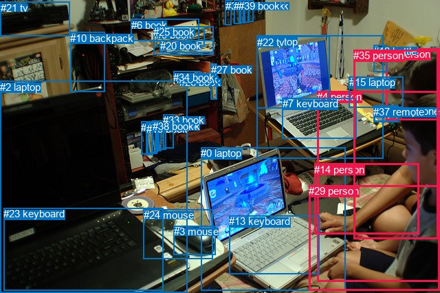
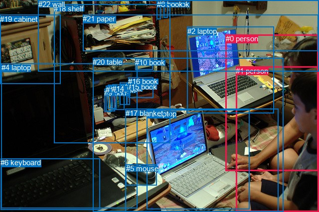

# 图片 0012：1159501.jpg

随机样本序号：385。图片 SHA256：`7bdb9858858cc1deda7a370e168e1a82ad1b1d51b90e86312e6716d172dc8ca1`。

红色框表示人，蓝色框表示其他物体。两个模式分别保留自身框编号，可依据位置比较对应对象。

## 自动检测框与输出

人的框编号：`[4, 5, 14, 29, 35]`。状态：`ok`。

### 自动检测全部物体框

| 编号 | 类别 | 是否为人 | 检测分数 | 像素坐标 xyxy |
|---|---|---|---|---|
| 0 | laptop | False | 0.9997 | 292.5, 214.4, 503.0, 422.0 |
| 1 | laptop | False | 0.9996 | 373.9, 51.8, 557.3, 230.7 |
| 2 | laptop | False | 0.9980 | 0.0, 117.8, 272.6, 425.2 |
| 3 | mouse | False | 0.9969 | 253.0, 328.1, 313.3, 370.9 |
| 4 | person | True | 0.9844 | 461.5, 132.1, 639.0, 409.9 |
| 5 | person | True | 0.9419 | 561.3, 70.4, 640.0, 174.1 |
| 6 | book | False | 0.9356 | 190.9, 27.7, 289.5, 59.5 |
| 7 | keyboard | False | 0.9279 | 410.7, 142.3, 518.1, 201.5 |
| 8 | book | False | 0.8524 | 225.4, 175.9, 234.5, 219.2 |
| 9 | book | False | 0.8393 | 227.5, 42.3, 297.5, 67.6 |
| 10 | backpack | False | 0.8333 | 102.4, 46.7, 152.4, 134.0 |
| 11 | book | False | 0.7999 | 231.0, 175.3, 241.3, 217.4 |
| 12 | bottle | False | 0.7920 | 543.5, 65.8, 562.1, 104.5 |
| 13 | keyboard | False | 0.7538 | 333.4, 313.1, 464.6, 398.1 |
| 14 | person | True | 0.6711 | 457.2, 237.8, 609.8, 340.1 |
| 15 | laptop | False | 0.6648 | 507.7, 111.1, 586.4, 156.9 |
| 16 | book | False | 0.6435 | 205.4, 176.6, 221.9, 224.4 |
| 17 | cell phone | False | 0.5984 | 544.8, 153.1, 579.6, 177.1 |
| 18 | book | False | 0.5977 | 214.7, 176.7, 228.3, 223.7 |
| 19 | book | False | 0.5942 | 213.0, 178.9, 222.4, 225.7 |
| 20 | book | False | 0.5738 | 232.6, 58.2, 310.3, 76.8 |
| 21 | tv | False | 0.5638 | 0.9, 2.5, 101.4, 52.6 |
| 22 | tv | False | 0.5604 | 374.0, 52.7, 479.7, 157.6 |
| 23 | keyboard | False | 0.5375 | 5.1, 302.3, 237.8, 422.4 |
| 24 | mouse | False | 0.5373 | 208.7, 304.1, 309.8, 376.6 |
| 25 | book | False | 0.5315 | 223.1, 38.1, 310.4, 79.3 |
| 26 | book | False | 0.5195 | 261.1, 111.3, 300.1, 122.8 |
| 27 | book | False | 0.5049 | 306.6, 92.9, 315.5, 144.6 |
| 28 | book | False | 0.4472 | 257.1, 107.5, 299.2, 118.7 |
| 29 | person | True | 0.4427 | 449.1, 269.3, 639.4, 422.3 |
| 30 | book | False | 0.4404 | 360.3, 0.3, 368.1, 31.5 |
| 31 | book | False | 0.4062 | 353.5, 0.4, 362.5, 32.4 |
| 32 | book | False | 0.4008 | 327.6, 0.0, 336.3, 36.8 |
| 33 | book | False | 0.3983 | 237.3, 166.2, 252.2, 215.9 |
| 34 | book | False | 0.3946 | 252.4, 103.7, 291.3, 114.7 |
| 35 | person | True | 0.3936 | 514.3, 72.2, 637.7, 347.4 |
| 36 | book | False | 0.3892 | 340.5, 0.0, 350.2, 34.4 |
| 37 | remote | False | 0.3882 | 543.2, 153.7, 580.0, 176.7 |
| 38 | book | False | 0.3740 | 221.9, 175.5, 229.7, 222.0 |
| 39 | book | False | 0.3727 | 347.3, 0.0, 356.2, 33.1 |

### 自动检测 Top50 人相关候选

评分物体对：1560；人相关物体对：370；输出关系：50。

| 排名 | 主语编号与类别 | 关系 | 宾语编号与类别 | 类型 | 人与人 | 排序分数 | 原始融合 logit |
|---|---|---|---|---|---|---|---|
| 1 | #4 person | wearing | #29 person | semantic | True | 0.98713 | 4.3396 |
| 2 | #4 person | in | #29 person | spatial | True | 0.95999 | 3.1779 |
| 3 | #35 person | wearing | #29 person | semantic | True | 0.94061 | 2.7624 |
| 4 | #35 person | wearing | #5 person | semantic | True | 0.90593 | 2.2649 |
| 5 | #35 person | in | #29 person | spatial | True | 0.88471 | 2.0378 |
| 6 | #5 person | on | #15 laptop | spatial | False | 0.88450 | 2.0357 |
| 7 | #4 person | on | #0 laptop | spatial | False | 0.88290 | 2.0202 |
| 8 | #4 person | looking at | #0 laptop | semantic | False | 0.88092 | 2.0012 |
| 9 | #4 person | in | #14 person | spatial | True | 0.88062 | 1.9983 |
| 10 | #5 person | on | #35 person | spatial | True | 0.87855 | 1.9788 |
| 11 | #35 person | looking at | #1 laptop | semantic | False | 0.87685 | 1.9630 |
| 12 | #35 person | in | #5 person | spatial | True | 0.85355 | 1.7627 |
| 13 | #4 person | wearing | #14 person | semantic | True | 0.84351 | 1.6846 |
| 14 | #35 person | wearing | #14 person | semantic | True | 0.81725 | 1.4978 |
| 15 | #35 person | on | #14 person | spatial | True | 0.81638 | 1.4920 |
| 16 | #35 person | looking at | #22 tv | semantic | False | 0.81242 | 1.4658 |
| 17 | #35 person | on | #15 laptop | spatial | False | 0.80208 | 1.3993 |
| 18 | #35 person | looking at | #0 laptop | semantic | False | 0.79093 | 1.3305 |
| 19 | #4 person | looking at | #1 laptop | semantic | False | 0.77979 | 1.2645 |
| 20 | #35 person | holding | #37 remote | semantic | False | 0.77707 | 1.2487 |
| 21 | #35 person | holding | #17 cell phone | semantic | False | 0.77645 | 1.2451 |
| 22 | #35 person | on | #0 laptop | spatial | False | 0.76405 | 1.1750 |
| 23 | #14 person | on | #29 person | spatial | True | 0.75156 | 1.1070 |
| 24 | #35 person | on | #1 laptop | spatial | False | 0.74463 | 1.0702 |
| 25 | #5 person | sitting on | #15 laptop | semantic | False | 0.74072 | 1.0497 |
| 26 | #12 bottle | hanging from | #5 person | spatial | False | 0.73374 | 1.0137 |
| 27 | #4 person | looking at | #2 laptop | semantic | False | 0.73083 | 0.9988 |
| 28 | #4 person | looking at | #22 tv | semantic | False | 0.70386 | 0.8657 |
| 29 | #14 person | on | #4 person | spatial | True | 0.70354 | 0.8642 |
| 30 | #35 person | wearing | #12 bottle | semantic | False | 0.70095 | 0.8518 |
| 31 | #5 person | wearing | #12 bottle | semantic | False | 0.68222 | 0.7640 |
| 32 | #14 person | on | #0 laptop | spatial | False | 0.68042 | 0.7557 |
| 33 | #35 person | sitting on | #15 laptop | semantic | False | 0.67803 | 0.7447 |
| 34 | #4 person | in | #35 person | spatial | True | 0.67496 | 0.7307 |
| 35 | #4 person | sitting on | #35 person | semantic | True | 0.66495 | 0.6854 |
| 36 | #35 person | looking at | #2 laptop | semantic | False | 0.61075 | 0.4505 |
| 37 | #4 person | on | #1 laptop | spatial | False | 0.61075 | 0.4505 |
| 38 | #4 person | on | #2 laptop | spatial | False | 0.60615 | 0.4312 |
| 39 | #35 person | sitting on | #4 person | semantic | True | 0.60562 | 0.4289 |
| 40 | #4 person | wearing | #5 person | semantic | True | 0.60146 | 0.4116 |
| 41 | #5 person | in | #12 bottle | spatial | False | 0.60005 | 0.4057 |
| 42 | #29 person | on | #0 laptop | spatial | False | 0.57199 | 0.2900 |
| 43 | #5 person | looking at | #22 tv | semantic | False | 0.56012 | 0.2417 |
| 44 | #14 person | on | #35 person | spatial | True | 0.54767 | 0.1913 |
| 45 | #5 person | on | #37 remote | spatial | False | 0.53643 | 0.1460 |
| 46 | #4 person | holding | #37 remote | semantic | False | 0.53341 | 0.1338 |
| 47 | #4 person | holding | #17 cell phone | semantic | False | 0.53184 | 0.1275 |
| 48 | #35 person | on | #4 person | spatial | True | 0.53101 | 0.1242 |
| 49 | #29 person | on | #4 person | spatial | True | 0.52080 | 0.0833 |
| 50 | #5 person | on | #17 cell phone | spatial | False | 0.51965 | 0.0786 |

### 自动检测逐条人相关 GT 核验

R@50：40.00%；命中 2/5。

| GT 主语编号 | GT 关系 | GT 宾语编号 | 结果阶段 | 匹配预测主语编号 | 匹配预测宾语编号 |
|---|---|---|---|---|---|
| 0 | attached to | 1 | wrong_predicate | [4, 35] | [4] |
| 0 | looking at | 3 | hit50 | [4, 35] | [0] |
| 0 | touching | 3 | wrong_predicate | [4, 35] | [0] |
| 1 | attached to | 0 | wrong_predicate | [4] | [4, 35] |
| 1 | looking at | 3 | hit50 | [4] | [0] |

## 真实框与输出

人的框编号：`[0, 1]`。

### 真实框全部物体框

| 编号 | 类别 | 是否为人 | 检测分数 | 像素坐标 xyxy |
|---|---|---|---|---|
| 0 | person | True | GT | 453.0, 69.0, 639.0, 344.0 |
| 1 | person | True | GT | 473.0, 134.0, 640.0, 426.0 |
| 2 | laptop | False | GT | 376.0, 54.0, 550.0, 228.0 |
| 3 | laptop | False | GT | 295.0, 220.0, 501.0, 420.0 |
| 4 | laptop | False | GT | 3.0, 127.0, 275.0, 418.0 |
| 5 | mouse | False | GT | 253.0, 330.0, 315.0, 372.0 |
| 6 | keyboard | False | GT | 1.0, 318.0, 200.0, 421.0 |
| 7 | book | False | GT | 328.0, 0.0, 337.0, 36.0 |
| 8 | book | False | GT | 315.0, 0.0, 323.0, 39.0 |
| 9 | book | False | GT | 209.0, 178.0, 223.0, 224.0 |
| 10 | book | False | GT | 271.0, 117.0, 306.0, 140.0 |
| 11 | book | False | GT | 241.0, 166.0, 255.0, 211.0 |
| 12 | book | False | GT | 217.0, 170.0, 234.0, 219.0 |
| 13 | book | False | GT | 212.0, 172.0, 230.0, 223.0 |
| 14 | book | False | GT | 225.0, 170.0, 249.0, 221.0 |
| 15 | book | False | GT | 255.0, 166.0, 261.0, 211.0 |
| 16 | book | False | GT | 257.0, 155.0, 307.0, 196.0 |
| 17 | blanket | False | GT | 252.0, 219.0, 559.0, 426.0 |
| 18 | shelf | False | GT | 108.0, 9.0, 341.0, 288.0 |
| 19 | cabinet | False | GT | 0.0, 30.0, 121.0, 169.0 |
| 20 | table | False | GT | 186.0, 116.0, 568.0, 426.0 |
| 21 | paper | False | GT | 166.0, 29.0, 639.0, 102.0 |
| 22 | wall | False | GT | 77.0, 0.0, 640.0, 143.0 |

### 真实框 Top50 人相关候选

评分物体对：506；人相关物体对：86；输出关系：50。

| 排名 | 主语编号与类别 | 关系 | 宾语编号与类别 | 类型 | 人与人 | 排序分数 | 原始融合 logit |
|---|---|---|---|---|---|---|---|
| 1 | #1 person | sitting on | #20 table | semantic | False | 0.93131 | 2.6069 |
| 2 | #1 person | sitting on | #17 blanket | semantic | False | 0.92410 | 2.4994 |
| 3 | #1 person | on | #17 blanket | spatial | False | 0.92229 | 2.4739 |
| 4 | #1 person | sitting on | #0 person | semantic | True | 0.91701 | 2.4023 |
| 5 | #1 person | looking at | #3 laptop | semantic | False | 0.89662 | 2.1603 |
| 6 | #1 person | on | #20 table | spatial | False | 0.89533 | 2.1464 |
| 7 | #1 person | beside | #3 laptop | spatial | False | 0.88295 | 2.0207 |
| 8 | #0 person | looking at | #2 laptop | semantic | False | 0.87631 | 1.9580 |
| 9 | #0 person | sitting on | #20 table | semantic | False | 0.86633 | 1.8689 |
| 10 | #0 person | on | #2 laptop | spatial | False | 0.86460 | 1.8540 |
| 11 | #0 person | on | #17 blanket | spatial | False | 0.85609 | 1.7832 |
| 12 | #0 person | on | #20 table | spatial | False | 0.83910 | 1.6516 |
| 13 | #1 person | on | #0 person | spatial | True | 0.82671 | 1.5625 |
| 14 | #1 person | looking at | #4 laptop | semantic | False | 0.82511 | 1.5513 |
| 15 | #0 person | sitting on | #17 blanket | semantic | False | 0.81627 | 1.4913 |
| 16 | #0 person | looking at | #3 laptop | semantic | False | 0.81222 | 1.4645 |
| 17 | #0 person | on | #3 laptop | spatial | False | 0.80932 | 1.4456 |
| 18 | #1 person | looking at | #2 laptop | semantic | False | 0.79195 | 1.3367 |
| 19 | #1 person | on | #4 laptop | spatial | False | 0.64556 | 0.5996 |
| 20 | #1 person | on | #2 laptop | spatial | False | 0.55490 | 0.2205 |
| 21 | #0 person | looking at | #4 laptop | semantic | False | 0.49597 | -0.0161 |
| 22 | #0 person | beside | #1 person | spatial | True | 0.44448 | -0.2230 |
| 23 | #0 person | sitting on | #1 person | semantic | True | 0.42801 | -0.2900 |
| 24 | #0 person | on | #4 laptop | spatial | False | 0.31761 | -0.7648 |
| 25 | #2 laptop | on | #0 person | spatial | False | 0.27902 | -0.9493 |
| 26 | #1 person | on | #6 keyboard | spatial | False | 0.14426 | -1.7803 |
| 27 | #1 person | touching | #5 mouse | semantic | False | 0.12268 | -1.9673 |
| 28 | #2 laptop | sitting on | #0 person | semantic | False | 0.11111 | -2.0795 |
| 29 | #1 person | on | #5 mouse | spatial | False | 0.09971 | -2.2005 |
| 30 | #1 person | playing | #6 keyboard | semantic | False | 0.07290 | -2.5430 |
| 31 | #3 laptop | beside | #1 person | spatial | False | 0.05831 | -2.7819 |
| 32 | #0 person | on | #6 keyboard | spatial | False | 0.05420 | -2.8593 |
| 33 | #3 laptop | beside | #0 person | spatial | False | 0.05243 | -2.8944 |
| 34 | #0 person | playing | #6 keyboard | semantic | False | 0.04145 | -3.1409 |
| 35 | #0 person | beside | #18 shelf | spatial | False | 0.03743 | -3.2470 |
| 36 | #0 person | on | #5 mouse | spatial | False | 0.03571 | -3.2959 |
| 37 | #2 laptop | beside | #1 person | spatial | False | 0.03168 | -3.4200 |
| 38 | #17 blanket | in | #0 person | spatial | False | 0.02983 | -3.4820 |
| 39 | #3 laptop | playing | #1 person | semantic | False | 0.02892 | -3.5140 |
| 40 | #0 person | touching | #5 mouse | semantic | False | 0.02885 | -3.5164 |
| 41 | #1 person | sitting on | #18 shelf | semantic | False | 0.02551 | -3.6429 |
| 42 | #20 table | in | #0 person | spatial | False | 0.02351 | -3.7265 |
| 43 | #0 person | sitting on | #18 shelf | semantic | False | 0.02083 | -3.8501 |
| 44 | #1 person | beside | #18 shelf | spatial | False | 0.02073 | -3.8552 |
| 45 | #0 person | in front of | #22 wall | spatial | False | 0.02066 | -3.8588 |
| 46 | #17 blanket | in | #1 person | spatial | False | 0.01963 | -3.9107 |
| 47 | #3 laptop | playing | #0 person | semantic | False | 0.01924 | -3.9316 |
| 48 | #1 person | sitting on | #19 cabinet | semantic | False | 0.01820 | -3.9877 |
| 49 | #0 person | on | #21 paper | spatial | False | 0.01763 | -4.0204 |
| 50 | #4 laptop | beside | #1 person | spatial | False | 0.01751 | -4.0273 |

### 真实框逐条人相关 GT 核验

R@50：40.00%；命中 2/5。

| GT 主语编号 | GT 关系 | GT 宾语编号 | 结果阶段 | 匹配预测主语编号 | 匹配预测宾语编号 |
|---|---|---|---|---|---|
| 0 | attached to | 1 | wrong_predicate | [0] | [1] |
| 0 | looking at | 3 | hit50 | [0] | [3] |
| 0 | touching | 3 | wrong_predicate | [0] | [3] |
| 1 | attached to | 0 | wrong_predicate | [1] | [0] |
| 1 | looking at | 3 | hit50 | [1] | [3] |

## 全部人相关 GT

| 主语编号与类别 | 关系 | 宾语编号与类别 |
|---|---|---|
| #0 person | attached to | #1 person |
| #0 person | looking at | #3 laptop |
| #0 person | touching | #3 laptop |
| #1 person | attached to | #0 person |
| #1 person | looking at | #3 laptop |

原始记录、全部人相关物体对的两项预测与分项分数见 [逐图证据 JSON](../evidence/cases/0012.json)。全部56类 logits 保留于本机 HOR/output/random500/logits/。

<!-- HOR_COMPLETE_RESULTS -->

## 六组条件的完整输出对照

以下保留同一图片三种框与候选模式、两种谓词输出规则的全部 Top50。框编号各自在所属模式内解释。

### 自动检测框完整枚举：空间与语义各保留一个谓词

| 排名 | 主语编号与类别 | 谓词 | 宾语编号与类别 | 分组 | 排序分数 | predicate logit | pair logit |
|---|---|---|---|---|---|---|---|
| 1 | #4 person | wearing | #29 person | semantic | 0.9871264 | 4.0547853 | 0.2848303 |
| 2 | #4 person | in | #29 person | spatial | 0.9599925 | 2.8930283 | 0.2848303 |
| 3 | #35 person | wearing | #29 person | semantic | 0.9406095 | 2.7584596 | 0.0039337 |
| 4 | #35 person | wearing | #5 person | semantic | 0.9059270 | 2.1074367 | 0.1574513 |
| 5 | #35 person | in | #29 person | spatial | 0.8847104 | 2.0338793 | 0.0039337 |
| 6 | #5 person | on | #15 laptop | spatial | 0.8844995 | 2.3764095 | -0.3406625 |
| 7 | #4 person | on | #0 laptop | spatial | 0.8828967 | 2.1193166 | -0.0991645 |
| 8 | #4 person | looking at | #0 laptop | semantic | 0.8809237 | 2.1003718 | -0.0991645 |
| 9 | #4 person | in | #14 person | spatial | 0.8806235 | 1.7039685 | 0.2943792 |
| 10 | #5 person | on | #35 person | spatial | 0.8785522 | 2.3128085 | -0.3340174 |
| 11 | #35 person | looking at | #1 laptop | semantic | 0.8768523 | 2.3781662 | -0.4152123 |
| 12 | #35 person | in | #5 person | spatial | 0.8535510 | 1.6052766 | 0.1574513 |
| 13 | #4 person | wearing | #14 person | semantic | 0.8435122 | 1.3902173 | 0.2943792 |
| 14 | #35 person | wearing | #14 person | semantic | 0.8172453 | 1.4965916 | 0.0012029 |
| 15 | #35 person | on | #14 person | spatial | 0.8163813 | 1.4908175 | 0.0012029 |
| 16 | #35 person | looking at | #22 tv | semantic | 0.8124197 | 1.9365592 | -0.4707494 |
| 17 | #35 person | on | #15 laptop | spatial | 0.8020751 | 1.8164053 | -0.4170906 |
| 18 | #35 person | looking at | #0 laptop | semantic | 0.7909296 | 1.7389283 | -0.4083903 |
| 19 | #4 person | looking at | #1 laptop | semantic | 0.7797946 | 1.7245259 | -0.4600557 |
| 20 | #35 person | holding | #37 remote | semantic | 0.7770738 | 1.9305916 | -0.6818972 |
| 21 | #35 person | holding | #17 cell phone | semantic | 0.7764450 | 1.9305916 | -0.6855233 |
| 22 | #35 person | on | #0 laptop | spatial | 0.7640508 | 1.5834079 | -0.4083903 |
| 23 | #14 person | on | #29 person | spatial | 0.7515643 | 1.6023769 | -0.4954040 |
| 24 | #35 person | on | #1 laptop | spatial | 0.7446329 | 1.4854016 | -0.4152123 |
| 25 | #5 person | sitting on | #15 laptop | semantic | 0.7407221 | 1.3903875 | -0.3406625 |
| 26 | #12 bottle | hanging from | #5 person | spatial | 0.7337430 | 1.0803032 | -0.0666064 |
| 27 | #4 person | looking at | #2 laptop | semantic | 0.7308255 | 1.3724294 | -0.3736143 |
| 28 | #4 person | looking at | #22 tv | semantic | 0.7038584 | 1.3644767 | -0.4987373 |
| 29 | #14 person | on | #4 person | spatial | 0.7035391 | 1.3550439 | -0.4908358 |
| 30 | #35 person | wearing | #12 bottle | semantic | 0.7009467 | 1.2839890 | -0.4321786 |
| 31 | #5 person | wearing | #12 bottle | semantic | 0.6822240 | 0.8398461 | -0.0758350 |
| 32 | #14 person | on | #0 laptop | spatial | 0.6804194 | 1.4888759 | -0.7331762 |
| 33 | #35 person | sitting on | #15 laptop | semantic | 0.6780254 | 1.1618028 | -0.4170906 |
| 34 | #4 person | in | #35 person | spatial | 0.6749616 | 1.3032713 | -0.5725589 |
| 35 | #4 person | sitting on | #35 person | semantic | 0.6649495 | 1.2579889 | -0.5725589 |
| 36 | #35 person | looking at | #2 laptop | semantic | 0.6107489 | 1.0470037 | -0.5965425 |
| 37 | #4 person | on | #1 laptop | spatial | 0.6107475 | 0.9105110 | -0.4600557 |
| 38 | #4 person | on | #2 laptop | spatial | 0.6061498 | 0.8047709 | -0.3736143 |
| 39 | #35 person | sitting on | #4 person | semantic | 0.6056224 | 1.1255589 | -0.6966110 |
| 40 | #4 person | wearing | #5 person | semantic | 0.6014600 | 0.4104452 | 0.0011069 |
| 41 | #5 person | in | #12 bottle | spatial | 0.6000526 | 0.4815192 | -0.0758350 |
| 42 | #29 person | on | #0 laptop | spatial | 0.5719889 | 1.2151594 | -0.9251888 |
| 43 | #5 person | looking at | #22 tv | semantic | 0.5601228 | 0.9118214 | -0.6701610 |
| 44 | #14 person | on | #35 person | spatial | 0.5476710 | 0.7641087 | -0.5728439 |
| 45 | #5 person | on | #37 remote | spatial | 0.5364345 | 0.7752600 | -0.6292629 |
| 46 | #4 person | holding | #37 remote | semantic | 0.5334086 | 1.0568471 | -0.9230132 |
| 47 | #4 person | holding | #17 cell phone | semantic | 0.5318363 | 1.0538926 | -0.9263749 |
| 48 | #35 person | on | #4 person | spatial | 0.5310116 | 0.8208170 | -0.6966110 |
| 49 | #29 person | on | #4 person | spatial | 0.5208017 | 0.8681393 | -0.7848846 |
| 50 | #5 person | on | #17 cell phone | spatial | 0.5196460 | 0.7150769 | -0.6364524 |

GT 命中：2/5，R@50=40.00%。

| GT主语 | GT谓词 | GT宾语 | 结果阶段 | 匹配主语框 | 匹配宾语框 |
|---|---|---|---|---|---|
| 0 | attached to | 1 | wrong_predicate | [4, 35] | [4] |
| 0 | looking at | 3 | hit50 | [4, 35] | [0] |
| 0 | touching | 3 | wrong_predicate | [4, 35] | [0] |
| 1 | attached to | 0 | wrong_predicate | [4] | [4, 35] |
| 1 | looking at | 3 | hit50 | [4] | [0] |

### 自动检测框完整枚举：每对只保留一个谓词

| 排名 | 主语编号与类别 | 谓词 | 宾语编号与类别 | 分组 | 排序分数 | predicate logit | pair logit |
|---|---|---|---|---|---|---|---|
| 1 | #4 person | wearing | #29 person | single | 0.9871264 | 4.0547853 | 0.2848303 |
| 2 | #35 person | wearing | #29 person | single | 0.9406095 | 2.7584596 | 0.0039337 |
| 3 | #35 person | wearing | #5 person | single | 0.9059270 | 2.1074367 | 0.1574513 |
| 4 | #5 person | on | #15 laptop | single | 0.8844995 | 2.3764095 | -0.3406625 |
| 5 | #4 person | on | #0 laptop | single | 0.8828967 | 2.1193166 | -0.0991645 |
| 6 | #4 person | in | #14 person | single | 0.8806235 | 1.7039685 | 0.2943792 |
| 7 | #5 person | on | #35 person | single | 0.8785522 | 2.3128085 | -0.3340174 |
| 8 | #35 person | looking at | #1 laptop | single | 0.8768523 | 2.3781662 | -0.4152123 |
| 9 | #35 person | wearing | #14 person | single | 0.8172453 | 1.4965916 | 0.0012029 |
| 10 | #35 person | looking at | #22 tv | single | 0.8124197 | 1.9365592 | -0.4707494 |
| 11 | #35 person | on | #15 laptop | single | 0.8020751 | 1.8164053 | -0.4170906 |
| 12 | #35 person | looking at | #0 laptop | single | 0.7909296 | 1.7389283 | -0.4083903 |
| 13 | #4 person | looking at | #1 laptop | single | 0.7797946 | 1.7245259 | -0.4600557 |
| 14 | #35 person | holding | #37 remote | single | 0.7770738 | 1.9305916 | -0.6818972 |
| 15 | #35 person | holding | #17 cell phone | single | 0.7764450 | 1.9305916 | -0.6855233 |
| 16 | #14 person | on | #29 person | single | 0.7515643 | 1.6023769 | -0.4954040 |
| 17 | #12 bottle | hanging from | #5 person | single | 0.7337430 | 1.0803032 | -0.0666064 |
| 18 | #4 person | looking at | #2 laptop | single | 0.7308255 | 1.3724294 | -0.3736143 |
| 19 | #4 person | looking at | #22 tv | single | 0.7038584 | 1.3644767 | -0.4987373 |
| 20 | #14 person | on | #4 person | single | 0.7035391 | 1.3550439 | -0.4908358 |
| 21 | #35 person | wearing | #12 bottle | single | 0.7009467 | 1.2839890 | -0.4321786 |
| 22 | #5 person | wearing | #12 bottle | single | 0.6822240 | 0.8398461 | -0.0758350 |
| 23 | #14 person | on | #0 laptop | single | 0.6804194 | 1.4888759 | -0.7331762 |
| 24 | #4 person | in | #35 person | single | 0.6749616 | 1.3032713 | -0.5725589 |
| 25 | #35 person | looking at | #2 laptop | single | 0.6107489 | 1.0470037 | -0.5965425 |
| 26 | #35 person | sitting on | #4 person | single | 0.6056224 | 1.1255589 | -0.6966110 |
| 27 | #4 person | wearing | #5 person | single | 0.6014600 | 0.4104452 | 0.0011069 |
| 28 | #29 person | on | #0 laptop | single | 0.5719889 | 1.2151594 | -0.9251888 |
| 29 | #5 person | looking at | #22 tv | single | 0.5601228 | 0.9118214 | -0.6701610 |
| 30 | #14 person | on | #35 person | single | 0.5476710 | 0.7641087 | -0.5728439 |
| 31 | #5 person | on | #37 remote | single | 0.5364345 | 0.7752600 | -0.6292629 |
| 32 | #4 person | holding | #37 remote | single | 0.5334086 | 1.0568471 | -0.9230132 |
| 33 | #4 person | holding | #17 cell phone | single | 0.5318363 | 1.0538926 | -0.9263749 |
| 34 | #29 person | on | #4 person | single | 0.5208017 | 0.8681393 | -0.7848846 |
| 35 | #5 person | on | #17 cell phone | single | 0.5196460 | 0.7150769 | -0.6364524 |
| 36 | #12 bottle | hanging from | #35 person | single | 0.4924082 | 0.6289387 | -0.6593083 |
| 37 | #5 person | looking at | #1 laptop | single | 0.4831582 | 0.4726553 | -0.5400481 |
| 38 | #4 person | on | #15 laptop | single | 0.4510090 | 0.5193248 | -0.7159198 |
| 39 | #17 cell phone | on | #35 person | single | 0.4478861 | 0.5706730 | -0.7798885 |
| 40 | #37 remote | on | #35 person | single | 0.4453057 | 0.5652285 | -0.7848848 |
| 41 | #29 person | on | #14 person | single | 0.4374602 | 0.1891899 | -0.4406661 |
| 42 | #17 cell phone | on | #5 person | single | 0.3981006 | 0.4898415 | -0.9032268 |
| 43 | #37 remote | on | #5 person | single | 0.3901785 | 0.4597497 | -0.9063118 |
| 44 | #4 person | playing | #13 keyboard | single | 0.3640316 | 0.3457088 | -0.9036170 |
| 45 | #4 person | on | #7 keyboard | single | 0.3567069 | 0.4373631 | -1.0270493 |
| 46 | #5 person | wearing | #14 person | single | 0.3459963 | 0.3436432 | -0.9803281 |
| 47 | #5 person | on | #4 person | single | 0.3279682 | -0.1022520 | -0.6151369 |
| 48 | #35 person | on | #13 keyboard | single | 0.2660690 | 0.2986655 | -1.3133248 |
| 49 | #4 person | on | #23 keyboard | single | 0.2412312 | -0.2635980 | -0.8823433 |
| 50 | #15 laptop | beside | #5 person | single | 0.2368598 | -0.2803259 | -0.8896473 |

GT 命中：1/5，R@50=20.00%。

| GT主语 | GT谓词 | GT宾语 | 结果阶段 | 匹配主语框 | 匹配宾语框 |
|---|---|---|---|---|---|
| 0 | attached to | 1 | wrong_predicate | [4, 35] | [4] |
| 0 | looking at | 3 | hit50 | [4, 35] | [0] |
| 0 | touching | 3 | wrong_predicate | [4, 35] | [0] |
| 1 | attached to | 0 | wrong_predicate | [4] | [4, 35] |
| 1 | looking at | 3 | wrong_predicate | [4] | [0] |

### 真实框完整枚举：空间与语义各保留一个谓词

| 排名 | 主语编号与类别 | 谓词 | 宾语编号与类别 | 分组 | 排序分数 | predicate logit | pair logit |
|---|---|---|---|---|---|---|---|
| 1 | #1 person | sitting on | #20 table | semantic | 0.9313052 | 2.8770838 | -0.2701702 |
| 2 | #1 person | sitting on | #17 blanket | semantic | 0.9240999 | 2.5761709 | -0.0767696 |
| 3 | #1 person | on | #17 blanket | spatial | 0.9222898 | 2.5506430 | -0.0767696 |
| 4 | #1 person | sitting on | #0 person | semantic | 0.9170063 | 2.8649383 | -0.4625892 |
| 5 | #1 person | looking at | #3 laptop | semantic | 0.8966231 | 2.1675272 | -0.0072733 |
| 6 | #1 person | on | #20 table | spatial | 0.8953300 | 2.4165497 | -0.2701702 |
| 7 | #1 person | beside | #3 laptop | spatial | 0.8829529 | 2.0279684 | -0.0072733 |
| 8 | #0 person | looking at | #2 laptop | semantic | 0.8763145 | 2.3442397 | -0.3862565 |
| 9 | #0 person | sitting on | #20 table | semantic | 0.8663307 | 2.5851517 | -0.7162534 |
| 10 | #0 person | on | #2 laptop | spatial | 0.8645965 | 2.2402601 | -0.3862565 |
| 11 | #0 person | on | #17 blanket | spatial | 0.8560899 | 2.3534718 | -0.5702845 |
| 12 | #0 person | on | #20 table | spatial | 0.8391048 | 2.3678360 | -0.7162534 |
| 13 | #1 person | on | #0 person | spatial | 0.8267055 | 2.0250454 | -0.4625892 |
| 14 | #1 person | looking at | #4 laptop | semantic | 0.8251060 | 1.8410554 | -0.2897236 |
| 15 | #0 person | sitting on | #17 blanket | semantic | 0.8162660 | 2.0615358 | -0.5702845 |
| 16 | #0 person | looking at | #3 laptop | semantic | 0.8122175 | 1.8565044 | -0.3920207 |
| 17 | #0 person | on | #3 laptop | spatial | 0.8093181 | 1.8376060 | -0.3920207 |
| 18 | #1 person | looking at | #2 laptop | semantic | 0.7919533 | 1.7636814 | -0.4269418 |
| 19 | #1 person | on | #4 laptop | spatial | 0.6455619 | 0.8893108 | -0.2897236 |
| 20 | #1 person | on | #2 laptop | spatial | 0.5548980 | 0.6474223 | -0.4269418 |
| 21 | #0 person | looking at | #4 laptop | semantic | 0.4959735 | 0.6535516 | -0.6696579 |
| 22 | #0 person | beside | #1 person | spatial | 0.4444780 | 0.6568398 | -0.8798475 |
| 23 | #0 person | sitting on | #1 person | semantic | 0.4280150 | 0.5898929 | -0.8798475 |
| 24 | #0 person | on | #4 laptop | spatial | 0.3176144 | -0.0950990 | -0.6696579 |
| 25 | #2 laptop | on | #0 person | spatial | 0.2790227 | -0.0913630 | -0.8579518 |
| 26 | #1 person | on | #6 keyboard | spatial | 0.1442608 | -0.9313402 | -0.8490028 |
| 27 | #1 person | touching | #5 mouse | semantic | 0.1226755 | -1.2003243 | -0.7670098 |
| 28 | #2 laptop | sitting on | #0 person | semantic | 0.1111091 | -1.2215104 | -0.8579518 |
| 29 | #1 person | on | #5 mouse | spatial | 0.0997093 | -1.4334495 | -0.7670098 |
| 30 | #1 person | playing | #6 keyboard | semantic | 0.0728980 | -1.6939998 | -0.8490028 |
| 31 | #3 laptop | beside | #1 person | spatial | 0.0583099 | -1.4140751 | -1.3678299 |
| 32 | #0 person | on | #6 keyboard | spatial | 0.0542023 | -1.6199925 | -1.2393122 |
| 33 | #3 laptop | beside | #0 person | spatial | 0.0524320 | -1.8357863 | -1.0585960 |
| 34 | #0 person | playing | #6 keyboard | semantic | 0.0414500 | -1.9016209 | -1.2393122 |
| 35 | #0 person | beside | #18 shelf | spatial | 0.0374347 | -1.6400213 | -1.6069815 |
| 36 | #0 person | on | #5 mouse | spatial | 0.0357116 | -2.1357141 | -1.1602021 |
| 37 | #2 laptop | beside | #1 person | spatial | 0.0316771 | -2.0169046 | -1.4030666 |
| 38 | #17 blanket | in | #0 person | spatial | 0.0298295 | -2.2487607 | -1.2332144 |
| 39 | #3 laptop | playing | #1 person | semantic | 0.0289159 | -2.1461926 | -1.3678299 |
| 40 | #0 person | touching | #5 mouse | semantic | 0.0288478 | -2.3562477 | -1.1602021 |
| 41 | #1 person | sitting on | #18 shelf | semantic | 0.0255089 | -2.1949697 | -1.4479182 |
| 42 | #20 table | in | #0 person | spatial | 0.0235119 | -2.1369152 | -1.5895400 |
| 43 | #0 person | sitting on | #18 shelf | semantic | 0.0208341 | -2.2431269 | -1.6069815 |
| 44 | #1 person | beside | #18 shelf | spatial | 0.0207311 | -2.4072526 | -1.4479182 |
| 45 | #0 person | in front of | #22 wall | spatial | 0.0206569 | -2.4294639 | -1.4293694 |
| 46 | #17 blanket | in | #1 person | spatial | 0.0196330 | -2.3686299 | -1.5420867 |
| 47 | #3 laptop | playing | #0 person | semantic | 0.0192360 | -2.8729544 | -1.0585960 |
| 48 | #1 person | sitting on | #19 cabinet | semantic | 0.0182040 | -1.8504145 | -2.1373250 |
| 49 | #0 person | on | #21 paper | spatial | 0.0176299 | -2.2988412 | -1.7215292 |
| 50 | #4 laptop | beside | #1 person | spatial | 0.0175101 | -2.4091897 | -1.6181197 |

GT 命中：2/5，R@50=40.00%。

| GT主语 | GT谓词 | GT宾语 | 结果阶段 | 匹配主语框 | 匹配宾语框 |
|---|---|---|---|---|---|
| 0 | attached to | 1 | wrong_predicate | [0] | [1] |
| 0 | looking at | 3 | hit50 | [0] | [3] |
| 0 | touching | 3 | wrong_predicate | [0] | [3] |
| 1 | attached to | 0 | wrong_predicate | [1] | [0] |
| 1 | looking at | 3 | hit50 | [1] | [3] |

### 真实框完整枚举：每对只保留一个谓词

| 排名 | 主语编号与类别 | 谓词 | 宾语编号与类别 | 分组 | 排序分数 | predicate logit | pair logit |
|---|---|---|---|---|---|---|---|
| 1 | #1 person | sitting on | #20 table | single | 0.9313052 | 2.8770838 | -0.2701702 |
| 2 | #1 person | sitting on | #17 blanket | single | 0.9240999 | 2.5761709 | -0.0767696 |
| 3 | #1 person | sitting on | #0 person | single | 0.9170063 | 2.8649383 | -0.4625892 |
| 4 | #1 person | looking at | #3 laptop | single | 0.8966231 | 2.1675272 | -0.0072733 |
| 5 | #0 person | looking at | #2 laptop | single | 0.8763145 | 2.3442397 | -0.3862565 |
| 6 | #0 person | sitting on | #20 table | single | 0.8663307 | 2.5851517 | -0.7162534 |
| 7 | #0 person | on | #17 blanket | single | 0.8560899 | 2.3534718 | -0.5702845 |
| 8 | #1 person | looking at | #4 laptop | single | 0.8251060 | 1.8410554 | -0.2897236 |
| 9 | #0 person | looking at | #3 laptop | single | 0.8122175 | 1.8565044 | -0.3920207 |
| 10 | #1 person | looking at | #2 laptop | single | 0.7919533 | 1.7636814 | -0.4269418 |
| 11 | #0 person | looking at | #4 laptop | single | 0.4959735 | 0.6535516 | -0.6696579 |
| 12 | #0 person | beside | #1 person | single | 0.4444780 | 0.6568398 | -0.8798475 |
| 13 | #2 laptop | on | #0 person | single | 0.2790227 | -0.0913630 | -0.8579518 |
| 14 | #1 person | on | #6 keyboard | single | 0.1442608 | -0.9313402 | -0.8490028 |
| 15 | #1 person | touching | #5 mouse | single | 0.1226755 | -1.2003243 | -0.7670098 |
| 16 | #3 laptop | beside | #1 person | single | 0.0583099 | -1.4140751 | -1.3678299 |
| 17 | #0 person | on | #6 keyboard | single | 0.0542023 | -1.6199925 | -1.2393122 |
| 18 | #3 laptop | beside | #0 person | single | 0.0524320 | -1.8357863 | -1.0585960 |
| 19 | #0 person | beside | #18 shelf | single | 0.0374347 | -1.6400213 | -1.6069815 |
| 20 | #0 person | on | #5 mouse | single | 0.0357116 | -2.1357141 | -1.1602021 |
| 21 | #2 laptop | beside | #1 person | single | 0.0316771 | -2.0169046 | -1.4030666 |
| 22 | #17 blanket | in | #0 person | single | 0.0298295 | -2.2487607 | -1.2332144 |
| 23 | #1 person | sitting on | #18 shelf | single | 0.0255089 | -2.1949697 | -1.4479182 |
| 24 | #20 table | in | #0 person | single | 0.0235119 | -2.1369152 | -1.5895400 |
| 25 | #0 person | in front of | #22 wall | single | 0.0206569 | -2.4294639 | -1.4293694 |
| 26 | #17 blanket | in | #1 person | single | 0.0196330 | -2.3686299 | -1.5420867 |
| 27 | #1 person | sitting on | #19 cabinet | single | 0.0182040 | -1.8504145 | -2.1373250 |
| 28 | #0 person | on | #21 paper | single | 0.0176299 | -2.2988412 | -1.7215292 |
| 29 | #4 laptop | beside | #1 person | single | 0.0175101 | -2.4091897 | -1.6181197 |
| 30 | #4 laptop | beside | #0 person | single | 0.0160372 | -2.7548633 | -1.3618150 |
| 31 | #6 keyboard | on | #0 person | single | 0.0124762 | -2.6031570 | -1.7682232 |
| 32 | #0 person | beside | #19 cabinet | single | 0.0119927 | -2.2865119 | -2.1248786 |
| 33 | #20 table | in | #1 person | single | 0.0116162 | -2.6511779 | -1.7924883 |
| 34 | #18 shelf | beside | #0 person | single | 0.0111699 | -2.8092866 | -1.6740127 |
| 35 | #18 shelf | beside | #1 person | single | 0.0089998 | -2.7563667 | -1.9451407 |
| 36 | #6 keyboard | on | #1 person | single | 0.0074955 | -2.9379692 | -1.9479611 |
| 37 | #1 person | in | #22 wall | single | 0.0073991 | -3.2067633 | -1.6922038 |
| 38 | #9 book | on | #0 person | single | 0.0073119 | -3.1514754 | -1.7594446 |
| 39 | #19 cabinet | beside | #0 person | single | 0.0070456 | -3.0054579 | -1.9428239 |
| 40 | #13 book | on | #0 person | single | 0.0070307 | -3.1718206 | -1.7785881 |
| 41 | #12 book | on | #0 person | single | 0.0064385 | -3.2484827 | -1.7905219 |
| 42 | #1 person | on | #21 paper | single | 0.0063093 | -3.0635612 | -1.9958329 |
| 43 | #5 mouse | on | #0 person | single | 0.0062578 | -3.2319891 | -1.8356653 |
| 44 | #5 mouse | on | #1 person | single | 0.0060330 | -3.3760014 | -1.7284592 |
| 45 | #14 book | on | #0 person | single | 0.0059430 | -3.3320227 | -1.7875521 |
| 46 | #21 paper | beside | #0 person | single | 0.0058697 | -3.7734091 | -1.3586481 |
| 47 | #0 person | playing | #14 book | single | 0.0057053 | -2.9996095 | -2.1610346 |
| 48 | #0 person | playing | #13 book | single | 0.0053207 | -3.0852871 | -2.1455257 |
| 49 | #0 person | playing | #12 book | single | 0.0052013 | -3.1015444 | -2.1520839 |
| 50 | #0 person | playing | #9 book | single | 0.0051493 | -3.1117425 | -2.1519938 |

GT 命中：2/5，R@50=40.00%。

| GT主语 | GT谓词 | GT宾语 | 结果阶段 | 匹配主语框 | 匹配宾语框 |
|---|---|---|---|---|---|
| 0 | attached to | 1 | wrong_predicate | [0] | [1] |
| 0 | looking at | 3 | hit50 | [0] | [3] |
| 0 | touching | 3 | wrong_predicate | [0] | [3] |
| 1 | attached to | 0 | wrong_predicate | [1] | [0] |
| 1 | looking at | 3 | hit50 | [1] | [3] |

### 真实框400候选：空间与语义各保留一个谓词

| 排名 | 主语编号与类别 | 谓词 | 宾语编号与类别 | 分组 | 排序分数 | predicate logit | pair logit |
|---|---|---|---|---|---|---|---|
| 1 | #1 person | sitting on | #20 table | semantic | 0.9361449 | 2.9553237 | -0.2701702 |
| 2 | #1 person | sitting on | #17 blanket | semantic | 0.9255641 | 2.5972338 | -0.0767696 |
| 3 | #1 person | sitting on | #0 person | semantic | 0.9197137 | 2.9010539 | -0.4625892 |
| 4 | #1 person | on | #17 blanket | spatial | 0.9194924 | 2.5122399 | -0.0767696 |
| 5 | #1 person | looking at | #3 laptop | semantic | 0.8968491 | 2.1699677 | -0.0072733 |
| 6 | #1 person | on | #20 table | spatial | 0.8916760 | 2.3781462 | -0.2701702 |
| 7 | #1 person | beside | #3 laptop | spatial | 0.8890021 | 2.0878615 | -0.0072733 |
| 8 | #0 person | looking at | #2 laptop | semantic | 0.8765411 | 2.3463316 | -0.3862565 |
| 9 | #0 person | sitting on | #20 table | semantic | 0.8731477 | 2.6453347 | -0.7162534 |
| 10 | #0 person | on | #2 laptop | spatial | 0.8573951 | 2.1800776 | -0.3862565 |
| 11 | #0 person | on | #17 blanket | spatial | 0.8471104 | 2.2823997 | -0.5702845 |
| 12 | #1 person | looking at | #4 laptop | semantic | 0.8341527 | 1.9050727 | -0.2897236 |
| 13 | #0 person | on | #20 table | spatial | 0.8253461 | 2.2692499 | -0.7162534 |
| 14 | #1 person | on | #0 person | spatial | 0.8166721 | 1.9565511 | -0.4625892 |
| 15 | #0 person | sitting on | #17 blanket | semantic | 0.8162660 | 2.0615358 | -0.5702845 |
| 16 | #0 person | looking at | #3 laptop | semantic | 0.8079095 | 1.8285046 | -0.3920207 |
| 17 | #0 person | on | #3 laptop | spatial | 0.8046310 | 1.8075142 | -0.3920207 |
| 18 | #1 person | looking at | #2 laptop | semantic | 0.7921255 | 1.7647271 | -0.4269418 |
| 19 | #1 person | on | #4 laptop | spatial | 0.6701940 | 0.9987860 | -0.2897236 |
| 20 | #0 person | looking at | #4 laptop | semantic | 0.5338407 | 0.8052278 | -0.6696579 |
| 21 | #1 person | on | #2 laptop | spatial | 0.5331475 | 0.5597262 | -0.4269418 |
| 22 | #0 person | beside | #1 person | spatial | 0.4518912 | 0.6868153 | -0.8798475 |
| 23 | #0 person | sitting on | #1 person | semantic | 0.4324416 | 0.6079512 | -0.8798475 |
| 24 | #0 person | on | #4 laptop | spatial | 0.3592170 | 0.0908937 | -0.6696579 |
| 25 | #2 laptop | on | #0 person | spatial | 0.2633364 | -0.1707473 | -0.8579518 |
| 26 | #1 person | on | #6 keyboard | spatial | 0.1656992 | -0.7674167 | -0.8490028 |
| 27 | #1 person | touching | #5 mouse | semantic | 0.1452980 | -1.0049562 | -0.7670098 |
| 28 | #2 laptop | sitting on | #0 person | semantic | 0.1190747 | -1.1432703 | -0.8579518 |
| 29 | #1 person | on | #5 mouse | spatial | 0.1135031 | -1.2884381 | -0.7670098 |
| 30 | #1 person | playing | #6 keyboard | semantic | 0.0831483 | -1.5513177 | -0.8490028 |
| 31 | #0 person | on | #6 keyboard | spatial | 0.0684624 | -1.3712401 | -1.2393122 |
| 32 | #3 laptop | beside | #1 person | spatial | 0.0616955 | -1.3540335 | -1.3678299 |
| 33 | #0 person | playing | #6 keyboard | semantic | 0.0536765 | -1.6302969 | -1.2393122 |
| 34 | #3 laptop | beside | #0 person | spatial | 0.0524251 | -1.8359237 | -1.0585960 |
| 35 | #0 person | beside | #18 shelf | spatial | 0.0402267 | -1.5651855 | -1.6069815 |
| 36 | #0 person | on | #5 mouse | spatial | 0.0400411 | -2.0167825 | -1.1602021 |
| 37 | #0 person | touching | #5 mouse | semantic | 0.0353629 | -2.1458874 | -1.1602021 |
| 38 | #2 laptop | beside | #1 person | spatial | 0.0350729 | -1.9115562 | -1.4030666 |
| 39 | #1 person | sitting on | #18 shelf | semantic | 0.0329396 | -1.9316673 | -1.4479182 |
| 40 | #3 laptop | playing | #1 person | semantic | 0.0289840 | -2.1437688 | -1.3678299 |
| 41 | #17 blanket | in | #0 person | spatial | 0.0289740 | -2.2787406 | -1.2332144 |
| 42 | #1 person | sitting on | #19 cabinet | semantic | 0.0270009 | -1.4471872 | -2.1373250 |
| 43 | #1 person | beside | #18 shelf | spatial | 0.0262161 | -2.1668985 | -1.4479182 |
| 44 | #0 person | sitting on | #18 shelf | semantic | 0.0243488 | -2.0836415 | -1.6069815 |
| 45 | #1 person | leaning on | #19 cabinet | spatial | 0.0243302 | -1.5540824 | -2.1373250 |
| 46 | #20 table | in | #0 person | spatial | 0.0230752 | -2.1561093 | -1.5895400 |
| 47 | #0 person | in front of | #22 wall | spatial | 0.0225644 | -2.3391902 | -1.4293694 |
| 48 | #4 laptop | beside | #1 person | spatial | 0.0205974 | -2.2436588 | -1.6181197 |
| 49 | #17 blanket | in | #1 person | spatial | 0.0197794 | -2.3610516 | -1.5420867 |
| 50 | #4 laptop | beside | #0 person | spatial | 0.0191481 | -2.5744026 | -1.3618150 |

GT 命中：2/5，R@50=40.00%。

| GT主语 | GT谓词 | GT宾语 | 结果阶段 | 匹配主语框 | 匹配宾语框 |
|---|---|---|---|---|---|
| 0 | attached to | 1 | wrong_predicate | [0] | [1] |
| 0 | looking at | 3 | hit50 | [0] | [3] |
| 0 | touching | 3 | wrong_predicate | [0] | [3] |
| 1 | attached to | 0 | wrong_predicate | [1] | [0] |
| 1 | looking at | 3 | hit50 | [1] | [3] |

### 真实框400候选：每对只保留一个谓词

| 排名 | 主语编号与类别 | 谓词 | 宾语编号与类别 | 分组 | 排序分数 | predicate logit | pair logit |
|---|---|---|---|---|---|---|---|
| 1 | #1 person | sitting on | #20 table | single | 0.9361449 | 2.9553237 | -0.2701702 |
| 2 | #1 person | sitting on | #17 blanket | single | 0.9255641 | 2.5972338 | -0.0767696 |
| 3 | #1 person | sitting on | #0 person | single | 0.9197137 | 2.9010539 | -0.4625892 |
| 4 | #1 person | looking at | #3 laptop | single | 0.8968491 | 2.1699677 | -0.0072733 |
| 5 | #0 person | looking at | #2 laptop | single | 0.8765411 | 2.3463316 | -0.3862565 |
| 6 | #0 person | sitting on | #20 table | single | 0.8731477 | 2.6453347 | -0.7162534 |
| 7 | #0 person | on | #17 blanket | single | 0.8471104 | 2.2823997 | -0.5702845 |
| 8 | #1 person | looking at | #4 laptop | single | 0.8341527 | 1.9050727 | -0.2897236 |
| 9 | #0 person | looking at | #3 laptop | single | 0.8079095 | 1.8285046 | -0.3920207 |
| 10 | #1 person | looking at | #2 laptop | single | 0.7921255 | 1.7647271 | -0.4269418 |
| 11 | #0 person | looking at | #4 laptop | single | 0.5338407 | 0.8052278 | -0.6696579 |
| 12 | #0 person | beside | #1 person | single | 0.4518912 | 0.6868153 | -0.8798475 |
| 13 | #2 laptop | on | #0 person | single | 0.2633364 | -0.1707473 | -0.8579518 |
| 14 | #1 person | on | #6 keyboard | single | 0.1656992 | -0.7674167 | -0.8490028 |
| 15 | #1 person | touching | #5 mouse | single | 0.1452980 | -1.0049562 | -0.7670098 |
| 16 | #0 person | on | #6 keyboard | single | 0.0684624 | -1.3712401 | -1.2393122 |
| 17 | #3 laptop | beside | #1 person | single | 0.0616955 | -1.3540335 | -1.3678299 |
| 18 | #3 laptop | beside | #0 person | single | 0.0524251 | -1.8359237 | -1.0585960 |
| 19 | #0 person | beside | #18 shelf | single | 0.0402267 | -1.5651855 | -1.6069815 |
| 20 | #0 person | on | #5 mouse | single | 0.0400411 | -2.0167825 | -1.1602021 |
| 21 | #2 laptop | beside | #1 person | single | 0.0350729 | -1.9115562 | -1.4030666 |
| 22 | #1 person | sitting on | #18 shelf | single | 0.0329396 | -1.9316673 | -1.4479182 |
| 23 | #17 blanket | in | #0 person | single | 0.0289740 | -2.2787406 | -1.2332144 |
| 24 | #1 person | sitting on | #19 cabinet | single | 0.0270009 | -1.4471872 | -2.1373250 |
| 25 | #20 table | in | #0 person | single | 0.0230752 | -2.1561093 | -1.5895400 |
| 26 | #0 person | in front of | #22 wall | single | 0.0225644 | -2.3391902 | -1.4293694 |
| 27 | #4 laptop | beside | #1 person | single | 0.0205974 | -2.2436588 | -1.6181197 |
| 28 | #17 blanket | in | #1 person | single | 0.0197794 | -2.3610516 | -1.5420867 |
| 29 | #4 laptop | beside | #0 person | single | 0.0191481 | -2.5744026 | -1.3618150 |
| 30 | #0 person | on | #21 paper | single | 0.0165741 | -2.3616736 | -1.7215292 |
| 31 | #6 keyboard | on | #0 person | single | 0.0165423 | -2.3169284 | -1.7682232 |
| 32 | #0 person | beside | #19 cabinet | single | 0.0152101 | -2.0455868 | -2.1248786 |
| 33 | #18 shelf | beside | #0 person | single | 0.0144894 | -2.5457282 | -1.6740127 |
| 34 | #18 shelf | beside | #1 person | single | 0.0138590 | -2.3197255 | -1.9451407 |
| 35 | #20 table | in | #1 person | single | 0.0115972 | -2.6528373 | -1.7924883 |
| 36 | #19 cabinet | beside | #0 person | single | 0.0104614 | -2.6067200 | -1.9428239 |
| 37 | #9 book | on | #0 person | single | 0.0101100 | -2.8246274 | -1.7594446 |
| 38 | #6 keyboard | on | #1 person | single | 0.0096085 | -2.6874936 | -1.9479611 |
| 39 | #13 book | on | #0 person | single | 0.0095521 | -2.8628135 | -1.7785881 |
| 40 | #1 person | sitting on | #22 wall | single | 0.0087189 | -3.0412960 | -1.6922038 |
| 41 | #12 book | on | #0 person | single | 0.0083890 | -2.9818897 | -1.7905219 |
| 42 | #1 person | sitting on | #21 paper | single | 0.0079570 | -2.8298821 | -1.9958329 |
| 43 | #14 book | on | #0 person | single | 0.0078617 | -3.0503120 | -1.7875521 |
| 44 | #5 mouse | on | #0 person | single | 0.0072375 | -3.0855439 | -1.8356653 |
| 45 | #5 mouse | on | #1 person | single | 0.0071895 | -3.1994653 | -1.7284592 |
| 46 | #10 book | on | #0 person | single | 0.0068772 | -3.1090465 | -1.8635948 |
| 47 | #0 person | playing | #14 book | single | 0.0068217 | -2.8197708 | -2.1610346 |
| 48 | #19 cabinet | beside | #1 person | single | 0.0067544 | -2.9216373 | -2.0691500 |
| 49 | #0 person | playing | #13 book | single | 0.0062831 | -2.9180703 | -2.1455257 |
| 50 | #0 person | playing | #12 book | single | 0.0062272 | -2.9204941 | -2.1520839 |

GT 命中：2/5，R@50=40.00%。

| GT主语 | GT谓词 | GT宾语 | 结果阶段 | 匹配主语框 | 匹配宾语框 |
|---|---|---|---|---|---|
| 0 | attached to | 1 | wrong_predicate | [0] | [1] |
| 0 | looking at | 3 | hit50 | [0] | [3] |
| 0 | touching | 3 | wrong_predicate | [0] | [3] |
| 1 | attached to | 0 | wrong_predicate | [1] | [0] |
| 1 | looking at | 3 | hit50 | [1] | [3] |
