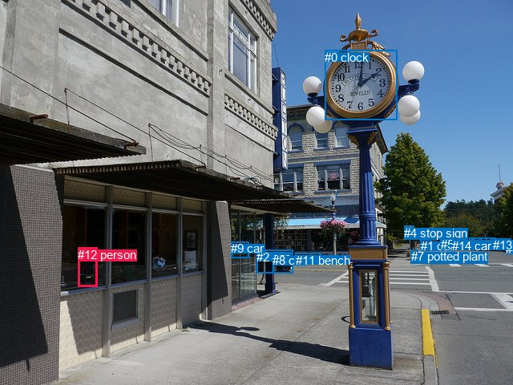
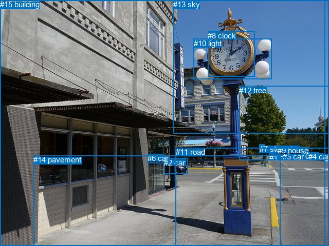

# 图片 0013：1159542.jpg

随机样本序号：350。图片 SHA256：`7d16daf50ccdcbda18b01c0d1e9cf4bd58999550184c951420416c7e916ef9ef`。

红色框表示人，蓝色框表示其他物体。两个模式分别保留自身框编号，可依据位置比较对应对象。

## 自动检测框与输出

人的框编号：`[12]`。状态：`ok`。

### 自动检测全部物体框

| 编号 | 类别 | 是否为人 | 检测分数 | 像素坐标 xyxy |
|---|---|---|---|---|
| 0 | clock | False | 0.9913 | 405.3, 62.6, 495.2, 149.9 |
| 1 | car | False | 0.9626 | 524.8, 298.5, 537.5, 309.2 |
| 2 | car | False | 0.9429 | 320.4, 311.7, 366.0, 340.8 |
| 3 | car | False | 0.9371 | 585.6, 296.7, 599.1, 305.6 |
| 4 | stop sign | False | 0.9244 | 504.4, 282.0, 516.5, 293.7 |
| 5 | car | False | 0.8569 | 549.8, 296.3, 565.1, 308.8 |
| 6 | car | False | 0.8566 | 631.1, 302.3, 640.0, 313.6 |
| 7 | potted plant | False | 0.8316 | 512.6, 311.4, 521.1, 324.9 |
| 8 | car | False | 0.7889 | 340.1, 316.3, 365.8, 340.7 |
| 9 | car | False | 0.7616 | 288.2, 301.1, 310.6, 321.6 |
| 10 | car | False | 0.7486 | 599.3, 296.8, 618.9, 309.3 |
| 11 | bench | False | 0.7040 | 369.0, 315.7, 400.1, 326.7 |
| 12 | person | True | 0.6408 | 97.3, 308.9, 121.2, 357.9 |
| 13 | car | False | 0.4613 | 615.2, 297.0, 637.8, 310.7 |
| 14 | car | False | 0.3703 | 564.1, 297.8, 575.3, 304.2 |

### 自动检测 Top50 人相关候选

评分物体对：210；人相关物体对：28；输出关系：50。

| 排名 | 主语编号与类别 | 关系 | 宾语编号与类别 | 类型 | 人与人 | 排序分数 | 原始融合 logit |
|---|---|---|---|---|---|---|---|
| 1 | #12 person | walking on | #11 bench | semantic | False | 0.95236 | 2.9953 |
| 2 | #12 person | walking on | #2 car | semantic | False | 0.80575 | 1.4226 |
| 3 | #12 person | walking on | #0 clock | semantic | False | 0.79722 | 1.3690 |
| 4 | #12 person | walking on | #8 car | semantic | False | 0.79479 | 1.3540 |
| 5 | #12 person | walking on | #7 potted plant | semantic | False | 0.68350 | 0.7699 |
| 6 | #12 person | walking on | #9 car | semantic | False | 0.58621 | 0.3483 |
| 7 | #12 person | walking on | #5 car | semantic | False | 0.56557 | 0.2638 |
| 8 | #12 person | walking on | #14 car | semantic | False | 0.51764 | 0.0706 |
| 9 | #12 person | walking on | #1 car | semantic | False | 0.47864 | -0.0855 |
| 10 | #12 person | walking on | #10 car | semantic | False | 0.45838 | -0.1669 |
| 11 | #12 person | walking on | #3 car | semantic | False | 0.44741 | -0.2111 |
| 12 | #12 person | walking on | #13 car | semantic | False | 0.41678 | -0.3360 |
| 13 | #12 person | walking on | #6 car | semantic | False | 0.36097 | -0.5712 |
| 14 | #12 person | in | #11 bench | spatial | False | 0.35269 | -0.6072 |
| 15 | #12 person | on | #0 clock | spatial | False | 0.28958 | -0.8974 |
| 16 | #12 person | walking on | #4 stop sign | semantic | False | 0.23667 | -1.1710 |
| 17 | #0 clock | on | #12 person | spatial | False | 0.18299 | -1.4962 |
| 18 | #12 person | in | #9 car | spatial | False | 0.16326 | -1.6342 |
| 19 | #12 person | in | #2 car | spatial | False | 0.15751 | -1.6769 |
| 20 | #12 person | in | #8 car | spatial | False | 0.11367 | -2.0538 |
| 21 | #0 clock | talking to | #12 person | semantic | False | 0.06808 | -2.6165 |
| 22 | #12 person | in | #5 car | spatial | False | 0.05038 | -2.9364 |
| 23 | #12 person | on | #7 potted plant | spatial | False | 0.04660 | -3.0183 |
| 24 | #12 person | on | #4 stop sign | spatial | False | 0.04585 | -3.0355 |
| 25 | #12 person | in | #14 car | spatial | False | 0.04562 | -3.0407 |
| 26 | #12 person | on | #1 car | spatial | False | 0.04305 | -3.1013 |
| 27 | #12 person | in | #3 car | spatial | False | 0.04234 | -3.1188 |
| 28 | #12 person | in | #10 car | spatial | False | 0.03773 | -3.2389 |
| 29 | #12 person | in | #13 car | spatial | False | 0.02881 | -3.5179 |
| 30 | #12 person | in | #6 car | spatial | False | 0.02163 | -3.8119 |
| 31 | #7 potted plant | walking on | #12 person | semantic | False | 0.01769 | -4.0170 |
| 32 | #4 stop sign | in front of | #12 person | spatial | False | 0.01164 | -4.4415 |
| 33 | #7 potted plant | in | #12 person | spatial | False | 0.01019 | -4.5762 |
| 34 | #2 car | parked on | #12 person | semantic | False | 0.01018 | -4.5768 |
| 35 | #2 car | in front of | #12 person | spatial | False | 0.00995 | -4.5999 |
| 36 | #9 car | in front of | #12 person | spatial | False | 0.00934 | -4.6637 |
| 37 | #6 car | driving | #12 person | semantic | False | 0.00919 | -4.6799 |
| 38 | #8 car | parked on | #12 person | semantic | False | 0.00761 | -4.8708 |
| 39 | #8 car | in front of | #12 person | spatial | False | 0.00697 | -4.9586 |
| 40 | #1 car | in | #12 person | spatial | False | 0.00692 | -4.9666 |
| 41 | #14 car | on | #12 person | spatial | False | 0.00680 | -4.9846 |
| 42 | #5 car | in | #12 person | spatial | False | 0.00633 | -5.0555 |
| 43 | #14 car | driving | #12 person | semantic | False | 0.00625 | -5.0685 |
| 44 | #3 car | on | #12 person | spatial | False | 0.00593 | -5.1212 |
| 45 | #13 car | driving | #12 person | semantic | False | 0.00591 | -5.1245 |
| 46 | #11 bench | parked on | #12 person | semantic | False | 0.00558 | -5.1836 |
| 47 | #4 stop sign | holding | #12 person | semantic | False | 0.00544 | -5.2080 |
| 48 | #5 car | driving | #12 person | semantic | False | 0.00512 | -5.2688 |
| 49 | #9 car | parked on | #12 person | semantic | False | 0.00511 | -5.2713 |
| 50 | #11 bench | in front of | #12 person | spatial | False | 0.00480 | -5.3350 |

### 自动检测逐条人相关 GT 核验

本图没有人相关 GT，R@50 无分母；预测候选继续展示。

## 真实框与输出

人的框编号：`[]`。

### 真实框全部物体框

| 编号 | 类别 | 是否为人 | 检测分数 | 像素坐标 xyxy |
|---|---|---|---|---|
| 0 | car | False | GT | 586.0, 296.0, 603.0, 306.0 |
| 1 | car | False | GT | 524.0, 299.0, 537.0, 309.0 |
| 2 | car | False | GT | 319.0, 309.0, 366.0, 340.0 |
| 3 | car | False | GT | 631.0, 303.0, 640.0, 313.0 |
| 4 | car | False | GT | 600.0, 297.0, 619.0, 310.0 |
| 5 | car | False | GT | 550.0, 297.0, 564.0, 309.0 |
| 6 | car | False | GT | 287.0, 300.0, 317.0, 318.0 |
| 7 | stop sign | False | GT | 505.0, 282.0, 516.0, 293.0 |
| 8 | clock | False | GT | 404.0, 61.0, 496.0, 149.0 |
| 9 | house | False | GT | 540.0, 285.0, 559.0, 309.0 |
| 10 | light | False | GT | 377.0, 76.0, 529.0, 155.0 |
| 11 | road | False | GT | 342.0, 288.0, 640.0, 480.0 |
| 12 | tree | False | GT | 465.0, 168.0, 640.0, 313.0 |
| 13 | sky | False | GT | 337.0, 0.0, 640.0, 261.0 |
| 14 | pavement | False | GT | 65.0, 303.0, 546.0, 480.0 |
| 15 | building | False | GT | 0.0, 0.0, 632.0, 480.0 |

### 真实框 Top50 人相关候选

评分物体对：0；人相关物体对：0；输出关系：0。

| 排名 | 主语编号与类别 | 关系 | 宾语编号与类别 | 类型 | 人与人 | 排序分数 | 原始融合 logit |
|---|---|---|---|---|---|---|---|

### 真实框逐条人相关 GT 核验

本图没有人相关 GT，R@50 无分母；预测候选继续展示。

## 全部人相关 GT

| 主语编号与类别 | 关系 | 宾语编号与类别 |
|---|---|---|

原始记录、全部人相关物体对的两项预测与分项分数见 [逐图证据 JSON](../evidence/cases/0013.json)。全部56类 logits 保留于本机 HOR/output/random500/logits/。

<!-- HOR_COMPLETE_RESULTS -->

## 六组条件的完整输出对照

以下保留同一图片三种框与候选模式、两种谓词输出规则的全部 Top50。框编号各自在所属模式内解释。

### 自动检测框完整枚举：空间与语义各保留一个谓词

| 排名 | 主语编号与类别 | 谓词 | 宾语编号与类别 | 分组 | 排序分数 | predicate logit | pair logit |
|---|---|---|---|---|---|---|---|
| 1 | #12 person | walking on | #11 bench | semantic | 0.9523606 | 3.9269309 | -0.9316475 |
| 2 | #12 person | walking on | #2 car | semantic | 0.8057468 | 2.6600881 | -1.2374811 |
| 3 | #12 person | walking on | #0 clock | semantic | 0.7972188 | 2.9700317 | -1.6010302 |
| 4 | #12 person | walking on | #8 car | semantic | 0.7947884 | 2.5637932 | -1.2097592 |
| 5 | #12 person | walking on | #7 potted plant | semantic | 0.6834953 | 1.6430345 | -0.8731527 |
| 6 | #12 person | walking on | #9 car | semantic | 0.5862129 | 1.6701155 | -1.3217843 |
| 7 | #12 person | walking on | #5 car | semantic | 0.5655695 | 1.4053149 | -1.1415179 |
| 8 | #12 person | walking on | #14 car | semantic | 0.5176436 | 1.2277784 | -1.1571745 |
| 9 | #12 person | walking on | #1 car | semantic | 0.4786424 | 1.1269674 | -1.2124500 |
| 10 | #12 person | walking on | #10 car | semantic | 0.4583811 | 0.9359112 | -1.1027728 |
| 11 | #12 person | walking on | #3 car | semantic | 0.4474132 | 0.9058199 | -1.1169479 |
| 12 | #12 person | walking on | #13 car | semantic | 0.4167751 | 0.7959776 | -1.1320038 |
| 13 | #12 person | walking on | #6 car | semantic | 0.3609664 | 0.5522370 | -1.1234093 |
| 14 | #12 person | in | #11 bench | spatial | 0.3526932 | 0.3244257 | -0.9316475 |
| 15 | #12 person | on | #0 clock | spatial | 0.2895805 | 0.7036080 | -1.6010302 |
| 16 | #12 person | walking on | #4 stop sign | semantic | 0.2366684 | 0.5101180 | -1.6811506 |
| 17 | #0 clock | on | #12 person | spatial | 0.1829948 | 0.3826537 | -1.8788415 |
| 18 | #12 person | in | #9 car | spatial | 0.1632623 | -0.3123679 | -1.3217843 |
| 19 | #12 person | in | #2 car | spatial | 0.1575129 | -0.4393702 | -1.2374811 |
| 20 | #12 person | in | #8 car | spatial | 0.1136676 | -0.8440540 | -1.2097592 |
| 21 | #0 clock | talking to | #12 person | semantic | 0.0680830 | -0.7376750 | -1.8788415 |
| 22 | #12 person | in | #5 car | spatial | 0.0503832 | -1.7948828 | -1.1415179 |
| 23 | #12 person | on | #7 potted plant | spatial | 0.0466043 | -2.1451840 | -0.8731527 |
| 24 | #12 person | on | #4 stop sign | spatial | 0.0458474 | -1.3543549 | -1.6811506 |
| 25 | #12 person | in | #14 car | spatial | 0.0456219 | -1.8834972 | -1.1571745 |
| 26 | #12 person | on | #1 car | spatial | 0.0430545 | -1.8888295 | -1.2124500 |
| 27 | #12 person | in | #3 car | spatial | 0.0423377 | -2.0018687 | -1.1169479 |
| 28 | #12 person | in | #10 car | spatial | 0.0377284 | -2.1361096 | -1.1027728 |
| 29 | #12 person | in | #13 car | spatial | 0.0288066 | -2.3859155 | -1.1320038 |
| 30 | #12 person | in | #6 car | spatial | 0.0216286 | -2.6884658 | -1.1234093 |
| 31 | #7 potted plant | walking on | #12 person | semantic | 0.0176878 | -2.8969283 | -1.1201075 |
| 32 | #4 stop sign | in front of | #12 person | spatial | 0.0116409 | -2.9404664 | -1.5010546 |
| 33 | #7 potted plant | in | #12 person | spatial | 0.0101887 | -3.4561291 | -1.1201075 |
| 34 | #2 car | parked on | #12 person | semantic | 0.0101830 | -3.3448896 | -1.2319078 |
| 35 | #2 car | in front of | #12 person | spatial | 0.0099531 | -3.3679597 | -1.2319078 |
| 36 | #9 car | in front of | #12 person | spatial | 0.0093438 | -3.3913116 | -1.2723420 |
| 37 | #6 car | driving | #12 person | semantic | 0.0091948 | -3.0872989 | -1.5925827 |
| 38 | #8 car | parked on | #12 person | semantic | 0.0076091 | -3.5629368 | -1.3078392 |
| 39 | #8 car | in front of | #12 person | spatial | 0.0069738 | -3.6507633 | -1.3078392 |
| 40 | #1 car | in | #12 person | spatial | 0.0069188 | -3.6341217 | -1.3324487 |
| 41 | #14 car | on | #12 person | spatial | 0.0067958 | -3.5599511 | -1.4246867 |
| 42 | #5 car | in | #12 person | spatial | 0.0063339 | -3.6750598 | -1.3804190 |
| 43 | #14 car | driving | #12 person | semantic | 0.0062522 | -3.6438627 | -1.4246867 |
| 44 | #3 car | on | #12 person | spatial | 0.0059334 | -3.5845251 | -1.5366894 |
| 45 | #13 car | driving | #12 person | semantic | 0.0059138 | -3.5836983 | -1.5408285 |
| 46 | #11 bench | parked on | #12 person | semantic | 0.0055765 | -3.5027008 | -1.6809001 |
| 47 | #4 stop sign | holding | #12 person | semantic | 0.0054429 | -3.7069225 | -1.5010546 |
| 48 | #5 car | driving | #12 person | semantic | 0.0051236 | -3.8883367 | -1.3804190 |
| 49 | #9 car | parked on | #12 person | semantic | 0.0051106 | -3.9989815 | -1.2723420 |
| 50 | #11 bench | in front of | #12 person | spatial | 0.0047967 | -3.6541150 | -1.6809001 |

没有人相关 GT，本条件的召回率无分母。

### 自动检测框完整枚举：每对只保留一个谓词

| 排名 | 主语编号与类别 | 谓词 | 宾语编号与类别 | 分组 | 排序分数 | predicate logit | pair logit |
|---|---|---|---|---|---|---|---|
| 1 | #12 person | walking on | #11 bench | single | 0.9523606 | 3.9269309 | -0.9316475 |
| 2 | #12 person | walking on | #2 car | single | 0.8057468 | 2.6600881 | -1.2374811 |
| 3 | #12 person | walking on | #0 clock | single | 0.7972188 | 2.9700317 | -1.6010302 |
| 4 | #12 person | walking on | #8 car | single | 0.7947884 | 2.5637932 | -1.2097592 |
| 5 | #12 person | walking on | #7 potted plant | single | 0.6834953 | 1.6430345 | -0.8731527 |
| 6 | #12 person | walking on | #9 car | single | 0.5862129 | 1.6701155 | -1.3217843 |
| 7 | #12 person | walking on | #5 car | single | 0.5655695 | 1.4053149 | -1.1415179 |
| 8 | #12 person | walking on | #14 car | single | 0.5176436 | 1.2277784 | -1.1571745 |
| 9 | #12 person | walking on | #1 car | single | 0.4786424 | 1.1269674 | -1.2124500 |
| 10 | #12 person | walking on | #10 car | single | 0.4583811 | 0.9359112 | -1.1027728 |
| 11 | #12 person | walking on | #3 car | single | 0.4474132 | 0.9058199 | -1.1169479 |
| 12 | #12 person | walking on | #13 car | single | 0.4167751 | 0.7959776 | -1.1320038 |
| 13 | #12 person | walking on | #6 car | single | 0.3609664 | 0.5522370 | -1.1234093 |
| 14 | #12 person | walking on | #4 stop sign | single | 0.2366684 | 0.5101180 | -1.6811506 |
| 15 | #0 clock | on | #12 person | single | 0.1829948 | 0.3826537 | -1.8788415 |
| 16 | #7 potted plant | walking on | #12 person | single | 0.0176878 | -2.8969283 | -1.1201075 |
| 17 | #4 stop sign | in front of | #12 person | single | 0.0116409 | -2.9404664 | -1.5010546 |
| 18 | #2 car | parked on | #12 person | single | 0.0101830 | -3.3448896 | -1.2319078 |
| 19 | #9 car | in front of | #12 person | single | 0.0093438 | -3.3913116 | -1.2723420 |
| 20 | #6 car | driving | #12 person | single | 0.0091948 | -3.0872989 | -1.5925827 |
| 21 | #8 car | parked on | #12 person | single | 0.0076091 | -3.5629368 | -1.3078392 |
| 22 | #1 car | in | #12 person | single | 0.0069188 | -3.6341217 | -1.3324487 |
| 23 | #14 car | on | #12 person | single | 0.0067958 | -3.5599511 | -1.4246867 |
| 24 | #5 car | in | #12 person | single | 0.0063339 | -3.6750598 | -1.3804190 |
| 25 | #3 car | on | #12 person | single | 0.0059334 | -3.5845251 | -1.5366894 |
| 26 | #13 car | driving | #12 person | single | 0.0059138 | -3.5836983 | -1.5408285 |
| 27 | #11 bench | parked on | #12 person | single | 0.0055765 | -3.5027008 | -1.6809001 |
| 28 | #10 car | driving | #12 person | single | 0.0047369 | -3.7604561 | -1.5871753 |

没有人相关 GT，本条件的召回率无分母。

### 真实框完整枚举：空间与语义各保留一个谓词

| 排名 | 主语编号与类别 | 谓词 | 宾语编号与类别 | 分组 | 排序分数 | predicate logit | pair logit |
|---|---|---|---|---|---|---|---|

没有人相关 GT，本条件的召回率无分母。

### 真实框完整枚举：每对只保留一个谓词

| 排名 | 主语编号与类别 | 谓词 | 宾语编号与类别 | 分组 | 排序分数 | predicate logit | pair logit |
|---|---|---|---|---|---|---|---|

没有人相关 GT，本条件的召回率无分母。

### 真实框400候选：空间与语义各保留一个谓词

| 排名 | 主语编号与类别 | 谓词 | 宾语编号与类别 | 分组 | 排序分数 | predicate logit | pair logit |
|---|---|---|---|---|---|---|---|

没有人相关 GT，本条件的召回率无分母。

### 真实框400候选：每对只保留一个谓词

| 排名 | 主语编号与类别 | 谓词 | 宾语编号与类别 | 分组 | 排序分数 | predicate logit | pair logit |
|---|---|---|---|---|---|---|---|

没有人相关 GT，本条件的召回率无分母。
