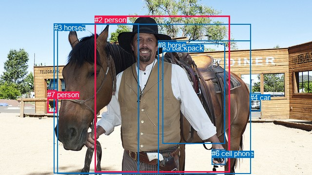
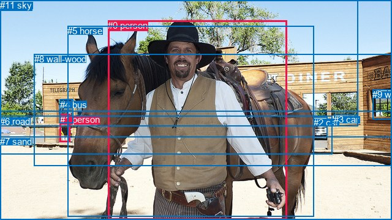

# 图片 0015：1159597.jpg

随机样本序号：185。图片 SHA256：`581707545af4222d6ec9a18e3cb2a2c5d977e793b68f13172a1c11ef585005b6`。

红色框表示人，蓝色框表示其他物体。两个模式分别保留自身框编号，可依据位置比较对应对象。

## 自动检测框与输出

人的框编号：`[1, 2, 7]`。状态：`ok`。

### 自动检测全部物体框

| 编号 | 类别 | 是否为人 | 检测分数 | 像素坐标 xyxy |
|---|---|---|---|---|
| 0 | horse | False | 0.9981 | 117.8, 49.6, 514.2, 357.7 |
| 1 | person | True | 0.9929 | 97.5, 186.2, 116.2, 232.7 |
| 2 | person | True | 0.9877 | 194.4, 32.1, 471.7, 354.1 |
| 3 | horse | False | 0.9494 | 110.7, 48.1, 284.1, 356.6 |
| 4 | car | False | 0.8009 | 512.5, 191.7, 535.0, 228.3 |
| 5 | backpack | False | 0.5744 | 333.4, 89.5, 461.6, 295.6 |
| 6 | cell phone | False | 0.4927 | 434.5, 307.4, 462.1, 338.5 |
| 7 | person | True | 0.4811 | 97.5, 185.8, 114.4, 202.5 |
| 8 | horse | False | 0.3664 | 324.2, 83.6, 514.4, 357.6 |

### 自动检测 Top50 人相关候选

评分物体对：72；人相关物体对：42；输出关系：50。

| 排名 | 主语编号与类别 | 关系 | 宾语编号与类别 | 类型 | 人与人 | 排序分数 | 原始融合 logit |
|---|---|---|---|---|---|---|---|
| 1 | #2 person | holding | #6 cell phone | semantic | False | 0.98962 | 4.5572 |
| 2 | #1 person | wearing | #7 person | semantic | True | 0.98617 | 4.2669 |
| 3 | #2 person | wearing | #5 backpack | semantic | False | 0.97885 | 3.8349 |
| 4 | #2 person | holding | #8 horse | semantic | False | 0.96309 | 3.2617 |
| 5 | #1 person | in | #7 person | spatial | True | 0.94805 | 2.9041 |
| 6 | #2 person | holding | #3 horse | semantic | False | 0.94562 | 2.8558 |
| 7 | #7 person | on | #1 person | spatial | True | 0.90420 | 2.2448 |
| 8 | #2 person | in | #5 backpack | spatial | False | 0.85444 | 1.7699 |
| 9 | #5 backpack | on | #2 person | spatial | False | 0.82948 | 1.5820 |
| 10 | #2 person | in | #0 horse | spatial | False | 0.81430 | 1.4782 |
| 11 | #2 person | standing on | #0 horse | semantic | False | 0.80717 | 1.4317 |
| 12 | #2 person | beside | #3 horse | spatial | False | 0.76699 | 1.1914 |
| 13 | #4 car | parked on | #2 person | semantic | False | 0.69976 | 0.8462 |
| 14 | #2 person | beside | #8 horse | spatial | False | 0.68553 | 0.7793 |
| 15 | #6 cell phone | holding | #2 person | semantic | False | 0.67514 | 0.7315 |
| 16 | #6 cell phone | on | #2 person | spatial | False | 0.65489 | 0.6406 |
| 17 | #1 person | looking at | #3 horse | semantic | False | 0.65389 | 0.6362 |
| 18 | #2 person | on | #6 cell phone | spatial | False | 0.64582 | 0.6007 |
| 19 | #1 person | on | #3 horse | spatial | False | 0.57397 | 0.2981 |
| 20 | #7 person | wearing | #1 person | semantic | True | 0.57389 | 0.2977 |
| 21 | #0 horse | wearing | #2 person | semantic | False | 0.42226 | -0.3135 |
| 22 | #0 horse | in | #2 person | spatial | False | 0.37785 | -0.4987 |
| 23 | #1 person | looking at | #0 horse | semantic | False | 0.36455 | -0.5557 |
| 24 | #3 horse | wearing | #7 person | semantic | False | 0.34898 | -0.6235 |
| 25 | #8 horse | on | #2 person | spatial | False | 0.30395 | -0.8286 |
| 26 | #4 car | beside | #2 person | spatial | False | 0.27596 | -0.9646 |
| 27 | #3 horse | on | #2 person | spatial | False | 0.25213 | -1.0873 |
| 28 | #5 backpack | carrying | #2 person | semantic | False | 0.24225 | -1.1404 |
| 29 | #1 person | on | #0 horse | spatial | False | 0.21681 | -1.2843 |
| 30 | #3 horse | wearing | #2 person | semantic | False | 0.19971 | -1.3881 |
| 31 | #7 person | on | #3 horse | spatial | False | 0.18615 | -1.4752 |
| 32 | #7 person | looking at | #3 horse | semantic | False | 0.16046 | -1.6548 |
| 33 | #3 horse | wearing | #1 person | semantic | False | 0.15590 | -1.6890 |
| 34 | #4 car | parked on | #7 person | semantic | False | 0.15349 | -1.7075 |
| 35 | #4 car | parked on | #1 person | semantic | False | 0.13754 | -1.8358 |
| 36 | #4 car | in | #7 person | spatial | False | 0.10884 | -2.1026 |
| 37 | #7 person | on | #0 horse | spatial | False | 0.10307 | -2.1635 |
| 38 | #1 person | looking at | #2 person | semantic | True | 0.10038 | -2.1930 |
| 39 | #8 horse | carrying | #2 person | semantic | False | 0.08419 | -2.3868 |
| 40 | #1 person | holding | #6 cell phone | semantic | False | 0.07747 | -2.4772 |
| 41 | #1 person | walking on | #4 car | semantic | False | 0.06998 | -2.5869 |
| 42 | #1 person | on | #2 person | spatial | True | 0.06588 | -2.6518 |
| 43 | #7 person | looking at | #0 horse | semantic | False | 0.06302 | -2.6993 |
| 44 | #1 person | looking at | #8 horse | semantic | False | 0.06228 | -2.7119 |
| 45 | #7 person | in | #4 car | spatial | False | 0.05893 | -2.7708 |
| 46 | #1 person | in | #4 car | spatial | False | 0.05826 | -2.7828 |
| 47 | #7 person | on | #2 person | spatial | True | 0.05147 | -2.9139 |
| 48 | #4 car | in | #1 person | spatial | False | 0.04885 | -2.9690 |
| 49 | #2 person | looking at | #1 person | semantic | True | 0.04622 | -3.0270 |
| 50 | #2 person | in | #4 car | spatial | False | 0.04553 | -3.0428 |

### 自动检测逐条人相关 GT 核验

R@50：0.00%；命中 0/1。

| GT 主语编号 | GT 关系 | GT 宾语编号 | 结果阶段 | 匹配预测主语编号 | 匹配预测宾语编号 |
|---|---|---|---|---|---|
| 0 | guiding | 5 | wrong_predicate | [2] | [0] |

## 真实框与输出

人的框编号：`[0, 1]`。

### 真实框全部物体框

| 编号 | 类别 | 是否为人 | 检测分数 | 像素坐标 xyxy |
|---|---|---|---|---|
| 0 | person | True | GT | 176.0, 33.0, 468.0, 360.0 |
| 1 | person | True | GT | 98.0, 187.0, 115.0, 233.0 |
| 2 | car | False | GT | 512.0, 192.0, 535.0, 225.0 |
| 3 | car | False | GT | 545.0, 187.0, 583.0, 199.0 |
| 4 | bus | False | GT | 98.0, 163.0, 120.0, 202.0 |
| 5 | horse | False | GT | 110.0, 42.0, 513.0, 354.0 |
| 6 | road | False | GT | 0.0, 190.0, 543.0, 253.0 |
| 7 | sand | False | GT | 0.0, 223.0, 640.0, 360.0 |
| 8 | wall-wood | False | GT | 56.0, 88.0, 640.0, 271.0 |
| 9 | window | False | GT | 608.0, 146.0, 640.0, 195.0 |
| 10 | tree | False | GT | 0.0, 0.0, 584.0, 207.0 |
| 11 | sky | False | GT | 0.0, 0.0, 640.0, 183.0 |

### 真实框 Top50 人相关候选

评分物体对：132；人相关物体对：42；输出关系：50。

| 排名 | 主语编号与类别 | 关系 | 宾语编号与类别 | 类型 | 人与人 | 排序分数 | 原始融合 logit |
|---|---|---|---|---|---|---|---|
| 1 | #1 person | walking on | #7 sand | semantic | False | 0.97644 | 3.7244 |
| 2 | #0 person | standing on | #7 sand | semantic | False | 0.96856 | 3.4278 |
| 3 | #1 person | standing on | #6 road | semantic | False | 0.96456 | 3.3039 |
| 4 | #0 person | holding | #5 horse | semantic | False | 0.93659 | 2.6926 |
| 5 | #1 person | leaning on | #6 road | spatial | False | 0.93404 | 2.6504 |
| 6 | #1 person | guiding | #5 horse | semantic | False | 0.90287 | 2.2296 |
| 7 | #0 person | beside | #5 horse | spatial | False | 0.90166 | 2.2158 |
| 8 | #1 person | looking at | #4 bus | semantic | False | 0.90145 | 2.2134 |
| 9 | #0 person | on | #7 sand | spatial | False | 0.88930 | 2.0836 |
| 10 | #1 person | in | #4 bus | spatial | False | 0.88369 | 2.0278 |
| 11 | #1 person | in | #8 wall-wood | spatial | False | 0.84919 | 1.7283 |
| 12 | #1 person | on | #7 sand | spatial | False | 0.81742 | 1.4989 |
| 13 | #1 person | beside | #5 horse | spatial | False | 0.80366 | 1.4093 |
| 14 | #5 horse | beside | #0 person | spatial | False | 0.73325 | 1.0112 |
| 15 | #5 horse | wearing | #0 person | semantic | False | 0.72147 | 0.9517 |
| 16 | #1 person | looking at | #0 person | semantic | True | 0.71274 | 0.9087 |
| 17 | #1 person | standing on | #8 wall-wood | semantic | False | 0.70361 | 0.8646 |
| 18 | #1 person | in | #10 tree | spatial | False | 0.63867 | 0.5696 |
| 19 | #1 person | beside | #0 person | spatial | True | 0.49474 | -0.0211 |
| 20 | #6 road | beside | #0 person | spatial | False | 0.49375 | -0.0250 |
| 21 | #0 person | in front of | #8 wall-wood | spatial | False | 0.46987 | -0.1207 |
| 22 | #8 wall-wood | beside | #0 person | spatial | False | 0.41042 | -0.3622 |
| 23 | #0 person | standing on | #8 wall-wood | semantic | False | 0.34607 | -0.6364 |
| 24 | #7 sand | beside | #0 person | spatial | False | 0.26817 | -1.0039 |
| 25 | #1 person | walking on | #10 tree | semantic | False | 0.23209 | -1.1965 |
| 26 | #6 road | looking at | #0 person | semantic | False | 0.18303 | -1.4959 |
| 27 | #1 person | in | #11 sky | spatial | False | 0.17861 | -1.5258 |
| 28 | #0 person | beside | #6 road | spatial | False | 0.17103 | -1.5783 |
| 29 | #4 bus | on | #1 person | spatial | False | 0.16425 | -1.6270 |
| 30 | #0 person | looking at | #1 person | semantic | True | 0.15686 | -1.6818 |
| 31 | #11 sky | over | #0 person | spatial | False | 0.14387 | -1.7835 |
| 32 | #0 person | in | #10 tree | spatial | False | 0.13524 | -1.8554 |
| 33 | #5 horse | wearing | #1 person | semantic | False | 0.13474 | -1.8597 |
| 34 | #4 bus | wearing | #1 person | semantic | False | 0.12226 | -1.9712 |
| 35 | #8 wall-wood | looking at | #0 person | semantic | False | 0.10554 | -2.1372 |
| 36 | #0 person | wearing | #6 road | semantic | False | 0.09867 | -2.2121 |
| 37 | #9 window | beside | #0 person | spatial | False | 0.08204 | -2.4149 |
| 38 | #4 bus | looking at | #0 person | semantic | False | 0.07540 | -2.5065 |
| 39 | #7 sand | holding | #0 person | semantic | False | 0.06678 | -2.6373 |
| 40 | #1 person | looking at | #11 sky | semantic | False | 0.06344 | -2.6922 |
| 41 | #4 bus | beside | #0 person | spatial | False | 0.06288 | -2.7015 |
| 42 | #0 person | in | #11 sky | spatial | False | 0.06246 | -2.7088 |
| 43 | #1 person | looking at | #3 car | semantic | False | 0.06211 | -2.7148 |
| 44 | #0 person | in | #1 person | spatial | True | 0.05615 | -2.8220 |
| 45 | #5 horse | beside | #1 person | spatial | False | 0.05159 | -2.9115 |
| 46 | #1 person | looking at | #2 car | semantic | False | 0.04997 | -2.9451 |
| 47 | #0 person | wearing | #10 tree | semantic | False | 0.04697 | -3.0102 |
| 48 | #2 car | beside | #0 person | spatial | False | 0.04665 | -3.0173 |
| 49 | #9 window | looking at | #0 person | semantic | False | 0.04575 | -3.0377 |
| 50 | #10 tree | over | #0 person | spatial | False | 0.04476 | -3.0607 |

### 真实框逐条人相关 GT 核验

R@50：0.00%；命中 0/1。

| GT 主语编号 | GT 关系 | GT 宾语编号 | 结果阶段 | 匹配预测主语编号 | 匹配预测宾语编号 |
|---|---|---|---|---|---|
| 0 | guiding | 5 | wrong_predicate | [0] | [5] |

## 全部人相关 GT

| 主语编号与类别 | 关系 | 宾语编号与类别 |
|---|---|---|
| #0 person | guiding | #5 horse |

原始记录、全部人相关物体对的两项预测与分项分数见 [逐图证据 JSON](../evidence/cases/0015.json)。全部56类 logits 保留于本机 HOR/output/random500/logits/。

<!-- HOR_COMPLETE_RESULTS -->

## 六组条件的完整输出对照

以下保留同一图片三种框与候选模式、两种谓词输出规则的全部 Top50。框编号各自在所属模式内解释。

### 自动检测框完整枚举：空间与语义各保留一个谓词

| 排名 | 主语编号与类别 | 谓词 | 宾语编号与类别 | 分组 | 排序分数 | predicate logit | pair logit |
|---|---|---|---|---|---|---|---|
| 1 | #2 person | holding | #6 cell phone | semantic | 0.9896176 | 4.6019149 | -0.0447012 |
| 2 | #1 person | wearing | #7 person | semantic | 0.9861686 | 4.2354779 | 0.0314009 |
| 3 | #2 person | wearing | #5 backpack | semantic | 0.9788542 | 3.5424819 | 0.2924564 |
| 4 | #2 person | holding | #8 horse | semantic | 0.9630898 | 3.1032610 | 0.1583950 |
| 5 | #1 person | in | #7 person | spatial | 0.9480473 | 2.8726707 | 0.0314009 |
| 6 | #2 person | holding | #3 horse | semantic | 0.9456182 | 3.1268950 | -0.2710862 |
| 7 | #7 person | on | #1 person | spatial | 0.9042033 | 2.4959626 | -0.2511369 |
| 8 | #2 person | in | #5 backpack | spatial | 0.8544404 | 1.4774046 | 0.2924564 |
| 9 | #5 backpack | on | #2 person | spatial | 0.8294846 | 2.1297121 | -0.5477335 |
| 10 | #2 person | in | #0 horse | spatial | 0.8142983 | 1.7340598 | -0.2558743 |
| 11 | #2 person | standing on | #0 horse | semantic | 0.8071660 | 1.6875739 | -0.2558743 |
| 12 | #2 person | beside | #3 horse | spatial | 0.7669903 | 1.4624801 | -0.2710862 |
| 13 | #4 car | parked on | #2 person | semantic | 0.6997594 | 1.5273919 | -0.6812398 |
| 14 | #2 person | beside | #8 horse | spatial | 0.6855298 | 0.6209078 | 0.1583950 |
| 15 | #6 cell phone | holding | #2 person | semantic | 0.6751434 | 1.4814973 | -0.7499563 |
| 16 | #6 cell phone | on | #2 person | spatial | 0.6548944 | 1.3905797 | -0.7499563 |
| 17 | #1 person | looking at | #3 horse | semantic | 0.6538928 | 0.9655113 | -0.3293166 |
| 18 | #2 person | on | #6 cell phone | spatial | 0.6458217 | 0.6454244 | -0.0447012 |
| 19 | #1 person | on | #3 horse | spatial | 0.5739692 | 0.6273808 | -0.3293166 |
| 20 | #7 person | wearing | #1 person | semantic | 0.5738892 | 0.5488739 | -0.2511369 |
| 21 | #0 horse | wearing | #2 person | semantic | 0.4222560 | 0.5872340 | -0.9007531 |
| 22 | #0 horse | in | #2 person | spatial | 0.3778505 | 0.4020715 | -0.9007531 |
| 23 | #1 person | looking at | #0 horse | semantic | 0.3645460 | -0.1751666 | -0.3805203 |
| 24 | #3 horse | wearing | #7 person | semantic | 0.3489799 | 0.5685644 | -1.1920907 |
| 25 | #8 horse | on | #2 person | spatial | 0.3039475 | -0.0426207 | -0.7859494 |
| 26 | #4 car | beside | #2 person | spatial | 0.2759578 | -0.2833619 | -0.6812398 |
| 27 | #3 horse | on | #2 person | spatial | 0.2521267 | -0.3982992 | -0.6890026 |
| 28 | #5 backpack | carrying | #2 person | semantic | 0.2422473 | -0.5926642 | -0.5477335 |
| 29 | #1 person | on | #0 horse | spatial | 0.2168112 | -0.9038265 | -0.3805203 |
| 30 | #3 horse | wearing | #2 person | semantic | 0.1997128 | -0.6990879 | -0.6890026 |
| 31 | #7 person | on | #3 horse | spatial | 0.1861462 | -0.8209960 | -0.6542525 |
| 32 | #7 person | looking at | #3 horse | semantic | 0.1604563 | -1.0005841 | -0.6542525 |
| 33 | #3 horse | wearing | #1 person | semantic | 0.1559021 | -0.5472126 | -1.1418273 |
| 34 | #4 car | parked on | #7 person | semantic | 0.1534871 | -0.8790083 | -0.8285007 |
| 35 | #4 car | parked on | #1 person | semantic | 0.1375438 | -1.0594378 | -0.7764044 |
| 36 | #4 car | in | #7 person | spatial | 0.1088400 | -1.2741442 | -0.8285007 |
| 37 | #7 person | on | #0 horse | spatial | 0.1030747 | -1.4694495 | -0.6940689 |
| 38 | #1 person | looking at | #2 person | semantic | 0.1003813 | -1.1998923 | -0.9931028 |
| 39 | #8 horse | carrying | #2 person | semantic | 0.0841871 | -1.6008210 | -0.7859494 |
| 40 | #1 person | holding | #6 cell phone | semantic | 0.0774718 | -0.4287624 | -2.0484421 |
| 41 | #1 person | walking on | #4 car | semantic | 0.0699841 | -1.9903827 | -0.5965517 |
| 42 | #1 person | on | #2 person | spatial | 0.0658753 | -1.6587434 | -0.9931028 |
| 43 | #7 person | looking at | #0 horse | semantic | 0.0630160 | -2.0052087 | -0.6940689 |
| 44 | #1 person | looking at | #8 horse | semantic | 0.0622757 | -1.8951180 | -0.8167672 |
| 45 | #7 person | in | #4 car | spatial | 0.0589252 | -2.1780152 | -0.5927389 |
| 46 | #1 person | in | #4 car | spatial | 0.0582617 | -2.1862309 | -0.5965517 |
| 47 | #7 person | on | #2 person | spatial | 0.0514687 | -1.7089198 | -1.2050217 |
| 48 | #4 car | in | #1 person | spatial | 0.0488452 | -2.1926155 | -0.7764044 |
| 49 | #2 person | looking at | #1 person | semantic | 0.0462206 | -1.4856834 | -1.5413229 |
| 50 | #2 person | in | #4 car | spatial | 0.0455311 | -1.4760561 | -1.5667039 |

GT 命中：0/1，R@50=0.00%。

| GT主语 | GT谓词 | GT宾语 | 结果阶段 | 匹配主语框 | 匹配宾语框 |
|---|---|---|---|---|---|
| 0 | guiding | 5 | wrong_predicate | [2] | [0] |

### 自动检测框完整枚举：每对只保留一个谓词

| 排名 | 主语编号与类别 | 谓词 | 宾语编号与类别 | 分组 | 排序分数 | predicate logit | pair logit |
|---|---|---|---|---|---|---|---|
| 1 | #2 person | holding | #6 cell phone | single | 0.9896176 | 4.6019149 | -0.0447012 |
| 2 | #1 person | wearing | #7 person | single | 0.9861686 | 4.2354779 | 0.0314009 |
| 3 | #2 person | wearing | #5 backpack | single | 0.9788542 | 3.5424819 | 0.2924564 |
| 4 | #2 person | holding | #8 horse | single | 0.9630898 | 3.1032610 | 0.1583950 |
| 5 | #2 person | holding | #3 horse | single | 0.9456182 | 3.1268950 | -0.2710862 |
| 6 | #7 person | on | #1 person | single | 0.9042033 | 2.4959626 | -0.2511369 |
| 7 | #5 backpack | on | #2 person | single | 0.8294846 | 2.1297121 | -0.5477335 |
| 8 | #2 person | in | #0 horse | single | 0.8142983 | 1.7340598 | -0.2558743 |
| 9 | #4 car | parked on | #2 person | single | 0.6997594 | 1.5273919 | -0.6812398 |
| 10 | #6 cell phone | holding | #2 person | single | 0.6751434 | 1.4814973 | -0.7499563 |
| 11 | #1 person | looking at | #3 horse | single | 0.6538928 | 0.9655113 | -0.3293166 |
| 12 | #0 horse | wearing | #2 person | single | 0.4222560 | 0.5872340 | -0.9007531 |
| 13 | #1 person | looking at | #0 horse | single | 0.3645460 | -0.1751666 | -0.3805203 |
| 14 | #3 horse | wearing | #7 person | single | 0.3489799 | 0.5685644 | -1.1920907 |
| 15 | #8 horse | on | #2 person | single | 0.3039475 | -0.0426207 | -0.7859494 |
| 16 | #3 horse | on | #2 person | single | 0.2521267 | -0.3982992 | -0.6890026 |
| 17 | #7 person | on | #3 horse | single | 0.1861462 | -0.8209960 | -0.6542525 |
| 18 | #3 horse | wearing | #1 person | single | 0.1559021 | -0.5472126 | -1.1418273 |
| 19 | #4 car | parked on | #7 person | single | 0.1534871 | -0.8790083 | -0.8285007 |
| 20 | #4 car | parked on | #1 person | single | 0.1375438 | -1.0594378 | -0.7764044 |
| 21 | #7 person | on | #0 horse | single | 0.1030747 | -1.4694495 | -0.6940689 |
| 22 | #1 person | looking at | #2 person | single | 0.1003813 | -1.1998923 | -0.9931028 |
| 23 | #1 person | holding | #6 cell phone | single | 0.0774718 | -0.4287624 | -2.0484421 |
| 24 | #1 person | walking on | #4 car | single | 0.0699841 | -1.9903827 | -0.5965517 |
| 25 | #1 person | looking at | #8 horse | single | 0.0622757 | -1.8951180 | -0.8167672 |
| 26 | #7 person | in | #4 car | single | 0.0589252 | -2.1780152 | -0.5927389 |
| 27 | #7 person | on | #2 person | single | 0.0514687 | -1.7089198 | -1.2050217 |
| 28 | #2 person | looking at | #1 person | single | 0.0462206 | -1.4856834 | -1.5413229 |
| 29 | #2 person | in | #4 car | single | 0.0455311 | -1.4760561 | -1.5667039 |
| 30 | #2 person | wearing | #7 person | single | 0.0453063 | -1.3185644 | -1.7293808 |
| 31 | #0 horse | wearing | #7 person | single | 0.0389903 | -1.8756282 | -1.3290441 |
| 32 | #0 horse | wearing | #1 person | single | 0.0317497 | -2.1494565 | -1.2681518 |
| 33 | #7 person | on | #8 horse | single | 0.0236447 | -2.5886073 | -1.1320810 |
| 34 | #6 cell phone | holding | #1 person | single | 0.0174733 | -1.5961733 | -2.4332788 |
| 35 | #7 person | holding | #6 cell phone | single | 0.0144563 | -1.5862424 | -2.6358178 |
| 36 | #1 person | wearing | #5 backpack | single | 0.0122855 | -2.6502059 | -1.7367685 |
| 37 | #6 cell phone | in | #7 person | single | 0.0082583 | -2.1214244 | -2.6668158 |
| 38 | #7 person | on | #5 backpack | single | 0.0067485 | -3.0153549 | -1.9763088 |
| 39 | #5 backpack | on | #1 person | single | 0.0066599 | -2.8271036 | -2.1778717 |
| 40 | #8 horse | in | #1 person | single | 0.0059037 | -3.3409598 | -1.7852997 |
| 41 | #8 horse | wearing | #7 person | single | 0.0052214 | -3.3642001 | -1.8855473 |
| 42 | #5 backpack | in | #7 person | single | 0.0035001 | -3.2790065 | -2.3724377 |

GT 命中：0/1，R@50=0.00%。

| GT主语 | GT谓词 | GT宾语 | 结果阶段 | 匹配主语框 | 匹配宾语框 |
|---|---|---|---|---|---|
| 0 | guiding | 5 | wrong_predicate | [2] | [0] |

### 真实框完整枚举：空间与语义各保留一个谓词

| 排名 | 主语编号与类别 | 谓词 | 宾语编号与类别 | 分组 | 排序分数 | predicate logit | pair logit |
|---|---|---|---|---|---|---|---|
| 1 | #1 person | walking on | #7 sand | semantic | 0.9764398 | 4.1014848 | -0.3771285 |
| 2 | #0 person | standing on | #7 sand | semantic | 0.9685621 | 3.3726840 | 0.0551146 |
| 3 | #1 person | standing on | #6 road | semantic | 0.9645624 | 3.2027364 | 0.1011651 |
| 4 | #0 person | holding | #5 horse | semantic | 0.9365883 | 2.9585834 | -0.2659889 |
| 5 | #1 person | leaning on | #6 road | spatial | 0.9340372 | 2.5492606 | 0.1011651 |
| 6 | #1 person | guiding | #5 horse | semantic | 0.9028746 | 2.5497389 | -0.3201579 |
| 7 | #0 person | beside | #5 horse | spatial | 0.9016625 | 2.4818239 | -0.2659889 |
| 8 | #1 person | looking at | #4 bus | semantic | 0.9014508 | 2.3674898 | -0.1540409 |
| 9 | #0 person | on | #7 sand | spatial | 0.8893024 | 2.0285201 | 0.0551146 |
| 10 | #1 person | in | #4 bus | spatial | 0.8836899 | 2.1818876 | -0.1540409 |
| 11 | #1 person | in | #8 wall-wood | spatial | 0.8491908 | 1.8889480 | -0.1606795 |
| 12 | #1 person | on | #7 sand | spatial | 0.8174159 | 1.8760657 | -0.3771285 |
| 13 | #1 person | beside | #5 horse | spatial | 0.8036597 | 1.7294846 | -0.3201579 |
| 14 | #5 horse | beside | #0 person | spatial | 0.7332500 | 1.9435930 | -0.9324183 |
| 15 | #5 horse | wearing | #0 person | semantic | 0.7214662 | 1.8841648 | -0.9324183 |
| 16 | #1 person | looking at | #0 person | semantic | 0.7127425 | 1.8174801 | -0.9087389 |
| 17 | #1 person | standing on | #8 wall-wood | semantic | 0.7036145 | 1.0252495 | -0.1606795 |
| 18 | #1 person | in | #10 tree | spatial | 0.6386718 | 1.0561266 | -0.4865226 |
| 19 | #1 person | beside | #0 person | spatial | 0.4947358 | 0.8876815 | -0.9087389 |
| 20 | #6 road | beside | #0 person | spatial | 0.4937494 | 0.3474264 | -0.3724304 |
| 21 | #0 person | in front of | #8 wall-wood | spatial | 0.4698721 | 0.6161847 | -0.7368425 |
| 22 | #8 wall-wood | beside | #0 person | spatial | 0.4104163 | 0.3176246 | -0.6798694 |
| 23 | #0 person | standing on | #8 wall-wood | semantic | 0.3460691 | 0.1004791 | -0.7368425 |
| 24 | #7 sand | beside | #0 person | spatial | 0.2681739 | -0.1629682 | -0.8409392 |
| 25 | #1 person | walking on | #10 tree | semantic | 0.2320908 | -0.7100203 | -0.4865226 |
| 26 | #6 road | looking at | #0 person | semantic | 0.1830335 | -1.1234982 | -0.3724304 |
| 27 | #1 person | in | #11 sky | spatial | 0.1786072 | -0.6356211 | -0.8901914 |
| 28 | #0 person | beside | #6 road | spatial | 0.1710327 | -0.1352482 | -1.4430780 |
| 29 | #4 bus | on | #1 person | spatial | 0.1642482 | -1.1290908 | -0.4978619 |
| 30 | #0 person | looking at | #1 person | semantic | 0.1568624 | -0.2382040 | -1.4435569 |
| 31 | #11 sky | over | #0 person | spatial | 0.1438720 | -0.9740396 | -0.8094565 |
| 32 | #0 person | in | #10 tree | spatial | 0.1352405 | -0.7199249 | -1.1354715 |
| 33 | #5 horse | wearing | #1 person | semantic | 0.1347366 | -0.5890398 | -1.2706726 |
| 34 | #4 bus | wearing | #1 person | semantic | 0.1222601 | -1.4733374 | -0.4978619 |
| 35 | #8 wall-wood | looking at | #0 person | semantic | 0.1055371 | -1.4572911 | -0.6798694 |
| 36 | #0 person | wearing | #6 road | semantic | 0.0986663 | -0.7690542 | -1.4430780 |
| 37 | #9 window | beside | #0 person | spatial | 0.0820443 | -1.3730946 | -1.0417958 |
| 38 | #4 bus | looking at | #0 person | semantic | 0.0754047 | -1.3222289 | -1.1842577 |
| 39 | #7 sand | holding | #0 person | semantic | 0.0667788 | -1.7963178 | -0.8409392 |
| 40 | #1 person | looking at | #11 sky | semantic | 0.0634357 | -1.8020000 | -0.8901914 |
| 41 | #4 bus | beside | #0 person | spatial | 0.0628846 | -1.5172477 | -1.1842577 |
| 42 | #0 person | in | #11 sky | spatial | 0.0624577 | -1.4863110 | -1.2224615 |
| 43 | #1 person | looking at | #3 car | semantic | 0.0621072 | -1.8549600 | -0.8598143 |
| 44 | #0 person | in | #1 person | spatial | 0.0561491 | -1.3784013 | -1.4435569 |
| 45 | #5 horse | beside | #1 person | spatial | 0.0515869 | -1.6408508 | -1.2706726 |
| 46 | #1 person | looking at | #2 car | semantic | 0.0499700 | -2.3113837 | -0.6336859 |
| 47 | #0 person | wearing | #10 tree | semantic | 0.0469660 | -1.8747561 | -1.1354715 |
| 48 | #2 car | beside | #0 person | spatial | 0.0466500 | -2.3621736 | -0.6551356 |
| 49 | #9 window | looking at | #0 person | semantic | 0.0457510 | -1.9959157 | -1.0417958 |
| 50 | #10 tree | over | #0 person | spatial | 0.0447581 | -2.2794864 | -0.7812052 |

GT 命中：0/1，R@50=0.00%。

| GT主语 | GT谓词 | GT宾语 | 结果阶段 | 匹配主语框 | 匹配宾语框 |
|---|---|---|---|---|---|
| 0 | guiding | 5 | wrong_predicate | [0] | [5] |

### 真实框完整枚举：每对只保留一个谓词

| 排名 | 主语编号与类别 | 谓词 | 宾语编号与类别 | 分组 | 排序分数 | predicate logit | pair logit |
|---|---|---|---|---|---|---|---|
| 1 | #1 person | walking on | #7 sand | single | 0.9764398 | 4.1014848 | -0.3771285 |
| 2 | #0 person | standing on | #7 sand | single | 0.9685621 | 3.3726840 | 0.0551146 |
| 3 | #1 person | standing on | #6 road | single | 0.9645624 | 3.2027364 | 0.1011651 |
| 4 | #0 person | holding | #5 horse | single | 0.9365883 | 2.9585834 | -0.2659889 |
| 5 | #1 person | guiding | #5 horse | single | 0.9028746 | 2.5497389 | -0.3201579 |
| 6 | #1 person | looking at | #4 bus | single | 0.9014508 | 2.3674898 | -0.1540409 |
| 7 | #1 person | in | #8 wall-wood | single | 0.8491908 | 1.8889480 | -0.1606795 |
| 8 | #5 horse | beside | #0 person | single | 0.7332500 | 1.9435930 | -0.9324183 |
| 9 | #1 person | looking at | #0 person | single | 0.7127425 | 1.8174801 | -0.9087389 |
| 10 | #1 person | in | #10 tree | single | 0.6386718 | 1.0561266 | -0.4865226 |
| 11 | #6 road | beside | #0 person | single | 0.4937494 | 0.3474264 | -0.3724304 |
| 12 | #0 person | in front of | #8 wall-wood | single | 0.4698721 | 0.6161847 | -0.7368425 |
| 13 | #8 wall-wood | beside | #0 person | single | 0.4104163 | 0.3176246 | -0.6798694 |
| 14 | #7 sand | beside | #0 person | single | 0.2681739 | -0.1629682 | -0.8409392 |
| 15 | #1 person | in | #11 sky | single | 0.1786072 | -0.6356211 | -0.8901914 |
| 16 | #0 person | beside | #6 road | single | 0.1710327 | -0.1352482 | -1.4430780 |
| 17 | #4 bus | on | #1 person | single | 0.1642482 | -1.1290908 | -0.4978619 |
| 18 | #0 person | looking at | #1 person | single | 0.1568624 | -0.2382040 | -1.4435569 |
| 19 | #11 sky | over | #0 person | single | 0.1438720 | -0.9740396 | -0.8094565 |
| 20 | #0 person | in | #10 tree | single | 0.1352405 | -0.7199249 | -1.1354715 |
| 21 | #5 horse | wearing | #1 person | single | 0.1347366 | -0.5890398 | -1.2706726 |
| 22 | #9 window | beside | #0 person | single | 0.0820443 | -1.3730946 | -1.0417958 |
| 23 | #4 bus | looking at | #0 person | single | 0.0754047 | -1.3222289 | -1.1842577 |
| 24 | #0 person | in | #11 sky | single | 0.0624577 | -1.4863110 | -1.2224615 |
| 25 | #1 person | looking at | #3 car | single | 0.0621072 | -1.8549600 | -0.8598143 |
| 26 | #1 person | looking at | #2 car | single | 0.0499700 | -2.3113837 | -0.6336859 |
| 27 | #2 car | beside | #0 person | single | 0.0466500 | -2.3621736 | -0.6551356 |
| 28 | #10 tree | over | #0 person | single | 0.0447581 | -2.2794864 | -0.7812052 |
| 29 | #0 person | looking at | #4 bus | single | 0.0404057 | -1.3084915 | -1.8590486 |
| 30 | #3 car | beside | #0 person | single | 0.0333964 | -2.4207513 | -0.9445902 |
| 31 | #0 person | looking at | #9 window | single | 0.0307337 | -1.5061543 | -1.9450254 |
| 32 | #6 road | in | #1 person | single | 0.0287841 | -3.0070319 | -0.5116936 |
| 33 | #1 person | looking at | #9 window | single | 0.0286081 | -2.4902425 | -1.0347987 |
| 34 | #0 person | beside | #2 car | single | 0.0148507 | -2.7103624 | -1.4843836 |
| 35 | #2 car | parked on | #1 person | single | 0.0102638 | -3.8040023 | -0.7648113 |
| 36 | #8 wall-wood | holding | #1 person | single | 0.0096434 | -3.6213772 | -1.0104156 |
| 37 | #0 person | looking at | #3 car | single | 0.0079148 | -2.7810667 | -2.0500045 |
| 38 | #7 sand | in | #1 person | single | 0.0064052 | -3.5056369 | -1.5385901 |
| 39 | #9 window | in | #1 person | single | 0.0056294 | -3.9956670 | -1.1784354 |
| 40 | #3 car | parked on | #1 person | single | 0.0055405 | -4.2418990 | -0.9482235 |
| 41 | #11 sky | over | #1 person | single | 0.0046350 | -3.9871304 | -1.3823466 |
| 42 | #10 tree | over | #1 person | single | 0.0039047 | -4.2057953 | -1.3358545 |

GT 命中：0/1，R@50=0.00%。

| GT主语 | GT谓词 | GT宾语 | 结果阶段 | 匹配主语框 | 匹配宾语框 |
|---|---|---|---|---|---|
| 0 | guiding | 5 | wrong_predicate | [0] | [5] |

### 真实框400候选：空间与语义各保留一个谓词

| 排名 | 主语编号与类别 | 谓词 | 宾语编号与类别 | 分组 | 排序分数 | predicate logit | pair logit |
|---|---|---|---|---|---|---|---|
| 1 | #1 person | walking on | #7 sand | semantic | 0.9765090 | 4.1044955 | -0.3771285 |
| 2 | #0 person | standing on | #7 sand | semantic | 0.9671469 | 3.3271899 | 0.0551146 |
| 3 | #1 person | standing on | #6 road | semantic | 0.9629741 | 3.1572423 | 0.1011651 |
| 4 | #0 person | holding | #5 horse | semantic | 0.9365883 | 2.9585834 | -0.2659889 |
| 5 | #1 person | in | #6 road | spatial | 0.9325172 | 2.5248508 | 0.1011651 |
| 6 | #1 person | guiding | #5 horse | semantic | 0.9054816 | 2.5798306 | -0.3201579 |
| 7 | #0 person | beside | #5 horse | spatial | 0.9016677 | 2.4818816 | -0.2659889 |
| 8 | #1 person | looking at | #4 bus | semantic | 0.9014508 | 2.3674898 | -0.1540409 |
| 9 | #0 person | on | #7 sand | spatial | 0.8893024 | 2.0285201 | 0.0551146 |
| 10 | #1 person | in | #4 bus | spatial | 0.8836899 | 2.1818876 | -0.1540409 |
| 11 | #1 person | in | #8 wall-wood | spatial | 0.8457300 | 1.8621755 | -0.1606795 |
| 12 | #1 person | on | #7 sand | spatial | 0.8190355 | 1.8869548 | -0.3771285 |
| 13 | #1 person | beside | #5 horse | spatial | 0.8036597 | 1.7294846 | -0.3201579 |
| 14 | #5 horse | beside | #0 person | spatial | 0.7332500 | 1.9435930 | -0.9324183 |
| 15 | #5 horse | wearing | #0 person | semantic | 0.7214662 | 1.8841648 | -0.9324183 |
| 16 | #1 person | looking at | #0 person | semantic | 0.7127425 | 1.8174801 | -0.9087389 |
| 17 | #1 person | standing on | #8 wall-wood | semantic | 0.7020807 | 1.0179052 | -0.1606795 |
| 18 | #1 person | in | #10 tree | spatial | 0.6309266 | 1.0227165 | -0.4865226 |
| 19 | #1 person | beside | #0 person | spatial | 0.5022295 | 0.9176569 | -0.9087389 |
| 20 | #6 road | beside | #0 person | spatial | 0.4937494 | 0.3474264 | -0.3724304 |
| 21 | #0 person | in front of | #8 wall-wood | spatial | 0.4848477 | 0.6762147 | -0.7368425 |
| 22 | #8 wall-wood | beside | #0 person | spatial | 0.4177026 | 0.3476577 | -0.6798694 |
| 23 | #0 person | standing on | #8 wall-wood | semantic | 0.3529100 | 0.1305704 | -0.7368425 |
| 24 | #7 sand | beside | #0 person | spatial | 0.2681739 | -0.1629682 | -0.8409392 |
| 25 | #1 person | walking on | #10 tree | semantic | 0.2318226 | -0.7115254 | -0.4865226 |
| 26 | #6 road | looking at | #0 person | semantic | 0.1830335 | -1.1234982 | -0.3724304 |
| 27 | #1 person | in | #11 sky | spatial | 0.1786072 | -0.6356211 | -0.8901914 |
| 28 | #0 person | beside | #6 road | spatial | 0.1710286 | -0.1352768 | -1.4430780 |
| 29 | #4 bus | on | #1 person | spatial | 0.1684207 | -1.0989997 | -0.4978619 |
| 30 | #0 person | looking at | #1 person | semantic | 0.1567933 | -0.2387271 | -1.4435569 |
| 31 | #11 sky | over | #0 person | spatial | 0.1444429 | -0.9694123 | -0.8094565 |
| 32 | #0 person | in | #10 tree | spatial | 0.1352405 | -0.7199249 | -1.1354715 |
| 33 | #5 horse | wearing | #1 person | semantic | 0.1347366 | -0.5890398 | -1.2706726 |
| 34 | #4 bus | wearing | #1 person | semantic | 0.1268617 | -1.4311345 | -0.4978619 |
| 35 | #8 wall-wood | looking at | #0 person | semantic | 0.1055371 | -1.4572911 | -0.6798694 |
| 36 | #0 person | wearing | #6 road | semantic | 0.0984057 | -0.7719882 | -1.4430780 |
| 37 | #9 window | beside | #0 person | spatial | 0.0809225 | -1.3880823 | -1.0417958 |
| 38 | #4 bus | looking at | #0 person | semantic | 0.0754047 | -1.3222289 | -1.1842577 |
| 39 | #7 sand | holding | #0 person | semantic | 0.0667788 | -1.7963178 | -0.8409392 |
| 40 | #4 bus | beside | #0 person | spatial | 0.0646814 | -1.4871564 | -1.1842577 |
| 41 | #0 person | in | #11 sky | spatial | 0.0623606 | -1.4879704 | -1.2224615 |
| 42 | #1 person | looking at | #11 sky | semantic | 0.0616914 | -1.8317428 | -0.8901914 |
| 43 | #1 person | looking at | #3 car | semantic | 0.0604070 | -1.8845282 | -0.8598143 |
| 44 | #0 person | in | #1 person | spatial | 0.0555308 | -1.3901281 | -1.4435569 |
| 45 | #5 horse | beside | #1 person | spatial | 0.0523258 | -1.6258485 | -1.2706726 |
| 46 | #1 person | looking at | #2 car | semantic | 0.0506913 | -2.2962947 | -0.6336859 |
| 47 | #2 car | beside | #0 person | spatial | 0.0486956 | -2.3171091 | -0.6551356 |
| 48 | #0 person | wearing | #10 tree | semantic | 0.0469660 | -1.8747561 | -1.1354715 |
| 49 | #9 window | looking at | #0 person | semantic | 0.0451061 | -2.0107868 | -1.0417958 |
| 50 | #10 tree | over | #0 person | spatial | 0.0443428 | -2.2892437 | -0.7812052 |

GT 命中：0/1，R@50=0.00%。

| GT主语 | GT谓词 | GT宾语 | 结果阶段 | 匹配主语框 | 匹配宾语框 |
|---|---|---|---|---|---|
| 0 | guiding | 5 | wrong_predicate | [0] | [5] |

### 真实框400候选：每对只保留一个谓词

| 排名 | 主语编号与类别 | 谓词 | 宾语编号与类别 | 分组 | 排序分数 | predicate logit | pair logit |
|---|---|---|---|---|---|---|---|
| 1 | #1 person | walking on | #7 sand | single | 0.9765090 | 4.1044955 | -0.3771285 |
| 2 | #0 person | standing on | #7 sand | single | 0.9671469 | 3.3271899 | 0.0551146 |
| 3 | #1 person | standing on | #6 road | single | 0.9629741 | 3.1572423 | 0.1011651 |
| 4 | #0 person | holding | #5 horse | single | 0.9365883 | 2.9585834 | -0.2659889 |
| 5 | #1 person | guiding | #5 horse | single | 0.9054816 | 2.5798306 | -0.3201579 |
| 6 | #1 person | looking at | #4 bus | single | 0.9014508 | 2.3674898 | -0.1540409 |
| 7 | #1 person | in | #8 wall-wood | single | 0.8457300 | 1.8621755 | -0.1606795 |
| 8 | #5 horse | beside | #0 person | single | 0.7332500 | 1.9435930 | -0.9324183 |
| 9 | #1 person | looking at | #0 person | single | 0.7127425 | 1.8174801 | -0.9087389 |
| 10 | #1 person | in | #10 tree | single | 0.6309266 | 1.0227165 | -0.4865226 |
| 11 | #6 road | beside | #0 person | single | 0.4937494 | 0.3474264 | -0.3724304 |
| 12 | #0 person | in front of | #8 wall-wood | single | 0.4848477 | 0.6762147 | -0.7368425 |
| 13 | #8 wall-wood | beside | #0 person | single | 0.4177026 | 0.3476577 | -0.6798694 |
| 14 | #7 sand | beside | #0 person | single | 0.2681739 | -0.1629682 | -0.8409392 |
| 15 | #1 person | in | #11 sky | single | 0.1786072 | -0.6356211 | -0.8901914 |
| 16 | #0 person | beside | #6 road | single | 0.1710286 | -0.1352768 | -1.4430780 |
| 17 | #4 bus | on | #1 person | single | 0.1684207 | -1.0989997 | -0.4978619 |
| 18 | #0 person | looking at | #1 person | single | 0.1567933 | -0.2387271 | -1.4435569 |
| 19 | #11 sky | over | #0 person | single | 0.1444429 | -0.9694123 | -0.8094565 |
| 20 | #0 person | in | #10 tree | single | 0.1352405 | -0.7199249 | -1.1354715 |
| 21 | #5 horse | wearing | #1 person | single | 0.1347366 | -0.5890398 | -1.2706726 |
| 22 | #9 window | beside | #0 person | single | 0.0809225 | -1.3880823 | -1.0417958 |
| 23 | #4 bus | looking at | #0 person | single | 0.0754047 | -1.3222289 | -1.1842577 |
| 24 | #0 person | in | #11 sky | single | 0.0623606 | -1.4879704 | -1.2224615 |
| 25 | #1 person | looking at | #3 car | single | 0.0604070 | -1.8845282 | -0.8598143 |
| 26 | #1 person | looking at | #2 car | single | 0.0506913 | -2.2962947 | -0.6336859 |
| 27 | #2 car | beside | #0 person | single | 0.0486956 | -2.3171091 | -0.6551356 |
| 28 | #10 tree | over | #0 person | single | 0.0443428 | -2.2892437 | -0.7812052 |
| 29 | #0 person | looking at | #4 bus | single | 0.0416061 | -1.2779644 | -1.8590486 |
| 30 | #3 car | beside | #0 person | single | 0.0338848 | -2.4057274 | -0.9445902 |
| 31 | #0 person | looking at | #9 window | single | 0.0307415 | -1.5058928 | -1.9450254 |
| 32 | #6 road | in | #1 person | single | 0.0294945 | -2.9819188 | -0.5116936 |
| 33 | #1 person | looking at | #9 window | single | 0.0286056 | -2.4903295 | -1.0347987 |
| 34 | #0 person | beside | #2 car | single | 0.0152966 | -2.6803291 | -1.4843836 |
| 35 | #2 car | parked on | #1 person | single | 0.0104566 | -3.7851992 | -0.7648113 |
| 36 | #8 wall-wood | holding | #1 person | single | 0.0096663 | -3.6189768 | -1.0104156 |
| 37 | #0 person | looking at | #3 car | single | 0.0077969 | -2.7961993 | -2.0500045 |
| 38 | #7 sand | in | #1 person | single | 0.0063575 | -3.5131598 | -1.5385901 |
| 39 | #3 car | parked on | #1 person | single | 0.0056768 | -4.2174597 | -0.9482235 |
| 40 | #9 window | in | #1 person | single | 0.0056437 | -3.9931223 | -1.1784354 |
| 41 | #11 sky | over | #1 person | single | 0.0045944 | -3.9959753 | -1.3823466 |
| 42 | #10 tree | over | #1 person | single | 0.0039393 | -4.1969504 | -1.3358545 |

GT 命中：0/1，R@50=0.00%。

| GT主语 | GT谓词 | GT宾语 | 结果阶段 | 匹配主语框 | 匹配宾语框 |
|---|---|---|---|---|---|
| 0 | guiding | 5 | wrong_predicate | [0] | [5] |
