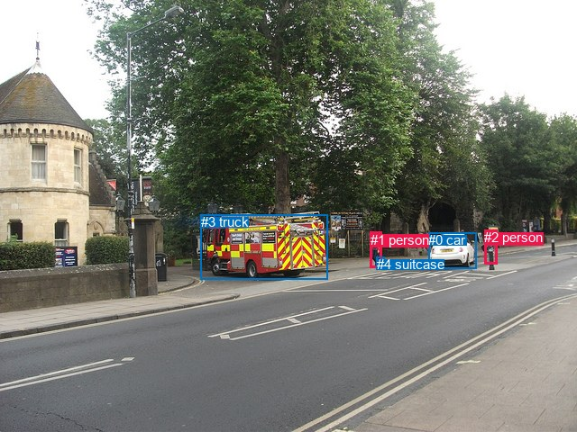
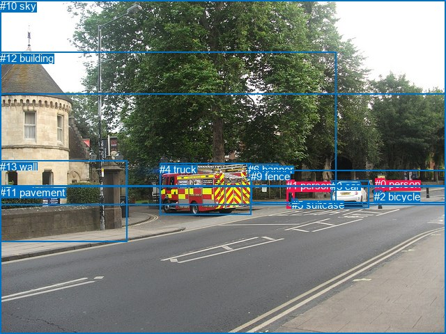

# 图片 0023：1159863.jpg

随机样本序号：145。图片 SHA256：`4278c4c673a2e75b1f63780d026b3c05dd9955eeae50cd017a8e1844b736ce58`。

红色框表示人，蓝色框表示其他物体。两个模式分别保留自身框编号，可依据位置比较对应对象。

## 自动检测框与输出

人的框编号：`[1, 2]`。状态：`ok`。

### 自动检测全部物体框

| 编号 | 类别 | 是否为人 | 检测分数 | 像素坐标 xyxy |
|---|---|---|---|---|
| 0 | car | False | 0.9976 | 475.4, 258.5, 528.7, 298.9 |
| 1 | person | True | 0.9966 | 410.9, 257.6, 423.9, 297.9 |
| 2 | person | True | 0.9886 | 537.4, 255.5, 551.5, 293.7 |
| 3 | truck | False | 0.9056 | 222.8, 238.1, 363.3, 310.7 |
| 4 | suitcase | False | 0.5772 | 417.7, 285.3, 426.6, 295.7 |

### 自动检测 Top50 人相关候选

评分物体对：20；人相关物体对：14；输出关系：28。

| 排名 | 主语编号与类别 | 关系 | 宾语编号与类别 | 类型 | 人与人 | 排序分数 | 原始融合 logit |
|---|---|---|---|---|---|---|---|
| 1 | #1 person | holding | #4 suitcase | semantic | False | 0.98055 | 3.9200 |
| 2 | #2 person | holding | #4 suitcase | semantic | False | 0.95448 | 3.0430 |
| 3 | #2 person | walking on | #0 car | semantic | False | 0.89825 | 2.1779 |
| 4 | #1 person | walking on | #3 truck | semantic | False | 0.89262 | 2.1178 |
| 5 | #2 person | walking on | #3 truck | semantic | False | 0.81457 | 1.4800 |
| 6 | #2 person | beside | #0 car | spatial | False | 0.80109 | 1.3931 |
| 7 | #1 person | in | #4 suitcase | spatial | False | 0.73633 | 1.0270 |
| 8 | #1 person | beside | #3 truck | spatial | False | 0.69037 | 0.8018 |
| 9 | #2 person | holding | #1 person | semantic | True | 0.62091 | 0.4934 |
| 10 | #0 car | driving on | #2 person | semantic | False | 0.57605 | 0.3066 |
| 11 | #0 car | beside | #2 person | spatial | False | 0.55630 | 0.2262 |
| 12 | #4 suitcase | on | #1 person | spatial | False | 0.55028 | 0.2018 |
| 13 | #1 person | walking on | #0 car | semantic | False | 0.38483 | -0.4691 |
| 14 | #4 suitcase | carrying | #1 person | semantic | False | 0.37355 | -0.5170 |
| 15 | #2 person | beside | #3 truck | spatial | False | 0.32532 | -0.7294 |
| 16 | #3 truck | beside | #1 person | spatial | False | 0.31002 | -0.8000 |
| 17 | #2 person | on | #4 suitcase | spatial | False | 0.26293 | -1.0308 |
| 18 | #0 car | driving | #1 person | semantic | False | 0.22648 | -1.2283 |
| 19 | #3 truck | driving | #1 person | semantic | False | 0.22146 | -1.2572 |
| 20 | #0 car | beside | #1 person | spatial | False | 0.11619 | -2.0290 |
| 21 | #1 person | walking on | #2 person | semantic | True | 0.07848 | -2.4632 |
| 22 | #2 person | beside | #1 person | spatial | True | 0.06879 | -2.6055 |
| 23 | #1 person | beside | #0 car | spatial | False | 0.06534 | -2.6606 |
| 24 | #3 truck | driving | #2 person | semantic | False | 0.05228 | -2.8975 |
| 25 | #4 suitcase | carrying | #2 person | semantic | False | 0.03795 | -3.2328 |
| 26 | #4 suitcase | on | #2 person | spatial | False | 0.02695 | -3.5865 |
| 27 | #3 truck | beside | #2 person | spatial | False | 0.01555 | -4.1483 |
| 28 | #1 person | in | #2 person | spatial | True | 0.01374 | -4.2733 |

### 自动检测逐条人相关 GT 核验

R@50：0.00%；命中 0/1。

| GT 主语编号 | GT 关系 | GT 宾语编号 | 结果阶段 | 匹配预测主语编号 | 匹配预测宾语编号 |
|---|---|---|---|---|---|
| 0 | on | 7 | endpoint_missing_or_wrong_class | [2] | [] |

## 真实框与输出

人的框编号：`[0, 1]`。

### 真实框全部物体框

| 编号 | 类别 | 是否为人 | 检测分数 | 像素坐标 xyxy |
|---|---|---|---|---|
| 0 | person | True | GT | 538.0, 256.0, 551.0, 283.0 |
| 1 | person | True | GT | 411.0, 258.0, 422.0, 299.0 |
| 2 | bicycle | False | GT | 537.0, 274.0, 549.0, 285.0 |
| 3 | car | False | GT | 475.0, 259.0, 529.0, 298.0 |
| 4 | truck | False | GT | 229.0, 235.0, 361.0, 309.0 |
| 5 | suitcase | False | GT | 419.0, 286.0, 427.0, 296.0 |
| 6 | banner | False | GT | 356.0, 235.0, 401.0, 256.0 |
| 7 | road | False | GT | 0.0, 266.0, 640.0, 480.0 |
| 8 | tree | False | GT | 0.0, 0.0, 640.0, 294.0 |
| 9 | fence | False | GT | 360.0, 245.0, 640.0, 292.0 |
| 10 | sky | False | GT | 0.0, 0.0, 640.0, 135.0 |
| 11 | pavement | False | GT | 0.0, 268.0, 640.0, 480.0 |
| 12 | building | False | GT | 0.0, 75.0, 483.0, 295.0 |
| 13 | wall | False | GT | 0.0, 231.0, 182.0, 348.0 |

### 真实框 Top50 人相关候选

评分物体对：182；人相关物体对：50；输出关系：50。

| 排名 | 主语编号与类别 | 关系 | 宾语编号与类别 | 类型 | 人与人 | 排序分数 | 原始融合 logit |
|---|---|---|---|---|---|---|---|
| 1 | #1 person | crossing | #7 road | semantic | False | 0.99293 | 4.9443 |
| 2 | #1 person | crossing | #11 pavement | semantic | False | 0.99291 | 4.9414 |
| 3 | #1 person | carrying | #5 suitcase | semantic | False | 0.98381 | 4.1072 |
| 4 | #0 person | wearing | #2 bicycle | semantic | False | 0.97874 | 3.8296 |
| 5 | #0 person | crossing | #7 road | semantic | False | 0.97371 | 3.6120 |
| 6 | #1 person | walking on | #9 fence | semantic | False | 0.97261 | 3.5697 |
| 7 | #0 person | crossing | #11 pavement | semantic | False | 0.97039 | 3.4895 |
| 8 | #0 person | walking on | #9 fence | semantic | False | 0.93042 | 2.5932 |
| 9 | #0 person | in | #2 bicycle | spatial | False | 0.92151 | 2.4630 |
| 10 | #2 bicycle | on | #0 person | spatial | False | 0.89389 | 2.1311 |
| 11 | #1 person | on | #7 road | spatial | False | 0.80719 | 1.4319 |
| 12 | #1 person | on | #11 pavement | spatial | False | 0.80675 | 1.4290 |
| 13 | #1 person | in | #5 suitcase | spatial | False | 0.74377 | 1.0657 |
| 14 | #2 bicycle | holding | #0 person | semantic | False | 0.72133 | 0.9510 |
| 15 | #0 person | on | #9 fence | spatial | False | 0.67261 | 0.7200 |
| 16 | #1 person | walking on | #4 truck | semantic | False | 0.66614 | 0.6908 |
| 17 | #1 person | on | #9 fence | spatial | False | 0.63418 | 0.5502 |
| 18 | #5 suitcase | on | #1 person | spatial | False | 0.61499 | 0.4683 |
| 19 | #0 person | on | #7 road | spatial | False | 0.60531 | 0.4276 |
| 20 | #0 person | on | #11 pavement | spatial | False | 0.58560 | 0.3458 |
| 21 | #5 suitcase | carrying | #1 person | semantic | False | 0.53649 | 0.1462 |
| 22 | #1 person | beside | #4 truck | spatial | False | 0.48238 | -0.0705 |
| 23 | #1 person | walking on | #12 building | semantic | False | 0.25599 | -1.0669 |
| 24 | #1 person | wearing | #0 person | semantic | True | 0.25545 | -1.0698 |
| 25 | #1 person | wearing | #2 bicycle | semantic | False | 0.25084 | -1.0941 |
| 26 | #0 person | beside | #3 car | spatial | False | 0.23365 | -1.1878 |
| 27 | #0 person | standing on | #3 car | semantic | False | 0.17536 | -1.5481 |
| 28 | #0 person | walking on | #4 truck | semantic | False | 0.14126 | -1.8048 |
| 29 | #0 person | wearing | #5 suitcase | semantic | False | 0.11609 | -2.0300 |
| 30 | #1 person | walking on | #6 banner | semantic | False | 0.08862 | -2.3305 |
| 31 | #1 person | beside | #3 car | spatial | False | 0.08782 | -2.3405 |
| 32 | #1 person | beside | #12 building | spatial | False | 0.08727 | -2.3474 |
| 33 | #1 person | walking on | #3 car | semantic | False | 0.07305 | -2.5408 |
| 34 | #0 person | wearing | #1 person | semantic | True | 0.07256 | -2.5480 |
| 35 | #2 bicycle | on | #1 person | spatial | False | 0.06412 | -2.6807 |
| 36 | #1 person | beside | #6 banner | spatial | False | 0.06322 | -2.6959 |
| 37 | #0 person | beside | #4 truck | spatial | False | 0.05823 | -2.7833 |
| 38 | #2 bicycle | wearing | #1 person | semantic | False | 0.05282 | -2.8867 |
| 39 | #0 person | in | #5 suitcase | spatial | False | 0.04971 | -2.9507 |
| 40 | #1 person | in | #0 person | spatial | True | 0.04289 | -3.1052 |
| 41 | #1 person | in | #2 bicycle | spatial | False | 0.04058 | -3.1632 |
| 42 | #5 suitcase | on | #0 person | spatial | False | 0.03576 | -3.2945 |
| 43 | #3 car | beside | #0 person | spatial | False | 0.03208 | -3.4068 |
| 44 | #0 person | on | #1 person | spatial | True | 0.02854 | -3.5275 |
| 45 | #1 person | walking on | #8 tree | semantic | False | 0.02816 | -3.5414 |
| 46 | #5 suitcase | wearing | #0 person | semantic | False | 0.02552 | -3.6425 |
| 47 | #0 person | walking on | #13 wall | semantic | False | 0.02392 | -3.7089 |
| 48 | #1 person | in | #8 tree | spatial | False | 0.01984 | -3.9000 |
| 49 | #6 banner | attached to | #1 person | spatial | False | 0.01810 | -3.9936 |
| 50 | #4 truck | beside | #1 person | spatial | False | 0.01775 | -4.0132 |

### 真实框逐条人相关 GT 核验

R@50：100.00%；命中 1/1。

| GT 主语编号 | GT 关系 | GT 宾语编号 | 结果阶段 | 匹配预测主语编号 | 匹配预测宾语编号 |
|---|---|---|---|---|---|
| 0 | on | 7 | hit50 | [0] | [7] |

## 全部人相关 GT

| 主语编号与类别 | 关系 | 宾语编号与类别 |
|---|---|---|
| #0 person | on | #7 road |

原始记录、全部人相关物体对的两项预测与分项分数见 [逐图证据 JSON](../evidence/cases/0023.json)。全部56类 logits 保留于本机 HOR/output/random500/logits/。

<!-- HOR_COMPLETE_RESULTS -->

## 六组条件的完整输出对照

以下保留同一图片三种框与候选模式、两种谓词输出规则的全部 Top50。框编号各自在所属模式内解释。

### 自动检测框完整枚举：空间与语义各保留一个谓词

| 排名 | 主语编号与类别 | 谓词 | 宾语编号与类别 | 分组 | 排序分数 | predicate logit | pair logit |
|---|---|---|---|---|---|---|---|
| 1 | #1 person | holding | #4 suitcase | semantic | 0.9805458 | 3.7611375 | 0.1589047 |
| 2 | #2 person | holding | #4 suitcase | semantic | 0.9544789 | 3.5717273 | -0.5287372 |
| 3 | #2 person | walking on | #0 car | semantic | 0.8982472 | 2.8437018 | -0.6658036 |
| 4 | #1 person | walking on | #3 truck | semantic | 0.8926212 | 2.7714491 | -0.6536487 |
| 5 | #2 person | walking on | #3 truck | semantic | 0.8145725 | 2.3441510 | -0.8641516 |
| 6 | #2 person | beside | #0 car | spatial | 0.8010904 | 2.0589271 | -0.6658036 |
| 7 | #1 person | in | #4 suitcase | spatial | 0.7363253 | 0.8680511 | 0.1589047 |
| 8 | #1 person | beside | #3 truck | spatial | 0.6903667 | 1.4554830 | -0.6536487 |
| 9 | #2 person | holding | #1 person | semantic | 0.6209072 | 1.2757196 | -0.7823191 |
| 10 | #0 car | driving on | #2 person | semantic | 0.5760522 | 1.4999547 | -1.1933664 |
| 11 | #0 car | beside | #2 person | spatial | 0.5562992 | 1.4195223 | -1.1933664 |
| 12 | #4 suitcase | on | #1 person | spatial | 0.5502778 | 0.6592379 | -0.4574448 |
| 13 | #1 person | walking on | #0 car | semantic | 0.3848271 | 0.5658126 | -1.0349216 |
| 14 | #4 suitcase | carrying | #1 person | semantic | 0.3735489 | -0.0595770 | -0.4574448 |
| 15 | #2 person | beside | #3 truck | spatial | 0.3253164 | 0.1347060 | -0.8641516 |
| 16 | #3 truck | beside | #1 person | spatial | 0.3100208 | 0.9052682 | -1.7052903 |
| 17 | #2 person | on | #4 suitcase | spatial | 0.2629279 | -0.5020685 | -0.5287372 |
| 18 | #0 car | driving | #1 person | semantic | 0.2264811 | 0.1472697 | -1.3755586 |
| 19 | #3 truck | driving | #1 person | semantic | 0.2214621 | 0.4481239 | -1.7052903 |
| 20 | #0 car | beside | #1 person | spatial | 0.1161923 | -0.6534343 | -1.3755586 |
| 21 | #1 person | walking on | #2 person | semantic | 0.0784804 | -1.3328910 | -1.1302838 |
| 22 | #2 person | beside | #1 person | spatial | 0.0687883 | -1.8231332 | -0.7823191 |
| 23 | #1 person | beside | #0 car | spatial | 0.0653362 | -1.6257186 | -1.0349216 |
| 24 | #3 truck | driving | #2 person | semantic | 0.0522764 | -0.9209058 | -1.9766122 |
| 25 | #4 suitcase | carrying | #2 person | semantic | 0.0379516 | -1.8946431 | -1.3381089 |
| 26 | #4 suitcase | on | #2 person | spatial | 0.0269492 | -2.2483757 | -1.3381089 |
| 27 | #3 truck | beside | #2 person | spatial | 0.0155460 | -2.1716692 | -1.9766122 |
| 28 | #1 person | in | #2 person | spatial | 0.0137437 | -3.1430497 | -1.1302838 |

GT 命中：0/1，R@50=0.00%。

| GT主语 | GT谓词 | GT宾语 | 结果阶段 | 匹配主语框 | 匹配宾语框 |
|---|---|---|---|---|---|
| 0 | on | 7 | endpoint_missing_or_wrong_class | [2] | [] |

### 自动检测框完整枚举：每对只保留一个谓词

| 排名 | 主语编号与类别 | 谓词 | 宾语编号与类别 | 分组 | 排序分数 | predicate logit | pair logit |
|---|---|---|---|---|---|---|---|
| 1 | #1 person | holding | #4 suitcase | single | 0.9805458 | 3.7611375 | 0.1589047 |
| 2 | #2 person | holding | #4 suitcase | single | 0.9544789 | 3.5717273 | -0.5287372 |
| 3 | #2 person | walking on | #0 car | single | 0.8982472 | 2.8437018 | -0.6658036 |
| 4 | #1 person | walking on | #3 truck | single | 0.8926212 | 2.7714491 | -0.6536487 |
| 5 | #2 person | walking on | #3 truck | single | 0.8145725 | 2.3441510 | -0.8641516 |
| 6 | #2 person | holding | #1 person | single | 0.6209072 | 1.2757196 | -0.7823191 |
| 7 | #0 car | driving on | #2 person | single | 0.5760522 | 1.4999547 | -1.1933664 |
| 8 | #4 suitcase | on | #1 person | single | 0.5502778 | 0.6592379 | -0.4574448 |
| 9 | #1 person | walking on | #0 car | single | 0.3848271 | 0.5658126 | -1.0349216 |
| 10 | #3 truck | beside | #1 person | single | 0.3100208 | 0.9052682 | -1.7052903 |
| 11 | #0 car | driving | #1 person | single | 0.2264811 | 0.1472697 | -1.3755586 |
| 12 | #1 person | walking on | #2 person | single | 0.0784804 | -1.3328910 | -1.1302838 |
| 13 | #3 truck | driving | #2 person | single | 0.0522764 | -0.9209058 | -1.9766122 |
| 14 | #4 suitcase | carrying | #2 person | single | 0.0379516 | -1.8946431 | -1.3381089 |

GT 命中：0/1，R@50=0.00%。

| GT主语 | GT谓词 | GT宾语 | 结果阶段 | 匹配主语框 | 匹配宾语框 |
|---|---|---|---|---|---|
| 0 | on | 7 | endpoint_missing_or_wrong_class | [2] | [] |

### 真实框完整枚举：空间与语义各保留一个谓词

| 排名 | 主语编号与类别 | 谓词 | 宾语编号与类别 | 分组 | 排序分数 | predicate logit | pair logit |
|---|---|---|---|---|---|---|---|
| 1 | #1 person | crossing | #7 road | semantic | 0.9929265 | 5.2025285 | -0.2582229 |
| 2 | #1 person | crossing | #11 pavement | semantic | 0.9929062 | 5.2024579 | -0.2610338 |
| 3 | #1 person | carrying | #5 suitcase | semantic | 0.9838126 | 3.9536090 | 0.1535915 |
| 4 | #0 person | wearing | #2 bicycle | semantic | 0.9787424 | 4.2529359 | -0.4233812 |
| 5 | #0 person | crossing | #7 road | semantic | 0.9737119 | 3.9418950 | -0.3298963 |
| 6 | #1 person | walking on | #9 fence | semantic | 0.9726071 | 3.8185802 | -0.2488851 |
| 7 | #0 person | crossing | #11 pavement | semantic | 0.9703885 | 3.8218856 | -0.3323498 |
| 8 | #0 person | walking on | #9 fence | semantic | 0.9304232 | 3.0182009 | -0.4249925 |
| 9 | #0 person | in | #2 bicycle | spatial | 0.9215076 | 2.8863907 | -0.4233812 |
| 10 | #2 bicycle | on | #0 person | spatial | 0.8938877 | 2.3294325 | -0.1983497 |
| 11 | #1 person | on | #7 road | spatial | 0.8071895 | 1.6900735 | -0.2582229 |
| 12 | #1 person | on | #11 pavement | spatial | 0.8067517 | 1.6900735 | -0.2610338 |
| 13 | #1 person | in | #5 suitcase | spatial | 0.7437739 | 0.9120851 | 0.1535915 |
| 14 | #2 bicycle | holding | #0 person | semantic | 0.7213256 | 1.1493959 | -0.1983497 |
| 15 | #0 person | on | #9 fence | spatial | 0.6726053 | 1.1449847 | -0.4249925 |
| 16 | #1 person | walking on | #4 truck | semantic | 0.6661394 | 1.3782201 | -0.6874446 |
| 17 | #1 person | on | #9 fence | spatial | 0.6341775 | 0.7990656 | -0.2488851 |
| 18 | #5 suitcase | on | #1 person | spatial | 0.6149929 | 0.9334769 | -0.4651282 |
| 19 | #0 person | on | #7 road | spatial | 0.6053095 | 0.7575345 | -0.3298963 |
| 20 | #0 person | on | #11 pavement | spatial | 0.5855987 | 0.6781497 | -0.3323498 |
| 21 | #5 suitcase | carrying | #1 person | semantic | 0.5364906 | 0.6113505 | -0.4651282 |
| 22 | #1 person | beside | #4 truck | spatial | 0.4823756 | 0.6169176 | -0.6874446 |
| 23 | #1 person | walking on | #12 building | semantic | 0.2559861 | -0.1609068 | -0.9060300 |
| 24 | #1 person | wearing | #0 person | semantic | 0.2554478 | -0.0773425 | -0.9924222 |
| 25 | #1 person | wearing | #2 bicycle | semantic | 0.2508413 | -0.0604906 | -1.0336398 |
| 26 | #0 person | beside | #3 car | spatial | 0.2336493 | -0.4377069 | -0.7501121 |
| 27 | #0 person | standing on | #3 car | semantic | 0.1753633 | -0.7979708 | -0.7501121 |
| 28 | #0 person | walking on | #4 truck | semantic | 0.1412634 | -0.6618934 | -1.1429427 |
| 29 | #0 person | wearing | #5 suitcase | semantic | 0.1160885 | -1.1322584 | -0.8977461 |
| 30 | #1 person | walking on | #6 banner | semantic | 0.0886248 | -1.4848871 | -0.8456554 |
| 31 | #1 person | beside | #3 car | spatial | 0.0878242 | -1.2950692 | -1.0454259 |
| 32 | #1 person | beside | #12 building | spatial | 0.0872693 | -1.4414124 | -0.9060300 |
| 33 | #1 person | walking on | #3 car | semantic | 0.0730450 | -1.4954033 | -1.0454259 |
| 34 | #0 person | wearing | #1 person | semantic | 0.0725593 | -1.4807932 | -1.0672317 |
| 35 | #2 bicycle | on | #1 person | spatial | 0.0641197 | -1.8100147 | -0.8707209 |
| 36 | #1 person | beside | #6 banner | spatial | 0.0632180 | -1.8502066 | -0.8456554 |
| 37 | #0 person | beside | #4 truck | spatial | 0.0582310 | -1.6403992 | -1.1429427 |
| 38 | #2 bicycle | wearing | #1 person | semantic | 0.0528158 | -2.0159616 | -0.8707209 |
| 39 | #0 person | in | #5 suitcase | spatial | 0.0497055 | -2.0529096 | -0.8977461 |
| 40 | #1 person | in | #0 person | spatial | 0.0428949 | -2.1127381 | -0.9924222 |
| 41 | #1 person | in | #2 bicycle | spatial | 0.0405751 | -2.1295390 | -1.0336398 |
| 42 | #5 suitcase | on | #0 person | spatial | 0.0357614 | -2.0107083 | -1.2837601 |
| 43 | #3 car | beside | #0 person | spatial | 0.0320842 | -2.3193209 | -1.0874602 |
| 44 | #0 person | on | #1 person | spatial | 0.0285391 | -2.4602957 | -1.0672317 |
| 45 | #1 person | walking on | #8 tree | semantic | 0.0281564 | -2.3620493 | -1.1793725 |
| 46 | #5 suitcase | wearing | #0 person | semantic | 0.0255177 | -2.3587744 | -1.2837601 |
| 47 | #0 person | walking on | #13 wall | semantic | 0.0239175 | -2.3725510 | -1.3363847 |
| 48 | #1 person | in | #8 tree | spatial | 0.0198397 | -2.7206593 | -1.1793725 |
| 49 | #6 banner | attached to | #1 person | spatial | 0.0180996 | -2.5879555 | -1.4056464 |
| 50 | #4 truck | beside | #1 person | spatial | 0.0177538 | -2.3182800 | -1.6949638 |

GT 命中：1/1，R@50=100.00%。

| GT主语 | GT谓词 | GT宾语 | 结果阶段 | 匹配主语框 | 匹配宾语框 |
|---|---|---|---|---|---|
| 0 | on | 7 | hit50 | [0] | [7] |

### 真实框完整枚举：每对只保留一个谓词

| 排名 | 主语编号与类别 | 谓词 | 宾语编号与类别 | 分组 | 排序分数 | predicate logit | pair logit |
|---|---|---|---|---|---|---|---|
| 1 | #1 person | crossing | #7 road | single | 0.9929265 | 5.2025285 | -0.2582229 |
| 2 | #1 person | crossing | #11 pavement | single | 0.9929062 | 5.2024579 | -0.2610338 |
| 3 | #1 person | carrying | #5 suitcase | single | 0.9838126 | 3.9536090 | 0.1535915 |
| 4 | #0 person | wearing | #2 bicycle | single | 0.9787424 | 4.2529359 | -0.4233812 |
| 5 | #0 person | crossing | #7 road | single | 0.9737119 | 3.9418950 | -0.3298963 |
| 6 | #1 person | walking on | #9 fence | single | 0.9726071 | 3.8185802 | -0.2488851 |
| 7 | #0 person | crossing | #11 pavement | single | 0.9703885 | 3.8218856 | -0.3323498 |
| 8 | #0 person | walking on | #9 fence | single | 0.9304232 | 3.0182009 | -0.4249925 |
| 9 | #2 bicycle | on | #0 person | single | 0.8938877 | 2.3294325 | -0.1983497 |
| 10 | #1 person | walking on | #4 truck | single | 0.6661394 | 1.3782201 | -0.6874446 |
| 11 | #5 suitcase | on | #1 person | single | 0.6149929 | 0.9334769 | -0.4651282 |
| 12 | #1 person | walking on | #12 building | single | 0.2559861 | -0.1609068 | -0.9060300 |
| 13 | #1 person | wearing | #0 person | single | 0.2554478 | -0.0773425 | -0.9924222 |
| 14 | #1 person | wearing | #2 bicycle | single | 0.2508413 | -0.0604906 | -1.0336398 |
| 15 | #0 person | beside | #3 car | single | 0.2336493 | -0.4377069 | -0.7501121 |
| 16 | #0 person | walking on | #4 truck | single | 0.1412634 | -0.6618934 | -1.1429427 |
| 17 | #0 person | wearing | #5 suitcase | single | 0.1160885 | -1.1322584 | -0.8977461 |
| 18 | #1 person | walking on | #6 banner | single | 0.0886248 | -1.4848871 | -0.8456554 |
| 19 | #1 person | beside | #3 car | single | 0.0878242 | -1.2950692 | -1.0454259 |
| 20 | #0 person | wearing | #1 person | single | 0.0725593 | -1.4807932 | -1.0672317 |
| 21 | #2 bicycle | on | #1 person | single | 0.0641197 | -1.8100147 | -0.8707209 |
| 22 | #5 suitcase | on | #0 person | single | 0.0357614 | -2.0107083 | -1.2837601 |
| 23 | #3 car | beside | #0 person | single | 0.0320842 | -2.3193209 | -1.0874602 |
| 24 | #1 person | walking on | #8 tree | single | 0.0281564 | -2.3620493 | -1.1793725 |
| 25 | #0 person | walking on | #13 wall | single | 0.0239175 | -2.3725510 | -1.3363847 |
| 26 | #6 banner | attached to | #1 person | single | 0.0180996 | -2.5879555 | -1.4056464 |
| 27 | #4 truck | beside | #1 person | single | 0.0177538 | -2.3182800 | -1.6949638 |
| 28 | #3 car | beside | #1 person | single | 0.0176488 | -2.6503823 | -1.3688965 |
| 29 | #0 person | in | #8 tree | single | 0.0175198 | -2.6745813 | -1.3521650 |
| 30 | #1 person | walking on | #13 wall | single | 0.0174948 | -2.5636423 | -1.4645604 |
| 31 | #0 person | walking on | #12 building | single | 0.0157315 | -2.9111552 | -1.2250773 |
| 32 | #0 person | holding | #6 banner | single | 0.0112977 | -3.0054121 | -1.4663788 |
| 33 | #9 fence | wearing | #0 person | single | 0.0096663 | -3.2009897 | -1.4284091 |
| 34 | #10 sky | over | #1 person | single | 0.0041185 | -3.9812794 | -1.5068636 |
| 35 | #9 fence | holding | #1 person | single | 0.0037939 | -3.9978943 | -1.5726666 |
| 36 | #4 truck | beside | #0 person | single | 0.0026663 | -3.8815503 | -2.0428457 |
| 37 | #6 banner | attached to | #0 person | single | 0.0025355 | -3.8462794 | -2.1285620 |
| 38 | #12 building | beside | #1 person | single | 0.0024514 | -4.2301321 | -1.7785027 |
| 39 | #13 wall | beside | #1 person | single | 0.0023184 | -4.4101014 | -1.6544571 |
| 40 | #10 sky | over | #0 person | single | 0.0019146 | -4.4984941 | -1.7578461 |
| 41 | #0 person | looking at | #10 sky | single | 0.0014463 | -4.3047624 | -2.2325618 |
| 42 | #8 tree | beside | #1 person | single | 0.0013800 | -5.1713800 | -1.4129405 |
| 43 | #7 road | in | #0 person | single | 0.0013756 | -4.7375417 | -1.8499286 |
| 44 | #11 pavement | in | #0 person | single | 0.0012835 | -4.7973371 | -1.8595595 |
| 45 | #7 road | in | #1 person | single | 0.0012711 | -4.7086697 | -1.9579501 |
| 46 | #11 pavement | in | #1 person | single | 0.0012176 | -4.7446246 | -1.9650114 |
| 47 | #12 building | beside | #0 person | single | 0.0012070 | -4.9150839 | -1.8033302 |
| 48 | #1 person | looking at | #10 sky | single | 0.0011953 | -4.4238405 | -2.3042860 |
| 49 | #13 wall | beside | #0 person | single | 0.0008505 | -5.0919657 | -1.9769028 |
| 50 | #8 tree | in | #0 person | single | 0.0008157 | -5.3641577 | -1.7464827 |

GT 命中：0/1，R@50=0.00%。

| GT主语 | GT谓词 | GT宾语 | 结果阶段 | 匹配主语框 | 匹配宾语框 |
|---|---|---|---|---|---|
| 0 | on | 7 | wrong_predicate | [0] | [7] |

### 真实框400候选：空间与语义各保留一个谓词

| 排名 | 主语编号与类别 | 谓词 | 宾语编号与类别 | 分组 | 排序分数 | predicate logit | pair logit |
|---|---|---|---|---|---|---|---|
| 1 | #1 person | crossing | #7 road | semantic | 0.9929265 | 5.2025285 | -0.2582229 |
| 2 | #1 person | crossing | #11 pavement | semantic | 0.9929073 | 5.2026000 | -0.2610338 |
| 3 | #1 person | carrying | #5 suitcase | semantic | 0.9838126 | 3.9536090 | 0.1535915 |
| 4 | #0 person | wearing | #2 bicycle | semantic | 0.9788643 | 4.2588048 | -0.4233812 |
| 5 | #0 person | crossing | #7 road | semantic | 0.9737119 | 3.9418950 | -0.3298963 |
| 6 | #1 person | walking on | #9 fence | semantic | 0.9726071 | 3.8185802 | -0.2488851 |
| 7 | #0 person | crossing | #11 pavement | semantic | 0.9703907 | 3.8219571 | -0.3323498 |
| 8 | #0 person | walking on | #9 fence | semantic | 0.9304232 | 3.0182009 | -0.4249925 |
| 9 | #0 person | in | #2 bicycle | spatial | 0.9210262 | 2.8797531 | -0.4233812 |
| 10 | #2 bicycle | on | #0 person | spatial | 0.8938877 | 2.3294325 | -0.1983497 |
| 11 | #1 person | on | #11 pavement | spatial | 0.8075991 | 1.6955180 | -0.2610338 |
| 12 | #1 person | on | #7 road | spatial | 0.8071895 | 1.6900735 | -0.2582229 |
| 13 | #1 person | in | #5 suitcase | spatial | 0.7437739 | 0.9120851 | 0.1535915 |
| 14 | #2 bicycle | holding | #0 person | semantic | 0.7213256 | 1.1493959 | -0.1983497 |
| 15 | #0 person | on | #9 fence | spatial | 0.6714052 | 1.1395397 | -0.4249925 |
| 16 | #1 person | walking on | #4 truck | semantic | 0.6600900 | 1.3511395 | -0.6874446 |
| 17 | #1 person | on | #9 fence | spatial | 0.6284409 | 0.7744193 | -0.2488851 |
| 18 | #5 suitcase | on | #1 person | spatial | 0.6149929 | 0.9334769 | -0.4651282 |
| 19 | #0 person | on | #7 road | spatial | 0.6053095 | 0.7575345 | -0.3298963 |
| 20 | #0 person | on | #11 pavement | spatial | 0.5902507 | 0.6973515 | -0.3323498 |
| 21 | #5 suitcase | carrying | #1 person | semantic | 0.5433865 | 0.6391120 | -0.4651282 |
| 22 | #1 person | beside | #4 truck | spatial | 0.4748666 | 0.5868263 | -0.6874446 |
| 23 | #1 person | walking on | #12 building | semantic | 0.2611777 | -0.1338263 | -0.9060300 |
| 24 | #1 person | wearing | #0 person | semantic | 0.2554478 | -0.0773425 | -0.9924222 |
| 25 | #1 person | wearing | #2 bicycle | semantic | 0.2502903 | -0.0634246 | -1.0336398 |
| 26 | #0 person | beside | #3 car | spatial | 0.2336518 | -0.4376926 | -0.7501121 |
| 27 | #0 person | standing on | #3 car | semantic | 0.1748330 | -0.8016427 | -0.7501121 |
| 28 | #0 person | walking on | #4 truck | semantic | 0.1414461 | -0.6603885 | -1.1429427 |
| 29 | #0 person | wearing | #5 suitcase | semantic | 0.1185973 | -1.1080351 | -0.8977461 |
| 30 | #1 person | beside | #12 building | spatial | 0.0884775 | -1.4263380 | -0.9060300 |
| 31 | #1 person | beside | #3 car | spatial | 0.0878176 | -1.2951522 | -1.0454259 |
| 32 | #1 person | walking on | #6 banner | semantic | 0.0874171 | -1.4999328 | -0.8456554 |
| 33 | #0 person | wearing | #1 person | semantic | 0.0733786 | -1.4686813 | -1.0672317 |
| 34 | #1 person | walking on | #3 car | semantic | 0.0720328 | -1.5104489 | -1.0454259 |
| 35 | #2 bicycle | on | #1 person | spatial | 0.0640993 | -1.8103549 | -0.8707209 |
| 36 | #1 person | beside | #6 banner | spatial | 0.0614573 | -1.8803306 | -0.8456554 |
| 37 | #0 person | beside | #4 truck | spatial | 0.0582298 | -1.6404209 | -1.1429427 |
| 38 | #2 bicycle | wearing | #1 person | semantic | 0.0534250 | -2.0038500 | -0.8707209 |
| 39 | #0 person | in | #5 suitcase | spatial | 0.0504409 | -2.0374491 | -0.8977461 |
| 40 | #1 person | in | #0 person | spatial | 0.0423487 | -2.1261244 | -0.9924222 |
| 41 | #1 person | in | #2 bicycle | spatial | 0.0396442 | -2.1537187 | -1.0336398 |
| 42 | #5 suitcase | on | #0 person | spatial | 0.0358348 | -2.0085816 | -1.2837601 |
| 43 | #3 car | beside | #0 person | spatial | 0.0325538 | -2.3043041 | -1.0874602 |
| 44 | #0 person | on | #1 person | spatial | 0.0285815 | -2.4587646 | -1.0672317 |
| 45 | #1 person | walking on | #8 tree | semantic | 0.0285501 | -2.3477561 | -1.1793725 |
| 46 | #5 suitcase | wearing | #0 person | semantic | 0.0252182 | -2.3708858 | -1.2837601 |
| 47 | #0 person | walking on | #13 wall | semantic | 0.0238824 | -2.3740563 | -1.3363847 |
| 48 | #1 person | in | #8 tree | spatial | 0.0198558 | -2.7198296 | -1.1793725 |
| 49 | #1 person | walking on | #13 wall | semantic | 0.0182473 | -2.5207634 | -1.4645604 |
| 50 | #6 banner | attached to | #1 person | spatial | 0.0178212 | -2.6037397 | -1.4056464 |

GT 命中：1/1，R@50=100.00%。

| GT主语 | GT谓词 | GT宾语 | 结果阶段 | 匹配主语框 | 匹配宾语框 |
|---|---|---|---|---|---|
| 0 | on | 7 | hit50 | [0] | [7] |

### 真实框400候选：每对只保留一个谓词

| 排名 | 主语编号与类别 | 谓词 | 宾语编号与类别 | 分组 | 排序分数 | predicate logit | pair logit |
|---|---|---|---|---|---|---|---|
| 1 | #1 person | crossing | #7 road | single | 0.9929265 | 5.2025285 | -0.2582229 |
| 2 | #1 person | crossing | #11 pavement | single | 0.9929073 | 5.2026000 | -0.2610338 |
| 3 | #1 person | carrying | #5 suitcase | single | 0.9838126 | 3.9536090 | 0.1535915 |
| 4 | #0 person | wearing | #2 bicycle | single | 0.9788643 | 4.2588048 | -0.4233812 |
| 5 | #0 person | crossing | #7 road | single | 0.9737119 | 3.9418950 | -0.3298963 |
| 6 | #1 person | walking on | #9 fence | single | 0.9726071 | 3.8185802 | -0.2488851 |
| 7 | #0 person | crossing | #11 pavement | single | 0.9703907 | 3.8219571 | -0.3323498 |
| 8 | #0 person | walking on | #9 fence | single | 0.9304232 | 3.0182009 | -0.4249925 |
| 9 | #2 bicycle | on | #0 person | single | 0.8938877 | 2.3294325 | -0.1983497 |
| 10 | #1 person | walking on | #4 truck | single | 0.6600900 | 1.3511395 | -0.6874446 |
| 11 | #5 suitcase | on | #1 person | single | 0.6149929 | 0.9334769 | -0.4651282 |
| 12 | #1 person | walking on | #12 building | single | 0.2611777 | -0.1338263 | -0.9060300 |
| 13 | #1 person | wearing | #0 person | single | 0.2554478 | -0.0773425 | -0.9924222 |
| 14 | #1 person | wearing | #2 bicycle | single | 0.2502903 | -0.0634246 | -1.0336398 |
| 15 | #0 person | beside | #3 car | single | 0.2336518 | -0.4376926 | -0.7501121 |
| 16 | #0 person | walking on | #4 truck | single | 0.1414461 | -0.6603885 | -1.1429427 |
| 17 | #0 person | wearing | #5 suitcase | single | 0.1185973 | -1.1080351 | -0.8977461 |
| 18 | #1 person | beside | #3 car | single | 0.0878176 | -1.2951522 | -1.0454259 |
| 19 | #1 person | walking on | #6 banner | single | 0.0874171 | -1.4999328 | -0.8456554 |
| 20 | #0 person | wearing | #1 person | single | 0.0733786 | -1.4686813 | -1.0672317 |
| 21 | #2 bicycle | on | #1 person | single | 0.0640993 | -1.8103549 | -0.8707209 |
| 22 | #5 suitcase | on | #0 person | single | 0.0358348 | -2.0085816 | -1.2837601 |
| 23 | #3 car | beside | #0 person | single | 0.0325538 | -2.3043041 | -1.0874602 |
| 24 | #1 person | walking on | #8 tree | single | 0.0285501 | -2.3477561 | -1.1793725 |
| 25 | #0 person | walking on | #13 wall | single | 0.0238824 | -2.3740563 | -1.3363847 |
| 26 | #1 person | walking on | #13 wall | single | 0.0182473 | -2.5207634 | -1.4645604 |
| 27 | #6 banner | attached to | #1 person | single | 0.0178212 | -2.6037397 | -1.4056464 |
| 28 | #4 truck | beside | #1 person | single | 0.0177533 | -2.3183088 | -1.6949638 |
| 29 | #3 car | beside | #1 person | single | 0.0176483 | -2.6504111 | -1.3688965 |
| 30 | #0 person | in | #8 tree | single | 0.0174913 | -2.6762407 | -1.3521650 |
| 31 | #0 person | walking on | #12 building | single | 0.0154201 | -2.9314659 | -1.2250773 |
| 32 | #0 person | holding | #6 banner | single | 0.0109745 | -3.0347648 | -1.4663788 |
| 33 | #9 fence | wearing | #0 person | single | 0.0094371 | -3.2252131 | -1.4284091 |
| 34 | #10 sky | over | #1 person | single | 0.0041185 | -3.9812794 | -1.5068636 |
| 35 | #9 fence | holding | #1 person | single | 0.0038745 | -3.9768028 | -1.5726666 |
| 36 | #4 truck | beside | #0 person | single | 0.0026763 | -3.8778033 | -2.0428457 |
| 37 | #6 banner | attached to | #0 person | single | 0.0025392 | -3.8448017 | -2.1285620 |
| 38 | #12 building | beside | #1 person | single | 0.0024423 | -4.2338791 | -1.7785027 |
| 39 | #13 wall | beside | #1 person | single | 0.0023053 | -4.4157796 | -1.6544571 |
| 40 | #10 sky | over | #0 person | single | 0.0019036 | -4.5042386 | -1.7578461 |
| 41 | #0 person | looking at | #10 sky | single | 0.0014376 | -4.3107967 | -2.2325618 |
| 42 | #8 tree | beside | #1 person | single | 0.0013672 | -5.1806898 | -1.4129405 |
| 43 | #7 road | in | #0 person | single | 0.0013636 | -4.7463369 | -1.8499286 |
| 44 | #7 road | in | #1 person | single | 0.0012860 | -4.6969428 | -1.9579501 |
| 45 | #11 pavement | in | #0 person | single | 0.0012760 | -4.8032007 | -1.8595595 |
| 46 | #11 pavement | in | #1 person | single | 0.0012511 | -4.7174649 | -1.9650114 |
| 47 | #1 person | looking at | #10 sky | single | 0.0012046 | -4.4160995 | -2.3042860 |
| 48 | #12 building | beside | #0 person | single | 0.0011979 | -4.9226356 | -1.8033302 |
| 49 | #13 wall | beside | #0 person | single | 0.0008394 | -5.1051378 | -1.9769028 |
| 50 | #8 tree | in | #0 person | single | 0.0008175 | -5.3619385 | -1.7464827 |

GT 命中：0/1，R@50=0.00%。

| GT主语 | GT谓词 | GT宾语 | 结果阶段 | 匹配主语框 | 匹配宾语框 |
|---|---|---|---|---|---|
| 0 | on | 7 | wrong_predicate | [0] | [7] |
