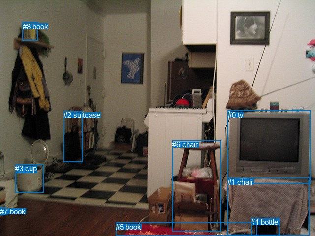
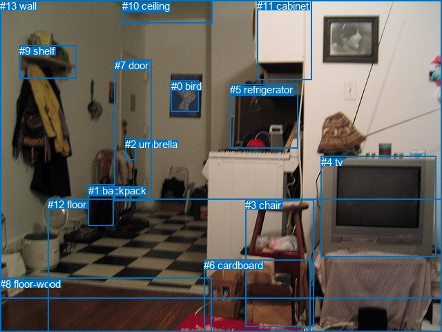

# 图片 0039：1591827.jpg

随机样本序号：132。图片 SHA256：`125a508da98e2c2413ece8f6a8bf0af1740e2018fec9e7b5214d86590ccfe0a0`。

红色框表示人，蓝色框表示其他物体。两个模式分别保留自身框编号，可依据位置比较对应对象。

## 自动检测框与输出

人的框编号：`[]`。状态：`no_person`。

### 自动检测全部物体框

| 编号 | 类别 | 是否为人 | 检测分数 | 像素坐标 xyxy |
|---|---|---|---|---|
| 0 | tv | False | 0.9974 | 462.8, 224.7, 630.8, 374.0 |
| 1 | chair | False | 0.6613 | 462.2, 361.6, 628.5, 479.0 |
| 2 | suitcase | False | 0.5646 | 129.0, 225.0, 167.9, 329.5 |
| 3 | cup | False | 0.5611 | 31.3, 334.1, 88.4, 391.4 |
| 4 | bottle | False | 0.4990 | 510.3, 443.1, 567.9, 480.0 |
| 5 | book | False | 0.4900 | 235.1, 452.8, 522.5, 479.0 |
| 6 | chair | False | 0.4818 | 350.5, 285.0, 449.7, 470.5 |
| 7 | book | False | 0.4615 | 0.0, 421.9, 12.2, 437.7 |
| 8 | book | False | 0.3910 | 45.9, 44.9, 76.6, 82.6 |

### 自动检测 Top50 人相关候选

评分物体对：0；人相关物体对：0；输出关系：0。

| 排名 | 主语编号与类别 | 关系 | 宾语编号与类别 | 类型 | 人与人 | 排序分数 | 原始融合 logit |
|---|---|---|---|---|---|---|---|

### 自动检测逐条人相关 GT 核验

本图没有人相关 GT，R@50 无分母；预测候选继续展示。

## 真实框与输出

人的框编号：`[]`。

### 真实框全部物体框

| 编号 | 类别 | 是否为人 | 检测分数 | 像素坐标 xyxy |
|---|---|---|---|---|
| 0 | bird | False | GT | 248.0, 116.0, 287.0, 161.0 |
| 1 | backpack | False | GT | 128.0, 267.0, 165.0, 327.0 |
| 2 | umbrella | False | GT | 181.0, 200.0, 196.0, 232.0 |
| 3 | chair | False | GT | 355.0, 288.0, 454.0, 473.0 |
| 4 | tv | False | GT | 465.0, 226.0, 632.0, 372.0 |
| 5 | refrigerator | False | GT | 333.0, 121.0, 432.0, 214.0 |
| 6 | cardboard | False | GT | 295.0, 375.0, 449.0, 480.0 |
| 7 | door | False | GT | 166.0, 86.0, 219.0, 290.0 |
| 8 | floor-wood | False | GT | 0.0, 402.0, 306.0, 480.0 |
| 9 | shelf | False | GT | 28.0, 65.0, 110.0, 113.0 |
| 10 | ceiling | False | GT | 177.0, 0.0, 307.0, 34.0 |
| 11 | cabinet | False | GT | 372.0, 0.0, 451.0, 116.0 |
| 12 | floor | False | GT | 69.0, 287.0, 640.0, 480.0 |
| 13 | wall | False | GT | 0.0, 0.0, 640.0, 431.0 |

### 真实框 Top50 人相关候选

评分物体对：0；人相关物体对：0；输出关系：0。

| 排名 | 主语编号与类别 | 关系 | 宾语编号与类别 | 类型 | 人与人 | 排序分数 | 原始融合 logit |
|---|---|---|---|---|---|---|---|

### 真实框逐条人相关 GT 核验

本图没有人相关 GT，R@50 无分母；预测候选继续展示。

## 全部人相关 GT

| 主语编号与类别 | 关系 | 宾语编号与类别 |
|---|---|---|

原始记录、全部人相关物体对的两项预测与分项分数见 [逐图证据 JSON](../evidence/cases/0039.json)。全部56类 logits 保留于本机 HOR/output/random500/logits/。

<!-- HOR_COMPLETE_RESULTS -->

## 六组条件的完整输出对照

以下保留同一图片三种框与候选模式、两种谓词输出规则的全部 Top50。框编号各自在所属模式内解释。

### 自动检测框完整枚举：空间与语义各保留一个谓词

| 排名 | 主语编号与类别 | 谓词 | 宾语编号与类别 | 分组 | 排序分数 | predicate logit | pair logit |
|---|---|---|---|---|---|---|---|

没有人相关 GT，本条件的召回率无分母。

### 自动检测框完整枚举：每对只保留一个谓词

| 排名 | 主语编号与类别 | 谓词 | 宾语编号与类别 | 分组 | 排序分数 | predicate logit | pair logit |
|---|---|---|---|---|---|---|---|

没有人相关 GT，本条件的召回率无分母。

### 真实框完整枚举：空间与语义各保留一个谓词

| 排名 | 主语编号与类别 | 谓词 | 宾语编号与类别 | 分组 | 排序分数 | predicate logit | pair logit |
|---|---|---|---|---|---|---|---|

没有人相关 GT，本条件的召回率无分母。

### 真实框完整枚举：每对只保留一个谓词

| 排名 | 主语编号与类别 | 谓词 | 宾语编号与类别 | 分组 | 排序分数 | predicate logit | pair logit |
|---|---|---|---|---|---|---|---|

没有人相关 GT，本条件的召回率无分母。

### 真实框400候选：空间与语义各保留一个谓词

| 排名 | 主语编号与类别 | 谓词 | 宾语编号与类别 | 分组 | 排序分数 | predicate logit | pair logit |
|---|---|---|---|---|---|---|---|

没有人相关 GT，本条件的召回率无分母。

### 真实框400候选：每对只保留一个谓词

| 排名 | 主语编号与类别 | 谓词 | 宾语编号与类别 | 分组 | 排序分数 | predicate logit | pair logit |
|---|---|---|---|---|---|---|---|

没有人相关 GT，本条件的召回率无分母。
