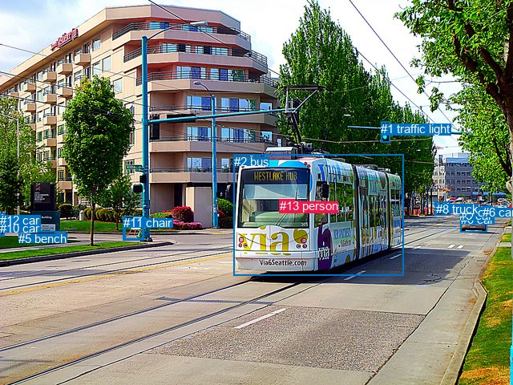
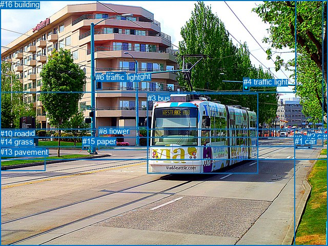

# 图片 0042：1591955.jpg

随机样本序号：208。图片 SHA256：`951d0f6e435a5cafbdc7fa40f8e5f42467c0ecb2259576c7ffc2eb784e3193a7`。

红色框表示人，蓝色框表示其他物体。两个模式分别保留自身框编号，可依据位置比较对应对象。

## 自动检测框与输出

人的框编号：`[13]`。状态：`ok`。

### 自动检测全部物体框

| 编号 | 类别 | 是否为人 | 检测分数 | 像素坐标 xyxy |
|---|---|---|---|---|
| 0 | car | False | 0.9997 | 574.6, 265.3, 607.3, 289.9 |
| 1 | traffic light | False | 0.9949 | 475.1, 152.0, 486.2, 177.4 |
| 2 | bus | False | 0.9875 | 291.5, 192.5, 503.4, 343.7 |
| 3 | car | False | 0.9490 | 573.3, 260.4, 591.5, 274.5 |
| 4 | car | False | 0.8391 | 576.0, 255.9, 590.1, 265.1 |
| 5 | bench | False | 0.8167 | 23.4, 288.8, 81.4, 302.6 |
| 6 | car | False | 0.7950 | 602.2, 256.2, 614.4, 266.2 |
| 7 | car | False | 0.6997 | 542.2, 251.9, 561.5, 268.8 |
| 8 | truck | False | 0.4787 | 543.7, 251.8, 561.7, 268.6 |
| 9 | bench | False | 0.4678 | 155.2, 269.6, 178.2, 298.3 |
| 10 | car | False | 0.4513 | 0.2, 275.8, 5.0, 294.7 |
| 11 | chair | False | 0.3733 | 153.7, 269.3, 179.3, 299.4 |
| 12 | car | False | 0.3642 | 0.0, 265.9, 6.2, 277.2 |
| 13 | person | True | 0.3547 | 349.0, 248.4, 368.7, 264.1 |

### 自动检测 Top50 人相关候选

评分物体对：182；人相关物体对：26；输出关系：50。

| 排名 | 主语编号与类别 | 关系 | 宾语编号与类别 | 类型 | 人与人 | 排序分数 | 原始融合 logit |
|---|---|---|---|---|---|---|---|
| 1 | #13 person | driving on | #2 bus | semantic | False | 0.99551 | 5.4014 |
| 2 | #13 person | in | #2 bus | spatial | False | 0.94327 | 2.8111 |
| 3 | #2 bus | carrying | #13 person | semantic | False | 0.80777 | 1.4356 |
| 4 | #2 bus | beside | #13 person | spatial | False | 0.31132 | -0.7940 |
| 5 | #13 person | driving | #0 car | semantic | False | 0.05005 | -2.9433 |
| 6 | #13 person | driving | #3 car | semantic | False | 0.02226 | -3.7824 |
| 7 | #13 person | driving | #4 car | semantic | False | 0.01527 | -4.1665 |
| 8 | #13 person | driving | #6 car | semantic | False | 0.01255 | -4.3657 |
| 9 | #13 person | driving | #7 car | semantic | False | 0.00823 | -4.7918 |
| 10 | #13 person | driving | #8 truck | semantic | False | 0.00823 | -4.7919 |
| 11 | #4 car | driving | #13 person | semantic | False | 0.00508 | -5.2774 |
| 12 | #1 traffic light | over | #13 person | spatial | False | 0.00478 | -5.3394 |
| 13 | #3 car | driving | #13 person | semantic | False | 0.00465 | -5.3652 |
| 14 | #0 car | driving | #13 person | semantic | False | 0.00432 | -5.4402 |
| 15 | #6 car | driving | #13 person | semantic | False | 0.00421 | -5.4670 |
| 16 | #13 person | looking at | #9 bench | semantic | False | 0.00314 | -5.7605 |
| 17 | #13 person | looking at | #11 chair | semantic | False | 0.00310 | -5.7726 |
| 18 | #8 truck | driving | #13 person | semantic | False | 0.00260 | -5.9507 |
| 19 | #7 car | driving | #13 person | semantic | False | 0.00253 | -5.9779 |
| 20 | #4 car | in | #13 person | spatial | False | 0.00227 | -6.0878 |
| 21 | #13 person | in | #1 traffic light | spatial | False | 0.00220 | -6.1176 |
| 22 | #13 person | walking on | #5 bench | semantic | False | 0.00216 | -6.1350 |
| 23 | #6 car | in | #13 person | spatial | False | 0.00208 | -6.1734 |
| 24 | #13 person | in | #0 car | spatial | False | 0.00195 | -6.2370 |
| 25 | #3 car | in | #13 person | spatial | False | 0.00192 | -6.2524 |
| 26 | #13 person | in | #3 car | spatial | False | 0.00144 | -6.5441 |
| 27 | #0 car | in | #13 person | spatial | False | 0.00143 | -6.5508 |
| 28 | #13 person | in | #4 car | spatial | False | 0.00127 | -6.6686 |
| 29 | #13 person | looking at | #1 traffic light | semantic | False | 0.00127 | -6.6701 |
| 30 | #8 truck | in | #13 person | spatial | False | 0.00122 | -6.7047 |
| 31 | #7 car | in | #13 person | spatial | False | 0.00117 | -6.7499 |
| 32 | #13 person | walking on | #12 car | semantic | False | 0.00115 | -6.7665 |
| 33 | #13 person | in | #7 car | spatial | False | 0.00105 | -6.8545 |
| 34 | #13 person | in | #8 truck | spatial | False | 0.00104 | -6.8657 |
| 35 | #13 person | walking on | #10 car | semantic | False | 0.00103 | -6.8738 |
| 36 | #13 person | in | #6 car | spatial | False | 0.00103 | -6.8790 |
| 37 | #1 traffic light | guiding | #13 person | semantic | False | 0.00059 | -7.4387 |
| 38 | #13 person | in | #11 chair | spatial | False | 0.00053 | -7.5477 |
| 39 | #13 person | in | #9 bench | spatial | False | 0.00053 | -7.5503 |
| 40 | #5 bench | in | #13 person | spatial | False | 0.00050 | -7.6028 |
| 41 | #9 bench | walking on | #13 person | semantic | False | 0.00049 | -7.6306 |
| 42 | #11 chair | walking on | #13 person | semantic | False | 0.00045 | -7.7047 |
| 43 | #5 bench | playing | #13 person | semantic | False | 0.00043 | -7.7437 |
| 44 | #12 car | in | #13 person | spatial | False | 0.00039 | -7.8429 |
| 45 | #13 person | in | #5 bench | spatial | False | 0.00034 | -7.9720 |
| 46 | #12 car | looking at | #13 person | semantic | False | 0.00034 | -7.9782 |
| 47 | #10 car | in | #13 person | spatial | False | 0.00033 | -8.0261 |
| 48 | #13 person | in | #12 car | spatial | False | 0.00031 | -8.0763 |
| 49 | #13 person | in | #10 car | spatial | False | 0.00024 | -8.3299 |
| 50 | #10 car | looking at | #13 person | semantic | False | 0.00023 | -8.3709 |

### 自动检测逐条人相关 GT 核验

本图没有人相关 GT，R@50 无分母；预测候选继续展示。

## 真实框与输出

人的框编号：`[]`。

### 真实框全部物体框

| 编号 | 类别 | 是否为人 | 检测分数 | 像素坐标 xyxy |
|---|---|---|---|---|
| 0 | car | False | GT | 574.0, 261.0, 593.0, 275.0 |
| 1 | car | False | GT | 575.0, 267.0, 608.0, 290.0 |
| 2 | car | False | GT | 599.0, 257.0, 614.0, 267.0 |
| 3 | bus | False | GT | 288.0, 183.0, 504.0, 339.0 |
| 4 | traffic light | False | GT | 475.0, 151.0, 487.0, 177.0 |
| 5 | traffic light | False | GT | 207.0, 140.0, 245.0, 154.0 |
| 6 | traffic light | False | GT | 187.0, 142.0, 199.0, 174.0 |
| 7 | bench | False | GT | 22.0, 289.0, 82.0, 303.0 |
| 8 | flower | False | GT | 193.0, 247.0, 290.0, 293.0 |
| 9 | railroad | False | GT | 0.0, 251.0, 575.0, 480.0 |
| 10 | road | False | GT | 0.0, 252.0, 640.0, 480.0 |
| 11 | tree | False | GT | 0.0, 0.0, 640.0, 311.0 |
| 12 | sky | False | GT | 0.0, 0.0, 577.0, 181.0 |
| 13 | pavement | False | GT | 0.0, 288.0, 89.0, 333.0 |
| 14 | grass | False | GT | 0.0, 268.0, 640.0, 480.0 |
| 15 | paper | False | GT | 161.0, 267.0, 182.0, 292.0 |
| 16 | building | False | GT | 0.0, 0.0, 631.0, 286.0 |

### 真实框 Top50 人相关候选

评分物体对：0；人相关物体对：0；输出关系：0。

| 排名 | 主语编号与类别 | 关系 | 宾语编号与类别 | 类型 | 人与人 | 排序分数 | 原始融合 logit |
|---|---|---|---|---|---|---|---|

### 真实框逐条人相关 GT 核验

本图没有人相关 GT，R@50 无分母；预测候选继续展示。

## 全部人相关 GT

| 主语编号与类别 | 关系 | 宾语编号与类别 |
|---|---|---|

原始记录、全部人相关物体对的两项预测与分项分数见 [逐图证据 JSON](../evidence/cases/0042.json)。全部56类 logits 保留于本机 HOR/output/random500/logits/。

<!-- HOR_COMPLETE_RESULTS -->

## 六组条件的完整输出对照

以下保留同一图片三种框与候选模式、两种谓词输出规则的全部 Top50。框编号各自在所属模式内解释。

### 自动检测框完整枚举：空间与语义各保留一个谓词

| 排名 | 主语编号与类别 | 谓词 | 宾语编号与类别 | 分组 | 排序分数 | predicate logit | pair logit |
|---|---|---|---|---|---|---|---|
| 1 | #13 person | driving on | #2 bus | semantic | 0.9955100 | 5.2283864 | 0.1729964 |
| 2 | #13 person | in | #2 bus | spatial | 0.9432743 | 2.6381330 | 0.1729964 |
| 3 | #2 bus | carrying | #13 person | semantic | 0.8077669 | 1.9623275 | -0.5267622 |
| 4 | #2 bus | beside | #13 person | spatial | 0.3113171 | -0.2672067 | -0.5267622 |
| 5 | #13 person | driving | #0 car | semantic | 0.0500530 | -1.6131771 | -1.3301458 |
| 6 | #13 person | driving | #3 car | semantic | 0.0222611 | -2.1246314 | -1.6577688 |
| 7 | #13 person | driving | #4 car | semantic | 0.0152699 | -2.3352373 | -1.8312500 |
| 8 | #13 person | driving | #6 car | semantic | 0.0125468 | -2.4856594 | -1.8800017 |
| 9 | #13 person | driving | #7 car | semantic | 0.0082288 | -2.7564545 | -2.0353947 |
| 10 | #13 person | driving | #8 truck | semantic | 0.0082282 | -2.7564533 | -2.0354667 |
| 11 | #4 car | driving | #13 person | semantic | 0.0050799 | -3.2076559 | -2.0697246 |
| 12 | #1 traffic light | over | #13 person | spatial | 0.0047757 | -3.3006439 | -2.0387909 |
| 13 | #3 car | driving | #13 person | semantic | 0.0046548 | -3.4182277 | -1.9469634 |
| 14 | #0 car | driving | #13 person | semantic | 0.0043197 | -3.6438537 | -1.7963916 |
| 15 | #6 car | driving | #13 person | semantic | 0.0042059 | -3.4408913 | -2.0261502 |
| 16 | #13 person | looking at | #9 bench | semantic | 0.0031397 | -3.4847469 | -2.2757463 |
| 17 | #13 person | looking at | #11 chair | semantic | 0.0031020 | -3.4840493 | -2.2885470 |
| 18 | #8 truck | driving | #13 person | semantic | 0.0025973 | -3.7492785 | -2.2013965 |
| 19 | #7 car | driving | #13 person | semantic | 0.0025278 | -3.7906477 | -2.1872158 |
| 20 | #4 car | in | #13 person | spatial | 0.0022651 | -4.0181241 | -2.0697246 |
| 21 | #13 person | in | #1 traffic light | spatial | 0.0021990 | -4.4630728 | -1.6544826 |
| 22 | #13 person | walking on | #5 bench | semantic | 0.0021610 | -3.6703634 | -2.4646749 |
| 23 | #6 car | in | #13 person | spatial | 0.0020798 | -4.1472311 | -2.0261502 |
| 24 | #13 person | in | #0 car | spatial | 0.0019518 | -4.9068980 | -1.3301458 |
| 25 | #3 car | in | #13 person | spatial | 0.0019221 | -4.3054276 | -1.9469634 |
| 26 | #13 person | in | #3 car | spatial | 0.0014365 | -4.8863468 | -1.6577688 |
| 27 | #0 car | in | #13 person | spatial | 0.0014269 | -4.7544160 | -1.7963916 |
| 28 | #13 person | in | #4 car | spatial | 0.0012686 | -4.8373227 | -1.8312500 |
| 29 | #13 person | looking at | #1 traffic light | semantic | 0.0012667 | -5.0156083 | -1.6544826 |
| 30 | #8 truck | in | #13 person | spatial | 0.0012237 | -4.5032949 | -2.2013965 |
| 31 | #7 car | in | #13 person | spatial | 0.0011696 | -4.5627036 | -2.1872158 |
| 32 | #13 person | walking on | #12 car | semantic | 0.0011504 | -4.3658371 | -2.4006569 |
| 33 | #13 person | in | #7 car | spatial | 0.0010536 | -4.8190699 | -2.0353947 |
| 34 | #13 person | in | #8 truck | spatial | 0.0010418 | -4.8302574 | -2.0354667 |
| 35 | #13 person | walking on | #10 car | semantic | 0.0010335 | -4.4519763 | -2.4218042 |
| 36 | #13 person | in | #6 car | spatial | 0.0010281 | -4.9990368 | -1.8800017 |
| 37 | #1 traffic light | guiding | #13 person | semantic | 0.0005877 | -5.3998704 | -2.0387909 |
| 38 | #13 person | in | #11 chair | spatial | 0.0005270 | -5.2591963 | -2.2885470 |
| 39 | #13 person | in | #9 bench | spatial | 0.0005257 | -5.2745876 | -2.2757463 |
| 40 | #5 bench | in | #13 person | spatial | 0.0004988 | -5.1550074 | -2.4477565 |
| 41 | #9 bench | walking on | #13 person | semantic | 0.0004851 | -5.3154707 | -2.3151116 |
| 42 | #11 chair | walking on | #13 person | semantic | 0.0004505 | -5.3794146 | -2.3252885 |
| 43 | #5 bench | playing | #13 person | semantic | 0.0004333 | -5.2959061 | -2.4477565 |
| 44 | #12 car | in | #13 person | spatial | 0.0003924 | -5.5314045 | -2.3114543 |
| 45 | #13 person | in | #5 bench | spatial | 0.0003449 | -5.5073171 | -2.4646749 |
| 46 | #12 car | looking at | #13 person | semantic | 0.0003427 | -5.6667128 | -2.3114543 |
| 47 | #10 car | in | #13 person | spatial | 0.0003267 | -5.7744570 | -2.2515988 |
| 48 | #13 person | in | #12 car | spatial | 0.0003107 | -5.6756105 | -2.4006569 |
| 49 | #13 person | in | #10 car | spatial | 0.0002411 | -5.9080725 | -2.4218042 |
| 50 | #10 car | looking at | #13 person | semantic | 0.0002315 | -6.1193156 | -2.2515988 |

没有人相关 GT，本条件的召回率无分母。

### 自动检测框完整枚举：每对只保留一个谓词

| 排名 | 主语编号与类别 | 谓词 | 宾语编号与类别 | 分组 | 排序分数 | predicate logit | pair logit |
|---|---|---|---|---|---|---|---|
| 1 | #13 person | driving on | #2 bus | single | 0.9955100 | 5.2283864 | 0.1729964 |
| 2 | #2 bus | carrying | #13 person | single | 0.8077669 | 1.9623275 | -0.5267622 |
| 3 | #13 person | driving | #0 car | single | 0.0500530 | -1.6131771 | -1.3301458 |
| 4 | #13 person | driving | #3 car | single | 0.0222611 | -2.1246314 | -1.6577688 |
| 5 | #13 person | driving | #4 car | single | 0.0152699 | -2.3352373 | -1.8312500 |
| 6 | #13 person | driving | #6 car | single | 0.0125468 | -2.4856594 | -1.8800017 |
| 7 | #13 person | driving | #7 car | single | 0.0082288 | -2.7564545 | -2.0353947 |
| 8 | #13 person | driving | #8 truck | single | 0.0082282 | -2.7564533 | -2.0354667 |
| 9 | #4 car | driving | #13 person | single | 0.0050799 | -3.2076559 | -2.0697246 |
| 10 | #1 traffic light | over | #13 person | single | 0.0047757 | -3.3006439 | -2.0387909 |
| 11 | #3 car | driving | #13 person | single | 0.0046548 | -3.4182277 | -1.9469634 |
| 12 | #0 car | driving | #13 person | single | 0.0043197 | -3.6438537 | -1.7963916 |
| 13 | #6 car | driving | #13 person | single | 0.0042059 | -3.4408913 | -2.0261502 |
| 14 | #13 person | looking at | #9 bench | single | 0.0031397 | -3.4847469 | -2.2757463 |
| 15 | #13 person | looking at | #11 chair | single | 0.0031020 | -3.4840493 | -2.2885470 |
| 16 | #8 truck | driving | #13 person | single | 0.0025973 | -3.7492785 | -2.2013965 |
| 17 | #7 car | driving | #13 person | single | 0.0025278 | -3.7906477 | -2.1872158 |
| 18 | #13 person | in | #1 traffic light | single | 0.0021990 | -4.4630728 | -1.6544826 |
| 19 | #13 person | walking on | #5 bench | single | 0.0021610 | -3.6703634 | -2.4646749 |
| 20 | #13 person | walking on | #12 car | single | 0.0011504 | -4.3658371 | -2.4006569 |
| 21 | #13 person | walking on | #10 car | single | 0.0010335 | -4.4519763 | -2.4218042 |
| 22 | #5 bench | in | #13 person | single | 0.0004988 | -5.1550074 | -2.4477565 |
| 23 | #9 bench | walking on | #13 person | single | 0.0004851 | -5.3154707 | -2.3151116 |
| 24 | #11 chair | walking on | #13 person | single | 0.0004505 | -5.3794146 | -2.3252885 |
| 25 | #12 car | in | #13 person | single | 0.0003924 | -5.5314045 | -2.3114543 |
| 26 | #10 car | in | #13 person | single | 0.0003267 | -5.7744570 | -2.2515988 |

没有人相关 GT，本条件的召回率无分母。

### 真实框完整枚举：空间与语义各保留一个谓词

| 排名 | 主语编号与类别 | 谓词 | 宾语编号与类别 | 分组 | 排序分数 | predicate logit | pair logit |
|---|---|---|---|---|---|---|---|

没有人相关 GT，本条件的召回率无分母。

### 真实框完整枚举：每对只保留一个谓词

| 排名 | 主语编号与类别 | 谓词 | 宾语编号与类别 | 分组 | 排序分数 | predicate logit | pair logit |
|---|---|---|---|---|---|---|---|

没有人相关 GT，本条件的召回率无分母。

### 真实框400候选：空间与语义各保留一个谓词

| 排名 | 主语编号与类别 | 谓词 | 宾语编号与类别 | 分组 | 排序分数 | predicate logit | pair logit |
|---|---|---|---|---|---|---|---|

没有人相关 GT，本条件的召回率无分母。

### 真实框400候选：每对只保留一个谓词

| 排名 | 主语编号与类别 | 谓词 | 宾语编号与类别 | 分组 | 排序分数 | predicate logit | pair logit |
|---|---|---|---|---|---|---|---|

没有人相关 GT，本条件的召回率无分母。
