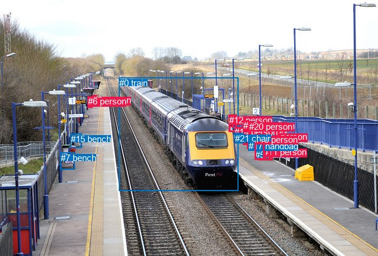
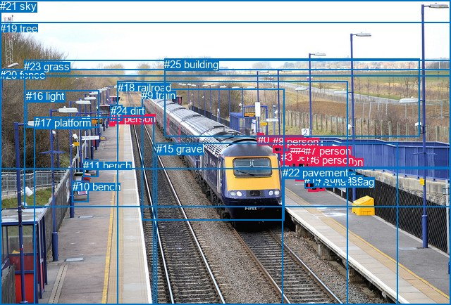

# 图片 0047：1592228.jpg

随机样本序号：154。图片 SHA256：`0cc4df971844484c680888590fe5498676d7c69411405ee99d40a2188c21ea7e`。

红色框表示人，蓝色框表示其他物体。两个模式分别保留自身框编号，可依据位置比较对应对象。

## 自动检测框与输出

人的框编号：`[1, 2, 3, 4, 6, 8, 9, 11, 12, 13, 14, 18, 19, 20]`。状态：`ok`。

### 自动检测全部物体框

| 编号 | 类别 | 是否为人 | 检测分数 | 像素坐标 xyxy |
|---|---|---|---|---|
| 0 | train | False | 0.9997 | 201.6, 131.8, 403.1, 323.1 |
| 1 | person | True | 0.9849 | 438.5, 226.1, 449.9, 271.3 |
| 2 | person | True | 0.9816 | 411.4, 205.3, 423.7, 245.1 |
| 3 | person | True | 0.9733 | 156.6, 161.5, 163.0, 179.9 |
| 4 | person | True | 0.9665 | 418.8, 212.5, 433.0, 252.8 |
| 5 | suitcase | False | 0.8032 | 431.7, 253.6, 442.7, 268.2 |
| 6 | person | True | 0.7831 | 148.7, 163.5, 156.3, 182.8 |
| 7 | bench | False | 0.7414 | 102.8, 258.6, 126.4, 287.2 |
| 8 | person | True | 0.6939 | 387.4, 194.9, 395.7, 215.9 |
| 9 | person | True | 0.6016 | 433.6, 205.3, 442.3, 230.9 |
| 10 | suitcase | False | 0.5932 | 420.9, 241.7, 431.6, 255.1 |
| 11 | person | True | 0.5684 | 446.5, 249.4, 457.7, 271.2 |
| 12 | person | True | 0.5665 | 387.8, 194.8, 400.5, 223.6 |
| 13 | person | True | 0.5647 | 447.1, 223.4, 461.3, 271.9 |
| 14 | person | True | 0.5577 | 397.1, 215.2, 412.6, 240.1 |
| 15 | bench | False | 0.5103 | 119.8, 226.6, 138.5, 250.9 |
| 16 | bench | False | 0.4878 | 397.8, 226.3, 412.7, 241.9 |
| 17 | handbag | False | 0.4617 | 420.9, 238.6, 431.9, 254.7 |
| 18 | person | True | 0.4499 | 431.5, 227.5, 448.0, 270.6 |
| 19 | person | True | 0.3819 | 412.0, 204.2, 421.6, 224.3 |
| 20 | person | True | 0.3804 | 422.1, 205.6, 429.8, 218.1 |
| 21 | chair | False | 0.3604 | 397.8, 225.7, 412.3, 242.1 |

### 自动检测 Top50 人相关候选

评分物体对：462；人相关物体对：406；输出关系：50。

| 排名 | 主语编号与类别 | 关系 | 宾语编号与类别 | 类型 | 人与人 | 排序分数 | 原始融合 logit |
|---|---|---|---|---|---|---|---|
| 1 | #13 person | wearing | #11 person | semantic | True | 0.97811 | 3.7997 |
| 2 | #18 person | wearing | #5 suitcase | semantic | False | 0.97288 | 3.5801 |
| 3 | #1 person | pushing | #18 person | semantic | True | 0.97042 | 3.4906 |
| 4 | #20 person | looking at | #0 train | semantic | False | 0.96952 | 3.4597 |
| 5 | #8 person | looking at | #0 train | semantic | False | 0.96705 | 3.3793 |
| 6 | #19 person | looking at | #0 train | semantic | False | 0.96684 | 3.3726 |
| 7 | #12 person | looking at | #0 train | semantic | False | 0.96455 | 3.3035 |
| 8 | #14 person | looking at | #0 train | semantic | False | 0.96282 | 3.2541 |
| 9 | #4 person | carrying | #17 handbag | semantic | False | 0.96000 | 3.1782 |
| 10 | #2 person | looking at | #0 train | semantic | False | 0.95716 | 3.1065 |
| 11 | #4 person | carrying | #10 suitcase | semantic | False | 0.95538 | 3.0639 |
| 12 | #9 person | looking at | #0 train | semantic | False | 0.95468 | 3.0476 |
| 13 | #4 person | pushing | #18 person | semantic | True | 0.95202 | 2.9878 |
| 14 | #4 person | looking at | #0 train | semantic | False | 0.94098 | 2.7691 |
| 15 | #1 person | carrying | #5 suitcase | semantic | False | 0.92688 | 2.5397 |
| 16 | #2 person | wearing | #19 person | semantic | True | 0.92658 | 2.5353 |
| 17 | #12 person | wearing | #8 person | semantic | True | 0.92631 | 2.5314 |
| 18 | #9 person | pushing | #18 person | semantic | True | 0.92302 | 2.4840 |
| 19 | #0 train | pulling | #14 person | semantic | False | 0.91179 | 2.3357 |
| 20 | #13 person | pushing | #18 person | semantic | True | 0.91135 | 2.3302 |
| 21 | #14 person | wearing | #16 bench | semantic | False | 0.91004 | 2.3141 |
| 22 | #13 person | looking at | #0 train | semantic | False | 0.90276 | 2.2282 |
| 23 | #2 person | pushing | #17 handbag | semantic | False | 0.90078 | 2.2060 |
| 24 | #1 person | pushing | #11 person | semantic | True | 0.90021 | 2.1995 |
| 25 | #14 person | wearing | #21 chair | semantic | False | 0.89898 | 2.1859 |
| 26 | #18 person | pushing | #11 person | semantic | True | 0.88879 | 2.0785 |
| 27 | #18 person | looking at | #0 train | semantic | False | 0.88627 | 2.0532 |
| 28 | #3 person | looking at | #0 train | semantic | False | 0.88223 | 2.0137 |
| 29 | #14 person | beside | #0 train | spatial | False | 0.88057 | 1.9978 |
| 30 | #2 person | pushing | #10 suitcase | semantic | False | 0.87781 | 1.9719 |
| 31 | #1 person | looking at | #0 train | semantic | False | 0.87659 | 1.9606 |
| 32 | #6 person | looking at | #0 train | semantic | False | 0.87642 | 1.9589 |
| 33 | #1 person | pushing | #13 person | semantic | True | 0.87225 | 1.9210 |
| 34 | #12 person | beside | #0 train | spatial | False | 0.85849 | 1.8028 |
| 35 | #18 person | pushing | #13 person | semantic | True | 0.85135 | 1.7452 |
| 36 | #9 person | pushing | #1 person | semantic | True | 0.84582 | 1.7022 |
| 37 | #13 person | in | #11 person | spatial | True | 0.84341 | 1.6838 |
| 38 | #8 person | beside | #0 train | spatial | False | 0.82520 | 1.5520 |
| 39 | #18 person | pushing | #1 person | semantic | True | 0.81908 | 1.5101 |
| 40 | #13 person | pushing | #1 person | semantic | True | 0.81568 | 1.4874 |
| 41 | #2 person | beside | #0 train | spatial | False | 0.81309 | 1.4702 |
| 42 | #18 person | in | #5 suitcase | spatial | False | 0.80940 | 1.4461 |
| 43 | #4 person | beside | #0 train | spatial | False | 0.80817 | 1.4382 |
| 44 | #18 person | pushing | #17 handbag | semantic | False | 0.79391 | 1.3486 |
| 45 | #19 person | beside | #0 train | spatial | False | 0.77863 | 1.2577 |
| 46 | #0 train | pulling | #12 person | semantic | False | 0.77060 | 1.2117 |
| 47 | #20 person | beside | #0 train | spatial | False | 0.76810 | 1.1976 |
| 48 | #13 person | pulling | #5 suitcase | semantic | False | 0.75985 | 1.1518 |
| 49 | #9 person | beside | #0 train | spatial | False | 0.75300 | 1.1147 |
| 50 | #18 person | pushing | #10 suitcase | semantic | False | 0.74399 | 1.0668 |

### 自动检测逐条人相关 GT 核验

R@50：0.00%；命中 0/3。

| GT 主语编号 | GT 关系 | GT 宾语编号 | 结果阶段 | 匹配预测主语编号 | 匹配预测宾语编号 |
|---|---|---|---|---|---|
| 1 | standing on | 17 | endpoint_missing_or_wrong_class | [3] | [] |
| 5 | carrying | 12 | endpoint_missing_or_wrong_class | [13] | [] |
| 5 | standing on | 22 | endpoint_missing_or_wrong_class | [13] | [] |

## 真实框与输出

人的框编号：`[0, 1, 2, 3, 4, 5, 6, 7, 8]`。

### 真实框全部物体框

| 编号 | 类别 | 是否为人 | 检测分数 | 像素坐标 xyxy |
|---|---|---|---|---|
| 0 | person | True | GT | 366.0, 190.0, 375.0, 202.0 |
| 1 | person | True | GT | 156.0, 160.0, 163.0, 180.0 |
| 2 | person | True | GT | 412.0, 205.0, 423.0, 247.0 |
| 3 | person | True | GT | 399.0, 215.0, 412.0, 234.0 |
| 4 | person | True | GT | 419.0, 205.0, 434.0, 257.0 |
| 5 | person | True | GT | 450.0, 222.0, 460.0, 271.0 |
| 6 | person | True | GT | 437.0, 219.0, 451.0, 272.0 |
| 7 | person | True | GT | 433.0, 206.0, 440.0, 232.0 |
| 8 | person | True | GT | 387.0, 193.0, 401.0, 217.0 |
| 9 | train | False | GT | 201.0, 127.0, 404.0, 314.0 |
| 10 | bench | False | GT | 103.0, 257.0, 126.0, 287.0 |
| 11 | bench | False | GT | 118.0, 227.0, 139.0, 251.0 |
| 12 | handbag | False | GT | 447.0, 250.0, 456.0, 262.0 |
| 13 | suitcase | False | GT | 422.0, 241.0, 430.0, 255.0 |
| 14 | suitcase | False | GT | 432.0, 246.0, 446.0, 267.0 |
| 15 | gravel | False | GT | 222.0, 203.0, 565.0, 434.0 |
| 16 | light | False | GT | 37.0, 128.0, 140.0, 181.0 |
| 17 | platform | False | GT | 49.0, 166.0, 219.0, 434.0 |
| 18 | railroad | False | GT | 167.0, 116.0, 494.0, 434.0 |
| 19 | tree | False | GT | 0.0, 32.0, 640.0, 240.0 |
| 20 | fence | False | GT | 0.0, 98.0, 640.0, 434.0 |
| 21 | sky | False | GT | 0.0, 0.0, 640.0, 108.0 |
| 22 | pavement | False | GT | 401.0, 237.0, 640.0, 434.0 |
| 23 | grass | False | GT | 34.0, 86.0, 640.0, 295.0 |
| 24 | dirt | False | GT | 157.0, 149.0, 174.0, 171.0 |
| 25 | building | False | GT | 233.0, 83.0, 595.0, 195.0 |

### 真实框 Top50 人相关候选

评分物体对：650；人相关物体对：378；输出关系：50。

| 排名 | 主语编号与类别 | 关系 | 宾语编号与类别 | 类型 | 人与人 | 排序分数 | 原始融合 logit |
|---|---|---|---|---|---|---|---|
| 1 | #5 person | carrying | #12 handbag | semantic | False | 0.97209 | 3.5504 |
| 2 | #4 person | carrying | #13 suitcase | semantic | False | 0.97002 | 3.4769 |
| 3 | #6 person | carrying | #14 suitcase | semantic | False | 0.96235 | 3.2409 |
| 4 | #6 person | carrying | #12 handbag | semantic | False | 0.95828 | 3.1342 |
| 5 | #0 person | on | #20 fence | spatial | False | 0.94537 | 2.8509 |
| 6 | #6 person | standing on | #22 pavement | semantic | False | 0.93510 | 2.6678 |
| 7 | #5 person | standing on | #22 pavement | semantic | False | 0.93060 | 2.5959 |
| 8 | #3 person | looking at | #9 train | semantic | False | 0.93034 | 2.5919 |
| 9 | #4 person | standing on | #15 gravel | semantic | False | 0.92582 | 2.5242 |
| 10 | #3 person | looking at | #18 railroad | semantic | False | 0.92521 | 2.5153 |
| 11 | #1 person | standing on | #17 platform | semantic | False | 0.92059 | 2.4504 |
| 12 | #8 person | looking at | #9 train | semantic | False | 0.91862 | 2.4237 |
| 13 | #2 person | looking at | #9 train | semantic | False | 0.91630 | 2.3931 |
| 14 | #2 person | looking at | #18 railroad | semantic | False | 0.91501 | 2.3764 |
| 15 | #6 person | standing on | #15 gravel | semantic | False | 0.91493 | 2.3754 |
| 16 | #0 person | on | #18 railroad | spatial | False | 0.90526 | 2.2571 |
| 17 | #4 person | looking at | #9 train | semantic | False | 0.90318 | 2.2331 |
| 18 | #4 person | looking at | #18 railroad | semantic | False | 0.90157 | 2.2147 |
| 19 | #2 person | standing on | #15 gravel | semantic | False | 0.89464 | 2.1391 |
| 20 | #8 person | on | #20 fence | spatial | False | 0.88978 | 2.0885 |
| 21 | #1 person | on | #17 platform | spatial | False | 0.88698 | 2.0603 |
| 22 | #7 person | looking at | #18 railroad | semantic | False | 0.88581 | 2.0486 |
| 23 | #6 person | looking at | #18 railroad | semantic | False | 0.88317 | 2.0228 |
| 24 | #6 person | standing on | #20 fence | semantic | False | 0.88065 | 1.9986 |
| 25 | #8 person | looking at | #18 railroad | semantic | False | 0.87750 | 1.9690 |
| 26 | #4 person | standing on | #20 fence | semantic | False | 0.87286 | 1.9265 |
| 27 | #1 person | on | #20 fence | spatial | False | 0.87221 | 1.9206 |
| 28 | #8 person | beside | #18 railroad | spatial | False | 0.87142 | 1.9136 |
| 29 | #7 person | looking at | #9 train | semantic | False | 0.87092 | 1.9091 |
| 30 | #6 person | looking at | #9 train | semantic | False | 0.86230 | 1.8346 |
| 31 | #1 person | standing on | #24 dirt | semantic | False | 0.85922 | 1.8088 |
| 32 | #5 person | looking at | #18 railroad | semantic | False | 0.85240 | 1.7535 |
| 33 | #0 person | on | #9 train | spatial | False | 0.84022 | 1.6598 |
| 34 | #5 person | standing on | #20 fence | semantic | False | 0.83981 | 1.6568 |
| 35 | #8 person | beside | #9 train | spatial | False | 0.83848 | 1.6470 |
| 36 | #2 person | standing on | #20 fence | semantic | False | 0.83493 | 1.6210 |
| 37 | #8 person | standing on | #20 fence | semantic | False | 0.83460 | 1.6186 |
| 38 | #5 person | looking at | #9 train | semantic | False | 0.83212 | 1.6007 |
| 39 | #6 person | on | #15 gravel | spatial | False | 0.82708 | 1.5651 |
| 40 | #6 person | on | #20 fence | spatial | False | 0.82574 | 1.5557 |
| 41 | #5 person | standing on | #15 gravel | semantic | False | 0.82409 | 1.5443 |
| 42 | #6 person | on | #22 pavement | spatial | False | 0.82376 | 1.5420 |
| 43 | #4 person | standing on | #22 pavement | semantic | False | 0.82019 | 1.5176 |
| 44 | #4 person | on | #15 gravel | spatial | False | 0.81564 | 1.4871 |
| 45 | #4 person | pushing | #14 suitcase | semantic | False | 0.81520 | 1.4842 |
| 46 | #5 person | on | #22 pavement | spatial | False | 0.81473 | 1.4811 |
| 47 | #6 person | beside | #9 train | spatial | False | 0.81468 | 1.4807 |
| 48 | #6 person | beside | #18 railroad | spatial | False | 0.80769 | 1.4351 |
| 49 | #7 person | standing on | #15 gravel | semantic | False | 0.80287 | 1.4044 |
| 50 | #3 person | looking at | #20 fence | semantic | False | 0.80283 | 1.4041 |

### 真实框逐条人相关 GT 核验

R@50：100.00%；命中 3/3。

| GT 主语编号 | GT 关系 | GT 宾语编号 | 结果阶段 | 匹配预测主语编号 | 匹配预测宾语编号 |
|---|---|---|---|---|---|
| 1 | standing on | 17 | hit50 | [1] | [17] |
| 5 | carrying | 12 | hit50 | [5] | [12] |
| 5 | standing on | 22 | hit50 | [5] | [22] |

## 全部人相关 GT

| 主语编号与类别 | 关系 | 宾语编号与类别 |
|---|---|---|
| #1 person | standing on | #17 platform |
| #5 person | carrying | #12 handbag |
| #5 person | standing on | #22 pavement |

原始记录、全部人相关物体对的两项预测与分项分数见 [逐图证据 JSON](../evidence/cases/0047.json)。全部56类 logits 保留于本机 HOR/output/random500/logits/。

<!-- HOR_COMPLETE_RESULTS -->

## 六组条件的完整输出对照

以下保留同一图片三种框与候选模式、两种谓词输出规则的全部 Top50。框编号各自在所属模式内解释。

### 自动检测框完整枚举：空间与语义各保留一个谓词

| 排名 | 主语编号与类别 | 谓词 | 宾语编号与类别 | 分组 | 排序分数 | predicate logit | pair logit |
|---|---|---|---|---|---|---|---|
| 1 | #13 person | wearing | #11 person | semantic | 0.9781120 | 3.7744832 | 0.0251994 |
| 2 | #18 person | wearing | #5 suitcase | semantic | 0.9728826 | 3.6584830 | -0.0783944 |
| 3 | #1 person | pushing | #18 person | semantic | 0.9704187 | 3.7863755 | -0.2957897 |
| 4 | #20 person | looking at | #0 train | semantic | 0.9695197 | 3.5999436 | -0.1402246 |
| 5 | #8 person | looking at | #0 train | semantic | 0.9670517 | 3.4656348 | -0.0863221 |
| 6 | #19 person | looking at | #0 train | semantic | 0.9668370 | 3.4228835 | -0.0502876 |
| 7 | #12 person | looking at | #0 train | semantic | 0.9645479 | 3.2892699 | 0.0142092 |
| 8 | #14 person | looking at | #0 train | semantic | 0.9628199 | 3.1045394 | 0.1495549 |
| 9 | #4 person | carrying | #17 handbag | semantic | 0.9600042 | 3.2034583 | -0.0252948 |
| 10 | #2 person | looking at | #0 train | semantic | 0.9571614 | 3.0645781 | 0.0419524 |
| 11 | #4 person | carrying | #10 suitcase | semantic | 0.9553786 | 3.1040645 | -0.0401719 |
| 12 | #9 person | looking at | #0 train | semantic | 0.9546803 | 3.2416387 | -0.1940022 |
| 13 | #4 person | pushing | #18 person | semantic | 0.9520184 | 3.1846142 | -0.1968471 |
| 14 | #4 person | looking at | #0 train | semantic | 0.9409818 | 2.7895732 | -0.0204958 |
| 15 | #1 person | carrying | #5 suitcase | semantic | 0.9268754 | 2.5973730 | -0.0577193 |
| 16 | #2 person | wearing | #19 person | semantic | 0.9265777 | 2.7558179 | -0.2205487 |
| 17 | #12 person | wearing | #8 person | semantic | 0.9263129 | 2.7865882 | -0.2552038 |
| 18 | #9 person | pushing | #18 person | semantic | 0.9230154 | 2.8538680 | -0.3698269 |
| 19 | #0 train | pulling | #14 person | semantic | 0.9117911 | 3.3664613 | -1.0307572 |
| 20 | #13 person | pushing | #18 person | semantic | 0.9113453 | 2.5229163 | -0.1927440 |
| 21 | #14 person | wearing | #16 bench | semantic | 0.9100385 | 2.6015306 | -0.2874249 |
| 22 | #13 person | looking at | #0 train | semantic | 0.9027558 | 2.5338516 | -0.3056254 |
| 23 | #2 person | pushing | #17 handbag | semantic | 0.9007846 | 2.2223067 | -0.0163339 |
| 24 | #1 person | pushing | #11 person | semantic | 0.9002089 | 2.2824721 | -0.0829248 |
| 25 | #14 person | wearing | #21 chair | semantic | 0.8989758 | 2.4811654 | -0.2952693 |
| 26 | #18 person | pushing | #11 person | semantic | 0.8887949 | 2.1923089 | -0.1138181 |
| 27 | #18 person | looking at | #0 train | semantic | 0.8862738 | 2.3725877 | -0.3193561 |
| 28 | #3 person | looking at | #0 train | semantic | 0.8822291 | 2.3522582 | -0.3385473 |
| 29 | #14 person | beside | #0 train | spatial | 0.8805704 | 1.8482881 | 0.1495549 |
| 30 | #2 person | pushing | #10 suitcase | semantic | 0.8778130 | 2.0117497 | -0.0398695 |
| 31 | #1 person | looking at | #0 train | semantic | 0.8765929 | 2.2878919 | -0.3273384 |
| 32 | #6 person | looking at | #0 train | semantic | 0.8764181 | 2.3204241 | -0.3614859 |
| 33 | #1 person | pushing | #13 person | semantic | 0.8722528 | 2.3122721 | -0.3912458 |
| 34 | #12 person | beside | #0 train | spatial | 0.8584937 | 1.7886257 | 0.0142092 |
| 35 | #18 person | pushing | #13 person | semantic | 0.8513464 | 2.1618214 | -0.4166209 |
| 36 | #9 person | pushing | #1 person | semantic | 0.8458189 | 2.0716233 | -0.3694457 |
| 37 | #13 person | in | #11 person | spatial | 0.8434095 | 1.6586189 | 0.0251994 |
| 38 | #8 person | beside | #0 train | spatial | 0.8251972 | 1.6382856 | -0.0863221 |
| 39 | #18 person | pushing | #1 person | semantic | 0.8190785 | 1.8309751 | -0.3208586 |
| 40 | #13 person | pushing | #1 person | semantic | 0.8156815 | 1.6807227 | -0.1933638 |
| 41 | #2 person | beside | #0 train | spatial | 0.8130931 | 1.4282827 | 0.0419524 |
| 42 | #18 person | in | #5 suitcase | spatial | 0.8094036 | 1.5245342 | -0.0783944 |
| 43 | #4 person | beside | #0 train | spatial | 0.8081707 | 1.4586635 | -0.0204958 |
| 44 | #18 person | pushing | #17 handbag | semantic | 0.7939075 | 1.5304413 | -0.1817991 |
| 45 | #19 person | beside | #0 train | spatial | 0.7786279 | 1.3079758 | -0.0502876 |
| 46 | #0 train | pulling | #12 person | semantic | 0.7705975 | 2.3435321 | -1.1318442 |
| 47 | #20 person | beside | #0 train | spatial | 0.7680995 | 1.3378358 | -0.1402246 |
| 48 | #13 person | pulling | #5 suitcase | semantic | 0.7598453 | 1.1097264 | 0.0421053 |
| 49 | #9 person | beside | #0 train | spatial | 0.7529982 | 1.3086696 | -0.1940022 |
| 50 | #18 person | pushing | #10 suitcase | semantic | 0.7439909 | 1.2595267 | -0.1927110 |

GT 命中：0/3，R@50=0.00%。

| GT主语 | GT谓词 | GT宾语 | 结果阶段 | 匹配主语框 | 匹配宾语框 |
|---|---|---|---|---|---|
| 1 | standing on | 17 | endpoint_missing_or_wrong_class | [3] | [] |
| 5 | carrying | 12 | endpoint_missing_or_wrong_class | [13] | [] |
| 5 | standing on | 22 | endpoint_missing_or_wrong_class | [13] | [] |

### 自动检测框完整枚举：每对只保留一个谓词

| 排名 | 主语编号与类别 | 谓词 | 宾语编号与类别 | 分组 | 排序分数 | predicate logit | pair logit |
|---|---|---|---|---|---|---|---|
| 1 | #13 person | wearing | #11 person | single | 0.9781120 | 3.7744832 | 0.0251994 |
| 2 | #18 person | wearing | #5 suitcase | single | 0.9728826 | 3.6584830 | -0.0783944 |
| 3 | #1 person | pushing | #18 person | single | 0.9704187 | 3.7863755 | -0.2957897 |
| 4 | #20 person | looking at | #0 train | single | 0.9695197 | 3.5999436 | -0.1402246 |
| 5 | #8 person | looking at | #0 train | single | 0.9670517 | 3.4656348 | -0.0863221 |
| 6 | #19 person | looking at | #0 train | single | 0.9668370 | 3.4228835 | -0.0502876 |
| 7 | #12 person | looking at | #0 train | single | 0.9645479 | 3.2892699 | 0.0142092 |
| 8 | #14 person | looking at | #0 train | single | 0.9628199 | 3.1045394 | 0.1495549 |
| 9 | #4 person | carrying | #17 handbag | single | 0.9600042 | 3.2034583 | -0.0252948 |
| 10 | #2 person | looking at | #0 train | single | 0.9571614 | 3.0645781 | 0.0419524 |
| 11 | #4 person | carrying | #10 suitcase | single | 0.9553786 | 3.1040645 | -0.0401719 |
| 12 | #9 person | looking at | #0 train | single | 0.9546803 | 3.2416387 | -0.1940022 |
| 13 | #4 person | pushing | #18 person | single | 0.9520184 | 3.1846142 | -0.1968471 |
| 14 | #4 person | looking at | #0 train | single | 0.9409818 | 2.7895732 | -0.0204958 |
| 15 | #1 person | carrying | #5 suitcase | single | 0.9268754 | 2.5973730 | -0.0577193 |
| 16 | #2 person | wearing | #19 person | single | 0.9265777 | 2.7558179 | -0.2205487 |
| 17 | #12 person | wearing | #8 person | single | 0.9263129 | 2.7865882 | -0.2552038 |
| 18 | #9 person | pushing | #18 person | single | 0.9230154 | 2.8538680 | -0.3698269 |
| 19 | #0 train | pulling | #14 person | single | 0.9117911 | 3.3664613 | -1.0307572 |
| 20 | #13 person | pushing | #18 person | single | 0.9113453 | 2.5229163 | -0.1927440 |
| 21 | #14 person | wearing | #16 bench | single | 0.9100385 | 2.6015306 | -0.2874249 |
| 22 | #13 person | looking at | #0 train | single | 0.9027558 | 2.5338516 | -0.3056254 |
| 23 | #2 person | pushing | #17 handbag | single | 0.9007846 | 2.2223067 | -0.0163339 |
| 24 | #1 person | pushing | #11 person | single | 0.9002089 | 2.2824721 | -0.0829248 |
| 25 | #14 person | wearing | #21 chair | single | 0.8989758 | 2.4811654 | -0.2952693 |
| 26 | #18 person | pushing | #11 person | single | 0.8887949 | 2.1923089 | -0.1138181 |
| 27 | #18 person | looking at | #0 train | single | 0.8862738 | 2.3725877 | -0.3193561 |
| 28 | #3 person | looking at | #0 train | single | 0.8822291 | 2.3522582 | -0.3385473 |
| 29 | #2 person | pushing | #10 suitcase | single | 0.8778130 | 2.0117497 | -0.0398695 |
| 30 | #1 person | looking at | #0 train | single | 0.8765929 | 2.2878919 | -0.3273384 |
| 31 | #6 person | looking at | #0 train | single | 0.8764181 | 2.3204241 | -0.3614859 |
| 32 | #1 person | pushing | #13 person | single | 0.8722528 | 2.3122721 | -0.3912458 |
| 33 | #18 person | pushing | #13 person | single | 0.8513464 | 2.1618214 | -0.4166209 |
| 34 | #9 person | pushing | #1 person | single | 0.8458189 | 2.0716233 | -0.3694457 |
| 35 | #18 person | pushing | #1 person | single | 0.8190785 | 1.8309751 | -0.3208586 |
| 36 | #13 person | pushing | #1 person | single | 0.8156815 | 1.6807227 | -0.1933638 |
| 37 | #18 person | pushing | #17 handbag | single | 0.7939075 | 1.5304413 | -0.1817991 |
| 38 | #0 train | pulling | #12 person | single | 0.7705975 | 2.3435321 | -1.1318442 |
| 39 | #13 person | pulling | #5 suitcase | single | 0.7598453 | 1.1097264 | 0.0421053 |
| 40 | #18 person | pushing | #10 suitcase | single | 0.7439909 | 1.2595267 | -0.1927110 |
| 41 | #4 person | pushing | #5 suitcase | single | 0.7418308 | 1.0787840 | -0.0232779 |
| 42 | #14 person | pushing | #17 handbag | single | 0.7010162 | 1.3791561 | -0.5270143 |
| 43 | #14 person | pushing | #10 suitcase | single | 0.6967415 | 1.3792372 | -0.5474082 |
| 44 | #9 person | pushing | #17 handbag | single | 0.6966906 | 1.0787868 | -0.2471990 |
| 45 | #6 person | beside | #3 person | single | 0.6887094 | 1.0953422 | -0.3012496 |
| 46 | #2 person | pushing | #18 person | single | 0.6768972 | 0.9280815 | -0.1885326 |
| 47 | #4 person | pushing | #1 person | single | 0.6724710 | 0.9280992 | -0.2087167 |
| 48 | #9 person | pushing | #10 suitcase | single | 0.6662015 | 0.9584541 | -0.2673993 |
| 49 | #2 person | pushing | #4 person | single | 0.6617790 | 0.8682766 | -0.1970442 |
| 50 | #1 person | pulling | #10 suitcase | single | 0.6597863 | 0.8388891 | -0.1765471 |

GT 命中：0/3，R@50=0.00%。

| GT主语 | GT谓词 | GT宾语 | 结果阶段 | 匹配主语框 | 匹配宾语框 |
|---|---|---|---|---|---|
| 1 | standing on | 17 | endpoint_missing_or_wrong_class | [3] | [] |
| 5 | carrying | 12 | endpoint_missing_or_wrong_class | [13] | [] |
| 5 | standing on | 22 | endpoint_missing_or_wrong_class | [13] | [] |

### 真实框完整枚举：空间与语义各保留一个谓词

| 排名 | 主语编号与类别 | 谓词 | 宾语编号与类别 | 分组 | 排序分数 | predicate logit | pair logit |
|---|---|---|---|---|---|---|---|
| 1 | #5 person | carrying | #12 handbag | semantic | 0.9720880 | 3.5230126 | 0.0273755 |
| 2 | #4 person | carrying | #13 suitcase | semantic | 0.9700236 | 3.4073071 | 0.0696018 |
| 3 | #6 person | carrying | #14 suitcase | semantic | 0.9623461 | 3.1735673 | 0.0673702 |
| 4 | #6 person | carrying | #12 handbag | semantic | 0.9582812 | 3.0648527 | 0.0693374 |
| 5 | #0 person | on | #20 fence | spatial | 0.9453660 | 3.2436390 | -0.3927231 |
| 6 | #6 person | standing on | #22 pavement | semantic | 0.9350984 | 2.9295726 | -0.2617937 |
| 7 | #5 person | standing on | #22 pavement | semantic | 0.9305986 | 2.8092074 | -0.2132879 |
| 8 | #3 person | looking at | #9 train | semantic | 0.9303391 | 2.5005140 | 0.0913957 |
| 9 | #4 person | standing on | #15 gravel | semantic | 0.9258201 | 2.9454913 | -0.4213047 |
| 10 | #3 person | looking at | #18 railroad | semantic | 0.9252084 | 2.8937917 | -0.3784792 |
| 11 | #1 person | standing on | #17 platform | semantic | 0.9205922 | 2.8634753 | -0.4130545 |
| 12 | #8 person | looking at | #9 train | semantic | 0.9186205 | 2.5361834 | -0.1124338 |
| 13 | #2 person | looking at | #9 train | semantic | 0.9162998 | 2.3695812 | 0.0235212 |
| 14 | #2 person | looking at | #18 railroad | semantic | 0.9150093 | 2.5942745 | -0.2178825 |
| 15 | #6 person | standing on | #15 gravel | semantic | 0.9149303 | 2.8281837 | -0.4528068 |
| 16 | #0 person | on | #18 railroad | spatial | 0.9052645 | 2.4652634 | -0.2081246 |
| 17 | #4 person | looking at | #9 train | semantic | 0.9031811 | 2.2457299 | -0.0126490 |
| 18 | #4 person | looking at | #18 railroad | semantic | 0.9015654 | 2.4151211 | -0.2003812 |
| 19 | #2 person | standing on | #15 gravel | semantic | 0.8946426 | 2.5931697 | -0.4541039 |
| 20 | #8 person | on | #20 fence | spatial | 0.8897830 | 2.4159708 | -0.3274444 |
| 21 | #1 person | on | #17 platform | spatial | 0.8869802 | 2.4733143 | -0.4130545 |
| 22 | #7 person | looking at | #18 railroad | semantic | 0.8858061 | 2.4521852 | -0.4035847 |
| 23 | #6 person | looking at | #18 railroad | semantic | 0.8831672 | 2.3514524 | -0.3286819 |
| 24 | #6 person | standing on | #20 fence | semantic | 0.8806542 | 2.3820152 | -0.3833758 |
| 25 | #8 person | looking at | #18 railroad | semantic | 0.8774991 | 2.2401514 | -0.2711935 |
| 26 | #4 person | standing on | #20 fence | semantic | 0.8728603 | 2.1543455 | -0.2278565 |
| 27 | #1 person | on | #20 fence | spatial | 0.8722070 | 2.2640948 | -0.3434793 |
| 28 | #8 person | beside | #18 railroad | spatial | 0.8714222 | 2.1847858 | -0.2711935 |
| 29 | #7 person | looking at | #9 train | semantic | 0.8709190 | 2.1022463 | -0.1931372 |
| 30 | #6 person | looking at | #9 train | semantic | 0.8623046 | 2.0841174 | -0.2495525 |
| 31 | #1 person | standing on | #24 dirt | semantic | 0.8592223 | 2.1310825 | -0.3222373 |
| 32 | #5 person | looking at | #18 railroad | semantic | 0.8523964 | 2.1107225 | -0.3572014 |
| 33 | #0 person | on | #9 train | spatial | 0.8402160 | 1.7866321 | -0.1267960 |
| 34 | #5 person | standing on | #20 fence | semantic | 0.8398076 | 2.0737581 | -0.4169610 |
| 35 | #8 person | beside | #9 train | spatial | 0.8384809 | 1.7594023 | -0.1124338 |
| 36 | #2 person | standing on | #20 fence | semantic | 0.8349318 | 1.8695507 | -0.2485595 |
| 37 | #8 person | standing on | #20 fence | semantic | 0.8346027 | 1.9460492 | -0.3274444 |
| 38 | #5 person | looking at | #9 train | semantic | 0.8321232 | 1.9021754 | -0.3014255 |
| 39 | #6 person | on | #15 gravel | spatial | 0.8270819 | 2.0178919 | -0.4528068 |
| 40 | #6 person | on | #20 fence | spatial | 0.8257369 | 1.9390864 | -0.3833758 |
| 41 | #5 person | standing on | #15 gravel | semantic | 0.8240883 | 2.0230641 | -0.4787681 |
| 42 | #6 person | on | #22 pavement | spatial | 0.8237613 | 1.8038349 | -0.2617937 |
| 43 | #4 person | standing on | #22 pavement | semantic | 0.8201863 | 1.8872957 | -0.3696856 |
| 44 | #4 person | on | #15 gravel | spatial | 0.8156443 | 1.9084163 | -0.4213047 |
| 45 | #4 person | pushing | #14 suitcase | semantic | 0.8152041 | 1.4399867 | 0.0441999 |
| 46 | #5 person | on | #22 pavement | spatial | 0.8147345 | 1.6943603 | -0.2132879 |
| 47 | #6 person | beside | #9 train | spatial | 0.8146846 | 1.7302942 | -0.2495525 |
| 48 | #6 person | beside | #18 railroad | spatial | 0.8076881 | 1.7637391 | -0.3286819 |
| 49 | #7 person | standing on | #15 gravel | semantic | 0.8028745 | 1.9891014 | -0.5847434 |
| 50 | #3 person | looking at | #20 fence | semantic | 0.8028258 | 1.9315696 | -0.5275195 |

GT 命中：3/3，R@50=100.00%。

| GT主语 | GT谓词 | GT宾语 | 结果阶段 | 匹配主语框 | 匹配宾语框 |
|---|---|---|---|---|---|
| 1 | standing on | 17 | hit50 | [1] | [17] |
| 5 | carrying | 12 | hit50 | [5] | [12] |
| 5 | standing on | 22 | hit50 | [5] | [22] |

### 真实框完整枚举：每对只保留一个谓词

| 排名 | 主语编号与类别 | 谓词 | 宾语编号与类别 | 分组 | 排序分数 | predicate logit | pair logit |
|---|---|---|---|---|---|---|---|
| 1 | #5 person | carrying | #12 handbag | single | 0.9720880 | 3.5230126 | 0.0273755 |
| 2 | #4 person | carrying | #13 suitcase | single | 0.9700236 | 3.4073071 | 0.0696018 |
| 3 | #6 person | carrying | #14 suitcase | single | 0.9623461 | 3.1735673 | 0.0673702 |
| 4 | #6 person | carrying | #12 handbag | single | 0.9582812 | 3.0648527 | 0.0693374 |
| 5 | #0 person | on | #20 fence | single | 0.9453660 | 3.2436390 | -0.3927231 |
| 6 | #6 person | standing on | #22 pavement | single | 0.9350984 | 2.9295726 | -0.2617937 |
| 7 | #5 person | standing on | #22 pavement | single | 0.9305986 | 2.8092074 | -0.2132879 |
| 8 | #3 person | looking at | #9 train | single | 0.9303391 | 2.5005140 | 0.0913957 |
| 9 | #4 person | standing on | #15 gravel | single | 0.9258201 | 2.9454913 | -0.4213047 |
| 10 | #3 person | looking at | #18 railroad | single | 0.9252084 | 2.8937917 | -0.3784792 |
| 11 | #1 person | standing on | #17 platform | single | 0.9205922 | 2.8634753 | -0.4130545 |
| 12 | #8 person | looking at | #9 train | single | 0.9186205 | 2.5361834 | -0.1124338 |
| 13 | #2 person | looking at | #9 train | single | 0.9162998 | 2.3695812 | 0.0235212 |
| 14 | #2 person | looking at | #18 railroad | single | 0.9150093 | 2.5942745 | -0.2178825 |
| 15 | #6 person | standing on | #15 gravel | single | 0.9149303 | 2.8281837 | -0.4528068 |
| 16 | #0 person | on | #18 railroad | single | 0.9052645 | 2.4652634 | -0.2081246 |
| 17 | #4 person | looking at | #9 train | single | 0.9031811 | 2.2457299 | -0.0126490 |
| 18 | #4 person | looking at | #18 railroad | single | 0.9015654 | 2.4151211 | -0.2003812 |
| 19 | #2 person | standing on | #15 gravel | single | 0.8946426 | 2.5931697 | -0.4541039 |
| 20 | #8 person | on | #20 fence | single | 0.8897830 | 2.4159708 | -0.3274444 |
| 21 | #7 person | looking at | #18 railroad | single | 0.8858061 | 2.4521852 | -0.4035847 |
| 22 | #6 person | looking at | #18 railroad | single | 0.8831672 | 2.3514524 | -0.3286819 |
| 23 | #6 person | standing on | #20 fence | single | 0.8806542 | 2.3820152 | -0.3833758 |
| 24 | #8 person | looking at | #18 railroad | single | 0.8774991 | 2.2401514 | -0.2711935 |
| 25 | #4 person | standing on | #20 fence | single | 0.8728603 | 2.1543455 | -0.2278565 |
| 26 | #1 person | on | #20 fence | single | 0.8722070 | 2.2640948 | -0.3434793 |
| 27 | #7 person | looking at | #9 train | single | 0.8709190 | 2.1022463 | -0.1931372 |
| 28 | #6 person | looking at | #9 train | single | 0.8623046 | 2.0841174 | -0.2495525 |
| 29 | #1 person | standing on | #24 dirt | single | 0.8592223 | 2.1310825 | -0.3222373 |
| 30 | #5 person | looking at | #18 railroad | single | 0.8523964 | 2.1107225 | -0.3572014 |
| 31 | #0 person | on | #9 train | single | 0.8402160 | 1.7866321 | -0.1267960 |
| 32 | #5 person | standing on | #20 fence | single | 0.8398076 | 2.0737581 | -0.4169610 |
| 33 | #2 person | standing on | #20 fence | single | 0.8349318 | 1.8695507 | -0.2485595 |
| 34 | #5 person | looking at | #9 train | single | 0.8321232 | 1.9021754 | -0.3014255 |
| 35 | #5 person | standing on | #15 gravel | single | 0.8240883 | 2.0230641 | -0.4787681 |
| 36 | #4 person | standing on | #22 pavement | single | 0.8201863 | 1.8872957 | -0.3696856 |
| 37 | #4 person | pushing | #14 suitcase | single | 0.8152041 | 1.4399867 | 0.0441999 |
| 38 | #7 person | standing on | #15 gravel | single | 0.8028745 | 1.9891014 | -0.5847434 |
| 39 | #3 person | looking at | #20 fence | single | 0.8028258 | 1.9315696 | -0.5275195 |
| 40 | #0 person | on | #23 grass | single | 0.7720518 | 1.7986798 | -0.5787466 |
| 41 | #2 person | carrying | #13 suitcase | single | 0.7633216 | 1.1982307 | -0.0272532 |
| 42 | #24 dirt | on | #1 person | single | 0.7609860 | 1.4705153 | -0.3124222 |
| 43 | #7 person | looking at | #20 fence | single | 0.7295558 | 1.4522014 | -0.4598316 |
| 44 | #8 person | on | #15 gravel | single | 0.7205104 | 1.4467373 | -0.4997429 |
| 45 | #3 person | standing on | #15 gravel | single | 0.6789231 | 1.4057364 | -0.6569090 |
| 46 | #6 person | pushing | #5 person | single | 0.6319347 | 0.8082342 | -0.2677084 |
| 47 | #2 person | pushing | #14 suitcase | single | 0.6029723 | 0.5071139 | -0.0892490 |
| 48 | #7 person | pushing | #6 person | single | 0.5757679 | 0.7180362 | -0.4126123 |
| 49 | #5 person | pushing | #14 suitcase | single | 0.5396237 | 0.1462498 | 0.0125782 |
| 50 | #1 person | standing on | #23 grass | single | 0.5326933 | 0.5899982 | -0.4590383 |

GT 命中：3/3，R@50=100.00%。

| GT主语 | GT谓词 | GT宾语 | 结果阶段 | 匹配主语框 | 匹配宾语框 |
|---|---|---|---|---|---|
| 1 | standing on | 17 | hit50 | [1] | [17] |
| 5 | carrying | 12 | hit50 | [5] | [12] |
| 5 | standing on | 22 | hit50 | [5] | [22] |

### 真实框400候选：空间与语义各保留一个谓词

| 排名 | 主语编号与类别 | 谓词 | 宾语编号与类别 | 分组 | 排序分数 | predicate logit | pair logit |
|---|---|---|---|---|---|---|---|
| 1 | #5 person | carrying | #12 handbag | semantic | 0.9707404 | 3.4744792 | 0.0273755 |
| 2 | #4 person | carrying | #13 suitcase | semantic | 0.9685796 | 3.3587747 | 0.0696018 |
| 3 | #6 person | carrying | #14 suitcase | semantic | 0.9645470 | 3.2360792 | 0.0673702 |
| 4 | #6 person | standing on | #22 pavement | semantic | 0.9597940 | 3.4344945 | -0.2617937 |
| 5 | #5 person | standing on | #22 pavement | semantic | 0.9569275 | 3.3141294 | -0.2132879 |
| 6 | #6 person | carrying | #12 handbag | semantic | 0.9537118 | 2.9561381 | 0.0693374 |
| 7 | #0 person | on | #20 fence | spatial | 0.9464507 | 3.2648392 | -0.3927231 |
| 8 | #1 person | standing on | #17 platform | semantic | 0.9399886 | 3.1643877 | -0.4130545 |
| 9 | #4 person | standing on | #15 gravel | semantic | 0.9341277 | 3.0732002 | -0.4213047 |
| 10 | #6 person | standing on | #15 gravel | semantic | 0.9314233 | 3.0615687 | -0.4528068 |
| 11 | #3 person | looking at | #18 railroad | semantic | 0.9191324 | 2.8090963 | -0.3784792 |
| 12 | #6 person | standing on | #20 fence | semantic | 0.9183335 | 2.8032928 | -0.3833758 |
| 13 | #2 person | standing on | #15 gravel | semantic | 0.9152736 | 2.8338995 | -0.4541039 |
| 14 | #0 person | beside | #18 railroad | spatial | 0.9145234 | 2.5782847 | -0.2081246 |
| 15 | #4 person | standing on | #20 fence | semantic | 0.9103886 | 2.5462465 | -0.2278565 |
| 16 | #5 person | standing on | #20 fence | semantic | 0.9028453 | 2.6462073 | -0.4169610 |
| 17 | #4 person | standing on | #18 railroad | semantic | 0.9017239 | 2.4169092 | -0.2003812 |
| 18 | #3 person | looking at | #9 train | semantic | 0.9010629 | 2.1176953 | 0.0913957 |
| 19 | #2 person | looking at | #18 railroad | semantic | 0.9003146 | 2.4186077 | -0.2178825 |
| 20 | #8 person | on | #20 fence | spatial | 0.8980408 | 2.5030875 | -0.3274444 |
| 21 | #2 person | standing on | #20 fence | semantic | 0.8940938 | 2.3818164 | -0.2485595 |
| 22 | #1 person | on | #17 platform | spatial | 0.8907168 | 2.5111384 | -0.4130545 |
| 23 | #2 person | looking at | #9 train | semantic | 0.8879993 | 2.0469446 | 0.0235212 |
| 24 | #6 person | standing on | #18 railroad | semantic | 0.8870021 | 2.3891606 | -0.3286819 |
| 25 | #8 person | looking at | #9 train | semantic | 0.8821481 | 2.1253653 | -0.1124338 |
| 26 | #5 person | standing on | #15 gravel | semantic | 0.8820285 | 2.4905496 | -0.4787681 |
| 27 | #8 person | beside | #18 railroad | spatial | 0.8714869 | 2.1853638 | -0.2711935 |
| 28 | #7 person | standing on | #15 gravel | semantic | 0.8713504 | 2.4976954 | -0.5847434 |
| 29 | #4 person | looking at | #9 train | semantic | 0.8710691 | 1.9230938 | -0.0126490 |
| 30 | #8 person | standing on | #20 fence | semantic | 0.8705177 | 2.2329879 | -0.3274444 |
| 31 | #7 person | looking at | #18 railroad | semantic | 0.8704696 | 2.3087015 | -0.4035847 |
| 32 | #6 person | on | #20 fence | spatial | 0.8635572 | 2.2285304 | -0.3833758 |
| 33 | #1 person | on | #20 fence | spatial | 0.8614261 | 2.1706648 | -0.3434793 |
| 34 | #4 person | standing on | #22 pavement | semantic | 0.8613541 | 2.1962671 | -0.3696856 |
| 35 | #5 person | looking at | #18 railroad | semantic | 0.8567424 | 2.1456943 | -0.3572014 |
| 36 | #3 person | looking at | #20 fence | semantic | 0.8552396 | 2.3038211 | -0.5275195 |
| 37 | #0 person | on back of | #9 train | spatial | 0.8516649 | 1.8745151 | -0.1267960 |
| 38 | #5 person | on | #20 fence | spatial | 0.8507502 | 2.1574583 | -0.4169610 |
| 39 | #6 person | on | #22 pavement | spatial | 0.8491237 | 1.9895377 | -0.2617937 |
| 40 | #5 person | on | #22 pavement | spatial | 0.8462098 | 1.9184661 | -0.2132879 |
| 41 | #1 person | wearing | #24 dirt | semantic | 0.8445750 | 2.0149078 | -0.3222373 |
| 42 | #8 person | looking at | #18 railroad | semantic | 0.8424290 | 1.9476066 | -0.2711935 |
| 43 | #6 person | standing on | #17 platform | semantic | 0.8362731 | 2.3519239 | -0.7211685 |
| 44 | #4 person | on | #20 fence | spatial | 0.8359900 | 1.8565459 | -0.2278565 |
| 45 | #8 person | beside | #9 train | spatial | 0.8343720 | 1.7293692 | -0.1124338 |
| 46 | #8 person | standing on | #17 platform | semantic | 0.8336266 | 2.4876919 | -0.8761413 |
| 47 | #6 person | on | #15 gravel | spatial | 0.8309001 | 2.0448265 | -0.4528068 |
| 48 | #4 person | standing on | #17 platform | semantic | 0.8276610 | 2.2483907 | -0.6792499 |
| 49 | #6 person | looking at | #9 train | semantic | 0.8240616 | 1.7936640 | -0.2495525 |
| 50 | #2 person | on | #20 fence | spatial | 0.8157211 | 1.7361813 | -0.2485595 |

GT 命中：3/3，R@50=100.00%。

| GT主语 | GT谓词 | GT宾语 | 结果阶段 | 匹配主语框 | 匹配宾语框 |
|---|---|---|---|---|---|
| 1 | standing on | 17 | hit50 | [1] | [17] |
| 5 | carrying | 12 | hit50 | [5] | [12] |
| 5 | standing on | 22 | hit50 | [5] | [22] |

### 真实框400候选：每对只保留一个谓词

| 排名 | 主语编号与类别 | 谓词 | 宾语编号与类别 | 分组 | 排序分数 | predicate logit | pair logit |
|---|---|---|---|---|---|---|---|
| 1 | #5 person | carrying | #12 handbag | single | 0.9707404 | 3.4744792 | 0.0273755 |
| 2 | #4 person | carrying | #13 suitcase | single | 0.9685796 | 3.3587747 | 0.0696018 |
| 3 | #6 person | carrying | #14 suitcase | single | 0.9645470 | 3.2360792 | 0.0673702 |
| 4 | #6 person | standing on | #22 pavement | single | 0.9597940 | 3.4344945 | -0.2617937 |
| 5 | #5 person | standing on | #22 pavement | single | 0.9569275 | 3.3141294 | -0.2132879 |
| 6 | #6 person | carrying | #12 handbag | single | 0.9537118 | 2.9561381 | 0.0693374 |
| 7 | #0 person | on | #20 fence | single | 0.9464507 | 3.2648392 | -0.3927231 |
| 8 | #1 person | standing on | #17 platform | single | 0.9399886 | 3.1643877 | -0.4130545 |
| 9 | #4 person | standing on | #15 gravel | single | 0.9341277 | 3.0732002 | -0.4213047 |
| 10 | #6 person | standing on | #15 gravel | single | 0.9314233 | 3.0615687 | -0.4528068 |
| 11 | #3 person | looking at | #18 railroad | single | 0.9191324 | 2.8090963 | -0.3784792 |
| 12 | #6 person | standing on | #20 fence | single | 0.9183335 | 2.8032928 | -0.3833758 |
| 13 | #2 person | standing on | #15 gravel | single | 0.9152736 | 2.8338995 | -0.4541039 |
| 14 | #0 person | beside | #18 railroad | single | 0.9145234 | 2.5782847 | -0.2081246 |
| 15 | #4 person | standing on | #20 fence | single | 0.9103886 | 2.5462465 | -0.2278565 |
| 16 | #5 person | standing on | #20 fence | single | 0.9028453 | 2.6462073 | -0.4169610 |
| 17 | #4 person | standing on | #18 railroad | single | 0.9017239 | 2.4169092 | -0.2003812 |
| 18 | #3 person | looking at | #9 train | single | 0.9010629 | 2.1176953 | 0.0913957 |
| 19 | #2 person | looking at | #18 railroad | single | 0.9003146 | 2.4186077 | -0.2178825 |
| 20 | #8 person | on | #20 fence | single | 0.8980408 | 2.5030875 | -0.3274444 |
| 21 | #2 person | standing on | #20 fence | single | 0.8940938 | 2.3818164 | -0.2485595 |
| 22 | #2 person | looking at | #9 train | single | 0.8879993 | 2.0469446 | 0.0235212 |
| 23 | #6 person | standing on | #18 railroad | single | 0.8870021 | 2.3891606 | -0.3286819 |
| 24 | #8 person | looking at | #9 train | single | 0.8821481 | 2.1253653 | -0.1124338 |
| 25 | #5 person | standing on | #15 gravel | single | 0.8820285 | 2.4905496 | -0.4787681 |
| 26 | #8 person | beside | #18 railroad | single | 0.8714869 | 2.1853638 | -0.2711935 |
| 27 | #7 person | standing on | #15 gravel | single | 0.8713504 | 2.4976954 | -0.5847434 |
| 28 | #4 person | looking at | #9 train | single | 0.8710691 | 1.9230938 | -0.0126490 |
| 29 | #7 person | looking at | #18 railroad | single | 0.8704696 | 2.3087015 | -0.4035847 |
| 30 | #1 person | on | #20 fence | single | 0.8614261 | 2.1706648 | -0.3434793 |
| 31 | #4 person | standing on | #22 pavement | single | 0.8613541 | 2.1962671 | -0.3696856 |
| 32 | #5 person | looking at | #18 railroad | single | 0.8567424 | 2.1456943 | -0.3572014 |
| 33 | #3 person | looking at | #20 fence | single | 0.8552396 | 2.3038211 | -0.5275195 |
| 34 | #0 person | on back of | #9 train | single | 0.8516649 | 1.8745151 | -0.1267960 |
| 35 | #1 person | wearing | #24 dirt | single | 0.8445750 | 2.0149078 | -0.3222373 |
| 36 | #6 person | standing on | #17 platform | single | 0.8362731 | 2.3519239 | -0.7211685 |
| 37 | #8 person | standing on | #17 platform | single | 0.8336266 | 2.4876919 | -0.8761413 |
| 38 | #4 person | standing on | #17 platform | single | 0.8276610 | 2.2483907 | -0.6792499 |
| 39 | #6 person | looking at | #9 train | single | 0.8240616 | 1.7936640 | -0.2495525 |
| 40 | #7 person | looking at | #20 fence | single | 0.8156392 | 1.9469094 | -0.4598316 |
| 41 | #7 person | looking at | #9 train | single | 0.8079453 | 1.6298509 | -0.1931372 |
| 42 | #3 person | standing on | #15 gravel | single | 0.7920609 | 1.9943018 | -0.6569090 |
| 43 | #0 person | on | #23 grass | single | 0.7896962 | 1.9018416 | -0.5787466 |
| 44 | #5 person | standing on | #17 platform | single | 0.7882424 | 2.0502968 | -0.7359336 |
| 45 | #2 person | standing on | #17 platform | single | 0.7807019 | 2.0076609 | -0.7378990 |
| 46 | #5 person | looking at | #9 train | single | 0.7721902 | 1.5221453 | -0.3014255 |
| 47 | #2 person | carrying | #13 suitcase | single | 0.7589096 | 1.1739640 | -0.0272532 |
| 48 | #0 person | in | #19 tree | single | 0.7417711 | 2.0128541 | -0.9576597 |
| 49 | #24 dirt | wearing | #1 person | single | 0.7309125 | 1.3116794 | -0.3124222 |
| 50 | #8 person | on | #15 gravel | single | 0.7291970 | 1.4902954 | -0.4997429 |

GT 命中：3/3，R@50=100.00%。

| GT主语 | GT谓词 | GT宾语 | 结果阶段 | 匹配主语框 | 匹配宾语框 |
|---|---|---|---|---|---|
| 1 | standing on | 17 | hit50 | [1] | [17] |
| 5 | carrying | 12 | hit50 | [5] | [12] |
| 5 | standing on | 22 | hit50 | [5] | [22] |
