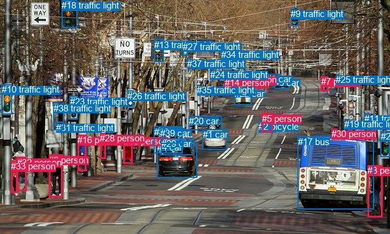
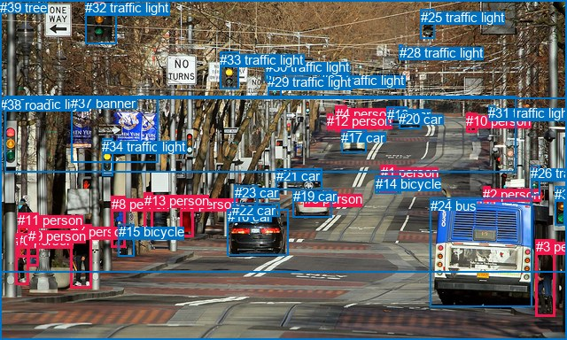

# 图片 0049：1592294.jpg

随机样本序号：321。图片 SHA256：`8ed212a0ffcf1b3d5f1fb307839030fb41aed1ff7488845a3bed02e386474082`。

红色框表示人，蓝色框表示其他物体。两个模式分别保留自身框编号，可依据位置比较对应对象。

## 自动检测框与输出

人的框编号：`[3, 5, 7, 8, 12, 14, 15, 16, 28, 30, 32, 33]`。状态：`ok`。

### 自动检测全部物体框

| 编号 | 类别 | 是否为人 | 检测分数 | 像素坐标 xyxy |
|---|---|---|---|---|
| 0 | car | False | 0.9988 | 450.2, 126.6, 474.5, 145.6 |
| 1 | car | False | 0.9979 | 332.9, 212.0, 372.5, 245.1 |
| 2 | bicycle | False | 0.9971 | 424.1, 198.9, 452.2, 218.0 |
| 3 | person | True | 0.9963 | 603.0, 271.4, 627.2, 356.4 |
| 4 | car | False | 0.9963 | 257.8, 233.3, 323.7, 291.2 |
| 5 | person | True | 0.9913 | 429.7, 185.8, 447.2, 216.0 |
| 6 | car | False | 0.9889 | 437.2, 121.2, 459.5, 140.5 |
| 7 | person | True | 0.9878 | 526.8, 125.2, 538.4, 149.3 |
| 8 | person | True | 0.9865 | 80.1, 253.6, 102.7, 323.3 |
| 9 | traffic light | False | 0.9864 | 477.2, 14.3, 490.6, 42.2 |
| 10 | traffic light | False | 0.9811 | 2.9, 138.2, 19.9, 187.9 |
| 11 | traffic light | False | 0.9774 | 597.9, 186.4, 609.0, 221.2 |
| 12 | person | True | 0.9758 | 380.9, 122.4, 389.7, 148.1 |
| 13 | traffic light | False | 0.9755 | 253.3, 65.0, 268.3, 101.2 |
| 14 | person | True | 0.9754 | 368.6, 127.3, 375.5, 147.6 |
| 15 | person | True | 0.9698 | 202.7, 222.8, 218.0, 268.2 |
| 16 | person | True | 0.9660 | 127.2, 221.1, 141.9, 280.2 |
| 17 | bus | False | 0.9600 | 488.5, 223.8, 613.8, 343.2 |
| 18 | traffic light | False | 0.9576 | 101.1, 0.0, 126.5, 45.4 |
| 19 | traffic light | False | 0.9575 | 565.3, 195.4, 572.9, 217.8 |
| 20 | car | False | 0.9533 | 309.8, 190.4, 363.3, 213.6 |
| 21 | traffic light | False | 0.9519 | 624.7, 215.1, 639.5, 258.0 |
| 22 | car | False | 0.9511 | 384.9, 145.4, 412.9, 172.1 |
| 23 | traffic light | False | 0.9425 | 114.5, 157.7, 127.2, 195.1 |
| 24 | traffic light | False | 0.9147 | 344.6, 113.7, 349.8, 129.5 |
| 25 | traffic light | False | 0.9000 | 551.2, 121.5, 556.8, 135.5 |
| 26 | traffic light | False | 0.8910 | 209.5, 148.5, 218.3, 175.2 |
| 27 | traffic light | False | 0.8863 | 300.1, 67.6, 308.0, 90.6 |
| 28 | person | True | 0.8720 | 164.4, 218.2, 173.2, 260.5 |
| 29 | car | False | 0.8715 | 264.7, 227.3, 318.6, 254.3 |
| 30 | person | True | 0.8386 | 544.3, 211.1, 553.5, 225.2 |
| 31 | traffic light | False | 0.8212 | 92.5, 200.9, 103.9, 213.8 |
| 32 | person | True | 0.7767 | 27.5, 257.5, 43.3, 313.8 |
| 33 | person | True | 0.7362 | 18.5, 264.4, 28.9, 316.4 |
| 34 | traffic light | False | 0.7067 | 362.8, 80.7, 369.3, 91.5 |
| 35 | traffic light | False | 0.6781 | 323.2, 139.1, 328.2, 148.1 |
| 36 | car | False | 0.6575 | 252.9, 207.9, 299.9, 251.0 |
| 37 | traffic light | False | 0.6526 | 307.2, 96.0, 312.6, 107.6 |
| 38 | traffic light | False | 0.6111 | 87.5, 168.9, 104.9, 214.0 |
| 39 | car | False | 0.5907 | 263.2, 209.6, 296.7, 235.6 |

### 自动检测 Top50 人相关候选

评分物体对：1560；人相关物体对：804；输出关系：50。

| 排名 | 主语编号与类别 | 关系 | 宾语编号与类别 | 类型 | 人与人 | 排序分数 | 原始融合 logit |
|---|---|---|---|---|---|---|---|
| 1 | #5 person | riding | #2 bicycle | semantic | False | 0.99787 | 6.1473 |
| 2 | #12 person | crossing | #22 car | semantic | False | 0.98715 | 4.3417 |
| 3 | #3 person | walking on | #17 bus | semantic | False | 0.98411 | 4.1263 |
| 4 | #5 person | on | #2 bicycle | spatial | False | 0.97880 | 3.8324 |
| 5 | #3 person | beside | #17 bus | spatial | False | 0.96222 | 3.2375 |
| 6 | #32 person | pushing | #33 person | semantic | True | 0.94499 | 2.8437 |
| 7 | #30 person | on back of | #17 bus | spatial | False | 0.93672 | 2.6949 |
| 8 | #32 person | on | #33 person | spatial | True | 0.91287 | 2.3492 |
| 9 | #33 person | walking on | #32 person | semantic | True | 0.90258 | 2.2262 |
| 10 | #14 person | crossing | #22 car | semantic | False | 0.89854 | 2.1811 |
| 11 | #16 person | walking on | #28 person | semantic | True | 0.89474 | 2.1401 |
| 12 | #33 person | on | #32 person | spatial | True | 0.87605 | 1.9556 |
| 13 | #8 person | walking on | #33 person | semantic | True | 0.86842 | 1.8870 |
| 14 | #17 bus | on | #30 person | spatial | False | 0.85904 | 1.8073 |
| 15 | #8 person | walking on | #32 person | semantic | True | 0.85724 | 1.7926 |
| 16 | #8 person | walking on | #16 person | semantic | True | 0.85411 | 1.7672 |
| 17 | #12 person | on | #22 car | spatial | False | 0.85260 | 1.7551 |
| 18 | #3 person | standing on | #21 traffic light | semantic | False | 0.80376 | 1.4099 |
| 19 | #2 bicycle | riding | #5 person | semantic | False | 0.77357 | 1.2286 |
| 20 | #7 person | walking on | #25 traffic light | semantic | False | 0.77326 | 1.2268 |
| 21 | #2 bicycle | on | #5 person | spatial | False | 0.75466 | 1.1236 |
| 22 | #8 person | walking on | #38 traffic light | semantic | False | 0.73642 | 1.0274 |
| 23 | #16 person | beside | #28 person | spatial | True | 0.71607 | 0.9251 |
| 24 | #8 person | beside | #32 person | spatial | True | 0.70689 | 0.8803 |
| 25 | #30 person | on | #19 traffic light | spatial | False | 0.70252 | 0.8593 |
| 26 | #8 person | beside | #33 person | spatial | True | 0.69362 | 0.8171 |
| 27 | #14 person | walking on | #0 car | semantic | False | 0.62867 | 0.5265 |
| 28 | #14 person | walking on | #6 car | semantic | False | 0.62553 | 0.5131 |
| 29 | #12 person | riding | #2 bicycle | semantic | False | 0.61547 | 0.4704 |
| 30 | #17 bus | beside | #3 person | spatial | False | 0.60830 | 0.4402 |
| 31 | #14 person | riding | #2 bicycle | semantic | False | 0.59883 | 0.4006 |
| 32 | #14 person | walking on | #12 person | semantic | True | 0.59782 | 0.3964 |
| 33 | #17 bus | driving | #30 person | semantic | False | 0.59635 | 0.3903 |
| 34 | #8 person | beside | #16 person | spatial | True | 0.59275 | 0.3754 |
| 35 | #16 person | walking on | #15 person | semantic | True | 0.58963 | 0.3624 |
| 36 | #3 person | beside | #21 traffic light | spatial | False | 0.56585 | 0.2649 |
| 37 | #14 person | walking on | #20 car | semantic | False | 0.56410 | 0.2578 |
| 38 | #8 person | walking on | #31 traffic light | semantic | False | 0.56074 | 0.2442 |
| 39 | #17 bus | parked on | #3 person | semantic | False | 0.55964 | 0.2397 |
| 40 | #14 person | beside | #22 car | spatial | False | 0.55002 | 0.2008 |
| 41 | #30 person | guiding | #17 bus | semantic | False | 0.53674 | 0.1472 |
| 42 | #12 person | walking on | #14 person | semantic | True | 0.53501 | 0.1403 |
| 43 | #7 person | walking on | #0 car | semantic | False | 0.52243 | 0.0898 |
| 44 | #7 person | beside | #25 traffic light | spatial | False | 0.49668 | -0.0133 |
| 45 | #28 person | walking on | #15 person | semantic | True | 0.48944 | -0.0422 |
| 46 | #30 person | on | #21 traffic light | spatial | False | 0.46592 | -0.1365 |
| 47 | #12 person | walking on | #0 car | semantic | False | 0.44766 | -0.2101 |
| 48 | #12 person | walking on | #6 car | semantic | False | 0.44238 | -0.2315 |
| 49 | #25 traffic light | beside | #7 person | spatial | False | 0.44134 | -0.2357 |
| 50 | #8 person | beside | #38 traffic light | spatial | False | 0.44072 | -0.2383 |

### 自动检测逐条人相关 GT 核验

R@50：20.00%；命中 1/5。

| GT 主语编号 | GT 关系 | GT 宾语编号 | 结果阶段 | 匹配预测主语编号 | 匹配预测宾语编号 |
|---|---|---|---|---|---|
| 1 | riding | 14 | hit50 | [5] | [2] |
| 1 | crossing | 38 | endpoint_missing_or_wrong_class | [5] | [] |
| 3 | standing on | 38 | endpoint_missing_or_wrong_class | [3] | [] |
| 8 | walking on | 7 | rank_below50 | [16] | [8] |
| 8 | looking at | 15 | endpoint_missing_or_wrong_class | [16] | [] |

## 真实框与输出

人的框编号：`[0, 1, 2, 3, 4, 5, 6, 7, 8, 9, 10, 11, 12, 13]`。

### 真实框全部物体框

| 编号 | 类别 | 是否为人 | 检测分数 | 像素坐标 xyxy |
|---|---|---|---|---|
| 0 | person | True | GT | 18.0, 263.0, 33.0, 322.0 |
| 1 | person | True | GT | 430.0, 186.0, 447.0, 218.0 |
| 2 | person | True | GT | 545.0, 211.0, 553.0, 225.0 |
| 3 | person | True | GT | 605.0, 270.0, 627.0, 357.0 |
| 4 | person | True | GT | 379.0, 120.0, 391.0, 149.0 |
| 5 | person | True | GT | 344.0, 216.0, 348.0, 219.0 |
| 6 | person | True | GT | 204.0, 222.0, 219.0, 268.0 |
| 7 | person | True | GT | 80.0, 253.0, 104.0, 325.0 |
| 8 | person | True | GT | 126.0, 222.0, 142.0, 280.0 |
| 9 | person | True | GT | 32.0, 258.0, 43.0, 301.0 |
| 10 | person | True | GT | 526.0, 128.0, 539.0, 150.0 |
| 11 | person | True | GT | 20.0, 240.0, 43.0, 290.0 |
| 12 | person | True | GT | 369.0, 128.0, 375.0, 146.0 |
| 13 | person | True | GT | 163.0, 218.0, 173.0, 262.0 |
| 14 | bicycle | False | GT | 424.0, 199.0, 453.0, 219.0 |
| 15 | bicycle | False | GT | 134.0, 253.0, 151.0, 290.0 |
| 16 | car | False | GT | 257.0, 236.0, 326.0, 289.0 |
| 17 | car | False | GT | 385.0, 147.0, 413.0, 173.0 |
| 18 | car | False | GT | 437.0, 121.0, 460.0, 140.0 |
| 19 | car | False | GT | 331.0, 213.0, 374.0, 245.0 |
| 20 | car | False | GT | 450.0, 126.0, 475.0, 145.0 |
| 21 | car | False | GT | 312.0, 190.0, 364.0, 214.0 |
| 22 | car | False | GT | 262.0, 229.0, 316.0, 244.0 |
| 23 | car | False | GT | 265.0, 209.0, 291.0, 234.0 |
| 24 | bus | False | GT | 486.0, 224.0, 601.0, 346.0 |
| 25 | traffic light | False | GT | 475.0, 11.0, 491.0, 43.0 |
| 26 | traffic light | False | GT | 599.0, 187.0, 609.0, 220.0 |
| 27 | traffic light | False | GT | 362.0, 82.0, 371.0, 88.0 |
| 28 | traffic light | False | GT | 451.0, 51.0, 455.0, 55.0 |
| 29 | traffic light | False | GT | 302.0, 84.0, 317.0, 111.0 |
| 30 | traffic light | False | GT | 300.0, 67.0, 308.0, 92.0 |
| 31 | traffic light | False | GT | 551.0, 119.0, 558.0, 134.0 |
| 32 | traffic light | False | GT | 96.0, 0.0, 131.0, 50.0 |
| 33 | traffic light | False | GT | 248.0, 59.0, 269.0, 100.0 |
| 34 | traffic light | False | GT | 115.0, 157.0, 127.0, 199.0 |
| 35 | traffic light | False | GT | 626.0, 211.0, 637.0, 255.0 |
| 36 | traffic light | False | GT | 5.0, 109.0, 583.0, 194.0 |
| 37 | banner | False | GT | 80.0, 108.0, 179.0, 183.0 |
| 38 | road | False | GT | 0.0, 110.0, 640.0, 384.0 |
| 39 | tree | False | GT | 0.0, 0.0, 640.0, 307.0 |

### 真实框 Top50 人相关候选

评分物体对：1560；人相关物体对：910；输出关系：50。

| 排名 | 主语编号与类别 | 关系 | 宾语编号与类别 | 类型 | 人与人 | 排序分数 | 原始融合 logit |
|---|---|---|---|---|---|---|---|
| 1 | #1 person | riding | #14 bicycle | semantic | False | 0.99750 | 5.9904 |
| 2 | #10 person | crossing | #38 road | semantic | False | 0.99427 | 5.1555 |
| 3 | #4 person | crossing | #38 road | semantic | False | 0.99398 | 5.1070 |
| 4 | #5 person | driving on | #38 road | semantic | False | 0.99359 | 5.0438 |
| 5 | #1 person | crossing | #38 road | semantic | False | 0.99306 | 4.9639 |
| 6 | #12 person | crossing | #38 road | semantic | False | 0.99271 | 4.9135 |
| 7 | #7 person | crossing | #38 road | semantic | False | 0.99179 | 4.7944 |
| 8 | #8 person | crossing | #38 road | semantic | False | 0.98736 | 4.3579 |
| 9 | #4 person | crossing | #36 traffic light | semantic | False | 0.98424 | 4.1346 |
| 10 | #4 person | crossing | #17 car | semantic | False | 0.97480 | 3.6554 |
| 11 | #1 person | on | #14 bicycle | spatial | False | 0.97413 | 3.6284 |
| 12 | #3 person | crossing | #38 road | semantic | False | 0.97374 | 3.6130 |
| 13 | #5 person | on | #38 road | spatial | False | 0.97250 | 3.5656 |
| 14 | #10 person | crossing | #36 traffic light | semantic | False | 0.96766 | 3.3985 |
| 15 | #12 person | crossing | #36 traffic light | semantic | False | 0.96761 | 3.3969 |
| 16 | #11 person | on | #0 person | spatial | True | 0.96608 | 3.3492 |
| 17 | #9 person | carrying | #11 person | semantic | True | 0.96461 | 3.3053 |
| 18 | #8 person | pushing | #15 bicycle | semantic | False | 0.95987 | 3.1746 |
| 19 | #11 person | on | #9 person | spatial | True | 0.95591 | 3.0764 |
| 20 | #0 person | holding | #11 person | semantic | True | 0.95583 | 3.0744 |
| 21 | #3 person | walking on | #24 bus | semantic | False | 0.95500 | 3.0551 |
| 22 | #2 person | on back of | #24 bus | spatial | False | 0.94994 | 2.9432 |
| 23 | #9 person | crossing | #38 road | semantic | False | 0.94897 | 2.9229 |
| 24 | #3 person | beside | #24 bus | spatial | False | 0.94393 | 2.8234 |
| 25 | #5 person | on | #19 car | spatial | False | 0.94338 | 2.8131 |
| 26 | #1 person | on | #38 road | spatial | False | 0.93165 | 2.6123 |
| 27 | #0 person | holding | #9 person | semantic | True | 0.92942 | 2.5778 |
| 28 | #13 person | crossing | #38 road | semantic | False | 0.92898 | 2.5712 |
| 29 | #6 person | on | #38 road | spatial | False | 0.92080 | 2.4533 |
| 30 | #11 person | crossing | #38 road | semantic | False | 0.90690 | 2.2763 |
| 31 | #9 person | on | #0 person | spatial | True | 0.89995 | 2.1966 |
| 32 | #13 person | on | #38 road | spatial | False | 0.89979 | 2.1948 |
| 33 | #8 person | walking on | #39 tree | semantic | False | 0.88955 | 2.0862 |
| 34 | #9 person | walking on | #0 person | semantic | True | 0.88894 | 2.0800 |
| 35 | #7 person | on | #38 road | spatial | False | 0.88859 | 2.0765 |
| 36 | #11 person | carrying | #9 person | semantic | True | 0.88742 | 2.0646 |
| 37 | #8 person | on | #15 bicycle | spatial | False | 0.88710 | 2.0615 |
| 38 | #8 person | on | #38 road | spatial | False | 0.86169 | 1.8294 |
| 39 | #9 person | beside | #11 person | spatial | True | 0.84970 | 1.7323 |
| 40 | #7 person | walking on | #39 tree | semantic | False | 0.80923 | 1.4450 |
| 41 | #0 person | on | #38 road | spatial | False | 0.79970 | 1.3844 |
| 42 | #15 bicycle | leaning on | #8 person | spatial | False | 0.79505 | 1.3557 |
| 43 | #0 person | beside | #9 person | spatial | True | 0.79021 | 1.3262 |
| 44 | #0 person | on | #11 person | spatial | True | 0.78938 | 1.3212 |
| 45 | #11 person | on | #38 road | spatial | False | 0.78707 | 1.3073 |
| 46 | #11 person | standing on | #0 person | semantic | True | 0.78140 | 1.2739 |
| 47 | #9 person | on | #38 road | spatial | False | 0.77050 | 1.2111 |
| 48 | #4 person | on | #38 road | spatial | False | 0.75910 | 1.1478 |
| 49 | #0 person | crossing | #38 road | semantic | False | 0.75763 | 1.1397 |
| 50 | #12 person | walking on | #39 tree | semantic | False | 0.75734 | 1.1382 |

### 真实框逐条人相关 GT 核验

R@50：40.00%；命中 2/5。

| GT 主语编号 | GT 关系 | GT 宾语编号 | 结果阶段 | 匹配预测主语编号 | 匹配预测宾语编号 |
|---|---|---|---|---|---|
| 1 | riding | 14 | hit50 | [1] | [14] |
| 1 | crossing | 38 | hit50 | [1] | [38] |
| 3 | standing on | 38 | wrong_predicate | [3] | [38] |
| 8 | walking on | 7 | rank_below50 | [8] | [7] |
| 8 | looking at | 15 | wrong_predicate | [8] | [15] |

## 全部人相关 GT

| 主语编号与类别 | 关系 | 宾语编号与类别 |
|---|---|---|
| #1 person | riding | #14 bicycle |
| #1 person | crossing | #38 road |
| #3 person | standing on | #38 road |
| #8 person | walking on | #7 person |
| #8 person | looking at | #15 bicycle |

原始记录、全部人相关物体对的两项预测与分项分数见 [逐图证据 JSON](../evidence/cases/0049.json)。全部56类 logits 保留于本机 HOR/output/random500/logits/。

<!-- HOR_COMPLETE_RESULTS -->

## 六组条件的完整输出对照

以下保留同一图片三种框与候选模式、两种谓词输出规则的全部 Top50。框编号各自在所属模式内解释。

### 自动检测框完整枚举：空间与语义各保留一个谓词

| 排名 | 主语编号与类别 | 谓词 | 宾语编号与类别 | 分组 | 排序分数 | predicate logit | pair logit |
|---|---|---|---|---|---|---|---|
| 1 | #5 person | riding | #2 bicycle | semantic | 0.9978653 | 5.9826512 | 0.1646173 |
| 2 | #12 person | crossing | #22 car | semantic | 0.9871525 | 4.7211404 | -0.3794604 |
| 3 | #3 person | walking on | #17 bus | semantic | 0.9841144 | 4.0623202 | 0.0640063 |
| 4 | #5 person | on | #2 bicycle | spatial | 0.9788022 | 3.6678128 | 0.1646173 |
| 5 | #3 person | beside | #17 bus | spatial | 0.9622222 | 3.1735177 | 0.0640063 |
| 6 | #32 person | pushing | #33 person | semantic | 0.9449934 | 2.8551497 | -0.0114260 |
| 7 | #30 person | on back of | #17 bus | spatial | 0.9367247 | 2.6614447 | 0.0334488 |
| 8 | #32 person | on | #33 person | spatial | 0.9128706 | 2.3606253 | -0.0114260 |
| 9 | #33 person | walking on | #32 person | semantic | 0.9025803 | 2.3080244 | -0.0817955 |
| 10 | #14 person | crossing | #22 car | semantic | 0.8985436 | 2.5601854 | -0.3790395 |
| 11 | #16 person | walking on | #28 person | semantic | 0.8947400 | 2.3441510 | -0.2040516 |
| 12 | #33 person | on | #32 person | spatial | 0.8760515 | 2.0373545 | -0.0817955 |
| 13 | #8 person | walking on | #33 person | semantic | 0.8684151 | 1.9559751 | -0.0689576 |
| 14 | #17 bus | on | #30 person | spatial | 0.8590412 | 1.9557109 | -0.1483611 |
| 15 | #8 person | walking on | #32 person | semantic | 0.8572438 | 1.8897715 | -0.0971876 |
| 16 | #8 person | walking on | #16 person | semantic | 0.8541121 | 2.0402002 | -0.2729761 |
| 17 | #12 person | on | #22 car | spatial | 0.8525971 | 2.1345778 | -0.3794604 |
| 18 | #3 person | standing on | #21 traffic light | semantic | 0.8037555 | 1.8520041 | -0.4420704 |
| 19 | #2 bicycle | riding | #5 person | semantic | 0.7735694 | 1.5530930 | -0.3245164 |
| 20 | #7 person | walking on | #25 traffic light | semantic | 0.7732587 | 1.1916795 | 0.0351250 |
| 21 | #2 bicycle | on | #5 person | spatial | 0.7546633 | 1.4481568 | -0.3245164 |
| 22 | #8 person | walking on | #38 traffic light | semantic | 0.7364187 | 2.1244946 | -1.0970578 |
| 23 | #16 person | beside | #28 person | spatial | 0.7160707 | 1.1291051 | -0.2040516 |
| 24 | #8 person | beside | #32 person | spatial | 0.7068854 | 0.9774923 | -0.0971876 |
| 25 | #30 person | on | #19 traffic light | spatial | 0.7025174 | 1.2865496 | -0.4272348 |
| 26 | #8 person | beside | #33 person | spatial | 0.6936215 | 0.8860626 | -0.0689576 |
| 27 | #14 person | walking on | #0 car | semantic | 0.6286703 | 1.2549286 | -0.7284119 |
| 28 | #14 person | walking on | #6 car | semantic | 0.6255331 | 1.2428999 | -0.7297990 |
| 29 | #12 person | riding | #2 bicycle | semantic | 0.6154717 | 0.9764724 | -0.5061008 |
| 30 | #17 bus | beside | #3 person | spatial | 0.6082964 | 1.3083801 | -0.8682233 |
| 31 | #14 person | riding | #2 bicycle | semantic | 0.5988255 | 0.8852210 | -0.4846475 |
| 32 | #14 person | walking on | #12 person | semantic | 0.5978179 | 0.5928373 | -0.1964563 |
| 33 | #17 bus | driving | #30 person | semantic | 0.5963457 | 0.5386229 | -0.1483611 |
| 34 | #8 person | beside | #16 person | spatial | 0.5927543 | 0.6483393 | -0.2729761 |
| 35 | #16 person | walking on | #15 person | semantic | 0.5896295 | 0.6981912 | -0.3357574 |
| 36 | #3 person | beside | #21 traffic light | spatial | 0.5658522 | 0.7070184 | -0.4420704 |
| 37 | #14 person | walking on | #20 car | semantic | 0.5641015 | 0.9028230 | -0.6449983 |
| 38 | #8 person | walking on | #31 traffic light | semantic | 0.5607406 | 1.2759609 | -1.0317926 |
| 39 | #17 bus | parked on | #3 person | semantic | 0.5596412 | 1.1079292 | -0.8682233 |
| 40 | #14 person | beside | #22 car | spatial | 0.5500243 | 0.5798082 | -0.3790395 |
| 41 | #30 person | guiding | #17 bus | semantic | 0.5367415 | 0.1137824 | 0.0334488 |
| 42 | #12 person | walking on | #14 person | semantic | 0.5350080 | 0.3882198 | -0.2479584 |
| 43 | #7 person | walking on | #0 car | semantic | 0.5224270 | 0.7794476 | -0.6896791 |
| 44 | #7 person | beside | #25 traffic light | spatial | 0.4966813 | -0.0483999 | 0.0351250 |
| 45 | #28 person | walking on | #15 person | semantic | 0.4894434 | 0.0768261 | -0.1190586 |
| 46 | #30 person | on | #21 traffic light | spatial | 0.4659182 | 0.4497290 | -0.5862677 |
| 47 | #12 person | walking on | #0 car | semantic | 0.4476594 | 0.5026474 | -0.7127796 |
| 48 | #12 person | walking on | #6 car | semantic | 0.4423836 | 0.4845982 | -0.7160921 |
| 49 | #25 traffic light | beside | #7 person | spatial | 0.4413445 | 0.0101271 | -0.2458343 |
| 50 | #8 person | beside | #38 traffic light | spatial | 0.4407167 | 0.8588042 | -1.0970578 |

GT 命中：1/5，R@50=20.00%。

| GT主语 | GT谓词 | GT宾语 | 结果阶段 | 匹配主语框 | 匹配宾语框 |
|---|---|---|---|---|---|
| 1 | riding | 14 | hit50 | [5] | [2] |
| 1 | crossing | 38 | endpoint_missing_or_wrong_class | [5] | [] |
| 3 | standing on | 38 | endpoint_missing_or_wrong_class | [3] | [] |
| 8 | walking on | 7 | rank_below50 | [16] | [8] |
| 8 | looking at | 15 | endpoint_missing_or_wrong_class | [16] | [] |

### 自动检测框完整枚举：每对只保留一个谓词

| 排名 | 主语编号与类别 | 谓词 | 宾语编号与类别 | 分组 | 排序分数 | predicate logit | pair logit |
|---|---|---|---|---|---|---|---|
| 1 | #5 person | riding | #2 bicycle | single | 0.9978653 | 5.9826512 | 0.1646173 |
| 2 | #12 person | crossing | #22 car | single | 0.9871525 | 4.7211404 | -0.3794604 |
| 3 | #3 person | walking on | #17 bus | single | 0.9841144 | 4.0623202 | 0.0640063 |
| 4 | #32 person | pushing | #33 person | single | 0.9449934 | 2.8551497 | -0.0114260 |
| 5 | #30 person | on back of | #17 bus | single | 0.9367247 | 2.6614447 | 0.0334488 |
| 6 | #33 person | walking on | #32 person | single | 0.9025803 | 2.3080244 | -0.0817955 |
| 7 | #14 person | crossing | #22 car | single | 0.8985436 | 2.5601854 | -0.3790395 |
| 8 | #16 person | walking on | #28 person | single | 0.8947400 | 2.3441510 | -0.2040516 |
| 9 | #8 person | walking on | #33 person | single | 0.8684151 | 1.9559751 | -0.0689576 |
| 10 | #17 bus | on | #30 person | single | 0.8590412 | 1.9557109 | -0.1483611 |
| 11 | #8 person | walking on | #32 person | single | 0.8572438 | 1.8897715 | -0.0971876 |
| 12 | #8 person | walking on | #16 person | single | 0.8541121 | 2.0402002 | -0.2729761 |
| 13 | #3 person | standing on | #21 traffic light | single | 0.8037555 | 1.8520041 | -0.4420704 |
| 14 | #2 bicycle | riding | #5 person | single | 0.7735694 | 1.5530930 | -0.3245164 |
| 15 | #7 person | walking on | #25 traffic light | single | 0.7732587 | 1.1916795 | 0.0351250 |
| 16 | #8 person | walking on | #38 traffic light | single | 0.7364187 | 2.1244946 | -1.0970578 |
| 17 | #30 person | on | #19 traffic light | single | 0.7025174 | 1.2865496 | -0.4272348 |
| 18 | #14 person | walking on | #0 car | single | 0.6286703 | 1.2549286 | -0.7284119 |
| 19 | #14 person | walking on | #6 car | single | 0.6255331 | 1.2428999 | -0.7297990 |
| 20 | #12 person | riding | #2 bicycle | single | 0.6154717 | 0.9764724 | -0.5061008 |
| 21 | #17 bus | beside | #3 person | single | 0.6082964 | 1.3083801 | -0.8682233 |
| 22 | #14 person | riding | #2 bicycle | single | 0.5988255 | 0.8852210 | -0.4846475 |
| 23 | #14 person | walking on | #12 person | single | 0.5978179 | 0.5928373 | -0.1964563 |
| 24 | #16 person | walking on | #15 person | single | 0.5896295 | 0.6981912 | -0.3357574 |
| 25 | #14 person | walking on | #20 car | single | 0.5641015 | 0.9028230 | -0.6449983 |
| 26 | #8 person | walking on | #31 traffic light | single | 0.5607406 | 1.2759609 | -1.0317926 |
| 27 | #12 person | walking on | #14 person | single | 0.5350080 | 0.3882198 | -0.2479584 |
| 28 | #7 person | walking on | #0 car | single | 0.5224270 | 0.7794476 | -0.6896791 |
| 29 | #28 person | walking on | #15 person | single | 0.4894434 | 0.0768261 | -0.1190586 |
| 30 | #30 person | on | #21 traffic light | single | 0.4659182 | 0.4497290 | -0.5862677 |
| 31 | #12 person | walking on | #0 car | single | 0.4476594 | 0.5026474 | -0.7127796 |
| 32 | #12 person | walking on | #6 car | single | 0.4423836 | 0.4845982 | -0.7160921 |
| 33 | #25 traffic light | beside | #7 person | single | 0.4413445 | 0.0101271 | -0.2458343 |
| 34 | #12 person | walking on | #20 car | single | 0.4371715 | 0.4093351 | -0.6619846 |
| 35 | #16 person | walking on | #39 car | single | 0.4351062 | 0.5327110 | -0.7937585 |
| 36 | #16 person | walking on | #20 car | single | 0.4328414 | 0.7162690 | -0.9865367 |
| 37 | #16 person | walking on | #8 person | single | 0.4309575 | 0.2016788 | -0.4796245 |
| 38 | #8 person | walking on | #28 person | single | 0.4171325 | 0.3942547 | -0.7288105 |
| 39 | #16 person | walking on | #33 person | single | 0.4105051 | 0.0677943 | -0.4296719 |
| 40 | #32 person | walking on | #8 person | single | 0.4063233 | 0.1144018 | -0.4935877 |
| 41 | #16 person | walking on | #36 car | single | 0.3975554 | 0.4785490 | -0.8942106 |
| 42 | #8 person | walking on | #15 person | single | 0.3930345 | 0.4755106 | -0.9100852 |
| 43 | #3 person | looking at | #11 traffic light | single | 0.3751163 | 0.1295152 | -0.6398447 |
| 44 | #26 traffic light | on | #15 person | single | 0.3726088 | -0.5798178 | 0.0587767 |
| 45 | #3 person | standing on | #19 traffic light | single | 0.3688623 | -0.1185160 | -0.4185849 |
| 46 | #8 person | walking on | #23 traffic light | single | 0.3642280 | 0.7643952 | -1.3214552 |
| 47 | #16 person | walking on | #38 traffic light | single | 0.3596713 | 0.4634829 | -1.0402739 |
| 48 | #7 person | walking on | #6 car | single | 0.3500267 | 0.1234336 | -0.7423553 |
| 49 | #16 person | walking on | #32 person | single | 0.3462297 | -0.2210755 | -0.4145780 |
| 50 | #14 person | walking on | #35 traffic light | single | 0.3448447 | 0.1294827 | -0.7712610 |

GT 命中：2/5，R@50=40.00%。

| GT主语 | GT谓词 | GT宾语 | 结果阶段 | 匹配主语框 | 匹配宾语框 |
|---|---|---|---|---|---|
| 1 | riding | 14 | hit50 | [5] | [2] |
| 1 | crossing | 38 | endpoint_missing_or_wrong_class | [5] | [] |
| 3 | standing on | 38 | endpoint_missing_or_wrong_class | [3] | [] |
| 8 | walking on | 7 | hit50 | [16] | [8] |
| 8 | looking at | 15 | endpoint_missing_or_wrong_class | [16] | [] |

### 真实框完整枚举：空间与语义各保留一个谓词

| 排名 | 主语编号与类别 | 谓词 | 宾语编号与类别 | 分组 | 排序分数 | predicate logit | pair logit |
|---|---|---|---|---|---|---|---|
| 1 | #1 person | riding | #14 bicycle | semantic | 0.9975035 | 5.8647304 | 0.1256272 |
| 2 | #10 person | crossing | #38 road | semantic | 0.9942655 | 5.3158565 | -0.1603586 |
| 3 | #4 person | crossing | #38 road | semantic | 0.9939820 | 5.3171372 | -0.2101735 |
| 4 | #5 person | driving on | #38 road | semantic | 0.9935922 | 4.7477307 | 0.2960910 |
| 5 | #1 person | crossing | #38 road | semantic | 0.9930624 | 5.1372275 | -0.1733752 |
| 6 | #12 person | crossing | #38 road | semantic | 0.9927067 | 5.0768332 | -0.1633492 |
| 7 | #7 person | crossing | #38 road | semantic | 0.9917920 | 5.0863576 | -0.2919619 |
| 8 | #8 person | crossing | #38 road | semantic | 0.9873570 | 4.7272525 | -0.3693184 |
| 9 | #4 person | crossing | #36 traffic light | semantic | 0.9842428 | 4.6617389 | -0.5271652 |
| 10 | #4 person | crossing | #17 car | semantic | 0.9748012 | 4.0600562 | -0.4046188 |
| 11 | #1 person | on | #14 bicycle | spatial | 0.9741275 | 3.5027308 | 0.1256272 |
| 12 | #3 person | crossing | #38 road | semantic | 0.9737363 | 3.7634091 | -0.1504556 |
| 13 | #5 person | on | #38 road | spatial | 0.9724967 | 3.2694721 | 0.2960910 |
| 14 | #10 person | crossing | #36 traffic light | semantic | 0.9676590 | 3.8795085 | -0.4809642 |
| 15 | #12 person | crossing | #36 traffic light | semantic | 0.9676074 | 3.8805747 | -0.4836755 |
| 16 | #11 person | on | #0 person | spatial | 0.9660802 | 3.3576903 | -0.0084409 |
| 17 | #9 person | carrying | #11 person | semantic | 0.9646102 | 3.3634343 | -0.0581354 |
| 18 | #8 person | pushing | #15 bicycle | semantic | 0.9598679 | 3.1857219 | -0.0111026 |
| 19 | #11 person | on | #9 person | spatial | 0.9559107 | 3.1696715 | -0.0932226 |
| 20 | #0 person | holding | #11 person | semantic | 0.9558263 | 3.1907902 | -0.1163425 |
| 21 | #3 person | walking on | #24 bus | semantic | 0.9550020 | 2.9850850 | 0.0700083 |
| 22 | #2 person | on back of | #24 bus | spatial | 0.9499427 | 2.8942471 | 0.0489862 |
| 23 | #9 person | crossing | #38 road | semantic | 0.9489679 | 3.4061513 | -0.4832305 |
| 24 | #3 person | beside | #24 bus | spatial | 0.9439276 | 2.7533965 | 0.0700083 |
| 25 | #5 person | on | #19 car | spatial | 0.9433798 | 3.1456323 | -0.3325288 |
| 26 | #1 person | on | #38 road | spatial | 0.9316504 | 2.7856960 | -0.1733752 |
| 27 | #0 person | holding | #9 person | semantic | 0.9294165 | 2.7436829 | -0.1659220 |
| 28 | #13 person | crossing | #38 road | semantic | 0.9289821 | 2.9315867 | -0.3604295 |
| 29 | #6 person | on | #38 road | spatial | 0.9208027 | 2.6859517 | -0.2326487 |
| 30 | #11 person | crossing | #38 road | semantic | 0.9068989 | 2.7186737 | -0.4423291 |
| 31 | #9 person | on | #0 person | spatial | 0.8999467 | 2.2772446 | -0.0806110 |
| 32 | #13 person | on | #38 road | spatial | 0.8997858 | 2.5552759 | -0.3604295 |
| 33 | #8 person | walking on | #39 tree | semantic | 0.8895533 | 2.6600742 | -0.5738873 |
| 34 | #9 person | walking on | #0 person | semantic | 0.8889423 | 2.1605930 | -0.0806110 |
| 35 | #7 person | on | #38 road | spatial | 0.8885934 | 2.3684149 | -0.2919619 |
| 36 | #11 person | carrying | #9 person | semantic | 0.8874178 | 2.1578550 | -0.0932226 |
| 37 | #8 person | on | #15 bicycle | spatial | 0.8871043 | 2.0726008 | -0.0111026 |
| 38 | #8 person | on | #38 road | spatial | 0.8616949 | 2.1987572 | -0.3693184 |
| 39 | #9 person | beside | #11 person | spatial | 0.8497042 | 1.7904186 | -0.0581354 |
| 40 | #7 person | walking on | #39 tree | semantic | 0.8092291 | 2.1756172 | -0.7306086 |
| 41 | #0 person | on | #38 road | spatial | 0.7997035 | 1.8857970 | -0.5013551 |
| 42 | #15 bicycle | leaning on | #8 person | spatial | 0.7950531 | 1.7477183 | -0.3920608 |
| 43 | #0 person | beside | #9 person | spatial | 0.7902091 | 1.4921083 | -0.1659220 |
| 44 | #0 person | on | #11 person | spatial | 0.7893790 | 1.4375286 | -0.1163425 |
| 45 | #11 person | on | #38 road | spatial | 0.7870690 | 1.7496767 | -0.4423291 |
| 46 | #11 person | standing on | #0 person | semantic | 0.7814019 | 1.2822957 | -0.0084409 |
| 47 | #9 person | on | #38 road | spatial | 0.7704988 | 1.6943603 | -0.4832305 |
| 48 | #4 person | on | #38 road | spatial | 0.7591026 | 1.3579397 | -0.2101735 |
| 49 | #0 person | crossing | #38 road | semantic | 0.7576282 | 1.6410751 | -0.5013551 |
| 50 | #12 person | walking on | #39 tree | semantic | 0.7573401 | 1.5677996 | -0.4296478 |

GT 命中：2/5，R@50=40.00%。

| GT主语 | GT谓词 | GT宾语 | 结果阶段 | 匹配主语框 | 匹配宾语框 |
|---|---|---|---|---|---|
| 1 | riding | 14 | hit50 | [1] | [14] |
| 1 | crossing | 38 | hit50 | [1] | [38] |
| 3 | standing on | 38 | wrong_predicate | [3] | [38] |
| 8 | walking on | 7 | rank_below50 | [8] | [7] |
| 8 | looking at | 15 | wrong_predicate | [8] | [15] |

### 真实框完整枚举：每对只保留一个谓词

| 排名 | 主语编号与类别 | 谓词 | 宾语编号与类别 | 分组 | 排序分数 | predicate logit | pair logit |
|---|---|---|---|---|---|---|---|
| 1 | #1 person | riding | #14 bicycle | single | 0.9975035 | 5.8647304 | 0.1256272 |
| 2 | #10 person | crossing | #38 road | single | 0.9942655 | 5.3158565 | -0.1603586 |
| 3 | #4 person | crossing | #38 road | single | 0.9939820 | 5.3171372 | -0.2101735 |
| 4 | #5 person | driving on | #38 road | single | 0.9935922 | 4.7477307 | 0.2960910 |
| 5 | #1 person | crossing | #38 road | single | 0.9930624 | 5.1372275 | -0.1733752 |
| 6 | #12 person | crossing | #38 road | single | 0.9927067 | 5.0768332 | -0.1633492 |
| 7 | #7 person | crossing | #38 road | single | 0.9917920 | 5.0863576 | -0.2919619 |
| 8 | #8 person | crossing | #38 road | single | 0.9873570 | 4.7272525 | -0.3693184 |
| 9 | #4 person | crossing | #36 traffic light | single | 0.9842428 | 4.6617389 | -0.5271652 |
| 10 | #4 person | crossing | #17 car | single | 0.9748012 | 4.0600562 | -0.4046188 |
| 11 | #3 person | crossing | #38 road | single | 0.9737363 | 3.7634091 | -0.1504556 |
| 12 | #10 person | crossing | #36 traffic light | single | 0.9676590 | 3.8795085 | -0.4809642 |
| 13 | #12 person | crossing | #36 traffic light | single | 0.9676074 | 3.8805747 | -0.4836755 |
| 14 | #11 person | on | #0 person | single | 0.9660802 | 3.3576903 | -0.0084409 |
| 15 | #9 person | carrying | #11 person | single | 0.9646102 | 3.3634343 | -0.0581354 |
| 16 | #8 person | pushing | #15 bicycle | single | 0.9598679 | 3.1857219 | -0.0111026 |
| 17 | #11 person | on | #9 person | single | 0.9559107 | 3.1696715 | -0.0932226 |
| 18 | #0 person | holding | #11 person | single | 0.9558263 | 3.1907902 | -0.1163425 |
| 19 | #3 person | walking on | #24 bus | single | 0.9550020 | 2.9850850 | 0.0700083 |
| 20 | #2 person | on back of | #24 bus | single | 0.9499427 | 2.8942471 | 0.0489862 |
| 21 | #9 person | crossing | #38 road | single | 0.9489679 | 3.4061513 | -0.4832305 |
| 22 | #5 person | on | #19 car | single | 0.9433798 | 3.1456323 | -0.3325288 |
| 23 | #0 person | holding | #9 person | single | 0.9294165 | 2.7436829 | -0.1659220 |
| 24 | #13 person | crossing | #38 road | single | 0.9289821 | 2.9315867 | -0.3604295 |
| 25 | #6 person | on | #38 road | single | 0.9208027 | 2.6859517 | -0.2326487 |
| 26 | #11 person | crossing | #38 road | single | 0.9068989 | 2.7186737 | -0.4423291 |
| 27 | #9 person | on | #0 person | single | 0.8999467 | 2.2772446 | -0.0806110 |
| 28 | #8 person | walking on | #39 tree | single | 0.8895533 | 2.6600742 | -0.5738873 |
| 29 | #7 person | walking on | #39 tree | single | 0.8092291 | 2.1756172 | -0.7306086 |
| 30 | #0 person | on | #38 road | single | 0.7997035 | 1.8857970 | -0.5013551 |
| 31 | #15 bicycle | leaning on | #8 person | single | 0.7950531 | 1.7477183 | -0.3920608 |
| 32 | #12 person | walking on | #39 tree | single | 0.7573401 | 1.5677996 | -0.4296478 |
| 33 | #5 person | driving on | #36 traffic light | single | 0.7519523 | 1.3784056 | -0.2693541 |
| 34 | #4 person | walking on | #39 tree | single | 0.7471352 | 1.5497360 | -0.4663451 |
| 35 | #3 person | standing on | #35 traffic light | single | 0.7270371 | 1.3910480 | -0.4114065 |
| 36 | #2 person | on | #38 road | single | 0.6974151 | 1.2937317 | -0.4587127 |
| 37 | #14 bicycle | on | #1 person | single | 0.6602343 | 0.9692745 | -0.3049360 |
| 38 | #12 person | crossing | #17 car | single | 0.6433773 | 0.9989944 | -0.4089414 |
| 39 | #7 person | walking on | #8 person | single | 0.6430200 | 0.8621531 | -0.2736568 |
| 40 | #8 person | walking on | #13 person | single | 0.6407468 | 0.7583599 | -0.1797532 |
| 41 | #24 bus | on | #2 person | single | 0.6396443 | 0.7119207 | -0.1381004 |
| 42 | #13 person | walking on | #39 tree | single | 0.6336589 | 1.0968766 | -0.5489305 |
| 43 | #1 person | crossing | #36 traffic light | single | 0.6205330 | 1.2697449 | -0.7779338 |
| 44 | #5 person | on | #22 car | single | 0.6092904 | 1.4507914 | -1.0064609 |
| 45 | #5 person | on | #16 car | single | 0.5973810 | 1.1825476 | -0.7879832 |
| 46 | #15 bicycle | leaning on | #13 person | single | 0.5962592 | 0.7530441 | -0.3631415 |
| 47 | #10 person | walking on | #39 tree | single | 0.5606571 | 0.8140130 | -0.5701836 |
| 48 | #7 person | walking on | #15 bicycle | single | 0.5275561 | 0.2558403 | -0.1455039 |
| 49 | #10 person | walking on | #31 traffic light | single | 0.5241758 | 0.1159210 | -0.0191424 |
| 50 | #7 person | walking on | #0 person | single | 0.5240384 | 0.1490231 | -0.0527954 |

GT 命中：2/5，R@50=40.00%。

| GT主语 | GT谓词 | GT宾语 | 结果阶段 | 匹配主语框 | 匹配宾语框 |
|---|---|---|---|---|---|
| 1 | riding | 14 | hit50 | [1] | [14] |
| 1 | crossing | 38 | hit50 | [1] | [38] |
| 3 | standing on | 38 | wrong_predicate | [3] | [38] |
| 8 | walking on | 7 | rank_below50 | [8] | [7] |
| 8 | looking at | 15 | wrong_predicate | [8] | [15] |

### 真实框400候选：空间与语义各保留一个谓词

| 排名 | 主语编号与类别 | 谓词 | 宾语编号与类别 | 分组 | 排序分数 | predicate logit | pair logit |
|---|---|---|---|---|---|---|---|
| 1 | #1 person | riding | #14 bicycle | semantic | 0.9973464 | 5.8035693 | 0.1256272 |
| 2 | #10 person | crossing | #38 road | semantic | 0.9970277 | 5.9758029 | -0.1603586 |
| 3 | #4 person | crossing | #38 road | semantic | 0.9968753 | 5.9754472 | -0.2101735 |
| 4 | #12 person | crossing | #38 road | semantic | 0.9964323 | 5.7956119 | -0.1633492 |
| 5 | #1 person | crossing | #38 road | semantic | 0.9961743 | 5.7355704 | -0.1733752 |
| 6 | #5 person | driving on | #38 road | semantic | 0.9955232 | 5.1082749 | 0.2960910 |
| 7 | #7 person | crossing | #38 road | semantic | 0.9951987 | 5.6260104 | -0.2919619 |
| 8 | #3 person | crossing | #38 road | semantic | 0.9919520 | 4.9647126 | -0.1504556 |
| 9 | #8 person | crossing | #38 road | semantic | 0.9916533 | 5.1468244 | -0.3693184 |
| 10 | #4 person | crossing | #36 traffic light | semantic | 0.9822184 | 4.5388160 | -0.5271652 |
| 11 | #9 person | crossing | #38 road | semantic | 0.9820769 | 4.4868064 | -0.4832305 |
| 12 | #5 person | on | #38 road | spatial | 0.9695476 | 3.1645722 | 0.2960910 |
| 13 | #4 person | crossing | #17 car | semantic | 0.9681106 | 3.8176913 | -0.4046188 |
| 14 | #11 person | crossing | #38 road | semantic | 0.9673099 | 3.8297753 | -0.4423291 |
| 15 | #1 person | on | #14 bicycle | spatial | 0.9660605 | 3.2230182 | 0.1256272 |
| 16 | #12 person | crossing | #36 traffic light | semantic | 0.9655964 | 3.8182607 | -0.4836755 |
| 17 | #13 person | crossing | #38 road | semantic | 0.9641065 | 3.6510768 | -0.3604295 |
| 18 | #9 person | carrying | #11 person | semantic | 0.9559011 | 3.1343551 | -0.0581354 |
| 19 | #3 person | walking on | #24 bus | semantic | 0.9498244 | 2.8707404 | 0.0700083 |
| 20 | #10 person | crossing | #36 traffic light | semantic | 0.9485893 | 3.3960938 | -0.4809642 |
| 21 | #8 person | pushing | #15 bicycle | semantic | 0.9480178 | 2.9145746 | -0.0111026 |
| 22 | #2 person | on back of | #24 bus | spatial | 0.9421838 | 2.7419453 | 0.0489862 |
| 23 | #0 person | holding | #11 person | semantic | 0.9406331 | 2.8791590 | -0.1163425 |
| 24 | #8 person | walking on | #39 tree | semantic | 0.9382611 | 3.2950010 | -0.5738873 |
| 25 | #3 person | beside | #24 bus | spatial | 0.9372125 | 2.6331472 | 0.0700083 |
| 26 | #2 person | painted on | #38 road | spatial | 0.9253522 | 2.9761052 | -0.4587127 |
| 27 | #5 person | attached to | #19 car | spatial | 0.9236722 | 2.8258481 | -0.3325288 |
| 28 | #1 person | on | #38 road | spatial | 0.9211538 | 2.6315036 | -0.1733752 |
| 29 | #11 person | on | #0 person | spatial | 0.9210590 | 2.4652634 | -0.0084409 |
| 30 | #6 person | on | #38 road | spatial | 0.9105924 | 2.5535383 | -0.2326487 |
| 31 | #11 person | on | #9 person | spatial | 0.9022452 | 2.3156476 | -0.0932226 |
| 32 | #0 person | crossing | #38 road | semantic | 0.8993928 | 2.6918516 | -0.5013551 |
| 33 | #7 person | walking on | #39 tree | semantic | 0.8901197 | 2.8225722 | -0.7306086 |
| 34 | #13 person | walking on | #39 tree | semantic | 0.8896433 | 2.6360321 | -0.5489305 |
| 35 | #13 person | on | #38 road | spatial | 0.8763286 | 2.3185434 | -0.3604295 |
| 36 | #11 person | carrying | #9 person | semantic | 0.8753297 | 2.0421500 | -0.0932226 |
| 37 | #0 person | holding | #9 person | semantic | 0.8731019 | 2.0945902 | -0.1659220 |
| 38 | #12 person | walking on | #39 tree | semantic | 0.8656856 | 2.2929864 | -0.4296478 |
| 39 | #7 person | on | #38 road | spatial | 0.8616914 | 2.1213717 | -0.2919619 |
| 40 | #4 person | walking on | #39 tree | semantic | 0.8455680 | 2.1665998 | -0.4663451 |
| 41 | #9 person | walking on | #0 person | semantic | 0.8404680 | 1.7423258 | -0.0806110 |
| 42 | #0 person | beside | #38 road | spatial | 0.8391702 | 2.1534219 | -0.5013551 |
| 43 | #8 person | on | #38 road | spatial | 0.8355350 | 1.9946933 | -0.3693184 |
| 44 | #6 person | crossing | #38 road | semantic | 0.8308116 | 1.8240395 | -0.2326487 |
| 45 | #11 person | on | #38 road | spatial | 0.8227602 | 1.9774899 | -0.4423291 |
| 46 | #9 person | beside | #11 person | spatial | 0.8071148 | 1.4895062 | -0.0581354 |
| 47 | #9 person | on | #38 road | spatial | 0.8061501 | 1.9084163 | -0.4832305 |
| 48 | #10 person | walking on | #39 tree | semantic | 0.7989519 | 1.9499402 | -0.5701836 |
| 49 | #11 person | standing on | #0 person | semantic | 0.7986860 | 1.3865428 | -0.0084409 |
| 50 | #3 person | on | #38 road | spatial | 0.7962108 | 1.5132332 | -0.1504556 |

GT 命中：2/5，R@50=40.00%。

| GT主语 | GT谓词 | GT宾语 | 结果阶段 | 匹配主语框 | 匹配宾语框 |
|---|---|---|---|---|---|
| 1 | riding | 14 | hit50 | [1] | [14] |
| 1 | crossing | 38 | hit50 | [1] | [38] |
| 3 | standing on | 38 | wrong_predicate | [3] | [38] |
| 8 | walking on | 7 | rank_below50 | [8] | [7] |
| 8 | looking at | 15 | wrong_predicate | [8] | [15] |

### 真实框400候选：每对只保留一个谓词

| 排名 | 主语编号与类别 | 谓词 | 宾语编号与类别 | 分组 | 排序分数 | predicate logit | pair logit |
|---|---|---|---|---|---|---|---|
| 1 | #1 person | riding | #14 bicycle | single | 0.9973464 | 5.8035693 | 0.1256272 |
| 2 | #10 person | crossing | #38 road | single | 0.9970277 | 5.9758029 | -0.1603586 |
| 3 | #4 person | crossing | #38 road | single | 0.9968753 | 5.9754472 | -0.2101735 |
| 4 | #12 person | crossing | #38 road | single | 0.9964323 | 5.7956119 | -0.1633492 |
| 5 | #1 person | crossing | #38 road | single | 0.9961743 | 5.7355704 | -0.1733752 |
| 6 | #5 person | driving on | #38 road | single | 0.9955232 | 5.1082749 | 0.2960910 |
| 7 | #7 person | crossing | #38 road | single | 0.9951987 | 5.6260104 | -0.2919619 |
| 8 | #3 person | crossing | #38 road | single | 0.9919520 | 4.9647126 | -0.1504556 |
| 9 | #8 person | crossing | #38 road | single | 0.9916533 | 5.1468244 | -0.3693184 |
| 10 | #4 person | crossing | #36 traffic light | single | 0.9822184 | 4.5388160 | -0.5271652 |
| 11 | #9 person | crossing | #38 road | single | 0.9820769 | 4.4868064 | -0.4832305 |
| 12 | #4 person | crossing | #17 car | single | 0.9681106 | 3.8176913 | -0.4046188 |
| 13 | #11 person | crossing | #38 road | single | 0.9673099 | 3.8297753 | -0.4423291 |
| 14 | #12 person | crossing | #36 traffic light | single | 0.9655964 | 3.8182607 | -0.4836755 |
| 15 | #13 person | crossing | #38 road | single | 0.9641065 | 3.6510768 | -0.3604295 |
| 16 | #9 person | carrying | #11 person | single | 0.9559011 | 3.1343551 | -0.0581354 |
| 17 | #3 person | walking on | #24 bus | single | 0.9498244 | 2.8707404 | 0.0700083 |
| 18 | #10 person | crossing | #36 traffic light | single | 0.9485893 | 3.3960938 | -0.4809642 |
| 19 | #8 person | pushing | #15 bicycle | single | 0.9480178 | 2.9145746 | -0.0111026 |
| 20 | #2 person | on back of | #24 bus | single | 0.9421838 | 2.7419453 | 0.0489862 |
| 21 | #0 person | holding | #11 person | single | 0.9406331 | 2.8791590 | -0.1163425 |
| 22 | #8 person | walking on | #39 tree | single | 0.9382611 | 3.2950010 | -0.5738873 |
| 23 | #2 person | painted on | #38 road | single | 0.9253522 | 2.9761052 | -0.4587127 |
| 24 | #5 person | attached to | #19 car | single | 0.9236722 | 2.8258481 | -0.3325288 |
| 25 | #11 person | on | #0 person | single | 0.9210590 | 2.4652634 | -0.0084409 |
| 26 | #6 person | on | #38 road | single | 0.9105924 | 2.5535383 | -0.2326487 |
| 27 | #11 person | on | #9 person | single | 0.9022452 | 2.3156476 | -0.0932226 |
| 28 | #0 person | crossing | #38 road | single | 0.8993928 | 2.6918516 | -0.5013551 |
| 29 | #7 person | walking on | #39 tree | single | 0.8901197 | 2.8225722 | -0.7306086 |
| 30 | #13 person | walking on | #39 tree | single | 0.8896433 | 2.6360321 | -0.5489305 |
| 31 | #0 person | holding | #9 person | single | 0.8731019 | 2.0945902 | -0.1659220 |
| 32 | #12 person | walking on | #39 tree | single | 0.8656856 | 2.2929864 | -0.4296478 |
| 33 | #4 person | walking on | #39 tree | single | 0.8455680 | 2.1665998 | -0.4663451 |
| 34 | #9 person | walking on | #0 person | single | 0.8404680 | 1.7423258 | -0.0806110 |
| 35 | #10 person | walking on | #39 tree | single | 0.7989519 | 1.9499402 | -0.5701836 |
| 36 | #9 person | walking on | #39 tree | single | 0.7502431 | 1.8355961 | -0.7356871 |
| 37 | #0 person | walking on | #39 tree | single | 0.7208642 | 1.6791329 | -0.7303801 |
| 38 | #6 person | walking on | #39 tree | single | 0.6975520 | 1.4444380 | -0.6087704 |
| 39 | #15 bicycle | leaning on | #8 person | single | 0.6703935 | 1.1020260 | -0.3920608 |
| 40 | #11 person | walking on | #39 tree | single | 0.6562660 | 1.3571606 | -0.7104625 |
| 41 | #14 bicycle | riding | #1 person | single | 0.6348039 | 0.8578176 | -0.3049360 |
| 42 | #3 person | standing on | #35 traffic light | single | 0.5998765 | 0.8163571 | -0.4114065 |
| 43 | #12 person | crossing | #17 car | single | 0.5195977 | 0.4873724 | -0.4089414 |
| 44 | #3 person | walking on | #39 tree | single | 0.4316006 | 0.4303808 | -0.7057045 |
| 45 | #8 person | walking on | #13 person | single | 0.3736260 | -0.3369393 | -0.1797532 |
| 46 | #19 car | in | #5 person | single | 0.3654705 | 0.1261711 | -0.6778693 |
| 47 | #15 bicycle | leaning on | #13 person | single | 0.3507436 | -0.2526307 | -0.3631415 |
| 48 | #7 person | walking on | #8 person | single | 0.3366398 | -0.4046478 | -0.2736568 |
| 49 | #7 person | walking on | #0 person | single | 0.2946958 | -0.8198900 | -0.0527954 |
| 50 | #1 person | walking on | #39 tree | single | 0.2630840 | -0.2135911 | -0.8164093 |

GT 命中：2/5，R@50=40.00%。

| GT主语 | GT谓词 | GT宾语 | 结果阶段 | 匹配主语框 | 匹配宾语框 |
|---|---|---|---|---|---|
| 1 | riding | 14 | hit50 | [1] | [14] |
| 1 | crossing | 38 | hit50 | [1] | [38] |
| 3 | standing on | 38 | wrong_predicate | [3] | [38] |
| 8 | walking on | 7 | rank_below50 | [8] | [7] |
| 8 | looking at | 15 | wrong_predicate | [8] | [15] |
