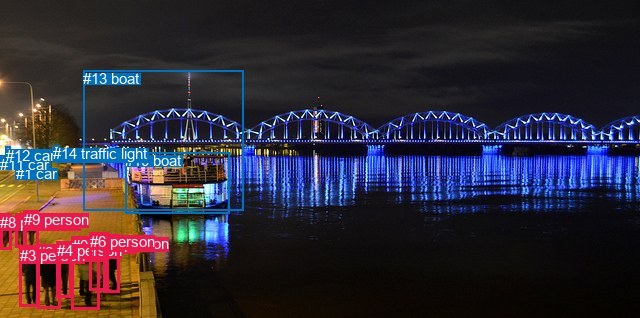
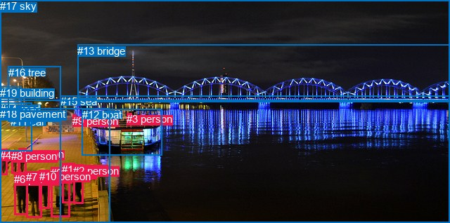

# 图片 0052：1592452.jpg

随机样本序号：312。图片 SHA256：`5f6e1f03f620dbe602f3d447952712d9eb922f23b5be0bb3f226f0dee5cc80da`。

红色框表示人，蓝色框表示其他物体。两个模式分别保留自身框编号，可依据位置比较对应对象。

## 自动检测框与输出

人的框编号：`[0, 2, 3, 4, 5, 6, 7, 8, 9]`。状态：`ok`。

### 自动检测全部物体框

| 编号 | 类别 | 是否为人 | 检测分数 | 像素坐标 xyxy |
|---|---|---|---|---|
| 0 | person | True | 0.9907 | 72.0, 236.8, 99.2, 309.0 |
| 1 | car | False | 0.9846 | 15.5, 165.2, 28.0, 173.7 |
| 2 | person | True | 0.9782 | 37.5, 244.4, 60.1, 308.7 |
| 3 | person | True | 0.9747 | 19.6, 246.7, 38.8, 306.3 |
| 4 | person | True | 0.9264 | 56.5, 241.8, 71.7, 297.8 |
| 5 | person | True | 0.9248 | 103.5, 234.6, 119.7, 292.3 |
| 6 | person | True | 0.9111 | 89.9, 232.8, 108.3, 290.1 |
| 7 | person | True | 0.9043 | 15.5, 213.6, 26.3, 247.5 |
| 8 | person | True | 0.8730 | 0.0, 213.9, 11.3, 249.7 |
| 9 | person | True | 0.8473 | 23.7, 210.7, 38.0, 247.7 |
| 10 | boat | False | 0.7941 | 125.0, 152.4, 229.9, 213.3 |
| 11 | car | False | 0.7214 | 0.1, 155.5, 4.5, 162.4 |
| 12 | car | False | 0.7183 | 5.9, 146.6, 10.7, 150.3 |
| 13 | boat | False | 0.4861 | 83.3, 70.4, 243.1, 210.6 |
| 14 | traffic light | False | 0.4216 | 53.5, 145.2, 59.5, 150.4 |

### 自动检测 Top50 人相关候选

评分物体对：210；人相关物体对：180；输出关系：50。

| 排名 | 主语编号与类别 | 关系 | 宾语编号与类别 | 类型 | 人与人 | 排序分数 | 原始融合 logit |
|---|---|---|---|---|---|---|---|
| 1 | #6 person | talking to | #5 person | semantic | True | 0.87164 | 1.9156 |
| 2 | #7 person | walking on | #9 person | semantic | True | 0.86080 | 1.8219 |
| 3 | #6 person | looking at | #13 boat | semantic | False | 0.85607 | 1.7830 |
| 4 | #5 person | looking at | #13 boat | semantic | False | 0.85454 | 1.7706 |
| 5 | #8 person | walking on | #1 car | semantic | False | 0.85398 | 1.7661 |
| 6 | #7 person | walking on | #1 car | semantic | False | 0.84699 | 1.7112 |
| 7 | #5 person | talking to | #6 person | semantic | True | 0.84275 | 1.6789 |
| 8 | #9 person | walking on | #7 person | semantic | True | 0.84193 | 1.6726 |
| 9 | #6 person | looking at | #10 boat | semantic | False | 0.83855 | 1.6475 |
| 10 | #5 person | looking at | #10 boat | semantic | False | 0.83807 | 1.6440 |
| 11 | #2 person | talking to | #4 person | semantic | True | 0.83579 | 1.6272 |
| 12 | #0 person | looking at | #13 boat | semantic | False | 0.83554 | 1.6254 |
| 13 | #2 person | talking to | #3 person | semantic | True | 0.83019 | 1.5870 |
| 14 | #9 person | walking on | #1 car | semantic | False | 0.81548 | 1.4860 |
| 15 | #2 person | beside | #3 person | spatial | True | 0.80965 | 1.4477 |
| 16 | #0 person | talking to | #6 person | semantic | True | 0.80260 | 1.4026 |
| 17 | #4 person | talking to | #2 person | semantic | True | 0.79005 | 1.3252 |
| 18 | #9 person | looking at | #13 boat | semantic | False | 0.78772 | 1.3113 |
| 19 | #3 person | talking to | #2 person | semantic | True | 0.78673 | 1.3053 |
| 20 | #3 person | beside | #2 person | spatial | True | 0.77429 | 1.2327 |
| 21 | #0 person | looking at | #10 boat | semantic | False | 0.75537 | 1.1275 |
| 22 | #7 person | looking at | #13 boat | semantic | False | 0.74848 | 1.0905 |
| 23 | #2 person | beside | #4 person | spatial | True | 0.74513 | 1.0728 |
| 24 | #8 person | looking at | #13 boat | semantic | False | 0.74144 | 1.0535 |
| 25 | #6 person | talking to | #0 person | semantic | True | 0.72043 | 0.9466 |
| 26 | #7 person | walking on | #10 boat | semantic | False | 0.71101 | 0.9003 |
| 27 | #9 person | walking on | #10 boat | semantic | False | 0.71078 | 0.8992 |
| 28 | #2 person | looking at | #13 boat | semantic | False | 0.69540 | 0.8255 |
| 29 | #4 person | looking at | #13 boat | semantic | False | 0.69280 | 0.8132 |
| 30 | #4 person | beside | #2 person | spatial | True | 0.67648 | 0.7376 |
| 31 | #8 person | walking on | #10 boat | semantic | False | 0.67153 | 0.7151 |
| 32 | #7 person | beside | #9 person | spatial | True | 0.64466 | 0.5956 |
| 33 | #5 person | beside | #10 boat | spatial | False | 0.62318 | 0.5031 |
| 34 | #0 person | beside | #6 person | spatial | True | 0.62019 | 0.4903 |
| 35 | #9 person | beside | #7 person | spatial | True | 0.61738 | 0.4784 |
| 36 | #3 person | looking at | #13 boat | semantic | False | 0.60377 | 0.4212 |
| 37 | #7 person | walking on | #11 car | semantic | False | 0.59562 | 0.3873 |
| 38 | #4 person | looking at | #10 boat | semantic | False | 0.59241 | 0.3739 |
| 39 | #5 person | beside | #6 person | spatial | True | 0.58584 | 0.3468 |
| 40 | #8 person | walking on | #11 car | semantic | False | 0.58131 | 0.3282 |
| 41 | #6 person | beside | #5 person | spatial | True | 0.57821 | 0.3154 |
| 42 | #7 person | walking on | #8 person | semantic | True | 0.57175 | 0.2890 |
| 43 | #6 person | beside | #10 boat | spatial | False | 0.57062 | 0.2844 |
| 44 | #2 person | looking at | #10 boat | semantic | False | 0.54803 | 0.1927 |
| 45 | #9 person | walking on | #11 car | semantic | False | 0.54722 | 0.1895 |
| 46 | #8 person | walking on | #7 person | semantic | True | 0.53786 | 0.1517 |
| 47 | #0 person | beside | #10 boat | spatial | False | 0.51731 | 0.0693 |
| 48 | #9 person | walking on | #8 person | semantic | True | 0.49195 | -0.0322 |
| 49 | #3 person | looking at | #10 boat | semantic | False | 0.48771 | -0.0492 |
| 50 | #8 person | on | #1 car | spatial | False | 0.46034 | -0.1590 |

### 自动检测逐条人相关 GT 核验

R@50：25.00%；命中 1/4。

| GT 主语编号 | GT 关系 | GT 宾语编号 | 结果阶段 | 匹配预测主语编号 | 匹配预测宾语编号 |
|---|---|---|---|---|---|
| 2 | talking to | 1 | hit50 | [5] | [6] |
| 6 | in | 10 | wrong_predicate | [3] | [4] |
| 7 | wearing | 10 | wrong_predicate | [2] | [4] |
| 8 | walking on | 18 | endpoint_missing_or_wrong_class | [7] | [] |

## 真实框与输出

人的框编号：`[0, 1, 2, 3, 4, 5, 6, 7, 8, 9, 10]`。

### 真实框全部物体框

| 编号 | 类别 | 是否为人 | 检测分数 | 像素坐标 xyxy |
|---|---|---|---|---|
| 0 | person | True | GT | 72.0, 238.0, 99.0, 309.0 |
| 1 | person | True | GT | 88.0, 233.0, 107.0, 290.0 |
| 2 | person | True | GT | 104.0, 235.0, 118.0, 291.0 |
| 3 | person | True | GT | 180.0, 161.0, 187.0, 175.0 |
| 4 | person | True | GT | 0.0, 213.0, 10.0, 250.0 |
| 5 | person | True | GT | 26.0, 211.0, 37.0, 247.0 |
| 6 | person | True | GT | 20.0, 247.0, 39.0, 306.0 |
| 7 | person | True | GT | 37.0, 244.0, 59.0, 310.0 |
| 8 | person | True | GT | 16.0, 214.0, 27.0, 247.0 |
| 9 | person | True | GT | 103.0, 164.0, 108.0, 170.0 |
| 10 | person | True | GT | 56.0, 243.0, 71.0, 298.0 |
| 11 | car | False | GT | 15.0, 165.0, 29.0, 174.0 |
| 12 | boat | False | GT | 117.0, 155.0, 231.0, 221.0 |
| 13 | bridge | False | GT | 110.0, 64.0, 640.0, 145.0 |
| 14 | road | False | GT | 0.0, 147.0, 46.0, 216.0 |
| 15 | sea | False | GT | 86.0, 136.0, 640.0, 318.0 |
| 16 | tree | False | GT | 12.0, 95.0, 87.0, 173.0 |
| 17 | sky | False | GT | 0.0, 0.0, 640.0, 143.0 |
| 18 | pavement | False | GT | 0.0, 154.0, 157.0, 318.0 |
| 19 | building | False | GT | 0.0, 124.0, 30.0, 157.0 |

### 真实框 Top50 人相关候选

评分物体对：380；人相关物体对：308；输出关系：50。

| 排名 | 主语编号与类别 | 关系 | 宾语编号与类别 | 类型 | 人与人 | 排序分数 | 原始融合 logit |
|---|---|---|---|---|---|---|---|
| 1 | #0 person | standing on | #18 pavement | semantic | False | 0.99092 | 4.6928 |
| 2 | #7 person | standing on | #18 pavement | semantic | False | 0.99090 | 4.6906 |
| 3 | #5 person | walking on | #18 pavement | semantic | False | 0.99084 | 4.6834 |
| 4 | #8 person | walking on | #18 pavement | semantic | False | 0.99006 | 4.6015 |
| 5 | #10 person | standing on | #18 pavement | semantic | False | 0.98949 | 4.5448 |
| 6 | #4 person | walking on | #18 pavement | semantic | False | 0.98861 | 4.4636 |
| 7 | #1 person | standing on | #18 pavement | semantic | False | 0.98788 | 4.4007 |
| 8 | #6 person | standing on | #18 pavement | semantic | False | 0.98755 | 4.3733 |
| 9 | #2 person | standing on | #18 pavement | semantic | False | 0.98589 | 4.2468 |
| 10 | #3 person | riding | #12 boat | semantic | False | 0.98514 | 4.1941 |
| 11 | #3 person | on | #12 boat | spatial | False | 0.96925 | 3.4505 |
| 12 | #4 person | walking on | #14 road | semantic | False | 0.96463 | 3.3058 |
| 13 | #5 person | walking on | #14 road | semantic | False | 0.96416 | 3.2921 |
| 14 | #8 person | walking on | #14 road | semantic | False | 0.96406 | 3.2894 |
| 15 | #7 person | on | #18 pavement | spatial | False | 0.95182 | 2.9835 |
| 16 | #9 person | on | #18 pavement | spatial | False | 0.94844 | 2.9120 |
| 17 | #0 person | on | #18 pavement | spatial | False | 0.94727 | 2.8885 |
| 18 | #1 person | looking at | #15 sea | semantic | False | 0.94702 | 2.8835 |
| 19 | #6 person | on | #18 pavement | spatial | False | 0.94472 | 2.8386 |
| 20 | #0 person | looking at | #15 sea | semantic | False | 0.93707 | 2.7007 |
| 21 | #2 person | looking at | #15 sea | semantic | False | 0.93315 | 2.6360 |
| 22 | #5 person | on | #18 pavement | spatial | False | 0.92990 | 2.5852 |
| 23 | #10 person | on | #18 pavement | spatial | False | 0.92973 | 2.5825 |
| 24 | #1 person | on | #18 pavement | spatial | False | 0.92272 | 2.4798 |
| 25 | #8 person | on | #18 pavement | spatial | False | 0.92222 | 2.4729 |
| 26 | #4 person | on | #18 pavement | spatial | False | 0.92012 | 2.4440 |
| 27 | #2 person | on | #18 pavement | spatial | False | 0.91773 | 2.4119 |
| 28 | #2 person | beside | #15 sea | spatial | False | 0.91693 | 2.4014 |
| 29 | #5 person | looking at | #15 sea | semantic | False | 0.91349 | 2.3570 |
| 30 | #0 person | beside | #15 sea | spatial | False | 0.91031 | 2.3174 |
| 31 | #8 person | looking at | #15 sea | semantic | False | 0.90753 | 2.2839 |
| 32 | #4 person | beside | #15 sea | spatial | False | 0.90456 | 2.2489 |
| 33 | #1 person | beside | #15 sea | spatial | False | 0.89950 | 2.1917 |
| 34 | #4 person | looking at | #15 sea | semantic | False | 0.89691 | 2.1633 |
| 35 | #8 person | beside | #15 sea | spatial | False | 0.89574 | 2.1508 |
| 36 | #5 person | beside | #15 sea | spatial | False | 0.89409 | 2.1333 |
| 37 | #9 person | beside | #15 sea | spatial | False | 0.89108 | 2.1018 |
| 38 | #10 person | looking at | #15 sea | semantic | False | 0.85892 | 1.8063 |
| 39 | #1 person | talking to | #2 person | semantic | True | 0.85814 | 1.7999 |
| 40 | #7 person | looking at | #15 sea | semantic | False | 0.85728 | 1.7929 |
| 41 | #4 person | on | #14 road | spatial | False | 0.84131 | 1.6680 |
| 42 | #7 person | beside | #15 sea | spatial | False | 0.83180 | 1.5984 |
| 43 | #5 person | on | #14 road | spatial | False | 0.82628 | 1.5595 |
| 44 | #8 person | on | #14 road | spatial | False | 0.81953 | 1.5132 |
| 45 | #6 person | beside | #7 person | spatial | True | 0.81382 | 1.4750 |
| 46 | #6 person | looking at | #15 sea | semantic | False | 0.80852 | 1.4404 |
| 47 | #7 person | beside | #6 person | spatial | True | 0.80537 | 1.4202 |
| 48 | #10 person | beside | #15 sea | spatial | False | 0.80176 | 1.3973 |
| 49 | #6 person | beside | #15 sea | spatial | False | 0.79761 | 1.3715 |
| 50 | #2 person | talking to | #1 person | semantic | True | 0.79704 | 1.3679 |

### 真实框逐条人相关 GT 核验

R@50：50.00%；命中 2/4。

| GT 主语编号 | GT 关系 | GT 宾语编号 | 结果阶段 | 匹配预测主语编号 | 匹配预测宾语编号 |
|---|---|---|---|---|---|
| 2 | talking to | 1 | hit50 | [2] | [1] |
| 6 | in | 10 | wrong_predicate | [6] | [10] |
| 7 | wearing | 10 | wrong_predicate | [7] | [10] |
| 8 | walking on | 18 | hit50 | [8] | [18] |

## 全部人相关 GT

| 主语编号与类别 | 关系 | 宾语编号与类别 |
|---|---|---|
| #2 person | talking to | #1 person |
| #6 person | in | #10 person |
| #7 person | wearing | #10 person |
| #8 person | walking on | #18 pavement |

原始记录、全部人相关物体对的两项预测与分项分数见 [逐图证据 JSON](../evidence/cases/0052.json)。全部56类 logits 保留于本机 HOR/output/random500/logits/。

<!-- HOR_COMPLETE_RESULTS -->

## 六组条件的完整输出对照

以下保留同一图片三种框与候选模式、两种谓词输出规则的全部 Top50。框编号各自在所属模式内解释。

### 自动检测框完整枚举：空间与语义各保留一个谓词

| 排名 | 主语编号与类别 | 谓词 | 宾语编号与类别 | 分组 | 排序分数 | predicate logit | pair logit |
|---|---|---|---|---|---|---|---|
| 1 | #6 person | talking to | #5 person | semantic | 0.8716417 | 2.6377506 | -0.7221983 |
| 2 | #7 person | walking on | #9 person | semantic | 0.8607969 | 2.2327619 | -0.4108370 |
| 3 | #6 person | looking at | #13 boat | semantic | 0.8560655 | 2.4053597 | -0.6223711 |
| 4 | #5 person | looking at | #13 boat | semantic | 0.8545360 | 2.3627172 | -0.5920874 |
| 5 | #8 person | walking on | #1 car | semantic | 0.8539767 | 1.8416867 | -0.0755490 |
| 6 | #7 person | walking on | #1 car | semantic | 0.8469944 | 1.7363749 | -0.0251554 |
| 7 | #5 person | talking to | #6 person | semantic | 0.8427548 | 2.3094978 | -0.6306282 |
| 8 | #9 person | walking on | #7 person | semantic | 0.8419273 | 2.0793090 | -0.4066698 |
| 9 | #6 person | looking at | #10 boat | semantic | 0.8385524 | 2.1352353 | -0.4877391 |
| 10 | #5 person | looking at | #10 boat | semantic | 0.8380716 | 2.0946856 | -0.4507355 |
| 11 | #2 person | talking to | #4 person | semantic | 0.8357863 | 1.9250646 | -0.2978597 |
| 12 | #0 person | looking at | #13 boat | semantic | 0.8355355 | 2.3655062 | -0.7401276 |
| 13 | #2 person | talking to | #3 person | semantic | 0.8301874 | 1.6295290 | -0.0425727 |
| 14 | #9 person | walking on | #1 car | semantic | 0.8154768 | 1.5528164 | -0.0668187 |
| 15 | #2 person | beside | #3 person | spatial | 0.8096508 | 1.4903159 | -0.0425727 |
| 16 | #0 person | talking to | #6 person | semantic | 0.8026002 | 2.0115871 | -0.6089615 |
| 17 | #4 person | talking to | #2 person | semantic | 0.7900450 | 1.7165518 | -0.3913549 |
| 18 | #9 person | looking at | #13 boat | semantic | 0.7877233 | 1.9477158 | -0.6364594 |
| 19 | #3 person | talking to | #2 person | semantic | 0.7867281 | 1.6252775 | -0.3199627 |
| 20 | #3 person | beside | #2 person | spatial | 0.7742864 | 1.5526381 | -0.3199627 |
| 21 | #0 person | looking at | #10 boat | semantic | 0.7553707 | 1.7097740 | -0.5823094 |
| 22 | #7 person | looking at | #13 boat | semantic | 0.7484769 | 1.7391682 | -0.6486626 |
| 23 | #2 person | beside | #4 person | spatial | 0.7451262 | 1.3706446 | -0.2978597 |
| 24 | #8 person | looking at | #13 boat | semantic | 0.7414437 | 1.7363796 | -0.6828937 |
| 25 | #6 person | talking to | #0 person | semantic | 0.7204340 | 1.7706065 | -0.8239914 |
| 26 | #7 person | walking on | #10 boat | semantic | 0.7110100 | 1.7874837 | -0.8871896 |
| 27 | #9 person | walking on | #10 boat | semantic | 0.7107767 | 1.7333221 | -0.8341625 |
| 28 | #2 person | looking at | #13 boat | semantic | 0.6953968 | 1.7808733 | -0.9554008 |
| 29 | #4 person | looking at | #13 boat | semantic | 0.6927999 | 1.7346358 | -0.9213941 |
| 30 | #4 person | beside | #2 person | spatial | 0.6764783 | 1.1289892 | -0.3913549 |
| 31 | #8 person | walking on | #10 boat | semantic | 0.6715272 | 1.6430488 | -0.9279481 |
| 32 | #7 person | beside | #9 person | spatial | 0.6446600 | 1.0064850 | -0.4108370 |
| 33 | #5 person | beside | #10 boat | spatial | 0.6231840 | 0.9538202 | -0.4507355 |
| 34 | #0 person | beside | #6 person | spatial | 0.6201868 | 1.0993028 | -0.6089615 |
| 35 | #9 person | beside | #7 person | spatial | 0.6173791 | 0.8851085 | -0.4066698 |
| 36 | #3 person | looking at | #13 boat | semantic | 0.6037738 | 1.5030789 | -1.0818648 |
| 37 | #7 person | walking on | #11 car | semantic | 0.5956215 | 0.5838757 | -0.1966214 |
| 38 | #4 person | looking at | #10 boat | semantic | 0.5924085 | 1.2489920 | -0.8750612 |
| 39 | #5 person | beside | #6 person | spatial | 0.5858429 | 0.9774346 | -0.6306282 |
| 40 | #8 person | walking on | #11 car | semantic | 0.5813127 | 0.5718336 | -0.2436692 |
| 41 | #6 person | beside | #5 person | spatial | 0.5782073 | 1.0376167 | -0.7221983 |
| 42 | #7 person | walking on | #8 person | semantic | 0.5717473 | 0.6650901 | -0.3761064 |
| 43 | #6 person | beside | #10 boat | spatial | 0.5706190 | 0.7721162 | -0.4877391 |
| 44 | #2 person | looking at | #10 boat | semantic | 0.5480289 | 1.1220036 | -0.9292936 |
| 45 | #9 person | walking on | #11 car | semantic | 0.5472223 | 0.4304090 | -0.2409553 |
| 46 | #8 person | walking on | #7 person | semantic | 0.5378620 | 0.5462022 | -0.3944637 |
| 47 | #0 person | beside | #10 boat | spatial | 0.5173101 | 0.6515775 | -0.5823094 |
| 48 | #9 person | walking on | #8 person | semantic | 0.4919497 | 0.3656826 | -0.3978865 |
| 49 | #3 person | looking at | #10 boat | semantic | 0.4877069 | 1.0240593 | -1.0732415 |
| 50 | #8 person | on | #1 car | spatial | 0.4603393 | -0.0834279 | -0.0755490 |

GT 命中：1/4，R@50=25.00%。

| GT主语 | GT谓词 | GT宾语 | 结果阶段 | 匹配主语框 | 匹配宾语框 |
|---|---|---|---|---|---|
| 2 | talking to | 1 | hit50 | [5] | [6] |
| 6 | in | 10 | wrong_predicate | [3] | [4] |
| 7 | wearing | 10 | wrong_predicate | [2] | [4] |
| 8 | walking on | 18 | endpoint_missing_or_wrong_class | [7] | [] |

### 自动检测框完整枚举：每对只保留一个谓词

| 排名 | 主语编号与类别 | 谓词 | 宾语编号与类别 | 分组 | 排序分数 | predicate logit | pair logit |
|---|---|---|---|---|---|---|---|
| 1 | #6 person | talking to | #5 person | single | 0.8716417 | 2.6377506 | -0.7221983 |
| 2 | #7 person | walking on | #9 person | single | 0.8607969 | 2.2327619 | -0.4108370 |
| 3 | #6 person | looking at | #13 boat | single | 0.8560655 | 2.4053597 | -0.6223711 |
| 4 | #5 person | looking at | #13 boat | single | 0.8545360 | 2.3627172 | -0.5920874 |
| 5 | #8 person | walking on | #1 car | single | 0.8539767 | 1.8416867 | -0.0755490 |
| 6 | #7 person | walking on | #1 car | single | 0.8469944 | 1.7363749 | -0.0251554 |
| 7 | #5 person | talking to | #6 person | single | 0.8427548 | 2.3094978 | -0.6306282 |
| 8 | #9 person | walking on | #7 person | single | 0.8419273 | 2.0793090 | -0.4066698 |
| 9 | #6 person | looking at | #10 boat | single | 0.8385524 | 2.1352353 | -0.4877391 |
| 10 | #5 person | looking at | #10 boat | single | 0.8380716 | 2.0946856 | -0.4507355 |
| 11 | #2 person | talking to | #4 person | single | 0.8357863 | 1.9250646 | -0.2978597 |
| 12 | #0 person | looking at | #13 boat | single | 0.8355355 | 2.3655062 | -0.7401276 |
| 13 | #2 person | talking to | #3 person | single | 0.8301874 | 1.6295290 | -0.0425727 |
| 14 | #9 person | walking on | #1 car | single | 0.8154768 | 1.5528164 | -0.0668187 |
| 15 | #0 person | talking to | #6 person | single | 0.8026002 | 2.0115871 | -0.6089615 |
| 16 | #4 person | talking to | #2 person | single | 0.7900450 | 1.7165518 | -0.3913549 |
| 17 | #9 person | looking at | #13 boat | single | 0.7877233 | 1.9477158 | -0.6364594 |
| 18 | #3 person | talking to | #2 person | single | 0.7867281 | 1.6252775 | -0.3199627 |
| 19 | #0 person | looking at | #10 boat | single | 0.7553707 | 1.7097740 | -0.5823094 |
| 20 | #7 person | looking at | #13 boat | single | 0.7484769 | 1.7391682 | -0.6486626 |
| 21 | #8 person | looking at | #13 boat | single | 0.7414437 | 1.7363796 | -0.6828937 |
| 22 | #6 person | talking to | #0 person | single | 0.7204340 | 1.7706065 | -0.8239914 |
| 23 | #7 person | walking on | #10 boat | single | 0.7110100 | 1.7874837 | -0.8871896 |
| 24 | #9 person | walking on | #10 boat | single | 0.7107767 | 1.7333221 | -0.8341625 |
| 25 | #2 person | looking at | #13 boat | single | 0.6953968 | 1.7808733 | -0.9554008 |
| 26 | #4 person | looking at | #13 boat | single | 0.6927999 | 1.7346358 | -0.9213941 |
| 27 | #8 person | walking on | #10 boat | single | 0.6715272 | 1.6430488 | -0.9279481 |
| 28 | #3 person | looking at | #13 boat | single | 0.6037738 | 1.5030789 | -1.0818648 |
| 29 | #7 person | walking on | #11 car | single | 0.5956215 | 0.5838757 | -0.1966214 |
| 30 | #4 person | looking at | #10 boat | single | 0.5924085 | 1.2489920 | -0.8750612 |
| 31 | #8 person | walking on | #11 car | single | 0.5813127 | 0.5718336 | -0.2436692 |
| 32 | #7 person | walking on | #8 person | single | 0.5717473 | 0.6650901 | -0.3761064 |
| 33 | #2 person | looking at | #10 boat | single | 0.5480289 | 1.1220036 | -0.9292936 |
| 34 | #9 person | walking on | #11 car | single | 0.5472223 | 0.4304090 | -0.2409553 |
| 35 | #8 person | walking on | #7 person | single | 0.5378620 | 0.5462022 | -0.3944637 |
| 36 | #9 person | walking on | #8 person | single | 0.4919497 | 0.3656826 | -0.3978865 |
| 37 | #3 person | looking at | #10 boat | single | 0.4877069 | 1.0240593 | -1.0732415 |
| 38 | #0 person | talking to | #5 person | single | 0.4547664 | 0.4831862 | -0.6646168 |
| 39 | #2 person | beside | #0 person | single | 0.4380745 | 0.4366021 | -0.6855823 |
| 40 | #4 person | talking to | #0 person | single | 0.4256052 | 0.4871874 | -0.7869921 |
| 41 | #9 person | walking on | #3 person | single | 0.4245827 | 0.0602822 | -0.3642707 |
| 42 | #3 person | beside | #4 person | single | 0.3930321 | -0.0462751 | -0.3883095 |
| 43 | #8 person | walking on | #9 person | single | 0.3881864 | -0.0300331 | -0.4249091 |
| 44 | #4 person | beside | #3 person | single | 0.3269807 | -0.5301762 | -0.1916969 |
| 45 | #2 person | walking on | #1 car | single | 0.3246082 | -0.0811005 | -0.6515737 |
| 46 | #7 person | walking on | #3 person | single | 0.3232178 | -0.3549604 | -0.3840626 |
| 47 | #3 person | standing on | #9 person | single | 0.3180827 | -0.0207992 | -0.7417977 |
| 48 | #0 person | standing on | #4 person | single | 0.3090839 | -0.4626794 | -0.3417262 |
| 49 | #3 person | walking on | #1 car | single | 0.3088915 | -0.0209179 | -0.7843888 |
| 50 | #0 person | beside | #2 person | single | 0.2950380 | -0.5302873 | -0.3407524 |

GT 命中：1/4，R@50=25.00%。

| GT主语 | GT谓词 | GT宾语 | 结果阶段 | 匹配主语框 | 匹配宾语框 |
|---|---|---|---|---|---|
| 2 | talking to | 1 | hit50 | [5] | [6] |
| 6 | in | 10 | wrong_predicate | [3] | [4] |
| 7 | wearing | 10 | wrong_predicate | [2] | [4] |
| 8 | walking on | 18 | endpoint_missing_or_wrong_class | [7] | [] |

### 真实框完整枚举：空间与语义各保留一个谓词

| 排名 | 主语编号与类别 | 谓词 | 宾语编号与类别 | 分组 | 排序分数 | predicate logit | pair logit |
|---|---|---|---|---|---|---|---|
| 1 | #0 person | standing on | #18 pavement | semantic | 0.9909218 | 4.2770486 | 0.4157155 |
| 2 | #7 person | standing on | #18 pavement | semantic | 0.9909026 | 4.2021785 | 0.4884448 |
| 3 | #5 person | walking on | #18 pavement | semantic | 0.9908376 | 4.1947560 | 0.4886905 |
| 4 | #8 person | walking on | #18 pavement | semantic | 0.9900625 | 4.1375833 | 0.4638758 |
| 5 | #10 person | standing on | #18 pavement | semantic | 0.9894896 | 4.1728015 | 0.3720217 |
| 6 | #4 person | walking on | #18 pavement | semantic | 0.9886103 | 4.0232396 | 0.4403511 |
| 7 | #1 person | standing on | #18 pavement | semantic | 0.9878802 | 4.0818133 | 0.3189079 |
| 8 | #6 person | standing on | #18 pavement | semantic | 0.9875470 | 3.9922538 | 0.3810090 |
| 9 | #2 person | standing on | #18 pavement | semantic | 0.9858926 | 3.9026952 | 0.3441506 |
| 10 | #3 person | riding | #12 boat | semantic | 0.9851397 | 4.0714726 | 0.1226161 |
| 11 | #3 person | on | #12 boat | spatial | 0.9692470 | 3.3279166 | 0.1226161 |
| 12 | #4 person | walking on | #14 road | semantic | 0.9646270 | 3.3341660 | -0.0283722 |
| 13 | #5 person | walking on | #14 road | semantic | 0.9641575 | 3.2920461 | 0.0000746 |
| 14 | #8 person | walking on | #14 road | semantic | 0.9640628 | 3.2920461 | -0.0026644 |
| 15 | #7 person | on | #18 pavement | spatial | 0.9518249 | 2.4950933 | 0.4884448 |
| 16 | #9 person | on | #18 pavement | spatial | 0.9484360 | 3.3863626 | -0.4743715 |
| 17 | #0 person | on | #18 pavement | spatial | 0.9472725 | 2.4727354 | 0.4157155 |
| 18 | #1 person | looking at | #15 sea | semantic | 0.9470233 | 2.9965081 | -0.1130372 |
| 19 | #6 person | on | #18 pavement | spatial | 0.9447247 | 2.4575591 | 0.3810090 |
| 20 | #0 person | looking at | #15 sea | semantic | 0.9370657 | 2.9279580 | -0.2272969 |
| 21 | #2 person | looking at | #15 sea | semantic | 0.9331456 | 2.7201090 | -0.0840643 |
| 22 | #5 person | on | #18 pavement | spatial | 0.9299001 | 2.0964642 | 0.4886905 |
| 23 | #10 person | on | #18 pavement | spatial | 0.9297292 | 2.2105155 | 0.3720217 |
| 24 | #1 person | on | #18 pavement | spatial | 0.9227166 | 2.1609335 | 0.3189079 |
| 25 | #8 person | on | #18 pavement | spatial | 0.9222224 | 2.0090575 | 0.4638758 |
| 26 | #4 person | on | #18 pavement | spatial | 0.9201189 | 2.0036130 | 0.4403511 |
| 27 | #2 person | on | #18 pavement | spatial | 0.9177335 | 2.0677924 | 0.3441506 |
| 28 | #2 person | beside | #15 sea | spatial | 0.9169342 | 2.4854665 | -0.0840643 |
| 29 | #5 person | looking at | #15 sea | semantic | 0.9134860 | 2.4367371 | -0.0797746 |
| 30 | #0 person | beside | #15 sea | spatial | 0.9103100 | 2.5447235 | -0.2272969 |
| 31 | #8 person | looking at | #15 sea | semantic | 0.9075320 | 2.3765540 | -0.0926878 |
| 32 | #4 person | beside | #15 sea | spatial | 0.9045559 | 2.3949614 | -0.1460587 |
| 33 | #1 person | beside | #15 sea | spatial | 0.8994973 | 2.3046880 | -0.1130372 |
| 34 | #4 person | looking at | #15 sea | semantic | 0.8969088 | 2.3093987 | -0.1460587 |
| 35 | #8 person | beside | #15 sea | spatial | 0.8957413 | 2.2434645 | -0.0926878 |
| 36 | #5 person | beside | #15 sea | spatial | 0.8940933 | 2.2130265 | -0.0797746 |
| 37 | #9 person | beside | #15 sea | spatial | 0.8910795 | 2.3940363 | -0.2922208 |
| 38 | #10 person | looking at | #15 sea | semantic | 0.8589174 | 2.0812197 | -0.2748929 |
| 39 | #1 person | talking to | #2 person | semantic | 0.8581368 | 2.4874196 | -0.6875197 |
| 40 | #7 person | looking at | #15 sea | semantic | 0.8572801 | 2.0476422 | -0.2547607 |
| 41 | #4 person | on | #14 road | spatial | 0.8413110 | 1.6963868 | -0.0283722 |
| 42 | #7 person | beside | #15 sea | spatial | 0.8318006 | 1.8532033 | -0.2547607 |
| 43 | #5 person | on | #14 road | spatial | 0.8262776 | 1.5593977 | 0.0000746 |
| 44 | #8 person | on | #14 road | spatial | 0.8195313 | 1.5158396 | -0.0026644 |
| 45 | #6 person | beside | #7 person | spatial | 0.8138201 | 1.7922692 | -0.3172431 |
| 46 | #6 person | looking at | #15 sea | semantic | 0.8085185 | 1.8020315 | -0.3616192 |
| 47 | #7 person | beside | #6 person | spatial | 0.8053734 | 1.4595885 | -0.0393653 |
| 48 | #10 person | beside | #15 sea | spatial | 0.8017552 | 1.6721935 | -0.2748929 |
| 49 | #6 person | beside | #15 sea | spatial | 0.7976144 | 1.7330699 | -0.3616192 |
| 50 | #2 person | talking to | #1 person | semantic | 0.7970444 | 1.9811206 | -0.6131974 |

GT 命中：2/4，R@50=50.00%。

| GT主语 | GT谓词 | GT宾语 | 结果阶段 | 匹配主语框 | 匹配宾语框 |
|---|---|---|---|---|---|
| 2 | talking to | 1 | hit50 | [2] | [1] |
| 6 | in | 10 | wrong_predicate | [6] | [10] |
| 7 | wearing | 10 | wrong_predicate | [7] | [10] |
| 8 | walking on | 18 | hit50 | [8] | [18] |

### 真实框完整枚举：每对只保留一个谓词

| 排名 | 主语编号与类别 | 谓词 | 宾语编号与类别 | 分组 | 排序分数 | predicate logit | pair logit |
|---|---|---|---|---|---|---|---|
| 1 | #0 person | standing on | #18 pavement | single | 0.9909218 | 4.2770486 | 0.4157155 |
| 2 | #7 person | standing on | #18 pavement | single | 0.9909026 | 4.2021785 | 0.4884448 |
| 3 | #5 person | walking on | #18 pavement | single | 0.9908376 | 4.1947560 | 0.4886905 |
| 4 | #8 person | walking on | #18 pavement | single | 0.9900625 | 4.1375833 | 0.4638758 |
| 5 | #10 person | standing on | #18 pavement | single | 0.9894896 | 4.1728015 | 0.3720217 |
| 6 | #4 person | walking on | #18 pavement | single | 0.9886103 | 4.0232396 | 0.4403511 |
| 7 | #1 person | standing on | #18 pavement | single | 0.9878802 | 4.0818133 | 0.3189079 |
| 8 | #6 person | standing on | #18 pavement | single | 0.9875470 | 3.9922538 | 0.3810090 |
| 9 | #2 person | standing on | #18 pavement | single | 0.9858926 | 3.9026952 | 0.3441506 |
| 10 | #3 person | riding | #12 boat | single | 0.9851397 | 4.0714726 | 0.1226161 |
| 11 | #4 person | walking on | #14 road | single | 0.9646270 | 3.3341660 | -0.0283722 |
| 12 | #5 person | walking on | #14 road | single | 0.9641575 | 3.2920461 | 0.0000746 |
| 13 | #8 person | walking on | #14 road | single | 0.9640628 | 3.2920461 | -0.0026644 |
| 14 | #9 person | on | #18 pavement | single | 0.9484360 | 3.3863626 | -0.4743715 |
| 15 | #1 person | looking at | #15 sea | single | 0.9470233 | 2.9965081 | -0.1130372 |
| 16 | #0 person | looking at | #15 sea | single | 0.9370657 | 2.9279580 | -0.2272969 |
| 17 | #2 person | looking at | #15 sea | single | 0.9331456 | 2.7201090 | -0.0840643 |
| 18 | #5 person | looking at | #15 sea | single | 0.9134860 | 2.4367371 | -0.0797746 |
| 19 | #8 person | looking at | #15 sea | single | 0.9075320 | 2.3765540 | -0.0926878 |
| 20 | #4 person | beside | #15 sea | single | 0.9045559 | 2.3949614 | -0.1460587 |
| 21 | #9 person | beside | #15 sea | single | 0.8910795 | 2.3940363 | -0.2922208 |
| 22 | #10 person | looking at | #15 sea | single | 0.8589174 | 2.0812197 | -0.2748929 |
| 23 | #1 person | talking to | #2 person | single | 0.8581368 | 2.4874196 | -0.6875197 |
| 24 | #7 person | looking at | #15 sea | single | 0.8572801 | 2.0476422 | -0.2547607 |
| 25 | #6 person | beside | #7 person | single | 0.8138201 | 1.7922692 | -0.3172431 |
| 26 | #6 person | looking at | #15 sea | single | 0.8085185 | 1.8020315 | -0.3616192 |
| 27 | #7 person | beside | #6 person | single | 0.8053734 | 1.4595885 | -0.0393653 |
| 28 | #2 person | talking to | #1 person | single | 0.7970444 | 1.9811206 | -0.6131974 |
| 29 | #0 person | talking to | #1 person | single | 0.7939774 | 1.9214382 | -0.5723690 |
| 30 | #1 person | looking at | #12 boat | single | 0.7715326 | 1.6572623 | -0.4402768 |
| 31 | #7 person | standing on | #10 person | single | 0.7681807 | 1.4830494 | -0.2849830 |
| 32 | #10 person | beside | #7 person | single | 0.7508975 | 1.4896798 | -0.3862754 |
| 33 | #2 person | looking at | #12 boat | single | 0.7449664 | 1.4679985 | -0.3960544 |
| 34 | #5 person | pushing | #8 person | single | 0.7401701 | 1.4405112 | -0.3936583 |
| 35 | #8 person | walking on | #5 person | single | 0.7386673 | 1.4820132 | -0.4429599 |
| 36 | #1 person | talking to | #0 person | single | 0.7297971 | 1.7724829 | -0.7788893 |
| 37 | #4 person | walking on | #11 car | single | 0.6429965 | 0.6741772 | -0.0857833 |
| 38 | #0 person | looking at | #12 boat | single | 0.6213031 | 1.0519505 | -0.5568676 |
| 39 | #8 person | walking on | #11 car | single | 0.6071202 | 0.4906330 | -0.0554099 |
| 40 | #5 person | walking on | #11 car | single | 0.5354491 | 0.2017627 | -0.0597276 |
| 41 | #7 person | standing on | #14 road | single | 0.5228871 | 0.6492672 | -0.5576547 |
| 42 | #8 person | walking on | #12 boat | single | 0.5106314 | 0.8531494 | -0.8106172 |
| 43 | #5 person | walking on | #12 boat | single | 0.5059599 | 0.7673917 | -0.7435510 |
| 44 | #12 boat | carrying | #3 person | single | 0.4863737 | 0.5952401 | -0.6497589 |
| 45 | #6 person | standing on | #14 road | single | 0.4780864 | 0.6067309 | -0.6944416 |
| 46 | #10 person | looking at | #12 boat | single | 0.4475997 | 0.6254435 | -0.8358172 |
| 47 | #2 person | looking at | #13 bridge | single | 0.4210971 | 0.7695155 | -1.0877870 |
| 48 | #7 person | beside | #0 person | single | 0.4201354 | 0.3154559 | -0.6376734 |
| 49 | #4 person | walking on | #12 boat | single | 0.4149041 | 0.5371985 | -0.8809270 |
| 50 | #10 person | beside | #0 person | single | 0.4146152 | 0.4053249 | -0.7502434 |

GT 命中：2/4，R@50=50.00%。

| GT主语 | GT谓词 | GT宾语 | 结果阶段 | 匹配主语框 | 匹配宾语框 |
|---|---|---|---|---|---|
| 2 | talking to | 1 | hit50 | [2] | [1] |
| 6 | in | 10 | wrong_predicate | [6] | [10] |
| 7 | wearing | 10 | wrong_predicate | [7] | [10] |
| 8 | walking on | 18 | hit50 | [8] | [18] |

### 真实框400候选：空间与语义各保留一个谓词

| 排名 | 主语编号与类别 | 谓词 | 宾语编号与类别 | 分组 | 排序分数 | predicate logit | pair logit |
|---|---|---|---|---|---|---|---|
| 1 | #0 person | standing on | #18 pavement | semantic | 0.9909218 | 4.2770486 | 0.4157155 |
| 2 | #7 person | standing on | #18 pavement | semantic | 0.9909026 | 4.2021785 | 0.4884448 |
| 3 | #5 person | walking on | #18 pavement | semantic | 0.9908376 | 4.1947560 | 0.4886905 |
| 4 | #8 person | walking on | #18 pavement | semantic | 0.9900625 | 4.1375833 | 0.4638758 |
| 5 | #10 person | standing on | #18 pavement | semantic | 0.9894896 | 4.1728015 | 0.3720217 |
| 6 | #4 person | walking on | #18 pavement | semantic | 0.9886103 | 4.0232396 | 0.4403511 |
| 7 | #1 person | standing on | #18 pavement | semantic | 0.9878802 | 4.0818133 | 0.3189079 |
| 8 | #6 person | standing on | #18 pavement | semantic | 0.9875470 | 3.9922538 | 0.3810090 |
| 9 | #2 person | standing on | #18 pavement | semantic | 0.9858926 | 3.9026952 | 0.3441506 |
| 10 | #3 person | riding | #12 boat | semantic | 0.9851397 | 4.0714726 | 0.1226161 |
| 11 | #3 person | on | #12 boat | spatial | 0.9692470 | 3.3279166 | 0.1226161 |
| 12 | #4 person | walking on | #14 road | semantic | 0.9646270 | 3.3341660 | -0.0283722 |
| 13 | #5 person | walking on | #14 road | semantic | 0.9641575 | 3.2920461 | 0.0000746 |
| 14 | #8 person | walking on | #14 road | semantic | 0.9640628 | 3.2920461 | -0.0026644 |
| 15 | #7 person | on | #18 pavement | spatial | 0.9518249 | 2.4950933 | 0.4884448 |
| 16 | #9 person | on | #18 pavement | spatial | 0.9484360 | 3.3863626 | -0.4743715 |
| 17 | #0 person | on | #18 pavement | spatial | 0.9472725 | 2.4727354 | 0.4157155 |
| 18 | #1 person | looking at | #15 sea | semantic | 0.9470233 | 2.9965081 | -0.1130372 |
| 19 | #6 person | on | #18 pavement | spatial | 0.9447247 | 2.4575591 | 0.3810090 |
| 20 | #0 person | looking at | #15 sea | semantic | 0.9370657 | 2.9279580 | -0.2272969 |
| 21 | #2 person | looking at | #15 sea | semantic | 0.9331456 | 2.7201090 | -0.0840643 |
| 22 | #5 person | on | #18 pavement | spatial | 0.9299001 | 2.0964642 | 0.4886905 |
| 23 | #10 person | on | #18 pavement | spatial | 0.9297292 | 2.2105155 | 0.3720217 |
| 24 | #1 person | on | #18 pavement | spatial | 0.9227166 | 2.1609335 | 0.3189079 |
| 25 | #8 person | on | #18 pavement | spatial | 0.9222224 | 2.0090575 | 0.4638758 |
| 26 | #4 person | on | #18 pavement | spatial | 0.9201189 | 2.0036130 | 0.4403511 |
| 27 | #2 person | on | #18 pavement | spatial | 0.9177335 | 2.0677924 | 0.3441506 |
| 28 | #2 person | beside | #15 sea | spatial | 0.9169342 | 2.4854665 | -0.0840643 |
| 29 | #5 person | looking at | #15 sea | semantic | 0.9134860 | 2.4367371 | -0.0797746 |
| 30 | #0 person | beside | #15 sea | spatial | 0.9103100 | 2.5447235 | -0.2272969 |
| 31 | #8 person | looking at | #15 sea | semantic | 0.9075320 | 2.3765540 | -0.0926878 |
| 32 | #4 person | beside | #15 sea | spatial | 0.9045559 | 2.3949614 | -0.1460587 |
| 33 | #1 person | beside | #15 sea | spatial | 0.8994973 | 2.3046880 | -0.1130372 |
| 34 | #4 person | looking at | #15 sea | semantic | 0.8969088 | 2.3093987 | -0.1460587 |
| 35 | #8 person | beside | #15 sea | spatial | 0.8957413 | 2.2434645 | -0.0926878 |
| 36 | #5 person | beside | #15 sea | spatial | 0.8940933 | 2.2130265 | -0.0797746 |
| 37 | #9 person | beside | #15 sea | spatial | 0.8910795 | 2.3940363 | -0.2922208 |
| 38 | #10 person | looking at | #15 sea | semantic | 0.8589174 | 2.0812197 | -0.2748929 |
| 39 | #1 person | talking to | #2 person | semantic | 0.8581368 | 2.4874196 | -0.6875197 |
| 40 | #7 person | looking at | #15 sea | semantic | 0.8572801 | 2.0476422 | -0.2547607 |
| 41 | #4 person | on | #14 road | spatial | 0.8413110 | 1.6963868 | -0.0283722 |
| 42 | #7 person | beside | #15 sea | spatial | 0.8318006 | 1.8532033 | -0.2547607 |
| 43 | #5 person | on | #14 road | spatial | 0.8262776 | 1.5593977 | 0.0000746 |
| 44 | #8 person | on | #14 road | spatial | 0.8195313 | 1.5158396 | -0.0026644 |
| 45 | #6 person | beside | #7 person | spatial | 0.8138201 | 1.7922692 | -0.3172431 |
| 46 | #6 person | looking at | #15 sea | semantic | 0.8085185 | 1.8020315 | -0.3616192 |
| 47 | #7 person | beside | #6 person | spatial | 0.8053734 | 1.4595885 | -0.0393653 |
| 48 | #10 person | beside | #15 sea | spatial | 0.8017552 | 1.6721935 | -0.2748929 |
| 49 | #6 person | beside | #15 sea | spatial | 0.7976144 | 1.7330699 | -0.3616192 |
| 50 | #2 person | talking to | #1 person | semantic | 0.7970444 | 1.9811206 | -0.6131974 |

GT 命中：2/4，R@50=50.00%。

| GT主语 | GT谓词 | GT宾语 | 结果阶段 | 匹配主语框 | 匹配宾语框 |
|---|---|---|---|---|---|
| 2 | talking to | 1 | hit50 | [2] | [1] |
| 6 | in | 10 | wrong_predicate | [6] | [10] |
| 7 | wearing | 10 | wrong_predicate | [7] | [10] |
| 8 | walking on | 18 | hit50 | [8] | [18] |

### 真实框400候选：每对只保留一个谓词

| 排名 | 主语编号与类别 | 谓词 | 宾语编号与类别 | 分组 | 排序分数 | predicate logit | pair logit |
|---|---|---|---|---|---|---|---|
| 1 | #0 person | standing on | #18 pavement | single | 0.9909218 | 4.2770486 | 0.4157155 |
| 2 | #7 person | standing on | #18 pavement | single | 0.9909026 | 4.2021785 | 0.4884448 |
| 3 | #5 person | walking on | #18 pavement | single | 0.9908376 | 4.1947560 | 0.4886905 |
| 4 | #8 person | walking on | #18 pavement | single | 0.9900625 | 4.1375833 | 0.4638758 |
| 5 | #10 person | standing on | #18 pavement | single | 0.9894896 | 4.1728015 | 0.3720217 |
| 6 | #4 person | walking on | #18 pavement | single | 0.9886103 | 4.0232396 | 0.4403511 |
| 7 | #1 person | standing on | #18 pavement | single | 0.9878802 | 4.0818133 | 0.3189079 |
| 8 | #6 person | standing on | #18 pavement | single | 0.9875470 | 3.9922538 | 0.3810090 |
| 9 | #2 person | standing on | #18 pavement | single | 0.9858926 | 3.9026952 | 0.3441506 |
| 10 | #3 person | riding | #12 boat | single | 0.9851397 | 4.0714726 | 0.1226161 |
| 11 | #4 person | walking on | #14 road | single | 0.9646270 | 3.3341660 | -0.0283722 |
| 12 | #5 person | walking on | #14 road | single | 0.9641575 | 3.2920461 | 0.0000746 |
| 13 | #8 person | walking on | #14 road | single | 0.9640628 | 3.2920461 | -0.0026644 |
| 14 | #9 person | on | #18 pavement | single | 0.9484360 | 3.3863626 | -0.4743715 |
| 15 | #1 person | looking at | #15 sea | single | 0.9470233 | 2.9965081 | -0.1130372 |
| 16 | #0 person | looking at | #15 sea | single | 0.9370657 | 2.9279580 | -0.2272969 |
| 17 | #2 person | looking at | #15 sea | single | 0.9331456 | 2.7201090 | -0.0840643 |
| 18 | #5 person | looking at | #15 sea | single | 0.9134860 | 2.4367371 | -0.0797746 |
| 19 | #8 person | looking at | #15 sea | single | 0.9075320 | 2.3765540 | -0.0926878 |
| 20 | #4 person | beside | #15 sea | single | 0.9045559 | 2.3949614 | -0.1460587 |
| 21 | #9 person | beside | #15 sea | single | 0.8910795 | 2.3940363 | -0.2922208 |
| 22 | #10 person | looking at | #15 sea | single | 0.8589174 | 2.0812197 | -0.2748929 |
| 23 | #1 person | talking to | #2 person | single | 0.8581368 | 2.4874196 | -0.6875197 |
| 24 | #7 person | looking at | #15 sea | single | 0.8572801 | 2.0476422 | -0.2547607 |
| 25 | #6 person | beside | #7 person | single | 0.8138201 | 1.7922692 | -0.3172431 |
| 26 | #6 person | looking at | #15 sea | single | 0.8085185 | 1.8020315 | -0.3616192 |
| 27 | #7 person | beside | #6 person | single | 0.8053734 | 1.4595885 | -0.0393653 |
| 28 | #2 person | talking to | #1 person | single | 0.7970444 | 1.9811206 | -0.6131974 |
| 29 | #0 person | talking to | #1 person | single | 0.7939774 | 1.9214382 | -0.5723690 |
| 30 | #1 person | looking at | #12 boat | single | 0.7715326 | 1.6572623 | -0.4402768 |
| 31 | #7 person | standing on | #10 person | single | 0.7681807 | 1.4830494 | -0.2849830 |
| 32 | #10 person | beside | #7 person | single | 0.7508975 | 1.4896798 | -0.3862754 |
| 33 | #2 person | looking at | #12 boat | single | 0.7449664 | 1.4679985 | -0.3960544 |
| 34 | #5 person | pushing | #8 person | single | 0.7401701 | 1.4405112 | -0.3936583 |
| 35 | #8 person | walking on | #5 person | single | 0.7386673 | 1.4820132 | -0.4429599 |
| 36 | #1 person | talking to | #0 person | single | 0.7297971 | 1.7724829 | -0.7788893 |
| 37 | #4 person | walking on | #11 car | single | 0.6429965 | 0.6741772 | -0.0857833 |
| 38 | #0 person | looking at | #12 boat | single | 0.6213031 | 1.0519505 | -0.5568676 |
| 39 | #8 person | walking on | #11 car | single | 0.6071202 | 0.4906330 | -0.0554099 |
| 40 | #5 person | walking on | #11 car | single | 0.5354491 | 0.2017627 | -0.0597276 |
| 41 | #7 person | standing on | #14 road | single | 0.5228871 | 0.6492672 | -0.5576547 |
| 42 | #8 person | walking on | #12 boat | single | 0.5106314 | 0.8531494 | -0.8106172 |
| 43 | #5 person | walking on | #12 boat | single | 0.5059599 | 0.7673917 | -0.7435510 |
| 44 | #12 boat | carrying | #3 person | single | 0.4863737 | 0.5952401 | -0.6497589 |
| 45 | #6 person | standing on | #14 road | single | 0.4780864 | 0.6067309 | -0.6944416 |
| 46 | #10 person | looking at | #12 boat | single | 0.4475997 | 0.6254435 | -0.8358172 |
| 47 | #2 person | looking at | #13 bridge | single | 0.4210971 | 0.7695155 | -1.0877870 |
| 48 | #7 person | beside | #0 person | single | 0.4201354 | 0.3154559 | -0.6376734 |
| 49 | #4 person | walking on | #12 boat | single | 0.4149041 | 0.5371985 | -0.8809270 |
| 50 | #10 person | beside | #0 person | single | 0.4146152 | 0.4053249 | -0.7502434 |

GT 命中：2/4，R@50=50.00%。

| GT主语 | GT谓词 | GT宾语 | 结果阶段 | 匹配主语框 | 匹配宾语框 |
|---|---|---|---|---|---|
| 2 | talking to | 1 | hit50 | [2] | [1] |
| 6 | in | 10 | wrong_predicate | [6] | [10] |
| 7 | wearing | 10 | wrong_predicate | [7] | [10] |
| 8 | walking on | 18 | hit50 | [8] | [18] |
