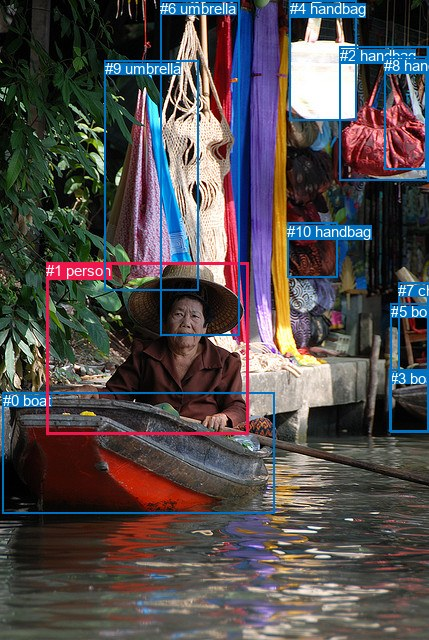
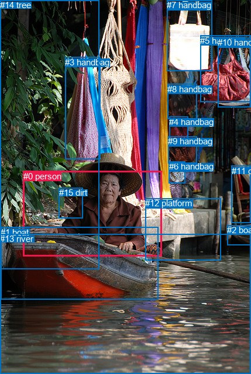

# 图片 0056：1592537.jpg

随机样本序号：370。图片 SHA256：`a0e9476784e5398887642f7c603fa755b7aa19c0b03b195047448c75a926eb7a`。

红色框表示人，蓝色框表示其他物体。两个模式分别保留自身框编号，可依据位置比较对应对象。

## 自动检测框与输出

人的框编号：`[1]`。状态：`ok`。

### 自动检测全部物体框

| 编号 | 类别 | 是否为人 | 检测分数 | 像素坐标 xyxy |
|---|---|---|---|---|
| 0 | boat | False | 0.9927 | 2.5, 392.4, 274.8, 513.4 |
| 1 | person | True | 0.9914 | 46.4, 262.5, 248.6, 434.5 |
| 2 | handbag | False | 0.9731 | 340.0, 46.9, 429.0, 180.0 |
| 3 | boat | False | 0.8738 | 389.8, 369.7, 429.0, 431.1 |
| 4 | handbag | False | 0.8716 | 289.5, 0.0, 356.2, 120.9 |
| 5 | boat | False | 0.7414 | 390.7, 303.4, 428.7, 432.8 |
| 6 | umbrella | False | 0.7111 | 160.4, 0.0, 239.0, 335.5 |
| 7 | chair | False | 0.6470 | 398.1, 282.4, 428.6, 371.2 |
| 8 | handbag | False | 0.4892 | 384.1, 56.9, 426.9, 169.1 |
| 9 | umbrella | False | 0.4566 | 104.7, 60.5, 198.4, 290.9 |
| 10 | handbag | False | 0.4470 | 287.3, 222.6, 337.3, 277.9 |

### 自动检测 Top50 人相关候选

评分物体对：110；人相关物体对：20；输出关系：40。

| 排名 | 主语编号与类别 | 关系 | 宾语编号与类别 | 类型 | 人与人 | 排序分数 | 原始融合 logit |
|---|---|---|---|---|---|---|---|
| 1 | #1 person | riding | #0 boat | semantic | False | 0.97595 | 3.7032 |
| 2 | #1 person | in | #0 boat | spatial | False | 0.97339 | 3.5995 |
| 3 | #9 umbrella | hanging from | #1 person | spatial | False | 0.96606 | 3.3487 |
| 4 | #1 person | wearing | #9 umbrella | semantic | False | 0.93595 | 2.6819 |
| 5 | #1 person | wearing | #6 umbrella | semantic | False | 0.84324 | 1.6826 |
| 6 | #6 umbrella | hanging from | #1 person | spatial | False | 0.82024 | 1.5180 |
| 7 | #1 person | beside | #6 umbrella | spatial | False | 0.79887 | 1.3793 |
| 8 | #1 person | beside | #9 umbrella | spatial | False | 0.74762 | 1.0860 |
| 9 | #1 person | sitting on | #3 boat | semantic | False | 0.49041 | -0.0384 |
| 10 | #0 boat | in front of | #1 person | spatial | False | 0.42196 | -0.3147 |
| 11 | #1 person | sitting on | #5 boat | semantic | False | 0.32798 | -0.7173 |
| 12 | #1 person | sitting on | #7 chair | semantic | False | 0.25326 | -1.0813 |
| 13 | #1 person | in front of | #10 handbag | spatial | False | 0.19468 | -1.4199 |
| 14 | #1 person | wearing | #10 handbag | semantic | False | 0.19131 | -1.4415 |
| 15 | #0 boat | carrying | #1 person | semantic | False | 0.16531 | -1.6192 |
| 16 | #1 person | in front of | #2 handbag | spatial | False | 0.10977 | -2.0931 |
| 17 | #1 person | beside | #4 handbag | spatial | False | 0.10817 | -2.1096 |
| 18 | #1 person | in front of | #7 chair | spatial | False | 0.10343 | -2.1597 |
| 19 | #4 handbag | over | #1 person | spatial | False | 0.09845 | -2.2146 |
| 20 | #7 chair | beside | #1 person | spatial | False | 0.09436 | -2.2615 |
| 21 | #10 handbag | beside | #1 person | spatial | False | 0.09366 | -2.2697 |
| 22 | #9 umbrella | holding | #1 person | semantic | False | 0.07737 | -2.4787 |
| 23 | #1 person | in front of | #8 handbag | spatial | False | 0.07231 | -2.5518 |
| 24 | #5 boat | beside | #1 person | spatial | False | 0.07202 | -2.5560 |
| 25 | #1 person | in | #3 boat | spatial | False | 0.06994 | -2.5877 |
| 26 | #1 person | in front of | #5 boat | spatial | False | 0.06098 | -2.7343 |
| 27 | #3 boat | beside | #1 person | spatial | False | 0.05192 | -2.9047 |
| 28 | #2 handbag | over | #1 person | spatial | False | 0.04516 | -3.0514 |
| 29 | #1 person | wearing | #2 handbag | semantic | False | 0.03225 | -3.4014 |
| 30 | #8 handbag | over | #1 person | spatial | False | 0.02815 | -3.5417 |
| 31 | #6 umbrella | holding | #1 person | semantic | False | 0.02211 | -3.7896 |
| 32 | #1 person | wearing | #4 handbag | semantic | False | 0.01785 | -4.0079 |
| 33 | #10 handbag | looking at | #1 person | semantic | False | 0.01419 | -4.2410 |
| 34 | #7 chair | looking at | #1 person | semantic | False | 0.01198 | -4.4126 |
| 35 | #3 boat | holding | #1 person | semantic | False | 0.01027 | -4.5678 |
| 36 | #1 person | wearing | #8 handbag | semantic | False | 0.00910 | -4.6901 |
| 37 | #5 boat | holding | #1 person | semantic | False | 0.00735 | -4.9057 |
| 38 | #8 handbag | holding | #1 person | semantic | False | 0.00471 | -5.3530 |
| 39 | #4 handbag | holding | #1 person | semantic | False | 0.00368 | -5.6016 |
| 40 | #2 handbag | holding | #1 person | semantic | False | 0.00332 | -5.7055 |

### 自动检测逐条人相关 GT 核验

R@50：50.00%；命中 1/2。

| GT 主语编号 | GT 关系 | GT 宾语编号 | 结果阶段 | 匹配预测主语编号 | 匹配预测宾语编号 |
|---|---|---|---|---|---|
| 0 | riding | 1 | hit50 | [1] | [0] |
| 14 | beside | 0 | endpoint_missing_or_wrong_class | [] | [1] |

## 真实框与输出

人的框编号：`[0]`。

### 真实框全部物体框

| 编号 | 类别 | 是否为人 | 检测分数 | 像素坐标 xyxy |
|---|---|---|---|---|
| 0 | person | True | GT | 40.0, 293.0, 277.0, 439.0 |
| 1 | boat | False | GT | 1.0, 389.0, 270.0, 513.0 |
| 2 | boat | False | GT | 388.0, 385.0, 429.0, 419.0 |
| 3 | handbag | False | GT | 111.0, 98.0, 171.0, 273.0 |
| 4 | handbag | False | GT | 289.0, 200.0, 321.0, 241.0 |
| 5 | handbag | False | GT | 342.0, 61.0, 428.0, 174.0 |
| 6 | handbag | False | GT | 289.0, 276.0, 317.0, 314.0 |
| 7 | handbag | False | GT | 285.0, 0.0, 362.0, 122.0 |
| 8 | handbag | False | GT | 286.0, 144.0, 336.0, 204.0 |
| 9 | handbag | False | GT | 287.0, 233.0, 336.0, 279.0 |
| 10 | handbag | False | GT | 372.0, 64.0, 429.0, 183.0 |
| 11 | chair | False | GT | 396.0, 284.0, 429.0, 382.0 |
| 12 | platform | False | GT | 248.0, 339.0, 377.0, 445.0 |
| 13 | river | False | GT | 0.0, 400.0, 429.0, 640.0 |
| 14 | tree | False | GT | 0.0, 0.0, 169.0, 460.0 |
| 15 | dirt | False | GT | 101.0, 321.0, 142.0, 373.0 |

### 真实框 Top50 人相关候选

评分物体对：240；人相关物体对：30；输出关系：50。

| 排名 | 主语编号与类别 | 关系 | 宾语编号与类别 | 类型 | 人与人 | 排序分数 | 原始融合 logit |
|---|---|---|---|---|---|---|---|
| 1 | #0 person | wearing | #15 dirt | semantic | False | 0.98300 | 4.0574 |
| 2 | #0 person | in | #1 boat | spatial | False | 0.96176 | 3.2249 |
| 3 | #3 handbag | hanging from | #0 person | spatial | False | 0.95824 | 3.1333 |
| 4 | #0 person | sitting on | #1 boat | semantic | False | 0.94956 | 2.9353 |
| 5 | #0 person | sitting on | #13 river | semantic | False | 0.92379 | 2.4949 |
| 6 | #0 person | in | #13 river | spatial | False | 0.86983 | 1.8995 |
| 7 | #0 person | leaning on | #15 dirt | spatial | False | 0.85218 | 1.7518 |
| 8 | #0 person | sitting on | #12 platform | semantic | False | 0.81087 | 1.4557 |
| 9 | #14 tree | beside | #0 person | spatial | False | 0.80944 | 1.4464 |
| 10 | #15 dirt | beside | #0 person | spatial | False | 0.78188 | 1.2767 |
| 11 | #0 person | wearing | #3 handbag | semantic | False | 0.71065 | 0.8985 |
| 12 | #0 person | beside | #3 handbag | spatial | False | 0.62463 | 0.5092 |
| 13 | #0 person | on | #12 platform | spatial | False | 0.52295 | 0.0919 |
| 14 | #0 person | sitting on | #2 boat | semantic | False | 0.48887 | -0.0445 |
| 15 | #15 dirt | sitting on | #0 person | semantic | False | 0.47012 | -0.1197 |
| 16 | #0 person | wearing | #9 handbag | semantic | False | 0.29287 | -0.8815 |
| 17 | #0 person | wearing | #6 handbag | semantic | False | 0.28565 | -0.9166 |
| 18 | #11 chair | beside | #0 person | spatial | False | 0.23910 | -1.1576 |
| 19 | #0 person | sitting on | #11 chair | semantic | False | 0.23427 | -1.1844 |
| 20 | #13 river | beside | #0 person | spatial | False | 0.21948 | -1.2687 |
| 21 | #7 handbag | over | #0 person | spatial | False | 0.20635 | -1.3471 |
| 22 | #0 person | beside | #14 tree | spatial | False | 0.19699 | -1.4052 |
| 23 | #12 platform | beside | #0 person | spatial | False | 0.18964 | -1.4524 |
| 24 | #14 tree | holding | #0 person | semantic | False | 0.18743 | -1.4668 |
| 25 | #0 person | wearing | #4 handbag | semantic | False | 0.17299 | -1.5646 |
| 26 | #1 boat | holding | #0 person | semantic | False | 0.14697 | -1.7586 |
| 27 | #0 person | in | #2 boat | spatial | False | 0.14587 | -1.7674 |
| 28 | #0 person | wearing | #8 handbag | semantic | False | 0.14569 | -1.7688 |
| 29 | #6 handbag | beside | #0 person | spatial | False | 0.14353 | -1.7863 |
| 30 | #3 handbag | holding | #0 person | semantic | False | 0.13956 | -1.8189 |
| 31 | #1 boat | beside | #0 person | spatial | False | 0.12358 | -1.9590 |
| 32 | #0 person | holding | #14 tree | semantic | False | 0.11923 | -1.9998 |
| 33 | #5 handbag | hanging from | #0 person | spatial | False | 0.08690 | -2.3521 |
| 34 | #2 boat | beside | #0 person | spatial | False | 0.07008 | -2.5855 |
| 35 | #9 handbag | beside | #0 person | spatial | False | 0.06756 | -2.6248 |
| 36 | #10 handbag | hanging from | #0 person | spatial | False | 0.06592 | -2.6512 |
| 37 | #0 person | beside | #7 handbag | spatial | False | 0.06332 | -2.6941 |
| 38 | #0 person | holding | #5 handbag | semantic | False | 0.04821 | -2.9828 |
| 39 | #0 person | in | #11 chair | spatial | False | 0.04646 | -3.0217 |
| 40 | #8 handbag | beside | #0 person | spatial | False | 0.04249 | -3.1150 |
| 41 | #0 person | in | #9 handbag | spatial | False | 0.03957 | -3.1893 |
| 42 | #4 handbag | beside | #0 person | spatial | False | 0.03940 | -3.1938 |
| 43 | #0 person | in | #6 handbag | spatial | False | 0.03877 | -3.2106 |
| 44 | #0 person | holding | #7 handbag | semantic | False | 0.03396 | -3.3481 |
| 45 | #0 person | beside | #5 handbag | spatial | False | 0.03223 | -3.4020 |
| 46 | #0 person | in front of | #8 handbag | spatial | False | 0.02830 | -3.5361 |
| 47 | #0 person | holding | #10 handbag | semantic | False | 0.02500 | -3.6634 |
| 48 | #0 person | in | #4 handbag | spatial | False | 0.02389 | -3.7101 |
| 49 | #7 handbag | holding | #0 person | semantic | False | 0.02329 | -3.7363 |
| 50 | #11 chair | looking at | #0 person | semantic | False | 0.01868 | -3.9614 |

### 真实框逐条人相关 GT 核验

R@50：50.00%；命中 1/2。

| GT 主语编号 | GT 关系 | GT 宾语编号 | 结果阶段 | 匹配预测主语编号 | 匹配预测宾语编号 |
|---|---|---|---|---|---|
| 0 | riding | 1 | wrong_predicate | [0] | [1] |
| 14 | beside | 0 | hit50 | [14] | [0] |

## 全部人相关 GT

| 主语编号与类别 | 关系 | 宾语编号与类别 |
|---|---|---|
| #0 person | riding | #1 boat |
| #14 tree | beside | #0 person |

原始记录、全部人相关物体对的两项预测与分项分数见 [逐图证据 JSON](../evidence/cases/0056.json)。全部56类 logits 保留于本机 HOR/output/random500/logits/。

<!-- HOR_COMPLETE_RESULTS -->

## 六组条件的完整输出对照

以下保留同一图片三种框与候选模式、两种谓词输出规则的全部 Top50。框编号各自在所属模式内解释。

### 自动检测框完整枚举：空间与语义各保留一个谓词

| 排名 | 主语编号与类别 | 谓词 | 宾语编号与类别 | 分组 | 排序分数 | predicate logit | pair logit |
|---|---|---|---|---|---|---|---|
| 1 | #1 person | riding | #0 boat | semantic | 0.9759479 | 3.3047385 | 0.3984485 |
| 2 | #1 person | in | #0 boat | spatial | 0.9733893 | 3.2010236 | 0.3984485 |
| 3 | #9 umbrella | hanging from | #1 person | spatial | 0.9660614 | 3.9088006 | -0.5601257 |
| 4 | #1 person | wearing | #9 umbrella | semantic | 0.9359493 | 3.5263820 | -0.8444953 |
| 5 | #1 person | wearing | #6 umbrella | semantic | 0.8432450 | 2.6544871 | -0.9719135 |
| 6 | #6 umbrella | hanging from | #1 person | spatial | 0.8202443 | 2.1635208 | -0.6455176 |
| 7 | #1 person | beside | #6 umbrella | spatial | 0.7988709 | 2.3511653 | -0.9719135 |
| 8 | #1 person | beside | #9 umbrella | spatial | 0.7476250 | 1.9304805 | -0.8444953 |
| 9 | #1 person | sitting on | #3 boat | semantic | 0.4904116 | 0.6472950 | -0.6856534 |
| 10 | #0 boat | in front of | #1 person | spatial | 0.4219628 | 0.9141002 | -1.2288212 |
| 11 | #1 person | sitting on | #5 boat | semantic | 0.3279816 | 0.2229810 | -0.9403094 |
| 12 | #1 person | sitting on | #7 chair | semantic | 0.2532567 | 0.1086087 | -1.1899264 |
| 13 | #1 person | in front of | #10 handbag | spatial | 0.1946838 | 0.0734601 | -1.4933183 |
| 14 | #1 person | wearing | #10 handbag | semantic | 0.1913141 | 0.0518241 | -1.4933183 |
| 15 | #0 boat | carrying | #1 person | semantic | 0.1653126 | -0.3903980 | -1.2288212 |
| 16 | #1 person | in front of | #2 handbag | spatial | 0.1097684 | -0.5416899 | -1.5514189 |
| 17 | #1 person | beside | #4 handbag | spatial | 0.1081666 | -0.5400229 | -1.5695840 |
| 18 | #1 person | in front of | #7 chair | spatial | 0.1034278 | -0.9697783 | -1.1899264 |
| 19 | #4 handbag | over | #1 person | spatial | 0.0984464 | -1.1870236 | -1.0275841 |
| 20 | #7 chair | beside | #1 person | spatial | 0.0943608 | -1.4808714 | -0.7806443 |
| 21 | #10 handbag | beside | #1 person | spatial | 0.0936615 | -1.0185337 | -1.2511923 |
| 22 | #9 umbrella | holding | #1 person | semantic | 0.0773685 | -1.9185247 | -0.5601257 |
| 23 | #1 person | in front of | #8 handbag | spatial | 0.0723061 | -0.8742259 | -1.6775670 |
| 24 | #5 boat | beside | #1 person | spatial | 0.0720247 | -1.7216883 | -0.8343076 |
| 25 | #1 person | in | #3 boat | spatial | 0.0699364 | -1.9020133 | -0.6856534 |
| 26 | #1 person | in front of | #5 boat | spatial | 0.0609816 | -1.7939537 | -0.9403094 |
| 27 | #3 boat | beside | #1 person | spatial | 0.0519213 | -1.9171078 | -0.9876009 |
| 28 | #2 handbag | over | #1 person | spatial | 0.0451581 | -2.0633202 | -0.9880566 |
| 29 | #1 person | wearing | #2 handbag | semantic | 0.0322508 | -1.8500111 | -1.5514189 |
| 30 | #8 handbag | over | #1 person | spatial | 0.0281496 | -2.3449056 | -1.1967635 |
| 31 | #6 umbrella | holding | #1 person | semantic | 0.0221055 | -3.1440568 | -0.6455176 |
| 32 | #1 person | wearing | #4 handbag | semantic | 0.0178470 | -2.4383302 | -1.5695840 |
| 33 | #10 handbag | looking at | #1 person | semantic | 0.0141896 | -2.9897656 | -1.2511923 |
| 34 | #7 chair | looking at | #1 person | semantic | 0.0119783 | -3.6319609 | -0.7806443 |
| 35 | #3 boat | holding | #1 person | semantic | 0.0102746 | -3.5801525 | -0.9876009 |
| 36 | #1 person | wearing | #8 handbag | semantic | 0.0091024 | -3.0125070 | -1.6775670 |
| 37 | #5 boat | holding | #1 person | semantic | 0.0073495 | -4.0714321 | -0.8343076 |
| 38 | #8 handbag | holding | #1 person | semantic | 0.0047118 | -4.1561928 | -1.1967635 |
| 39 | #4 handbag | holding | #1 person | semantic | 0.0036784 | -4.5740180 | -1.0275841 |
| 40 | #2 handbag | holding | #1 person | semantic | 0.0033166 | -4.7174315 | -0.9880566 |

GT 命中：1/2，R@50=50.00%。

| GT主语 | GT谓词 | GT宾语 | 结果阶段 | 匹配主语框 | 匹配宾语框 |
|---|---|---|---|---|---|
| 0 | riding | 1 | hit50 | [1] | [0] |
| 14 | beside | 0 | endpoint_missing_or_wrong_class | [] | [1] |

### 自动检测框完整枚举：每对只保留一个谓词

| 排名 | 主语编号与类别 | 谓词 | 宾语编号与类别 | 分组 | 排序分数 | predicate logit | pair logit |
|---|---|---|---|---|---|---|---|
| 1 | #1 person | riding | #0 boat | single | 0.9759479 | 3.3047385 | 0.3984485 |
| 2 | #9 umbrella | hanging from | #1 person | single | 0.9660614 | 3.9088006 | -0.5601257 |
| 3 | #1 person | wearing | #9 umbrella | single | 0.9359493 | 3.5263820 | -0.8444953 |
| 4 | #1 person | wearing | #6 umbrella | single | 0.8432450 | 2.6544871 | -0.9719135 |
| 5 | #6 umbrella | hanging from | #1 person | single | 0.8202443 | 2.1635208 | -0.6455176 |
| 6 | #1 person | sitting on | #3 boat | single | 0.4904116 | 0.6472950 | -0.6856534 |
| 7 | #0 boat | in front of | #1 person | single | 0.4219628 | 0.9141002 | -1.2288212 |
| 8 | #1 person | sitting on | #5 boat | single | 0.3279816 | 0.2229810 | -0.9403094 |
| 9 | #1 person | sitting on | #7 chair | single | 0.2532567 | 0.1086087 | -1.1899264 |
| 10 | #1 person | in front of | #10 handbag | single | 0.1946838 | 0.0734601 | -1.4933183 |
| 11 | #1 person | in front of | #2 handbag | single | 0.1097684 | -0.5416899 | -1.5514189 |
| 12 | #1 person | beside | #4 handbag | single | 0.1081666 | -0.5400229 | -1.5695840 |
| 13 | #4 handbag | over | #1 person | single | 0.0984464 | -1.1870236 | -1.0275841 |
| 14 | #7 chair | beside | #1 person | single | 0.0943608 | -1.4808714 | -0.7806443 |
| 15 | #10 handbag | beside | #1 person | single | 0.0936615 | -1.0185337 | -1.2511923 |
| 16 | #1 person | in front of | #8 handbag | single | 0.0723061 | -0.8742259 | -1.6775670 |
| 17 | #5 boat | beside | #1 person | single | 0.0720247 | -1.7216883 | -0.8343076 |
| 18 | #3 boat | beside | #1 person | single | 0.0519213 | -1.9171078 | -0.9876009 |
| 19 | #2 handbag | over | #1 person | single | 0.0451581 | -2.0633202 | -0.9880566 |
| 20 | #8 handbag | over | #1 person | single | 0.0281496 | -2.3449056 | -1.1967635 |

GT 命中：1/2，R@50=50.00%。

| GT主语 | GT谓词 | GT宾语 | 结果阶段 | 匹配主语框 | 匹配宾语框 |
|---|---|---|---|---|---|
| 0 | riding | 1 | hit50 | [1] | [0] |
| 14 | beside | 0 | endpoint_missing_or_wrong_class | [] | [1] |

### 真实框完整枚举：空间与语义各保留一个谓词

| 排名 | 主语编号与类别 | 谓词 | 宾语编号与类别 | 分组 | 排序分数 | predicate logit | pair logit |
|---|---|---|---|---|---|---|---|
| 1 | #0 person | wearing | #15 dirt | semantic | 0.9829997 | 3.9476590 | 0.1097176 |
| 2 | #0 person | in | #1 boat | spatial | 0.9617622 | 3.0673838 | 0.1575588 |
| 3 | #3 handbag | hanging from | #0 person | spatial | 0.9582441 | 3.9088025 | -0.7755390 |
| 4 | #0 person | sitting on | #1 boat | semantic | 0.9495645 | 2.7777491 | 0.1575588 |
| 5 | #0 person | sitting on | #13 river | semantic | 0.9237851 | 2.7446051 | -0.2496831 |
| 6 | #0 person | in | #13 river | spatial | 0.8698306 | 2.1491451 | -0.2496831 |
| 7 | #0 person | leaning on | #15 dirt | spatial | 0.8521786 | 1.6420732 | 0.1097176 |
| 8 | #0 person | sitting on | #12 platform | semantic | 0.8108722 | 2.1307631 | -0.6750758 |
| 9 | #14 tree | beside | #0 person | spatial | 0.8094403 | 2.2964764 | -0.8500987 |
| 10 | #15 dirt | beside | #0 person | spatial | 0.7818825 | 1.6672783 | -0.3906073 |
| 11 | #0 person | wearing | #3 handbag | semantic | 0.7106462 | 1.9915819 | -1.0930574 |
| 12 | #0 person | beside | #3 handbag | spatial | 0.6246279 | 1.6022959 | -1.0930574 |
| 13 | #0 person | on | #12 platform | spatial | 0.5229517 | 0.7669473 | -0.6750758 |
| 14 | #0 person | sitting on | #2 boat | semantic | 0.4888721 | 0.6232281 | -0.6677469 |
| 15 | #15 dirt | sitting on | #0 person | semantic | 0.4701184 | 0.2709384 | -0.3906073 |
| 16 | #0 person | wearing | #9 handbag | semantic | 0.2928748 | 0.3490510 | -1.2305133 |
| 17 | #0 person | wearing | #6 handbag | semantic | 0.2856500 | 0.3072243 | -1.2238301 |
| 18 | #11 chair | beside | #0 person | spatial | 0.2390986 | -0.2016501 | -0.9559777 |
| 19 | #0 person | sitting on | #11 chair | semantic | 0.2342686 | -0.0117559 | -1.1726069 |
| 20 | #13 river | beside | #0 person | spatial | 0.2194808 | -0.2905154 | -0.9781789 |
| 21 | #7 handbag | over | #0 person | spatial | 0.2063458 | -0.2096505 | -1.1374440 |
| 22 | #0 person | beside | #14 tree | spatial | 0.1969895 | -0.2584896 | -1.1467280 |
| 23 | #12 platform | beside | #0 person | spatial | 0.1896358 | -0.2608676 | -1.1915112 |
| 24 | #14 tree | holding | #0 person | semantic | 0.1874288 | -0.6167059 | -0.8500987 |
| 25 | #0 person | wearing | #4 handbag | semantic | 0.1729922 | -0.2806830 | -1.2838849 |
| 26 | #1 boat | holding | #0 person | semantic | 0.1469687 | -0.4771786 | -1.2813981 |
| 27 | #0 person | in | #2 boat | spatial | 0.1458654 | -1.0996575 | -0.6677469 |
| 28 | #0 person | wearing | #8 handbag | semantic | 0.1456907 | -0.4648790 | -1.3039284 |
| 29 | #6 handbag | beside | #0 person | spatial | 0.1435291 | -0.6243119 | -1.1619706 |
| 30 | #3 handbag | holding | #0 person | semantic | 0.1395603 | -1.0434082 | -0.7755390 |
| 31 | #1 boat | beside | #0 person | spatial | 0.1235788 | -0.6775694 | -1.2813981 |
| 32 | #0 person | holding | #14 tree | semantic | 0.1192268 | -0.8530445 | -1.1467280 |
| 33 | #5 handbag | hanging from | #0 person | spatial | 0.0868983 | -1.2818711 | -1.0702376 |
| 34 | #2 boat | beside | #0 person | spatial | 0.0700757 | -1.3282180 | -1.2573092 |
| 35 | #9 handbag | beside | #0 person | spatial | 0.0675564 | -1.3460391 | -1.2788064 |
| 36 | #10 handbag | hanging from | #0 person | spatial | 0.0659157 | -1.4624124 | -1.1887784 |
| 37 | #0 person | beside | #7 handbag | spatial | 0.0633241 | -1.0594206 | -1.6346505 |
| 38 | #0 person | holding | #5 handbag | semantic | 0.0482087 | -1.4792616 | -1.5035442 |
| 39 | #0 person | in | #11 chair | spatial | 0.0464563 | -1.8490653 | -1.1726069 |
| 40 | #8 handbag | beside | #0 person | spatial | 0.0424936 | -1.9166453 | -1.1983325 |
| 41 | #0 person | in | #9 handbag | spatial | 0.0395692 | -1.9588163 | -1.2305133 |
| 42 | #4 handbag | beside | #0 person | spatial | 0.0394006 | -1.9767120 | -1.2170633 |
| 43 | #0 person | in | #6 handbag | spatial | 0.0387694 | -1.9867525 | -1.2238301 |
| 44 | #0 person | holding | #7 handbag | semantic | 0.0339581 | -1.7134297 | -1.6346505 |
| 45 | #0 person | beside | #5 handbag | spatial | 0.0322342 | -1.8984191 | -1.5035442 |
| 46 | #0 person | in front of | #8 handbag | spatial | 0.0283029 | -2.2321503 | -1.3039284 |
| 47 | #0 person | holding | #10 handbag | semantic | 0.0250046 | -2.0414791 | -1.6218944 |
| 48 | #0 person | in | #4 handbag | spatial | 0.0238914 | -2.4261715 | -1.2838849 |
| 49 | #7 handbag | holding | #0 person | semantic | 0.0232863 | -2.5988860 | -1.1374440 |
| 50 | #11 chair | looking at | #0 person | semantic | 0.0186803 | -3.0054486 | -0.9559777 |

GT 命中：1/2，R@50=50.00%。

| GT主语 | GT谓词 | GT宾语 | 结果阶段 | 匹配主语框 | 匹配宾语框 |
|---|---|---|---|---|---|
| 0 | riding | 1 | wrong_predicate | [0] | [1] |
| 14 | beside | 0 | hit50 | [14] | [0] |

### 真实框完整枚举：每对只保留一个谓词

| 排名 | 主语编号与类别 | 谓词 | 宾语编号与类别 | 分组 | 排序分数 | predicate logit | pair logit |
|---|---|---|---|---|---|---|---|
| 1 | #0 person | wearing | #15 dirt | single | 0.9829997 | 3.9476590 | 0.1097176 |
| 2 | #0 person | in | #1 boat | single | 0.9617622 | 3.0673838 | 0.1575588 |
| 3 | #3 handbag | hanging from | #0 person | single | 0.9582441 | 3.9088025 | -0.7755390 |
| 4 | #0 person | sitting on | #13 river | single | 0.9237851 | 2.7446051 | -0.2496831 |
| 5 | #0 person | sitting on | #12 platform | single | 0.8108722 | 2.1307631 | -0.6750758 |
| 6 | #14 tree | beside | #0 person | single | 0.8094403 | 2.2964764 | -0.8500987 |
| 7 | #15 dirt | beside | #0 person | single | 0.7818825 | 1.6672783 | -0.3906073 |
| 8 | #0 person | wearing | #3 handbag | single | 0.7106462 | 1.9915819 | -1.0930574 |
| 9 | #0 person | sitting on | #2 boat | single | 0.4888721 | 0.6232281 | -0.6677469 |
| 10 | #0 person | wearing | #9 handbag | single | 0.2928748 | 0.3490510 | -1.2305133 |
| 11 | #0 person | wearing | #6 handbag | single | 0.2856500 | 0.3072243 | -1.2238301 |
| 12 | #11 chair | beside | #0 person | single | 0.2390986 | -0.2016501 | -0.9559777 |
| 13 | #0 person | sitting on | #11 chair | single | 0.2342686 | -0.0117559 | -1.1726069 |
| 14 | #13 river | beside | #0 person | single | 0.2194808 | -0.2905154 | -0.9781789 |
| 15 | #7 handbag | over | #0 person | single | 0.2063458 | -0.2096505 | -1.1374440 |
| 16 | #0 person | beside | #14 tree | single | 0.1969895 | -0.2584896 | -1.1467280 |
| 17 | #12 platform | beside | #0 person | single | 0.1896358 | -0.2608676 | -1.1915112 |
| 18 | #0 person | wearing | #4 handbag | single | 0.1729922 | -0.2806830 | -1.2838849 |
| 19 | #1 boat | holding | #0 person | single | 0.1469687 | -0.4771786 | -1.2813981 |
| 20 | #0 person | wearing | #8 handbag | single | 0.1456907 | -0.4648790 | -1.3039284 |
| 21 | #6 handbag | beside | #0 person | single | 0.1435291 | -0.6243119 | -1.1619706 |
| 22 | #5 handbag | hanging from | #0 person | single | 0.0868983 | -1.2818711 | -1.0702376 |
| 23 | #2 boat | beside | #0 person | single | 0.0700757 | -1.3282180 | -1.2573092 |
| 24 | #9 handbag | beside | #0 person | single | 0.0675564 | -1.3460391 | -1.2788064 |
| 25 | #10 handbag | hanging from | #0 person | single | 0.0659157 | -1.4624124 | -1.1887784 |
| 26 | #0 person | beside | #7 handbag | single | 0.0633241 | -1.0594206 | -1.6346505 |
| 27 | #0 person | holding | #5 handbag | single | 0.0482087 | -1.4792616 | -1.5035442 |
| 28 | #8 handbag | beside | #0 person | single | 0.0424936 | -1.9166453 | -1.1983325 |
| 29 | #4 handbag | beside | #0 person | single | 0.0394006 | -1.9767120 | -1.2170633 |
| 30 | #0 person | holding | #10 handbag | single | 0.0250046 | -2.0414791 | -1.6218944 |

GT 命中：1/2，R@50=50.00%。

| GT主语 | GT谓词 | GT宾语 | 结果阶段 | 匹配主语框 | 匹配宾语框 |
|---|---|---|---|---|---|
| 0 | riding | 1 | wrong_predicate | [0] | [1] |
| 14 | beside | 0 | hit50 | [14] | [0] |

### 真实框400候选：空间与语义各保留一个谓词

| 排名 | 主语编号与类别 | 谓词 | 宾语编号与类别 | 分组 | 排序分数 | predicate logit | pair logit |
|---|---|---|---|---|---|---|---|
| 1 | #0 person | wearing | #15 dirt | semantic | 0.9830974 | 3.9535270 | 0.1097176 |
| 2 | #0 person | in | #1 boat | spatial | 0.9617622 | 3.0673838 | 0.1575588 |
| 3 | #3 handbag | hanging from | #0 person | spatial | 0.9582441 | 3.9088016 | -0.7755390 |
| 4 | #0 person | sitting on | #1 boat | semantic | 0.9495645 | 2.7777491 | 0.1575588 |
| 5 | #0 person | sitting on | #13 river | semantic | 0.9237851 | 2.7446051 | -0.2496831 |
| 6 | #0 person | in | #13 river | spatial | 0.8698306 | 2.1491451 | -0.2496831 |
| 7 | #0 person | leaning on | #15 dirt | spatial | 0.8521786 | 1.6420732 | 0.1097176 |
| 8 | #0 person | sitting on | #12 platform | semantic | 0.8140811 | 2.1518254 | -0.6750758 |
| 9 | #14 tree | beside | #0 person | spatial | 0.8094313 | 2.2964182 | -0.8500987 |
| 10 | #15 dirt | beside | #0 person | spatial | 0.7818727 | 1.6672206 | -0.3906073 |
| 11 | #0 person | wearing | #3 handbag | semantic | 0.7156017 | 2.0158057 | -1.0930574 |
| 12 | #0 person | beside | #3 handbag | spatial | 0.6246550 | 1.6024113 | -1.0930574 |
| 13 | #0 person | on | #12 platform | spatial | 0.5202344 | 0.7560577 | -0.6750758 |
| 14 | #0 person | sitting on | #2 boat | semantic | 0.4836105 | 0.6021657 | -0.6677469 |
| 15 | #15 dirt | sitting on | #0 person | semantic | 0.4648753 | 0.2498765 | -0.3906073 |
| 16 | #0 person | wearing | #9 handbag | semantic | 0.2872824 | 0.3218937 | -1.2305133 |
| 17 | #0 person | wearing | #6 handbag | semantic | 0.2862490 | 0.3101583 | -1.2238301 |
| 18 | #11 chair | beside | #0 person | spatial | 0.2390901 | -0.2016969 | -0.9559777 |
| 19 | #0 person | sitting on | #11 chair | semantic | 0.2342686 | -0.0117559 | -1.1726069 |
| 20 | #13 river | beside | #0 person | spatial | 0.2246782 | -0.2604303 | -0.9781789 |
| 21 | #7 handbag | over | #0 person | spatial | 0.2050498 | -0.2175827 | -1.1374440 |
| 22 | #12 platform | beside | #0 person | spatial | 0.1896409 | -0.2608342 | -1.1915112 |
| 23 | #0 person | beside | #14 tree | spatial | 0.1876891 | -0.3183680 | -1.1467280 |
| 24 | #14 tree | holding | #0 person | semantic | 0.1869792 | -0.6196604 | -0.8500987 |
| 25 | #0 person | wearing | #4 handbag | semantic | 0.1769120 | -0.2535257 | -1.2838849 |
| 26 | #1 boat | holding | #0 person | semantic | 0.1465987 | -0.4801331 | -1.2813981 |
| 27 | #6 handbag | beside | #0 person | spatial | 0.1435219 | -0.6243701 | -1.1619706 |
| 28 | #0 person | in | #2 boat | spatial | 0.1427643 | -1.1247706 | -0.6677469 |
| 29 | #0 person | wearing | #8 handbag | semantic | 0.1425221 | -0.4905701 | -1.3039284 |
| 30 | #3 handbag | holding | #0 person | semantic | 0.1388523 | -1.0493166 | -0.7755390 |
| 31 | #1 boat | beside | #0 person | spatial | 0.1203641 | -0.7075887 | -1.2813981 |
| 32 | #0 person | holding | #14 tree | semantic | 0.1189169 | -0.8559990 | -1.1467280 |
| 33 | #5 handbag | hanging from | #0 person | spatial | 0.0857119 | -1.2969162 | -1.0702376 |
| 34 | #2 boat | beside | #0 person | spatial | 0.0710587 | -1.3132300 | -1.2573092 |
| 35 | #9 handbag | beside | #0 person | spatial | 0.0675564 | -1.3460391 | -1.2788064 |
| 36 | #10 handbag | hanging from | #0 person | spatial | 0.0649953 | -1.4774578 | -1.1887784 |
| 37 | #0 person | beside | #7 handbag | spatial | 0.0633207 | -1.0594785 | -1.6346505 |
| 38 | #0 person | holding | #5 handbag | semantic | 0.0487666 | -1.4671705 | -1.5035442 |
| 39 | #0 person | in | #11 chair | spatial | 0.0464747 | -1.8486505 | -1.1726069 |
| 40 | #8 handbag | beside | #0 person | spatial | 0.0431101 | -1.9015996 | -1.1983325 |
| 41 | #4 handbag | beside | #0 person | spatial | 0.0394006 | -1.9767120 | -1.2170633 |
| 42 | #0 person | in | #6 handbag | spatial | 0.0391776 | -1.9758551 | -1.2238301 |
| 43 | #0 person | in | #9 handbag | spatial | 0.0391260 | -1.9705431 | -1.2305133 |
| 44 | #0 person | holding | #7 handbag | semantic | 0.0329611 | -1.7442596 | -1.6346505 |
| 45 | #0 person | beside | #5 handbag | spatial | 0.0327041 | -1.8834600 | -1.5035442 |
| 46 | #0 person | in front of | #8 handbag | spatial | 0.0282945 | -2.2324567 | -1.3039284 |
| 47 | #0 person | holding | #10 handbag | semantic | 0.0247115 | -2.0535705 | -1.6218944 |
| 48 | #0 person | in | #4 handbag | spatial | 0.0245237 | -2.3993990 | -1.2838849 |
| 49 | #7 handbag | holding | #0 person | semantic | 0.0228969 | -2.6161473 | -1.1374440 |
| 50 | #11 chair | looking at | #0 person | semantic | 0.0184097 | -3.0203199 | -0.9559777 |

GT 命中：1/2，R@50=50.00%。

| GT主语 | GT谓词 | GT宾语 | 结果阶段 | 匹配主语框 | 匹配宾语框 |
|---|---|---|---|---|---|
| 0 | riding | 1 | wrong_predicate | [0] | [1] |
| 14 | beside | 0 | hit50 | [14] | [0] |

### 真实框400候选：每对只保留一个谓词

| 排名 | 主语编号与类别 | 谓词 | 宾语编号与类别 | 分组 | 排序分数 | predicate logit | pair logit |
|---|---|---|---|---|---|---|---|
| 1 | #0 person | wearing | #15 dirt | single | 0.9830974 | 3.9535270 | 0.1097176 |
| 2 | #0 person | in | #1 boat | single | 0.9617622 | 3.0673838 | 0.1575588 |
| 3 | #3 handbag | hanging from | #0 person | single | 0.9582441 | 3.9088016 | -0.7755390 |
| 4 | #0 person | sitting on | #13 river | single | 0.9237851 | 2.7446051 | -0.2496831 |
| 5 | #0 person | sitting on | #12 platform | single | 0.8140811 | 2.1518254 | -0.6750758 |
| 6 | #14 tree | beside | #0 person | single | 0.8094313 | 2.2964182 | -0.8500987 |
| 7 | #15 dirt | beside | #0 person | single | 0.7818727 | 1.6672206 | -0.3906073 |
| 8 | #0 person | wearing | #3 handbag | single | 0.7156017 | 2.0158057 | -1.0930574 |
| 9 | #0 person | sitting on | #2 boat | single | 0.4836105 | 0.6021657 | -0.6677469 |
| 10 | #0 person | wearing | #9 handbag | single | 0.2872824 | 0.3218937 | -1.2305133 |
| 11 | #0 person | wearing | #6 handbag | single | 0.2862490 | 0.3101583 | -1.2238301 |
| 12 | #11 chair | beside | #0 person | single | 0.2390901 | -0.2016969 | -0.9559777 |
| 13 | #0 person | sitting on | #11 chair | single | 0.2342686 | -0.0117559 | -1.1726069 |
| 14 | #13 river | beside | #0 person | single | 0.2246782 | -0.2604303 | -0.9781789 |
| 15 | #7 handbag | over | #0 person | single | 0.2050498 | -0.2175827 | -1.1374440 |
| 16 | #12 platform | beside | #0 person | single | 0.1896409 | -0.2608342 | -1.1915112 |
| 17 | #0 person | beside | #14 tree | single | 0.1876891 | -0.3183680 | -1.1467280 |
| 18 | #0 person | wearing | #4 handbag | single | 0.1769120 | -0.2535257 | -1.2838849 |
| 19 | #1 boat | holding | #0 person | single | 0.1465987 | -0.4801331 | -1.2813981 |
| 20 | #6 handbag | beside | #0 person | single | 0.1435219 | -0.6243701 | -1.1619706 |
| 21 | #0 person | wearing | #8 handbag | single | 0.1425221 | -0.4905701 | -1.3039284 |
| 22 | #5 handbag | hanging from | #0 person | single | 0.0857119 | -1.2969162 | -1.0702376 |
| 23 | #2 boat | beside | #0 person | single | 0.0710587 | -1.3132300 | -1.2573092 |
| 24 | #9 handbag | beside | #0 person | single | 0.0675564 | -1.3460391 | -1.2788064 |
| 25 | #10 handbag | hanging from | #0 person | single | 0.0649953 | -1.4774578 | -1.1887784 |
| 26 | #0 person | beside | #7 handbag | single | 0.0633207 | -1.0594785 | -1.6346505 |
| 27 | #0 person | holding | #5 handbag | single | 0.0487666 | -1.4671705 | -1.5035442 |
| 28 | #8 handbag | beside | #0 person | single | 0.0431101 | -1.9015996 | -1.1983325 |
| 29 | #4 handbag | beside | #0 person | single | 0.0394006 | -1.9767120 | -1.2170633 |
| 30 | #0 person | holding | #10 handbag | single | 0.0247115 | -2.0535705 | -1.6218944 |

GT 命中：1/2，R@50=50.00%。

| GT主语 | GT谓词 | GT宾语 | 结果阶段 | 匹配主语框 | 匹配宾语框 |
|---|---|---|---|---|---|
| 0 | riding | 1 | wrong_predicate | [0] | [1] |
| 14 | beside | 0 | hit50 | [14] | [0] |
