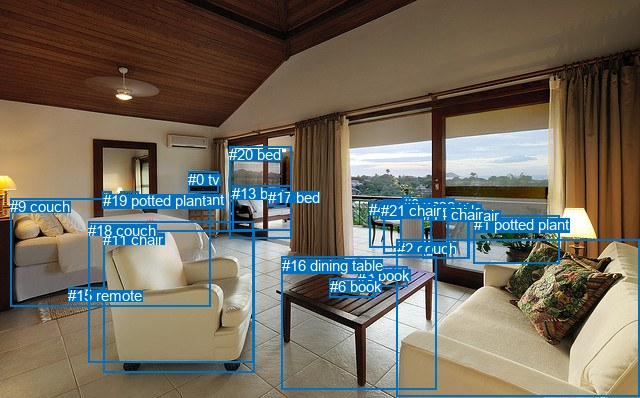
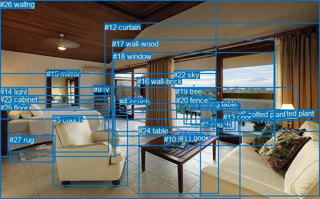

# 图片 0069：1593263.jpg

随机样本序号：411。图片 SHA256：`dbc7d9ef1f9e15c8fdc67eeefbb74091b6d489af385bb85137e918e3d1b7e6f8`。

红色框表示人，蓝色框表示其他物体。两个模式分别保留自身框编号，可依据位置比较对应对象。

## 自动检测框与输出

人的框编号：`[]`。状态：`no_person`。

### 自动检测全部物体框

| 编号 | 类别 | 是否为人 | 检测分数 | 像素坐标 xyxy |
|---|---|---|---|---|
| 0 | tv | False | 0.9987 | 188.5, 171.2, 218.7, 192.9 |
| 1 | potted plant | False | 0.9980 | 474.0, 215.7, 559.9, 263.6 |
| 2 | couch | False | 0.9943 | 396.8, 239.7, 639.5, 396.7 |
| 3 | book | False | 0.9823 | 358.1, 266.6, 407.1, 286.6 |
| 4 | chair | False | 0.9804 | 369.4, 201.0, 401.2, 247.6 |
| 5 | dining table | False | 0.9798 | 383.8, 199.6, 431.9, 253.2 |
| 6 | book | False | 0.9654 | 329.9, 278.3, 375.1, 297.9 |
| 7 | chair | False | 0.9070 | 447.0, 207.4, 469.6, 258.6 |
| 8 | vase | False | 0.9068 | 402.7, 195.7, 410.5, 204.9 |
| 9 | couch | False | 0.8942 | 10.4, 198.1, 210.8, 306.5 |
| 10 | potted plant | False | 0.8920 | 120.7, 191.3, 138.5, 205.4 |
| 11 | chair | False | 0.8650 | 103.2, 230.9, 254.2, 372.0 |
| 12 | dining table | False | 0.8499 | 381.0, 201.6, 433.1, 207.8 |
| 13 | bed | False | 0.7964 | 232.1, 185.1, 291.5, 230.6 |
| 14 | chair | False | 0.7865 | 422.5, 206.2, 468.9, 258.5 |
| 15 | remote | False | 0.6438 | 68.3, 287.5, 102.9, 301.7 |
| 16 | dining table | False | 0.6371 | 281.6, 256.9, 436.5, 389.7 |
| 17 | bed | False | 0.5769 | 268.0, 188.9, 286.9, 206.1 |
| 18 | couch | False | 0.4713 | 88.1, 221.7, 253.1, 363.0 |
| 19 | potted plant | False | 0.4309 | 102.7, 191.8, 112.0, 203.5 |
| 20 | bed | False | 0.4234 | 229.3, 146.5, 291.3, 238.3 |
| 21 | chair | False | 0.3562 | 381.5, 202.1, 398.3, 219.6 |

### 自动检测 Top50 人相关候选

评分物体对：0；人相关物体对：0；输出关系：0。

| 排名 | 主语编号与类别 | 关系 | 宾语编号与类别 | 类型 | 人与人 | 排序分数 | 原始融合 logit |
|---|---|---|---|---|---|---|---|

### 自动检测逐条人相关 GT 核验

本图没有人相关 GT，R@50 无分母；预测候选继续展示。

## 真实框与输出

人的框编号：`[]`。

### 真实框全部物体框

| 编号 | 类别 | 是否为人 | 检测分数 | 像素坐标 xyxy |
|---|---|---|---|---|
| 0 | chair | False | GT | 368.0, 199.0, 402.0, 249.0 |
| 1 | chair | False | GT | 425.0, 204.0, 470.0, 259.0 |
| 2 | couch | False | GT | 401.0, 241.0, 640.0, 393.0 |
| 3 | couch | False | GT | 105.0, 231.0, 255.0, 372.0 |
| 4 | couch | False | GT | 239.0, 195.0, 293.0, 225.0 |
| 5 | potted plant | False | GT | 533.0, 218.0, 560.0, 247.0 |
| 6 | potted plant | False | GT | 476.0, 220.0, 532.0, 264.0 |
| 7 | bed | False | GT | 15.0, 199.0, 217.0, 304.0 |
| 8 | dining table | False | GT | 381.0, 199.0, 433.0, 251.0 |
| 9 | tv | False | GT | 187.0, 170.0, 218.0, 193.0 |
| 10 | book | False | GT | 328.0, 270.0, 376.0, 299.0 |
| 11 | book | False | GT | 359.0, 267.0, 407.0, 285.0 |
| 12 | curtain | False | GT | 209.0, 46.0, 640.0, 263.0 |
| 13 | door | False | GT | 446.0, 226.0, 464.0, 255.0 |
| 14 | light | False | GT | 0.0, 175.0, 596.0, 239.0 |
| 15 | mirror | False | GT | 93.0, 139.0, 160.0, 217.0 |
| 16 | wall-brick | False | GT | 274.0, 154.0, 296.0, 208.0 |
| 17 | wall-wood | False | GT | 224.0, 79.0, 550.0, 292.0 |
| 18 | window | False | GT | 226.0, 104.0, 549.0, 273.0 |
| 19 | tree | False | GT | 351.0, 174.0, 432.0, 210.0 |
| 20 | fence | False | GT | 352.0, 192.0, 432.0, 238.0 |
| 21 | ceiling | False | GT | 0.0, 0.0, 432.0, 147.0 |
| 22 | sky | False | GT | 347.0, 141.0, 432.0, 178.0 |
| 23 | cabinet | False | GT | 0.0, 190.0, 230.0, 313.0 |
| 24 | table | False | GT | 277.0, 253.0, 437.0, 387.0 |
| 25 | floor | False | GT | 0.0, 207.0, 481.0, 398.0 |
| 26 | wall | False | GT | 0.0, 0.0, 640.0, 220.0 |
| 27 | rug | False | GT | 19.0, 271.0, 111.0, 325.0 |

### 真实框 Top50 人相关候选

评分物体对：0；人相关物体对：0；输出关系：0。

| 排名 | 主语编号与类别 | 关系 | 宾语编号与类别 | 类型 | 人与人 | 排序分数 | 原始融合 logit |
|---|---|---|---|---|---|---|---|

### 真实框逐条人相关 GT 核验

本图没有人相关 GT，R@50 无分母；预测候选继续展示。

## 全部人相关 GT

| 主语编号与类别 | 关系 | 宾语编号与类别 |
|---|---|---|

原始记录、全部人相关物体对的两项预测与分项分数见 [逐图证据 JSON](../evidence/cases/0069.json)。全部56类 logits 保留于本机 HOR/output/random500/logits/。

<!-- HOR_COMPLETE_RESULTS -->

## 六组条件的完整输出对照

以下保留同一图片三种框与候选模式、两种谓词输出规则的全部 Top50。框编号各自在所属模式内解释。

### 自动检测框完整枚举：空间与语义各保留一个谓词

| 排名 | 主语编号与类别 | 谓词 | 宾语编号与类别 | 分组 | 排序分数 | predicate logit | pair logit |
|---|---|---|---|---|---|---|---|

没有人相关 GT，本条件的召回率无分母。

### 自动检测框完整枚举：每对只保留一个谓词

| 排名 | 主语编号与类别 | 谓词 | 宾语编号与类别 | 分组 | 排序分数 | predicate logit | pair logit |
|---|---|---|---|---|---|---|---|

没有人相关 GT，本条件的召回率无分母。

### 真实框完整枚举：空间与语义各保留一个谓词

| 排名 | 主语编号与类别 | 谓词 | 宾语编号与类别 | 分组 | 排序分数 | predicate logit | pair logit |
|---|---|---|---|---|---|---|---|

没有人相关 GT，本条件的召回率无分母。

### 真实框完整枚举：每对只保留一个谓词

| 排名 | 主语编号与类别 | 谓词 | 宾语编号与类别 | 分组 | 排序分数 | predicate logit | pair logit |
|---|---|---|---|---|---|---|---|

没有人相关 GT，本条件的召回率无分母。

### 真实框400候选：空间与语义各保留一个谓词

| 排名 | 主语编号与类别 | 谓词 | 宾语编号与类别 | 分组 | 排序分数 | predicate logit | pair logit |
|---|---|---|---|---|---|---|---|

没有人相关 GT，本条件的召回率无分母。

### 真实框400候选：每对只保留一个谓词

| 排名 | 主语编号与类别 | 谓词 | 宾语编号与类别 | 分组 | 排序分数 | predicate logit | pair logit |
|---|---|---|---|---|---|---|---|

没有人相关 GT，本条件的召回率无分母。
