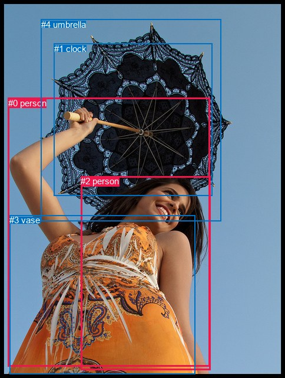
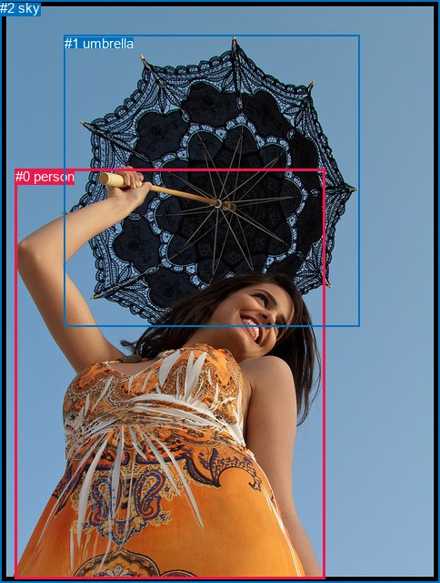

# 图片 0077：2315602.jpg

随机样本序号：217。图片 SHA256：`c278f5713c135f44dcd7d708f0d9abc4f63a2870a6d1c7753ad5a7b198bbabbe`。

红色框表示人，蓝色框表示其他物体。两个模式分别保留自身框编号，可依据位置比较对应对象。

## 自动检测框与输出

人的框编号：`[0, 2]`。状态：`ok`。

### 自动检测全部物体框

| 编号 | 类别 | 是否为人 | 检测分数 | 像素坐标 xyxy |
|---|---|---|---|---|
| 0 | person | True | 0.9915 | 13.5, 165.5, 356.0, 621.0 |
| 1 | clock | False | 0.7493 | 91.6, 73.6, 360.6, 331.8 |
| 2 | person | True | 0.6886 | 137.4, 298.2, 357.2, 626.4 |
| 3 | vase | False | 0.5959 | 16.2, 364.2, 331.3, 633.4 |
| 4 | umbrella | False | 0.5651 | 69.5, 32.6, 375.6, 375.0 |

### 自动检测 Top50 人相关候选

评分物体对：20；人相关物体对：14；输出关系：28。

| 排名 | 主语编号与类别 | 关系 | 宾语编号与类别 | 类型 | 人与人 | 排序分数 | 原始融合 logit |
|---|---|---|---|---|---|---|---|
| 1 | #0 person | holding | #4 umbrella | semantic | False | 0.99333 | 5.0030 |
| 2 | #0 person | holding | #1 clock | semantic | False | 0.99317 | 4.9801 |
| 3 | #0 person | wearing | #3 vase | semantic | False | 0.99128 | 4.7337 |
| 4 | #2 person | wearing | #3 vase | semantic | False | 0.98664 | 4.3020 |
| 5 | #2 person | holding | #4 umbrella | semantic | False | 0.98553 | 4.2211 |
| 6 | #2 person | holding | #1 clock | semantic | False | 0.98347 | 4.0860 |
| 7 | #0 person | in | #3 vase | spatial | False | 0.94597 | 2.8626 |
| 8 | #2 person | in | #3 vase | spatial | False | 0.92984 | 2.5842 |
| 9 | #3 vase | on | #0 person | spatial | False | 0.88299 | 2.0210 |
| 10 | #3 vase | on | #2 person | spatial | False | 0.82753 | 1.5682 |
| 11 | #0 person | holding | #2 person | semantic | True | 0.77909 | 1.2604 |
| 12 | #0 person | in | #4 umbrella | spatial | False | 0.74164 | 1.0545 |
| 13 | #0 person | in | #1 clock | spatial | False | 0.73017 | 0.9955 |
| 14 | #2 person | wearing | #0 person | semantic | True | 0.65046 | 0.6211 |
| 15 | #2 person | in | #4 umbrella | spatial | False | 0.62983 | 0.5315 |
| 16 | #2 person | in | #1 clock | spatial | False | 0.58089 | 0.3264 |
| 17 | #0 person | in | #2 person | spatial | True | 0.52000 | 0.0801 |
| 18 | #4 umbrella | over | #2 person | spatial | False | 0.40937 | -0.3666 |
| 19 | #2 person | in | #0 person | spatial | True | 0.38733 | -0.4585 |
| 20 | #3 vase | wearing | #0 person | semantic | False | 0.35665 | -0.5899 |
| 21 | #1 clock | over | #2 person | spatial | False | 0.33421 | -0.6892 |
| 22 | #1 clock | holding | #0 person | semantic | False | 0.31950 | -0.7561 |
| 23 | #4 umbrella | over | #0 person | spatial | False | 0.31742 | -0.7656 |
| 24 | #4 umbrella | holding | #0 person | semantic | False | 0.30923 | -0.8037 |
| 25 | #1 clock | over | #0 person | spatial | False | 0.30093 | -0.8429 |
| 26 | #3 vase | wearing | #2 person | semantic | False | 0.28211 | -0.9340 |
| 27 | #4 umbrella | holding | #2 person | semantic | False | 0.24778 | -1.1105 |
| 28 | #1 clock | holding | #2 person | semantic | False | 0.17116 | -1.5774 |

### 自动检测逐条人相关 GT 核验

R@50：100.00%；命中 2/2。

| GT 主语编号 | GT 关系 | GT 宾语编号 | 结果阶段 | 匹配预测主语编号 | 匹配预测宾语编号 |
|---|---|---|---|---|---|
| 0 | holding | 1 | hit50 | [0] | [4] |
| 1 | over | 0 | hit50 | [4] | [0] |

## 真实框与输出

人的框编号：`[0]`。

### 真实框全部物体框

| 编号 | 类别 | 是否为人 | 检测分数 | 像素坐标 xyxy |
|---|---|---|---|---|
| 0 | person | True | GT | 17.0, 185.0, 357.0, 635.0 |
| 1 | umbrella | False | GT | 71.0, 39.0, 395.0, 359.0 |
| 2 | sky | False | GT | 0.0, 0.0, 484.0, 640.0 |

### 真实框 Top50 人相关候选

评分物体对：6；人相关物体对：4；输出关系：8。

| 排名 | 主语编号与类别 | 关系 | 宾语编号与类别 | 类型 | 人与人 | 排序分数 | 原始融合 logit |
|---|---|---|---|---|---|---|---|
| 1 | #0 person | holding | #1 umbrella | semantic | False | 0.99485 | 5.2638 |
| 2 | #0 person | holding | #2 sky | semantic | False | 0.86731 | 1.8773 |
| 3 | #2 sky | over | #0 person | spatial | False | 0.86542 | 1.8611 |
| 4 | #0 person | in | #2 sky | spatial | False | 0.83665 | 1.6335 |
| 5 | #0 person | in | #1 umbrella | spatial | False | 0.82213 | 1.5308 |
| 6 | #1 umbrella | over | #0 person | spatial | False | 0.72423 | 0.9655 |
| 7 | #1 umbrella | holding | #0 person | semantic | False | 0.61439 | 0.4658 |
| 8 | #2 sky | holding | #0 person | semantic | False | 0.39675 | -0.4190 |

### 真实框逐条人相关 GT 核验

R@50：100.00%；命中 2/2。

| GT 主语编号 | GT 关系 | GT 宾语编号 | 结果阶段 | 匹配预测主语编号 | 匹配预测宾语编号 |
|---|---|---|---|---|---|
| 0 | holding | 1 | hit50 | [0] | [1] |
| 1 | over | 0 | hit50 | [1] | [0] |

## 全部人相关 GT

| 主语编号与类别 | 关系 | 宾语编号与类别 |
|---|---|---|
| #0 person | holding | #1 umbrella |
| #1 umbrella | over | #0 person |

原始记录、全部人相关物体对的两项预测与分项分数见 [逐图证据 JSON](../evidence/cases/0077.json)。全部56类 logits 保留于本机 HOR/output/random500/logits/。

<!-- HOR_COMPLETE_RESULTS -->

## 六组条件的完整输出对照

以下保留同一图片三种框与候选模式、两种谓词输出规则的全部 Top50。框编号各自在所属模式内解释。

### 自动检测框完整枚举：空间与语义各保留一个谓词

| 排名 | 主语编号与类别 | 谓词 | 宾语编号与类别 | 分组 | 排序分数 | predicate logit | pair logit |
|---|---|---|---|---|---|---|---|
| 1 | #0 person | holding | #4 umbrella | semantic | 0.9933270 | 4.4235635 | 0.5794246 |
| 2 | #0 person | holding | #1 clock | semantic | 0.9931738 | 4.4531054 | 0.5270312 |
| 3 | #0 person | wearing | #3 vase | semantic | 0.9912831 | 4.2926536 | 0.4410830 |
| 4 | #2 person | wearing | #3 vase | semantic | 0.9866392 | 4.1957603 | 0.1062226 |
| 5 | #2 person | holding | #4 umbrella | semantic | 0.9855294 | 4.1049256 | 0.1161303 |
| 6 | #2 person | holding | #1 clock | semantic | 0.9834710 | 4.0211091 | 0.0648623 |
| 7 | #0 person | in | #3 vase | spatial | 0.9459667 | 2.4215245 | 0.4410830 |
| 8 | #2 person | in | #3 vase | spatial | 0.9298356 | 2.4779429 | 0.1062226 |
| 9 | #3 vase | on | #0 person | spatial | 0.8829870 | 2.4529829 | -0.4319570 |
| 10 | #3 vase | on | #2 person | spatial | 0.8275333 | 2.1079330 | -0.5396881 |
| 11 | #0 person | holding | #2 person | semantic | 0.7790928 | 1.9136243 | -0.6532370 |
| 12 | #0 person | in | #4 umbrella | spatial | 0.7416397 | 0.4750838 | 0.5794246 |
| 13 | #0 person | in | #1 clock | spatial | 0.7301685 | 0.4684463 | 0.5270312 |
| 14 | #2 person | wearing | #0 person | semantic | 0.6504645 | 1.2522483 | -0.6311666 |
| 15 | #2 person | in | #4 umbrella | spatial | 0.6298276 | 0.4153466 | 0.1161303 |
| 16 | #2 person | in | #1 clock | spatial | 0.5808915 | 0.2615719 | 0.0648623 |
| 17 | #0 person | in | #2 person | spatial | 0.5200046 | 0.7332983 | -0.6532370 |
| 18 | #4 umbrella | over | #2 person | spatial | 0.4093740 | 0.2748752 | -0.6414292 |
| 19 | #2 person | in | #0 person | spatial | 0.3873339 | 0.1726336 | -0.6311666 |
| 20 | #3 vase | wearing | #0 person | semantic | 0.3566522 | -0.1579676 | -0.4319570 |
| 21 | #1 clock | over | #2 person | spatial | 0.3342061 | -0.0091662 | -0.6800560 |
| 22 | #1 clock | holding | #0 person | semantic | 0.3195009 | 0.0435748 | -0.7996411 |
| 23 | #4 umbrella | over | #0 person | spatial | 0.3174212 | 0.0639205 | -0.8295689 |
| 24 | #4 umbrella | holding | #0 person | semantic | 0.3092305 | 0.0258498 | -0.8295689 |
| 25 | #1 clock | over | #0 person | spatial | 0.3009318 | -0.0432234 | -0.7996411 |
| 26 | #3 vase | wearing | #2 person | semantic | 0.2821096 | -0.3943329 | -0.5396881 |
| 27 | #4 umbrella | holding | #2 person | semantic | 0.2477770 | -0.4690742 | -0.6414292 |
| 28 | #1 clock | holding | #2 person | semantic | 0.1711620 | -0.8973582 | -0.6800560 |

GT 命中：2/2，R@50=100.00%。

| GT主语 | GT谓词 | GT宾语 | 结果阶段 | 匹配主语框 | 匹配宾语框 |
|---|---|---|---|---|---|
| 0 | holding | 1 | hit50 | [0] | [4] |
| 1 | over | 0 | hit50 | [4] | [0] |

### 自动检测框完整枚举：每对只保留一个谓词

| 排名 | 主语编号与类别 | 谓词 | 宾语编号与类别 | 分组 | 排序分数 | predicate logit | pair logit |
|---|---|---|---|---|---|---|---|
| 1 | #0 person | holding | #4 umbrella | single | 0.9933270 | 4.4235635 | 0.5794246 |
| 2 | #0 person | holding | #1 clock | single | 0.9931738 | 4.4531054 | 0.5270312 |
| 3 | #0 person | wearing | #3 vase | single | 0.9912831 | 4.2926536 | 0.4410830 |
| 4 | #2 person | wearing | #3 vase | single | 0.9866392 | 4.1957603 | 0.1062226 |
| 5 | #2 person | holding | #4 umbrella | single | 0.9855294 | 4.1049256 | 0.1161303 |
| 6 | #2 person | holding | #1 clock | single | 0.9834710 | 4.0211091 | 0.0648623 |
| 7 | #3 vase | on | #0 person | single | 0.8829870 | 2.4529829 | -0.4319570 |
| 8 | #3 vase | on | #2 person | single | 0.8275333 | 2.1079330 | -0.5396881 |
| 9 | #0 person | holding | #2 person | single | 0.7790928 | 1.9136243 | -0.6532370 |
| 10 | #2 person | wearing | #0 person | single | 0.6504645 | 1.2522483 | -0.6311666 |
| 11 | #4 umbrella | over | #2 person | single | 0.4093740 | 0.2748752 | -0.6414292 |
| 12 | #1 clock | over | #2 person | single | 0.3342061 | -0.0091662 | -0.6800560 |
| 13 | #1 clock | holding | #0 person | single | 0.3195009 | 0.0435748 | -0.7996411 |
| 14 | #4 umbrella | over | #0 person | single | 0.3174212 | 0.0639205 | -0.8295689 |

GT 命中：2/2，R@50=100.00%。

| GT主语 | GT谓词 | GT宾语 | 结果阶段 | 匹配主语框 | 匹配宾语框 |
|---|---|---|---|---|---|
| 0 | holding | 1 | hit50 | [0] | [4] |
| 1 | over | 0 | hit50 | [4] | [0] |

### 真实框完整枚举：空间与语义各保留一个谓词

| 排名 | 主语编号与类别 | 谓词 | 宾语编号与类别 | 分组 | 排序分数 | predicate logit | pair logit |
|---|---|---|---|---|---|---|---|
| 1 | #0 person | holding | #1 umbrella | semantic | 0.9948512 | 4.6820188 | 0.5817993 |
| 2 | #0 person | holding | #2 sky | semantic | 0.8673051 | 2.3053589 | -0.4280205 |
| 3 | #2 sky | over | #0 person | spatial | 0.8654220 | 2.1468272 | -0.2857543 |
| 4 | #0 person | in | #2 sky | spatial | 0.8366488 | 2.0615220 | -0.4280205 |
| 5 | #0 person | in | #1 umbrella | spatial | 0.8221256 | 0.9490166 | 0.5817993 |
| 6 | #1 umbrella | over | #0 person | spatial | 0.7242310 | 1.7394009 | -0.7738538 |
| 7 | #1 umbrella | holding | #0 person | semantic | 0.6143929 | 1.2396693 | -0.7738538 |
| 8 | #2 sky | holding | #0 person | semantic | 0.3967527 | -0.1332598 | -0.2857543 |

GT 命中：2/2，R@50=100.00%。

| GT主语 | GT谓词 | GT宾语 | 结果阶段 | 匹配主语框 | 匹配宾语框 |
|---|---|---|---|---|---|
| 0 | holding | 1 | hit50 | [0] | [1] |
| 1 | over | 0 | hit50 | [1] | [0] |

### 真实框完整枚举：每对只保留一个谓词

| 排名 | 主语编号与类别 | 谓词 | 宾语编号与类别 | 分组 | 排序分数 | predicate logit | pair logit |
|---|---|---|---|---|---|---|---|
| 1 | #0 person | holding | #1 umbrella | single | 0.9948512 | 4.6820188 | 0.5817993 |
| 2 | #0 person | holding | #2 sky | single | 0.8673051 | 2.3053589 | -0.4280205 |
| 3 | #2 sky | over | #0 person | single | 0.8654220 | 2.1468272 | -0.2857543 |
| 4 | #1 umbrella | over | #0 person | single | 0.7242310 | 1.7394009 | -0.7738538 |

GT 命中：2/2，R@50=100.00%。

| GT主语 | GT谓词 | GT宾语 | 结果阶段 | 匹配主语框 | 匹配宾语框 |
|---|---|---|---|---|---|
| 0 | holding | 1 | hit50 | [0] | [1] |
| 1 | over | 0 | hit50 | [1] | [0] |

### 真实框400候选：空间与语义各保留一个谓词

| 排名 | 主语编号与类别 | 谓词 | 宾语编号与类别 | 分组 | 排序分数 | predicate logit | pair logit |
|---|---|---|---|---|---|---|---|
| 1 | #0 person | holding | #1 umbrella | semantic | 0.9948512 | 4.6820188 | 0.5817993 |
| 2 | #0 person | holding | #2 sky | semantic | 0.8673051 | 2.3053589 | -0.4280205 |
| 3 | #2 sky | over | #0 person | spatial | 0.8654220 | 2.1468272 | -0.2857543 |
| 4 | #0 person | in | #2 sky | spatial | 0.8366488 | 2.0615220 | -0.4280205 |
| 5 | #0 person | in | #1 umbrella | spatial | 0.8230942 | 0.9556541 | 0.5817993 |
| 6 | #1 umbrella | over | #0 person | spatial | 0.7231737 | 1.7341132 | -0.7738538 |
| 7 | #1 umbrella | holding | #0 person | semantic | 0.6143929 | 1.2396693 | -0.7738538 |
| 8 | #2 sky | holding | #0 person | semantic | 0.4018446 | -0.1120310 | -0.2857543 |

GT 命中：2/2，R@50=100.00%。

| GT主语 | GT谓词 | GT宾语 | 结果阶段 | 匹配主语框 | 匹配宾语框 |
|---|---|---|---|---|---|
| 0 | holding | 1 | hit50 | [0] | [1] |
| 1 | over | 0 | hit50 | [1] | [0] |

### 真实框400候选：每对只保留一个谓词

| 排名 | 主语编号与类别 | 谓词 | 宾语编号与类别 | 分组 | 排序分数 | predicate logit | pair logit |
|---|---|---|---|---|---|---|---|
| 1 | #0 person | holding | #1 umbrella | single | 0.9948512 | 4.6820188 | 0.5817993 |
| 2 | #0 person | holding | #2 sky | single | 0.8673051 | 2.3053589 | -0.4280205 |
| 3 | #2 sky | over | #0 person | single | 0.8654220 | 2.1468272 | -0.2857543 |
| 4 | #1 umbrella | over | #0 person | single | 0.7231737 | 1.7341132 | -0.7738538 |

GT 命中：2/2，R@50=100.00%。

| GT主语 | GT谓词 | GT宾语 | 结果阶段 | 匹配主语框 | 匹配宾语框 |
|---|---|---|---|---|---|
| 0 | holding | 1 | hit50 | [0] | [1] |
| 1 | over | 0 | hit50 | [1] | [0] |
