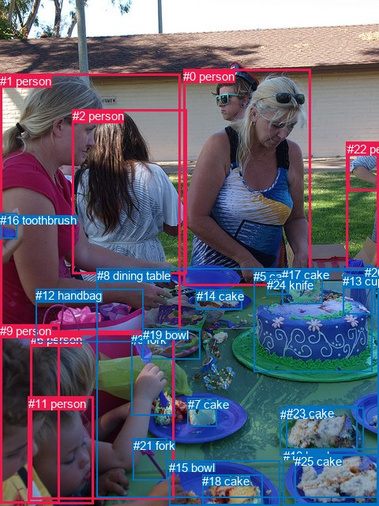
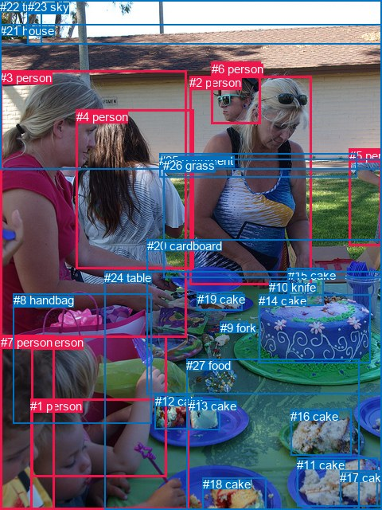

# 图片 0081：2315729.jpg

随机样本序号：29。图片 SHA256：`25b008f452e77d8618bb1cfb9380eb3c7d2dd43fe5c92c5cbcd949b3d4f9ce4b`。

红色框表示人，蓝色框表示其他物体。两个模式分别保留自身框编号，可依据位置比较对应对象。

## 自动检测框与输出

人的框编号：`[0, 1, 2, 4, 6, 9, 11, 22]`。状态：`ok`。

### 自动检测全部物体框

| 编号 | 类别 | 是否为人 | 检测分数 | 像素坐标 xyxy |
|---|---|---|---|---|
| 0 | person | True | 0.9999 | 232.1, 87.6, 393.5, 361.8 |
| 1 | person | True | 0.9955 | 0.4, 93.6, 228.6, 420.3 |
| 2 | person | True | 0.9951 | 92.0, 138.4, 236.8, 346.5 |
| 3 | fork | False | 0.9901 | 166.4, 420.9, 221.4, 525.6 |
| 4 | person | True | 0.9868 | 439.0, 179.5, 479.4, 340.9 |
| 5 | cake | False | 0.9838 | 321.2, 341.1, 471.8, 470.3 |
| 6 | person | True | 0.9470 | 38.6, 421.3, 220.7, 631.6 |
| 7 | cake | False | 0.9446 | 238.0, 503.1, 274.7, 539.8 |
| 8 | dining table | False | 0.9417 | 122.7, 340.0, 480.0, 629.2 |
| 9 | person | True | 0.9194 | 0.4, 410.1, 75.7, 636.9 |
| 10 | bowl | False | 0.9187 | 358.7, 567.7, 480.0, 639.7 |
| 11 | person | True | 0.8991 | 35.5, 502.0, 118.7, 637.8 |
| 12 | handbag | False | 0.8825 | 45.2, 365.4, 181.9, 433.0 |
| 13 | cup | False | 0.8761 | 434.3, 347.4, 475.8, 397.2 |
| 14 | cake | False | 0.7546 | 248.6, 366.5, 306.6, 391.2 |
| 15 | bowl | False | 0.7322 | 214.1, 582.6, 354.8, 639.2 |
| 16 | toothbrush | False | 0.6124 | 0.0, 269.8, 21.1, 301.4 |
| 17 | cake | False | 0.5983 | 357.1, 339.1, 408.8, 384.3 |
| 18 | cake | False | 0.5962 | 256.3, 600.4, 332.6, 639.0 |
| 19 | bowl | False | 0.5828 | 180.8, 415.4, 253.9, 454.1 |
| 20 | bowl | False | 0.5649 | 354.8, 515.9, 460.3, 576.0 |
| 21 | fork | False | 0.5520 | 168.5, 554.9, 211.9, 607.0 |
| 22 | person | True | 0.5445 | 440.3, 179.9, 480.0, 241.2 |
| 23 | cake | False | 0.4250 | 362.9, 513.6, 452.6, 570.9 |
| 24 | knife | False | 0.4140 | 338.2, 352.0, 365.4, 372.4 |
| 25 | cake | False | 0.3623 | 373.5, 574.7, 478.6, 637.2 |
| 26 | fork | False | 0.3546 | 462.1, 335.7, 472.0, 348.0 |

### 自动检测 Top50 人相关候选

评分物体对：702；人相关物体对：360；输出关系：50。

| 排名 | 主语编号与类别 | 关系 | 宾语编号与类别 | 类型 | 人与人 | 排序分数 | 原始融合 logit |
|---|---|---|---|---|---|---|---|
| 1 | #4 person | wearing | #22 person | semantic | True | 0.98748 | 4.3675 |
| 2 | #1 person | holding | #16 toothbrush | semantic | False | 0.98724 | 4.3489 |
| 3 | #6 person | holding | #3 fork | semantic | False | 0.97749 | 3.7711 |
| 4 | #6 person | holding | #21 fork | semantic | False | 0.94469 | 2.8379 |
| 5 | #4 person | in | #22 person | spatial | True | 0.93651 | 2.6913 |
| 6 | #0 person | standing on | #8 dining table | semantic | False | 0.93279 | 2.6304 |
| 7 | #0 person | slicing | #5 cake | semantic | False | 0.90264 | 2.2269 |
| 8 | #1 person | on | #8 dining table | spatial | False | 0.89641 | 2.1580 |
| 9 | #2 person | standing on | #8 dining table | semantic | False | 0.88350 | 2.0260 |
| 10 | #1 person | slicing | #5 cake | semantic | False | 0.87892 | 1.9822 |
| 11 | #6 person | on | #8 dining table | spatial | False | 0.87768 | 1.9707 |
| 12 | #1 person | holding | #12 handbag | semantic | False | 0.87710 | 1.9652 |
| 13 | #0 person | in | #8 dining table | spatial | False | 0.87414 | 1.9380 |
| 14 | #2 person | on | #8 dining table | spatial | False | 0.85822 | 1.8005 |
| 15 | #6 person | in | #11 person | spatial | True | 0.85810 | 1.7996 |
| 16 | #6 person | sitting on | #8 dining table | semantic | False | 0.84408 | 1.6889 |
| 17 | #1 person | standing on | #8 dining table | semantic | False | 0.83729 | 1.6382 |
| 18 | #9 person | in | #11 person | spatial | True | 0.83631 | 1.6310 |
| 19 | #4 person | standing on | #8 dining table | semantic | False | 0.81758 | 1.5001 |
| 20 | #22 person | on | #4 person | spatial | True | 0.80951 | 1.4468 |
| 21 | #1 person | in | #16 toothbrush | spatial | False | 0.77451 | 1.2340 |
| 22 | #6 person | on | #3 fork | spatial | False | 0.74972 | 1.0971 |
| 23 | #4 person | touching | #5 cake | semantic | False | 0.71772 | 0.9332 |
| 24 | #0 person | holding | #24 knife | semantic | False | 0.69061 | 0.8030 |
| 25 | #0 person | picking | #17 cake | semantic | False | 0.69017 | 0.8009 |
| 26 | #6 person | in | #9 person | spatial | True | 0.67212 | 0.7178 |
| 27 | #16 toothbrush | holding | #1 person | semantic | False | 0.66998 | 0.7081 |
| 28 | #1 person | picking | #14 cake | semantic | False | 0.65819 | 0.6552 |
| 29 | #6 person | on | #21 fork | spatial | False | 0.65014 | 0.6196 |
| 30 | #1 person | in | #12 handbag | spatial | False | 0.64876 | 0.6136 |
| 31 | #9 person | holding | #11 person | semantic | True | 0.64651 | 0.6037 |
| 32 | #4 person | holding | #26 fork | semantic | False | 0.63450 | 0.5516 |
| 33 | #21 fork | on | #6 person | spatial | False | 0.62867 | 0.5265 |
| 34 | #11 person | on | #6 person | spatial | True | 0.60408 | 0.4225 |
| 35 | #11 person | in | #9 person | spatial | True | 0.59506 | 0.3849 |
| 36 | #6 person | eating | #7 cake | semantic | False | 0.58828 | 0.3569 |
| 37 | #12 handbag | beside | #1 person | spatial | False | 0.55000 | 0.2007 |
| 38 | #6 person | wearing | #11 person | semantic | True | 0.53434 | 0.1376 |
| 39 | #6 person | eating | #18 cake | semantic | False | 0.51892 | 0.0757 |
| 40 | #9 person | holding | #16 toothbrush | semantic | False | 0.51654 | 0.0662 |
| 41 | #21 fork | holding | #6 person | semantic | False | 0.50949 | 0.0380 |
| 42 | #2 person | looking at | #0 person | semantic | True | 0.49674 | -0.0130 |
| 43 | #6 person | holding | #9 person | semantic | True | 0.49145 | -0.0342 |
| 44 | #1 person | picking | #17 cake | semantic | False | 0.48747 | -0.0501 |
| 45 | #1 person | holding | #3 fork | semantic | False | 0.48144 | -0.0743 |
| 46 | #2 person | beside | #1 person | spatial | True | 0.47464 | -0.1015 |
| 47 | #9 person | in | #6 person | spatial | True | 0.47454 | -0.1019 |
| 48 | #4 person | beside | #8 dining table | spatial | False | 0.45384 | -0.1852 |
| 49 | #2 person | looking at | #1 person | semantic | True | 0.44569 | -0.2181 |
| 50 | #6 person | eating | #15 bowl | semantic | False | 0.41843 | -0.3292 |

### 自动检测逐条人相关 GT 核验

R@50：0.00%；命中 0/3。

| GT 主语编号 | GT 关系 | GT 宾语编号 | 结果阶段 | 匹配预测主语编号 | 匹配预测宾语编号 |
|---|---|---|---|---|---|
| 2 | slicing | 15 | wrong_predicate | [0] | [17] |
| 3 | attached to | 4 | wrong_predicate | [1] | [2] |
| 6 | attached to | 2 | endpoint_missing_or_wrong_class | [] | [0] |

## 真实框与输出

人的框编号：`[0, 1, 2, 3, 4, 5, 6, 7]`。

### 真实框全部物体框

| 编号 | 类别 | 是否为人 | 检测分数 | 像素坐标 xyxy |
|---|---|---|---|---|
| 0 | person | True | GT | 40.0, 421.0, 210.0, 599.0 |
| 1 | person | True | GT | 38.0, 501.0, 237.0, 640.0 |
| 2 | person | True | GT | 238.0, 95.0, 391.0, 357.0 |
| 3 | person | True | GT | 0.0, 89.0, 234.0, 424.0 |
| 4 | person | True | GT | 96.0, 138.0, 244.0, 338.0 |
| 5 | person | True | GT | 439.0, 187.0, 480.0, 309.0 |
| 6 | person | True | GT | 266.0, 78.0, 328.0, 156.0 |
| 7 | person | True | GT | 1.0, 421.0, 69.0, 640.0 |
| 8 | handbag | False | GT | 17.0, 368.0, 190.0, 531.0 |
| 9 | fork | False | GT | 277.0, 403.0, 312.0, 417.0 |
| 10 | knife | False | GT | 338.0, 352.0, 363.0, 372.0 |
| 11 | cake | False | GT | 373.0, 575.0, 474.0, 636.0 |
| 12 | cake | False | GT | 195.0, 495.0, 239.0, 538.0 |
| 13 | cake | False | GT | 237.0, 501.0, 276.0, 540.0 |
| 14 | cake | False | GT | 325.0, 369.0, 465.0, 456.0 |
| 15 | cake | False | GT | 362.0, 337.0, 407.0, 384.0 |
| 16 | cake | False | GT | 365.0, 514.0, 441.0, 572.0 |
| 17 | cake | False | GT | 427.0, 591.0, 480.0, 636.0 |
| 18 | cake | False | GT | 255.0, 599.0, 335.0, 640.0 |
| 19 | cake | False | GT | 248.0, 367.0, 305.0, 390.0 |
| 20 | cardboard | False | GT | 185.0, 300.0, 480.0, 494.0 |
| 21 | house | False | GT | 0.0, 30.0, 480.0, 212.0 |
| 22 | tree | False | GT | 0.0, 0.0, 52.0, 57.0 |
| 23 | sky | False | GT | 35.0, 0.0, 480.0, 55.0 |
| 24 | table | False | GT | 131.0, 340.0, 480.0, 640.0 |
| 25 | pavement | False | GT | 200.0, 193.0, 448.0, 222.0 |
| 26 | grass | False | GT | 205.0, 199.0, 480.0, 348.0 |
| 27 | food | False | GT | 234.0, 450.0, 451.0, 640.0 |

### 真实框 Top50 人相关候选

评分物体对：756；人相关物体对：376；输出关系：50。

| 排名 | 主语编号与类别 | 关系 | 宾语编号与类别 | 类型 | 人与人 | 排序分数 | 原始融合 logit |
|---|---|---|---|---|---|---|---|
| 1 | #2 person | wearing | #6 person | semantic | True | 0.98648 | 4.2896 |
| 2 | #0 person | eating | #12 cake | semantic | False | 0.96881 | 3.4361 |
| 3 | #1 person | eating | #12 cake | semantic | False | 0.96765 | 3.3983 |
| 4 | #3 person | on | #24 table | spatial | False | 0.92000 | 2.4424 |
| 5 | #3 person | slicing | #14 cake | semantic | False | 0.91141 | 2.3310 |
| 6 | #5 person | standing on | #26 grass | semantic | False | 0.89475 | 2.1402 |
| 7 | #0 person | holding | #1 person | semantic | True | 0.88715 | 2.0620 |
| 8 | #3 person | eating | #20 cardboard | semantic | False | 0.88104 | 2.0023 |
| 9 | #5 person | on | #26 grass | spatial | False | 0.88017 | 1.9940 |
| 10 | #0 person | on | #24 table | spatial | False | 0.87969 | 1.9895 |
| 11 | #3 person | in | #20 cardboard | spatial | False | 0.87728 | 1.9669 |
| 12 | #3 person | picking | #12 cake | semantic | False | 0.87657 | 1.9604 |
| 13 | #2 person | standing on | #20 cardboard | semantic | False | 0.85967 | 1.8126 |
| 14 | #2 person | in | #25 pavement | spatial | False | 0.85107 | 1.7430 |
| 15 | #2 person | in | #6 person | spatial | True | 0.84985 | 1.7334 |
| 16 | #0 person | sitting on | #24 table | semantic | False | 0.83208 | 1.6004 |
| 17 | #0 person | in | #1 person | spatial | True | 0.82666 | 1.5621 |
| 18 | #0 person | in | #8 handbag | spatial | False | 0.82364 | 1.5412 |
| 19 | #4 person | on | #24 table | spatial | False | 0.80994 | 1.4496 |
| 20 | #3 person | sitting on | #24 table | semantic | False | 0.80863 | 1.4412 |
| 21 | #5 person | on | #25 pavement | spatial | False | 0.80028 | 1.3881 |
| 22 | #2 person | in | #26 grass | spatial | False | 0.79316 | 1.3441 |
| 23 | #2 person | standing on | #24 table | semantic | False | 0.79090 | 1.3304 |
| 24 | #4 person | standing on | #25 pavement | semantic | False | 0.78536 | 1.2972 |
| 25 | #5 person | standing on | #25 pavement | semantic | False | 0.78390 | 1.2885 |
| 26 | #2 person | on | #20 cardboard | spatial | False | 0.77843 | 1.2565 |
| 27 | #3 person | in | #26 grass | spatial | False | 0.76734 | 1.1934 |
| 28 | #4 person | standing on | #26 grass | semantic | False | 0.76161 | 1.1615 |
| 29 | #4 person | on | #20 cardboard | spatial | False | 0.75554 | 1.1284 |
| 30 | #2 person | in | #24 table | spatial | False | 0.75298 | 1.1146 |
| 31 | #4 person | standing on | #24 table | semantic | False | 0.75270 | 1.1131 |
| 32 | #7 person | in | #8 handbag | spatial | False | 0.74960 | 1.0965 |
| 33 | #4 person | in | #26 grass | spatial | False | 0.74297 | 1.0615 |
| 34 | #2 person | picking | #15 cake | semantic | False | 0.73619 | 1.0263 |
| 35 | #0 person | holding | #8 handbag | semantic | False | 0.73609 | 1.0258 |
| 36 | #0 person | in | #27 food | spatial | False | 0.72277 | 0.9582 |
| 37 | #3 person | picking | #19 cake | semantic | False | 0.71356 | 0.9127 |
| 38 | #1 person | on | #24 table | spatial | False | 0.70739 | 0.8827 |
| 39 | #1 person | holding | #0 person | semantic | True | 0.70523 | 0.8723 |
| 40 | #2 person | wearing | #25 pavement | semantic | False | 0.70500 | 0.8712 |
| 41 | #4 person | on | #25 pavement | spatial | False | 0.70256 | 0.8595 |
| 42 | #4 person | standing on | #20 cardboard | semantic | False | 0.69940 | 0.8445 |
| 43 | #2 person | standing on | #26 grass | semantic | False | 0.68245 | 0.7651 |
| 44 | #1 person | on | #27 food | spatial | False | 0.68046 | 0.7559 |
| 45 | #2 person | slicing | #14 cake | semantic | False | 0.67052 | 0.7105 |
| 46 | #6 person | on | #2 person | spatial | True | 0.65885 | 0.6582 |
| 47 | #1 person | in | #0 person | spatial | True | 0.65704 | 0.6501 |
| 48 | #0 person | on | #20 cardboard | spatial | False | 0.65120 | 0.6243 |
| 49 | #7 person | in | #1 person | spatial | True | 0.65074 | 0.6223 |
| 50 | #3 person | picking | #15 cake | semantic | False | 0.65025 | 0.6201 |

### 真实框逐条人相关 GT 核验

R@50：0.00%；命中 0/3。

| GT 主语编号 | GT 关系 | GT 宾语编号 | 结果阶段 | 匹配预测主语编号 | 匹配预测宾语编号 |
|---|---|---|---|---|---|
| 2 | slicing | 15 | wrong_predicate | [2] | [15] |
| 3 | attached to | 4 | wrong_predicate | [3] | [4] |
| 6 | attached to | 2 | wrong_predicate | [6] | [2] |

## 全部人相关 GT

| 主语编号与类别 | 关系 | 宾语编号与类别 |
|---|---|---|
| #2 person | slicing | #15 cake |
| #3 person | attached to | #4 person |
| #6 person | attached to | #2 person |

原始记录、全部人相关物体对的两项预测与分项分数见 [逐图证据 JSON](../evidence/cases/0081.json)。全部56类 logits 保留于本机 HOR/output/random500/logits/。

<!-- HOR_COMPLETE_RESULTS -->

## 六组条件的完整输出对照

以下保留同一图片三种框与候选模式、两种谓词输出规则的全部 Top50。框编号各自在所属模式内解释。

### 自动检测框完整枚举：空间与语义各保留一个谓词

| 排名 | 主语编号与类别 | 谓词 | 宾语编号与类别 | 分组 | 排序分数 | predicate logit | pair logit |
|---|---|---|---|---|---|---|---|
| 1 | #4 person | wearing | #22 person | semantic | 0.9874759 | 4.2413459 | 0.1261500 |
| 2 | #1 person | holding | #16 toothbrush | semantic | 0.9872440 | 4.4069362 | -0.0580190 |
| 3 | #6 person | holding | #3 fork | semantic | 0.9774926 | 4.0000901 | -0.2289442 |
| 4 | #6 person | holding | #21 fork | semantic | 0.9446892 | 3.0533786 | -0.2154902 |
| 5 | #4 person | in | #22 person | spatial | 0.9365096 | 2.5651207 | 0.1261500 |
| 6 | #0 person | standing on | #8 dining table | semantic | 0.9327946 | 2.8296123 | -0.1991802 |
| 7 | #0 person | slicing | #5 cake | semantic | 0.9026393 | 2.7956314 | -0.5687304 |
| 8 | #1 person | on | #8 dining table | spatial | 0.8964132 | 2.3168058 | -0.1588138 |
| 9 | #2 person | standing on | #8 dining table | semantic | 0.8834995 | 2.2080975 | -0.1821017 |
| 10 | #1 person | slicing | #5 cake | semantic | 0.8789166 | 2.3743539 | -0.3921435 |
| 11 | #6 person | on | #8 dining table | spatial | 0.8776821 | 2.2320051 | -0.2613435 |
| 12 | #1 person | holding | #12 handbag | semantic | 0.8770990 | 2.4493580 | -0.4841170 |
| 13 | #0 person | in | #8 dining table | spatial | 0.8741350 | 2.1372056 | -0.1991802 |
| 14 | #2 person | on | #8 dining table | spatial | 0.8582151 | 1.9826455 | -0.1821017 |
| 15 | #6 person | in | #11 person | spatial | 0.8580996 | 1.7097158 | 0.0898791 |
| 16 | #6 person | sitting on | #8 dining table | semantic | 0.8440799 | 1.9502473 | -0.2613435 |
| 17 | #1 person | standing on | #8 dining table | semantic | 0.8372909 | 1.7970219 | -0.1588138 |
| 18 | #9 person | in | #11 person | spatial | 0.8363075 | 1.8238888 | -0.1928815 |
| 19 | #4 person | standing on | #8 dining table | semantic | 0.8175846 | 1.9377918 | -0.4377238 |
| 20 | #22 person | on | #4 person | spatial | 0.8095081 | 1.7075658 | -0.2607485 |
| 21 | #1 person | in | #16 toothbrush | spatial | 0.7745109 | 1.2919793 | -0.0580190 |
| 22 | #6 person | on | #3 fork | spatial | 0.7497182 | 1.3260541 | -0.2289442 |
| 23 | #4 person | touching | #5 cake | semantic | 0.7177235 | 2.0647116 | -1.1315142 |
| 24 | #0 person | holding | #24 knife | semantic | 0.6906146 | 1.2366357 | -0.4336414 |
| 25 | #0 person | picking | #17 cake | semantic | 0.6901732 | 1.4103088 | -0.6093795 |
| 26 | #6 person | in | #9 person | spatial | 0.6721189 | 0.9946089 | -0.2768247 |
| 27 | #16 toothbrush | holding | #1 person | semantic | 0.6699821 | 1.3971319 | -0.6890276 |
| 28 | #1 person | picking | #14 cake | semantic | 0.6581873 | 1.4104042 | -0.7551774 |
| 29 | #6 person | on | #21 fork | spatial | 0.6501353 | 0.8351240 | -0.2154902 |
| 30 | #1 person | in | #12 handbag | spatial | 0.6487603 | 1.0977116 | -0.4841170 |
| 31 | #9 person | holding | #11 person | semantic | 0.6465099 | 0.7966146 | -0.1928815 |
| 32 | #4 person | holding | #26 fork | semantic | 0.6344973 | 0.9850168 | -0.4334573 |
| 33 | #21 fork | on | #6 person | spatial | 0.6286696 | 1.0039701 | -0.4774568 |
| 34 | #11 person | on | #6 person | spatial | 0.6040837 | 0.6918783 | -0.2693686 |
| 35 | #11 person | in | #9 person | spatial | 0.5950645 | 0.6136007 | -0.2286587 |
| 36 | #6 person | eating | #7 cake | semantic | 0.5882810 | 0.8276320 | -0.4707682 |
| 37 | #12 handbag | beside | #1 person | spatial | 0.5499964 | 0.8000097 | -0.5993536 |
| 38 | #6 person | wearing | #11 person | semantic | 0.5343408 | 0.0477009 | 0.0898791 |
| 39 | #6 person | eating | #18 cake | semantic | 0.5189158 | 0.4481931 | -0.3724939 |
| 40 | #9 person | holding | #16 toothbrush | semantic | 0.5165365 | 0.5026288 | -0.4364587 |
| 41 | #21 fork | holding | #6 person | semantic | 0.5094881 | 0.5154138 | -0.4774568 |
| 42 | #2 person | looking at | #0 person | semantic | 0.4967415 | 1.1401329 | -1.1531670 |
| 43 | #6 person | holding | #9 person | semantic | 0.4914463 | 0.2426062 | -0.2768247 |
| 44 | #1 person | picking | #17 cake | semantic | 0.4874692 | 0.5678735 | -0.6180072 |
| 45 | #1 person | holding | #3 fork | semantic | 0.4814432 | 0.4276552 | -0.5019166 |
| 46 | #2 person | beside | #1 person | spatial | 0.4746413 | 0.6820736 | -0.7835956 |
| 47 | #9 person | in | #6 person | spatial | 0.4745435 | 0.4961095 | -0.5980234 |
| 48 | #4 person | beside | #8 dining table | spatial | 0.4538398 | 0.2525558 | -0.4377238 |
| 49 | #2 person | looking at | #1 person | semantic | 0.4456915 | 0.5655012 | -0.7835956 |
| 50 | #6 person | eating | #15 bowl | semantic | 0.4184301 | 0.2383585 | -0.5675797 |

GT 命中：0/3，R@50=0.00%。

| GT主语 | GT谓词 | GT宾语 | 结果阶段 | 匹配主语框 | 匹配宾语框 |
|---|---|---|---|---|---|
| 2 | slicing | 15 | wrong_predicate | [0] | [17] |
| 3 | attached to | 4 | wrong_predicate | [1] | [2] |
| 6 | attached to | 2 | endpoint_missing_or_wrong_class | [] | [0] |

### 自动检测框完整枚举：每对只保留一个谓词

| 排名 | 主语编号与类别 | 谓词 | 宾语编号与类别 | 分组 | 排序分数 | predicate logit | pair logit |
|---|---|---|---|---|---|---|---|
| 1 | #4 person | wearing | #22 person | single | 0.9874759 | 4.2413459 | 0.1261500 |
| 2 | #1 person | holding | #16 toothbrush | single | 0.9872440 | 4.4069362 | -0.0580190 |
| 3 | #6 person | holding | #3 fork | single | 0.9774926 | 4.0000901 | -0.2289442 |
| 4 | #6 person | holding | #21 fork | single | 0.9446892 | 3.0533786 | -0.2154902 |
| 5 | #0 person | standing on | #8 dining table | single | 0.9327946 | 2.8296123 | -0.1991802 |
| 6 | #0 person | slicing | #5 cake | single | 0.9026393 | 2.7956314 | -0.5687304 |
| 7 | #1 person | on | #8 dining table | single | 0.8964132 | 2.3168058 | -0.1588138 |
| 8 | #2 person | standing on | #8 dining table | single | 0.8834995 | 2.2080975 | -0.1821017 |
| 9 | #1 person | slicing | #5 cake | single | 0.8789166 | 2.3743539 | -0.3921435 |
| 10 | #6 person | on | #8 dining table | single | 0.8776821 | 2.2320051 | -0.2613435 |
| 11 | #1 person | holding | #12 handbag | single | 0.8770990 | 2.4493580 | -0.4841170 |
| 12 | #6 person | in | #11 person | single | 0.8580996 | 1.7097158 | 0.0898791 |
| 13 | #9 person | in | #11 person | single | 0.8363075 | 1.8238888 | -0.1928815 |
| 14 | #4 person | standing on | #8 dining table | single | 0.8175846 | 1.9377918 | -0.4377238 |
| 15 | #22 person | on | #4 person | single | 0.8095081 | 1.7075658 | -0.2607485 |
| 16 | #4 person | touching | #5 cake | single | 0.7177235 | 2.0647116 | -1.1315142 |
| 17 | #0 person | holding | #24 knife | single | 0.6906146 | 1.2366357 | -0.4336414 |
| 18 | #0 person | picking | #17 cake | single | 0.6901732 | 1.4103088 | -0.6093795 |
| 19 | #6 person | in | #9 person | single | 0.6721189 | 0.9946089 | -0.2768247 |
| 20 | #16 toothbrush | holding | #1 person | single | 0.6699821 | 1.3971319 | -0.6890276 |
| 21 | #1 person | picking | #14 cake | single | 0.6581873 | 1.4104042 | -0.7551774 |
| 22 | #4 person | holding | #26 fork | single | 0.6344973 | 0.9850168 | -0.4334573 |
| 23 | #21 fork | on | #6 person | single | 0.6286696 | 1.0039701 | -0.4774568 |
| 24 | #11 person | on | #6 person | single | 0.6040837 | 0.6918783 | -0.2693686 |
| 25 | #11 person | in | #9 person | single | 0.5950645 | 0.6136007 | -0.2286587 |
| 26 | #6 person | eating | #7 cake | single | 0.5882810 | 0.8276320 | -0.4707682 |
| 27 | #12 handbag | beside | #1 person | single | 0.5499964 | 0.8000097 | -0.5993536 |
| 28 | #6 person | eating | #18 cake | single | 0.5189158 | 0.4481931 | -0.3724939 |
| 29 | #9 person | holding | #16 toothbrush | single | 0.5165365 | 0.5026288 | -0.4364587 |
| 30 | #2 person | looking at | #0 person | single | 0.4967415 | 1.1401329 | -1.1531670 |
| 31 | #1 person | picking | #17 cake | single | 0.4874692 | 0.5678735 | -0.6180072 |
| 32 | #1 person | holding | #3 fork | single | 0.4814432 | 0.4276552 | -0.5019166 |
| 33 | #2 person | beside | #1 person | single | 0.4746413 | 0.6820736 | -0.7835956 |
| 34 | #9 person | in | #6 person | single | 0.4745435 | 0.4961095 | -0.5980234 |
| 35 | #6 person | eating | #15 bowl | single | 0.4184301 | 0.2383585 | -0.5675797 |
| 36 | #3 fork | holding | #6 person | single | 0.3961771 | 0.3660555 | -0.7874750 |
| 37 | #1 person | picking | #7 cake | single | 0.3598881 | 0.4174652 | -0.9933149 |
| 38 | #6 person | holding | #16 toothbrush | single | 0.3326025 | -0.0288730 | -0.6675649 |
| 39 | #1 person | in | #2 person | single | 0.2807315 | 0.3029552 | -1.2437911 |
| 40 | #0 person | wearing | #22 person | single | 0.2640000 | -0.2337399 | -0.7915413 |
| 41 | #0 person | eating | #14 cake | single | 0.2632898 | -0.5712090 | -0.4577302 |
| 42 | #4 person | picking | #17 cake | single | 0.2579884 | -0.0637674 | -0.9926827 |
| 43 | #1 person | picking | #24 knife | single | 0.2442636 | -0.5450239 | -0.5844208 |
| 44 | #6 person | eating | #5 cake | single | 0.2385772 | -0.5279226 | -0.6325731 |
| 45 | #1 person | looking at | #0 person | single | 0.2359832 | -0.0228586 | -1.1519706 |
| 46 | #9 person | holding | #3 fork | single | 0.2260531 | -0.4188709 | -0.8118622 |
| 47 | #2 person | looking at | #5 cake | single | 0.2053402 | -0.3208508 | -1.0323949 |
| 48 | #6 person | eating | #19 bowl | single | 0.1938482 | -0.2897677 | -1.1354291 |
| 49 | #0 person | looking at | #1 person | single | 0.1922299 | -0.5582256 | -0.8773596 |
| 50 | #9 person | on | #8 dining table | single | 0.1856327 | -0.7454641 | -0.7331775 |

GT 命中：0/3，R@50=0.00%。

| GT主语 | GT谓词 | GT宾语 | 结果阶段 | 匹配主语框 | 匹配宾语框 |
|---|---|---|---|---|---|
| 2 | slicing | 15 | wrong_predicate | [0] | [17] |
| 3 | attached to | 4 | wrong_predicate | [1] | [2] |
| 6 | attached to | 2 | endpoint_missing_or_wrong_class | [] | [0] |

### 真实框完整枚举：空间与语义各保留一个谓词

| 排名 | 主语编号与类别 | 谓词 | 宾语编号与类别 | 分组 | 排序分数 | predicate logit | pair logit |
|---|---|---|---|---|---|---|---|
| 1 | #2 person | wearing | #6 person | semantic | 0.9864753 | 3.9154582 | 0.3741653 |
| 2 | #0 person | eating | #12 cake | semantic | 0.9688149 | 3.5704417 | -0.1343096 |
| 3 | #1 person | eating | #12 cake | semantic | 0.9676501 | 3.6869445 | -0.2886866 |
| 4 | #3 person | on | #24 table | spatial | 0.9200041 | 2.5753179 | -0.1329147 |
| 5 | #3 person | slicing | #14 cake | semantic | 0.9114117 | 2.9159961 | -0.5850007 |
| 6 | #5 person | standing on | #26 grass | semantic | 0.8947531 | 2.7943201 | -0.6540819 |
| 7 | #0 person | holding | #1 person | semantic | 0.8871499 | 2.3369670 | -0.2750136 |
| 8 | #3 person | eating | #20 cardboard | semantic | 0.8810386 | 2.2115078 | -0.2092051 |
| 9 | #5 person | on | #26 grass | spatial | 0.8801705 | 2.6481276 | -0.6540819 |
| 10 | #0 person | on | #24 table | spatial | 0.8796891 | 2.2159605 | -0.2264710 |
| 11 | #3 person | in | #20 cardboard | spatial | 0.8772815 | 2.1761403 | -0.2092051 |
| 12 | #3 person | picking | #12 cake | semantic | 0.8765743 | 2.4630237 | -0.5026419 |
| 13 | #2 person | standing on | #20 cardboard | semantic | 0.8596739 | 2.1007929 | -0.2882093 |
| 14 | #2 person | in | #25 pavement | spatial | 0.8510697 | 2.3969574 | -0.6539413 |
| 15 | #2 person | in | #6 person | spatial | 0.8498480 | 1.3592448 | 0.3741653 |
| 16 | #0 person | sitting on | #24 table | semantic | 0.8320752 | 1.8268781 | -0.2264710 |
| 17 | #0 person | in | #1 person | spatial | 0.8266616 | 1.8371634 | -0.2750136 |
| 18 | #0 person | in | #8 handbag | spatial | 0.8236437 | 1.9716935 | -0.4304618 |
| 19 | #4 person | on | #24 table | spatial | 0.8099406 | 1.6118188 | -0.1621949 |
| 20 | #3 person | sitting on | #24 table | semantic | 0.8086330 | 1.5740666 | -0.1329147 |
| 21 | #5 person | on | #25 pavement | spatial | 0.8002813 | 2.1379957 | -0.7499423 |
| 22 | #2 person | in | #26 grass | spatial | 0.7931621 | 1.9666142 | -0.6225220 |
| 23 | #2 person | standing on | #24 table | semantic | 0.7908991 | 1.5283446 | -0.1979912 |
| 24 | #4 person | standing on | #25 pavement | semantic | 0.7853592 | 1.7875342 | -0.4903590 |
| 25 | #5 person | standing on | #25 pavement | semantic | 0.7838973 | 2.0384669 | -0.7499423 |
| 26 | #2 person | on | #20 cardboard | spatial | 0.7784290 | 1.5447440 | -0.2882093 |
| 27 | #3 person | in | #26 grass | spatial | 0.7673425 | 2.1765852 | -0.9832195 |
| 28 | #4 person | standing on | #26 grass | semantic | 0.7616076 | 1.7287807 | -0.5672675 |
| 29 | #4 person | on | #20 cardboard | spatial | 0.7555382 | 1.5364318 | -0.4080604 |
| 30 | #2 person | in | #24 table | spatial | 0.7529836 | 1.3125796 | -0.1979912 |
| 31 | #4 person | standing on | #24 table | semantic | 0.7527016 | 1.2752681 | -0.1621949 |
| 32 | #7 person | in | #8 handbag | spatial | 0.7495982 | 1.5021729 | -0.4057024 |
| 33 | #4 person | in | #26 grass | spatial | 0.7429738 | 1.6287503 | -0.5672675 |
| 34 | #2 person | picking | #15 cake | semantic | 0.7361892 | 1.6206841 | -0.5944291 |
| 35 | #0 person | holding | #8 handbag | semantic | 0.7360921 | 1.4562168 | -0.4304618 |
| 36 | #0 person | in | #27 food | spatial | 0.7227668 | 1.4369316 | -0.4787039 |
| 37 | #3 person | picking | #19 cake | semantic | 0.7135558 | 1.6510625 | -0.7383455 |
| 38 | #1 person | on | #24 table | spatial | 0.7073858 | 1.2748199 | -0.3920984 |
| 39 | #1 person | holding | #0 person | semantic | 0.7052267 | 1.3770018 | -0.5046889 |
| 40 | #2 person | wearing | #25 pavement | semantic | 0.7050031 | 1.5251784 | -0.6539413 |
| 41 | #4 person | on | #25 pavement | spatial | 0.7025625 | 1.3498888 | -0.4903590 |
| 42 | #4 person | standing on | #20 cardboard | semantic | 0.6994039 | 1.2525215 | -0.4080604 |
| 43 | #2 person | standing on | #26 grass | semantic | 0.6824498 | 1.3875747 | -0.6225220 |
| 44 | #1 person | on | #27 food | spatial | 0.6804590 | 1.2753992 | -0.5195171 |
| 45 | #2 person | slicing | #14 cake | semantic | 0.6705185 | 1.5017076 | -0.7911764 |
| 46 | #6 person | on | #2 person | spatial | 0.6588504 | 1.2424407 | -0.5842653 |
| 47 | #1 person | in | #0 person | spatial | 0.6570351 | 1.1547980 | -0.5046889 |
| 48 | #0 person | on | #20 cardboard | spatial | 0.6511953 | 1.1888328 | -0.5645353 |
| 49 | #7 person | in | #1 person | spatial | 0.6507415 | 1.0176167 | -0.3953165 |
| 50 | #3 person | picking | #15 cake | semantic | 0.6502510 | 1.2297854 | -0.6096426 |

GT 命中：0/3，R@50=0.00%。

| GT主语 | GT谓词 | GT宾语 | 结果阶段 | 匹配主语框 | 匹配宾语框 |
|---|---|---|---|---|---|
| 2 | slicing | 15 | wrong_predicate | [2] | [15] |
| 3 | attached to | 4 | wrong_predicate | [3] | [4] |
| 6 | attached to | 2 | wrong_predicate | [6] | [2] |

### 真实框完整枚举：每对只保留一个谓词

| 排名 | 主语编号与类别 | 谓词 | 宾语编号与类别 | 分组 | 排序分数 | predicate logit | pair logit |
|---|---|---|---|---|---|---|---|
| 1 | #2 person | wearing | #6 person | single | 0.9864753 | 3.9154582 | 0.3741653 |
| 2 | #0 person | eating | #12 cake | single | 0.9688149 | 3.5704417 | -0.1343096 |
| 3 | #1 person | eating | #12 cake | single | 0.9676501 | 3.6869445 | -0.2886866 |
| 4 | #3 person | on | #24 table | single | 0.9200041 | 2.5753179 | -0.1329147 |
| 5 | #3 person | slicing | #14 cake | single | 0.9114117 | 2.9159961 | -0.5850007 |
| 6 | #5 person | standing on | #26 grass | single | 0.8947531 | 2.7943201 | -0.6540819 |
| 7 | #0 person | holding | #1 person | single | 0.8871499 | 2.3369670 | -0.2750136 |
| 8 | #3 person | eating | #20 cardboard | single | 0.8810386 | 2.2115078 | -0.2092051 |
| 9 | #0 person | on | #24 table | single | 0.8796891 | 2.2159605 | -0.2264710 |
| 10 | #3 person | picking | #12 cake | single | 0.8765743 | 2.4630237 | -0.5026419 |
| 11 | #2 person | standing on | #20 cardboard | single | 0.8596739 | 2.1007929 | -0.2882093 |
| 12 | #2 person | in | #25 pavement | single | 0.8510697 | 2.3969574 | -0.6539413 |
| 13 | #0 person | in | #8 handbag | single | 0.8236437 | 1.9716935 | -0.4304618 |
| 14 | #4 person | on | #24 table | single | 0.8099406 | 1.6118188 | -0.1621949 |
| 15 | #5 person | on | #25 pavement | single | 0.8002813 | 2.1379957 | -0.7499423 |
| 16 | #2 person | in | #26 grass | single | 0.7931621 | 1.9666142 | -0.6225220 |
| 17 | #2 person | standing on | #24 table | single | 0.7908991 | 1.5283446 | -0.1979912 |
| 18 | #4 person | standing on | #25 pavement | single | 0.7853592 | 1.7875342 | -0.4903590 |
| 19 | #3 person | in | #26 grass | single | 0.7673425 | 2.1765852 | -0.9832195 |
| 20 | #4 person | standing on | #26 grass | single | 0.7616076 | 1.7287807 | -0.5672675 |
| 21 | #4 person | on | #20 cardboard | single | 0.7555382 | 1.5364318 | -0.4080604 |
| 22 | #7 person | in | #8 handbag | single | 0.7495982 | 1.5021729 | -0.4057024 |
| 23 | #2 person | picking | #15 cake | single | 0.7361892 | 1.6206841 | -0.5944291 |
| 24 | #0 person | in | #27 food | single | 0.7227668 | 1.4369316 | -0.4787039 |
| 25 | #3 person | picking | #19 cake | single | 0.7135558 | 1.6510625 | -0.7383455 |
| 26 | #1 person | on | #24 table | single | 0.7073858 | 1.2748199 | -0.3920984 |
| 27 | #1 person | holding | #0 person | single | 0.7052267 | 1.3770018 | -0.5046889 |
| 28 | #1 person | on | #27 food | single | 0.6804590 | 1.2753992 | -0.5195171 |
| 29 | #2 person | slicing | #14 cake | single | 0.6705185 | 1.5017076 | -0.7911764 |
| 30 | #6 person | on | #2 person | single | 0.6588504 | 1.2424407 | -0.5842653 |
| 31 | #0 person | on | #20 cardboard | single | 0.6511953 | 1.1888328 | -0.5645353 |
| 32 | #7 person | in | #1 person | single | 0.6507415 | 1.0176167 | -0.3953165 |
| 33 | #3 person | picking | #15 cake | single | 0.6502510 | 1.2297854 | -0.6096426 |
| 34 | #0 person | eating | #13 cake | single | 0.6482165 | 1.1713486 | -0.5601395 |
| 35 | #5 person | standing on | #24 table | single | 0.5539160 | 0.7754478 | -0.5589420 |
| 36 | #1 person | eating | #18 cake | single | 0.5446139 | 0.6578660 | -0.4789346 |
| 37 | #2 person | holding | #10 knife | single | 0.5360310 | 0.5312433 | -0.3868691 |
| 38 | #5 person | picking | #15 cake | single | 0.5277989 | 1.1396308 | -1.0283203 |
| 39 | #4 person | looking at | #2 person | single | 0.5172356 | 1.2636352 | -1.1946654 |
| 40 | #7 person | in | #0 person | single | 0.4819692 | 0.5323930 | -0.6045477 |
| 41 | #0 person | holding | #7 person | single | 0.4703112 | 0.2985268 | -0.4174218 |
| 42 | #1 person | in | #7 person | single | 0.4688337 | 0.3126884 | -0.4375152 |
| 43 | #1 person | in | #8 handbag | single | 0.4588274 | 0.4600487 | -0.6251126 |
| 44 | #5 person | touching | #14 cake | single | 0.4549310 | 1.2529254 | -1.4336919 |
| 45 | #4 person | beside | #3 person | single | 0.4366291 | 0.5312123 | -0.7860668 |
| 46 | #3 person | on | #25 pavement | single | 0.4356666 | 0.9363441 | -1.1951123 |
| 47 | #1 person | eating | #13 cake | single | 0.4177112 | 0.3830218 | -0.7151982 |
| 48 | #7 person | eating | #12 cake | single | 0.4162061 | 0.6095915 | -0.9479591 |
| 49 | #8 handbag | holding | #0 person | single | 0.4157407 | 0.5392570 | -0.8795400 |
| 50 | #0 person | eating | #18 cake | single | 0.4143123 | 0.1821985 | -0.5283650 |

GT 命中：0/3，R@50=0.00%。

| GT主语 | GT谓词 | GT宾语 | 结果阶段 | 匹配主语框 | 匹配宾语框 |
|---|---|---|---|---|---|
| 2 | slicing | 15 | wrong_predicate | [2] | [15] |
| 3 | attached to | 4 | wrong_predicate | [3] | [4] |
| 6 | attached to | 2 | wrong_predicate | [6] | [2] |

### 真实框400候选：空间与语义各保留一个谓词

| 排名 | 主语编号与类别 | 谓词 | 宾语编号与类别 | 分组 | 排序分数 | predicate logit | pair logit |
|---|---|---|---|---|---|---|---|
| 1 | #2 person | wearing | #6 person | semantic | 0.9831514 | 3.6923327 | 0.3741653 |
| 2 | #1 person | eating | #12 cake | semantic | 0.9639320 | 3.5743032 | -0.2886866 |
| 3 | #0 person | eating | #12 cake | semantic | 0.9632169 | 3.3995490 | -0.1343096 |
| 4 | #3 person | slicing | #14 cake | semantic | 0.9383230 | 3.3071828 | -0.5850007 |
| 5 | #5 person | standing on | #26 grass | semantic | 0.9258619 | 3.1788769 | -0.6540819 |
| 6 | #3 person | picking | #12 cake | semantic | 0.9106187 | 2.8238554 | -0.5026419 |
| 7 | #0 person | holding | #1 person | semantic | 0.8917962 | 2.3842349 | -0.2750136 |
| 8 | #2 person | standing on | #20 cardboard | semantic | 0.8908567 | 2.3877311 | -0.2882093 |
| 9 | #3 person | on | #24 table | spatial | 0.8840584 | 2.1643510 | -0.1329147 |
| 10 | #0 person | on | #24 table | spatial | 0.8656915 | 2.0898609 | -0.2264710 |
| 11 | #0 person | sitting on | #24 table | semantic | 0.8648524 | 2.0826621 | -0.2264710 |
| 12 | #3 person | eating | #20 cardboard | semantic | 0.8587784 | 2.0143857 | -0.2092051 |
| 13 | #5 person | on | #26 grass | spatial | 0.8409135 | 2.3191223 | -0.6540819 |
| 14 | #4 person | standing on | #25 pavement | semantic | 0.8358219 | 2.1178231 | -0.4903590 |
| 15 | #3 person | standing on | #24 table | semantic | 0.8315399 | 1.7294950 | -0.1329147 |
| 16 | #2 person | in | #6 person | spatial | 0.8258047 | 1.1820159 | 0.3741653 |
| 17 | #4 person | standing on | #24 table | semantic | 0.8225377 | 1.6958313 | -0.1621949 |
| 18 | #3 person | in | #20 cardboard | spatial | 0.8223547 | 1.7415876 | -0.2092051 |
| 19 | #0 person | in | #1 person | spatial | 0.8168768 | 1.7703433 | -0.2750136 |
| 20 | #4 person | standing on | #26 grass | semantic | 0.8154603 | 2.0531554 | -0.5672675 |
| 21 | #2 person | standing on | #24 table | semantic | 0.7971383 | 1.5664945 | -0.1979912 |
| 22 | #0 person | in | #8 handbag | spatial | 0.7953675 | 1.7880502 | -0.4304618 |
| 23 | #3 person | picking | #15 cake | semantic | 0.7878441 | 1.9216208 | -0.6096426 |
| 24 | #2 person | picking | #15 cake | semantic | 0.7853143 | 1.8913379 | -0.5944291 |
| 25 | #2 person | in | #25 pavement | spatial | 0.7793322 | 1.9157200 | -0.6539413 |
| 26 | #4 person | on | #24 table | spatial | 0.7776240 | 1.4140682 | -0.1621949 |
| 27 | #3 person | picking | #19 cake | semantic | 0.7601094 | 1.8916249 | -0.7383455 |
| 28 | #0 person | on | #27 food | spatial | 0.7587854 | 1.6247358 | -0.4787039 |
| 29 | #4 person | standing on | #20 cardboard | semantic | 0.7459509 | 1.4851928 | -0.4080604 |
| 30 | #2 person | slicing | #14 cake | semantic | 0.7391460 | 1.8327112 | -0.7911764 |
| 31 | #2 person | in | #26 grass | spatial | 0.7362535 | 1.6491079 | -0.6225220 |
| 32 | #0 person | eating | #27 food | semantic | 0.7280728 | 1.4635706 | -0.4787039 |
| 33 | #3 person | in | #26 grass | spatial | 0.7269908 | 1.9626279 | -0.9832195 |
| 34 | #2 person | on | #20 cardboard | spatial | 0.7265922 | 1.2656102 | -0.2882093 |
| 35 | #2 person | standing on | #26 grass | semantic | 0.7203734 | 1.5688367 | -0.6225220 |
| 36 | #0 person | holding | #8 handbag | semantic | 0.7192694 | 1.3713021 | -0.4304618 |
| 37 | #1 person | on | #27 food | spatial | 0.7048523 | 1.3900294 | -0.5195171 |
| 38 | #5 person | standing on | #24 table | semantic | 0.7016050 | 1.4138942 | -0.5589420 |
| 39 | #4 person | on | #20 cardboard | spatial | 0.6822476 | 1.1721807 | -0.4080604 |
| 40 | #1 person | holding | #0 person | semantic | 0.6787200 | 1.2525845 | -0.5046889 |
| 41 | #0 person | picking | #13 cake | semantic | 0.6681560 | 1.2599964 | -0.5601395 |
| 42 | #4 person | in | #26 grass | spatial | 0.6674883 | 1.2641144 | -0.5672675 |
| 43 | #1 person | on | #24 table | spatial | 0.6674622 | 1.0888276 | -0.3920984 |
| 44 | #4 person | leaning on | #25 pavement | spatial | 0.6646526 | 1.1744566 | -0.4903590 |
| 45 | #3 person | standing on | #26 grass | semantic | 0.6552119 | 1.6252480 | -0.9832195 |
| 46 | #0 person | eating | #20 cardboard | semantic | 0.6503299 | 1.1850252 | -0.5645353 |
| 47 | #1 person | sitting on | #24 table | semantic | 0.6431863 | 0.9813190 | -0.3920984 |
| 48 | #2 person | in | #24 table | spatial | 0.6416838 | 0.7806711 | -0.1979912 |
| 49 | #0 person | on | #20 cardboard | spatial | 0.6411041 | 1.1446948 | -0.5645353 |
| 50 | #2 person | wearing | #25 pavement | semantic | 0.6388382 | 1.2242665 | -0.6539413 |

GT 命中：0/3，R@50=0.00%。

| GT主语 | GT谓词 | GT宾语 | 结果阶段 | 匹配主语框 | 匹配宾语框 |
|---|---|---|---|---|---|
| 2 | slicing | 15 | wrong_predicate | [2] | [15] |
| 3 | attached to | 4 | wrong_predicate | [3] | [4] |
| 6 | attached to | 2 | wrong_predicate | [6] | [2] |

### 真实框400候选：每对只保留一个谓词

| 排名 | 主语编号与类别 | 谓词 | 宾语编号与类别 | 分组 | 排序分数 | predicate logit | pair logit |
|---|---|---|---|---|---|---|---|
| 1 | #2 person | wearing | #6 person | single | 0.9831514 | 3.6923327 | 0.3741653 |
| 2 | #1 person | eating | #12 cake | single | 0.9639320 | 3.5743032 | -0.2886866 |
| 3 | #0 person | eating | #12 cake | single | 0.9632169 | 3.3995490 | -0.1343096 |
| 4 | #3 person | slicing | #14 cake | single | 0.9383230 | 3.3071828 | -0.5850007 |
| 5 | #5 person | standing on | #26 grass | single | 0.9258619 | 3.1788769 | -0.6540819 |
| 6 | #3 person | picking | #12 cake | single | 0.9106187 | 2.8238554 | -0.5026419 |
| 7 | #0 person | holding | #1 person | single | 0.8917962 | 2.3842349 | -0.2750136 |
| 8 | #2 person | standing on | #20 cardboard | single | 0.8908567 | 2.3877311 | -0.2882093 |
| 9 | #3 person | on | #24 table | single | 0.8840584 | 2.1643510 | -0.1329147 |
| 10 | #0 person | on | #24 table | single | 0.8656915 | 2.0898609 | -0.2264710 |
| 11 | #3 person | eating | #20 cardboard | single | 0.8587784 | 2.0143857 | -0.2092051 |
| 12 | #4 person | standing on | #25 pavement | single | 0.8358219 | 2.1178231 | -0.4903590 |
| 13 | #4 person | standing on | #24 table | single | 0.8225377 | 1.6958313 | -0.1621949 |
| 14 | #4 person | standing on | #26 grass | single | 0.8154603 | 2.0531554 | -0.5672675 |
| 15 | #2 person | standing on | #24 table | single | 0.7971383 | 1.5664945 | -0.1979912 |
| 16 | #0 person | in | #8 handbag | single | 0.7953675 | 1.7880502 | -0.4304618 |
| 17 | #3 person | picking | #15 cake | single | 0.7878441 | 1.9216208 | -0.6096426 |
| 18 | #2 person | picking | #15 cake | single | 0.7853143 | 1.8913379 | -0.5944291 |
| 19 | #2 person | in | #25 pavement | single | 0.7793322 | 1.9157200 | -0.6539413 |
| 20 | #3 person | picking | #19 cake | single | 0.7601094 | 1.8916249 | -0.7383455 |
| 21 | #0 person | on | #27 food | single | 0.7587854 | 1.6247358 | -0.4787039 |
| 22 | #4 person | standing on | #20 cardboard | single | 0.7459509 | 1.4851928 | -0.4080604 |
| 23 | #2 person | slicing | #14 cake | single | 0.7391460 | 1.8327112 | -0.7911764 |
| 24 | #2 person | in | #26 grass | single | 0.7362535 | 1.6491079 | -0.6225220 |
| 25 | #3 person | in | #26 grass | single | 0.7269908 | 1.9626279 | -0.9832195 |
| 26 | #1 person | on | #27 food | single | 0.7048523 | 1.3900294 | -0.5195171 |
| 27 | #5 person | standing on | #24 table | single | 0.7016050 | 1.4138942 | -0.5589420 |
| 28 | #1 person | holding | #0 person | single | 0.6787200 | 1.2525845 | -0.5046889 |
| 29 | #0 person | picking | #13 cake | single | 0.6681560 | 1.2599964 | -0.5601395 |
| 30 | #1 person | on | #24 table | single | 0.6674622 | 1.0888276 | -0.3920984 |
| 31 | #0 person | eating | #20 cardboard | single | 0.6503299 | 1.1850252 | -0.5645353 |
| 32 | #7 person | in | #8 handbag | single | 0.6291333 | 0.9342031 | -0.4057024 |
| 33 | #7 person | on | #24 table | single | 0.6231487 | 1.0656004 | -0.5626656 |
| 34 | #7 person | in | #1 person | single | 0.5861714 | 0.7434769 | -0.3953165 |
| 35 | #3 person | picking | #13 cake | single | 0.5706250 | 1.2596850 | -0.9752835 |
| 36 | #1 person | eating | #18 cake | single | 0.5460501 | 0.6636586 | -0.4789346 |
| 37 | #6 person | on | #2 person | single | 0.5271010 | 0.6927757 | -0.5842653 |
| 38 | #2 person | holding | #10 knife | single | 0.5096938 | 0.4256492 | -0.3868691 |
| 39 | #4 person | looking at | #2 person | single | 0.5036784 | 1.2093792 | -1.1946654 |
| 40 | #5 person | standing on | #20 cardboard | single | 0.5013381 | 0.7533164 | -0.7479638 |
| 41 | #7 person | on | #27 food | single | 0.4976731 | 0.7211294 | -0.7304373 |
| 42 | #3 person | in | #27 food | single | 0.4766527 | 0.5886092 | -0.6820662 |
| 43 | #5 person | picking | #15 cake | single | 0.4751466 | 0.9288244 | -1.0283203 |
| 44 | #1 person | eating | #13 cake | single | 0.4607255 | 0.5577760 | -0.7151982 |
| 45 | #3 person | standing on | #25 pavement | single | 0.4481097 | 0.9868011 | -1.1951123 |
| 46 | #5 person | standing on | #25 pavement | single | 0.4177259 | 0.4178267 | -0.7499423 |
| 47 | #0 person | eating | #18 cake | single | 0.4088955 | 0.1598315 | -0.5283650 |
| 48 | #4 person | beside | #3 person | single | 0.4000093 | 0.3806405 | -0.7860668 |
| 49 | #5 person | touching | #14 cake | single | 0.3962609 | 1.0126228 | -1.4336919 |
| 50 | #0 person | holding | #7 person | single | 0.3909214 | -0.0260191 | -0.4174218 |

GT 命中：0/3，R@50=0.00%。

| GT主语 | GT谓词 | GT宾语 | 结果阶段 | 匹配主语框 | 匹配宾语框 |
|---|---|---|---|---|---|
| 2 | slicing | 15 | wrong_predicate | [2] | [15] |
| 3 | attached to | 4 | wrong_predicate | [3] | [4] |
| 6 | attached to | 2 | wrong_predicate | [6] | [2] |
