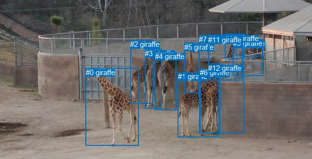
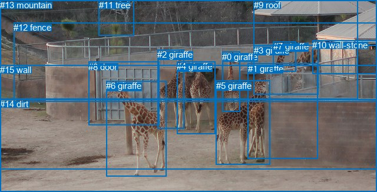

# 图片 0087：2315924.jpg

随机样本序号：469。图片 SHA256：`0b8ae43fda23fa76e27ad16a14a2fe62fe274696947b1e0f8165e1982f4cfd69`。

红色框表示人，蓝色框表示其他物体。两个模式分别保留自身框编号，可依据位置比较对应对象。

## 自动检测框与输出

人的框编号：`[]`。状态：`no_person`。

### 自动检测全部物体框

| 编号 | 类别 | 是否为人 | 检测分数 | 像素坐标 xyxy |
|---|---|---|---|---|
| 0 | giraffe | False | 0.9993 | 175.7, 139.6, 284.4, 298.9 |
| 1 | giraffe | False | 0.9968 | 365.0, 148.5, 449.9, 281.3 |
| 2 | giraffe | False | 0.9937 | 267.3, 82.1, 314.3, 212.2 |
| 3 | giraffe | False | 0.9877 | 297.1, 100.7, 331.5, 222.9 |
| 4 | giraffe | False | 0.9819 | 317.6, 107.0, 361.8, 225.4 |
| 5 | giraffe | False | 0.9767 | 378.2, 87.8, 408.4, 190.5 |
| 6 | giraffe | False | 0.9614 | 410.3, 140.5, 451.4, 273.4 |
| 7 | giraffe | False | 0.9143 | 408.4, 72.0, 500.9, 273.9 |
| 8 | giraffe | False | 0.9036 | 483.1, 81.4, 539.0, 115.8 |
| 9 | giraffe | False | 0.8960 | 477.6, 80.3, 539.7, 155.5 |
| 10 | giraffe | False | 0.8542 | 461.9, 70.0, 501.3, 120.0 |
| 11 | giraffe | False | 0.6942 | 427.4, 72.9, 497.7, 164.3 |
| 12 | giraffe | False | 0.3810 | 427.4, 130.9, 451.7, 160.9 |

### 自动检测 Top50 人相关候选

评分物体对：0；人相关物体对：0；输出关系：0。

| 排名 | 主语编号与类别 | 关系 | 宾语编号与类别 | 类型 | 人与人 | 排序分数 | 原始融合 logit |
|---|---|---|---|---|---|---|---|

### 自动检测逐条人相关 GT 核验

本图没有人相关 GT，R@50 无分母；预测候选继续展示。

## 真实框与输出

人的框编号：`[]`。

### 真实框全部物体框

| 编号 | 类别 | 是否为人 | 检测分数 | 像素坐标 xyxy |
|---|---|---|---|---|
| 0 | giraffe | False | GT | 377.0, 88.0, 407.0, 190.0 |
| 1 | giraffe | False | GT | 421.0, 108.0, 540.0, 270.0 |
| 2 | giraffe | False | GT | 267.0, 84.0, 313.0, 218.0 |
| 3 | giraffe | False | GT | 431.0, 77.0, 541.0, 160.0 |
| 4 | giraffe | False | GT | 300.0, 104.0, 365.0, 227.0 |
| 5 | giraffe | False | GT | 367.0, 137.0, 459.0, 280.0 |
| 6 | giraffe | False | GT | 180.0, 137.0, 282.0, 299.0 |
| 7 | giraffe | False | GT | 464.0, 70.0, 503.0, 121.0 |
| 8 | door | False | GT | 150.0, 105.0, 270.0, 213.0 |
| 9 | roof | False | GT | 431.0, 0.0, 640.0, 78.0 |
| 10 | wall-stone | False | GT | 530.0, 68.0, 640.0, 125.0 |
| 11 | tree | False | GT | 168.0, 0.0, 228.0, 60.0 |
| 12 | fence | False | GT | 23.0, 38.0, 640.0, 173.0 |
| 13 | mountain | False | GT | 0.0, 0.0, 607.0, 169.0 |
| 14 | dirt | False | GT | 0.0, 168.0, 640.0, 326.0 |
| 15 | wall | False | GT | 0.0, 110.0, 640.0, 287.0 |

### 真实框 Top50 人相关候选

评分物体对：0；人相关物体对：0；输出关系：0。

| 排名 | 主语编号与类别 | 关系 | 宾语编号与类别 | 类型 | 人与人 | 排序分数 | 原始融合 logit |
|---|---|---|---|---|---|---|---|

### 真实框逐条人相关 GT 核验

本图没有人相关 GT，R@50 无分母；预测候选继续展示。

## 全部人相关 GT

| 主语编号与类别 | 关系 | 宾语编号与类别 |
|---|---|---|

原始记录、全部人相关物体对的两项预测与分项分数见 [逐图证据 JSON](../evidence/cases/0087.json)。全部56类 logits 保留于本机 HOR/output/random500/logits/。

<!-- HOR_COMPLETE_RESULTS -->

## 六组条件的完整输出对照

以下保留同一图片三种框与候选模式、两种谓词输出规则的全部 Top50。框编号各自在所属模式内解释。

### 自动检测框完整枚举：空间与语义各保留一个谓词

| 排名 | 主语编号与类别 | 谓词 | 宾语编号与类别 | 分组 | 排序分数 | predicate logit | pair logit |
|---|---|---|---|---|---|---|---|

没有人相关 GT，本条件的召回率无分母。

### 自动检测框完整枚举：每对只保留一个谓词

| 排名 | 主语编号与类别 | 谓词 | 宾语编号与类别 | 分组 | 排序分数 | predicate logit | pair logit |
|---|---|---|---|---|---|---|---|

没有人相关 GT，本条件的召回率无分母。

### 真实框完整枚举：空间与语义各保留一个谓词

| 排名 | 主语编号与类别 | 谓词 | 宾语编号与类别 | 分组 | 排序分数 | predicate logit | pair logit |
|---|---|---|---|---|---|---|---|

没有人相关 GT，本条件的召回率无分母。

### 真实框完整枚举：每对只保留一个谓词

| 排名 | 主语编号与类别 | 谓词 | 宾语编号与类别 | 分组 | 排序分数 | predicate logit | pair logit |
|---|---|---|---|---|---|---|---|

没有人相关 GT，本条件的召回率无分母。

### 真实框400候选：空间与语义各保留一个谓词

| 排名 | 主语编号与类别 | 谓词 | 宾语编号与类别 | 分组 | 排序分数 | predicate logit | pair logit |
|---|---|---|---|---|---|---|---|

没有人相关 GT，本条件的召回率无分母。

### 真实框400候选：每对只保留一个谓词

| 排名 | 主语编号与类别 | 谓词 | 宾语编号与类别 | 分组 | 排序分数 | predicate logit | pair logit |
|---|---|---|---|---|---|---|---|

没有人相关 GT，本条件的召回率无分母。
