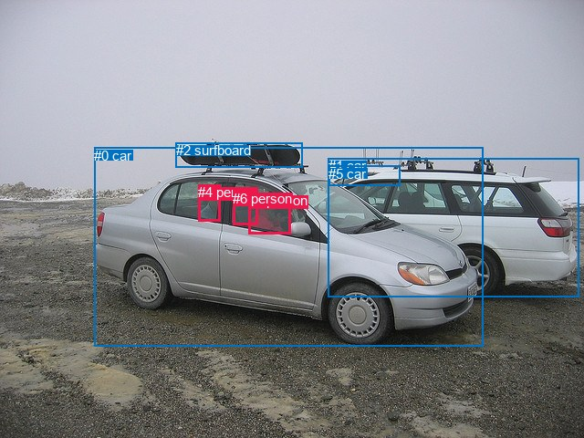
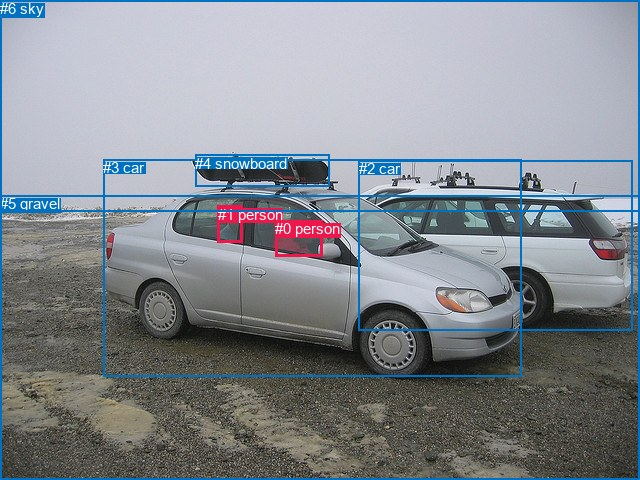

# 图片 0104：2316313.jpg

随机样本序号：447。图片 SHA256：`7d636d406352e1643cab6f85925dd2fccd7ac11c471f1c58bd627a9512154efc`。

红色框表示人，蓝色框表示其他物体。两个模式分别保留自身框编号，可依据位置比较对应对象。

## 自动检测框与输出

人的框编号：`[3, 4, 6]`。状态：`ok`。

### 自动检测全部物体框

| 编号 | 类别 | 是否为人 | 检测分数 | 像素坐标 xyxy |
|---|---|---|---|---|
| 0 | car | False | 0.9992 | 103.3, 161.7, 529.0, 379.4 |
| 1 | car | False | 0.9957 | 359.6, 173.0, 634.4, 325.3 |
| 2 | surfboard | False | 0.9269 | 192.5, 156.2, 331.6, 183.5 |
| 3 | person | True | 0.9263 | 272.1, 211.2, 318.6, 256.0 |
| 4 | person | True | 0.7539 | 217.4, 202.0, 241.8, 242.1 |
| 5 | car | False | 0.6611 | 360.0, 181.7, 438.2, 203.8 |
| 6 | person | True | 0.4943 | 255.0, 208.7, 282.6, 246.6 |

### 自动检测 Top50 人相关候选

评分物体对：42；人相关物体对：30；输出关系：50。

| 排名 | 主语编号与类别 | 关系 | 宾语编号与类别 | 类型 | 人与人 | 排序分数 | 原始融合 logit |
|---|---|---|---|---|---|---|---|
| 1 | #3 person | in | #0 car | spatial | False | 0.98360 | 4.0940 |
| 2 | #6 person | in | #0 car | spatial | False | 0.97851 | 3.8183 |
| 3 | #4 person | on | #0 car | spatial | False | 0.94490 | 2.8419 |
| 4 | #3 person | driving on | #0 car | semantic | False | 0.93560 | 2.6760 |
| 5 | #3 person | in | #6 person | spatial | True | 0.78596 | 1.3007 |
| 6 | #6 person | riding | #0 car | semantic | False | 0.71823 | 0.9357 |
| 7 | #3 person | looking at | #6 person | semantic | True | 0.66039 | 0.6650 |
| 8 | #6 person | on | #3 person | spatial | True | 0.51935 | 0.0774 |
| 9 | #4 person | on | #1 car | spatial | False | 0.51757 | 0.0703 |
| 10 | #6 person | in | #1 car | spatial | False | 0.44246 | -0.2312 |
| 11 | #6 person | looking at | #3 person | semantic | True | 0.41296 | -0.3518 |
| 12 | #6 person | in | #4 person | spatial | True | 0.40881 | -0.3689 |
| 13 | #4 person | riding | #0 car | semantic | False | 0.39709 | -0.4176 |
| 14 | #4 person | holding | #2 surfboard | semantic | False | 0.38146 | -0.4834 |
| 15 | #4 person | on | #2 surfboard | spatial | False | 0.37272 | -0.5206 |
| 16 | #3 person | in | #1 car | spatial | False | 0.35715 | -0.5878 |
| 17 | #0 car | in | #4 person | spatial | False | 0.30473 | -0.8249 |
| 18 | #3 person | in | #4 person | spatial | True | 0.29982 | -0.8481 |
| 19 | #6 person | on | #2 surfboard | spatial | False | 0.29442 | -0.8740 |
| 20 | #6 person | holding | #2 surfboard | semantic | False | 0.27288 | -0.9801 |
| 21 | #0 car | in | #6 person | spatial | False | 0.23427 | -1.1843 |
| 22 | #4 person | on | #6 person | spatial | True | 0.20990 | -1.3255 |
| 23 | #3 person | on | #2 surfboard | spatial | False | 0.17160 | -1.5743 |
| 24 | #3 person | holding | #2 surfboard | semantic | False | 0.15645 | -1.6849 |
| 25 | #3 person | driving on | #1 car | semantic | False | 0.14712 | -1.7574 |
| 26 | #0 car | carrying | #3 person | semantic | False | 0.14543 | -1.7709 |
| 27 | #4 person | looking at | #6 person | semantic | True | 0.13015 | -1.8996 |
| 28 | #0 car | in | #3 person | spatial | False | 0.12410 | -1.9542 |
| 29 | #3 person | looking at | #4 person | semantic | True | 0.12291 | -1.9652 |
| 30 | #4 person | on | #5 car | spatial | False | 0.11427 | -2.0478 |
| 31 | #3 person | sitting on | #5 car | semantic | False | 0.08834 | -2.3341 |
| 32 | #6 person | looking at | #4 person | semantic | True | 0.08653 | -2.3567 |
| 33 | #3 person | in | #5 car | spatial | False | 0.07966 | -2.4469 |
| 34 | #0 car | wearing | #4 person | semantic | False | 0.07401 | -2.5266 |
| 35 | #6 person | on | #5 car | spatial | False | 0.06962 | -2.5925 |
| 36 | #0 car | wearing | #6 person | semantic | False | 0.06362 | -2.6892 |
| 37 | #2 surfboard | on | #4 person | spatial | False | 0.06193 | -2.7179 |
| 38 | #4 person | on | #3 person | spatial | True | 0.06052 | -2.7423 |
| 39 | #6 person | riding | #1 car | semantic | False | 0.05923 | -2.7653 |
| 40 | #2 surfboard | on | #6 person | spatial | False | 0.05412 | -2.8608 |
| 41 | #4 person | standing on | #1 car | semantic | False | 0.04922 | -2.9611 |
| 42 | #4 person | looking at | #3 person | semantic | True | 0.04535 | -3.0469 |
| 43 | #2 surfboard | on | #3 person | spatial | False | 0.03773 | -3.2388 |
| 44 | #6 person | sitting on | #5 car | semantic | False | 0.02306 | -3.7463 |
| 45 | #4 person | standing on | #5 car | semantic | False | 0.01640 | -4.0940 |
| 46 | #1 car | in | #4 person | spatial | False | 0.00702 | -4.9520 |
| 47 | #5 car | beside | #3 person | spatial | False | 0.00633 | -5.0556 |
| 48 | #2 surfboard | sitting on | #4 person | semantic | False | 0.00580 | -5.1435 |
| 49 | #2 surfboard | holding | #6 person | semantic | False | 0.00538 | -5.2206 |
| 50 | #1 car | in | #6 person | spatial | False | 0.00478 | -5.3384 |

### 自动检测逐条人相关 GT 核验

R@50：0.00%；命中 0/2。

| GT 主语编号 | GT 关系 | GT 宾语编号 | 结果阶段 | 匹配预测主语编号 | 匹配预测宾语编号 |
|---|---|---|---|---|---|
| 0 | in front of | 1 | wrong_predicate | [3] | [4] |
| 1 | in | 3 | wrong_predicate | [4] | [0] |

## 真实框与输出

人的框编号：`[0, 1]`。

### 真实框全部物体框

| 编号 | 类别 | 是否为人 | 检测分数 | 像素坐标 xyxy |
|---|---|---|---|---|
| 0 | person | True | GT | 275.0, 220.0, 322.0, 256.0 |
| 1 | person | True | GT | 218.0, 206.0, 242.0, 243.0 |
| 2 | car | False | GT | 359.0, 160.0, 633.0, 330.0 |
| 3 | car | False | GT | 103.0, 159.0, 521.0, 376.0 |
| 4 | snowboard | False | GT | 195.0, 155.0, 329.0, 187.0 |
| 5 | gravel | False | GT | 0.0, 195.0, 640.0, 480.0 |
| 6 | sky | False | GT | 0.0, 0.0, 640.0, 212.0 |

### 真实框 Top50 人相关候选

评分物体对：42；人相关物体对：22；输出关系：44。

| 排名 | 主语编号与类别 | 关系 | 宾语编号与类别 | 类型 | 人与人 | 排序分数 | 原始融合 logit |
|---|---|---|---|---|---|---|---|
| 1 | #0 person | in | #3 car | spatial | False | 0.98028 | 3.9061 |
| 2 | #0 person | driving on | #3 car | semantic | False | 0.95929 | 3.1597 |
| 3 | #1 person | on | #3 car | spatial | False | 0.93542 | 2.6731 |
| 4 | #3 car | carrying | #0 person | semantic | False | 0.50158 | 0.0063 |
| 5 | #3 car | in | #1 person | spatial | False | 0.42074 | -0.3197 |
| 6 | #1 person | standing on | #3 car | semantic | False | 0.39110 | -0.4427 |
| 7 | #1 person | in | #2 car | spatial | False | 0.37589 | -0.5070 |
| 8 | #0 person | in | #1 person | spatial | True | 0.35873 | -0.5809 |
| 9 | #0 person | in | #2 car | spatial | False | 0.25280 | -1.0837 |
| 10 | #3 car | in | #0 person | spatial | False | 0.20850 | -1.3340 |
| 11 | #0 person | looking at | #1 person | semantic | True | 0.17803 | -1.5298 |
| 12 | #1 person | beside | #0 person | spatial | True | 0.17278 | -1.5661 |
| 13 | #3 car | wearing | #1 person | semantic | False | 0.14565 | -1.7691 |
| 14 | #0 person | driving on | #2 car | semantic | False | 0.11090 | -2.0816 |
| 15 | #0 person | in | #4 snowboard | spatial | False | 0.06979 | -2.5899 |
| 16 | #1 person | on | #4 snowboard | spatial | False | 0.06501 | -2.6660 |
| 17 | #0 person | in | #5 gravel | spatial | False | 0.05936 | -2.7629 |
| 18 | #1 person | looking at | #0 person | semantic | True | 0.05669 | -2.8119 |
| 19 | #1 person | holding | #4 snowboard | semantic | False | 0.04816 | -2.9839 |
| 20 | #1 person | sitting on | #2 car | semantic | False | 0.04021 | -3.1727 |
| 21 | #0 person | sitting on | #4 snowboard | semantic | False | 0.03670 | -3.2676 |
| 22 | #0 person | looking at | #5 gravel | semantic | False | 0.02684 | -3.5905 |
| 23 | #4 snowboard | over | #0 person | spatial | False | 0.01764 | -4.0199 |
| 24 | #4 snowboard | over | #1 person | spatial | False | 0.01711 | -4.0509 |
| 25 | #2 car | in | #1 person | spatial | False | 0.01644 | -4.0914 |
| 26 | #0 person | in | #6 sky | spatial | False | 0.00977 | -4.6183 |
| 27 | #2 car | in | #0 person | spatial | False | 0.00818 | -4.7977 |
| 28 | #0 person | looking at | #6 sky | semantic | False | 0.00810 | -4.8074 |
| 29 | #6 sky | over | #0 person | spatial | False | 0.00690 | -4.9693 |
| 30 | #2 car | parked on | #0 person | semantic | False | 0.00644 | -5.0393 |
| 31 | #1 person | looking at | #5 gravel | semantic | False | 0.00619 | -5.0791 |
| 32 | #6 sky | over | #1 person | spatial | False | 0.00421 | -5.4667 |
| 33 | #5 gravel | in | #1 person | spatial | False | 0.00331 | -5.7072 |
| 34 | #2 car | parked on | #1 person | semantic | False | 0.00280 | -5.8760 |
| 35 | #5 gravel | beside | #0 person | spatial | False | 0.00264 | -5.9360 |
| 36 | #1 person | in | #5 gravel | spatial | False | 0.00239 | -6.0355 |
| 37 | #4 snowboard | sitting on | #1 person | semantic | False | 0.00220 | -6.1152 |
| 38 | #1 person | beside | #6 sky | spatial | False | 0.00146 | -6.5250 |
| 39 | #1 person | looking at | #6 sky | semantic | False | 0.00134 | -6.6164 |
| 40 | #4 snowboard | holding | #0 person | semantic | False | 0.00124 | -6.6891 |
| 41 | #5 gravel | holding | #1 person | semantic | False | 0.00094 | -6.9710 |
| 42 | #5 gravel | holding | #0 person | semantic | False | 0.00064 | -7.3505 |
| 43 | #6 sky | holding | #0 person | semantic | False | 0.00043 | -7.7542 |
| 44 | #6 sky | holding | #1 person | semantic | False | 0.00025 | -8.2828 |

### 真实框逐条人相关 GT 核验

R@50：0.00%；命中 0/2。

| GT 主语编号 | GT 关系 | GT 宾语编号 | 结果阶段 | 匹配预测主语编号 | 匹配预测宾语编号 |
|---|---|---|---|---|---|
| 0 | in front of | 1 | wrong_predicate | [0] | [1] |
| 1 | in | 3 | wrong_predicate | [1] | [3] |

## 全部人相关 GT

| 主语编号与类别 | 关系 | 宾语编号与类别 |
|---|---|---|
| #0 person | in front of | #1 person |
| #1 person | in | #3 car |

原始记录、全部人相关物体对的两项预测与分项分数见 [逐图证据 JSON](../evidence/cases/0104.json)。全部56类 logits 保留于本机 HOR/output/random500/logits/。

<!-- HOR_COMPLETE_RESULTS -->

## 六组条件的完整输出对照

以下保留同一图片三种框与候选模式、两种谓词输出规则的全部 Top50。框编号各自在所属模式内解释。

### 自动检测框完整枚举：空间与语义各保留一个谓词

| 排名 | 主语编号与类别 | 谓词 | 宾语编号与类别 | 分组 | 排序分数 | predicate logit | pair logit |
|---|---|---|---|---|---|---|---|
| 1 | #3 person | in | #0 car | spatial | 0.9836008 | 4.0904860 | 0.0035025 |
| 2 | #6 person | in | #0 car | spatial | 0.9785069 | 3.8475299 | -0.0292380 |
| 3 | #4 person | on | #0 car | spatial | 0.9449010 | 2.9398880 | -0.0979387 |
| 4 | #3 person | driving on | #0 car | semantic | 0.9355958 | 2.6725016 | 0.0035025 |
| 5 | #3 person | in | #6 person | spatial | 0.7859558 | 1.5893507 | -0.2886330 |
| 6 | #6 person | riding | #0 car | semantic | 0.7182331 | 0.9649520 | -0.0292380 |
| 7 | #3 person | looking at | #6 person | semantic | 0.6603884 | 0.9536581 | -0.2886330 |
| 8 | #6 person | on | #3 person | spatial | 0.5193507 | 0.5465775 | -0.4691360 |
| 9 | #4 person | on | #1 car | spatial | 0.5175698 | 0.7535372 | -0.6832292 |
| 10 | #6 person | in | #1 car | spatial | 0.4424648 | 0.6076312 | -0.8387961 |
| 11 | #6 person | looking at | #3 person | semantic | 0.4129563 | 0.1173787 | -0.4691360 |
| 12 | #6 person | in | #4 person | spatial | 0.4088055 | 0.1250582 | -0.4939638 |
| 13 | #4 person | riding | #0 car | semantic | 0.3970853 | -0.3196859 | -0.0979387 |
| 14 | #4 person | holding | #2 surfboard | semantic | 0.3814561 | 0.8119349 | -1.2953075 |
| 15 | #4 person | on | #2 surfboard | spatial | 0.3727189 | 0.7747374 | -1.2953075 |
| 16 | #3 person | in | #1 car | spatial | 0.3571474 | 0.2772951 | -0.8650620 |
| 17 | #0 car | in | #4 person | spatial | 0.3047305 | -0.2763066 | -0.5485653 |
| 18 | #3 person | in | #4 person | spatial | 0.2998214 | -0.2462153 | -0.6019330 |
| 19 | #6 person | on | #2 surfboard | spatial | 0.2944236 | 0.2855449 | -1.1595402 |
| 20 | #6 person | holding | #2 surfboard | semantic | 0.2728778 | 0.1794696 | -1.1595402 |
| 21 | #0 car | in | #6 person | spatial | 0.2342725 | -0.6805453 | -0.5037959 |
| 22 | #4 person | on | #6 person | spatial | 0.2099002 | -0.6817188 | -0.6438084 |
| 23 | #3 person | on | #2 surfboard | spatial | 0.1716048 | -0.4049902 | -1.1693060 |
| 24 | #3 person | holding | #2 surfboard | semantic | 0.1564491 | -0.5155835 | -1.1693060 |
| 25 | #3 person | driving on | #1 car | semantic | 0.1471168 | -0.8923335 | -0.8650620 |
| 26 | #0 car | carrying | #3 person | semantic | 0.1454344 | -1.1666281 | -0.6042398 |
| 27 | #4 person | looking at | #6 person | semantic | 0.1301523 | -1.2558045 | -0.6438084 |
| 28 | #0 car | in | #3 person | spatial | 0.1240962 | -1.3499591 | -0.6042398 |
| 29 | #3 person | looking at | #4 person | semantic | 0.1229074 | -1.3632481 | -0.6019330 |
| 30 | #4 person | on | #5 car | spatial | 0.1142730 | -0.2705793 | -1.7772396 |
| 31 | #3 person | sitting on | #5 car | semantic | 0.0883406 | -0.5940208 | -1.7400453 |
| 32 | #6 person | looking at | #4 person | semantic | 0.0865319 | -1.8627713 | -0.4939638 |
| 33 | #3 person | in | #5 car | spatial | 0.0796642 | -0.7068729 | -1.7400453 |
| 34 | #0 car | wearing | #4 person | semantic | 0.0740140 | -1.9780393 | -0.5485653 |
| 35 | #6 person | on | #5 car | spatial | 0.0696214 | -0.8289900 | -1.7635295 |
| 36 | #0 car | wearing | #6 person | semantic | 0.0636158 | -2.1853681 | -0.5037959 |
| 37 | #2 surfboard | on | #4 person | spatial | 0.0619277 | -1.3878357 | -1.3300245 |
| 38 | #4 person | on | #3 person | spatial | 0.0605207 | -1.8569865 | -0.8853542 |
| 39 | #6 person | riding | #1 car | semantic | 0.0592278 | -1.9265137 | -0.8387961 |
| 40 | #2 surfboard | on | #6 person | spatial | 0.0541234 | -1.4988170 | -1.3620290 |
| 41 | #4 person | standing on | #1 car | semantic | 0.0492155 | -2.2778506 | -0.6832292 |
| 42 | #4 person | looking at | #3 person | semantic | 0.0453528 | -2.1615160 | -0.8853542 |
| 43 | #2 surfboard | on | #3 person | spatial | 0.0377327 | -1.8587716 | -1.3799946 |
| 44 | #6 person | sitting on | #5 car | semantic | 0.0230613 | -1.9827406 | -1.7635295 |
| 45 | #4 person | standing on | #5 car | semantic | 0.0163997 | -2.3167155 | -1.7772396 |
| 46 | #1 car | in | #4 person | spatial | 0.0070198 | -3.6040356 | -1.3479365 |
| 47 | #5 car | beside | #3 person | spatial | 0.0063331 | -2.9862723 | -2.0693378 |
| 48 | #2 surfboard | sitting on | #4 person | semantic | 0.0058034 | -3.8134649 | -1.3300245 |
| 49 | #2 surfboard | holding | #6 person | semantic | 0.0053751 | -3.8585615 | -1.3620290 |
| 50 | #1 car | in | #6 person | spatial | 0.0047807 | -3.9104776 | -1.4279070 |

GT 命中：0/2，R@50=0.00%。

| GT主语 | GT谓词 | GT宾语 | 结果阶段 | 匹配主语框 | 匹配宾语框 |
|---|---|---|---|---|---|
| 0 | in front of | 1 | wrong_predicate | [3] | [4] |
| 1 | in | 3 | wrong_predicate | [4] | [0] |

### 自动检测框完整枚举：每对只保留一个谓词

| 排名 | 主语编号与类别 | 谓词 | 宾语编号与类别 | 分组 | 排序分数 | predicate logit | pair logit |
|---|---|---|---|---|---|---|---|
| 1 | #3 person | in | #0 car | single | 0.9836008 | 4.0904860 | 0.0035025 |
| 2 | #6 person | in | #0 car | single | 0.9785069 | 3.8475299 | -0.0292380 |
| 3 | #4 person | on | #0 car | single | 0.9449010 | 2.9398880 | -0.0979387 |
| 4 | #3 person | in | #6 person | single | 0.7859558 | 1.5893507 | -0.2886330 |
| 5 | #6 person | on | #3 person | single | 0.5193507 | 0.5465775 | -0.4691360 |
| 6 | #4 person | on | #1 car | single | 0.5175698 | 0.7535372 | -0.6832292 |
| 7 | #6 person | in | #1 car | single | 0.4424648 | 0.6076312 | -0.8387961 |
| 8 | #6 person | in | #4 person | single | 0.4088055 | 0.1250582 | -0.4939638 |
| 9 | #4 person | holding | #2 surfboard | single | 0.3814561 | 0.8119349 | -1.2953075 |
| 10 | #3 person | in | #1 car | single | 0.3571474 | 0.2772951 | -0.8650620 |
| 11 | #0 car | in | #4 person | single | 0.3047305 | -0.2763066 | -0.5485653 |
| 12 | #3 person | in | #4 person | single | 0.2998214 | -0.2462153 | -0.6019330 |
| 13 | #6 person | on | #2 surfboard | single | 0.2944236 | 0.2855449 | -1.1595402 |
| 14 | #0 car | in | #6 person | single | 0.2342725 | -0.6805453 | -0.5037959 |
| 15 | #4 person | on | #6 person | single | 0.2099002 | -0.6817188 | -0.6438084 |
| 16 | #3 person | on | #2 surfboard | single | 0.1716048 | -0.4049902 | -1.1693060 |
| 17 | #0 car | carrying | #3 person | single | 0.1454344 | -1.1666281 | -0.6042398 |
| 18 | #4 person | on | #5 car | single | 0.1142730 | -0.2705793 | -1.7772396 |
| 19 | #3 person | sitting on | #5 car | single | 0.0883406 | -0.5940208 | -1.7400453 |
| 20 | #6 person | on | #5 car | single | 0.0696214 | -0.8289900 | -1.7635295 |
| 21 | #2 surfboard | on | #4 person | single | 0.0619277 | -1.3878357 | -1.3300245 |
| 22 | #4 person | on | #3 person | single | 0.0605207 | -1.8569865 | -0.8853542 |
| 23 | #2 surfboard | on | #6 person | single | 0.0541234 | -1.4988170 | -1.3620290 |
| 24 | #2 surfboard | on | #3 person | single | 0.0377327 | -1.8587716 | -1.3799946 |
| 25 | #1 car | in | #4 person | single | 0.0070198 | -3.6040356 | -1.3479365 |
| 26 | #5 car | beside | #3 person | single | 0.0063331 | -2.9862723 | -2.0693378 |
| 27 | #1 car | in | #6 person | single | 0.0047807 | -3.9104776 | -1.4279070 |
| 28 | #1 car | in | #3 person | single | 0.0036061 | -4.1732197 | -1.4483080 |
| 29 | #5 car | in | #4 person | single | 0.0030511 | -3.6158786 | -2.1733282 |
| 30 | #5 car | in | #6 person | single | 0.0021922 | -3.9988744 | -2.1217575 |

GT 命中：0/2，R@50=0.00%。

| GT主语 | GT谓词 | GT宾语 | 结果阶段 | 匹配主语框 | 匹配宾语框 |
|---|---|---|---|---|---|
| 0 | in front of | 1 | wrong_predicate | [3] | [4] |
| 1 | in | 3 | wrong_predicate | [4] | [0] |

### 真实框完整枚举：空间与语义各保留一个谓词

| 排名 | 主语编号与类别 | 谓词 | 宾语编号与类别 | 分组 | 排序分数 | predicate logit | pair logit |
|---|---|---|---|---|---|---|---|
| 1 | #0 person | in | #3 car | spatial | 0.9802782 | 3.9298511 | -0.0237415 |
| 2 | #0 person | driving on | #3 car | semantic | 0.9592876 | 3.1834011 | -0.0237415 |
| 3 | #1 person | on | #3 car | spatial | 0.9354190 | 2.7530270 | -0.0799534 |
| 4 | #3 car | carrying | #0 person | semantic | 0.5015813 | 0.6125159 | -0.6061906 |
| 5 | #3 car | in | #1 person | spatial | 0.4207393 | 0.2020574 | -0.5217964 |
| 6 | #1 person | standing on | #3 car | semantic | 0.3911043 | -0.3627195 | -0.0799534 |
| 7 | #1 person | in | #2 car | spatial | 0.3758896 | 0.1712980 | -0.6783297 |
| 8 | #0 person | in | #1 person | spatial | 0.3587345 | 0.0620022 | -0.6428630 |
| 9 | #0 person | in | #2 car | spatial | 0.2528023 | -0.2254124 | -0.8583097 |
| 10 | #3 car | in | #0 person | spatial | 0.2085039 | -0.7277768 | -0.6061906 |
| 11 | #0 person | looking at | #1 person | semantic | 0.1780287 | -0.8868976 | -0.6428630 |
| 12 | #1 person | beside | #0 person | spatial | 0.1727802 | -0.6269431 | -0.9391072 |
| 13 | #3 car | wearing | #1 person | semantic | 0.1456485 | -1.2473502 | -0.5217964 |
| 14 | #0 person | driving on | #2 car | semantic | 0.1109022 | -1.2232492 | -0.8583097 |
| 15 | #0 person | in | #4 snowboard | spatial | 0.0697942 | -1.4043314 | -1.1855230 |
| 16 | #1 person | on | #4 snowboard | spatial | 0.0650069 | -1.3758745 | -1.2901715 |
| 17 | #0 person | in | #5 gravel | spatial | 0.0593640 | -0.2916660 | -2.4712014 |
| 18 | #1 person | looking at | #0 person | semantic | 0.0566856 | -1.8727732 | -0.9391072 |
| 19 | #1 person | holding | #4 snowboard | semantic | 0.0481579 | -1.6937432 | -1.2901715 |
| 20 | #1 person | sitting on | #2 car | semantic | 0.0402076 | -2.4943321 | -0.6783297 |
| 21 | #0 person | sitting on | #4 snowboard | semantic | 0.0366999 | -2.0820677 | -1.1855230 |
| 22 | #0 person | looking at | #5 gravel | semantic | 0.0268436 | -1.1193147 | -2.4712014 |
| 23 | #4 snowboard | over | #0 person | spatial | 0.0176374 | -2.5865057 | -1.4334335 |
| 24 | #4 snowboard | over | #1 person | spatial | 0.0171085 | -2.6873558 | -1.3635700 |
| 25 | #2 car | in | #1 person | spatial | 0.0164408 | -2.7985179 | -1.2928956 |
| 26 | #0 person | in | #6 sky | spatial | 0.0097733 | -2.5602467 | -2.0580359 |
| 27 | #2 car | in | #0 person | spatial | 0.0081814 | -3.3438334 | -1.4538456 |
| 28 | #0 person | looking at | #6 sky | semantic | 0.0081030 | -2.7493515 | -2.0580359 |
| 29 | #6 sky | over | #0 person | spatial | 0.0069003 | -2.9559081 | -2.0133634 |
| 30 | #2 car | parked on | #0 person | semantic | 0.0064364 | -3.5854821 | -1.4538456 |
| 31 | #1 person | looking at | #5 gravel | semantic | 0.0061870 | -2.5968690 | -2.4822311 |
| 32 | #6 sky | over | #1 person | spatial | 0.0042072 | -3.4705725 | -1.9961593 |
| 33 | #5 gravel | in | #1 person | spatial | 0.0033109 | -3.6600242 | -2.0472078 |
| 34 | #2 car | parked on | #1 person | semantic | 0.0027982 | -4.5830703 | -1.2928956 |
| 35 | #5 gravel | beside | #0 person | spatial | 0.0026355 | -3.7754385 | -2.1606002 |
| 36 | #1 person | in | #5 gravel | spatial | 0.0023866 | -3.5532680 | -2.4822311 |
| 37 | #4 snowboard | sitting on | #1 person | semantic | 0.0022043 | -4.7515812 | -1.3635700 |
| 38 | #1 person | beside | #6 sky | spatial | 0.0014642 | -4.4420896 | -2.0828729 |
| 39 | #1 person | looking at | #6 sky | semantic | 0.0013365 | -4.5334778 | -2.0828729 |
| 40 | #4 snowboard | holding | #0 person | semantic | 0.0012428 | -5.2557063 | -1.4334335 |
| 41 | #5 gravel | holding | #1 person | semantic | 0.0009378 | -4.9238157 | -2.0472078 |
| 42 | #5 gravel | holding | #0 person | semantic | 0.0006419 | -5.1898942 | -2.1606002 |
| 43 | #6 sky | holding | #0 person | semantic | 0.0004288 | -5.7408142 | -2.0133634 |
| 44 | #6 sky | holding | #1 person | semantic | 0.0002528 | -6.2866459 | -1.9961593 |

GT 命中：0/2，R@50=0.00%。

| GT主语 | GT谓词 | GT宾语 | 结果阶段 | 匹配主语框 | 匹配宾语框 |
|---|---|---|---|---|---|
| 0 | in front of | 1 | wrong_predicate | [0] | [1] |
| 1 | in | 3 | wrong_predicate | [1] | [3] |

### 真实框完整枚举：每对只保留一个谓词

| 排名 | 主语编号与类别 | 谓词 | 宾语编号与类别 | 分组 | 排序分数 | predicate logit | pair logit |
|---|---|---|---|---|---|---|---|
| 1 | #0 person | in | #3 car | single | 0.9802782 | 3.9298511 | -0.0237415 |
| 2 | #1 person | on | #3 car | single | 0.9354190 | 2.7530270 | -0.0799534 |
| 3 | #3 car | carrying | #0 person | single | 0.5015813 | 0.6125159 | -0.6061906 |
| 4 | #3 car | in | #1 person | single | 0.4207393 | 0.2020574 | -0.5217964 |
| 5 | #1 person | in | #2 car | single | 0.3758896 | 0.1712980 | -0.6783297 |
| 6 | #0 person | in | #1 person | single | 0.3587345 | 0.0620022 | -0.6428630 |
| 7 | #0 person | in | #2 car | single | 0.2528023 | -0.2254124 | -0.8583097 |
| 8 | #1 person | beside | #0 person | single | 0.1727802 | -0.6269431 | -0.9391072 |
| 9 | #0 person | in | #4 snowboard | single | 0.0697942 | -1.4043314 | -1.1855230 |
| 10 | #1 person | on | #4 snowboard | single | 0.0650069 | -1.3758745 | -1.2901715 |
| 11 | #0 person | in | #5 gravel | single | 0.0593640 | -0.2916660 | -2.4712014 |
| 12 | #4 snowboard | over | #0 person | single | 0.0176374 | -2.5865057 | -1.4334335 |
| 13 | #4 snowboard | over | #1 person | single | 0.0171085 | -2.6873558 | -1.3635700 |
| 14 | #2 car | in | #1 person | single | 0.0164408 | -2.7985179 | -1.2928956 |
| 15 | #0 person | in | #6 sky | single | 0.0097733 | -2.5602467 | -2.0580359 |
| 16 | #2 car | in | #0 person | single | 0.0081814 | -3.3438334 | -1.4538456 |
| 17 | #6 sky | over | #0 person | single | 0.0069003 | -2.9559081 | -2.0133634 |
| 18 | #1 person | looking at | #5 gravel | single | 0.0061870 | -2.5968690 | -2.4822311 |
| 19 | #6 sky | over | #1 person | single | 0.0042072 | -3.4705725 | -1.9961593 |
| 20 | #5 gravel | in | #1 person | single | 0.0033109 | -3.6600242 | -2.0472078 |
| 21 | #5 gravel | beside | #0 person | single | 0.0026355 | -3.7754385 | -2.1606002 |
| 22 | #1 person | beside | #6 sky | single | 0.0014642 | -4.4420896 | -2.0828729 |

GT 命中：0/2，R@50=0.00%。

| GT主语 | GT谓词 | GT宾语 | 结果阶段 | 匹配主语框 | 匹配宾语框 |
|---|---|---|---|---|---|
| 0 | in front of | 1 | wrong_predicate | [0] | [1] |
| 1 | in | 3 | wrong_predicate | [1] | [3] |

### 真实框400候选：空间与语义各保留一个谓词

| 排名 | 主语编号与类别 | 谓词 | 宾语编号与类别 | 分组 | 排序分数 | predicate logit | pair logit |
|---|---|---|---|---|---|---|---|
| 1 | #0 person | in | #3 car | spatial | 0.9802782 | 3.9298511 | -0.0237415 |
| 2 | #0 person | driving on | #3 car | semantic | 0.9592876 | 3.1834011 | -0.0237415 |
| 3 | #1 person | on | #3 car | spatial | 0.9354190 | 2.7530270 | -0.0799534 |
| 4 | #3 car | carrying | #0 person | semantic | 0.5015813 | 0.6125159 | -0.6061906 |
| 5 | #3 car | in | #1 person | spatial | 0.4199307 | 0.1987386 | -0.5217964 |
| 6 | #1 person | standing on | #3 car | semantic | 0.3911043 | -0.3627195 | -0.0799534 |
| 7 | #1 person | in | #2 car | spatial | 0.3798428 | 0.1881142 | -0.6783297 |
| 8 | #0 person | in | #1 person | spatial | 0.3641476 | 0.0854559 | -0.6428630 |
| 9 | #0 person | in | #2 car | spatial | 0.2572582 | -0.2019587 | -0.8583097 |
| 10 | #3 car | in | #0 person | spatial | 0.2049300 | -0.7495711 | -0.6061906 |
| 11 | #0 person | looking at | #1 person | semantic | 0.1780287 | -0.8868976 | -0.6428630 |
| 12 | #1 person | beside | #0 person | spatial | 0.1771278 | -0.5968223 | -0.9391072 |
| 13 | #3 car | wearing | #1 person | semantic | 0.1456485 | -1.2473502 | -0.5217964 |
| 14 | #0 person | driving on | #2 car | semantic | 0.1109026 | -1.2232444 | -0.8583097 |
| 15 | #0 person | in | #4 snowboard | spatial | 0.0680612 | -1.4313374 | -1.1855230 |
| 16 | #1 person | on | #4 snowboard | spatial | 0.0649242 | -1.3772357 | -1.2901715 |
| 17 | #0 person | in | #5 gravel | spatial | 0.0592715 | -0.2933254 | -2.4712014 |
| 18 | #1 person | looking at | #0 person | semantic | 0.0575191 | -1.8572917 | -0.9391072 |
| 19 | #1 person | holding | #4 snowboard | semantic | 0.0481579 | -1.6937432 | -1.2901715 |
| 20 | #1 person | sitting on | #2 car | semantic | 0.0397744 | -2.5056143 | -0.6783297 |
| 21 | #0 person | sitting on | #4 snowboard | semantic | 0.0363294 | -2.0925989 | -1.1855230 |
| 22 | #0 person | looking at | #5 gravel | semantic | 0.0272303 | -1.1046174 | -2.4712014 |
| 23 | #4 snowboard | over | #0 person | spatial | 0.0179232 | -2.5701377 | -1.4334335 |
| 24 | #4 snowboard | over | #1 person | spatial | 0.0171085 | -2.6873558 | -1.3635700 |
| 25 | #2 car | in | #1 person | spatial | 0.0163738 | -2.8026662 | -1.2928956 |
| 26 | #0 person | in | #6 sky | spatial | 0.0098014 | -2.5573428 | -2.0580359 |
| 27 | #2 car | in | #0 person | spatial | 0.0081679 | -3.3454928 | -1.4538456 |
| 28 | #0 person | looking at | #6 sky | semantic | 0.0081058 | -2.7490027 | -2.0580359 |
| 29 | #6 sky | over | #0 person | spatial | 0.0067979 | -2.9709537 | -2.0133634 |
| 30 | #2 car | parked on | #0 person | semantic | 0.0067818 | -3.5328684 | -1.4538456 |
| 31 | #1 person | looking at | #5 gravel | semantic | 0.0060063 | -2.6266990 | -2.4822311 |
| 32 | #6 sky | over | #1 person | spatial | 0.0042128 | -3.4692507 | -1.9961593 |
| 33 | #5 gravel | in | #1 person | spatial | 0.0032077 | -3.6917748 | -2.0472078 |
| 34 | #2 car | parked on | #1 person | semantic | 0.0027969 | -4.5835438 | -1.2928956 |
| 35 | #5 gravel | beside | #0 person | spatial | 0.0026753 | -3.7604218 | -2.1606002 |
| 36 | #1 person | in | #5 gravel | spatial | 0.0023413 | -3.5724621 | -2.4822311 |
| 37 | #4 snowboard | sitting on | #1 person | semantic | 0.0022092 | -4.7493238 | -1.3635700 |
| 38 | #1 person | beside | #6 sky | spatial | 0.0014560 | -4.4477100 | -2.0828729 |
| 39 | #1 person | looking at | #6 sky | semantic | 0.0013274 | -4.5403433 | -2.0828729 |
| 40 | #4 snowboard | holding | #0 person | semantic | 0.0012540 | -5.2467408 | -1.4334335 |
| 41 | #5 gravel | holding | #1 person | semantic | 0.0009183 | -4.9448385 | -2.0472078 |
| 42 | #5 gravel | holding | #0 person | semantic | 0.0006494 | -5.1782494 | -2.1606002 |
| 43 | #6 sky | holding | #0 person | semantic | 0.0004262 | -5.7467222 | -2.0133634 |
| 44 | #6 sky | holding | #1 person | semantic | 0.0002566 | -6.2716002 | -1.9961593 |

GT 命中：0/2，R@50=0.00%。

| GT主语 | GT谓词 | GT宾语 | 结果阶段 | 匹配主语框 | 匹配宾语框 |
|---|---|---|---|---|---|
| 0 | in front of | 1 | wrong_predicate | [0] | [1] |
| 1 | in | 3 | wrong_predicate | [1] | [3] |

### 真实框400候选：每对只保留一个谓词

| 排名 | 主语编号与类别 | 谓词 | 宾语编号与类别 | 分组 | 排序分数 | predicate logit | pair logit |
|---|---|---|---|---|---|---|---|
| 1 | #0 person | in | #3 car | single | 0.9802782 | 3.9298511 | -0.0237415 |
| 2 | #1 person | on | #3 car | single | 0.9354190 | 2.7530270 | -0.0799534 |
| 3 | #3 car | carrying | #0 person | single | 0.5015813 | 0.6125159 | -0.6061906 |
| 4 | #3 car | in | #1 person | single | 0.4199307 | 0.1987386 | -0.5217964 |
| 5 | #1 person | in | #2 car | single | 0.3798428 | 0.1881142 | -0.6783297 |
| 6 | #0 person | in | #1 person | single | 0.3641476 | 0.0854559 | -0.6428630 |
| 7 | #0 person | in | #2 car | single | 0.2572582 | -0.2019587 | -0.8583097 |
| 8 | #1 person | beside | #0 person | single | 0.1771278 | -0.5968223 | -0.9391072 |
| 9 | #0 person | in | #4 snowboard | single | 0.0680612 | -1.4313374 | -1.1855230 |
| 10 | #1 person | on | #4 snowboard | single | 0.0649242 | -1.3772357 | -1.2901715 |
| 11 | #0 person | in | #5 gravel | single | 0.0592715 | -0.2933254 | -2.4712014 |
| 12 | #4 snowboard | over | #0 person | single | 0.0179232 | -2.5701377 | -1.4334335 |
| 13 | #4 snowboard | over | #1 person | single | 0.0171085 | -2.6873558 | -1.3635700 |
| 14 | #2 car | in | #1 person | single | 0.0163738 | -2.8026662 | -1.2928956 |
| 15 | #0 person | in | #6 sky | single | 0.0098014 | -2.5573428 | -2.0580359 |
| 16 | #2 car | in | #0 person | single | 0.0081679 | -3.3454928 | -1.4538456 |
| 17 | #6 sky | over | #0 person | single | 0.0067979 | -2.9709537 | -2.0133634 |
| 18 | #1 person | looking at | #5 gravel | single | 0.0060063 | -2.6266990 | -2.4822311 |
| 19 | #6 sky | over | #1 person | single | 0.0042128 | -3.4692507 | -1.9961593 |
| 20 | #5 gravel | in | #1 person | single | 0.0032077 | -3.6917748 | -2.0472078 |
| 21 | #5 gravel | beside | #0 person | single | 0.0026753 | -3.7604218 | -2.1606002 |
| 22 | #1 person | beside | #6 sky | single | 0.0014560 | -4.4477100 | -2.0828729 |

GT 命中：0/2，R@50=0.00%。

| GT主语 | GT谓词 | GT宾语 | 结果阶段 | 匹配主语框 | 匹配宾语框 |
|---|---|---|---|---|---|
| 0 | in front of | 1 | wrong_predicate | [0] | [1] |
| 1 | in | 3 | wrong_predicate | [1] | [3] |
