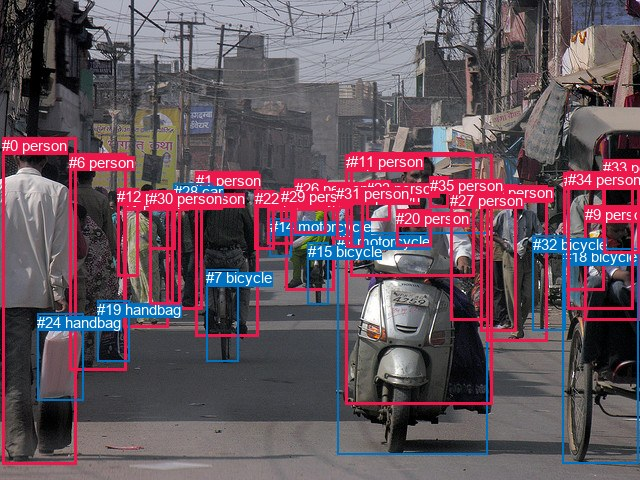
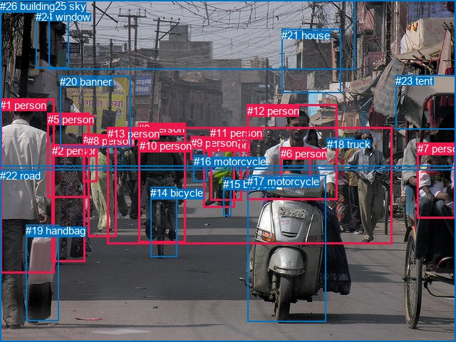

# 图片 0105：2316316.jpg

随机样本序号：210。图片 SHA256：`6d28aca076f309360f392b53b4e9a85ec7ec3ee524cba7f8dac52e50d85dcc36`。

红色框表示人，蓝色框表示其他物体。两个模式分别保留自身框编号，可依据位置比较对应对象。

## 自动检测框与输出

人的框编号：`[0, 1, 3, 4, 5, 6, 8, 9, 10, 11, 12, 13, 16, 17, 20, 21, 22, 23, 25, 26, 27, 29, 30, 31, 33, 34, 35]`。状态：`ok`。

### 自动检测全部物体框

| 编号 | 类别 | 是否为人 | 检测分数 | 像素坐标 xyxy |
|---|---|---|---|---|
| 0 | person | True | 0.9991 | 2.1, 137.3, 76.9, 464.7 |
| 1 | person | True | 0.9970 | 195.8, 171.5, 258.4, 336.8 |
| 2 | motorcycle | False | 0.9950 | 337.3, 232.9, 487.6, 455.0 |
| 3 | person | True | 0.9949 | 486.8, 185.8, 548.0, 341.2 |
| 4 | person | True | 0.9866 | 285.5, 191.9, 334.1, 291.0 |
| 5 | person | True | 0.9808 | 123.3, 193.1, 168.5, 327.7 |
| 6 | person | True | 0.9749 | 69.0, 153.8, 126.1, 370.9 |
| 7 | bicycle | False | 0.9624 | 206.2, 269.2, 238.1, 361.7 |
| 8 | person | True | 0.9574 | 345.6, 154.5, 492.0, 404.2 |
| 9 | person | True | 0.9552 | 584.7, 205.5, 639.4, 320.0 |
| 10 | person | True | 0.9538 | 171.7, 190.4, 202.5, 309.2 |
| 11 | person | True | 0.9503 | 350.1, 152.8, 474.8, 276.5 |
| 12 | person | True | 0.9118 | 117.2, 188.4, 138.3, 276.4 |
| 13 | person | True | 0.9068 | 563.5, 172.4, 604.5, 290.4 |
| 14 | motorcycle | False | 0.8594 | 269.9, 218.2, 291.7, 256.4 |
| 15 | bicycle | False | 0.8565 | 307.6, 242.8, 328.0, 304.7 |
| 16 | person | True | 0.8405 | 480.1, 184.3, 516.2, 331.5 |
| 17 | person | True | 0.7804 | 267.1, 193.1, 292.9, 244.5 |
| 18 | bicycle | False | 0.7704 | 562.8, 248.4, 638.8, 463.5 |
| 19 | handbag | False | 0.7687 | 97.2, 300.8, 129.7, 361.5 |
| 20 | person | True | 0.7337 | 396.3, 209.9, 431.7, 246.9 |
| 21 | person | True | 0.6967 | 346.5, 187.5, 363.9, 247.7 |
| 22 | person | True | 0.6853 | 254.7, 190.1, 274.5, 249.5 |
| 23 | person | True | 0.6483 | 366.1, 180.3, 390.8, 220.8 |
| 24 | handbag | False | 0.6025 | 37.1, 313.8, 83.5, 400.4 |
| 25 | person | True | 0.5858 | 149.0, 192.3, 180.7, 304.9 |
| 26 | person | True | 0.5270 | 294.9, 179.9, 326.8, 234.0 |
| 27 | person | True | 0.5185 | 450.1, 191.5, 488.8, 320.7 |
| 28 | car | False | 0.4620 | 173.8, 183.1, 212.5, 199.8 |
| 29 | person | True | 0.4159 | 280.5, 188.1, 295.2, 221.2 |
| 30 | person | True | 0.4098 | 149.5, 190.1, 175.4, 249.9 |
| 31 | person | True | 0.4097 | 336.5, 184.7, 353.0, 239.1 |
| 32 | bicycle | False | 0.4075 | 532.5, 235.8, 565.5, 330.2 |
| 33 | person | True | 0.4060 | 603.0, 159.4, 639.6, 253.8 |
| 34 | person | True | 0.3860 | 567.9, 171.3, 633.8, 309.2 |
| 35 | person | True | 0.3557 | 430.0, 177.0, 448.2, 207.5 |

### 自动检测 Top50 人相关候选

评分物体对：1260；人相关物体对：1188；输出关系：50。

| 排名 | 主语编号与类别 | 关系 | 宾语编号与类别 | 类型 | 人与人 | 排序分数 | 原始融合 logit |
|---|---|---|---|---|---|---|---|
| 1 | #4 person | riding | #15 bicycle | semantic | False | 0.99804 | 6.2347 |
| 2 | #1 person | riding | #7 bicycle | semantic | False | 0.99604 | 5.5273 |
| 3 | #3 person | pushing | #32 bicycle | semantic | False | 0.99489 | 5.2711 |
| 4 | #9 person | riding | #18 bicycle | semantic | False | 0.98814 | 4.4229 |
| 5 | #3 person | pushing | #18 bicycle | semantic | False | 0.98787 | 4.3998 |
| 6 | #4 person | on | #15 bicycle | spatial | False | 0.98703 | 4.3317 |
| 7 | #34 person | riding | #18 bicycle | semantic | False | 0.98688 | 4.3202 |
| 8 | #8 person | riding | #2 motorcycle | semantic | False | 0.98630 | 4.2769 |
| 9 | #0 person | carrying | #24 handbag | semantic | False | 0.98534 | 4.2081 |
| 10 | #25 person | wearing | #30 person | semantic | True | 0.98493 | 4.1802 |
| 11 | #13 person | pushing | #18 bicycle | semantic | False | 0.98473 | 4.1665 |
| 12 | #1 person | on | #7 bicycle | spatial | False | 0.98422 | 4.1333 |
| 13 | #26 person | riding | #15 bicycle | semantic | False | 0.98223 | 4.0121 |
| 14 | #13 person | on | #18 bicycle | spatial | False | 0.98094 | 3.9410 |
| 15 | #9 person | on | #18 bicycle | spatial | False | 0.98080 | 3.9337 |
| 16 | #11 person | pushing | #2 motorcycle | semantic | False | 0.98052 | 3.9187 |
| 17 | #34 person | on | #18 bicycle | spatial | False | 0.98023 | 3.9038 |
| 18 | #33 person | on | #18 bicycle | spatial | False | 0.97970 | 3.8768 |
| 19 | #33 person | riding | #18 bicycle | semantic | False | 0.97953 | 3.8680 |
| 20 | #10 person | wearing | #28 car | semantic | False | 0.97917 | 3.8502 |
| 21 | #6 person | carrying | #19 handbag | semantic | False | 0.97807 | 3.7976 |
| 22 | #13 person | pushing | #32 bicycle | semantic | False | 0.97804 | 3.7965 |
| 23 | #8 person | on | #2 motorcycle | spatial | False | 0.97756 | 3.7743 |
| 24 | #5 person | wearing | #30 person | semantic | True | 0.97332 | 3.5967 |
| 25 | #16 person | pushing | #18 bicycle | semantic | False | 0.97235 | 3.5599 |
| 26 | #16 person | pushing | #32 bicycle | semantic | False | 0.97084 | 3.5053 |
| 27 | #1 person | wearing | #28 car | semantic | False | 0.96795 | 3.4078 |
| 28 | #25 person | in | #30 person | spatial | True | 0.96765 | 3.3982 |
| 29 | #17 person | riding | #14 motorcycle | semantic | False | 0.96640 | 3.3590 |
| 30 | #20 person | on | #2 motorcycle | spatial | False | 0.96526 | 3.3245 |
| 31 | #11 person | on | #2 motorcycle | spatial | False | 0.96340 | 3.2703 |
| 32 | #22 person | pushing | #14 motorcycle | semantic | False | 0.96296 | 3.2580 |
| 33 | #25 person | wearing | #28 car | semantic | False | 0.96220 | 3.2370 |
| 34 | #29 person | pushing | #14 motorcycle | semantic | False | 0.95954 | 3.1661 |
| 35 | #27 person | pushing | #18 bicycle | semantic | False | 0.95197 | 2.9866 |
| 36 | #5 person | pulling | #19 handbag | semantic | False | 0.95114 | 2.9688 |
| 37 | #4 person | pushing | #14 motorcycle | semantic | False | 0.94268 | 2.8000 |
| 38 | #31 person | riding | #15 bicycle | semantic | False | 0.94169 | 2.7819 |
| 39 | #5 person | wearing | #12 person | semantic | True | 0.93945 | 2.7418 |
| 40 | #6 person | carrying | #24 handbag | semantic | False | 0.93758 | 2.7094 |
| 41 | #26 person | on | #15 bicycle | spatial | False | 0.93430 | 2.6547 |
| 42 | #29 person | on | #14 motorcycle | spatial | False | 0.92573 | 2.5228 |
| 43 | #5 person | in | #30 person | spatial | True | 0.92310 | 2.4852 |
| 44 | #26 person | pushing | #14 motorcycle | semantic | False | 0.92203 | 2.4703 |
| 45 | #27 person | pushing | #32 bicycle | semantic | False | 0.92117 | 2.4584 |
| 46 | #17 person | on | #14 motorcycle | spatial | False | 0.91838 | 2.4206 |
| 47 | #4 person | wearing | #26 person | semantic | True | 0.91543 | 2.3819 |
| 48 | #20 person | riding | #2 motorcycle | semantic | False | 0.91435 | 2.3680 |
| 49 | #34 person | pushing | #32 bicycle | semantic | False | 0.91260 | 2.3458 |
| 50 | #10 person | on | #7 bicycle | spatial | False | 0.89726 | 2.1671 |

### 自动检测逐条人相关 GT 核验

R@50：25.00%；命中 3/12。

| GT 主语编号 | GT 关系 | GT 宾语编号 | 结果阶段 | 匹配预测主语编号 | 匹配预测宾语编号 |
|---|---|---|---|---|---|
| 0 | on | 14 | hit50 | [1] | [7] |
| 0 | riding | 14 | hit50 | [1] | [7] |
| 1 | holding | 19 | wrong_predicate | [0] | [24] |
| 1 | on | 22 | endpoint_missing_or_wrong_class | [0] | [] |
| 1 | walking on | 22 | endpoint_missing_or_wrong_class | [0] | [] |
| 6 | in front of | 12 | wrong_predicate | [20] | [11] |
| 6 | sitting on | 17 | wrong_predicate | [20] | [2] |
| 11 | riding | 15 | endpoint_missing_or_wrong_class | [4] | [] |
| 12 | on | 17 | hit50 | [11] | [2] |
| 12 | riding | 17 | wrong_predicate | [11] | [2] |
| 13 | walking on | 22 | endpoint_missing_or_wrong_class | [] | [] |
| 25 | over | 6 | endpoint_missing_or_wrong_class | [] | [20] |

## 真实框与输出

人的框编号：`[0, 1, 2, 3, 4, 5, 6, 7, 8, 9, 10, 11, 12, 13]`。

### 真实框全部物体框

| 编号 | 类别 | 是否为人 | 检测分数 | 像素坐标 xyxy |
|---|---|---|---|---|
| 0 | person | True | GT | 194.0, 172.0, 261.0, 340.0 |
| 1 | person | True | GT | 0.0, 139.0, 77.0, 384.0 |
| 2 | person | True | GT | 73.0, 203.0, 120.0, 367.0 |
| 3 | person | True | GT | 117.0, 187.0, 137.0, 255.0 |
| 4 | person | True | GT | 285.0, 195.0, 329.0, 291.0 |
| 5 | person | True | GT | 67.0, 159.0, 126.0, 278.0 |
| 6 | person | True | GT | 394.0, 207.0, 437.0, 251.0 |
| 7 | person | True | GT | 586.0, 200.0, 640.0, 306.0 |
| 8 | person | True | GT | 123.0, 189.0, 163.0, 332.0 |
| 9 | person | True | GT | 268.0, 192.0, 295.0, 225.0 |
| 10 | person | True | GT | 196.0, 196.0, 209.0, 210.0 |
| 11 | person | True | GT | 295.0, 178.0, 339.0, 281.0 |
| 12 | person | True | GT | 347.0, 147.0, 473.0, 281.0 |
| 13 | person | True | GT | 151.0, 179.0, 550.0, 343.0 |
| 14 | bicycle | False | GT | 211.0, 262.0, 248.0, 360.0 |
| 15 | bicycle | False | GT | 313.0, 250.0, 324.0, 303.0 |
| 16 | motorcycle | False | GT | 272.0, 218.0, 291.0, 255.0 |
| 17 | motorcycle | False | GT | 347.0, 246.0, 457.0, 452.0 |
| 18 | truck | False | GT | 459.0, 194.0, 498.0, 208.0 |
| 19 | handbag | False | GT | 36.0, 315.0, 82.0, 450.0 |
| 20 | banner | False | GT | 84.0, 106.0, 183.0, 207.0 |
| 21 | house | False | GT | 395.0, 41.0, 478.0, 131.0 |
| 22 | road | False | GT | 0.0, 238.0, 640.0, 480.0 |
| 23 | tent | False | GT | 555.0, 105.0, 640.0, 181.0 |
| 24 | window | False | GT | 50.0, 15.0, 96.0, 95.0 |
| 25 | sky | False | GT | 69.0, 0.0, 499.0, 98.0 |
| 26 | building | False | GT | 0.0, 0.0, 640.0, 233.0 |

### 真实框 Top50 人相关候选

评分物体对：702；人相关物体对：546；输出关系：50。

| 排名 | 主语编号与类别 | 关系 | 宾语编号与类别 | 类型 | 人与人 | 排序分数 | 原始融合 logit |
|---|---|---|---|---|---|---|---|
| 1 | #11 person | riding | #15 bicycle | semantic | False | 0.99800 | 6.2122 |
| 2 | #4 person | riding | #15 bicycle | semantic | False | 0.99790 | 6.1654 |
| 3 | #13 person | crossing | #22 road | semantic | False | 0.99662 | 5.6872 |
| 4 | #12 person | pushing | #17 motorcycle | semantic | False | 0.99632 | 5.6022 |
| 5 | #0 person | riding | #14 bicycle | semantic | False | 0.99632 | 5.6020 |
| 6 | #8 person | crossing | #22 road | semantic | False | 0.99612 | 5.5482 |
| 7 | #0 person | crossing | #22 road | semantic | False | 0.99448 | 5.1942 |
| 8 | #4 person | crossing | #22 road | semantic | False | 0.99402 | 5.1128 |
| 9 | #11 person | crossing | #22 road | semantic | False | 0.99392 | 5.0965 |
| 10 | #1 person | crossing | #22 road | semantic | False | 0.99063 | 4.6604 |
| 11 | #2 person | crossing | #22 road | semantic | False | 0.98893 | 4.4920 |
| 12 | #12 person | crossing | #22 road | semantic | False | 0.98885 | 4.4855 |
| 13 | #5 person | crossing | #22 road | semantic | False | 0.98622 | 4.2709 |
| 14 | #4 person | on | #15 bicycle | spatial | False | 0.98619 | 4.2688 |
| 15 | #0 person | on | #14 bicycle | spatial | False | 0.98615 | 4.2655 |
| 16 | #11 person | on | #15 bicycle | spatial | False | 0.98614 | 4.2650 |
| 17 | #1 person | carrying | #19 handbag | semantic | False | 0.98483 | 4.1730 |
| 18 | #0 person | wearing | #10 person | semantic | True | 0.98409 | 4.1250 |
| 19 | #4 person | pushing | #16 motorcycle | semantic | False | 0.98202 | 4.0004 |
| 20 | #11 person | riding | #4 person | semantic | True | 0.97722 | 3.7589 |
| 21 | #11 person | pushing | #16 motorcycle | semantic | False | 0.97130 | 3.5218 |
| 22 | #3 person | crossing | #22 road | semantic | False | 0.96799 | 3.4091 |
| 23 | #6 person | on | #17 motorcycle | spatial | False | 0.96602 | 3.3473 |
| 24 | #9 person | pushing | #16 motorcycle | semantic | False | 0.96077 | 3.1983 |
| 25 | #8 person | wearing | #3 person | semantic | True | 0.95774 | 3.1208 |
| 26 | #13 person | on | #22 road | spatial | False | 0.95498 | 3.0547 |
| 27 | #12 person | on | #17 motorcycle | spatial | False | 0.95428 | 3.0385 |
| 28 | #0 person | on | #22 road | spatial | False | 0.94379 | 2.8209 |
| 29 | #4 person | on | #22 road | spatial | False | 0.93980 | 2.7480 |
| 30 | #12 person | on | #22 road | spatial | False | 0.93866 | 2.7280 |
| 31 | #6 person | riding | #17 motorcycle | semantic | False | 0.92400 | 2.4979 |
| 32 | #8 person | on | #22 road | spatial | False | 0.92321 | 2.4868 |
| 33 | #9 person | on | #16 motorcycle | spatial | False | 0.91699 | 2.4021 |
| 34 | #11 person | on | #22 road | spatial | False | 0.91536 | 2.3810 |
| 35 | #0 person | in | #10 person | spatial | True | 0.90191 | 2.2187 |
| 36 | #1 person | on | #22 road | spatial | False | 0.90143 | 2.2132 |
| 37 | #2 person | on | #22 road | spatial | False | 0.89733 | 2.1679 |
| 38 | #2 person | holding | #19 handbag | semantic | False | 0.89405 | 2.1328 |
| 39 | #7 person | pushing | #17 motorcycle | semantic | False | 0.88121 | 2.0039 |
| 40 | #11 person | pushing | #17 motorcycle | semantic | False | 0.87857 | 1.9790 |
| 41 | #7 person | sitting on | #23 tent | semantic | False | 0.87786 | 1.9723 |
| 42 | #19 handbag | carrying | #1 person | semantic | False | 0.87753 | 1.9692 |
| 43 | #8 person | in | #3 person | spatial | True | 0.87639 | 1.9587 |
| 44 | #11 person | on | #4 person | spatial | True | 0.86557 | 1.8623 |
| 45 | #12 person | holding | #6 person | semantic | True | 0.82401 | 1.5437 |
| 46 | #11 person | riding | #14 bicycle | semantic | False | 0.81907 | 1.5101 |
| 47 | #5 person | on | #22 road | spatial | False | 0.81809 | 1.5034 |
| 48 | #12 person | wearing | #18 truck | semantic | False | 0.81401 | 1.4763 |
| 49 | #4 person | carrying | #9 person | semantic | True | 0.81243 | 1.4659 |
| 50 | #7 person | on | #22 road | spatial | False | 0.81180 | 1.4618 |

### 真实框逐条人相关 GT 核验

R@50：41.67%；命中 5/12。

| GT 主语编号 | GT 关系 | GT 宾语编号 | 结果阶段 | 匹配预测主语编号 | 匹配预测宾语编号 |
|---|---|---|---|---|---|
| 0 | on | 14 | hit50 | [0] | [14] |
| 0 | riding | 14 | hit50 | [0] | [14] |
| 1 | holding | 19 | wrong_predicate | [1] | [19] |
| 1 | on | 22 | hit50 | [1] | [22] |
| 1 | walking on | 22 | wrong_predicate | [1] | [22] |
| 6 | in front of | 12 | wrong_predicate | [6] | [12] |
| 6 | sitting on | 17 | wrong_predicate | [6] | [17] |
| 11 | riding | 15 | hit50 | [11] | [15] |
| 12 | on | 17 | hit50 | [12] | [17] |
| 12 | riding | 17 | wrong_predicate | [12] | [17] |
| 13 | walking on | 22 | wrong_predicate | [13] | [22] |
| 25 | over | 6 | rank_below50 | [25] | [6] |

## 全部人相关 GT

| 主语编号与类别 | 关系 | 宾语编号与类别 |
|---|---|---|
| #0 person | on | #14 bicycle |
| #0 person | riding | #14 bicycle |
| #1 person | holding | #19 handbag |
| #1 person | on | #22 road |
| #1 person | walking on | #22 road |
| #6 person | in front of | #12 person |
| #6 person | sitting on | #17 motorcycle |
| #11 person | riding | #15 bicycle |
| #12 person | on | #17 motorcycle |
| #12 person | riding | #17 motorcycle |
| #13 person | walking on | #22 road |
| #25 sky | over | #6 person |

原始记录、全部人相关物体对的两项预测与分项分数见 [逐图证据 JSON](../evidence/cases/0105.json)。全部56类 logits 保留于本机 HOR/output/random500/logits/。

<!-- HOR_COMPLETE_RESULTS -->

## 六组条件的完整输出对照

以下保留同一图片三种框与候选模式、两种谓词输出规则的全部 Top50。框编号各自在所属模式内解释。

### 自动检测框完整枚举：空间与语义各保留一个谓词

| 排名 | 主语编号与类别 | 谓词 | 宾语编号与类别 | 分组 | 排序分数 | predicate logit | pair logit |
|---|---|---|---|---|---|---|---|
| 1 | #4 person | riding | #15 bicycle | semantic | 0.9980435 | 5.2039437 | 1.0307499 |
| 2 | #1 person | riding | #7 bicycle | semantic | 0.9960392 | 5.1437612 | 0.3835726 |
| 3 | #3 person | pushing | #32 bicycle | semantic | 0.9948885 | 5.1105008 | 0.1606266 |
| 4 | #9 person | riding | #18 bicycle | semantic | 0.9881427 | 3.7781348 | 0.6447482 |
| 5 | #3 person | pushing | #18 bicycle | semantic | 0.9878692 | 4.9903464 | -0.5905461 |
| 6 | #4 person | on | #15 bicycle | spatial | 0.9870258 | 3.3009830 | 1.0307499 |
| 7 | #34 person | riding | #18 bicycle | semantic | 0.9868777 | 3.8366065 | 0.4836355 |
| 8 | #8 person | riding | #2 motorcycle | semantic | 0.9863041 | 4.3721404 | -0.0952767 |
| 9 | #0 person | carrying | #24 handbag | semantic | 0.9853440 | 4.1019359 | 0.1062040 |
| 10 | #25 person | wearing | #30 person | semantic | 0.9849347 | 3.9228311 | 0.2573483 |
| 11 | #13 person | pushing | #18 bicycle | semantic | 0.9847298 | 3.8479400 | 0.3185272 |
| 12 | #1 person | on | #7 bicycle | spatial | 0.9842238 | 3.7497735 | 0.3835726 |
| 13 | #26 person | riding | #15 bicycle | semantic | 0.9822254 | 4.0066476 | 0.0054050 |
| 14 | #13 person | on | #18 bicycle | spatial | 0.9809424 | 3.6225162 | 0.3185272 |
| 15 | #9 person | on | #18 bicycle | spatial | 0.9808043 | 3.2889347 | 0.6447482 |
| 16 | #11 person | pushing | #2 motorcycle | semantic | 0.9805194 | 3.9682221 | -0.0495601 |
| 17 | #34 person | on | #18 bicycle | spatial | 0.9802340 | 3.4201903 | 0.4836355 |
| 18 | #33 person | on | #18 bicycle | spatial | 0.9797035 | 3.5457091 | 0.3310984 |
| 19 | #33 person | riding | #18 bicycle | semantic | 0.9795281 | 3.5369163 | 0.3310984 |
| 20 | #10 person | wearing | #28 car | semantic | 0.9791669 | 3.4661994 | 0.3839591 |
| 21 | #6 person | carrying | #19 handbag | semantic | 0.9780672 | 4.1178460 | -0.3202513 |
| 22 | #13 person | pushing | #32 bicycle | semantic | 0.9780439 | 3.7874417 | 0.0090663 |
| 23 | #8 person | on | #2 motorcycle | spatial | 0.9775615 | 3.8695607 | -0.0952767 |
| 24 | #5 person | wearing | #30 person | semantic | 0.9733174 | 3.3590732 | 0.2376245 |
| 25 | #16 person | pushing | #18 bicycle | semantic | 0.9723457 | 4.2682157 | -0.7082846 |
| 26 | #16 person | pushing | #32 bicycle | semantic | 0.9708385 | 3.3654075 | 0.1399055 |
| 27 | #1 person | wearing | #28 car | semantic | 0.9679488 | 3.1887589 | 0.2190835 |
| 28 | #25 person | in | #30 person | spatial | 0.9676479 | 3.1408410 | 0.2573483 |
| 29 | #17 person | riding | #14 motorcycle | semantic | 0.9663990 | 3.2959423 | 0.0630780 |
| 30 | #20 person | on | #2 motorcycle | spatial | 0.9652590 | 3.3663211 | -0.0418454 |
| 31 | #11 person | on | #2 motorcycle | spatial | 0.9633959 | 3.3198657 | -0.0495601 |
| 32 | #22 person | pushing | #14 motorcycle | semantic | 0.9629580 | 3.3058543 | -0.0478976 |
| 33 | #25 person | wearing | #28 car | semantic | 0.9622029 | 2.8011851 | 0.4358071 |
| 34 | #29 person | pushing | #14 motorcycle | semantic | 0.9595366 | 3.2460451 | -0.0799924 |
| 35 | #27 person | pushing | #18 bicycle | semantic | 0.9519663 | 3.9675813 | -0.9809550 |
| 36 | #5 person | pulling | #19 handbag | semantic | 0.9511423 | 3.1858597 | -0.2171074 |
| 37 | #4 person | pushing | #14 motorcycle | semantic | 0.9426782 | 2.2526426 | 0.5474013 |
| 38 | #31 person | riding | #15 bicycle | semantic | 0.9416912 | 2.9876995 | -0.2057739 |
| 39 | #5 person | wearing | #12 person | semantic | 0.9394497 | 2.8100595 | -0.0682394 |
| 40 | #6 person | carrying | #24 handbag | semantic | 0.9375772 | 3.0765033 | -0.3671361 |
| 41 | #26 person | on | #15 bicycle | spatial | 0.9342995 | 2.6492858 | 0.0054050 |
| 42 | #29 person | on | #14 motorcycle | spatial | 0.9257274 | 2.6028314 | -0.0799924 |
| 43 | #5 person | in | #30 person | spatial | 0.9231005 | 2.2476144 | 0.2376245 |
| 44 | #26 person | pushing | #14 motorcycle | semantic | 0.9220299 | 2.4635205 | 0.0067321 |
| 45 | #27 person | pushing | #32 bicycle | semantic | 0.9211726 | 2.4929123 | -0.0345245 |
| 46 | #17 person | on | #14 motorcycle | spatial | 0.9183850 | 2.3575253 | 0.0630780 |
| 47 | #4 person | wearing | #26 person | semantic | 0.9154347 | 2.4122534 | -0.0303786 |
| 48 | #20 person | riding | #2 motorcycle | semantic | 0.9143524 | 2.4098206 | -0.0418454 |
| 49 | #34 person | pushing | #32 bicycle | semantic | 0.9126031 | 2.4031401 | -0.0572990 |
| 50 | #10 person | on | #7 bicycle | spatial | 0.8972552 | 2.0950160 | 0.0720764 |

GT 命中：3/12，R@50=25.00%。

| GT主语 | GT谓词 | GT宾语 | 结果阶段 | 匹配主语框 | 匹配宾语框 |
|---|---|---|---|---|---|
| 0 | on | 14 | hit50 | [1] | [7] |
| 0 | riding | 14 | hit50 | [1] | [7] |
| 1 | holding | 19 | wrong_predicate | [0] | [24] |
| 1 | on | 22 | endpoint_missing_or_wrong_class | [0] | [] |
| 1 | walking on | 22 | endpoint_missing_or_wrong_class | [0] | [] |
| 6 | in front of | 12 | wrong_predicate | [20] | [11] |
| 6 | sitting on | 17 | wrong_predicate | [20] | [2] |
| 11 | riding | 15 | endpoint_missing_or_wrong_class | [4] | [] |
| 12 | on | 17 | hit50 | [11] | [2] |
| 12 | riding | 17 | wrong_predicate | [11] | [2] |
| 13 | walking on | 22 | endpoint_missing_or_wrong_class | [] | [] |
| 25 | over | 6 | endpoint_missing_or_wrong_class | [] | [20] |

### 自动检测框完整枚举：每对只保留一个谓词

| 排名 | 主语编号与类别 | 谓词 | 宾语编号与类别 | 分组 | 排序分数 | predicate logit | pair logit |
|---|---|---|---|---|---|---|---|
| 1 | #4 person | riding | #15 bicycle | single | 0.9980435 | 5.2039437 | 1.0307499 |
| 2 | #1 person | riding | #7 bicycle | single | 0.9960392 | 5.1437612 | 0.3835726 |
| 3 | #3 person | pushing | #32 bicycle | single | 0.9948885 | 5.1105008 | 0.1606266 |
| 4 | #9 person | riding | #18 bicycle | single | 0.9881427 | 3.7781348 | 0.6447482 |
| 5 | #3 person | pushing | #18 bicycle | single | 0.9878692 | 4.9903464 | -0.5905461 |
| 6 | #34 person | riding | #18 bicycle | single | 0.9868777 | 3.8366065 | 0.4836355 |
| 7 | #8 person | riding | #2 motorcycle | single | 0.9863041 | 4.3721404 | -0.0952767 |
| 8 | #0 person | carrying | #24 handbag | single | 0.9853440 | 4.1019359 | 0.1062040 |
| 9 | #25 person | wearing | #30 person | single | 0.9849347 | 3.9228311 | 0.2573483 |
| 10 | #13 person | pushing | #18 bicycle | single | 0.9847298 | 3.8479400 | 0.3185272 |
| 11 | #26 person | riding | #15 bicycle | single | 0.9822254 | 4.0066476 | 0.0054050 |
| 12 | #11 person | pushing | #2 motorcycle | single | 0.9805194 | 3.9682221 | -0.0495601 |
| 13 | #33 person | on | #18 bicycle | single | 0.9797035 | 3.5457091 | 0.3310984 |
| 14 | #10 person | wearing | #28 car | single | 0.9791669 | 3.4661994 | 0.3839591 |
| 15 | #6 person | carrying | #19 handbag | single | 0.9780672 | 4.1178460 | -0.3202513 |
| 16 | #13 person | pushing | #32 bicycle | single | 0.9780439 | 3.7874417 | 0.0090663 |
| 17 | #5 person | wearing | #30 person | single | 0.9733174 | 3.3590732 | 0.2376245 |
| 18 | #16 person | pushing | #18 bicycle | single | 0.9723457 | 4.2682157 | -0.7082846 |
| 19 | #16 person | pushing | #32 bicycle | single | 0.9708385 | 3.3654075 | 0.1399055 |
| 20 | #1 person | wearing | #28 car | single | 0.9679488 | 3.1887589 | 0.2190835 |
| 21 | #17 person | riding | #14 motorcycle | single | 0.9663990 | 3.2959423 | 0.0630780 |
| 22 | #20 person | on | #2 motorcycle | single | 0.9652590 | 3.3663211 | -0.0418454 |
| 23 | #22 person | pushing | #14 motorcycle | single | 0.9629580 | 3.3058543 | -0.0478976 |
| 24 | #25 person | wearing | #28 car | single | 0.9622029 | 2.8011851 | 0.4358071 |
| 25 | #29 person | pushing | #14 motorcycle | single | 0.9595366 | 3.2460451 | -0.0799924 |
| 26 | #27 person | pushing | #18 bicycle | single | 0.9519663 | 3.9675813 | -0.9809550 |
| 27 | #5 person | pulling | #19 handbag | single | 0.9511423 | 3.1858597 | -0.2171074 |
| 28 | #4 person | pushing | #14 motorcycle | single | 0.9426782 | 2.2526426 | 0.5474013 |
| 29 | #31 person | riding | #15 bicycle | single | 0.9416912 | 2.9876995 | -0.2057739 |
| 30 | #5 person | wearing | #12 person | single | 0.9394497 | 2.8100595 | -0.0682394 |
| 31 | #6 person | carrying | #24 handbag | single | 0.9375772 | 3.0765033 | -0.3671361 |
| 32 | #26 person | pushing | #14 motorcycle | single | 0.9220299 | 2.4635205 | 0.0067321 |
| 33 | #27 person | pushing | #32 bicycle | single | 0.9211726 | 2.4929123 | -0.0345245 |
| 34 | #4 person | wearing | #26 person | single | 0.9154347 | 2.4122534 | -0.0303786 |
| 35 | #34 person | pushing | #32 bicycle | single | 0.9126031 | 2.4031401 | -0.0572990 |
| 36 | #10 person | on | #7 bicycle | single | 0.8972552 | 2.0950160 | 0.0720764 |
| 37 | #21 person | riding | #15 bicycle | single | 0.8971820 | 2.3875847 | -0.2212857 |
| 38 | #33 person | pushing | #32 bicycle | single | 0.8861323 | 2.3127670 | -0.2609374 |
| 39 | #11 person | talking to | #35 person | single | 0.8818640 | 1.7950706 | 0.2151314 |
| 40 | #5 person | wearing | #28 car | single | 0.8797396 | 1.5828652 | 0.4071015 |
| 41 | #27 person | walking on | #2 motorcycle | single | 0.8787267 | 2.6571054 | -0.6766787 |
| 42 | #30 person | wearing | #28 car | single | 0.8707355 | 2.0833592 | -0.1758822 |
| 43 | #11 person | pushing | #18 bicycle | single | 0.8655723 | 3.0047431 | -1.1423783 |
| 44 | #25 person | pulling | #19 handbag | single | 0.8542072 | 2.0724869 | -0.3044995 |
| 45 | #8 person | pushing | #18 bicycle | single | 0.8355328 | 2.6440682 | -1.0187093 |
| 46 | #8 person | wearing | #35 person | single | 0.7899333 | 1.5827923 | -0.2582690 |
| 47 | #23 person | riding | #15 bicycle | single | 0.7888342 | 1.3703465 | -0.0524342 |
| 48 | #4 person | riding | #7 bicycle | single | 0.7781411 | 1.3074760 | -0.0526100 |
| 49 | #10 person | pulling | #19 handbag | single | 0.7683197 | 1.7114425 | -0.5125949 |
| 50 | #8 person | wearing | #20 person | single | 0.7644366 | 1.3566594 | -0.1795003 |

GT 命中：1/12，R@50=8.33%。

| GT主语 | GT谓词 | GT宾语 | 结果阶段 | 匹配主语框 | 匹配宾语框 |
|---|---|---|---|---|---|
| 0 | on | 14 | wrong_predicate | [1] | [7] |
| 0 | riding | 14 | hit50 | [1] | [7] |
| 1 | holding | 19 | wrong_predicate | [0] | [24] |
| 1 | on | 22 | endpoint_missing_or_wrong_class | [0] | [] |
| 1 | walking on | 22 | endpoint_missing_or_wrong_class | [0] | [] |
| 6 | in front of | 12 | wrong_predicate | [20] | [11] |
| 6 | sitting on | 17 | wrong_predicate | [20] | [2] |
| 11 | riding | 15 | endpoint_missing_or_wrong_class | [4] | [] |
| 12 | on | 17 | wrong_predicate | [11] | [2] |
| 12 | riding | 17 | wrong_predicate | [11] | [2] |
| 13 | walking on | 22 | endpoint_missing_or_wrong_class | [] | [] |
| 25 | over | 6 | endpoint_missing_or_wrong_class | [] | [20] |

### 真实框完整枚举：空间与语义各保留一个谓词

| 排名 | 主语编号与类别 | 谓词 | 宾语编号与类别 | 分组 | 排序分数 | predicate logit | pair logit |
|---|---|---|---|---|---|---|---|
| 1 | #11 person | riding | #15 bicycle | semantic | 0.9979991 | 5.2034554 | 1.0087230 |
| 2 | #4 person | riding | #15 bicycle | semantic | 0.9979036 | 5.1471829 | 1.0182601 |
| 3 | #13 person | crossing | #22 road | semantic | 0.9966223 | 5.8016534 | -0.1144834 |
| 4 | #12 person | pushing | #17 motorcycle | semantic | 0.9963237 | 5.5923581 | 0.0098144 |
| 5 | #0 person | riding | #14 bicycle | semantic | 0.9963230 | 5.1464496 | 0.4555273 |
| 6 | #8 person | crossing | #22 road | semantic | 0.9961206 | 5.3810868 | 0.1671194 |
| 7 | #0 person | crossing | #22 road | semantic | 0.9944819 | 5.0770459 | 0.1171326 |
| 8 | #4 person | crossing | #22 road | semantic | 0.9940165 | 5.0748076 | 0.0379553 |
| 9 | #11 person | crossing | #22 road | semantic | 0.9939191 | 5.0146251 | 0.0818801 |
| 10 | #1 person | crossing | #22 road | semantic | 0.9906259 | 4.6631598 | -0.0027793 |
| 11 | #2 person | crossing | #22 road | semantic | 0.9889256 | 4.5445733 | -0.0525891 |
| 12 | #12 person | crossing | #22 road | semantic | 0.9888544 | 4.5432229 | -0.0577224 |
| 13 | #5 person | crossing | #22 road | semantic | 0.9862234 | 4.1809907 | 0.0899172 |
| 14 | #4 person | on | #15 bicycle | spatial | 0.9861945 | 3.2505317 | 1.0182601 |
| 15 | #0 person | on | #14 bicycle | spatial | 0.9861494 | 3.8099561 | 0.4555273 |
| 16 | #11 person | on | #15 bicycle | spatial | 0.9861427 | 3.2562656 | 1.0087230 |
| 17 | #1 person | carrying | #19 handbag | semantic | 0.9848282 | 4.0370936 | 0.1359335 |
| 18 | #0 person | wearing | #10 person | semantic | 0.9840940 | 3.7744832 | 0.3505374 |
| 19 | #4 person | pushing | #16 motorcycle | semantic | 0.9820210 | 3.4859519 | 0.5144541 |
| 20 | #11 person | riding | #4 person | semantic | 0.9772206 | 4.0614543 | -0.3026021 |
| 21 | #11 person | pushing | #16 motorcycle | semantic | 0.9713009 | 3.0043821 | 0.5173867 |
| 22 | #3 person | crossing | #22 road | semantic | 0.9679884 | 3.4590850 | -0.0499631 |
| 23 | #6 person | on | #17 motorcycle | spatial | 0.9660162 | 3.3496966 | -0.0024018 |
| 24 | #9 person | pushing | #16 motorcycle | semantic | 0.9607710 | 3.3061805 | -0.1078612 |
| 25 | #8 person | wearing | #3 person | semantic | 0.9577446 | 3.1887589 | -0.0679105 |
| 26 | #13 person | on | #22 road | spatial | 0.9549835 | 3.1691489 | -0.1144834 |
| 27 | #12 person | on | #17 motorcycle | spatial | 0.9542834 | 3.0286851 | 0.0098144 |
| 28 | #0 person | on | #22 road | spatial | 0.9437931 | 2.7037339 | 0.1171326 |
| 29 | #4 person | on | #22 road | spatial | 0.9398004 | 2.7100472 | 0.0379553 |
| 30 | #12 person | on | #22 road | spatial | 0.9386572 | 2.7856960 | -0.0577224 |
| 31 | #6 person | riding | #17 motorcycle | semantic | 0.9239970 | 2.5003386 | -0.0024018 |
| 32 | #8 person | on | #22 road | spatial | 0.9232127 | 2.3197012 | 0.1671194 |
| 33 | #9 person | on | #16 motorcycle | spatial | 0.9169887 | 2.5099802 | -0.1078612 |
| 34 | #11 person | on | #22 road | spatial | 0.9153639 | 2.2990804 | 0.0818801 |
| 35 | #0 person | in | #10 person | spatial | 0.9019147 | 1.8681450 | 0.3505374 |
| 36 | #1 person | on | #22 road | spatial | 0.9014270 | 2.2159605 | -0.0027793 |
| 37 | #2 person | on | #22 road | spatial | 0.8973340 | 2.2205362 | -0.0525891 |
| 38 | #2 person | holding | #19 handbag | semantic | 0.8940513 | 2.7373562 | -0.6045482 |
| 39 | #7 person | pushing | #17 motorcycle | semantic | 0.8812065 | 2.9146209 | -0.9107158 |
| 40 | #11 person | pushing | #17 motorcycle | semantic | 0.8785723 | 2.8242426 | -0.8452628 |
| 41 | #7 person | sitting on | #23 tent | semantic | 0.8778557 | 2.4014726 | -0.4291934 |
| 42 | #19 handbag | carrying | #1 person | semantic | 0.8775273 | 2.5748377 | -0.6056176 |
| 43 | #8 person | in | #3 person | spatial | 0.8763883 | 2.0265741 | -0.0679105 |
| 44 | #11 person | on | #4 person | spatial | 0.8655681 | 2.1649299 | -0.3026021 |
| 45 | #12 person | holding | #6 person | semantic | 0.8240090 | 1.6367645 | -0.0930158 |
| 46 | #11 person | riding | #14 bicycle | semantic | 0.8190727 | 1.3957949 | 0.1142825 |
| 47 | #5 person | on | #22 road | spatial | 0.8180862 | 1.4135180 | 0.0899172 |
| 48 | #12 person | wearing | #18 truck | semantic | 0.8140070 | 1.8661013 | -0.3898415 |
| 49 | #4 person | carrying | #9 person | semantic | 0.8124281 | 1.5173836 | -0.0515189 |
| 50 | #7 person | on | #22 road | spatial | 0.8118004 | 2.0348339 | -0.5730827 |

GT 命中：5/12，R@50=41.67%。

| GT主语 | GT谓词 | GT宾语 | 结果阶段 | 匹配主语框 | 匹配宾语框 |
|---|---|---|---|---|---|
| 0 | on | 14 | hit50 | [0] | [14] |
| 0 | riding | 14 | hit50 | [0] | [14] |
| 1 | holding | 19 | wrong_predicate | [1] | [19] |
| 1 | on | 22 | hit50 | [1] | [22] |
| 1 | walking on | 22 | wrong_predicate | [1] | [22] |
| 6 | in front of | 12 | wrong_predicate | [6] | [12] |
| 6 | sitting on | 17 | wrong_predicate | [6] | [17] |
| 11 | riding | 15 | hit50 | [11] | [15] |
| 12 | on | 17 | hit50 | [12] | [17] |
| 12 | riding | 17 | wrong_predicate | [12] | [17] |
| 13 | walking on | 22 | wrong_predicate | [13] | [22] |
| 25 | over | 6 | rank_below50 | [25] | [6] |

### 真实框完整枚举：每对只保留一个谓词

| 排名 | 主语编号与类别 | 谓词 | 宾语编号与类别 | 分组 | 排序分数 | predicate logit | pair logit |
|---|---|---|---|---|---|---|---|
| 1 | #11 person | riding | #15 bicycle | single | 0.9979991 | 5.2034554 | 1.0087230 |
| 2 | #4 person | riding | #15 bicycle | single | 0.9979036 | 5.1471829 | 1.0182601 |
| 3 | #13 person | crossing | #22 road | single | 0.9966223 | 5.8016534 | -0.1144834 |
| 4 | #12 person | pushing | #17 motorcycle | single | 0.9963237 | 5.5923581 | 0.0098144 |
| 5 | #0 person | riding | #14 bicycle | single | 0.9963230 | 5.1464496 | 0.4555273 |
| 6 | #8 person | crossing | #22 road | single | 0.9961206 | 5.3810868 | 0.1671194 |
| 7 | #0 person | crossing | #22 road | single | 0.9944819 | 5.0770459 | 0.1171326 |
| 8 | #4 person | crossing | #22 road | single | 0.9940165 | 5.0748076 | 0.0379553 |
| 9 | #11 person | crossing | #22 road | single | 0.9939191 | 5.0146251 | 0.0818801 |
| 10 | #1 person | crossing | #22 road | single | 0.9906259 | 4.6631598 | -0.0027793 |
| 11 | #2 person | crossing | #22 road | single | 0.9889256 | 4.5445733 | -0.0525891 |
| 12 | #12 person | crossing | #22 road | single | 0.9888544 | 4.5432229 | -0.0577224 |
| 13 | #5 person | crossing | #22 road | single | 0.9862234 | 4.1809907 | 0.0899172 |
| 14 | #1 person | carrying | #19 handbag | single | 0.9848282 | 4.0370936 | 0.1359335 |
| 15 | #0 person | wearing | #10 person | single | 0.9840940 | 3.7744832 | 0.3505374 |
| 16 | #4 person | pushing | #16 motorcycle | single | 0.9820210 | 3.4859519 | 0.5144541 |
| 17 | #11 person | riding | #4 person | single | 0.9772206 | 4.0614543 | -0.3026021 |
| 18 | #11 person | pushing | #16 motorcycle | single | 0.9713009 | 3.0043821 | 0.5173867 |
| 19 | #3 person | crossing | #22 road | single | 0.9679884 | 3.4590850 | -0.0499631 |
| 20 | #6 person | on | #17 motorcycle | single | 0.9660162 | 3.3496966 | -0.0024018 |
| 21 | #9 person | pushing | #16 motorcycle | single | 0.9607710 | 3.3061805 | -0.1078612 |
| 22 | #8 person | wearing | #3 person | single | 0.9577446 | 3.1887589 | -0.0679105 |
| 23 | #2 person | holding | #19 handbag | single | 0.8940513 | 2.7373562 | -0.6045482 |
| 24 | #7 person | pushing | #17 motorcycle | single | 0.8812065 | 2.9146209 | -0.9107158 |
| 25 | #11 person | pushing | #17 motorcycle | single | 0.8785723 | 2.8242426 | -0.8452628 |
| 26 | #7 person | sitting on | #23 tent | single | 0.8778557 | 2.4014726 | -0.4291934 |
| 27 | #19 handbag | carrying | #1 person | single | 0.8775273 | 2.5748377 | -0.6056176 |
| 28 | #12 person | holding | #6 person | single | 0.8240090 | 1.6367645 | -0.0930158 |
| 29 | #11 person | riding | #14 bicycle | single | 0.8190727 | 1.3957949 | 0.1142825 |
| 30 | #12 person | wearing | #18 truck | single | 0.8140070 | 1.8661013 | -0.3898415 |
| 31 | #4 person | carrying | #9 person | single | 0.8124281 | 1.5173836 | -0.0515189 |
| 32 | #7 person | on | #22 road | single | 0.8118004 | 2.0348339 | -0.5730827 |
| 33 | #13 person | pushing | #17 motorcycle | single | 0.8061613 | 2.4033961 | -0.9781383 |
| 34 | #13 person | wearing | #18 truck | single | 0.6987744 | 1.3340120 | -0.4925435 |
| 35 | #4 person | riding | #14 bicycle | single | 0.6896896 | 0.8267493 | -0.0280809 |
| 36 | #11 person | wearing | #9 person | single | 0.6675937 | 0.4392524 | 0.2580690 |
| 37 | #13 person | riding | #15 bicycle | single | 0.6667998 | 0.7369642 | -0.0432177 |
| 38 | #13 person | riding | #14 bicycle | single | 0.6654877 | 1.3353686 | -0.6475222 |
| 39 | #0 person | pushing | #16 motorcycle | single | 0.6578552 | 0.6275492 | 0.0262017 |
| 40 | #7 person | riding | #14 bicycle | single | 0.6354554 | 1.3064990 | -0.7508063 |
| 41 | #2 person | carrying | #3 person | single | 0.6248144 | 0.9446845 | -0.4346507 |
| 42 | #2 person | wearing | #5 person | single | 0.6207781 | 1.1394010 | -0.6465489 |
| 43 | #12 person | in | #13 person | single | 0.5885677 | 1.2590346 | -0.9009873 |
| 44 | #13 person | wearing | #10 person | single | 0.5446843 | 0.8929486 | -0.7137332 |
| 45 | #8 person | wearing | #10 person | single | 0.5446736 | 0.0746164 | 0.1045555 |
| 46 | #6 person | on | #12 person | single | 0.5386613 | 0.5528908 | -0.3979363 |
| 47 | #7 person | riding | #15 bicycle | single | 0.5264098 | 1.0077858 | -0.9020480 |
| 48 | #7 person | pushing | #16 motorcycle | single | 0.5107831 | 0.5677252 | -0.5245859 |
| 49 | #19 handbag | carrying | #2 person | single | 0.5056187 | 1.3611021 | -1.3386264 |
| 50 | #3 person | pushing | #16 motorcycle | single | 0.4949408 | 0.2970848 | -0.3173221 |

GT 命中：2/12，R@50=16.67%。

| GT主语 | GT谓词 | GT宾语 | 结果阶段 | 匹配主语框 | 匹配宾语框 |
|---|---|---|---|---|---|
| 0 | on | 14 | wrong_predicate | [0] | [14] |
| 0 | riding | 14 | hit50 | [0] | [14] |
| 1 | holding | 19 | wrong_predicate | [1] | [19] |
| 1 | on | 22 | wrong_predicate | [1] | [22] |
| 1 | walking on | 22 | wrong_predicate | [1] | [22] |
| 6 | in front of | 12 | wrong_predicate | [6] | [12] |
| 6 | sitting on | 17 | wrong_predicate | [6] | [17] |
| 11 | riding | 15 | hit50 | [11] | [15] |
| 12 | on | 17 | wrong_predicate | [12] | [17] |
| 12 | riding | 17 | wrong_predicate | [12] | [17] |
| 13 | walking on | 22 | wrong_predicate | [13] | [22] |
| 25 | over | 6 | rank_below50 | [25] | [6] |

### 真实框400候选：空间与语义各保留一个谓词

| 排名 | 主语编号与类别 | 谓词 | 宾语编号与类别 | 分组 | 排序分数 | predicate logit | pair logit |
|---|---|---|---|---|---|---|---|
| 1 | #11 person | riding | #15 bicycle | semantic | 0.9981135 | 5.2624164 | 1.0087230 |
| 2 | #4 person | riding | #15 bicycle | semantic | 0.9979031 | 5.1469378 | 1.0182601 |
| 3 | #13 person | crossing | #22 road | semantic | 0.9968182 | 5.8616214 | -0.1144834 |
| 4 | #12 person | pushing | #17 motorcycle | semantic | 0.9967391 | 5.7126641 | 0.0098144 |
| 5 | #8 person | crossing | #22 road | semantic | 0.9963451 | 5.4409127 | 0.1671194 |
| 6 | #0 person | riding | #14 bicycle | semantic | 0.9963204 | 5.1457162 | 0.4555273 |
| 7 | #0 person | crossing | #22 road | semantic | 0.9947984 | 5.1364465 | 0.1171326 |
| 8 | #4 person | crossing | #22 road | semantic | 0.9940132 | 5.0742383 | 0.0379553 |
| 9 | #11 person | crossing | #22 road | semantic | 0.9939166 | 5.0141988 | 0.0818801 |
| 10 | #1 person | crossing | #22 road | semantic | 0.9921556 | 4.8428540 | -0.0027793 |
| 11 | #2 person | crossing | #22 road | semantic | 0.9901635 | 4.6643682 | -0.0525891 |
| 12 | #5 person | crossing | #22 road | semantic | 0.9897609 | 4.4813333 | 0.0899172 |
| 13 | #12 person | crossing | #22 road | semantic | 0.9888481 | 4.5426536 | -0.0577224 |
| 14 | #4 person | on | #15 bicycle | spatial | 0.9858149 | 3.2230182 | 1.0182601 |
| 15 | #1 person | carrying | #19 handbag | semantic | 0.9856358 | 4.0926156 | 0.1359335 |
| 16 | #11 person | on | #15 bicycle | spatial | 0.9854527 | 3.2069726 | 1.0087230 |
| 17 | #0 person | on | #14 bicycle | spatial | 0.9853029 | 3.7497735 | 0.4555273 |
| 18 | #0 person | wearing | #10 person | semantic | 0.9840019 | 3.7686152 | 0.3505374 |
| 19 | #11 person | riding | #4 person | semantic | 0.9830028 | 4.3601680 | -0.3026021 |
| 20 | #4 person | pushing | #16 motorcycle | semantic | 0.9772374 | 3.2451587 | 0.5144541 |
| 21 | #11 person | pushing | #16 motorcycle | semantic | 0.9637718 | 2.7636290 | 0.5173867 |
| 22 | #6 person | on | #17 motorcycle | spatial | 0.9601816 | 3.1851940 | -0.0024018 |
| 23 | #8 person | wearing | #3 person | semantic | 0.9585111 | 3.2078652 | -0.0679105 |
| 24 | #13 person | on | #22 road | spatial | 0.9547364 | 3.1634145 | -0.1144834 |
| 25 | #12 person | on | #17 motorcycle | spatial | 0.9535527 | 3.0120616 | 0.0098144 |
| 26 | #0 person | on | #22 road | spatial | 0.9423156 | 2.6762204 | 0.1171326 |
| 27 | #4 person | on | #22 road | spatial | 0.9385397 | 2.6879787 | 0.0379553 |
| 28 | #9 person | pushing | #16 motorcycle | semantic | 0.9362455 | 2.7946992 | -0.1078612 |
| 29 | #12 person | on | #22 road | spatial | 0.9334092 | 2.6979995 | -0.0577224 |
| 30 | #8 person | on | #22 road | spatial | 0.9220259 | 2.3030772 | 0.1671194 |
| 31 | #11 person | pushing | #17 motorcycle | semantic | 0.9168416 | 3.2454500 | -0.8452628 |
| 32 | #11 person | on | #22 road | spatial | 0.9136385 | 2.2770119 | 0.0818801 |
| 33 | #6 person | riding | #17 motorcycle | semantic | 0.9127532 | 2.3501267 | -0.0024018 |
| 34 | #1 person | on | #22 road | spatial | 0.9028435 | 2.2320051 | -0.0027793 |
| 35 | #2 person | on | #22 road | spatial | 0.8978080 | 2.2256918 | -0.0525891 |
| 36 | #0 person | in | #10 person | spatial | 0.8903944 | 1.7442389 | 0.3505374 |
| 37 | #7 person | pushing | #17 motorcycle | semantic | 0.8903316 | 3.0048485 | -0.9107158 |
| 38 | #11 person | on | #4 person | spatial | 0.8847010 | 2.3403225 | -0.3026021 |
| 39 | #8 person | in | #3 person | spatial | 0.8719840 | 1.9865265 | -0.0679105 |
| 40 | #7 person | sitting on | #23 tent | semantic | 0.8705791 | 2.3352814 | -0.4291934 |
| 41 | #9 person | on | #16 motorcycle | spatial | 0.8703476 | 2.0118961 | -0.1078612 |
| 42 | #19 handbag | carrying | #1 person | semantic | 0.8702547 | 2.5088301 | -0.6056176 |
| 43 | #2 person | holding | #19 handbag | semantic | 0.8676410 | 2.4848089 | -0.6045482 |
| 44 | #13 person | pushing | #17 motorcycle | semantic | 0.8637061 | 2.8245573 | -0.9781383 |
| 45 | #7 person | crossing | #22 road | semantic | 0.8481260 | 2.2930603 | -0.5730827 |
| 46 | #5 person | on | #22 road | spatial | 0.8379037 | 1.5527949 | 0.0899172 |
| 47 | #7 person | on | #22 road | spatial | 0.8370669 | 2.2096472 | -0.5730827 |
| 48 | #12 person | wearing | #6 person | semantic | 0.8316697 | 1.6905236 | -0.0930158 |
| 49 | #3 person | crossing | #22 road | semantic | 0.8245391 | 1.5973716 | -0.0499631 |
| 50 | #11 person | riding | #14 bicycle | semantic | 0.8144597 | 1.3649707 | 0.1142825 |

GT 命中：5/12，R@50=41.67%。

| GT主语 | GT谓词 | GT宾语 | 结果阶段 | 匹配主语框 | 匹配宾语框 |
|---|---|---|---|---|---|
| 0 | on | 14 | hit50 | [0] | [14] |
| 0 | riding | 14 | hit50 | [0] | [14] |
| 1 | holding | 19 | wrong_predicate | [1] | [19] |
| 1 | on | 22 | hit50 | [1] | [22] |
| 1 | walking on | 22 | wrong_predicate | [1] | [22] |
| 6 | in front of | 12 | wrong_predicate | [6] | [12] |
| 6 | sitting on | 17 | wrong_predicate | [6] | [17] |
| 11 | riding | 15 | hit50 | [11] | [15] |
| 12 | on | 17 | hit50 | [12] | [17] |
| 12 | riding | 17 | wrong_predicate | [12] | [17] |
| 13 | walking on | 22 | wrong_predicate | [13] | [22] |
| 25 | over | 6 | pair_not_selected | [25] | [6] |

### 真实框400候选：每对只保留一个谓词

| 排名 | 主语编号与类别 | 谓词 | 宾语编号与类别 | 分组 | 排序分数 | predicate logit | pair logit |
|---|---|---|---|---|---|---|---|
| 1 | #11 person | riding | #15 bicycle | single | 0.9981135 | 5.2624164 | 1.0087230 |
| 2 | #4 person | riding | #15 bicycle | single | 0.9979031 | 5.1469378 | 1.0182601 |
| 3 | #13 person | crossing | #22 road | single | 0.9968182 | 5.8616214 | -0.1144834 |
| 4 | #12 person | pushing | #17 motorcycle | single | 0.9967391 | 5.7126641 | 0.0098144 |
| 5 | #8 person | crossing | #22 road | single | 0.9963451 | 5.4409127 | 0.1671194 |
| 6 | #0 person | riding | #14 bicycle | single | 0.9963204 | 5.1457162 | 0.4555273 |
| 7 | #0 person | crossing | #22 road | single | 0.9947984 | 5.1364465 | 0.1171326 |
| 8 | #4 person | crossing | #22 road | single | 0.9940132 | 5.0742383 | 0.0379553 |
| 9 | #11 person | crossing | #22 road | single | 0.9939166 | 5.0141988 | 0.0818801 |
| 10 | #1 person | crossing | #22 road | single | 0.9921556 | 4.8428540 | -0.0027793 |
| 11 | #2 person | crossing | #22 road | single | 0.9901635 | 4.6643682 | -0.0525891 |
| 12 | #5 person | crossing | #22 road | single | 0.9897609 | 4.4813333 | 0.0899172 |
| 13 | #12 person | crossing | #22 road | single | 0.9888481 | 4.5426536 | -0.0577224 |
| 14 | #1 person | carrying | #19 handbag | single | 0.9856358 | 4.0926156 | 0.1359335 |
| 15 | #0 person | wearing | #10 person | single | 0.9840019 | 3.7686152 | 0.3505374 |
| 16 | #11 person | riding | #4 person | single | 0.9830028 | 4.3601680 | -0.3026021 |
| 17 | #4 person | pushing | #16 motorcycle | single | 0.9772374 | 3.2451587 | 0.5144541 |
| 18 | #11 person | pushing | #16 motorcycle | single | 0.9637718 | 2.7636290 | 0.5173867 |
| 19 | #6 person | on | #17 motorcycle | single | 0.9601816 | 3.1851940 | -0.0024018 |
| 20 | #8 person | wearing | #3 person | single | 0.9585111 | 3.2078652 | -0.0679105 |
| 21 | #9 person | pushing | #16 motorcycle | single | 0.9362455 | 2.7946992 | -0.1078612 |
| 22 | #11 person | pushing | #17 motorcycle | single | 0.9168416 | 3.2454500 | -0.8452628 |
| 23 | #7 person | pushing | #17 motorcycle | single | 0.8903316 | 3.0048485 | -0.9107158 |
| 24 | #7 person | sitting on | #23 tent | single | 0.8705791 | 2.3352814 | -0.4291934 |
| 25 | #19 handbag | carrying | #1 person | single | 0.8702547 | 2.5088301 | -0.6056176 |
| 26 | #2 person | holding | #19 handbag | single | 0.8676410 | 2.4848089 | -0.6045482 |
| 27 | #13 person | pushing | #17 motorcycle | single | 0.8637061 | 2.8245573 | -0.9781383 |
| 28 | #7 person | crossing | #22 road | single | 0.8481260 | 2.2930603 | -0.5730827 |
| 29 | #12 person | wearing | #6 person | single | 0.8316697 | 1.6905236 | -0.0930158 |
| 30 | #3 person | crossing | #22 road | single | 0.8245391 | 1.5973716 | -0.0499631 |
| 31 | #11 person | riding | #14 bicycle | single | 0.8144597 | 1.3649707 | 0.1142825 |
| 32 | #12 person | wearing | #18 truck | single | 0.8008881 | 1.7816954 | -0.3898415 |
| 33 | #4 person | carrying | #9 person | single | 0.7775993 | 1.3032498 | -0.0515189 |
| 34 | #13 person | wearing | #18 truck | single | 0.6961395 | 1.3215246 | -0.4925435 |
| 35 | #13 person | riding | #14 bicycle | single | 0.6915719 | 1.4550004 | -0.6475222 |
| 36 | #4 person | riding | #14 bicycle | single | 0.6830544 | 0.7959251 | -0.0280809 |
| 37 | #12 person | in | #13 person | single | 0.6521825 | 1.5296335 | -0.9009873 |
| 38 | #0 person | pushing | #16 motorcycle | single | 0.6302752 | 0.5071959 | 0.0262017 |
| 39 | #2 person | wearing | #5 person | single | 0.6195729 | 1.1342845 | -0.6465489 |
| 40 | #11 person | wearing | #9 person | single | 0.5967571 | 0.1339021 | 0.2580690 |
| 41 | #2 person | carrying | #3 person | single | 0.5446383 | 0.6136808 | -0.4346507 |
| 42 | #4 person | pushing | #17 motorcycle | single | 0.5444829 | 1.3199425 | -1.1415390 |
| 43 | #0 person | pushing | #17 motorcycle | single | 0.5150470 | 0.9889150 | -0.9287089 |
| 44 | #11 person | in | #13 person | single | 0.5079459 | 0.9209485 | -0.8891621 |
| 45 | #4 person | riding | #13 person | single | 0.5028875 | 1.0665021 | -1.0549520 |
| 46 | #6 person | on | #12 person | single | 0.4833626 | 0.3313622 | -0.3979363 |
| 47 | #12 person | pushing | #16 motorcycle | single | 0.4500131 | 0.4470778 | -0.6476954 |
| 48 | #12 person | pushing | #4 person | single | 0.4388380 | 0.7178845 | -0.9637637 |
| 49 | #12 person | riding | #14 bicycle | single | 0.4078669 | 0.3761134 | -0.7489041 |
| 50 | #5 person | wearing | #3 person | single | 0.4072640 | -0.0342307 | -0.3410571 |

GT 命中：2/12，R@50=16.67%。

| GT主语 | GT谓词 | GT宾语 | 结果阶段 | 匹配主语框 | 匹配宾语框 |
|---|---|---|---|---|---|
| 0 | on | 14 | wrong_predicate | [0] | [14] |
| 0 | riding | 14 | hit50 | [0] | [14] |
| 1 | holding | 19 | wrong_predicate | [1] | [19] |
| 1 | on | 22 | wrong_predicate | [1] | [22] |
| 1 | walking on | 22 | wrong_predicate | [1] | [22] |
| 6 | in front of | 12 | wrong_predicate | [6] | [12] |
| 6 | sitting on | 17 | wrong_predicate | [6] | [17] |
| 11 | riding | 15 | hit50 | [11] | [15] |
| 12 | on | 17 | wrong_predicate | [12] | [17] |
| 12 | riding | 17 | wrong_predicate | [12] | [17] |
| 13 | walking on | 22 | wrong_predicate | [13] | [22] |
| 25 | over | 6 | pair_not_selected | [25] | [6] |
