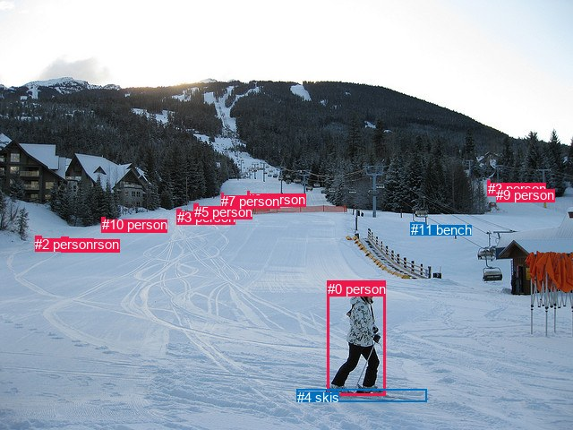
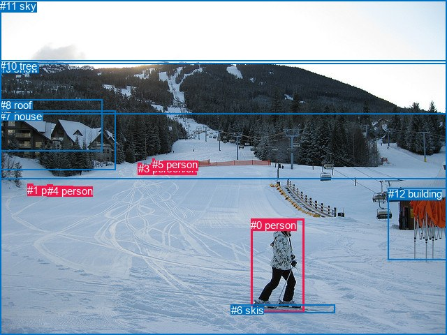

# 图片 0107：2316321.jpg

随机样本序号：461。图片 SHA256：`56ac4b8eb60e81efeeb2c9c2d974276bcbaa8f62aef1fe4f8fa38281339426cf`。

红色框表示人，蓝色框表示其他物体。两个模式分别保留自身框编号，可依据位置比较对应对象。

## 自动检测框与输出

人的框编号：`[0, 1, 2, 3, 5, 6, 7, 8, 9, 10]`。状态：`ok`。

### 自动检测全部物体框

| 编号 | 类别 | 是否为人 | 检测分数 | 像素坐标 xyxy |
|---|---|---|---|---|
| 0 | person | True | 0.9995 | 366.0, 313.6, 430.2, 441.7 |
| 1 | person | True | 0.9975 | 68.4, 264.2, 76.0, 280.7 |
| 2 | person | True | 0.9956 | 39.2, 263.5, 46.6, 279.8 |
| 3 | person | True | 0.9814 | 197.6, 233.6, 202.4, 242.0 |
| 4 | skis | False | 0.9713 | 331.5, 434.7, 476.2, 448.7 |
| 5 | person | True | 0.9693 | 216.5, 227.6, 221.4, 242.5 |
| 6 | person | True | 0.7133 | 276.4, 213.6, 278.7, 217.3 |
| 7 | person | True | 0.6730 | 247.2, 215.6, 249.7, 219.8 |
| 8 | person | True | 0.6011 | 544.8, 201.8, 547.9, 209.1 |
| 9 | person | True | 0.4893 | 554.1, 208.6, 556.9, 214.6 |
| 10 | person | True | 0.4352 | 114.0, 242.1, 117.6, 251.3 |
| 11 | bench | False | 0.3713 | 458.9, 248.2, 474.9, 258.9 |

### 自动检测 Top50 人相关候选

评分物体对：132；人相关物体对：130；输出关系：50。

| 排名 | 主语编号与类别 | 关系 | 宾语编号与类别 | 类型 | 人与人 | 排序分数 | 原始融合 logit |
|---|---|---|---|---|---|---|---|
| 1 | #0 person | on | #4 skis | spatial | False | 0.98563 | 4.2281 |
| 2 | #0 person | wearing | #4 skis | semantic | False | 0.98231 | 4.0172 |
| 3 | #5 person | on | #7 person | spatial | True | 0.88733 | 2.0637 |
| 4 | #1 person | on | #10 person | spatial | True | 0.82588 | 1.5567 |
| 5 | #5 person | standing on | #7 person | semantic | True | 0.81907 | 1.5101 |
| 6 | #2 person | in | #10 person | spatial | True | 0.81133 | 1.4587 |
| 7 | #6 person | on | #7 person | spatial | True | 0.77548 | 1.2395 |
| 8 | #5 person | standing on | #3 person | semantic | True | 0.76769 | 1.1953 |
| 9 | #8 person | beside | #9 person | spatial | True | 0.75809 | 1.1422 |
| 10 | #8 person | riding | #9 person | semantic | True | 0.71116 | 0.9010 |
| 11 | #3 person | standing on | #7 person | semantic | True | 0.70812 | 0.8863 |
| 12 | #5 person | on | #3 person | spatial | True | 0.69532 | 0.8251 |
| 13 | #5 person | on | #6 person | spatial | True | 0.68120 | 0.7593 |
| 14 | #5 person | on | #10 person | spatial | True | 0.67382 | 0.7255 |
| 15 | #7 person | on | #6 person | spatial | True | 0.66773 | 0.6980 |
| 16 | #3 person | on | #7 person | spatial | True | 0.66465 | 0.6841 |
| 17 | #3 person | in | #10 person | spatial | True | 0.65145 | 0.6254 |
| 18 | #5 person | standing on | #6 person | semantic | True | 0.63310 | 0.5456 |
| 19 | #1 person | walking on | #10 person | semantic | True | 0.60234 | 0.4152 |
| 20 | #2 person | walking on | #10 person | semantic | True | 0.58723 | 0.3525 |
| 21 | #9 person | standing on | #8 person | semantic | True | 0.58073 | 0.3258 |
| 22 | #10 person | on | #7 person | spatial | True | 0.56993 | 0.2816 |
| 23 | #3 person | standing on | #6 person | semantic | True | 0.56500 | 0.2615 |
| 24 | #7 person | wearing | #6 person | semantic | True | 0.55577 | 0.2240 |
| 25 | #3 person | on | #6 person | spatial | True | 0.54977 | 0.1997 |
| 26 | #9 person | beside | #8 person | spatial | True | 0.52657 | 0.1064 |
| 27 | #5 person | standing on | #10 person | semantic | True | 0.52314 | 0.0926 |
| 28 | #3 person | standing on | #10 person | semantic | True | 0.48317 | -0.0673 |
| 29 | #11 bench | on | #8 person | spatial | False | 0.47855 | -0.0858 |
| 30 | #3 person | on | #5 person | spatial | True | 0.47686 | -0.0926 |
| 31 | #6 person | wearing | #7 person | semantic | True | 0.47064 | -0.1176 |
| 32 | #4 skis | on | #0 person | spatial | False | 0.46517 | -0.1396 |
| 33 | #2 person | in | #1 person | spatial | True | 0.45620 | -0.1757 |
| 34 | #3 person | walking on | #5 person | semantic | True | 0.40568 | -0.3818 |
| 35 | #1 person | in | #2 person | spatial | True | 0.39922 | -0.4087 |
| 36 | #11 bench | on | #6 person | spatial | False | 0.39132 | -0.4418 |
| 37 | #7 person | on | #10 person | spatial | True | 0.38008 | -0.4892 |
| 38 | #1 person | walking on | #2 person | semantic | True | 0.37606 | -0.5063 |
| 39 | #10 person | on | #6 person | spatial | True | 0.36205 | -0.5665 |
| 40 | #11 bench | on | #7 person | spatial | False | 0.35209 | -0.6099 |
| 41 | #2 person | walking on | #1 person | semantic | True | 0.32836 | -0.7156 |
| 42 | #7 person | on | #8 person | spatial | True | 0.32496 | -0.7311 |
| 43 | #6 person | on | #8 person | spatial | True | 0.32038 | -0.7520 |
| 44 | #11 bench | on | #9 person | spatial | False | 0.28422 | -0.9236 |
| 45 | #6 person | on | #10 person | spatial | True | 0.24256 | -1.1387 |
| 46 | #7 person | on | #9 person | spatial | True | 0.22429 | -1.2408 |
| 47 | #10 person | wearing | #7 person | semantic | True | 0.22314 | -1.2474 |
| 48 | #7 person | climbing | #3 person | semantic | True | 0.20922 | -1.3296 |
| 49 | #6 person | on | #9 person | spatial | True | 0.20049 | -1.3833 |
| 50 | #10 person | on | #8 person | spatial | True | 0.19027 | -1.4483 |

### 自动检测逐条人相关 GT 核验

R@50：25.00%；命中 1/4。

| GT 主语编号 | GT 关系 | GT 宾语编号 | 结果阶段 | 匹配预测主语编号 | 匹配预测宾语编号 |
|---|---|---|---|---|---|
| 0 | standing on | 6 | wrong_predicate | [0] | [4] |
| 0 | wearing | 6 | hit50 | [0] | [4] |
| 2 | going down | 9 | endpoint_missing_or_wrong_class | [] | [] |
| 3 | going down | 9 | endpoint_missing_or_wrong_class | [3] | [] |

## 真实框与输出

人的框编号：`[0, 1, 2, 3, 4, 5]`。

### 真实框全部物体框

| 编号 | 类别 | 是否为人 | 检测分数 | 像素坐标 xyxy |
|---|---|---|---|---|
| 0 | person | True | GT | 359.0, 314.0, 436.0, 448.0 |
| 1 | person | True | GT | 39.0, 264.0, 47.0, 280.0 |
| 2 | person | True | GT | 217.0, 233.0, 221.0, 241.0 |
| 3 | person | True | GT | 198.0, 233.0, 203.0, 241.0 |
| 4 | person | True | GT | 68.0, 265.0, 76.0, 280.0 |
| 5 | person | True | GT | 218.0, 227.0, 221.0, 234.0 |
| 6 | skis | False | GT | 331.0, 436.0, 480.0, 448.0 |
| 7 | house | False | GT | 0.0, 158.0, 165.0, 243.0 |
| 8 | roof | False | GT | 0.0, 142.0, 146.0, 216.0 |
| 9 | snow | False | GT | 0.0, 90.0, 640.0, 480.0 |
| 10 | tree | False | GT | 0.0, 86.0, 640.0, 257.0 |
| 11 | sky | False | GT | 0.0, 0.0, 640.0, 163.0 |
| 12 | building | False | GT | 556.0, 269.0, 640.0, 372.0 |

### 真实框 Top50 人相关候选

评分物体对：156；人相关物体对：114；输出关系：50。

| 排名 | 主语编号与类别 | 关系 | 宾语编号与类别 | 类型 | 人与人 | 排序分数 | 原始融合 logit |
|---|---|---|---|---|---|---|---|
| 1 | #0 person | on | #6 skis | spatial | False | 0.98633 | 4.2790 |
| 2 | #0 person | wearing | #6 skis | semantic | False | 0.98023 | 3.9038 |
| 3 | #2 person | in | #9 snow | spatial | False | 0.95868 | 3.1441 |
| 4 | #0 person | in | #9 snow | spatial | False | 0.95750 | 3.1149 |
| 5 | #1 person | in | #9 snow | spatial | False | 0.95033 | 2.9515 |
| 6 | #4 person | in | #9 snow | spatial | False | 0.95016 | 2.9477 |
| 7 | #3 person | in | #9 snow | spatial | False | 0.95003 | 2.9451 |
| 8 | #5 person | in | #9 snow | spatial | False | 0.94726 | 2.8882 |
| 9 | #5 person | riding | #2 person | semantic | True | 0.91936 | 2.4336 |
| 10 | #5 person | on | #2 person | spatial | True | 0.90349 | 2.2366 |
| 11 | #1 person | going down | #9 snow | semantic | False | 0.89742 | 2.1689 |
| 12 | #2 person | in | #10 tree | spatial | False | 0.89366 | 2.1287 |
| 13 | #2 person | holding | #5 person | semantic | True | 0.89074 | 2.0983 |
| 14 | #5 person | in | #10 tree | spatial | False | 0.88983 | 2.0890 |
| 15 | #4 person | going down | #9 snow | semantic | False | 0.88717 | 2.0622 |
| 16 | #5 person | standing on | #9 snow | semantic | False | 0.87648 | 1.9595 |
| 17 | #3 person | in | #10 tree | spatial | False | 0.87434 | 1.9398 |
| 18 | #5 person | walking on | #10 tree | semantic | False | 0.87349 | 1.9322 |
| 19 | #2 person | standing on | #9 snow | semantic | False | 0.86829 | 1.8860 |
| 20 | #2 person | walking on | #10 tree | semantic | False | 0.86663 | 1.8715 |
| 21 | #3 person | standing on | #9 snow | semantic | False | 0.86359 | 1.8454 |
| 22 | #3 person | walking on | #10 tree | semantic | False | 0.86063 | 1.8205 |
| 23 | #0 person | going down | #9 snow | semantic | False | 0.85447 | 1.7701 |
| 24 | #2 person | on | #5 person | spatial | True | 0.74245 | 1.0588 |
| 25 | #1 person | walking on | #10 tree | semantic | False | 0.55996 | 0.2410 |
| 26 | #1 person | beside | #7 house | spatial | False | 0.54193 | 0.1681 |
| 27 | #1 person | walking on | #7 house | semantic | False | 0.49950 | -0.0020 |
| 28 | #12 building | beside | #0 person | spatial | False | 0.49476 | -0.0210 |
| 29 | #4 person | walking on | #10 tree | semantic | False | 0.48096 | -0.0762 |
| 30 | #6 skis | on | #0 person | spatial | False | 0.42045 | -0.3209 |
| 31 | #1 person | in | #10 tree | spatial | False | 0.40935 | -0.3667 |
| 32 | #4 person | in | #7 house | spatial | False | 0.37775 | -0.4991 |
| 33 | #4 person | walking on | #7 house | semantic | False | 0.36569 | -0.5507 |
| 34 | #4 person | in | #10 tree | spatial | False | 0.33642 | -0.6793 |
| 35 | #1 person | beside | #8 roof | spatial | False | 0.23404 | -1.1856 |
| 36 | #1 person | walking on | #8 roof | semantic | False | 0.22245 | -1.2515 |
| 37 | #0 person | in | #10 tree | spatial | False | 0.22244 | -1.2515 |
| 38 | #11 sky | over | #0 person | spatial | False | 0.15449 | -1.6998 |
| 39 | #4 person | walking on | #8 roof | semantic | False | 0.14472 | -1.7766 |
| 40 | #4 person | beside | #8 roof | spatial | False | 0.13898 | -1.8238 |
| 41 | #4 person | in | #1 person | spatial | True | 0.13435 | -1.8630 |
| 42 | #1 person | walking on | #4 person | semantic | True | 0.12876 | -1.9119 |
| 43 | #12 building | looking at | #0 person | semantic | False | 0.12736 | -1.9245 |
| 44 | #9 snow | in | #0 person | spatial | False | 0.12091 | -1.9838 |
| 45 | #4 person | walking on | #1 person | semantic | True | 0.11879 | -2.0039 |
| 46 | #6 skis | holding | #0 person | semantic | False | 0.11860 | -2.0058 |
| 47 | #1 person | in | #4 person | spatial | True | 0.11686 | -2.0225 |
| 48 | #0 person | going down | #10 tree | semantic | False | 0.11079 | -2.0827 |
| 49 | #5 person | walking on | #3 person | semantic | True | 0.09817 | -2.2178 |
| 50 | #5 person | on | #3 person | spatial | True | 0.09393 | -2.2665 |

### 真实框逐条人相关 GT 核验

R@50：25.00%；命中 1/4。

| GT 主语编号 | GT 关系 | GT 宾语编号 | 结果阶段 | 匹配预测主语编号 | 匹配预测宾语编号 |
|---|---|---|---|---|---|
| 0 | standing on | 6 | wrong_predicate | [0] | [6] |
| 0 | wearing | 6 | hit50 | [0] | [6] |
| 2 | going down | 9 | wrong_predicate | [2] | [9] |
| 3 | going down | 9 | wrong_predicate | [3] | [9] |

## 全部人相关 GT

| 主语编号与类别 | 关系 | 宾语编号与类别 |
|---|---|---|
| #0 person | standing on | #6 skis |
| #0 person | wearing | #6 skis |
| #2 person | going down | #9 snow |
| #3 person | going down | #9 snow |

原始记录、全部人相关物体对的两项预测与分项分数见 [逐图证据 JSON](../evidence/cases/0107.json)。全部56类 logits 保留于本机 HOR/output/random500/logits/。

<!-- HOR_COMPLETE_RESULTS -->

## 六组条件的完整输出对照

以下保留同一图片三种框与候选模式、两种谓词输出规则的全部 Top50。框编号各自在所属模式内解释。

### 自动检测框完整枚举：空间与语义各保留一个谓词

| 排名 | 主语编号与类别 | 谓词 | 宾语编号与类别 | 分组 | 排序分数 | predicate logit | pair logit |
|---|---|---|---|---|---|---|---|
| 1 | #0 person | on | #4 skis | spatial | 0.9856301 | 3.8500400 | 0.3781059 |
| 2 | #0 person | wearing | #4 skis | semantic | 0.9823149 | 3.6390834 | 0.3781059 |
| 3 | #5 person | on | #7 person | spatial | 0.8873253 | 2.0342546 | 0.0294527 |
| 4 | #1 person | on | #10 person | spatial | 0.8258821 | 2.0835476 | -0.5268282 |
| 5 | #5 person | standing on | #7 person | semantic | 0.8190715 | 1.4806170 | 0.0294527 |
| 6 | #2 person | in | #10 person | spatial | 0.8113338 | 2.0031204 | -0.5444198 |
| 7 | #6 person | on | #7 person | spatial | 0.7754767 | 1.2607737 | -0.0212754 |
| 8 | #5 person | standing on | #3 person | semantic | 0.7676855 | 1.3291383 | -0.1338505 |
| 9 | #8 person | beside | #9 person | spatial | 0.7580924 | 1.4273577 | -0.2851080 |
| 10 | #8 person | riding | #9 person | semantic | 0.7111604 | 1.1861343 | -0.2851080 |
| 11 | #3 person | standing on | #7 person | semantic | 0.7081212 | 0.9221425 | -0.0358658 |
| 12 | #5 person | on | #3 person | spatial | 0.6953206 | 0.9589634 | -0.1338505 |
| 13 | #5 person | on | #6 person | spatial | 0.6812029 | 0.8712959 | -0.1119907 |
| 14 | #5 person | on | #10 person | spatial | 0.6738245 | 1.3481798 | -0.6226456 |
| 15 | #7 person | on | #6 person | spatial | 0.6677337 | 0.8437824 | -0.1458295 |
| 16 | #3 person | on | #7 person | spatial | 0.6646545 | 0.7199717 | -0.0358658 |
| 17 | #3 person | in | #10 person | spatial | 0.6514530 | 1.2249570 | -0.5995250 |
| 18 | #5 person | standing on | #6 person | semantic | 0.6331032 | 0.6575437 | -0.1119907 |
| 19 | #1 person | walking on | #10 person | semantic | 0.6023412 | 0.9420581 | -0.5268282 |
| 20 | #2 person | walking on | #10 person | semantic | 0.5872257 | 0.8969278 | -0.5444198 |
| 21 | #9 person | standing on | #8 person | semantic | 0.5807277 | 0.5366631 | -0.2109017 |
| 22 | #10 person | on | #7 person | spatial | 0.5699270 | 0.8581181 | -0.5765646 |
| 23 | #3 person | standing on | #6 person | semantic | 0.5649992 | 0.4509840 | -0.1895074 |
| 24 | #7 person | wearing | #6 person | semantic | 0.5557672 | 0.3698301 | -0.1458295 |
| 25 | #3 person | on | #6 person | spatial | 0.5497720 | 0.3892570 | -0.1895074 |
| 26 | #9 person | beside | #8 person | spatial | 0.5265689 | 0.3172774 | -0.2109017 |
| 27 | #5 person | standing on | #10 person | semantic | 0.5231409 | 0.7152753 | -0.6226456 |
| 28 | #3 person | standing on | #10 person | semantic | 0.4831693 | 0.5321770 | -0.5995250 |
| 29 | #11 bench | on | #8 person | spatial | 0.4785543 | 0.3626122 | -0.4484477 |
| 30 | #3 person | on | #5 person | spatial | 0.4768564 | 0.2442455 | -0.3368864 |
| 31 | #6 person | wearing | #7 person | semantic | 0.4706447 | -0.0962811 | -0.0212754 |
| 32 | #4 skis | on | #0 person | spatial | 0.4651690 | 0.6177063 | -0.7572563 |
| 33 | #2 person | in | #1 person | spatial | 0.4561952 | 0.0195265 | -0.1951963 |
| 34 | #3 person | walking on | #5 person | semantic | 0.4056815 | -0.0449605 | -0.3368864 |
| 35 | #1 person | in | #2 person | spatial | 0.3992195 | -0.1911125 | -0.2176058 |
| 36 | #11 bench | on | #6 person | spatial | 0.3913201 | 0.1006818 | -0.5424483 |
| 37 | #7 person | on | #10 person | spatial | 0.3800846 | 0.2997355 | -0.7889245 |
| 38 | #1 person | walking on | #2 person | semantic | 0.3760630 | -0.2886868 | -0.2176058 |
| 39 | #10 person | on | #6 person | spatial | 0.3620482 | 0.1579976 | -0.7244828 |
| 40 | #11 bench | on | #7 person | spatial | 0.3520888 | -0.0523520 | -0.5575183 |
| 41 | #2 person | walking on | #1 person | semantic | 0.3283636 | -0.5203991 | -0.1951963 |
| 42 | #7 person | on | #8 person | spatial | 0.3249629 | 0.1021299 | -0.8331863 |
| 43 | #6 person | on | #8 person | spatial | 0.3203815 | 0.0693159 | -0.8213353 |
| 44 | #11 bench | on | #9 person | spatial | 0.2842203 | -0.4426980 | -0.4809248 |
| 45 | #6 person | on | #10 person | spatial | 0.2425633 | -0.2733593 | -0.8653178 |
| 46 | #7 person | on | #9 person | spatial | 0.2242931 | -0.4236126 | -0.8172083 |
| 47 | #10 person | wearing | #7 person | semantic | 0.2231434 | -0.6708765 | -0.5765646 |
| 48 | #7 person | climbing | #3 person | semantic | 0.2092239 | -0.6656084 | -0.6640015 |
| 49 | #6 person | on | #9 person | spatial | 0.2004863 | -0.5742135 | -0.8090446 |
| 50 | #10 person | on | #8 person | spatial | 0.1902704 | -0.3440843 | -1.1041701 |

GT 命中：1/4，R@50=25.00%。

| GT主语 | GT谓词 | GT宾语 | 结果阶段 | 匹配主语框 | 匹配宾语框 |
|---|---|---|---|---|---|
| 0 | standing on | 6 | wrong_predicate | [0] | [4] |
| 0 | wearing | 6 | hit50 | [0] | [4] |
| 2 | going down | 9 | endpoint_missing_or_wrong_class | [] | [] |
| 3 | going down | 9 | endpoint_missing_or_wrong_class | [3] | [] |

### 自动检测框完整枚举：每对只保留一个谓词

| 排名 | 主语编号与类别 | 谓词 | 宾语编号与类别 | 分组 | 排序分数 | predicate logit | pair logit |
|---|---|---|---|---|---|---|---|
| 1 | #0 person | on | #4 skis | single | 0.9856301 | 3.8500400 | 0.3781059 |
| 2 | #5 person | on | #7 person | single | 0.8873253 | 2.0342546 | 0.0294527 |
| 3 | #1 person | on | #10 person | single | 0.8258821 | 2.0835476 | -0.5268282 |
| 4 | #2 person | in | #10 person | single | 0.8113338 | 2.0031204 | -0.5444198 |
| 5 | #6 person | on | #7 person | single | 0.7754767 | 1.2607737 | -0.0212754 |
| 6 | #5 person | standing on | #3 person | single | 0.7676855 | 1.3291383 | -0.1338505 |
| 7 | #8 person | beside | #9 person | single | 0.7580924 | 1.4273577 | -0.2851080 |
| 8 | #3 person | standing on | #7 person | single | 0.7081212 | 0.9221425 | -0.0358658 |
| 9 | #5 person | on | #6 person | single | 0.6812029 | 0.8712959 | -0.1119907 |
| 10 | #5 person | on | #10 person | single | 0.6738245 | 1.3481798 | -0.6226456 |
| 11 | #7 person | on | #6 person | single | 0.6677337 | 0.8437824 | -0.1458295 |
| 12 | #3 person | in | #10 person | single | 0.6514530 | 1.2249570 | -0.5995250 |
| 13 | #9 person | standing on | #8 person | single | 0.5807277 | 0.5366631 | -0.2109017 |
| 14 | #10 person | on | #7 person | single | 0.5699270 | 0.8581181 | -0.5765646 |
| 15 | #3 person | standing on | #6 person | single | 0.5649992 | 0.4509840 | -0.1895074 |
| 16 | #11 bench | on | #8 person | single | 0.4785543 | 0.3626122 | -0.4484477 |
| 17 | #3 person | on | #5 person | single | 0.4768564 | 0.2442455 | -0.3368864 |
| 18 | #4 skis | on | #0 person | single | 0.4651690 | 0.6177063 | -0.7572563 |
| 19 | #2 person | in | #1 person | single | 0.4561952 | 0.0195265 | -0.1951963 |
| 20 | #1 person | in | #2 person | single | 0.3992195 | -0.1911125 | -0.2176058 |
| 21 | #11 bench | on | #6 person | single | 0.3913201 | 0.1006818 | -0.5424483 |
| 22 | #7 person | on | #10 person | single | 0.3800846 | 0.2997355 | -0.7889245 |
| 23 | #10 person | on | #6 person | single | 0.3620482 | 0.1579976 | -0.7244828 |
| 24 | #11 bench | on | #7 person | single | 0.3520888 | -0.0523520 | -0.5575183 |
| 25 | #7 person | on | #8 person | single | 0.3249629 | 0.1021299 | -0.8331863 |
| 26 | #6 person | on | #8 person | single | 0.3203815 | 0.0693159 | -0.8213353 |
| 27 | #11 bench | on | #9 person | single | 0.2842203 | -0.4426980 | -0.4809248 |
| 28 | #6 person | on | #10 person | single | 0.2425633 | -0.2733593 | -0.8653178 |
| 29 | #7 person | on | #9 person | single | 0.2242931 | -0.4236126 | -0.8172083 |
| 30 | #7 person | climbing | #3 person | single | 0.2092239 | -0.6656084 | -0.6640015 |
| 31 | #6 person | on | #9 person | single | 0.2004863 | -0.5742135 | -0.8090446 |
| 32 | #10 person | on | #8 person | single | 0.1902704 | -0.3440843 | -1.1041701 |
| 33 | #7 person | climbing | #5 person | single | 0.1864210 | -0.7499559 | -0.7234797 |
| 34 | #6 person | climbing | #5 person | single | 0.1778634 | -0.7435272 | -0.7873632 |
| 35 | #8 person | climbing | #11 bench | single | 0.1680155 | -0.7501571 | -0.8496007 |
| 36 | #9 person | climbing | #11 bench | single | 0.1672068 | -0.7841659 | -0.8213882 |
| 37 | #9 person | on | #10 person | single | 0.1566835 | -0.8522172 | -0.8308969 |
| 38 | #8 person | on | #10 person | single | 0.1485117 | -0.8988457 | -0.8474766 |
| 39 | #6 person | climbing | #3 person | single | 0.1456518 | -1.0232885 | -0.7458313 |
| 40 | #2 person | walking on | #11 bench | single | 0.1443725 | -1.0740559 | -0.7053821 |
| 41 | #6 person | climbing | #11 bench | single | 0.1427074 | -0.7407146 | -1.0522686 |
| 42 | #5 person | on | #8 person | single | 0.1359332 | -1.4614272 | -0.3880596 |
| 43 | #11 bench | on | #10 person | single | 0.1343378 | -1.0966544 | -0.7664831 |
| 44 | #9 person | on | #6 person | single | 0.1327822 | -1.2338166 | -0.6427636 |
| 45 | #1 person | on | #7 person | single | 0.1308916 | -1.0495331 | -0.8435650 |
| 46 | #9 person | on | #7 person | single | 0.1289489 | -1.3293905 | -0.5808938 |
| 47 | #10 person | on | #9 person | single | 0.1260963 | -0.8262677 | -1.1096562 |
| 48 | #8 person | on | #6 person | single | 0.1238818 | -1.2575946 | -0.6985787 |
| 49 | #5 person | walking on | #11 bench | single | 0.1215425 | -1.0289121 | -0.9489914 |
| 50 | #2 person | on | #7 person | single | 0.1172986 | -1.1120040 | -0.9062605 |

GT 命中：0/4，R@50=0.00%。

| GT主语 | GT谓词 | GT宾语 | 结果阶段 | 匹配主语框 | 匹配宾语框 |
|---|---|---|---|---|---|
| 0 | standing on | 6 | wrong_predicate | [0] | [4] |
| 0 | wearing | 6 | wrong_predicate | [0] | [4] |
| 2 | going down | 9 | endpoint_missing_or_wrong_class | [] | [] |
| 3 | going down | 9 | endpoint_missing_or_wrong_class | [3] | [] |

### 真实框完整枚举：空间与语义各保留一个谓词

| 排名 | 主语编号与类别 | 谓词 | 宾语编号与类别 | 分组 | 排序分数 | predicate logit | pair logit |
|---|---|---|---|---|---|---|---|
| 1 | #0 person | on | #6 skis | spatial | 0.9863331 | 3.8924403 | 0.3865774 |
| 2 | #0 person | wearing | #6 skis | semantic | 0.9802333 | 3.5172153 | 0.3865774 |
| 3 | #2 person | in | #9 snow | spatial | 0.9586768 | 3.0930429 | 0.0510860 |
| 4 | #0 person | in | #9 snow | spatial | 0.9575016 | 3.2147431 | -0.0998840 |
| 5 | #1 person | in | #9 snow | spatial | 0.9503333 | 3.0257778 | -0.0742993 |
| 6 | #4 person | in | #9 snow | spatial | 0.9501565 | 3.0390530 | -0.0913141 |
| 7 | #3 person | in | #9 snow | spatial | 0.9500300 | 2.9124956 | 0.0325751 |
| 8 | #5 person | in | #9 snow | spatial | 0.9472603 | 2.8655877 | 0.0226173 |
| 9 | #5 person | riding | #2 person | semantic | 0.9193551 | 2.5121036 | -0.0784864 |
| 10 | #5 person | on | #2 person | spatial | 0.9034868 | 2.3150682 | -0.0784864 |
| 11 | #1 person | going down | #9 snow | semantic | 0.8974235 | 2.2432184 | -0.0742993 |
| 12 | #2 person | in | #10 tree | spatial | 0.8936633 | 2.3637700 | -0.2350520 |
| 13 | #2 person | holding | #5 person | semantic | 0.8907387 | 2.4788208 | -0.3805119 |
| 14 | #5 person | in | #10 tree | spatial | 0.8898280 | 2.3235002 | -0.2345148 |
| 15 | #4 person | going down | #9 snow | semantic | 0.8871742 | 2.1535110 | -0.0913141 |
| 16 | #5 person | standing on | #9 snow | semantic | 0.8764784 | 1.9368787 | 0.0226173 |
| 17 | #3 person | in | #10 tree | spatial | 0.8743356 | 2.2168555 | -0.2770067 |
| 18 | #5 person | walking on | #10 tree | semantic | 0.8734940 | 2.1667256 | -0.2345148 |
| 19 | #2 person | standing on | #9 snow | semantic | 0.8682941 | 1.8348737 | 0.0510860 |
| 20 | #2 person | walking on | #10 tree | semantic | 0.8666307 | 2.1065426 | -0.2350520 |
| 21 | #3 person | standing on | #9 snow | semantic | 0.8635881 | 1.8128414 | 0.0325751 |
| 22 | #3 person | walking on | #10 tree | semantic | 0.8606266 | 2.0975113 | -0.2770067 |
| 23 | #0 person | going down | #9 snow | semantic | 0.8544676 | 1.8699641 | -0.0998840 |
| 24 | #2 person | on | #5 person | spatial | 0.7424522 | 1.4392653 | -0.3805119 |
| 25 | #1 person | walking on | #10 tree | semantic | 0.5599619 | 0.7975526 | -0.5565454 |
| 26 | #1 person | beside | #7 house | spatial | 0.5419294 | 0.7133212 | -0.5452089 |
| 27 | #1 person | walking on | #7 house | semantic | 0.4995027 | 0.5432196 | -0.5452089 |
| 28 | #12 building | beside | #0 person | spatial | 0.4947620 | 1.0075259 | -1.0284786 |
| 29 | #4 person | walking on | #10 tree | semantic | 0.4809599 | 0.4605417 | -0.5367391 |
| 30 | #6 skis | on | #0 person | spatial | 0.4204477 | 0.4700885 | -0.7910244 |
| 31 | #1 person | in | #10 tree | spatial | 0.4093507 | 0.1898952 | -0.5565454 |
| 32 | #4 person | in | #7 house | spatial | 0.3777525 | 0.0517220 | -0.5508211 |
| 33 | #4 person | walking on | #7 house | semantic | 0.3656937 | 0.0000854 | -0.5508211 |
| 34 | #4 person | in | #10 tree | spatial | 0.3364211 | -0.1425452 | -0.5367391 |
| 35 | #1 person | beside | #8 roof | spatial | 0.2340385 | -0.3102436 | -0.8754025 |
| 36 | #1 person | walking on | #8 roof | semantic | 0.2224468 | -0.3760619 | -0.8754025 |
| 37 | #0 person | in | #10 tree | spatial | 0.2224404 | -0.0362244 | -1.2152765 |
| 38 | #11 sky | over | #0 person | spatial | 0.1544876 | -0.5379038 | -1.1619253 |
| 39 | #4 person | walking on | #8 roof | semantic | 0.1447190 | -0.8966305 | -0.8800055 |
| 40 | #4 person | beside | #8 roof | spatial | 0.1389838 | -0.9437504 | -0.8800055 |
| 41 | #4 person | in | #1 person | spatial | 0.1343533 | -1.6388717 | -0.2241319 |
| 42 | #1 person | walking on | #4 person | semantic | 0.1287628 | -1.7195895 | -0.1923529 |
| 43 | #12 building | looking at | #0 person | semantic | 0.1273612 | -0.8960161 | -1.0284786 |
| 44 | #9 snow | in | #0 person | spatial | 0.1209100 | -0.8255785 | -1.1582626 |
| 45 | #4 person | walking on | #1 person | semantic | 0.1187944 | -1.7797647 | -0.2241319 |
| 46 | #6 skis | holding | #0 person | semantic | 0.1186003 | -1.2147281 | -0.7910244 |
| 47 | #1 person | in | #4 person | spatial | 0.1168600 | -1.8301544 | -0.1923529 |
| 48 | #0 person | going down | #10 tree | semantic | 0.1107883 | -0.8674374 | -1.2152765 |
| 49 | #5 person | walking on | #3 person | semantic | 0.0981660 | -2.1197584 | -0.0980120 |
| 50 | #5 person | on | #3 person | spatial | 0.0939335 | -2.1685133 | -0.0980120 |

GT 命中：1/4，R@50=25.00%。

| GT主语 | GT谓词 | GT宾语 | 结果阶段 | 匹配主语框 | 匹配宾语框 |
|---|---|---|---|---|---|
| 0 | standing on | 6 | wrong_predicate | [0] | [6] |
| 0 | wearing | 6 | hit50 | [0] | [6] |
| 2 | going down | 9 | wrong_predicate | [2] | [9] |
| 3 | going down | 9 | wrong_predicate | [3] | [9] |

### 真实框完整枚举：每对只保留一个谓词

| 排名 | 主语编号与类别 | 谓词 | 宾语编号与类别 | 分组 | 排序分数 | predicate logit | pair logit |
|---|---|---|---|---|---|---|---|
| 1 | #0 person | on | #6 skis | single | 0.9863331 | 3.8924403 | 0.3865774 |
| 2 | #2 person | in | #9 snow | single | 0.9586768 | 3.0930429 | 0.0510860 |
| 3 | #0 person | in | #9 snow | single | 0.9575016 | 3.2147431 | -0.0998840 |
| 4 | #1 person | in | #9 snow | single | 0.9503333 | 3.0257778 | -0.0742993 |
| 5 | #4 person | in | #9 snow | single | 0.9501565 | 3.0390530 | -0.0913141 |
| 6 | #3 person | in | #9 snow | single | 0.9500300 | 2.9124956 | 0.0325751 |
| 7 | #5 person | in | #9 snow | single | 0.9472603 | 2.8655877 | 0.0226173 |
| 8 | #5 person | riding | #2 person | single | 0.9193551 | 2.5121036 | -0.0784864 |
| 9 | #2 person | in | #10 tree | single | 0.8936633 | 2.3637700 | -0.2350520 |
| 10 | #2 person | holding | #5 person | single | 0.8907387 | 2.4788208 | -0.3805119 |
| 11 | #5 person | in | #10 tree | single | 0.8898280 | 2.3235002 | -0.2345148 |
| 12 | #3 person | in | #10 tree | single | 0.8743356 | 2.2168555 | -0.2770067 |
| 13 | #1 person | walking on | #10 tree | single | 0.5599619 | 0.7975526 | -0.5565454 |
| 14 | #1 person | beside | #7 house | single | 0.5419294 | 0.7133212 | -0.5452089 |
| 15 | #12 building | beside | #0 person | single | 0.4947620 | 1.0075259 | -1.0284786 |
| 16 | #4 person | walking on | #10 tree | single | 0.4809599 | 0.4605417 | -0.5367391 |
| 17 | #6 skis | on | #0 person | single | 0.4204477 | 0.4700885 | -0.7910244 |
| 18 | #4 person | in | #7 house | single | 0.3777525 | 0.0517220 | -0.5508211 |
| 19 | #1 person | beside | #8 roof | single | 0.2340385 | -0.3102436 | -0.8754025 |
| 20 | #0 person | in | #10 tree | single | 0.2224404 | -0.0362244 | -1.2152765 |
| 21 | #11 sky | over | #0 person | single | 0.1544876 | -0.5379038 | -1.1619253 |
| 22 | #4 person | walking on | #8 roof | single | 0.1447190 | -0.8966305 | -0.8800055 |
| 23 | #4 person | in | #1 person | single | 0.1343533 | -1.6388717 | -0.2241319 |
| 24 | #1 person | walking on | #4 person | single | 0.1287628 | -1.7195895 | -0.1923529 |
| 25 | #9 snow | in | #0 person | single | 0.1209100 | -0.8255785 | -1.1582626 |
| 26 | #5 person | walking on | #3 person | single | 0.0981660 | -2.1197584 | -0.0980120 |
| 27 | #2 person | walking on | #3 person | single | 0.0932034 | -2.0189896 | -0.2561447 |
| 28 | #0 person | looking at | #11 sky | single | 0.0891918 | -0.8515768 | -1.4719667 |
| 29 | #3 person | walking on | #2 person | single | 0.0879336 | -2.1288247 | -0.2103057 |
| 30 | #4 person | looking at | #0 person | single | 0.0744652 | -1.4394562 | -1.0805843 |
| 31 | #1 person | looking at | #0 person | single | 0.0734108 | -1.4265025 | -1.1089365 |
| 32 | #0 person | on | #12 building | single | 0.0643876 | -1.0855322 | -1.5907476 |
| 33 | #3 person | walking on | #5 person | single | 0.0587954 | -2.4139528 | -0.3591433 |
| 34 | #7 house | beside | #0 person | single | 0.0492110 | -1.5214109 | -1.4397645 |
| 35 | #9 snow | on | #3 person | single | 0.0480860 | -1.7920833 | -1.1934015 |
| 36 | #9 snow | on | #2 person | single | 0.0449580 | -1.8728285 | -1.1831989 |
| 37 | #1 person | walking on | #12 building | single | 0.0446560 | -1.5194664 | -1.5436165 |
| 38 | #3 person | in | #7 house | single | 0.0423740 | -2.2426188 | -0.8753038 |
| 39 | #2 person | on | #12 building | single | 0.0421081 | -2.0474389 | -1.0770562 |
| 40 | #2 person | in | #7 house | single | 0.0420169 | -2.2327743 | -0.8939849 |
| 41 | #10 tree | on | #3 person | single | 0.0413978 | -2.2885165 | -0.8537328 |
| 42 | #10 tree | beside | #0 person | single | 0.0401060 | -2.3027718 | -0.8725252 |
| 43 | #10 tree | on | #2 person | single | 0.0398789 | -2.3316839 | -0.8495269 |
| 44 | #5 person | in | #7 house | single | 0.0370730 | -2.3558507 | -0.9012377 |
| 45 | #3 person | on | #12 building | single | 0.0364365 | -2.1991112 | -1.0759552 |
| 46 | #5 person | on | #12 building | single | 0.0357134 | -2.3320892 | -0.9637745 |
| 47 | #5 person | looking at | #0 person | single | 0.0345090 | -1.8894305 | -1.4419866 |
| 48 | #2 person | looking at | #0 person | single | 0.0316148 | -1.9366591 | -1.4853458 |
| 49 | #7 house | beside | #3 person | single | 0.0298226 | -2.2560301 | -1.2261827 |
| 50 | #3 person | looking at | #0 person | single | 0.0297682 | -2.0425014 | -1.4415916 |

GT 命中：0/4，R@50=0.00%。

| GT主语 | GT谓词 | GT宾语 | 结果阶段 | 匹配主语框 | 匹配宾语框 |
|---|---|---|---|---|---|
| 0 | standing on | 6 | wrong_predicate | [0] | [6] |
| 0 | wearing | 6 | wrong_predicate | [0] | [6] |
| 2 | going down | 9 | wrong_predicate | [2] | [9] |
| 3 | going down | 9 | wrong_predicate | [3] | [9] |

### 真实框400候选：空间与语义各保留一个谓词

| 排名 | 主语编号与类别 | 谓词 | 宾语编号与类别 | 分组 | 排序分数 | predicate logit | pair logit |
|---|---|---|---|---|---|---|---|
| 1 | #0 person | on | #6 skis | spatial | 0.9863331 | 3.8924403 | 0.3865774 |
| 2 | #0 person | wearing | #6 skis | semantic | 0.9802333 | 3.5172153 | 0.3865774 |
| 3 | #2 person | in | #9 snow | spatial | 0.9586768 | 3.0930429 | 0.0510860 |
| 4 | #0 person | in | #9 snow | spatial | 0.9575016 | 3.2147431 | -0.0998840 |
| 5 | #1 person | in | #9 snow | spatial | 0.9503333 | 3.0257778 | -0.0742993 |
| 6 | #4 person | in | #9 snow | spatial | 0.9501565 | 3.0390530 | -0.0913141 |
| 7 | #3 person | in | #9 snow | spatial | 0.9500300 | 2.9124956 | 0.0325751 |
| 8 | #5 person | in | #9 snow | spatial | 0.9472603 | 2.8655877 | 0.0226173 |
| 9 | #5 person | riding | #2 person | semantic | 0.9193733 | 2.5123482 | -0.0784864 |
| 10 | #5 person | on | #2 person | spatial | 0.9034868 | 2.3150682 | -0.0784864 |
| 11 | #1 person | going down | #9 snow | semantic | 0.8974235 | 2.2432184 | -0.0742993 |
| 12 | #2 person | in | #10 tree | spatial | 0.8930308 | 2.3571324 | -0.2350520 |
| 13 | #2 person | holding | #5 person | semantic | 0.8904508 | 2.4758668 | -0.3805119 |
| 14 | #5 person | in | #10 tree | spatial | 0.8891756 | 2.3168626 | -0.2345148 |
| 15 | #4 person | going down | #9 snow | semantic | 0.8877866 | 2.1596427 | -0.0913141 |
| 16 | #5 person | standing on | #9 snow | semantic | 0.8760802 | 1.9332061 | 0.0226173 |
| 17 | #3 person | in | #10 tree | spatial | 0.8743356 | 2.2168555 | -0.2770067 |
| 18 | #5 person | walking on | #10 tree | semantic | 0.8704710 | 2.1396446 | -0.2345148 |
| 19 | #2 person | standing on | #9 snow | semantic | 0.8687136 | 1.8385463 | 0.0510860 |
| 20 | #3 person | walking on | #10 tree | semantic | 0.8638434 | 2.1245923 | -0.2770067 |
| 21 | #3 person | standing on | #9 snow | semantic | 0.8631549 | 1.8091693 | 0.0325751 |
| 22 | #2 person | walking on | #10 tree | semantic | 0.8631141 | 2.0764518 | -0.2350520 |
| 23 | #0 person | going down | #9 snow | semantic | 0.8566706 | 1.8877916 | -0.0998840 |
| 24 | #2 person | on | #5 person | spatial | 0.7366565 | 1.4091744 | -0.3805119 |
| 25 | #1 person | walking on | #10 tree | semantic | 0.5607036 | 0.8005633 | -0.5565454 |
| 26 | #1 person | beside | #7 house | spatial | 0.5493606 | 0.7432966 | -0.5452089 |
| 27 | #1 person | walking on | #7 house | semantic | 0.4995027 | 0.5432196 | -0.5452089 |
| 28 | #12 building | beside | #0 person | spatial | 0.4947475 | 1.0074677 | -1.0284786 |
| 29 | #4 person | walking on | #10 tree | semantic | 0.4884755 | 0.4906330 | -0.5367391 |
| 30 | #6 skis | on | #0 person | spatial | 0.4131335 | 0.4399977 | -0.7910244 |
| 31 | #1 person | in | #10 tree | spatial | 0.4093507 | 0.1898952 | -0.5565454 |
| 32 | #4 person | in | #7 house | spatial | 0.3773625 | 0.0500627 | -0.5508211 |
| 33 | #4 person | walking on | #7 house | semantic | 0.3590888 | -0.0285001 | -0.5508211 |
| 34 | #4 person | in | #10 tree | spatial | 0.3379044 | -0.1359076 | -0.5367391 |
| 35 | #1 person | beside | #8 roof | spatial | 0.2340281 | -0.3103018 | -0.8754025 |
| 36 | #0 person | in | #10 tree | spatial | 0.2227276 | -0.0345650 | -1.2152765 |
| 37 | #1 person | walking on | #8 roof | semantic | 0.2177980 | -0.4031425 | -0.8754025 |
| 38 | #11 sky | over | #0 person | spatial | 0.1541425 | -0.5405483 | -1.1619253 |
| 39 | #4 person | walking on | #8 roof | semantic | 0.1412166 | -0.9252167 | -0.8800055 |
| 40 | #4 person | beside | #8 roof | spatial | 0.1354184 | -0.9738705 | -0.8800055 |
| 41 | #4 person | in | #1 person | spatial | 0.1334744 | -1.6464503 | -0.2241319 |
| 42 | #1 person | walking on | #4 person | semantic | 0.1270844 | -1.7346349 | -0.1923529 |
| 43 | #12 building | looking at | #0 person | semantic | 0.1257366 | -0.9107134 | -1.0284786 |
| 44 | #9 snow | in | #0 person | spatial | 0.1209100 | -0.8255785 | -1.1582626 |
| 45 | #4 person | walking on | #1 person | semantic | 0.1202192 | -1.7662244 | -0.2241319 |
| 46 | #6 skis | holding | #0 person | semantic | 0.1156416 | -1.2433424 | -0.7910244 |
| 47 | #1 person | in | #4 person | spatial | 0.1141251 | -1.8569272 | -0.1923529 |
| 48 | #0 person | going down | #10 tree | semantic | 0.1081538 | -0.8944628 | -1.2152765 |
| 49 | #5 person | walking on | #3 person | semantic | 0.0968421 | -2.1348040 | -0.0980120 |
| 50 | #5 person | on | #3 person | spatial | 0.0924321 | -2.1862817 | -0.0980120 |

GT 命中：1/4，R@50=25.00%。

| GT主语 | GT谓词 | GT宾语 | 结果阶段 | 匹配主语框 | 匹配宾语框 |
|---|---|---|---|---|---|
| 0 | standing on | 6 | wrong_predicate | [0] | [6] |
| 0 | wearing | 6 | hit50 | [0] | [6] |
| 2 | going down | 9 | wrong_predicate | [2] | [9] |
| 3 | going down | 9 | wrong_predicate | [3] | [9] |

### 真实框400候选：每对只保留一个谓词

| 排名 | 主语编号与类别 | 谓词 | 宾语编号与类别 | 分组 | 排序分数 | predicate logit | pair logit |
|---|---|---|---|---|---|---|---|
| 1 | #0 person | on | #6 skis | single | 0.9863331 | 3.8924403 | 0.3865774 |
| 2 | #2 person | in | #9 snow | single | 0.9586768 | 3.0930429 | 0.0510860 |
| 3 | #0 person | in | #9 snow | single | 0.9575016 | 3.2147431 | -0.0998840 |
| 4 | #1 person | in | #9 snow | single | 0.9503333 | 3.0257778 | -0.0742993 |
| 5 | #4 person | in | #9 snow | single | 0.9501565 | 3.0390530 | -0.0913141 |
| 6 | #3 person | in | #9 snow | single | 0.9500300 | 2.9124956 | 0.0325751 |
| 7 | #5 person | in | #9 snow | single | 0.9472603 | 2.8655877 | 0.0226173 |
| 8 | #5 person | riding | #2 person | single | 0.9193733 | 2.5123482 | -0.0784864 |
| 9 | #2 person | in | #10 tree | single | 0.8930308 | 2.3571324 | -0.2350520 |
| 10 | #2 person | holding | #5 person | single | 0.8904508 | 2.4758668 | -0.3805119 |
| 11 | #5 person | in | #10 tree | single | 0.8891756 | 2.3168626 | -0.2345148 |
| 12 | #3 person | in | #10 tree | single | 0.8743356 | 2.2168555 | -0.2770067 |
| 13 | #1 person | walking on | #10 tree | single | 0.5607036 | 0.8005633 | -0.5565454 |
| 14 | #1 person | beside | #7 house | single | 0.5493606 | 0.7432966 | -0.5452089 |
| 15 | #12 building | beside | #0 person | single | 0.4947475 | 1.0074677 | -1.0284786 |
| 16 | #4 person | walking on | #10 tree | single | 0.4884755 | 0.4906330 | -0.5367391 |
| 17 | #6 skis | on | #0 person | single | 0.4131335 | 0.4399977 | -0.7910244 |
| 18 | #4 person | in | #7 house | single | 0.3773625 | 0.0500627 | -0.5508211 |
| 19 | #1 person | beside | #8 roof | single | 0.2340281 | -0.3103018 | -0.8754025 |
| 20 | #0 person | in | #10 tree | single | 0.2227276 | -0.0345650 | -1.2152765 |
| 21 | #11 sky | over | #0 person | single | 0.1541425 | -0.5405483 | -1.1619253 |
| 22 | #4 person | walking on | #8 roof | single | 0.1412166 | -0.9252167 | -0.8800055 |
| 23 | #4 person | in | #1 person | single | 0.1334744 | -1.6464503 | -0.2241319 |
| 24 | #1 person | walking on | #4 person | single | 0.1270844 | -1.7346349 | -0.1923529 |
| 25 | #9 snow | in | #0 person | single | 0.1209100 | -0.8255785 | -1.1582626 |
| 26 | #5 person | walking on | #3 person | single | 0.0968421 | -2.1348040 | -0.0980120 |
| 27 | #2 person | walking on | #3 person | single | 0.0919395 | -2.0340352 | -0.2561447 |
| 28 | #3 person | walking on | #2 person | single | 0.0876925 | -2.1318352 | -0.2103057 |
| 29 | #0 person | looking at | #11 sky | single | 0.0868049 | -0.8813193 | -1.4719667 |
| 30 | #4 person | looking at | #0 person | single | 0.0744652 | -1.4394562 | -1.0805843 |
| 31 | #1 person | looking at | #0 person | single | 0.0734108 | -1.4265025 | -1.1089365 |
| 32 | #0 person | on | #12 building | single | 0.0625985 | -1.1156235 | -1.5907476 |
| 33 | #3 person | walking on | #5 person | single | 0.0612137 | -2.3710740 | -0.3591433 |
| 34 | #7 house | beside | #0 person | single | 0.0492113 | -1.5214040 | -1.4397645 |
| 35 | #9 snow | on | #3 person | single | 0.0483358 | -1.7866383 | -1.1934015 |
| 36 | #9 snow | on | #2 person | single | 0.0449580 | -1.8728285 | -1.1831989 |
| 37 | #1 person | walking on | #12 building | single | 0.0434522 | -1.5480523 | -1.5436165 |
| 38 | #3 person | in | #7 house | single | 0.0423740 | -2.2426188 | -0.8753038 |
| 39 | #10 tree | on | #3 person | single | 0.0421636 | -2.2693872 | -0.8537328 |
| 40 | #2 person | on | #12 building | single | 0.0421081 | -2.0474389 | -1.0770562 |
| 41 | #2 person | in | #7 house | single | 0.0414154 | -2.2478197 | -0.8939849 |
| 42 | #10 tree | beside | #0 person | single | 0.0395330 | -2.3177595 | -0.8725252 |
| 43 | #10 tree | on | #2 person | single | 0.0389231 | -2.3569386 | -0.8495269 |
| 44 | #5 person | in | #7 house | single | 0.0380711 | -2.3282487 | -0.9012377 |
| 45 | #3 person | on | #12 building | single | 0.0361484 | -2.2073510 | -1.0759552 |
| 46 | #5 person | on | #12 building | single | 0.0349660 | -2.3540134 | -0.9637745 |
| 47 | #5 person | looking at | #0 person | single | 0.0345090 | -1.8894305 | -1.4419866 |
| 48 | #2 person | looking at | #0 person | single | 0.0316255 | -1.9363105 | -1.4853458 |
| 49 | #3 person | looking at | #0 person | single | 0.0297682 | -2.0425014 | -1.4415916 |
| 50 | #7 house | beside | #3 person | single | 0.0293916 | -2.2710323 | -1.2261827 |

GT 命中：0/4，R@50=0.00%。

| GT主语 | GT谓词 | GT宾语 | 结果阶段 | 匹配主语框 | 匹配宾语框 |
|---|---|---|---|---|---|
| 0 | standing on | 6 | wrong_predicate | [0] | [6] |
| 0 | wearing | 6 | wrong_predicate | [0] | [6] |
| 2 | going down | 9 | wrong_predicate | [2] | [9] |
| 3 | going down | 9 | wrong_predicate | [3] | [9] |
