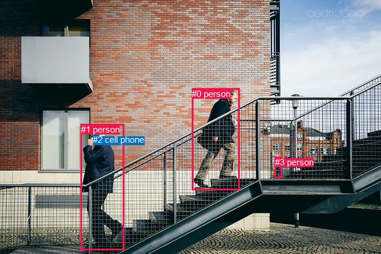
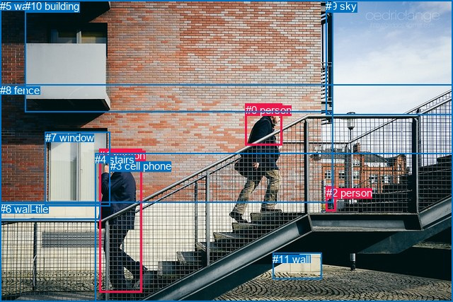

# 图片 0111：2316413.jpg

随机样本序号：354。图片 SHA256：`685bd913e0bfbbcd9d91b2368c219696308f51ba4f9428b077584d64b5a6ae83`。

红色框表示人，蓝色框表示其他物体。两个模式分别保留自身框编号，可依据位置比较对应对象。

## 自动检测框与输出

人的框编号：`[0, 1, 3]`。状态：`ok`。

### 自动检测全部物体框

| 编号 | 类别 | 是否为人 | 检测分数 | 像素坐标 xyxy |
|---|---|---|---|---|
| 0 | person | True | 0.9988 | 322.2, 148.8, 402.4, 319.5 |
| 1 | person | True | 0.9959 | 136.0, 208.7, 208.6, 420.7 |
| 2 | cell phone | False | 0.9855 | 156.1, 226.2, 166.5, 240.4 |
| 3 | person | True | 0.9417 | 461.6, 263.5, 473.5, 299.9 |

### 自动检测 Top50 人相关候选

评分物体对：12；人相关物体对：12；输出关系：24。

| 排名 | 主语编号与类别 | 关系 | 宾语编号与类别 | 类型 | 人与人 | 排序分数 | 原始融合 logit |
|---|---|---|---|---|---|---|---|
| 1 | #1 person | holding | #2 cell phone | semantic | False | 0.99058 | 4.6560 |
| 2 | #1 person | climbing | #0 person | semantic | True | 0.95848 | 3.1392 |
| 3 | #0 person | climbing | #1 person | semantic | True | 0.95535 | 3.0632 |
| 4 | #0 person | talking to | #2 cell phone | semantic | False | 0.93360 | 2.6433 |
| 5 | #1 person | beside | #0 person | spatial | True | 0.91544 | 2.3819 |
| 6 | #0 person | beside | #3 person | spatial | True | 0.90958 | 2.3085 |
| 7 | #0 person | climbing | #3 person | semantic | True | 0.88779 | 2.0684 |
| 8 | #0 person | beside | #1 person | spatial | True | 0.88566 | 2.0472 |
| 9 | #3 person | climbing | #0 person | semantic | True | 0.84150 | 1.6694 |
| 10 | #1 person | walking on | #3 person | semantic | True | 0.82620 | 1.5589 |
| 11 | #3 person | beside | #0 person | spatial | True | 0.79115 | 1.3319 |
| 12 | #1 person | beside | #2 cell phone | spatial | False | 0.72433 | 0.9661 |
| 13 | #3 person | climbing | #1 person | semantic | True | 0.66672 | 0.6934 |
| 14 | #2 cell phone | holding | #1 person | semantic | False | 0.47771 | -0.0892 |
| 15 | #3 person | beside | #1 person | spatial | True | 0.45985 | -0.1609 |
| 16 | #2 cell phone | on | #1 person | spatial | False | 0.43469 | -0.2628 |
| 17 | #0 person | beside | #2 cell phone | spatial | False | 0.37123 | -0.5269 |
| 18 | #1 person | in front of | #3 person | spatial | True | 0.26853 | -1.0021 |
| 19 | #2 cell phone | beside | #0 person | spatial | False | 0.10924 | -2.0985 |
| 20 | #3 person | carrying | #2 cell phone | semantic | False | 0.06017 | -2.7486 |
| 21 | #2 cell phone | holding | #0 person | semantic | False | 0.03781 | -3.2367 |
| 22 | #3 person | beside | #2 cell phone | spatial | False | 0.01907 | -3.9406 |
| 23 | #2 cell phone | holding | #3 person | semantic | False | 0.01791 | -4.0041 |
| 24 | #2 cell phone | in front of | #3 person | spatial | False | 0.00751 | -4.8842 |

### 自动检测逐条人相关 GT 核验

R@50：16.67%；命中 1/6。

| GT 主语编号 | GT 关系 | GT 宾语编号 | 结果阶段 | 匹配预测主语编号 | 匹配预测宾语编号 |
|---|---|---|---|---|---|
| 0 | walking on | 4 | endpoint_missing_or_wrong_class | [] | [] |
| 1 | holding | 3 | hit50 | [1] | [2] |
| 1 | going down | 4 | endpoint_missing_or_wrong_class | [1] | [] |
| 1 | wearing | 4 | endpoint_missing_or_wrong_class | [1] | [] |
| 2 | wearing | 0 | endpoint_missing_or_wrong_class | [3] | [] |
| 8 | in front of | 0 | endpoint_missing_or_wrong_class | [] | [] |

## 真实框与输出

人的框编号：`[0, 1, 2]`。

### 真实框全部物体框

| 编号 | 类别 | 是否为人 | 检测分数 | 像素坐标 xyxy |
|---|---|---|---|---|
| 0 | person | True | GT | 347.0, 147.0, 399.0, 206.0 |
| 1 | person | True | GT | 140.0, 211.0, 200.0, 414.0 |
| 2 | person | True | GT | 461.0, 264.0, 475.0, 299.0 |
| 3 | cell phone | False | GT | 156.0, 226.0, 167.0, 239.0 |
| 4 | stairs | False | GT | 134.0, 217.0, 640.0, 427.0 |
| 5 | wall-brick | False | GT | 0.0, 0.0, 470.0, 287.0 |
| 6 | wall-tile | False | GT | 0.0, 287.0, 142.0, 310.0 |
| 7 | window | False | GT | 64.0, 186.0, 155.0, 291.0 |
| 8 | fence | False | GT | 0.0, 119.0, 640.0, 427.0 |
| 9 | sky | False | GT | 460.0, 0.0, 640.0, 162.0 |
| 10 | building | False | GT | 35.0, 0.0, 471.0, 159.0 |
| 11 | wall | False | GT | 385.0, 358.0, 454.0, 395.0 |

### 真实框 Top50 人相关候选

评分物体对：132；人相关物体对：60；输出关系：50。

| 排名 | 主语编号与类别 | 关系 | 宾语编号与类别 | 类型 | 人与人 | 排序分数 | 原始融合 logit |
|---|---|---|---|---|---|---|---|
| 1 | #1 person | talking to | #3 cell phone | semantic | False | 0.99040 | 4.6364 |
| 2 | #2 person | walking on | #8 fence | semantic | False | 0.98408 | 4.1241 |
| 3 | #2 person | walking on | #4 stairs | semantic | False | 0.97893 | 3.8384 |
| 4 | #1 person | walking on | #8 fence | semantic | False | 0.97851 | 3.8185 |
| 5 | #1 person | looking at | #7 window | semantic | False | 0.96794 | 3.4075 |
| 6 | #1 person | walking on | #4 stairs | semantic | False | 0.96157 | 3.2198 |
| 7 | #1 person | leaning on | #8 fence | spatial | False | 0.96077 | 3.1983 |
| 8 | #1 person | on | #3 cell phone | spatial | False | 0.95607 | 3.0803 |
| 9 | #2 person | on | #4 stairs | spatial | False | 0.94228 | 2.7928 |
| 10 | #2 person | on | #8 fence | spatial | False | 0.93149 | 2.6099 |
| 11 | #1 person | on | #4 stairs | spatial | False | 0.92727 | 2.5455 |
| 12 | #0 person | walking on | #8 fence | semantic | False | 0.88156 | 2.0072 |
| 13 | #0 person | walking on | #4 stairs | semantic | False | 0.88088 | 2.0008 |
| 14 | #1 person | leaning on | #5 wall-brick | spatial | False | 0.86698 | 1.8745 |
| 15 | #0 person | on | #4 stairs | spatial | False | 0.83961 | 1.6553 |
| 16 | #1 person | leaning on | #7 window | spatial | False | 0.79170 | 1.3352 |
| 17 | #1 person | looking at | #5 wall-brick | semantic | False | 0.78217 | 1.2783 |
| 18 | #0 person | on | #8 fence | spatial | False | 0.76791 | 1.1965 |
| 19 | #3 cell phone | on | #1 person | spatial | False | 0.76435 | 1.1767 |
| 20 | #1 person | leaning on | #6 wall-tile | spatial | False | 0.44967 | -0.2020 |
| 21 | #2 person | walking on | #5 wall-brick | semantic | False | 0.41710 | -0.3347 |
| 22 | #1 person | wearing | #0 person | semantic | True | 0.37046 | -0.5302 |
| 23 | #2 person | on | #5 wall-brick | spatial | False | 0.35408 | -0.6012 |
| 24 | #1 person | walking on | #6 wall-tile | semantic | False | 0.28215 | -0.9338 |
| 25 | #3 cell phone | holding | #1 person | semantic | False | 0.26850 | -1.0023 |
| 26 | #1 person | looking at | #10 building | semantic | False | 0.26088 | -1.0414 |
| 27 | #2 person | walking on | #11 wall | semantic | False | 0.22996 | -1.2085 |
| 28 | #0 person | looking at | #5 wall-brick | semantic | False | 0.22555 | -1.2336 |
| 29 | #1 person | walking on | #11 wall | semantic | False | 0.22351 | -1.2453 |
| 30 | #7 window | beside | #1 person | spatial | False | 0.21451 | -1.2979 |
| 31 | #2 person | on | #11 wall | spatial | False | 0.19028 | -1.4482 |
| 32 | #1 person | leaning on | #10 building | spatial | False | 0.17774 | -1.5317 |
| 33 | #1 person | in | #0 person | spatial | True | 0.16064 | -1.6534 |
| 34 | #7 window | looking at | #1 person | semantic | False | 0.15036 | -1.7318 |
| 35 | #2 person | looking at | #1 person | semantic | True | 0.14206 | -1.7983 |
| 36 | #1 person | on | #11 wall | spatial | False | 0.12968 | -1.9038 |
| 37 | #0 person | on | #1 person | spatial | True | 0.12542 | -1.9421 |
| 38 | #2 person | wearing | #0 person | semantic | True | 0.12395 | -1.9556 |
| 39 | #6 wall-tile | beside | #1 person | spatial | False | 0.12345 | -1.9602 |
| 40 | #2 person | on | #6 wall-tile | spatial | False | 0.11847 | -2.0070 |
| 41 | #0 person | on | #5 wall-brick | spatial | False | 0.11779 | -2.0135 |
| 42 | #8 fence | beside | #1 person | spatial | False | 0.11561 | -2.0347 |
| 43 | #1 person | looking at | #9 sky | semantic | False | 0.10163 | -2.1792 |
| 44 | #0 person | looking at | #9 sky | semantic | False | 0.08451 | -2.3826 |
| 45 | #9 sky | over | #1 person | spatial | False | 0.08345 | -2.3963 |
| 46 | #0 person | wearing | #1 person | semantic | True | 0.08224 | -2.4122 |
| 47 | #4 stairs | beside | #1 person | spatial | False | 0.07994 | -2.4431 |
| 48 | #9 sky | over | #0 person | spatial | False | 0.07062 | -2.5772 |
| 49 | #2 person | walking on | #6 wall-tile | semantic | False | 0.06815 | -2.6155 |
| 50 | #0 person | looking at | #10 building | semantic | False | 0.06607 | -2.6487 |

### 真实框逐条人相关 GT 核验

R@50：33.33%；命中 2/6。

| GT 主语编号 | GT 关系 | GT 宾语编号 | 结果阶段 | 匹配预测主语编号 | 匹配预测宾语编号 |
|---|---|---|---|---|---|
| 0 | walking on | 4 | hit50 | [0] | [4] |
| 1 | holding | 3 | wrong_predicate | [1] | [3] |
| 1 | going down | 4 | wrong_predicate | [1] | [4] |
| 1 | wearing | 4 | wrong_predicate | [1] | [4] |
| 2 | wearing | 0 | hit50 | [2] | [0] |
| 8 | in front of | 0 | wrong_predicate | [8] | [0] |

## 全部人相关 GT

| 主语编号与类别 | 关系 | 宾语编号与类别 |
|---|---|---|
| #0 person | walking on | #4 stairs |
| #1 person | holding | #3 cell phone |
| #1 person | going down | #4 stairs |
| #1 person | wearing | #4 stairs |
| #2 person | wearing | #0 person |
| #8 fence | in front of | #0 person |

原始记录、全部人相关物体对的两项预测与分项分数见 [逐图证据 JSON](../evidence/cases/0111.json)。全部56类 logits 保留于本机 HOR/output/random500/logits/。

<!-- HOR_COMPLETE_RESULTS -->

## 六组条件的完整输出对照

以下保留同一图片三种框与候选模式、两种谓词输出规则的全部 Top50。框编号各自在所属模式内解释。

### 自动检测框完整枚举：空间与语义各保留一个谓词

| 排名 | 主语编号与类别 | 谓词 | 宾语编号与类别 | 分组 | 排序分数 | predicate logit | pair logit |
|---|---|---|---|---|---|---|---|
| 1 | #1 person | holding | #2 cell phone | semantic | 0.9905849 | 4.0930295 | 0.5629582 |
| 2 | #1 person | climbing | #0 person | semantic | 0.9584816 | 3.9848876 | -0.8456749 |
| 3 | #0 person | climbing | #1 person | semantic | 0.9553469 | 4.0033708 | -0.9402202 |
| 4 | #0 person | talking to | #2 cell phone | semantic | 0.9335969 | 3.1529279 | -0.5096276 |
| 5 | #1 person | beside | #0 person | spatial | 0.9154362 | 3.2275701 | -0.8456749 |
| 6 | #0 person | beside | #3 person | spatial | 0.9095751 | 3.1673880 | -0.8589303 |
| 7 | #0 person | climbing | #3 person | semantic | 0.8877923 | 2.9273176 | -0.8589303 |
| 8 | #0 person | beside | #1 person | spatial | 0.8856643 | 2.9874187 | -0.9402202 |
| 9 | #3 person | climbing | #0 person | semantic | 0.8415016 | 2.5754642 | -0.9060211 |
| 10 | #1 person | walking on | #3 person | semantic | 0.8261991 | 2.7683277 | -1.2094028 |
| 11 | #3 person | beside | #0 person | spatial | 0.7911534 | 2.2379131 | -0.9060211 |
| 12 | #1 person | beside | #2 cell phone | spatial | 0.7243329 | 0.4030986 | 0.5629582 |
| 13 | #3 person | climbing | #1 person | semantic | 0.6667226 | 1.8603058 | -1.1669068 |
| 14 | #2 cell phone | holding | #1 person | semantic | 0.4777118 | 0.3455853 | -0.4347970 |
| 15 | #3 person | beside | #1 person | spatial | 0.4598511 | 1.0059648 | -1.1669068 |
| 16 | #2 cell phone | on | #1 person | spatial | 0.4346870 | 0.1720438 | -0.4347970 |
| 17 | #0 person | beside | #2 cell phone | spatial | 0.3712345 | -0.0172968 | -0.5096276 |
| 18 | #1 person | in front of | #3 person | spatial | 0.2685308 | 0.2073135 | -1.2094028 |
| 19 | #2 cell phone | beside | #0 person | spatial | 0.1092427 | -1.2564301 | -0.8420704 |
| 20 | #3 person | carrying | #2 cell phone | semantic | 0.0601681 | -0.6876497 | -2.0609083 |
| 21 | #2 cell phone | holding | #0 person | semantic | 0.0378090 | -2.3945944 | -0.8420704 |
| 22 | #3 person | beside | #2 cell phone | spatial | 0.0190659 | -1.8796961 | -2.0609083 |
| 23 | #2 cell phone | holding | #3 person | semantic | 0.0179136 | -1.7804034 | -2.2237186 |
| 24 | #2 cell phone | in front of | #3 person | spatial | 0.0075081 | -2.6605203 | -2.2237186 |

GT 命中：1/6，R@50=16.67%。

| GT主语 | GT谓词 | GT宾语 | 结果阶段 | 匹配主语框 | 匹配宾语框 |
|---|---|---|---|---|---|
| 0 | walking on | 4 | endpoint_missing_or_wrong_class | [] | [] |
| 1 | holding | 3 | hit50 | [1] | [2] |
| 1 | going down | 4 | endpoint_missing_or_wrong_class | [1] | [] |
| 1 | wearing | 4 | endpoint_missing_or_wrong_class | [1] | [] |
| 2 | wearing | 0 | endpoint_missing_or_wrong_class | [3] | [] |
| 8 | in front of | 0 | endpoint_missing_or_wrong_class | [] | [] |

### 自动检测框完整枚举：每对只保留一个谓词

| 排名 | 主语编号与类别 | 谓词 | 宾语编号与类别 | 分组 | 排序分数 | predicate logit | pair logit |
|---|---|---|---|---|---|---|---|
| 1 | #1 person | holding | #2 cell phone | single | 0.9905849 | 4.0930295 | 0.5629582 |
| 2 | #1 person | climbing | #0 person | single | 0.9584816 | 3.9848876 | -0.8456749 |
| 3 | #0 person | climbing | #1 person | single | 0.9553469 | 4.0033708 | -0.9402202 |
| 4 | #0 person | talking to | #2 cell phone | single | 0.9335969 | 3.1529279 | -0.5096276 |
| 5 | #0 person | beside | #3 person | single | 0.9095751 | 3.1673880 | -0.8589303 |
| 6 | #3 person | climbing | #0 person | single | 0.8415016 | 2.5754642 | -0.9060211 |
| 7 | #1 person | walking on | #3 person | single | 0.8261991 | 2.7683277 | -1.2094028 |
| 8 | #3 person | climbing | #1 person | single | 0.6667226 | 1.8603058 | -1.1669068 |
| 9 | #2 cell phone | holding | #1 person | single | 0.4777118 | 0.3455853 | -0.4347970 |
| 10 | #2 cell phone | beside | #0 person | single | 0.1092427 | -1.2564301 | -0.8420704 |
| 11 | #3 person | carrying | #2 cell phone | single | 0.0601681 | -0.6876497 | -2.0609083 |
| 12 | #2 cell phone | holding | #3 person | single | 0.0179136 | -1.7804034 | -2.2237186 |

GT 命中：1/6，R@50=16.67%。

| GT主语 | GT谓词 | GT宾语 | 结果阶段 | 匹配主语框 | 匹配宾语框 |
|---|---|---|---|---|---|
| 0 | walking on | 4 | endpoint_missing_or_wrong_class | [] | [] |
| 1 | holding | 3 | hit50 | [1] | [2] |
| 1 | going down | 4 | endpoint_missing_or_wrong_class | [1] | [] |
| 1 | wearing | 4 | endpoint_missing_or_wrong_class | [1] | [] |
| 2 | wearing | 0 | endpoint_missing_or_wrong_class | [3] | [] |
| 8 | in front of | 0 | endpoint_missing_or_wrong_class | [] | [] |

### 真实框完整枚举：空间与语义各保留一个谓词

| 排名 | 主语编号与类别 | 谓词 | 宾语编号与类别 | 分组 | 排序分数 | predicate logit | pair logit |
|---|---|---|---|---|---|---|---|
| 1 | #1 person | talking to | #3 cell phone | semantic | 0.9904004 | 4.1055942 | 0.5307890 |
| 2 | #2 person | walking on | #8 fence | semantic | 0.9840795 | 4.3692546 | -0.2451527 |
| 3 | #2 person | walking on | #4 stairs | semantic | 0.9789266 | 4.0864053 | -0.2479610 |
| 4 | #1 person | walking on | #8 fence | semantic | 0.9785103 | 3.8126149 | 0.0058429 |
| 5 | #1 person | looking at | #7 window | semantic | 0.9679367 | 3.7770066 | -0.3695518 |
| 6 | #1 person | walking on | #4 stairs | semantic | 0.9615725 | 3.5448184 | -0.3250191 |
| 7 | #1 person | leaning on | #8 fence | spatial | 0.9607711 | 3.1924806 | 0.0058429 |
| 8 | #1 person | on | #3 cell phone | spatial | 0.9560717 | 2.5494852 | 0.5307890 |
| 9 | #2 person | on | #4 stairs | spatial | 0.9422840 | 3.0407333 | -0.2479610 |
| 10 | #2 person | on | #8 fence | spatial | 0.9314946 | 2.8550305 | -0.2451527 |
| 11 | #1 person | on | #4 stairs | spatial | 0.9272692 | 2.8704967 | -0.3250191 |
| 12 | #0 person | walking on | #8 fence | semantic | 0.8815560 | 3.4846072 | -1.4773599 |
| 13 | #0 person | walking on | #4 stairs | semantic | 0.8808782 | 3.3913655 | -1.3905926 |
| 14 | #1 person | leaning on | #5 wall-brick | spatial | 0.8669765 | 2.4534807 | -0.5789946 |
| 15 | #0 person | on | #4 stairs | spatial | 0.8396056 | 3.0458889 | -1.3905926 |
| 16 | #1 person | leaning on | #7 window | spatial | 0.7916955 | 1.7047281 | -0.3695518 |
| 17 | #1 person | looking at | #5 wall-brick | semantic | 0.7821668 | 1.8573332 | -0.5789946 |
| 18 | #0 person | on | #8 fence | spatial | 0.7679094 | 2.6739039 | -1.4773599 |
| 19 | #3 cell phone | on | #1 person | spatial | 0.7643489 | 1.5983515 | -0.4216797 |
| 20 | #1 person | leaning on | #6 wall-tile | spatial | 0.4496727 | 0.4911890 | -0.6931821 |
| 21 | #2 person | walking on | #5 wall-brick | semantic | 0.4170955 | 0.4378796 | -0.7725878 |
| 22 | #1 person | wearing | #0 person | semantic | 0.3704630 | 0.3130193 | -0.8432505 |
| 23 | #2 person | on | #5 wall-brick | spatial | 0.3540803 | 0.1714363 | -0.7725878 |
| 24 | #1 person | walking on | #6 wall-tile | semantic | 0.2821549 | -0.2406158 | -0.6931821 |
| 25 | #3 cell phone | holding | #1 person | semantic | 0.2684981 | -0.5805764 | -0.4216797 |
| 26 | #1 person | looking at | #10 building | semantic | 0.2608766 | 0.0102620 | -1.0516794 |
| 27 | #2 person | walking on | #11 wall | semantic | 0.2299649 | -0.4226551 | -0.7858543 |
| 28 | #0 person | looking at | #5 wall-brick | semantic | 0.2255472 | 0.4452448 | -1.6788720 |
| 29 | #1 person | walking on | #11 wall | semantic | 0.2235140 | -0.0931287 | -1.1521757 |
| 30 | #7 window | beside | #1 person | spatial | 0.2145103 | -0.2586484 | -1.0393014 |
| 31 | #2 person | on | #11 wall | spatial | 0.1902790 | -0.6623440 | -0.7858543 |
| 32 | #1 person | leaning on | #10 building | spatial | 0.1777381 | -0.4800682 | -1.0516794 |
| 33 | #1 person | in | #0 person | spatial | 0.1606434 | -0.8101985 | -0.8432505 |
| 34 | #7 window | looking at | #1 person | semantic | 0.1503611 | -0.6924701 | -1.0393014 |
| 35 | #2 person | looking at | #1 person | semantic | 0.1420600 | -0.6417007 | -1.1565838 |
| 36 | #1 person | on | #11 wall | spatial | 0.1296781 | -0.7516327 | -1.1521757 |
| 37 | #0 person | on | #1 person | spatial | 0.1254198 | -1.1793685 | -0.7627090 |
| 38 | #2 person | wearing | #0 person | semantic | 0.1239467 | -0.5199094 | -1.4356662 |
| 39 | #6 wall-tile | beside | #1 person | spatial | 0.1234478 | -0.9352980 | -1.0248799 |
| 40 | #2 person | on | #6 wall-tile | spatial | 0.1184679 | -1.1532745 | -0.8537447 |
| 41 | #0 person | on | #5 wall-brick | spatial | 0.1177883 | -0.3346705 | -1.6788720 |
| 42 | #8 fence | beside | #1 person | spatial | 0.1156061 | -1.0955365 | -0.9391770 |
| 43 | #1 person | looking at | #9 sky | semantic | 0.1016343 | -0.7934861 | -1.3857098 |
| 44 | #0 person | looking at | #9 sky | semantic | 0.0845095 | -0.3833647 | -1.9992318 |
| 45 | #9 sky | over | #1 person | spatial | 0.0834526 | -0.9022744 | -1.4940604 |
| 46 | #0 person | wearing | #1 person | semantic | 0.0822449 | -1.6495206 | -0.7627090 |
| 47 | #4 stairs | beside | #1 person | spatial | 0.0799432 | -1.4115813 | -1.0315373 |
| 48 | #9 sky | over | #0 person | spatial | 0.0706204 | -0.4988441 | -2.0783539 |
| 49 | #2 person | walking on | #6 wall-tile | semantic | 0.0681500 | -1.7617157 | -0.8537447 |
| 50 | #0 person | looking at | #10 building | semantic | 0.0660680 | -0.9980893 | -1.6506300 |

GT 命中：2/6，R@50=33.33%。

| GT主语 | GT谓词 | GT宾语 | 结果阶段 | 匹配主语框 | 匹配宾语框 |
|---|---|---|---|---|---|
| 0 | walking on | 4 | hit50 | [0] | [4] |
| 1 | holding | 3 | wrong_predicate | [1] | [3] |
| 1 | going down | 4 | wrong_predicate | [1] | [4] |
| 1 | wearing | 4 | wrong_predicate | [1] | [4] |
| 2 | wearing | 0 | hit50 | [2] | [0] |
| 8 | in front of | 0 | wrong_predicate | [8] | [0] |

### 真实框完整枚举：每对只保留一个谓词

| 排名 | 主语编号与类别 | 谓词 | 宾语编号与类别 | 分组 | 排序分数 | predicate logit | pair logit |
|---|---|---|---|---|---|---|---|
| 1 | #1 person | talking to | #3 cell phone | single | 0.9904004 | 4.1055942 | 0.5307890 |
| 2 | #2 person | walking on | #8 fence | single | 0.9840795 | 4.3692546 | -0.2451527 |
| 3 | #2 person | walking on | #4 stairs | single | 0.9789266 | 4.0864053 | -0.2479610 |
| 4 | #1 person | walking on | #8 fence | single | 0.9785103 | 3.8126149 | 0.0058429 |
| 5 | #1 person | looking at | #7 window | single | 0.9679367 | 3.7770066 | -0.3695518 |
| 6 | #1 person | walking on | #4 stairs | single | 0.9615725 | 3.5448184 | -0.3250191 |
| 7 | #0 person | walking on | #8 fence | single | 0.8815560 | 3.4846072 | -1.4773599 |
| 8 | #0 person | walking on | #4 stairs | single | 0.8808782 | 3.3913655 | -1.3905926 |
| 9 | #1 person | leaning on | #5 wall-brick | single | 0.8669765 | 2.4534807 | -0.5789946 |
| 10 | #3 cell phone | on | #1 person | single | 0.7643489 | 1.5983515 | -0.4216797 |
| 11 | #1 person | leaning on | #6 wall-tile | single | 0.4496727 | 0.4911890 | -0.6931821 |
| 12 | #2 person | walking on | #5 wall-brick | single | 0.4170955 | 0.4378796 | -0.7725878 |
| 13 | #1 person | wearing | #0 person | single | 0.3704630 | 0.3130193 | -0.8432505 |
| 14 | #1 person | looking at | #10 building | single | 0.2608766 | 0.0102620 | -1.0516794 |
| 15 | #2 person | walking on | #11 wall | single | 0.2299649 | -0.4226551 | -0.7858543 |
| 16 | #0 person | looking at | #5 wall-brick | single | 0.2255472 | 0.4452448 | -1.6788720 |
| 17 | #1 person | walking on | #11 wall | single | 0.2235140 | -0.0931287 | -1.1521757 |
| 18 | #7 window | beside | #1 person | single | 0.2145103 | -0.2586484 | -1.0393014 |
| 19 | #2 person | looking at | #1 person | single | 0.1420600 | -0.6417007 | -1.1565838 |
| 20 | #0 person | on | #1 person | single | 0.1254198 | -1.1793685 | -0.7627090 |
| 21 | #2 person | wearing | #0 person | single | 0.1239467 | -0.5199094 | -1.4356662 |
| 22 | #6 wall-tile | beside | #1 person | single | 0.1234478 | -0.9352980 | -1.0248799 |
| 23 | #2 person | on | #6 wall-tile | single | 0.1184679 | -1.1532745 | -0.8537447 |
| 24 | #8 fence | beside | #1 person | single | 0.1156061 | -1.0955365 | -0.9391770 |
| 25 | #1 person | looking at | #9 sky | single | 0.1016343 | -0.7934861 | -1.3857098 |
| 26 | #0 person | looking at | #9 sky | single | 0.0845095 | -0.3833647 | -1.9992318 |
| 27 | #9 sky | over | #1 person | single | 0.0834526 | -0.9022744 | -1.4940604 |
| 28 | #4 stairs | beside | #1 person | single | 0.0799432 | -1.4115813 | -1.0315373 |
| 29 | #9 sky | over | #0 person | single | 0.0706204 | -0.4988441 | -2.0783539 |
| 30 | #0 person | looking at | #10 building | single | 0.0660680 | -0.9980893 | -1.6506300 |
| 31 | #2 person | looking at | #10 building | single | 0.0614925 | -1.3146577 | -1.4107181 |
| 32 | #0 person | wearing | #2 person | single | 0.0580864 | -1.1108961 | -1.6750855 |
| 33 | #0 person | looking at | #7 window | single | 0.0483159 | -0.9380813 | -2.0423908 |
| 34 | #5 wall-brick | beside | #1 person | single | 0.0444531 | -2.1379638 | -0.9298860 |
| 35 | #2 person | looking at | #9 sky | single | 0.0354942 | -1.3847435 | -1.9175037 |
| 36 | #1 person | looking at | #2 person | single | 0.0353334 | -2.1628885 | -1.1440666 |
| 37 | #9 sky | over | #2 person | single | 0.0322222 | -1.4625907 | -1.9397571 |
| 38 | #0 person | on | #11 wall | single | 0.0223186 | -1.9582515 | -1.8215120 |
| 39 | #2 person | looking at | #7 window | single | 0.0215793 | -2.6655390 | -1.1486685 |
| 40 | #2 person | holding | #3 cell phone | single | 0.0158792 | -2.0459702 | -2.0807660 |
| 41 | #0 person | talking to | #3 cell phone | single | 0.0122123 | -2.7082996 | -1.6847215 |
| 42 | #0 person | walking on | #6 wall-tile | single | 0.0108042 | -2.6666901 | -1.8502672 |
| 43 | #11 wall | beside | #1 person | single | 0.0102535 | -3.1739721 | -1.3958557 |
| 44 | #8 fence | in | #0 person | single | 0.0088033 | -2.8593884 | -1.8644006 |
| 45 | #4 stairs | in | #2 person | single | 0.0052631 | -3.6416550 | -1.6000963 |
| 46 | #3 cell phone | on | #0 person | single | 0.0052618 | -3.5508146 | -1.6911924 |
| 47 | #10 building | beside | #1 person | single | 0.0045479 | -4.1134105 | -1.2751317 |
| 48 | #4 stairs | in | #0 person | single | 0.0042735 | -3.5962901 | -1.8547578 |
| 49 | #6 wall-tile | beside | #2 person | single | 0.0042590 | -3.8669095 | -1.5875437 |
| 50 | #8 fence | in | #2 person | single | 0.0040349 | -3.9026260 | -1.6061167 |

GT 命中：2/6，R@50=33.33%。

| GT主语 | GT谓词 | GT宾语 | 结果阶段 | 匹配主语框 | 匹配宾语框 |
|---|---|---|---|---|---|
| 0 | walking on | 4 | hit50 | [0] | [4] |
| 1 | holding | 3 | wrong_predicate | [1] | [3] |
| 1 | going down | 4 | wrong_predicate | [1] | [4] |
| 1 | wearing | 4 | wrong_predicate | [1] | [4] |
| 2 | wearing | 0 | hit50 | [2] | [0] |
| 8 | in front of | 0 | wrong_predicate | [8] | [0] |

### 真实框400候选：空间与语义各保留一个谓词

| 排名 | 主语编号与类别 | 谓词 | 宾语编号与类别 | 分组 | 排序分数 | predicate logit | pair logit |
|---|---|---|---|---|---|---|---|
| 1 | #1 person | talking to | #3 cell phone | semantic | 0.9904004 | 4.1055942 | 0.5307890 |
| 2 | #2 person | walking on | #8 fence | semantic | 0.9840795 | 4.3692546 | -0.2451527 |
| 3 | #2 person | walking on | #4 stairs | semantic | 0.9789266 | 4.0864053 | -0.2479610 |
| 4 | #1 person | walking on | #8 fence | semantic | 0.9784469 | 3.8096051 | 0.0058429 |
| 5 | #1 person | looking at | #7 window | semantic | 0.9660611 | 3.7182183 | -0.3695518 |
| 6 | #1 person | walking on | #4 stairs | semantic | 0.9635246 | 3.5989795 | -0.3250191 |
| 7 | #1 person | leaning on | #8 fence | spatial | 0.9585176 | 3.1342754 | 0.0058429 |
| 8 | #1 person | on | #3 cell phone | spatial | 0.9560717 | 2.5494852 | 0.5307890 |
| 9 | #2 person | on | #4 stairs | spatial | 0.9395440 | 2.9914403 | -0.2479610 |
| 10 | #2 person | on | #8 fence | spatial | 0.9314946 | 2.8550305 | -0.2451527 |
| 11 | #1 person | on | #4 stairs | spatial | 0.9280000 | 2.8813858 | -0.3250191 |
| 12 | #0 person | walking on | #8 fence | semantic | 0.8815560 | 3.4846072 | -1.4773599 |
| 13 | #0 person | walking on | #4 stairs | semantic | 0.8808782 | 3.3913655 | -1.3905926 |
| 14 | #1 person | leaning on | #5 wall-brick | spatial | 0.8703529 | 2.4830770 | -0.5789946 |
| 15 | #0 person | on | #4 stairs | spatial | 0.8396056 | 3.0458889 | -1.3905926 |
| 16 | #1 person | leaning on | #7 window | spatial | 0.7917770 | 1.7052221 | -0.3695518 |
| 17 | #1 person | looking at | #5 wall-brick | semantic | 0.7771171 | 1.8279390 | -0.5789946 |
| 18 | #0 person | on | #8 fence | spatial | 0.7679094 | 2.6739039 | -1.4773599 |
| 19 | #3 cell phone | on | #1 person | spatial | 0.7677900 | 1.6175537 | -0.4216797 |
| 20 | #1 person | leaning on | #6 wall-tile | spatial | 0.4497951 | 0.4916835 | -0.6931821 |
| 21 | #2 person | walking on | #5 wall-brick | semantic | 0.4240615 | 0.4664655 | -0.7725878 |
| 22 | #1 person | wearing | #0 person | semantic | 0.3704630 | 0.3130193 | -0.8432505 |
| 23 | #2 person | on | #5 wall-brick | spatial | 0.3553265 | 0.1768808 | -0.7725878 |
| 24 | #1 person | walking on | #6 wall-tile | semantic | 0.2879805 | -0.2120304 | -0.6931821 |
| 25 | #3 cell phone | holding | #1 person | semantic | 0.2732742 | -0.5563936 | -0.4216797 |
| 26 | #1 person | looking at | #10 building | semantic | 0.2551163 | -0.0198293 | -1.0516794 |
| 27 | #2 person | walking on | #11 wall | semantic | 0.2402450 | -0.3654828 | -0.7858543 |
| 28 | #0 person | looking at | #5 wall-brick | semantic | 0.2203943 | 0.4155021 | -1.6788720 |
| 29 | #1 person | walking on | #11 wall | semantic | 0.2188492 | -0.1202097 | -1.1521757 |
| 30 | #7 window | beside | #1 person | spatial | 0.2145103 | -0.2586484 | -1.0393014 |
| 31 | #2 person | on | #11 wall | spatial | 0.1915405 | -0.6541767 | -0.7858543 |
| 32 | #1 person | leaning on | #10 building | spatial | 0.1734539 | -0.5096645 | -1.0516794 |
| 33 | #1 person | in | #0 person | spatial | 0.1575060 | -0.8336527 | -0.8432505 |
| 34 | #7 window | looking at | #1 person | semantic | 0.1503834 | -0.6922960 | -1.0393014 |
| 35 | #2 person | looking at | #1 person | semantic | 0.1457671 | -0.6116099 | -1.1565838 |
| 36 | #1 person | on | #11 wall | spatial | 0.1290648 | -0.7570775 | -1.1521757 |
| 37 | #0 person | on | #1 person | spatial | 0.1254198 | -1.1793685 | -0.7627090 |
| 38 | #6 wall-tile | beside | #1 person | spatial | 0.1234452 | -0.9353223 | -1.0248799 |
| 39 | #2 person | wearing | #0 person | semantic | 0.1208718 | -0.5485339 | -1.4356662 |
| 40 | #2 person | on | #6 wall-tile | spatial | 0.1187525 | -1.1505520 | -0.8537447 |
| 41 | #0 person | on | #5 wall-brick | spatial | 0.1172238 | -0.3401151 | -1.6788720 |
| 42 | #8 fence | beside | #1 person | spatial | 0.1096052 | -1.1556032 | -0.9391770 |
| 43 | #1 person | looking at | #9 sky | semantic | 0.1015389 | -0.7945321 | -1.3857098 |
| 44 | #0 person | looking at | #9 sky | semantic | 0.0845364 | -0.3830166 | -1.9992318 |
| 45 | #9 sky | over | #1 person | spatial | 0.0832506 | -0.9049184 | -1.4940604 |
| 46 | #4 stairs | beside | #1 person | spatial | 0.0821792 | -1.3815625 | -1.0315373 |
| 47 | #0 person | wearing | #1 person | semantic | 0.0813353 | -1.6616323 | -0.7627090 |
| 48 | #9 sky | over | #0 person | spatial | 0.0724877 | -0.4707360 | -2.0783539 |
| 49 | #2 person | walking on | #6 wall-tile | semantic | 0.0689183 | -1.7496805 | -0.8537447 |
| 50 | #0 person | looking at | #10 building | semantic | 0.0660680 | -0.9980893 | -1.6506300 |

GT 命中：2/6，R@50=33.33%。

| GT主语 | GT谓词 | GT宾语 | 结果阶段 | 匹配主语框 | 匹配宾语框 |
|---|---|---|---|---|---|
| 0 | walking on | 4 | hit50 | [0] | [4] |
| 1 | holding | 3 | wrong_predicate | [1] | [3] |
| 1 | going down | 4 | wrong_predicate | [1] | [4] |
| 1 | wearing | 4 | wrong_predicate | [1] | [4] |
| 2 | wearing | 0 | hit50 | [2] | [0] |
| 8 | in front of | 0 | wrong_predicate | [8] | [0] |

### 真实框400候选：每对只保留一个谓词

| 排名 | 主语编号与类别 | 谓词 | 宾语编号与类别 | 分组 | 排序分数 | predicate logit | pair logit |
|---|---|---|---|---|---|---|---|
| 1 | #1 person | talking to | #3 cell phone | single | 0.9904004 | 4.1055942 | 0.5307890 |
| 2 | #2 person | walking on | #8 fence | single | 0.9840795 | 4.3692546 | -0.2451527 |
| 3 | #2 person | walking on | #4 stairs | single | 0.9789266 | 4.0864053 | -0.2479610 |
| 4 | #1 person | walking on | #8 fence | single | 0.9784469 | 3.8096051 | 0.0058429 |
| 5 | #1 person | looking at | #7 window | single | 0.9660611 | 3.7182183 | -0.3695518 |
| 6 | #1 person | walking on | #4 stairs | single | 0.9635246 | 3.5989795 | -0.3250191 |
| 7 | #0 person | walking on | #8 fence | single | 0.8815560 | 3.4846072 | -1.4773599 |
| 8 | #0 person | walking on | #4 stairs | single | 0.8808782 | 3.3913655 | -1.3905926 |
| 9 | #1 person | leaning on | #5 wall-brick | single | 0.8703529 | 2.4830770 | -0.5789946 |
| 10 | #3 cell phone | on | #1 person | single | 0.7677900 | 1.6175537 | -0.4216797 |
| 11 | #1 person | leaning on | #6 wall-tile | single | 0.4497951 | 0.4916835 | -0.6931821 |
| 12 | #2 person | walking on | #5 wall-brick | single | 0.4240615 | 0.4664655 | -0.7725878 |
| 13 | #1 person | wearing | #0 person | single | 0.3704630 | 0.3130193 | -0.8432505 |
| 14 | #1 person | looking at | #10 building | single | 0.2551163 | -0.0198293 | -1.0516794 |
| 15 | #2 person | walking on | #11 wall | single | 0.2402450 | -0.3654828 | -0.7858543 |
| 16 | #0 person | looking at | #5 wall-brick | single | 0.2203943 | 0.4155021 | -1.6788720 |
| 17 | #1 person | walking on | #11 wall | single | 0.2188492 | -0.1202097 | -1.1521757 |
| 18 | #7 window | beside | #1 person | single | 0.2145103 | -0.2586484 | -1.0393014 |
| 19 | #2 person | looking at | #1 person | single | 0.1457671 | -0.6116099 | -1.1565838 |
| 20 | #0 person | on | #1 person | single | 0.1254198 | -1.1793685 | -0.7627090 |
| 21 | #6 wall-tile | beside | #1 person | single | 0.1234452 | -0.9353223 | -1.0248799 |
| 22 | #2 person | wearing | #0 person | single | 0.1208718 | -0.5485339 | -1.4356662 |
| 23 | #2 person | on | #6 wall-tile | single | 0.1187525 | -1.1505520 | -0.8537447 |
| 24 | #8 fence | beside | #1 person | single | 0.1096052 | -1.1556032 | -0.9391770 |
| 25 | #1 person | looking at | #9 sky | single | 0.1015389 | -0.7945321 | -1.3857098 |
| 26 | #0 person | looking at | #9 sky | single | 0.0845364 | -0.3830166 | -1.9992318 |
| 27 | #9 sky | over | #1 person | single | 0.0832506 | -0.9049184 | -1.4940604 |
| 28 | #4 stairs | beside | #1 person | single | 0.0821792 | -1.3815625 | -1.0315373 |
| 29 | #9 sky | over | #0 person | single | 0.0724877 | -0.4707360 | -2.0783539 |
| 30 | #0 person | looking at | #10 building | single | 0.0660680 | -0.9980893 | -1.6506300 |
| 31 | #2 person | looking at | #10 building | single | 0.0606597 | -1.3291802 | -1.4107181 |
| 32 | #0 person | wearing | #2 person | single | 0.0580864 | -1.1108961 | -1.6750855 |
| 33 | #0 person | looking at | #7 window | single | 0.0490043 | -0.9232097 | -2.0423908 |
| 34 | #5 wall-brick | beside | #1 person | single | 0.0444531 | -2.1379638 | -0.9298860 |
| 35 | #2 person | looking at | #9 sky | single | 0.0360008 | -1.3700466 | -1.9175037 |
| 36 | #1 person | looking at | #2 person | single | 0.0353348 | -2.1628451 | -1.1440666 |
| 37 | #9 sky | over | #2 person | single | 0.0322557 | -1.4615164 | -1.9397571 |
| 38 | #0 person | on | #11 wall | single | 0.0218161 | -1.9815369 | -1.8215120 |
| 39 | #2 person | looking at | #7 window | single | 0.0212639 | -2.6805847 | -1.1486685 |
| 40 | #2 person | holding | #3 cell phone | single | 0.0158792 | -2.0459702 | -2.0807660 |
| 41 | #0 person | talking to | #3 cell phone | single | 0.0122123 | -2.7082996 | -1.6847215 |
| 42 | #0 person | walking on | #6 wall-tile | single | 0.0100665 | -2.7381549 | -1.8502672 |
| 43 | #11 wall | beside | #1 person | single | 0.0100276 | -3.1964829 | -1.3958557 |
| 44 | #8 fence | in | #0 person | single | 0.0088478 | -2.8542991 | -1.8644006 |
| 45 | #3 cell phone | on | #0 person | single | 0.0053411 | -3.5357690 | -1.6911924 |
| 46 | #4 stairs | in | #2 person | single | 0.0052852 | -3.6374507 | -1.6000963 |
| 47 | #10 building | beside | #1 person | single | 0.0044472 | -4.1358919 | -1.2751317 |
| 48 | #4 stairs | in | #0 person | single | 0.0043056 | -3.5887675 | -1.8547578 |
| 49 | #6 wall-tile | beside | #2 person | single | 0.0042118 | -3.8780925 | -1.5875437 |
| 50 | #8 fence | in | #2 person | single | 0.0040114 | -3.9084895 | -1.6061167 |

GT 命中：2/6，R@50=33.33%。

| GT主语 | GT谓词 | GT宾语 | 结果阶段 | 匹配主语框 | 匹配宾语框 |
|---|---|---|---|---|---|
| 0 | walking on | 4 | hit50 | [0] | [4] |
| 1 | holding | 3 | wrong_predicate | [1] | [3] |
| 1 | going down | 4 | wrong_predicate | [1] | [4] |
| 1 | wearing | 4 | wrong_predicate | [1] | [4] |
| 2 | wearing | 0 | hit50 | [2] | [0] |
| 8 | in front of | 0 | wrong_predicate | [8] | [0] |
