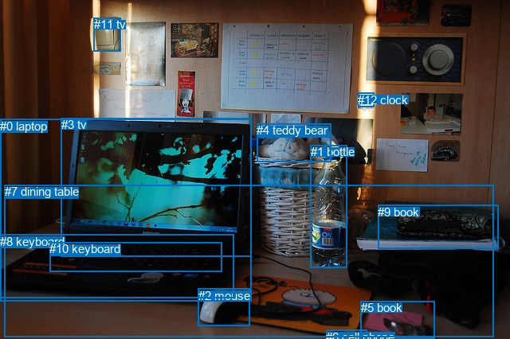
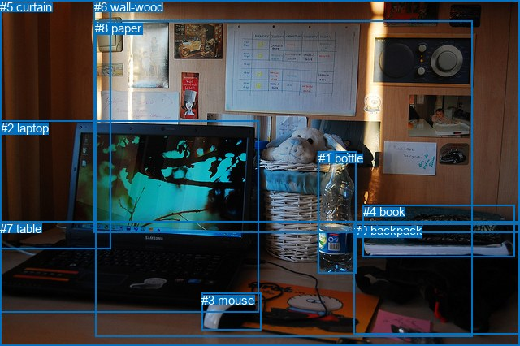

# 图片 0115：2316488.jpg

随机样本序号：268。图片 SHA256：`72e91c9eea461ca5656b3f8df0ffb7d03c6d151d1778295f0534e501853a0f0c`。

红色框表示人，蓝色框表示其他物体。两个模式分别保留自身框编号，可依据位置比较对应对象。

## 自动检测框与输出

人的框编号：`[]`。状态：`no_person`。

### 自动检测全部物体框

| 编号 | 类别 | 是否为人 | 检测分数 | 像素坐标 xyxy |
|---|---|---|---|---|
| 0 | laptop | False | 0.9993 | 0.2, 149.9, 315.5, 379.0 |
| 1 | bottle | False | 0.9989 | 389.7, 182.3, 435.8, 336.4 |
| 2 | mouse | False | 0.9937 | 248.7, 362.8, 313.4, 409.4 |
| 3 | tv | False | 0.8599 | 76.7, 148.2, 315.2, 322.7 |
| 4 | teddy bear | False | 0.8414 | 322.2, 155.2, 415.2, 203.9 |
| 5 | book | False | 0.7667 | 452.8, 378.2, 545.2, 425.4 |
| 6 | cell phone | False | 0.6595 | 409.1, 414.9, 460.9, 425.6 |
| 7 | dining table | False | 0.6361 | 5.6, 232.4, 619.4, 423.4 |
| 8 | keyboard | False | 0.5732 | 0.0, 294.9, 293.7, 374.5 |
| 9 | book | False | 0.5484 | 474.0, 257.8, 625.5, 312.2 |
| 10 | keyboard | False | 0.5352 | 62.2, 304.1, 278.2, 341.5 |
| 11 | tv | False | 0.5029 | 117.8, 22.3, 151.4, 64.8 |
| 12 | clock | False | 0.4477 | 449.1, 116.5, 469.0, 134.1 |

### 自动检测 Top50 人相关候选

评分物体对：0；人相关物体对：0；输出关系：0。

| 排名 | 主语编号与类别 | 关系 | 宾语编号与类别 | 类型 | 人与人 | 排序分数 | 原始融合 logit |
|---|---|---|---|---|---|---|---|

### 自动检测逐条人相关 GT 核验

本图没有人相关 GT，R@50 无分母；预测候选继续展示。

## 真实框与输出

人的框编号：`[]`。

### 真实框全部物体框

| 编号 | 类别 | 是否为人 | 检测分数 | 像素坐标 xyxy |
|---|---|---|---|---|
| 0 | backpack | False | GT | 436.0, 275.0, 640.0, 411.0 |
| 1 | bottle | False | GT | 392.0, 186.0, 439.0, 336.0 |
| 2 | laptop | False | GT | 1.0, 149.0, 318.0, 385.0 |
| 3 | mouse | False | GT | 248.0, 361.0, 321.0, 407.0 |
| 4 | book | False | GT | 447.0, 252.0, 634.0, 316.0 |
| 5 | curtain | False | GT | 0.0, 0.0, 137.0, 306.0 |
| 6 | wall-wood | False | GT | 116.0, 0.0, 640.0, 286.0 |
| 7 | table | False | GT | 0.0, 273.0, 640.0, 426.0 |
| 8 | paper | False | GT | 117.0, 26.0, 581.0, 414.0 |

### 真实框 Top50 人相关候选

评分物体对：0；人相关物体对：0；输出关系：0。

| 排名 | 主语编号与类别 | 关系 | 宾语编号与类别 | 类型 | 人与人 | 排序分数 | 原始融合 logit |
|---|---|---|---|---|---|---|---|

### 真实框逐条人相关 GT 核验

本图没有人相关 GT，R@50 无分母；预测候选继续展示。

## 全部人相关 GT

| 主语编号与类别 | 关系 | 宾语编号与类别 |
|---|---|---|

原始记录、全部人相关物体对的两项预测与分项分数见 [逐图证据 JSON](../evidence/cases/0115.json)。全部56类 logits 保留于本机 HOR/output/random500/logits/。

<!-- HOR_COMPLETE_RESULTS -->

## 六组条件的完整输出对照

以下保留同一图片三种框与候选模式、两种谓词输出规则的全部 Top50。框编号各自在所属模式内解释。

### 自动检测框完整枚举：空间与语义各保留一个谓词

| 排名 | 主语编号与类别 | 谓词 | 宾语编号与类别 | 分组 | 排序分数 | predicate logit | pair logit |
|---|---|---|---|---|---|---|---|

没有人相关 GT，本条件的召回率无分母。

### 自动检测框完整枚举：每对只保留一个谓词

| 排名 | 主语编号与类别 | 谓词 | 宾语编号与类别 | 分组 | 排序分数 | predicate logit | pair logit |
|---|---|---|---|---|---|---|---|

没有人相关 GT，本条件的召回率无分母。

### 真实框完整枚举：空间与语义各保留一个谓词

| 排名 | 主语编号与类别 | 谓词 | 宾语编号与类别 | 分组 | 排序分数 | predicate logit | pair logit |
|---|---|---|---|---|---|---|---|

没有人相关 GT，本条件的召回率无分母。

### 真实框完整枚举：每对只保留一个谓词

| 排名 | 主语编号与类别 | 谓词 | 宾语编号与类别 | 分组 | 排序分数 | predicate logit | pair logit |
|---|---|---|---|---|---|---|---|

没有人相关 GT，本条件的召回率无分母。

### 真实框400候选：空间与语义各保留一个谓词

| 排名 | 主语编号与类别 | 谓词 | 宾语编号与类别 | 分组 | 排序分数 | predicate logit | pair logit |
|---|---|---|---|---|---|---|---|

没有人相关 GT，本条件的召回率无分母。

### 真实框400候选：每对只保留一个谓词

| 排名 | 主语编号与类别 | 谓词 | 宾语编号与类别 | 分组 | 排序分数 | predicate logit | pair logit |
|---|---|---|---|---|---|---|---|

没有人相关 GT，本条件的召回率无分母。
