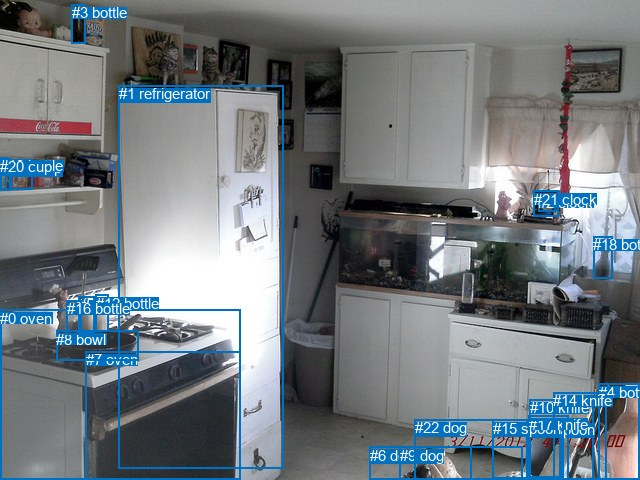
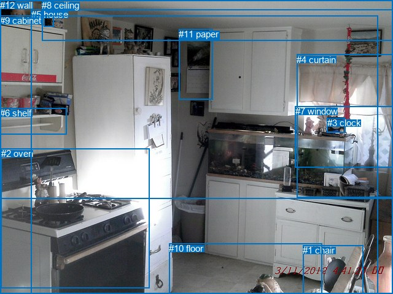

# 图片 0118：2316662.jpg

随机样本序号：163。图片 SHA256：`5d5c521df181581e25d65c7066ec28f34efadb4dbbd1d3f805fbdfd8c782b139`。

红色框表示人，蓝色框表示其他物体。两个模式分别保留自身框编号，可依据位置比较对应对象。

## 自动检测框与输出

人的框编号：`[]`。状态：`no_person`。

### 自动检测全部物体框

| 编号 | 类别 | 是否为人 | 检测分数 | 像素坐标 xyxy |
|---|---|---|---|---|
| 0 | oven | False | 0.9987 | 0.0, 310.0, 241.0, 479.3 |
| 1 | refrigerator | False | 0.9890 | 118.7, 85.2, 283.2, 468.6 |
| 2 | clock | False | 0.9753 | 538.2, 193.8, 555.8, 211.6 |
| 3 | bottle | False | 0.9633 | 72.0, 4.2, 85.9, 43.3 |
| 4 | bottle | False | 0.9486 | 599.0, 383.5, 639.9, 480.0 |
| 5 | bottle | False | 0.8617 | 78.3, 296.5, 94.0, 332.3 |
| 6 | dog | False | 0.8355 | 369.5, 446.8, 522.8, 479.6 |
| 7 | oven | False | 0.8296 | 85.7, 351.2, 240.9, 479.6 |
| 8 | bowl | False | 0.8026 | 56.1, 330.7, 138.6, 360.2 |
| 9 | dog | False | 0.7743 | 399.9, 446.7, 471.4, 479.6 |
| 10 | knife | False | 0.7684 | 529.7, 399.3, 593.2, 480.0 |
| 11 | cup | False | 0.7089 | 10.1, 159.5, 32.2, 189.2 |
| 12 | bottle | False | 0.6867 | 95.7, 294.6, 108.6, 331.7 |
| 13 | spoon | False | 0.6771 | 526.7, 421.0, 562.9, 477.3 |
| 14 | knife | False | 0.6052 | 553.2, 392.4, 606.3, 479.4 |
| 15 | spoon | False | 0.5883 | 492.7, 420.0, 560.7, 478.8 |
| 16 | bottle | False | 0.5486 | 66.8, 300.1, 81.2, 334.5 |
| 17 | knife | False | 0.4703 | 528.6, 415.9, 568.8, 479.4 |
| 18 | bottle | False | 0.4621 | 593.1, 236.3, 613.0, 278.5 |
| 19 | bottle | False | 0.4409 | 0.0, 157.1, 6.2, 190.6 |
| 20 | cup | False | 0.3953 | 0.1, 158.0, 10.9, 190.0 |
| 21 | clock | False | 0.3904 | 533.8, 190.6, 558.7, 216.7 |
| 22 | dog | False | 0.3704 | 414.5, 419.4, 563.2, 480.0 |

### 自动检测 Top50 人相关候选

评分物体对：0；人相关物体对：0；输出关系：0。

| 排名 | 主语编号与类别 | 关系 | 宾语编号与类别 | 类型 | 人与人 | 排序分数 | 原始融合 logit |
|---|---|---|---|---|---|---|---|

### 自动检测逐条人相关 GT 核验

本图没有人相关 GT，R@50 无分母；预测候选继续展示。

## 真实框与输出

人的框编号：`[]`。

### 真实框全部物体框

| 编号 | 类别 | 是否为人 | 检测分数 | 像素坐标 xyxy |
|---|---|---|---|---|
| 0 | bottle | False | GT | 71.0, 2.0, 87.0, 44.0 |
| 1 | chair | False | GT | 493.0, 400.0, 592.0, 480.0 |
| 2 | oven | False | GT | 2.0, 242.0, 243.0, 470.0 |
| 3 | clock | False | GT | 533.0, 192.0, 562.0, 216.0 |
| 4 | curtain | False | GT | 483.0, 89.0, 640.0, 322.0 |
| 5 | house | False | GT | 51.0, 15.0, 640.0, 480.0 |
| 6 | shelf | False | GT | 0.0, 176.0, 108.0, 219.0 |
| 7 | window | False | GT | 481.0, 173.0, 640.0, 273.0 |
| 8 | ceiling | False | GT | 68.0, 0.0, 640.0, 66.0 |
| 9 | cabinet | False | GT | 0.0, 25.0, 616.0, 480.0 |
| 10 | floor | False | GT | 275.0, 397.0, 524.0, 480.0 |
| 11 | paper | False | GT | 291.0, 47.0, 346.0, 163.0 |
| 12 | wall | False | GT | 0.0, 0.0, 640.0, 325.0 |

### 真实框 Top50 人相关候选

评分物体对：0；人相关物体对：0；输出关系：0。

| 排名 | 主语编号与类别 | 关系 | 宾语编号与类别 | 类型 | 人与人 | 排序分数 | 原始融合 logit |
|---|---|---|---|---|---|---|---|

### 真实框逐条人相关 GT 核验

本图没有人相关 GT，R@50 无分母；预测候选继续展示。

## 全部人相关 GT

| 主语编号与类别 | 关系 | 宾语编号与类别 |
|---|---|---|

原始记录、全部人相关物体对的两项预测与分项分数见 [逐图证据 JSON](../evidence/cases/0118.json)。全部56类 logits 保留于本机 HOR/output/random500/logits/。

<!-- HOR_COMPLETE_RESULTS -->

## 六组条件的完整输出对照

以下保留同一图片三种框与候选模式、两种谓词输出规则的全部 Top50。框编号各自在所属模式内解释。

### 自动检测框完整枚举：空间与语义各保留一个谓词

| 排名 | 主语编号与类别 | 谓词 | 宾语编号与类别 | 分组 | 排序分数 | predicate logit | pair logit |
|---|---|---|---|---|---|---|---|

没有人相关 GT，本条件的召回率无分母。

### 自动检测框完整枚举：每对只保留一个谓词

| 排名 | 主语编号与类别 | 谓词 | 宾语编号与类别 | 分组 | 排序分数 | predicate logit | pair logit |
|---|---|---|---|---|---|---|---|

没有人相关 GT，本条件的召回率无分母。

### 真实框完整枚举：空间与语义各保留一个谓词

| 排名 | 主语编号与类别 | 谓词 | 宾语编号与类别 | 分组 | 排序分数 | predicate logit | pair logit |
|---|---|---|---|---|---|---|---|

没有人相关 GT，本条件的召回率无分母。

### 真实框完整枚举：每对只保留一个谓词

| 排名 | 主语编号与类别 | 谓词 | 宾语编号与类别 | 分组 | 排序分数 | predicate logit | pair logit |
|---|---|---|---|---|---|---|---|

没有人相关 GT，本条件的召回率无分母。

### 真实框400候选：空间与语义各保留一个谓词

| 排名 | 主语编号与类别 | 谓词 | 宾语编号与类别 | 分组 | 排序分数 | predicate logit | pair logit |
|---|---|---|---|---|---|---|---|

没有人相关 GT，本条件的召回率无分母。

### 真实框400候选：每对只保留一个谓词

| 排名 | 主语编号与类别 | 谓词 | 宾语编号与类别 | 分组 | 排序分数 | predicate logit | pair logit |
|---|---|---|---|---|---|---|---|

没有人相关 GT，本条件的召回率无分母。
