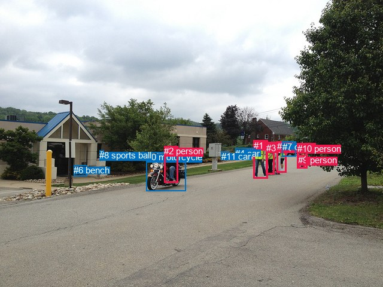
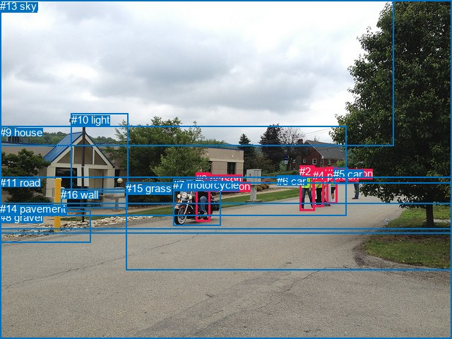

# 图片 0129：2317125.jpg

随机样本序号：22。图片 SHA256：`48fb278af1a31fd965eff31243c0147f90ff60b78ac2260e48f5962f9c1fc2f0`。

红色框表示人，蓝色框表示其他物体。两个模式分别保留自身框编号，可依据位置比较对应对象。

## 自动检测框与输出

人的框编号：`[1, 2, 3, 5, 9, 10]`。状态：`ok`。

### 自动检测全部物体框

| 编号 | 类别 | 是否为人 | 检测分数 | 像素坐标 xyxy |
|---|---|---|---|---|
| 0 | motorcycle | False | 0.9991 | 244.8, 254.3, 310.5, 319.2 |
| 1 | person | True | 0.9979 | 423.6, 234.8, 447.8, 298.5 |
| 2 | person | True | 0.9967 | 274.4, 244.2, 297.9, 305.2 |
| 3 | person | True | 0.9936 | 444.7, 238.6, 458.4, 291.8 |
| 4 | car | False | 0.9929 | 393.4, 248.0, 426.8, 260.9 |
| 5 | person | True | 0.9899 | 462.8, 236.4, 479.0, 288.6 |
| 6 | bench | False | 0.8796 | 123.1, 276.1, 145.3, 294.9 |
| 7 | car | False | 0.8703 | 471.9, 236.6, 494.8, 261.2 |
| 8 | sports ball | False | 0.8043 | 166.4, 251.5, 174.0, 259.1 |
| 9 | person | True | 0.7314 | 498.1, 259.2, 509.2, 281.9 |
| 10 | person | True | 0.4240 | 496.9, 239.6, 513.4, 281.7 |
| 11 | car | False | 0.3816 | 370.0, 253.0, 382.9, 261.5 |

### 自动检测 Top50 人相关候选

评分物体对：132；人相关物体对：102；输出关系：50。

| 排名 | 主语编号与类别 | 关系 | 宾语编号与类别 | 类型 | 人与人 | 排序分数 | 原始融合 logit |
|---|---|---|---|---|---|---|---|
| 1 | #2 person | riding | #0 motorcycle | semantic | False | 0.99281 | 4.9284 |
| 2 | #2 person | on | #0 motorcycle | spatial | False | 0.97620 | 3.7140 |
| 3 | #1 person | talking to | #3 person | semantic | True | 0.95153 | 2.9772 |
| 4 | #10 person | riding | #9 person | semantic | True | 0.94352 | 2.8158 |
| 5 | #3 person | talking to | #1 person | semantic | True | 0.92480 | 2.5094 |
| 6 | #5 person | walking on | #7 car | semantic | False | 0.92120 | 2.4587 |
| 7 | #10 person | in | #9 person | spatial | True | 0.87666 | 1.9612 |
| 8 | #1 person | walking on | #4 car | semantic | False | 0.87446 | 1.9410 |
| 9 | #3 person | talking to | #5 person | semantic | True | 0.83305 | 1.6074 |
| 10 | #5 person | in | #7 car | spatial | False | 0.78125 | 1.2730 |
| 11 | #9 person | walking on | #10 person | semantic | True | 0.73553 | 1.0228 |
| 12 | #5 person | walking on | #10 person | semantic | True | 0.72329 | 0.9608 |
| 13 | #3 person | walking on | #7 car | semantic | False | 0.70716 | 0.8816 |
| 14 | #1 person | beside | #3 person | spatial | True | 0.70486 | 0.8706 |
| 15 | #5 person | talking to | #3 person | semantic | True | 0.69555 | 0.8262 |
| 16 | #1 person | in | #4 car | spatial | False | 0.68130 | 0.7598 |
| 17 | #1 person | looking at | #0 motorcycle | semantic | False | 0.66617 | 0.6909 |
| 18 | #3 person | beside | #1 person | spatial | True | 0.65971 | 0.6620 |
| 19 | #5 person | pushing | #9 person | semantic | True | 0.63795 | 0.5665 |
| 20 | #1 person | walking on | #5 person | semantic | True | 0.60136 | 0.4112 |
| 21 | #10 person | walking on | #7 car | semantic | False | 0.59941 | 0.4030 |
| 22 | #3 person | walking on | #4 car | semantic | False | 0.59355 | 0.3787 |
| 23 | #3 person | looking at | #0 motorcycle | semantic | False | 0.58270 | 0.3339 |
| 24 | #5 person | looking at | #0 motorcycle | semantic | False | 0.57247 | 0.2919 |
| 25 | #3 person | beside | #5 person | spatial | True | 0.56084 | 0.2446 |
| 26 | #10 person | in | #7 car | spatial | False | 0.55468 | 0.2196 |
| 27 | #5 person | walking on | #4 car | semantic | False | 0.52495 | 0.0999 |
| 28 | #9 person | on | #10 person | spatial | True | 0.51344 | 0.0538 |
| 29 | #3 person | in | #7 car | spatial | False | 0.49900 | -0.0040 |
| 30 | #5 person | talking to | #1 person | semantic | True | 0.46189 | -0.1527 |
| 31 | #10 person | looking at | #0 motorcycle | semantic | False | 0.40452 | -0.3866 |
| 32 | #10 person | walking on | #5 person | semantic | True | 0.38927 | -0.4504 |
| 33 | #5 person | beside | #3 person | spatial | True | 0.38045 | -0.4876 |
| 34 | #5 person | beside | #10 person | spatial | True | 0.34831 | -0.6265 |
| 35 | #0 motorcycle | carrying | #2 person | semantic | False | 0.34647 | -0.6346 |
| 36 | #3 person | walking on | #9 person | semantic | True | 0.33850 | -0.6700 |
| 37 | #3 person | beside | #4 car | spatial | False | 0.33475 | -0.6868 |
| 38 | #10 person | walking on | #4 car | semantic | False | 0.32995 | -0.7084 |
| 39 | #9 person | walking on | #7 car | semantic | False | 0.32760 | -0.7190 |
| 40 | #3 person | walking on | #10 person | semantic | True | 0.30071 | -0.8439 |
| 41 | #1 person | beside | #5 person | spatial | True | 0.29571 | -0.8678 |
| 42 | #5 person | beside | #9 person | spatial | True | 0.27877 | -0.9506 |
| 43 | #9 person | in | #7 car | spatial | False | 0.27303 | -0.9793 |
| 44 | #1 person | in | #7 car | spatial | False | 0.26522 | -1.0190 |
| 45 | #1 person | walking on | #7 car | semantic | False | 0.26127 | -1.0394 |
| 46 | #9 person | looking at | #0 motorcycle | semantic | False | 0.25195 | -1.0882 |
| 47 | #5 person | beside | #4 car | spatial | False | 0.24799 | -1.1094 |
| 48 | #7 car | parked on | #5 person | semantic | False | 0.24290 | -1.1368 |
| 49 | #5 person | beside | #1 person | spatial | True | 0.23677 | -1.1705 |
| 50 | #9 person | walking on | #4 car | semantic | False | 0.21129 | -1.3172 |

### 自动检测逐条人相关 GT 核验

R@50：40.00%；命中 2/5。

| GT 主语编号 | GT 关系 | GT 宾语编号 | 结果阶段 | 匹配预测主语编号 | 匹配预测宾语编号 |
|---|---|---|---|---|---|
| 0 | on | 7 | hit50 | [2] | [0] |
| 0 | riding | 7 | hit50 | [2] | [0] |
| 2 | walking on | 11 | endpoint_missing_or_wrong_class | [1] | [] |
| 4 | standing on | 11 | endpoint_missing_or_wrong_class | [3] | [] |
| 9 | beside | 0 | endpoint_missing_or_wrong_class | [] | [2] |

## 真实框与输出

人的框编号：`[0, 1, 2, 3, 4]`。

### 真实框全部物体框

| 编号 | 类别 | 是否为人 | 检测分数 | 像素坐标 xyxy |
|---|---|---|---|---|
| 0 | person | True | GT | 277.0, 245.0, 297.0, 314.0 |
| 1 | person | True | GT | 289.0, 255.0, 296.0, 267.0 |
| 2 | person | True | GT | 424.0, 234.0, 445.0, 298.0 |
| 3 | person | True | GT | 463.0, 237.0, 478.0, 289.0 |
| 4 | person | True | GT | 443.0, 240.0, 459.0, 293.0 |
| 5 | car | False | GT | 472.0, 238.0, 492.0, 261.0 |
| 6 | car | False | GT | 392.0, 248.0, 426.0, 261.0 |
| 7 | motorcycle | False | GT | 245.0, 253.0, 312.0, 319.0 |
| 8 | gravel | False | GT | 0.0, 299.0, 129.0, 344.0 |
| 9 | house | False | GT | 0.0, 179.0, 490.0, 306.0 |
| 10 | light | False | GT | 101.0, 161.0, 182.0, 273.0 |
| 11 | road | False | GT | 0.0, 250.0, 640.0, 480.0 |
| 12 | tree | False | GT | 0.0, 0.0, 640.0, 330.0 |
| 13 | sky | False | GT | 0.0, 0.0, 558.0, 206.0 |
| 14 | pavement | False | GT | 0.0, 287.0, 640.0, 324.0 |
| 15 | grass | False | GT | 178.0, 258.0, 640.0, 383.0 |
| 16 | wall | False | GT | 86.0, 267.0, 180.0, 294.0 |

### 真实框 Top50 人相关候选

评分物体对：272；人相关物体对：140；输出关系：50。

| 排名 | 主语编号与类别 | 关系 | 宾语编号与类别 | 类型 | 人与人 | 排序分数 | 原始融合 logit |
|---|---|---|---|---|---|---|---|
| 1 | #3 person | crossing | #11 road | semantic | False | 0.99742 | 5.9569 |
| 2 | #2 person | crossing | #11 road | semantic | False | 0.99704 | 5.8197 |
| 3 | #4 person | crossing | #11 road | semantic | False | 0.99691 | 5.7776 |
| 4 | #0 person | riding | #7 motorcycle | semantic | False | 0.99256 | 4.8941 |
| 5 | #0 person | wearing | #1 person | semantic | True | 0.98729 | 4.3524 |
| 6 | #3 person | crossing | #15 grass | semantic | False | 0.98709 | 4.3367 |
| 7 | #2 person | crossing | #15 grass | semantic | False | 0.98492 | 4.1792 |
| 8 | #4 person | crossing | #15 grass | semantic | False | 0.98235 | 4.0191 |
| 9 | #0 person | on | #7 motorcycle | spatial | False | 0.96901 | 3.4426 |
| 10 | #0 person | riding | #11 road | semantic | False | 0.94729 | 2.8889 |
| 11 | #2 person | walking on | #14 pavement | semantic | False | 0.94052 | 2.7607 |
| 12 | #0 person | on | #11 road | spatial | False | 0.93760 | 2.7097 |
| 13 | #3 person | walking on | #14 pavement | semantic | False | 0.93451 | 2.6581 |
| 14 | #2 person | on | #11 road | spatial | False | 0.93364 | 2.6439 |
| 15 | #3 person | carrying | #5 car | semantic | False | 0.93004 | 2.5873 |
| 16 | #3 person | on | #11 road | spatial | False | 0.92120 | 2.4587 |
| 17 | #4 person | on | #11 road | spatial | False | 0.91927 | 2.4325 |
| 18 | #4 person | walking on | #14 pavement | semantic | False | 0.91378 | 2.3607 |
| 19 | #2 person | on | #15 grass | spatial | False | 0.91279 | 2.3482 |
| 20 | #3 person | on | #15 grass | spatial | False | 0.90823 | 2.2922 |
| 21 | #4 person | on | #15 grass | spatial | False | 0.90254 | 2.2258 |
| 22 | #2 person | talking to | #4 person | semantic | True | 0.82894 | 1.5781 |
| 23 | #0 person | in | #1 person | spatial | True | 0.81994 | 1.5159 |
| 24 | #2 person | on | #14 pavement | spatial | False | 0.72310 | 0.9599 |
| 25 | #4 person | talking to | #2 person | semantic | True | 0.71851 | 0.9371 |
| 26 | #7 motorcycle | wearing | #1 person | semantic | False | 0.69029 | 0.8015 |
| 27 | #2 person | beside | #4 person | spatial | True | 0.66758 | 0.6973 |
| 28 | #0 person | riding | #15 grass | semantic | False | 0.63275 | 0.5440 |
| 29 | #0 person | on | #15 grass | spatial | False | 0.62937 | 0.5295 |
| 30 | #1 person | on | #0 person | spatial | True | 0.62872 | 0.5267 |
| 31 | #3 person | beside | #5 car | spatial | False | 0.61725 | 0.4779 |
| 32 | #3 person | on | #14 pavement | spatial | False | 0.61417 | 0.4649 |
| 33 | #4 person | on | #14 pavement | spatial | False | 0.59805 | 0.3974 |
| 34 | #2 person | looking at | #7 motorcycle | semantic | False | 0.54028 | 0.1615 |
| 35 | #4 person | looking at | #7 motorcycle | semantic | False | 0.51504 | 0.0602 |
| 36 | #4 person | beside | #2 person | spatial | True | 0.50551 | 0.0221 |
| 37 | #2 person | in | #12 tree | spatial | False | 0.45442 | -0.1828 |
| 38 | #1 person | on | #7 motorcycle | spatial | False | 0.44391 | -0.2253 |
| 39 | #4 person | talking to | #3 person | semantic | True | 0.44094 | -0.2373 |
| 40 | #3 person | looking at | #7 motorcycle | semantic | False | 0.43661 | -0.2549 |
| 41 | #3 person | in | #12 tree | spatial | False | 0.42683 | -0.2948 |
| 42 | #7 motorcycle | carrying | #0 person | semantic | False | 0.41572 | -0.3404 |
| 43 | #0 person | in | #12 tree | spatial | False | 0.36837 | -0.5392 |
| 44 | #4 person | in | #12 tree | spatial | False | 0.36299 | -0.5624 |
| 45 | #0 person | on | #14 pavement | spatial | False | 0.34914 | -0.6228 |
| 46 | #4 person | beside | #3 person | spatial | True | 0.33745 | -0.6747 |
| 47 | #0 person | walking on | #14 pavement | semantic | False | 0.29717 | -0.8608 |
| 48 | #4 person | talking to | #0 person | semantic | True | 0.28105 | -0.9392 |
| 49 | #2 person | talking to | #0 person | semantic | True | 0.27463 | -0.9713 |
| 50 | #2 person | talking to | #3 person | semantic | True | 0.25255 | -1.0851 |

### 真实框逐条人相关 GT 核验

R@50：40.00%；命中 2/5。

| GT 主语编号 | GT 关系 | GT 宾语编号 | 结果阶段 | 匹配预测主语编号 | 匹配预测宾语编号 |
|---|---|---|---|---|---|
| 0 | on | 7 | hit50 | [0] | [7] |
| 0 | riding | 7 | hit50 | [0] | [7] |
| 2 | walking on | 11 | wrong_predicate | [2] | [11] |
| 4 | standing on | 11 | wrong_predicate | [4] | [11] |
| 9 | beside | 0 | rank_below50 | [9] | [0] |

## 全部人相关 GT

| 主语编号与类别 | 关系 | 宾语编号与类别 |
|---|---|---|
| #0 person | on | #7 motorcycle |
| #0 person | riding | #7 motorcycle |
| #2 person | walking on | #11 road |
| #4 person | standing on | #11 road |
| #9 house | beside | #0 person |

原始记录、全部人相关物体对的两项预测与分项分数见 [逐图证据 JSON](../evidence/cases/0129.json)。全部56类 logits 保留于本机 HOR/output/random500/logits/。

<!-- HOR_COMPLETE_RESULTS -->

## 六组条件的完整输出对照

以下保留同一图片三种框与候选模式、两种谓词输出规则的全部 Top50。框编号各自在所属模式内解释。

### 自动检测框完整枚举：空间与语义各保留一个谓词

| 排名 | 主语编号与类别 | 谓词 | 宾语编号与类别 | 分组 | 排序分数 | predicate logit | pair logit |
|---|---|---|---|---|---|---|---|
| 1 | #2 person | riding | #0 motorcycle | semantic | 0.9928141 | 4.8455367 | 0.0828832 |
| 2 | #2 person | on | #0 motorcycle | spatial | 0.9762011 | 3.6311460 | 0.0828832 |
| 3 | #1 person | talking to | #3 person | semantic | 0.9515323 | 3.3864064 | -0.4092303 |
| 4 | #10 person | riding | #9 person | semantic | 0.9435236 | 3.0378637 | -0.2220649 |
| 5 | #3 person | talking to | #1 person | semantic | 0.9248016 | 3.0951223 | -0.5856739 |
| 6 | #5 person | walking on | #7 car | semantic | 0.9211955 | 2.5126839 | -0.0539814 |
| 7 | #10 person | in | #9 person | spatial | 0.8766582 | 2.1832228 | -0.2220649 |
| 8 | #1 person | walking on | #4 car | semantic | 0.8744634 | 2.5066633 | -0.5656495 |
| 9 | #3 person | talking to | #5 person | semantic | 0.8330460 | 2.1300764 | -0.5227063 |
| 10 | #5 person | in | #7 car | spatial | 0.7812501 | 1.3269477 | -0.0539814 |
| 11 | #9 person | walking on | #10 person | semantic | 0.7355273 | 1.6715651 | -0.6487154 |
| 12 | #5 person | walking on | #10 person | semantic | 0.7232908 | 1.3902764 | -0.4294322 |
| 13 | #3 person | walking on | #7 car | semantic | 0.7071552 | 0.9118829 | -0.0302756 |
| 14 | #1 person | beside | #3 person | spatial | 0.7048627 | 1.2797928 | -0.4092303 |
| 15 | #5 person | talking to | #3 person | semantic | 0.6955463 | 1.4766974 | -0.6505187 |
| 16 | #1 person | in | #4 car | spatial | 0.6813017 | 1.3254099 | -0.5656495 |
| 17 | #1 person | looking at | #0 motorcycle | semantic | 0.6661652 | 1.5307298 | -0.8398384 |
| 18 | #3 person | beside | #1 person | spatial | 0.6597104 | 1.2476778 | -0.5856739 |
| 19 | #5 person | pushing | #9 person | semantic | 0.6379457 | 0.6877608 | -0.1213022 |
| 20 | #1 person | walking on | #5 person | semantic | 0.6013647 | 0.9028096 | -0.4916551 |
| 21 | #10 person | walking on | #7 car | semantic | 0.5994126 | 0.7584162 | -0.3553979 |
| 22 | #3 person | walking on | #4 car | semantic | 0.5935525 | 1.0773640 | -0.6986932 |
| 23 | #3 person | looking at | #0 motorcycle | semantic | 0.5826980 | 1.2378359 | -0.9039770 |
| 24 | #5 person | looking at | #0 motorcycle | semantic | 0.5724701 | 1.2560740 | -0.9641379 |
| 25 | #3 person | beside | #5 person | spatial | 0.5608352 | 0.7672586 | -0.5227063 |
| 26 | #10 person | in | #7 car | spatial | 0.5546836 | 0.5750108 | -0.3553979 |
| 27 | #5 person | walking on | #4 car | semantic | 0.5249524 | 0.8607039 | -0.7608117 |
| 28 | #9 person | on | #10 person | spatial | 0.5134375 | 0.7024784 | -0.6487154 |
| 29 | #3 person | in | #7 car | spatial | 0.4990025 | 0.0262856 | -0.0302756 |
| 30 | #5 person | talking to | #1 person | semantic | 0.4618866 | 0.6392698 | -0.7920194 |
| 31 | #10 person | looking at | #0 motorcycle | semantic | 0.4045244 | 0.7692099 | -1.1558580 |
| 32 | #10 person | walking on | #5 person | semantic | 0.3892719 | 0.3551178 | -0.8054917 |
| 33 | #5 person | beside | #3 person | spatial | 0.3804522 | 0.1628895 | -0.6505187 |
| 34 | #5 person | beside | #10 person | spatial | 0.3483056 | -0.1970634 | -0.4294322 |
| 35 | #0 motorcycle | carrying | #2 person | semantic | 0.3464696 | 0.2050195 | -0.8396136 |
| 36 | #3 person | walking on | #9 person | semantic | 0.3384984 | -0.4738197 | -0.1961735 |
| 37 | #3 person | beside | #4 car | spatial | 0.3347496 | 0.0119123 | -0.6986932 |
| 38 | #10 person | walking on | #4 car | semantic | 0.3299450 | 0.2889562 | -0.9973899 |
| 39 | #9 person | walking on | #7 car | semantic | 0.3276024 | -0.0946755 | -0.6243738 |
| 40 | #3 person | walking on | #10 person | semantic | 0.3007066 | -0.3023043 | -0.5416313 |
| 41 | #1 person | beside | #5 person | spatial | 0.2957109 | -0.3761516 | -0.4916551 |
| 42 | #5 person | beside | #9 person | spatial | 0.2787714 | -0.8292618 | -0.1213022 |
| 43 | #9 person | in | #7 car | spatial | 0.2730270 | -0.3549447 | -0.6243738 |
| 44 | #1 person | in | #7 car | spatial | 0.2652166 | -1.0146475 | -0.0043815 |
| 45 | #1 person | walking on | #7 car | semantic | 0.2612715 | -1.0349889 | -0.0043815 |
| 46 | #9 person | looking at | #0 motorcycle | semantic | 0.2519513 | 0.1682563 | -1.2564886 |
| 47 | #5 person | beside | #4 car | spatial | 0.2479906 | -0.3485460 | -0.7608117 |
| 48 | #7 car | parked on | #5 person | semantic | 0.2429046 | -0.2466650 | -0.8901553 |
| 49 | #5 person | beside | #1 person | spatial | 0.2367702 | -0.3784499 | -0.7920194 |
| 50 | #9 person | walking on | #4 car | semantic | 0.2112916 | -0.1248093 | -1.1923485 |

GT 命中：2/5，R@50=40.00%。

| GT主语 | GT谓词 | GT宾语 | 结果阶段 | 匹配主语框 | 匹配宾语框 |
|---|---|---|---|---|---|
| 0 | on | 7 | hit50 | [2] | [0] |
| 0 | riding | 7 | hit50 | [2] | [0] |
| 2 | walking on | 11 | endpoint_missing_or_wrong_class | [1] | [] |
| 4 | standing on | 11 | endpoint_missing_or_wrong_class | [3] | [] |
| 9 | beside | 0 | endpoint_missing_or_wrong_class | [] | [2] |

### 自动检测框完整枚举：每对只保留一个谓词

| 排名 | 主语编号与类别 | 谓词 | 宾语编号与类别 | 分组 | 排序分数 | predicate logit | pair logit |
|---|---|---|---|---|---|---|---|
| 1 | #2 person | riding | #0 motorcycle | single | 0.9928141 | 4.8455367 | 0.0828832 |
| 2 | #1 person | talking to | #3 person | single | 0.9515323 | 3.3864064 | -0.4092303 |
| 3 | #10 person | riding | #9 person | single | 0.9435236 | 3.0378637 | -0.2220649 |
| 4 | #3 person | talking to | #1 person | single | 0.9248016 | 3.0951223 | -0.5856739 |
| 5 | #5 person | walking on | #7 car | single | 0.9211955 | 2.5126839 | -0.0539814 |
| 6 | #1 person | walking on | #4 car | single | 0.8744634 | 2.5066633 | -0.5656495 |
| 7 | #3 person | talking to | #5 person | single | 0.8330460 | 2.1300764 | -0.5227063 |
| 8 | #9 person | walking on | #10 person | single | 0.7355273 | 1.6715651 | -0.6487154 |
| 9 | #5 person | walking on | #10 person | single | 0.7232908 | 1.3902764 | -0.4294322 |
| 10 | #3 person | walking on | #7 car | single | 0.7071552 | 0.9118829 | -0.0302756 |
| 11 | #5 person | talking to | #3 person | single | 0.6955463 | 1.4766974 | -0.6505187 |
| 12 | #1 person | looking at | #0 motorcycle | single | 0.6661652 | 1.5307298 | -0.8398384 |
| 13 | #5 person | pushing | #9 person | single | 0.6379457 | 0.6877608 | -0.1213022 |
| 14 | #1 person | walking on | #5 person | single | 0.6013647 | 0.9028096 | -0.4916551 |
| 15 | #10 person | walking on | #7 car | single | 0.5994126 | 0.7584162 | -0.3553979 |
| 16 | #3 person | walking on | #4 car | single | 0.5935525 | 1.0773640 | -0.6986932 |
| 17 | #3 person | looking at | #0 motorcycle | single | 0.5826980 | 1.2378359 | -0.9039770 |
| 18 | #5 person | looking at | #0 motorcycle | single | 0.5724701 | 1.2560740 | -0.9641379 |
| 19 | #5 person | walking on | #4 car | single | 0.5249524 | 0.8607039 | -0.7608117 |
| 20 | #5 person | talking to | #1 person | single | 0.4618866 | 0.6392698 | -0.7920194 |
| 21 | #10 person | looking at | #0 motorcycle | single | 0.4045244 | 0.7692099 | -1.1558580 |
| 22 | #10 person | walking on | #5 person | single | 0.3892719 | 0.3551178 | -0.8054917 |
| 23 | #0 motorcycle | carrying | #2 person | single | 0.3464696 | 0.2050195 | -0.8396136 |
| 24 | #3 person | walking on | #9 person | single | 0.3384984 | -0.4738197 | -0.1961735 |
| 25 | #10 person | walking on | #4 car | single | 0.3299450 | 0.2889562 | -0.9973899 |
| 26 | #9 person | walking on | #7 car | single | 0.3276024 | -0.0946755 | -0.6243738 |
| 27 | #3 person | walking on | #10 person | single | 0.3007066 | -0.3023043 | -0.5416313 |
| 28 | #1 person | in | #7 car | single | 0.2652166 | -1.0146475 | -0.0043815 |
| 29 | #9 person | looking at | #0 motorcycle | single | 0.2519513 | 0.1682563 | -1.2564886 |
| 30 | #7 car | parked on | #5 person | single | 0.2429046 | -0.2466650 | -0.8901553 |
| 31 | #9 person | walking on | #4 car | single | 0.2112916 | -0.1248093 | -1.1923485 |
| 32 | #7 car | pushing | #9 person | single | 0.1984050 | -0.6956644 | -0.7006285 |
| 33 | #7 car | parked on | #10 person | single | 0.1937070 | -0.6375008 | -0.7885994 |
| 34 | #1 person | walking on | #10 person | single | 0.1844235 | -0.9507573 | -0.5359032 |
| 35 | #1 person | looking at | #2 person | single | 0.1815888 | -0.3423362 | -1.1632841 |
| 36 | #1 person | walking on | #9 person | single | 0.1622406 | -1.4487541 | -0.1928967 |
| 37 | #4 car | parked on | #1 person | single | 0.1513375 | -0.7577286 | -0.9664205 |
| 38 | #10 person | walking on | #3 person | single | 0.1501285 | -0.6845140 | -1.0490798 |
| 39 | #5 person | looking at | #2 person | single | 0.1377864 | -0.5258574 | -1.3079407 |
| 40 | #3 person | walking on | #11 car | single | 0.1350794 | -0.6543956 | -1.2023790 |
| 41 | #5 person | walking on | #11 car | single | 0.1344171 | -0.5430622 | -1.3193933 |
| 42 | #3 person | looking at | #2 person | single | 0.1338664 | -0.6410112 | -1.2261860 |
| 43 | #10 person | looking at | #2 person | single | 0.1290827 | -0.4667759 | -1.4423178 |
| 44 | #9 person | walking on | #6 bench | single | 0.1278682 | -0.2887983 | -1.6311424 |
| 45 | #9 person | walking on | #11 car | single | 0.1170202 | -0.3505139 | -1.6704421 |
| 46 | #1 person | walking on | #11 car | single | 0.1165874 | -0.9868762 | -1.0382745 |
| 47 | #10 person | walking on | #1 person | single | 0.1025877 | -0.9839077 | -1.1848892 |
| 48 | #10 person | walking on | #6 bench | single | 0.0947166 | -0.7852693 | -1.4720894 |
| 49 | #7 car | beside | #3 person | single | 0.0857067 | -1.3269169 | -1.0403036 |
| 50 | #5 person | walking on | #6 bench | single | 0.0839349 | -0.8469570 | -1.5430897 |

GT 命中：1/5，R@50=20.00%。

| GT主语 | GT谓词 | GT宾语 | 结果阶段 | 匹配主语框 | 匹配宾语框 |
|---|---|---|---|---|---|
| 0 | on | 7 | wrong_predicate | [2] | [0] |
| 0 | riding | 7 | hit50 | [2] | [0] |
| 2 | walking on | 11 | endpoint_missing_or_wrong_class | [1] | [] |
| 4 | standing on | 11 | endpoint_missing_or_wrong_class | [3] | [] |
| 9 | beside | 0 | endpoint_missing_or_wrong_class | [] | [2] |

### 真实框完整枚举：空间与语义各保留一个谓词

| 排名 | 主语编号与类别 | 谓词 | 宾语编号与类别 | 分组 | 排序分数 | predicate logit | pair logit |
|---|---|---|---|---|---|---|---|
| 1 | #3 person | crossing | #11 road | semantic | 0.9974189 | 5.9216619 | 0.0352662 |
| 2 | #2 person | crossing | #11 road | semantic | 0.9970402 | 5.7413278 | 0.0783458 |
| 3 | #4 person | crossing | #11 road | semantic | 0.9969134 | 5.7410436 | 0.0365750 |
| 4 | #0 person | riding | #7 motorcycle | semantic | 0.9925649 | 4.9066978 | -0.0126188 |
| 5 | #0 person | wearing | #1 person | semantic | 0.9872873 | 4.1987672 | 0.1535888 |
| 6 | #3 person | crossing | #15 grass | semantic | 0.9870896 | 4.4846034 | -0.1478806 |
| 7 | #2 person | crossing | #15 grass | semantic | 0.9849199 | 4.3638835 | -0.1846983 |
| 8 | #4 person | crossing | #15 grass | semantic | 0.9823475 | 4.2442298 | -0.2251626 |
| 9 | #0 person | on | #7 motorcycle | spatial | 0.9690084 | 3.4551749 | -0.0126188 |
| 10 | #0 person | riding | #11 road | semantic | 0.9472941 | 3.1741109 | -0.2852296 |
| 11 | #2 person | walking on | #14 pavement | semantic | 0.9405161 | 3.0452952 | -0.2845725 |
| 12 | #0 person | on | #11 road | spatial | 0.9375957 | 2.9949150 | -0.2852296 |
| 13 | #3 person | walking on | #14 pavement | semantic | 0.9345065 | 2.9068666 | -0.2487993 |
| 14 | #2 person | on | #11 road | spatial | 0.9336361 | 2.5655866 | 0.0783458 |
| 15 | #3 person | carrying | #5 car | semantic | 0.9300411 | 2.6084242 | -0.0211035 |
| 16 | #3 person | on | #11 road | spatial | 0.9211960 | 2.4234424 | 0.0352662 |
| 17 | #4 person | on | #11 road | spatial | 0.9192725 | 2.3959284 | 0.0365750 |
| 18 | #4 person | walking on | #14 pavement | semantic | 0.9137819 | 2.7263336 | -0.3656204 |
| 19 | #2 person | on | #15 grass | spatial | 0.9127926 | 2.5329175 | -0.1846983 |
| 20 | #3 person | on | #15 grass | spatial | 0.9082278 | 2.4400663 | -0.1478806 |
| 21 | #4 person | on | #15 grass | spatial | 0.9025420 | 2.4509559 | -0.2251626 |
| 22 | #2 person | talking to | #4 person | semantic | 0.8289365 | 1.9517794 | -0.3736708 |
| 23 | #0 person | in | #1 person | spatial | 0.8199384 | 1.3623409 | 0.1535888 |
| 24 | #2 person | on | #14 pavement | spatial | 0.7230951 | 1.2444391 | -0.2845725 |
| 25 | #4 person | talking to | #2 person | semantic | 0.7185079 | 1.5341291 | -0.5970567 |
| 26 | #7 motorcycle | wearing | #1 person | semantic | 0.6902933 | 1.1879201 | -0.3864295 |
| 27 | #2 person | beside | #4 person | spatial | 0.6675836 | 1.0709467 | -0.3736708 |
| 28 | #0 person | riding | #15 grass | semantic | 0.6327457 | 1.3497853 | -0.8057714 |
| 29 | #0 person | on | #15 grass | spatial | 0.6293713 | 1.3352919 | -0.8057714 |
| 30 | #1 person | on | #0 person | spatial | 0.6287246 | 1.1189189 | -0.5921699 |
| 31 | #3 person | beside | #5 car | spatial | 0.6172467 | 0.4989815 | -0.0211035 |
| 32 | #3 person | on | #14 pavement | spatial | 0.6141728 | 0.7136860 | -0.2487993 |
| 33 | #4 person | on | #14 pavement | spatial | 0.5980529 | 0.7629790 | -0.3656204 |
| 34 | #2 person | looking at | #7 motorcycle | semantic | 0.5402815 | 1.0033813 | -0.8419051 |
| 35 | #4 person | looking at | #7 motorcycle | semantic | 0.5150368 | 0.9739876 | -0.9138223 |
| 36 | #4 person | beside | #2 person | spatial | 0.5055143 | 0.6191149 | -0.5970567 |
| 37 | #2 person | in | #12 tree | spatial | 0.4544217 | 0.5859580 | -0.7687786 |
| 38 | #1 person | on | #7 motorcycle | spatial | 0.4439116 | -0.0235353 | -0.2017668 |
| 39 | #4 person | talking to | #3 person | semantic | 0.4409408 | 0.3337302 | -0.5710750 |
| 40 | #3 person | looking at | #7 motorcycle | semantic | 0.4366080 | 0.7000284 | -0.9549683 |
| 41 | #3 person | in | #12 tree | spatial | 0.4268259 | 0.4350567 | -0.7298701 |
| 42 | #7 motorcycle | carrying | #0 person | semantic | 0.4157160 | 0.5798950 | -0.9202800 |
| 43 | #0 person | in | #12 tree | spatial | 0.3683650 | 0.4459033 | -0.9851404 |
| 44 | #4 person | in | #12 tree | spatial | 0.3629866 | 0.2833862 | -0.8458109 |
| 45 | #0 person | on | #14 pavement | spatial | 0.3491415 | 0.3735018 | -0.9963168 |
| 46 | #4 person | beside | #3 person | spatial | 0.3374519 | -0.1035953 | -0.5710750 |
| 47 | #0 person | walking on | #14 pavement | semantic | 0.2971694 | 0.1355033 | -0.9963168 |
| 48 | #4 person | talking to | #0 person | semantic | 0.2810540 | 0.2795501 | -1.2187897 |
| 49 | #2 person | talking to | #0 person | semantic | 0.2746262 | 0.1915269 | -1.1628031 |
| 50 | #2 person | talking to | #3 person | semantic | 0.2525451 | -0.5656309 | -0.5194532 |

GT 命中：2/5，R@50=40.00%。

| GT主语 | GT谓词 | GT宾语 | 结果阶段 | 匹配主语框 | 匹配宾语框 |
|---|---|---|---|---|---|
| 0 | on | 7 | hit50 | [0] | [7] |
| 0 | riding | 7 | hit50 | [0] | [7] |
| 2 | walking on | 11 | wrong_predicate | [2] | [11] |
| 4 | standing on | 11 | wrong_predicate | [4] | [11] |
| 9 | beside | 0 | rank_below50 | [9] | [0] |

### 真实框完整枚举：每对只保留一个谓词

| 排名 | 主语编号与类别 | 谓词 | 宾语编号与类别 | 分组 | 排序分数 | predicate logit | pair logit |
|---|---|---|---|---|---|---|---|
| 1 | #3 person | crossing | #11 road | single | 0.9974189 | 5.9216619 | 0.0352662 |
| 2 | #2 person | crossing | #11 road | single | 0.9970402 | 5.7413278 | 0.0783458 |
| 3 | #4 person | crossing | #11 road | single | 0.9969134 | 5.7410436 | 0.0365750 |
| 4 | #0 person | riding | #7 motorcycle | single | 0.9925649 | 4.9066978 | -0.0126188 |
| 5 | #0 person | wearing | #1 person | single | 0.9872873 | 4.1987672 | 0.1535888 |
| 6 | #3 person | crossing | #15 grass | single | 0.9870896 | 4.4846034 | -0.1478806 |
| 7 | #2 person | crossing | #15 grass | single | 0.9849199 | 4.3638835 | -0.1846983 |
| 8 | #4 person | crossing | #15 grass | single | 0.9823475 | 4.2442298 | -0.2251626 |
| 9 | #0 person | riding | #11 road | single | 0.9472941 | 3.1741109 | -0.2852296 |
| 10 | #2 person | walking on | #14 pavement | single | 0.9405161 | 3.0452952 | -0.2845725 |
| 11 | #3 person | walking on | #14 pavement | single | 0.9345065 | 2.9068666 | -0.2487993 |
| 12 | #3 person | carrying | #5 car | single | 0.9300411 | 2.6084242 | -0.0211035 |
| 13 | #4 person | walking on | #14 pavement | single | 0.9137819 | 2.7263336 | -0.3656204 |
| 14 | #2 person | talking to | #4 person | single | 0.8289365 | 1.9517794 | -0.3736708 |
| 15 | #4 person | talking to | #2 person | single | 0.7185079 | 1.5341291 | -0.5970567 |
| 16 | #7 motorcycle | wearing | #1 person | single | 0.6902933 | 1.1879201 | -0.3864295 |
| 17 | #0 person | riding | #15 grass | single | 0.6327457 | 1.3497853 | -0.8057714 |
| 18 | #1 person | on | #0 person | single | 0.6287246 | 1.1189189 | -0.5921699 |
| 19 | #2 person | looking at | #7 motorcycle | single | 0.5402815 | 1.0033813 | -0.8419051 |
| 20 | #4 person | looking at | #7 motorcycle | single | 0.5150368 | 0.9739876 | -0.9138223 |
| 21 | #2 person | in | #12 tree | single | 0.4544217 | 0.5859580 | -0.7687786 |
| 22 | #1 person | on | #7 motorcycle | single | 0.4439116 | -0.0235353 | -0.2017668 |
| 23 | #4 person | talking to | #3 person | single | 0.4409408 | 0.3337302 | -0.5710750 |
| 24 | #3 person | looking at | #7 motorcycle | single | 0.4366080 | 0.7000284 | -0.9549683 |
| 25 | #3 person | in | #12 tree | single | 0.4268259 | 0.4350567 | -0.7298701 |
| 26 | #7 motorcycle | carrying | #0 person | single | 0.4157160 | 0.5798950 | -0.9202800 |
| 27 | #0 person | in | #12 tree | single | 0.3683650 | 0.4459033 | -0.9851404 |
| 28 | #4 person | in | #12 tree | single | 0.3629866 | 0.2833862 | -0.8458109 |
| 29 | #0 person | on | #14 pavement | single | 0.3491415 | 0.3735018 | -0.9963168 |
| 30 | #4 person | talking to | #0 person | single | 0.2810540 | 0.2795501 | -1.2187897 |
| 31 | #2 person | talking to | #0 person | single | 0.2746262 | 0.1915269 | -1.1628031 |
| 32 | #2 person | talking to | #3 person | single | 0.2525451 | -0.5656309 | -0.5194532 |
| 33 | #3 person | talking to | #4 person | single | 0.2274997 | -0.5935340 | -0.6289498 |
| 34 | #3 person | talking to | #2 person | single | 0.1853186 | -0.6816192 | -0.7991015 |
| 35 | #4 person | wearing | #5 car | single | 0.1752593 | -1.5132124 | -0.0355898 |
| 36 | #2 person | in front of | #9 house | single | 0.1725714 | -0.5979853 | -0.9695266 |
| 37 | #3 person | looking at | #0 person | single | 0.1603323 | -0.3752379 | -1.2805195 |
| 38 | #3 person | walking on | #9 house | single | 0.1579400 | -0.7220485 | -0.9515876 |
| 39 | #2 person | walking on | #6 car | single | 0.1485544 | -1.1538627 | -0.5921218 |
| 40 | #3 person | wearing | #1 person | single | 0.1257051 | -0.8082981 | -1.1311810 |
| 41 | #4 person | walking on | #9 house | single | 0.1095902 | -1.0139222 | -1.0810113 |
| 42 | #4 person | wearing | #1 person | single | 0.1009654 | -1.1620944 | -1.0244498 |
| 43 | #2 person | wearing | #1 person | single | 0.0844352 | -1.4857817 | -0.8977748 |
| 44 | #0 person | in front of | #9 house | single | 0.0765026 | -1.1505504 | -1.3402932 |
| 45 | #1 person | driving on | #11 road | single | 0.0755714 | -1.6299486 | -0.8741488 |
| 46 | #13 sky | over | #0 person | single | 0.0702567 | -1.3625219 | -1.2202303 |
| 47 | #5 car | beside | #3 person | single | 0.0618547 | -1.8068445 | -0.9122717 |
| 48 | #2 person | looking at | #13 sky | single | 0.0608472 | -1.0320702 | -1.7045418 |
| 49 | #6 car | beside | #2 person | single | 0.0579412 | -1.7933311 | -0.9953079 |
| 50 | #2 person | wearing | #5 car | single | 0.0570779 | -2.8427923 | 0.0382252 |

GT 命中：1/5，R@50=20.00%。

| GT主语 | GT谓词 | GT宾语 | 结果阶段 | 匹配主语框 | 匹配宾语框 |
|---|---|---|---|---|---|
| 0 | on | 7 | wrong_predicate | [0] | [7] |
| 0 | riding | 7 | hit50 | [0] | [7] |
| 2 | walking on | 11 | wrong_predicate | [2] | [11] |
| 4 | standing on | 11 | wrong_predicate | [4] | [11] |
| 9 | beside | 0 | rank_below50 | [9] | [0] |

### 真实框400候选：空间与语义各保留一个谓词

| 排名 | 主语编号与类别 | 谓词 | 宾语编号与类别 | 分组 | 排序分数 | predicate logit | pair logit |
|---|---|---|---|---|---|---|---|
| 1 | #3 person | crossing | #11 road | semantic | 0.9974190 | 5.9217334 | 0.0352662 |
| 2 | #2 person | crossing | #11 road | semantic | 0.9970402 | 5.7413278 | 0.0783458 |
| 3 | #4 person | crossing | #11 road | semantic | 0.9969137 | 5.7411141 | 0.0365750 |
| 4 | #0 person | riding | #7 motorcycle | semantic | 0.9925649 | 4.9066978 | -0.0126188 |
| 5 | #0 person | wearing | #1 person | semantic | 0.9872873 | 4.1987672 | 0.1535888 |
| 6 | #3 person | crossing | #15 grass | semantic | 0.9870896 | 4.4846034 | -0.1478806 |
| 7 | #2 person | crossing | #15 grass | semantic | 0.9857852 | 4.4238524 | -0.1846983 |
| 8 | #4 person | crossing | #15 grass | semantic | 0.9823475 | 4.2442298 | -0.2251626 |
| 9 | #0 person | on | #7 motorcycle | spatial | 0.9690084 | 3.4551749 | -0.0126188 |
| 10 | #0 person | riding | #11 road | semantic | 0.9473062 | 3.1743550 | -0.2852296 |
| 11 | #2 person | walking on | #14 pavement | semantic | 0.9405161 | 3.0452952 | -0.2845725 |
| 12 | #0 person | on | #11 road | spatial | 0.9375957 | 2.9949150 | -0.2852296 |
| 13 | #3 person | walking on | #14 pavement | semantic | 0.9343220 | 2.9038563 | -0.2487993 |
| 14 | #2 person | on | #11 road | spatial | 0.9336361 | 2.5655866 | 0.0783458 |
| 15 | #3 person | carrying | #5 car | semantic | 0.9299652 | 2.6072588 | -0.0211035 |
| 16 | #3 person | on | #11 road | spatial | 0.9211960 | 2.4234424 | 0.0352662 |
| 17 | #4 person | on | #11 road | spatial | 0.9192725 | 2.3959284 | 0.0365750 |
| 18 | #4 person | walking on | #14 pavement | semantic | 0.9137819 | 2.7263336 | -0.3656204 |
| 19 | #2 person | on | #15 grass | spatial | 0.9127926 | 2.5329175 | -0.1846983 |
| 20 | #3 person | on | #15 grass | spatial | 0.9082278 | 2.4400663 | -0.1478806 |
| 21 | #4 person | on | #15 grass | spatial | 0.9025420 | 2.4509559 | -0.2251626 |
| 22 | #2 person | talking to | #4 person | semantic | 0.8289543 | 1.9519048 | -0.3736708 |
| 23 | #0 person | in | #1 person | spatial | 0.8199384 | 1.3623409 | 0.1535888 |
| 24 | #2 person | on | #14 pavement | spatial | 0.7230951 | 1.2444391 | -0.2845725 |
| 25 | #4 person | talking to | #2 person | semantic | 0.7185079 | 1.5341291 | -0.5970567 |
| 26 | #7 motorcycle | wearing | #1 person | semantic | 0.6954479 | 1.2121434 | -0.3864295 |
| 27 | #2 person | beside | #4 person | spatial | 0.6675963 | 1.0710044 | -0.3736708 |
| 28 | #0 person | riding | #15 grass | semantic | 0.6327457 | 1.3497853 | -0.8057714 |
| 29 | #0 person | on | #15 grass | spatial | 0.6293713 | 1.3352919 | -0.8057714 |
| 30 | #1 person | on | #0 person | spatial | 0.6287246 | 1.1189189 | -0.5921699 |
| 31 | #3 person | beside | #5 car | spatial | 0.6172467 | 0.4989815 | -0.0211035 |
| 32 | #3 person | on | #14 pavement | spatial | 0.6070182 | 0.6835947 | -0.2487993 |
| 33 | #4 person | on | #14 pavement | spatial | 0.5967434 | 0.7575345 | -0.3656204 |
| 34 | #2 person | looking at | #7 motorcycle | semantic | 0.5476596 | 1.0331240 | -0.8419051 |
| 35 | #4 person | looking at | #7 motorcycle | semantic | 0.5150368 | 0.9739876 | -0.9138223 |
| 36 | #4 person | beside | #2 person | spatial | 0.5055288 | 0.6191730 | -0.5970567 |
| 37 | #2 person | in | #12 tree | spatial | 0.4552447 | 0.5892768 | -0.7687786 |
| 38 | #1 person | on | #7 motorcycle | spatial | 0.4506777 | 0.0038338 | -0.2017668 |
| 39 | #3 person | looking at | #7 motorcycle | semantic | 0.4439374 | 0.7297711 | -0.9549683 |
| 40 | #4 person | talking to | #3 person | semantic | 0.4409408 | 0.3337302 | -0.5710750 |
| 41 | #3 person | in | #12 tree | spatial | 0.4276380 | 0.4383755 | -0.7298701 |
| 42 | #7 motorcycle | carrying | #0 person | semantic | 0.4159989 | 0.5810599 | -0.9202800 |
| 43 | #0 person | in | #12 tree | spatial | 0.3702976 | 0.4542003 | -0.9851404 |
| 44 | #4 person | in | #12 tree | spatial | 0.3633704 | 0.2850456 | -0.8458109 |
| 45 | #0 person | on | #14 pavement | spatial | 0.3547628 | 0.3981481 | -0.9963168 |
| 46 | #4 person | beside | #3 person | spatial | 0.3374584 | -0.1035662 | -0.5710750 |
| 47 | #0 person | walking on | #14 pavement | semantic | 0.3031743 | 0.1640892 | -0.9963168 |
| 48 | #4 person | talking to | #0 person | semantic | 0.2810035 | 0.2793002 | -1.2187897 |
| 49 | #2 person | talking to | #0 person | semantic | 0.2746512 | 0.1916523 | -1.1628031 |
| 50 | #2 person | talking to | #3 person | semantic | 0.2469421 | -0.5955348 | -0.5194532 |

GT 命中：2/5，R@50=40.00%。

| GT主语 | GT谓词 | GT宾语 | 结果阶段 | 匹配主语框 | 匹配宾语框 |
|---|---|---|---|---|---|
| 0 | on | 7 | hit50 | [0] | [7] |
| 0 | riding | 7 | hit50 | [0] | [7] |
| 2 | walking on | 11 | wrong_predicate | [2] | [11] |
| 4 | standing on | 11 | wrong_predicate | [4] | [11] |
| 9 | beside | 0 | rank_below50 | [9] | [0] |

### 真实框400候选：每对只保留一个谓词

| 排名 | 主语编号与类别 | 谓词 | 宾语编号与类别 | 分组 | 排序分数 | predicate logit | pair logit |
|---|---|---|---|---|---|---|---|
| 1 | #3 person | crossing | #11 road | single | 0.9974190 | 5.9217334 | 0.0352662 |
| 2 | #2 person | crossing | #11 road | single | 0.9970402 | 5.7413278 | 0.0783458 |
| 3 | #4 person | crossing | #11 road | single | 0.9969137 | 5.7411141 | 0.0365750 |
| 4 | #0 person | riding | #7 motorcycle | single | 0.9925649 | 4.9066978 | -0.0126188 |
| 5 | #0 person | wearing | #1 person | single | 0.9872873 | 4.1987672 | 0.1535888 |
| 6 | #3 person | crossing | #15 grass | single | 0.9870896 | 4.4846034 | -0.1478806 |
| 7 | #2 person | crossing | #15 grass | single | 0.9857852 | 4.4238524 | -0.1846983 |
| 8 | #4 person | crossing | #15 grass | single | 0.9823475 | 4.2442298 | -0.2251626 |
| 9 | #0 person | riding | #11 road | single | 0.9473062 | 3.1743550 | -0.2852296 |
| 10 | #2 person | walking on | #14 pavement | single | 0.9405161 | 3.0452952 | -0.2845725 |
| 11 | #3 person | walking on | #14 pavement | single | 0.9343220 | 2.9038563 | -0.2487993 |
| 12 | #3 person | carrying | #5 car | single | 0.9299652 | 2.6072588 | -0.0211035 |
| 13 | #4 person | walking on | #14 pavement | single | 0.9137819 | 2.7263336 | -0.3656204 |
| 14 | #2 person | talking to | #4 person | single | 0.8289543 | 1.9519048 | -0.3736708 |
| 15 | #4 person | talking to | #2 person | single | 0.7185079 | 1.5341291 | -0.5970567 |
| 16 | #7 motorcycle | wearing | #1 person | single | 0.6954479 | 1.2121434 | -0.3864295 |
| 17 | #0 person | riding | #15 grass | single | 0.6327457 | 1.3497853 | -0.8057714 |
| 18 | #1 person | on | #0 person | single | 0.6287246 | 1.1189189 | -0.5921699 |
| 19 | #2 person | looking at | #7 motorcycle | single | 0.5476596 | 1.0331240 | -0.8419051 |
| 20 | #4 person | looking at | #7 motorcycle | single | 0.5150368 | 0.9739876 | -0.9138223 |
| 21 | #2 person | in | #12 tree | single | 0.4552447 | 0.5892768 | -0.7687786 |
| 22 | #1 person | on | #7 motorcycle | single | 0.4506777 | 0.0038338 | -0.2017668 |
| 23 | #3 person | looking at | #7 motorcycle | single | 0.4439374 | 0.7297711 | -0.9549683 |
| 24 | #4 person | talking to | #3 person | single | 0.4409408 | 0.3337302 | -0.5710750 |
| 25 | #3 person | in | #12 tree | single | 0.4276380 | 0.4383755 | -0.7298701 |
| 26 | #7 motorcycle | carrying | #0 person | single | 0.4159989 | 0.5810599 | -0.9202800 |
| 27 | #0 person | in | #12 tree | single | 0.3702976 | 0.4542003 | -0.9851404 |
| 28 | #4 person | in | #12 tree | single | 0.3633704 | 0.2850456 | -0.8458109 |
| 29 | #0 person | on | #14 pavement | single | 0.3547628 | 0.3981481 | -0.9963168 |
| 30 | #4 person | talking to | #0 person | single | 0.2810035 | 0.2793002 | -1.2187897 |
| 31 | #2 person | talking to | #0 person | single | 0.2746512 | 0.1916523 | -1.1628031 |
| 32 | #2 person | talking to | #3 person | single | 0.2469421 | -0.5955348 | -0.5194532 |
| 33 | #3 person | talking to | #4 person | single | 0.2327867 | -0.5636926 | -0.6289498 |
| 34 | #3 person | talking to | #2 person | single | 0.1808185 | -0.7117105 | -0.7991015 |
| 35 | #4 person | wearing | #5 car | single | 0.1730952 | -1.5282581 | -0.0355898 |
| 36 | #2 person | in front of | #9 house | single | 0.1725167 | -0.5983682 | -0.9695266 |
| 37 | #3 person | looking at | #0 person | single | 0.1643292 | -0.3458433 | -1.2805195 |
| 38 | #3 person | walking on | #9 house | single | 0.1504842 | -0.7792203 | -0.9515876 |
| 39 | #2 person | walking on | #6 car | single | 0.1449749 | -1.1824486 | -0.5921218 |
| 40 | #3 person | wearing | #1 person | single | 0.1253830 | -0.8112321 | -1.1311810 |
| 41 | #4 person | walking on | #9 house | single | 0.1082759 | -1.0274625 | -1.0810113 |
| 42 | #4 person | wearing | #1 person | single | 0.1006993 | -1.1650283 | -1.0244498 |
| 43 | #2 person | wearing | #1 person | single | 0.0835036 | -1.4978933 | -0.8977748 |
| 44 | #0 person | in front of | #9 house | single | 0.0754571 | -1.1654425 | -1.3402932 |
| 45 | #1 person | driving on | #11 road | single | 0.0724792 | -1.6750672 | -0.8741488 |
| 46 | #13 sky | over | #0 person | single | 0.0682533 | -1.3936048 | -1.2202303 |
| 47 | #5 car | beside | #3 person | single | 0.0618539 | -1.8068590 | -0.9122717 |
| 48 | #2 person | looking at | #13 sky | single | 0.0617228 | -1.0168500 | -1.7045418 |
| 49 | #2 person | wearing | #5 car | single | 0.0589733 | -2.8081121 | 0.0382252 |
| 50 | #6 car | beside | #2 person | single | 0.0571285 | -1.8083191 | -0.9953079 |

GT 命中：1/5，R@50=20.00%。

| GT主语 | GT谓词 | GT宾语 | 结果阶段 | 匹配主语框 | 匹配宾语框 |
|---|---|---|---|---|---|
| 0 | on | 7 | wrong_predicate | [0] | [7] |
| 0 | riding | 7 | hit50 | [0] | [7] |
| 2 | walking on | 11 | wrong_predicate | [2] | [11] |
| 4 | standing on | 11 | wrong_predicate | [4] | [11] |
| 9 | beside | 0 | rank_below50 | [9] | [0] |
