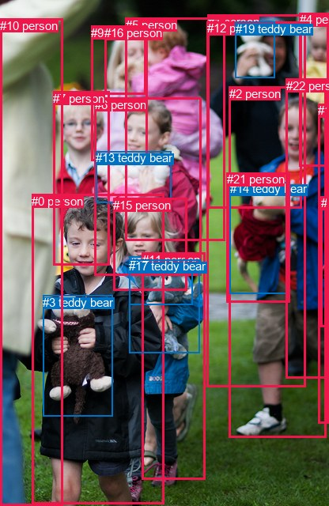
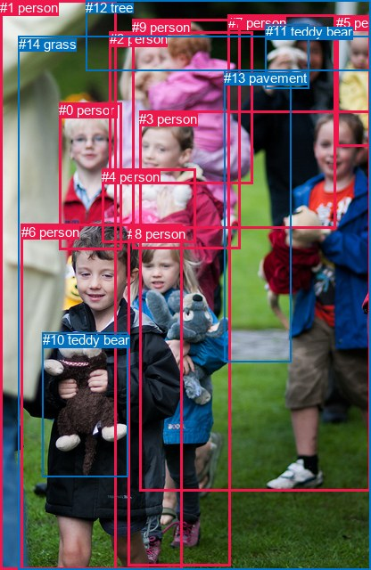

# 图片 0133：2317501.jpg

随机样本序号：269。图片 SHA256：`b05647286f7a433409bae4c890117b372a107202541bd62f12af2ed225afb124`。

红色框表示人，蓝色框表示其他物体。两个模式分别保留自身框编号，可依据位置比较对应对象。

## 自动检测框与输出

人的框编号：`[0, 1, 2, 4, 5, 6, 7, 9, 10, 11, 12, 15, 16, 18, 20, 21, 22]`。状态：`ok`。

### 自动检测全部物体框

| 编号 | 类别 | 是否为人 | 检测分数 | 像素坐标 xyxy |
|---|---|---|---|---|
| 0 | person | True | 0.9970 | 40.2, 245.9, 207.0, 637.3 |
| 1 | person | True | 0.9946 | 262.6, 18.7, 381.9, 263.1 |
| 2 | person | True | 0.9936 | 289.7, 109.6, 412.0, 553.5 |
| 3 | teddy bear | False | 0.9922 | 54.4, 373.6, 142.3, 526.7 |
| 4 | person | True | 0.9897 | 378.6, 16.0, 416.0, 210.3 |
| 5 | person | True | 0.9812 | 158.9, 22.8, 284.2, 304.8 |
| 6 | person | True | 0.9514 | 120.0, 124.0, 255.0, 348.2 |
| 7 | person | True | 0.9346 | 67.2, 115.9, 138.9, 335.2 |
| 8 | teddy bear | False | 0.9267 | 163.5, 324.1, 243.7, 385.6 |
| 9 | person | True | 0.9242 | 115.4, 32.7, 186.2, 203.9 |
| 10 | person | True | 0.9062 | 0.1, 23.6, 79.7, 640.0 |
| 11 | person | True | 0.8943 | 179.9, 319.8, 259.2, 607.0 |
| 12 | person | True | 0.8408 | 261.9, 27.4, 386.1, 489.0 |
| 13 | teddy bear | False | 0.8334 | 121.0, 191.0, 216.1, 256.6 |
| 14 | teddy bear | False | 0.8260 | 290.9, 230.0, 364.6, 371.1 |
| 15 | person | True | 0.8128 | 143.2, 250.9, 236.5, 367.8 |
| 16 | person | True | 0.6192 | 132.4, 33.1, 184.1, 119.1 |
| 17 | teddy bear | False | 0.5412 | 163.4, 328.0, 252.9, 446.7 |
| 18 | person | True | 0.4475 | 402.4, 131.1, 416.0, 535.9 |
| 19 | teddy bear | False | 0.3805 | 297.5, 27.8, 347.7, 98.6 |
| 20 | person | True | 0.3786 | 405.8, 248.2, 415.9, 413.1 |
| 21 | person | True | 0.3732 | 286.7, 218.1, 366.0, 382.3 |
| 22 | person | True | 0.3572 | 361.9, 99.6, 415.1, 478.7 |

### 自动检测 Top50 人相关候选

评分物体对：506；人相关物体对：476；输出关系：50。

| 排名 | 主语编号与类别 | 关系 | 宾语编号与类别 | 类型 | 人与人 | 排序分数 | 原始融合 logit |
|---|---|---|---|---|---|---|---|
| 1 | #0 person | holding | #3 teddy bear | semantic | False | 0.99625 | 5.5818 |
| 2 | #1 person | holding | #19 teddy bear | semantic | False | 0.99251 | 4.8868 |
| 3 | #18 person | wearing | #20 person | semantic | True | 0.99084 | 4.6838 |
| 4 | #2 person | holding | #21 person | semantic | True | 0.99003 | 4.5986 |
| 5 | #2 person | holding | #14 teddy bear | semantic | False | 0.98937 | 4.5336 |
| 6 | #12 person | holding | #19 teddy bear | semantic | False | 0.98926 | 4.5227 |
| 7 | #12 person | holding | #21 person | semantic | True | 0.98705 | 4.3339 |
| 8 | #12 person | holding | #14 teddy bear | semantic | False | 0.98319 | 4.0687 |
| 9 | #6 person | holding | #13 teddy bear | semantic | False | 0.97914 | 3.8487 |
| 10 | #18 person | in | #20 person | spatial | True | 0.95004 | 2.9454 |
| 11 | #22 person | holding | #21 person | semantic | True | 0.94689 | 2.8809 |
| 12 | #22 person | holding | #14 teddy bear | semantic | False | 0.93821 | 2.7202 |
| 13 | #22 person | wearing | #20 person | semantic | True | 0.92244 | 2.4759 |
| 14 | #1 person | holding | #21 person | semantic | True | 0.91839 | 2.4207 |
| 15 | #7 person | holding | #13 teddy bear | semantic | False | 0.89658 | 2.1598 |
| 16 | #1 person | holding | #14 teddy bear | semantic | False | 0.89513 | 2.1443 |
| 17 | #11 person | wearing | #17 teddy bear | semantic | False | 0.88475 | 2.0382 |
| 18 | #0 person | holding | #8 teddy bear | semantic | False | 0.87662 | 1.9608 |
| 19 | #15 person | holding | #8 teddy bear | semantic | False | 0.86475 | 1.8553 |
| 20 | #9 person | in | #16 person | spatial | True | 0.84689 | 1.7104 |
| 21 | #7 person | holding | #3 teddy bear | semantic | False | 0.83945 | 1.6541 |
| 22 | #11 person | holding | #8 teddy bear | semantic | False | 0.83919 | 1.6522 |
| 23 | #15 person | wearing | #17 teddy bear | semantic | False | 0.83137 | 1.5954 |
| 24 | #0 person | in | #3 teddy bear | spatial | False | 0.81108 | 1.4570 |
| 25 | #5 person | holding | #13 teddy bear | semantic | False | 0.80546 | 1.4208 |
| 26 | #10 person | holding | #3 teddy bear | semantic | False | 0.79876 | 1.3786 |
| 27 | #12 person | wearing | #1 person | semantic | True | 0.79099 | 1.3309 |
| 28 | #0 person | wearing | #17 teddy bear | semantic | False | 0.78694 | 1.3066 |
| 29 | #11 person | in | #17 teddy bear | spatial | False | 0.76432 | 1.1765 |
| 30 | #9 person | holding | #13 teddy bear | semantic | False | 0.75361 | 1.1180 |
| 31 | #10 person | beside | #0 person | spatial | True | 0.75086 | 1.1032 |
| 32 | #10 person | looking at | #0 person | semantic | True | 0.74484 | 1.0713 |
| 33 | #2 person | in | #14 teddy bear | spatial | False | 0.74153 | 1.0540 |
| 34 | #6 person | holding | #5 person | semantic | True | 0.71759 | 0.9325 |
| 35 | #1 person | on | #19 teddy bear | spatial | False | 0.71651 | 0.9272 |
| 36 | #2 person | in | #21 person | spatial | True | 0.71194 | 0.9048 |
| 37 | #11 person | in | #8 teddy bear | spatial | False | 0.70954 | 0.8932 |
| 38 | #22 person | in | #20 person | spatial | True | 0.69172 | 0.8082 |
| 39 | #2 person | wearing | #20 person | semantic | True | 0.69048 | 0.8024 |
| 40 | #9 person | playing with | #16 person | semantic | True | 0.66502 | 0.6857 |
| 41 | #4 person | holding | #19 teddy bear | semantic | False | 0.66335 | 0.6783 |
| 42 | #6 person | in | #13 teddy bear | spatial | False | 0.66006 | 0.6636 |
| 43 | #5 person | holding | #19 teddy bear | semantic | False | 0.65701 | 0.6500 |
| 44 | #2 person | wearing | #22 person | semantic | True | 0.63694 | 0.5621 |
| 45 | #0 person | wearing | #11 person | semantic | True | 0.62561 | 0.5134 |
| 46 | #18 person | holding | #14 teddy bear | semantic | False | 0.62271 | 0.5011 |
| 47 | #12 person | on | #19 teddy bear | spatial | False | 0.61976 | 0.4885 |
| 48 | #6 person | holding | #17 teddy bear | semantic | False | 0.60709 | 0.4351 |
| 49 | #12 person | in | #21 person | spatial | True | 0.60302 | 0.4181 |
| 50 | #4 person | holding | #21 person | semantic | True | 0.59752 | 0.3951 |

### 自动检测逐条人相关 GT 核验

R@50：25.00%；命中 1/4。

| GT 主语编号 | GT 关系 | GT 宾语编号 | 结果阶段 | 匹配预测主语编号 | 匹配预测宾语编号 |
|---|---|---|---|---|---|
| 1 | guiding | 6 | wrong_predicate | [10] | [0] |
| 2 | beside | 0 | wrong_predicate | [5] | [7] |
| 2 | holding | 9 | endpoints_collapsed_to_same_box | [5] | [5] |
| 6 | holding | 10 | hit50 | [0] | [3] |

## 真实框与输出

人的框编号：`[0, 1, 2, 3, 4, 5, 6, 7, 8, 9]`。

### 真实框全部物体框

| 编号 | 类别 | 是否为人 | 检测分数 | 像素坐标 xyxy |
|---|---|---|---|---|
| 0 | person | True | GT | 66.0, 115.0, 136.0, 280.0 |
| 1 | person | True | GT | 0.0, 0.0, 130.0, 640.0 |
| 2 | person | True | GT | 123.0, 35.0, 284.0, 206.0 |
| 3 | person | True | GT | 156.0, 125.0, 416.0, 552.0 |
| 4 | person | True | GT | 114.0, 190.0, 219.0, 273.0 |
| 5 | person | True | GT | 377.0, 17.0, 416.0, 164.0 |
| 6 | person | True | GT | 24.0, 252.0, 204.0, 640.0 |
| 7 | person | True | GT | 256.0, 17.0, 377.0, 257.0 |
| 8 | person | True | GT | 143.0, 254.0, 259.0, 635.0 |
| 9 | person | True | GT | 148.0, 22.0, 269.0, 279.0 |
| 10 | teddy bear | False | GT | 48.0, 373.0, 143.0, 535.0 |
| 11 | teddy bear | False | GT | 298.0, 27.0, 347.0, 99.0 |
| 12 | tree | False | GT | 96.0, 0.0, 416.0, 79.0 |
| 13 | pavement | False | GT | 251.0, 79.0, 326.0, 406.0 |
| 14 | grass | False | GT | 21.0, 41.0, 416.0, 640.0 |

### 真实框 Top50 人相关候选

评分物体对：210；人相关物体对：190；输出关系：50。

| 排名 | 主语编号与类别 | 关系 | 宾语编号与类别 | 类型 | 人与人 | 排序分数 | 原始融合 logit |
|---|---|---|---|---|---|---|---|
| 1 | #6 person | holding | #10 teddy bear | semantic | False | 0.99611 | 5.5464 |
| 2 | #7 person | holding | #11 teddy bear | semantic | False | 0.99403 | 5.1158 |
| 3 | #1 person | holding | #10 teddy bear | semantic | False | 0.98119 | 3.9542 |
| 4 | #0 person | holding | #4 person | semantic | True | 0.92721 | 2.5446 |
| 5 | #9 person | holding | #4 person | semantic | True | 0.91403 | 2.3639 |
| 6 | #3 person | in | #14 grass | spatial | False | 0.91201 | 2.3384 |
| 7 | #9 person | holding | #2 person | semantic | True | 0.90276 | 2.2283 |
| 8 | #8 person | in | #14 grass | spatial | False | 0.89307 | 2.1225 |
| 9 | #0 person | in | #14 grass | spatial | False | 0.86989 | 1.9000 |
| 10 | #5 person | holding | #11 teddy bear | semantic | False | 0.86507 | 1.8581 |
| 11 | #5 person | in | #12 tree | spatial | False | 0.86454 | 1.8535 |
| 12 | #2 person | holding | #9 person | semantic | True | 0.84918 | 1.7282 |
| 13 | #8 person | holding | #10 teddy bear | semantic | False | 0.84628 | 1.7058 |
| 14 | #6 person | in | #10 teddy bear | spatial | False | 0.81167 | 1.4609 |
| 15 | #3 person | standing on | #14 grass | semantic | False | 0.80262 | 1.4027 |
| 16 | #1 person | holding | #6 person | semantic | True | 0.79670 | 1.3658 |
| 17 | #9 person | in | #2 person | spatial | True | 0.79485 | 1.3544 |
| 18 | #9 person | holding | #11 teddy bear | semantic | False | 0.78660 | 1.3045 |
| 19 | #2 person | holding | #11 teddy bear | semantic | False | 0.77970 | 1.2639 |
| 20 | #8 person | holding | #4 person | semantic | True | 0.77413 | 1.2318 |
| 21 | #7 person | holding | #13 pavement | semantic | False | 0.76967 | 1.2065 |
| 22 | #5 person | in | #14 grass | spatial | False | 0.75974 | 1.1512 |
| 23 | #6 person | in | #14 grass | spatial | False | 0.75130 | 1.1056 |
| 24 | #7 person | on | #11 teddy bear | spatial | False | 0.74877 | 1.0921 |
| 25 | #6 person | holding | #1 person | semantic | True | 0.72821 | 0.9856 |
| 26 | #0 person | holding | #11 teddy bear | semantic | False | 0.71982 | 0.9435 |
| 27 | #1 person | beside | #6 person | spatial | True | 0.69655 | 0.8309 |
| 28 | #7 person | in | #13 pavement | spatial | False | 0.67110 | 0.7132 |
| 29 | #2 person | holding | #4 person | semantic | True | 0.66044 | 0.6652 |
| 30 | #1 person | in | #14 grass | spatial | False | 0.65161 | 0.6261 |
| 31 | #7 person | holding | #2 person | semantic | True | 0.65023 | 0.6200 |
| 32 | #2 person | in | #9 person | spatial | True | 0.64234 | 0.5855 |
| 33 | #9 person | in | #14 grass | spatial | False | 0.63870 | 0.5697 |
| 34 | #6 person | holding | #4 person | semantic | True | 0.63700 | 0.5624 |
| 35 | #7 person | in | #12 tree | spatial | False | 0.63160 | 0.5391 |
| 36 | #7 person | holding | #9 person | semantic | True | 0.59559 | 0.3871 |
| 37 | #0 person | holding | #10 teddy bear | semantic | False | 0.59404 | 0.3807 |
| 38 | #2 person | in | #14 grass | spatial | False | 0.56949 | 0.2798 |
| 39 | #7 person | in | #14 grass | spatial | False | 0.54449 | 0.1784 |
| 40 | #8 person | walking on | #14 grass | semantic | False | 0.54385 | 0.1759 |
| 41 | #6 person | holding | #8 person | semantic | True | 0.52782 | 0.1114 |
| 42 | #5 person | wearing | #7 person | semantic | True | 0.51526 | 0.0611 |
| 43 | #0 person | in | #4 person | spatial | True | 0.50582 | 0.0233 |
| 44 | #5 person | looking at | #14 grass | semantic | False | 0.50433 | 0.0173 |
| 45 | #1 person | walking on | #14 grass | semantic | False | 0.49908 | -0.0037 |
| 46 | #3 person | holding | #4 person | semantic | True | 0.49590 | -0.0164 |
| 47 | #3 person | holding | #10 teddy bear | semantic | False | 0.47503 | -0.1000 |
| 48 | #8 person | holding | #11 teddy bear | semantic | False | 0.43564 | -0.2589 |
| 49 | #0 person | holding | #2 person | semantic | True | 0.42861 | -0.2875 |
| 50 | #11 teddy bear | holding | #7 person | semantic | False | 0.42497 | -0.3024 |

### 真实框逐条人相关 GT 核验

R@50：50.00%；命中 2/4。

| GT 主语编号 | GT 关系 | GT 宾语编号 | 结果阶段 | 匹配预测主语编号 | 匹配预测宾语编号 |
|---|---|---|---|---|---|
| 1 | guiding | 6 | wrong_predicate | [1] | [6] |
| 2 | beside | 0 | wrong_predicate | [2] | [0] |
| 2 | holding | 9 | hit50 | [2] | [9] |
| 6 | holding | 10 | hit50 | [6] | [10] |

## 全部人相关 GT

| 主语编号与类别 | 关系 | 宾语编号与类别 |
|---|---|---|
| #1 person | guiding | #6 person |
| #2 person | beside | #0 person |
| #2 person | holding | #9 person |
| #6 person | holding | #10 teddy bear |

原始记录、全部人相关物体对的两项预测与分项分数见 [逐图证据 JSON](../evidence/cases/0133.json)。全部56类 logits 保留于本机 HOR/output/random500/logits/。

<!-- HOR_COMPLETE_RESULTS -->

## 六组条件的完整输出对照

以下保留同一图片三种框与候选模式、两种谓词输出规则的全部 Top50。框编号各自在所属模式内解释。

### 自动检测框完整枚举：空间与语义各保留一个谓词

| 排名 | 主语编号与类别 | 谓词 | 宾语编号与类别 | 分组 | 排序分数 | predicate logit | pair logit |
|---|---|---|---|---|---|---|---|
| 1 | #0 person | holding | #3 teddy bear | semantic | 0.9962484 | 4.8651805 | 0.7166445 |
| 2 | #1 person | holding | #19 teddy bear | semantic | 0.9925112 | 4.4520078 | 0.4348218 |
| 3 | #18 person | wearing | #20 person | semantic | 0.9908410 | 4.2031322 | 0.4806948 |
| 4 | #2 person | holding | #21 person | semantic | 0.9900348 | 4.1839318 | 0.4147050 |
| 5 | #2 person | holding | #14 teddy bear | semantic | 0.9893723 | 4.1001143 | 0.4334911 |
| 6 | #12 person | holding | #19 teddy bear | semantic | 0.9892573 | 4.2064672 | 0.3162628 |
| 7 | #12 person | holding | #21 person | semantic | 0.9870538 | 4.0517488 | 0.2821721 |
| 8 | #12 person | holding | #14 teddy bear | semantic | 0.9831876 | 3.7814765 | 0.2872116 |
| 9 | #6 person | holding | #13 teddy bear | semantic | 0.9791364 | 3.5621848 | 0.2864813 |
| 10 | #18 person | in | #20 person | spatial | 0.9500439 | 2.4646678 | 0.4806948 |
| 11 | #22 person | holding | #21 person | semantic | 0.9468932 | 2.5936961 | 0.2871838 |
| 12 | #22 person | holding | #14 teddy bear | semantic | 0.9382107 | 2.4408350 | 0.2794090 |
| 13 | #22 person | wearing | #20 person | semantic | 0.9224355 | 2.0848627 | 0.3910451 |
| 14 | #1 person | holding | #21 person | semantic | 0.9183921 | 2.4829526 | -0.0622545 |
| 15 | #7 person | holding | #13 teddy bear | semantic | 0.8965801 | 2.5719190 | -0.4121290 |
| 16 | #1 person | holding | #14 teddy bear | semantic | 0.8951333 | 2.2086277 | -0.0643452 |
| 17 | #11 person | wearing | #17 teddy bear | semantic | 0.8847458 | 2.3731418 | -0.3349810 |
| 18 | #0 person | holding | #8 teddy bear | semantic | 0.8766167 | 2.2293077 | -0.2685337 |
| 19 | #15 person | holding | #8 teddy bear | semantic | 0.8647467 | 2.2953987 | -0.4401110 |
| 20 | #9 person | in | #16 person | spatial | 0.8468945 | 1.6026254 | 0.1078237 |
| 21 | #7 person | holding | #3 teddy bear | semantic | 0.8394464 | 2.5021148 | -0.8480001 |
| 22 | #11 person | holding | #8 teddy bear | semantic | 0.8391861 | 2.0452571 | -0.3930725 |
| 23 | #15 person | wearing | #17 teddy bear | semantic | 0.8313693 | 1.9908304 | -0.3954672 |
| 24 | #0 person | in | #3 teddy bear | spatial | 0.8110773 | 0.7403808 | 0.7166445 |
| 25 | #5 person | holding | #13 teddy bear | semantic | 0.8054572 | 1.3282166 | 0.0925414 |
| 26 | #10 person | holding | #3 teddy bear | semantic | 0.7987594 | 2.3592143 | -0.9806557 |
| 27 | #12 person | wearing | #1 person | semantic | 0.7909884 | 1.6841230 | -0.3532293 |
| 28 | #0 person | wearing | #17 teddy bear | semantic | 0.7869414 | 1.7075949 | -0.4010084 |
| 29 | #11 person | in | #17 teddy bear | spatial | 0.7643181 | 1.5114818 | -0.3349810 |
| 30 | #9 person | holding | #13 teddy bear | semantic | 0.7536096 | 1.4692616 | -0.3513045 |
| 31 | #10 person | beside | #0 person | spatial | 0.7508559 | 1.5772934 | -0.4741110 |
| 32 | #10 person | looking at | #0 person | semantic | 0.7448367 | 1.5453725 | -0.4741110 |
| 33 | #2 person | in | #14 teddy bear | spatial | 0.7415332 | 0.6204615 | 0.4334911 |
| 34 | #6 person | holding | #5 person | semantic | 0.7175896 | 1.6954298 | -0.7628935 |
| 35 | #1 person | on | #19 teddy bear | spatial | 0.7165093 | 0.4923902 | 0.4348218 |
| 36 | #2 person | in | #21 person | spatial | 0.7119441 | 0.4901400 | 0.4147050 |
| 37 | #11 person | in | #8 teddy bear | spatial | 0.7095419 | 1.2862325 | -0.3930725 |
| 38 | #22 person | in | #20 person | spatial | 0.6917200 | 0.4171276 | 0.3910451 |
| 39 | #2 person | wearing | #20 person | semantic | 0.6904784 | 0.8048573 | -0.0025004 |
| 40 | #9 person | playing with | #16 person | semantic | 0.6650151 | 0.5779004 | 0.1078237 |
| 41 | #4 person | holding | #19 teddy bear | semantic | 0.6633486 | 0.9416318 | -0.2633793 |
| 42 | #6 person | in | #13 teddy bear | spatial | 0.6600599 | 0.3770800 | 0.2864813 |
| 43 | #5 person | holding | #19 teddy bear | semantic | 0.6570140 | 0.6793332 | -0.0293179 |
| 44 | #2 person | wearing | #22 person | semantic | 0.6369361 | 1.2283168 | -0.6662261 |
| 45 | #0 person | wearing | #11 person | semantic | 0.6256093 | 1.1013322 | -0.5879063 |
| 46 | #18 person | holding | #14 teddy bear | semantic | 0.6227079 | 0.4450016 | 0.0560564 |
| 47 | #12 person | on | #19 teddy bear | spatial | 0.6197622 | 0.1722765 | 0.3162628 |
| 48 | #6 person | holding | #17 teddy bear | semantic | 0.6070896 | 0.5181584 | -0.0830640 |
| 49 | #12 person | in | #21 person | spatial | 0.6030230 | 0.1359048 | 0.2821721 |
| 50 | #4 person | holding | #21 person | semantic | 0.5975167 | 0.8869786 | -0.4918499 |

GT 命中：1/4，R@50=25.00%。

| GT主语 | GT谓词 | GT宾语 | 结果阶段 | 匹配主语框 | 匹配宾语框 |
|---|---|---|---|---|---|
| 1 | guiding | 6 | wrong_predicate | [10] | [0] |
| 2 | beside | 0 | wrong_predicate | [5] | [7] |
| 2 | holding | 9 | endpoints_collapsed_to_same_box | [5] | [5] |
| 6 | holding | 10 | hit50 | [0] | [3] |

### 自动检测框完整枚举：每对只保留一个谓词

| 排名 | 主语编号与类别 | 谓词 | 宾语编号与类别 | 分组 | 排序分数 | predicate logit | pair logit |
|---|---|---|---|---|---|---|---|
| 1 | #0 person | holding | #3 teddy bear | single | 0.9962484 | 4.8651805 | 0.7166445 |
| 2 | #1 person | holding | #19 teddy bear | single | 0.9925112 | 4.4520078 | 0.4348218 |
| 3 | #18 person | wearing | #20 person | single | 0.9908410 | 4.2031322 | 0.4806948 |
| 4 | #2 person | holding | #21 person | single | 0.9900348 | 4.1839318 | 0.4147050 |
| 5 | #2 person | holding | #14 teddy bear | single | 0.9893723 | 4.1001143 | 0.4334911 |
| 6 | #12 person | holding | #19 teddy bear | single | 0.9892573 | 4.2064672 | 0.3162628 |
| 7 | #12 person | holding | #21 person | single | 0.9870538 | 4.0517488 | 0.2821721 |
| 8 | #12 person | holding | #14 teddy bear | single | 0.9831876 | 3.7814765 | 0.2872116 |
| 9 | #6 person | holding | #13 teddy bear | single | 0.9791364 | 3.5621848 | 0.2864813 |
| 10 | #22 person | holding | #21 person | single | 0.9468932 | 2.5936961 | 0.2871838 |
| 11 | #22 person | holding | #14 teddy bear | single | 0.9382107 | 2.4408350 | 0.2794090 |
| 12 | #22 person | wearing | #20 person | single | 0.9224355 | 2.0848627 | 0.3910451 |
| 13 | #1 person | holding | #21 person | single | 0.9183921 | 2.4829526 | -0.0622545 |
| 14 | #7 person | holding | #13 teddy bear | single | 0.8965801 | 2.5719190 | -0.4121290 |
| 15 | #1 person | holding | #14 teddy bear | single | 0.8951333 | 2.2086277 | -0.0643452 |
| 16 | #11 person | wearing | #17 teddy bear | single | 0.8847458 | 2.3731418 | -0.3349810 |
| 17 | #0 person | holding | #8 teddy bear | single | 0.8766167 | 2.2293077 | -0.2685337 |
| 18 | #15 person | holding | #8 teddy bear | single | 0.8647467 | 2.2953987 | -0.4401110 |
| 19 | #9 person | in | #16 person | single | 0.8468945 | 1.6026254 | 0.1078237 |
| 20 | #7 person | holding | #3 teddy bear | single | 0.8394464 | 2.5021148 | -0.8480001 |
| 21 | #11 person | holding | #8 teddy bear | single | 0.8391861 | 2.0452571 | -0.3930725 |
| 22 | #15 person | wearing | #17 teddy bear | single | 0.8313693 | 1.9908304 | -0.3954672 |
| 23 | #5 person | holding | #13 teddy bear | single | 0.8054572 | 1.3282166 | 0.0925414 |
| 24 | #10 person | holding | #3 teddy bear | single | 0.7987594 | 2.3592143 | -0.9806557 |
| 25 | #12 person | wearing | #1 person | single | 0.7909884 | 1.6841230 | -0.3532293 |
| 26 | #0 person | wearing | #17 teddy bear | single | 0.7869414 | 1.7075949 | -0.4010084 |
| 27 | #9 person | holding | #13 teddy bear | single | 0.7536096 | 1.4692616 | -0.3513045 |
| 28 | #10 person | beside | #0 person | single | 0.7508559 | 1.5772934 | -0.4741110 |
| 29 | #6 person | holding | #5 person | single | 0.7175896 | 1.6954298 | -0.7628935 |
| 30 | #2 person | wearing | #20 person | single | 0.6904784 | 0.8048573 | -0.0025004 |
| 31 | #4 person | holding | #19 teddy bear | single | 0.6633486 | 0.9416318 | -0.2633793 |
| 32 | #5 person | holding | #19 teddy bear | single | 0.6570140 | 0.6793332 | -0.0293179 |
| 33 | #2 person | wearing | #22 person | single | 0.6369361 | 1.2283168 | -0.6662261 |
| 34 | #0 person | wearing | #11 person | single | 0.6256093 | 1.1013322 | -0.5879063 |
| 35 | #18 person | holding | #14 teddy bear | single | 0.6227079 | 0.4450016 | 0.0560564 |
| 36 | #6 person | holding | #17 teddy bear | single | 0.6070896 | 0.5181584 | -0.0830640 |
| 37 | #4 person | holding | #21 person | single | 0.5975167 | 0.8869786 | -0.4918499 |
| 38 | #5 person | holding | #6 person | single | 0.5959122 | 0.7740788 | -0.3856178 |
| 39 | #20 person | on | #18 person | single | 0.5868949 | 0.9466834 | -0.5955394 |
| 40 | #4 person | holding | #14 teddy bear | single | 0.5839107 | 0.8722072 | -0.5333592 |
| 41 | #16 person | on | #9 person | single | 0.5830711 | 0.5749598 | -0.2395665 |
| 42 | #7 person | holding | #19 teddy bear | single | 0.5736998 | 0.9341965 | -0.6372341 |
| 43 | #6 person | holding | #3 teddy bear | single | 0.5651053 | 1.1278782 | -0.8659698 |
| 44 | #18 person | holding | #21 person | single | 0.5629389 | 0.1830430 | 0.0700550 |
| 45 | #6 person | holding | #8 teddy bear | single | 0.5601987 | 0.5083680 | -0.2663996 |
| 46 | #15 person | holding | #13 teddy bear | single | 0.5586345 | 1.0315657 | -0.7959434 |
| 47 | #2 person | holding | #19 teddy bear | single | 0.5206495 | 0.0811815 | 0.0014636 |
| 48 | #6 person | holding | #19 teddy bear | single | 0.5204811 | 0.3386893 | -0.2567191 |
| 49 | #10 person | holding | #7 person | single | 0.5117950 | 0.7592282 | -0.7120395 |
| 50 | #21 person | wearing | #14 teddy bear | single | 0.4899904 | 0.4479814 | -0.4880253 |

GT 命中：1/4，R@50=25.00%。

| GT主语 | GT谓词 | GT宾语 | 结果阶段 | 匹配主语框 | 匹配宾语框 |
|---|---|---|---|---|---|
| 1 | guiding | 6 | wrong_predicate | [10] | [0] |
| 2 | beside | 0 | wrong_predicate | [5] | [7] |
| 2 | holding | 9 | endpoints_collapsed_to_same_box | [5] | [5] |
| 6 | holding | 10 | hit50 | [0] | [3] |

### 真实框完整枚举：空间与语义各保留一个谓词

| 排名 | 主语编号与类别 | 谓词 | 宾语编号与类别 | 分组 | 排序分数 | predicate logit | pair logit |
|---|---|---|---|---|---|---|---|
| 1 | #6 person | holding | #10 teddy bear | semantic | 0.9961137 | 4.8356385 | 0.7107602 |
| 2 | #7 person | holding | #11 teddy bear | semantic | 0.9940345 | 4.7459149 | 0.3698533 |
| 3 | #1 person | holding | #10 teddy bear | semantic | 0.9811860 | 4.3811059 | -0.4269390 |
| 4 | #0 person | holding | #4 person | semantic | 0.9272089 | 3.0039153 | -0.4593298 |
| 5 | #9 person | holding | #4 person | semantic | 0.9140327 | 2.2551374 | 0.1087610 |
| 6 | #3 person | in | #14 grass | spatial | 0.9120082 | 2.5646758 | -0.2262713 |
| 7 | #9 person | holding | #2 person | semantic | 0.9027592 | 2.3585353 | -0.1302699 |
| 8 | #8 person | in | #14 grass | spatial | 0.8930665 | 2.4372277 | -0.3147748 |
| 9 | #0 person | in | #14 grass | spatial | 0.8698877 | 2.2040257 | -0.3040596 |
| 10 | #5 person | holding | #11 teddy bear | semantic | 0.8650710 | 2.2078695 | -0.3498071 |
| 11 | #5 person | in | #12 tree | spatial | 0.8645390 | 2.4912181 | -0.6377057 |
| 12 | #2 person | holding | #9 person | semantic | 0.8491762 | 2.2193470 | -0.4911928 |
| 13 | #8 person | holding | #10 teddy bear | semantic | 0.8462842 | 2.2038178 | -0.4980676 |
| 14 | #6 person | in | #10 teddy bear | spatial | 0.8116664 | 0.7501144 | 0.7107602 |
| 15 | #3 person | standing on | #14 grass | semantic | 0.8026196 | 1.6290197 | -0.2262713 |
| 16 | #1 person | holding | #6 person | semantic | 0.7966980 | 1.7537556 | -0.3879725 |
| 17 | #9 person | in | #2 person | spatial | 0.7948545 | 1.4847093 | -0.1302699 |
| 18 | #9 person | holding | #11 teddy bear | semantic | 0.7865952 | 1.3620214 | -0.0574983 |
| 19 | #2 person | holding | #11 teddy bear | semantic | 0.7796987 | 1.5130262 | -0.2491148 |
| 20 | #8 person | holding | #4 person | semantic | 0.7741347 | 1.5584378 | -0.3266307 |
| 21 | #7 person | holding | #13 pavement | semantic | 0.7696711 | 1.2019439 | 0.0045109 |
| 22 | #5 person | in | #14 grass | spatial | 0.7597367 | 1.2862530 | -0.1350166 |
| 23 | #6 person | in | #14 grass | spatial | 0.7513037 | 1.4139028 | -0.3083256 |
| 24 | #7 person | on | #11 teddy bear | spatial | 0.7487739 | 0.7222304 | 0.3698533 |
| 25 | #6 person | holding | #1 person | semantic | 0.7282141 | 1.7142534 | -0.7286729 |
| 26 | #0 person | holding | #11 teddy bear | semantic | 0.7198154 | 1.6942530 | -0.7507070 |
| 27 | #1 person | beside | #6 person | spatial | 0.6965544 | 1.2189164 | -0.3879725 |
| 28 | #7 person | in | #13 pavement | spatial | 0.6710994 | 0.7086506 | 0.0045109 |
| 29 | #2 person | holding | #4 person | semantic | 0.6604351 | 0.8026528 | -0.1374190 |
| 30 | #1 person | in | #14 grass | spatial | 0.6516134 | 0.9970574 | -0.3709192 |
| 31 | #7 person | holding | #2 person | semantic | 0.6502256 | 0.9974227 | -0.3773919 |
| 32 | #2 person | in | #9 person | spatial | 0.6423352 | 1.0767069 | -0.4911928 |
| 33 | #9 person | in | #14 grass | spatial | 0.6387048 | 0.8202734 | -0.2505263 |
| 34 | #6 person | holding | #4 person | semantic | 0.6370006 | 1.2516165 | -0.6892473 |
| 35 | #7 person | in | #12 tree | spatial | 0.6316049 | 1.1402082 | -0.6011002 |
| 36 | #7 person | holding | #9 person | semantic | 0.5955871 | 1.0110960 | -0.6239845 |
| 37 | #0 person | holding | #10 teddy bear | semantic | 0.5940427 | 1.6544099 | -1.2737064 |
| 38 | #2 person | in | #14 grass | spatial | 0.5694862 | 0.6470313 | -0.3672763 |
| 39 | #7 person | in | #14 grass | spatial | 0.5444918 | 0.4963522 | -0.3179130 |
| 40 | #8 person | walking on | #14 grass | semantic | 0.5438516 | 0.4906330 | -0.3147748 |
| 41 | #6 person | holding | #8 person | semantic | 0.5278185 | 1.1155920 | -1.0042028 |
| 42 | #5 person | wearing | #7 person | semantic | 0.5152613 | 0.6337175 | -0.5726535 |
| 43 | #0 person | in | #4 person | spatial | 0.5058202 | 0.4826117 | -0.4593298 |
| 44 | #5 person | looking at | #14 grass | semantic | 0.5043335 | 0.1523509 | -0.1350166 |
| 45 | #1 person | walking on | #14 grass | semantic | 0.4990846 | 0.3672576 | -0.3709192 |
| 46 | #3 person | holding | #4 person | semantic | 0.4959028 | 0.5506554 | -0.5670446 |
| 47 | #3 person | holding | #10 teddy bear | semantic | 0.4750328 | 0.7708755 | -0.8708273 |
| 48 | #8 person | holding | #11 teddy bear | semantic | 0.4356356 | 0.6494122 | -0.9083063 |
| 49 | #0 person | holding | #2 person | semantic | 0.4286122 | 0.6513085 | -0.9388242 |
| 50 | #11 teddy bear | holding | #7 person | semantic | 0.4249697 | 0.4685650 | -0.7709699 |

GT 命中：2/4，R@50=50.00%。

| GT主语 | GT谓词 | GT宾语 | 结果阶段 | 匹配主语框 | 匹配宾语框 |
|---|---|---|---|---|---|
| 1 | guiding | 6 | wrong_predicate | [1] | [6] |
| 2 | beside | 0 | wrong_predicate | [2] | [0] |
| 2 | holding | 9 | hit50 | [2] | [9] |
| 6 | holding | 10 | hit50 | [6] | [10] |

### 真实框完整枚举：每对只保留一个谓词

| 排名 | 主语编号与类别 | 谓词 | 宾语编号与类别 | 分组 | 排序分数 | predicate logit | pair logit |
|---|---|---|---|---|---|---|---|
| 1 | #6 person | holding | #10 teddy bear | single | 0.9961137 | 4.8356385 | 0.7107602 |
| 2 | #7 person | holding | #11 teddy bear | single | 0.9940345 | 4.7459149 | 0.3698533 |
| 3 | #1 person | holding | #10 teddy bear | single | 0.9811860 | 4.3811059 | -0.4269390 |
| 4 | #0 person | holding | #4 person | single | 0.9272089 | 3.0039153 | -0.4593298 |
| 5 | #9 person | holding | #4 person | single | 0.9140327 | 2.2551374 | 0.1087610 |
| 6 | #3 person | in | #14 grass | single | 0.9120082 | 2.5646758 | -0.2262713 |
| 7 | #9 person | holding | #2 person | single | 0.9027592 | 2.3585353 | -0.1302699 |
| 8 | #8 person | in | #14 grass | single | 0.8930665 | 2.4372277 | -0.3147748 |
| 9 | #0 person | in | #14 grass | single | 0.8698877 | 2.2040257 | -0.3040596 |
| 10 | #5 person | holding | #11 teddy bear | single | 0.8650710 | 2.2078695 | -0.3498071 |
| 11 | #5 person | in | #12 tree | single | 0.8645390 | 2.4912181 | -0.6377057 |
| 12 | #2 person | holding | #9 person | single | 0.8491762 | 2.2193470 | -0.4911928 |
| 13 | #8 person | holding | #10 teddy bear | single | 0.8462842 | 2.2038178 | -0.4980676 |
| 14 | #1 person | holding | #6 person | single | 0.7966980 | 1.7537556 | -0.3879725 |
| 15 | #9 person | holding | #11 teddy bear | single | 0.7865952 | 1.3620214 | -0.0574983 |
| 16 | #2 person | holding | #11 teddy bear | single | 0.7796987 | 1.5130262 | -0.2491148 |
| 17 | #8 person | holding | #4 person | single | 0.7741347 | 1.5584378 | -0.3266307 |
| 18 | #7 person | holding | #13 pavement | single | 0.7696711 | 1.2019439 | 0.0045109 |
| 19 | #5 person | in | #14 grass | single | 0.7597367 | 1.2862530 | -0.1350166 |
| 20 | #6 person | in | #14 grass | single | 0.7513037 | 1.4139028 | -0.3083256 |
| 21 | #6 person | holding | #1 person | single | 0.7282141 | 1.7142534 | -0.7286729 |
| 22 | #0 person | holding | #11 teddy bear | single | 0.7198154 | 1.6942530 | -0.7507070 |
| 23 | #2 person | holding | #4 person | single | 0.6604351 | 0.8026528 | -0.1374190 |
| 24 | #1 person | in | #14 grass | single | 0.6516134 | 0.9970574 | -0.3709192 |
| 25 | #7 person | holding | #2 person | single | 0.6502256 | 0.9974227 | -0.3773919 |
| 26 | #9 person | in | #14 grass | single | 0.6387048 | 0.8202734 | -0.2505263 |
| 27 | #6 person | holding | #4 person | single | 0.6370006 | 1.2516165 | -0.6892473 |
| 28 | #7 person | in | #12 tree | single | 0.6316049 | 1.1402082 | -0.6011002 |
| 29 | #7 person | holding | #9 person | single | 0.5955871 | 1.0110960 | -0.6239845 |
| 30 | #0 person | holding | #10 teddy bear | single | 0.5940427 | 1.6544099 | -1.2737064 |
| 31 | #2 person | in | #14 grass | single | 0.5694862 | 0.6470313 | -0.3672763 |
| 32 | #7 person | in | #14 grass | single | 0.5444918 | 0.4963522 | -0.3179130 |
| 33 | #6 person | holding | #8 person | single | 0.5278185 | 1.1155920 | -1.0042028 |
| 34 | #5 person | wearing | #7 person | single | 0.5152613 | 0.6337175 | -0.5726535 |
| 35 | #3 person | holding | #4 person | single | 0.4959028 | 0.5506554 | -0.5670446 |
| 36 | #3 person | holding | #10 teddy bear | single | 0.4750328 | 0.7708755 | -0.8708273 |
| 37 | #8 person | holding | #11 teddy bear | single | 0.4356356 | 0.6494122 | -0.9083063 |
| 38 | #0 person | holding | #2 person | single | 0.4286122 | 0.6513085 | -0.9388242 |
| 39 | #11 teddy bear | holding | #7 person | single | 0.4249697 | 0.4685650 | -0.7709699 |
| 40 | #8 person | beside | #6 person | single | 0.4210657 | 0.5613036 | -0.8797038 |
| 41 | #3 person | holding | #11 teddy bear | single | 0.4203784 | -0.1794691 | -0.1417513 |
| 42 | #3 person | holding | #8 person | single | 0.4098973 | 0.7443266 | -1.1087167 |
| 43 | #3 person | holding | #9 person | single | 0.4054049 | 0.5850081 | -0.9680027 |
| 44 | #3 person | wearing | #13 pavement | single | 0.3907724 | -0.0312967 | -0.4127697 |
| 45 | #2 person | in | #12 tree | single | 0.3804071 | -0.0409799 | -0.4468408 |
| 46 | #4 person | on | #9 person | single | 0.3803672 | 0.6555023 | -1.1434921 |
| 47 | #6 person | holding | #11 teddy bear | single | 0.3614498 | 0.2938466 | -0.8629237 |
| 48 | #9 person | in | #12 tree | single | 0.3431954 | -0.0582409 | -0.5908458 |
| 49 | #1 person | playing | #11 teddy bear | single | 0.3352731 | 0.1090031 | -0.7934340 |
| 50 | #14 grass | wearing | #3 person | single | 0.3193703 | -0.1943140 | -0.5623533 |

GT 命中：2/4，R@50=50.00%。

| GT主语 | GT谓词 | GT宾语 | 结果阶段 | 匹配主语框 | 匹配宾语框 |
|---|---|---|---|---|---|
| 1 | guiding | 6 | wrong_predicate | [1] | [6] |
| 2 | beside | 0 | wrong_predicate | [2] | [0] |
| 2 | holding | 9 | hit50 | [2] | [9] |
| 6 | holding | 10 | hit50 | [6] | [10] |

### 真实框400候选：空间与语义各保留一个谓词

| 排名 | 主语编号与类别 | 谓词 | 宾语编号与类别 | 分组 | 排序分数 | predicate logit | pair logit |
|---|---|---|---|---|---|---|---|
| 1 | #6 person | holding | #10 teddy bear | semantic | 0.9961137 | 4.8356385 | 0.7107602 |
| 2 | #7 person | holding | #11 teddy bear | semantic | 0.9940345 | 4.7459149 | 0.3698533 |
| 3 | #1 person | holding | #10 teddy bear | semantic | 0.9802722 | 4.3327403 | -0.4269390 |
| 4 | #0 person | holding | #4 person | semantic | 0.9272089 | 3.0039153 | -0.4593298 |
| 5 | #9 person | holding | #4 person | semantic | 0.9135672 | 2.2492290 | 0.1087610 |
| 6 | #3 person | in | #14 grass | spatial | 0.9125393 | 2.5713134 | -0.2262713 |
| 7 | #9 person | holding | #2 person | semantic | 0.8978895 | 2.3042612 | -0.1302699 |
| 8 | #8 person | in | #14 grass | spatial | 0.8936986 | 2.4438648 | -0.3147748 |
| 9 | #0 person | in | #14 grass | spatial | 0.8761895 | 2.2608895 | -0.3040596 |
| 10 | #5 person | holding | #11 teddy bear | semantic | 0.8661022 | 2.2167325 | -0.3498071 |
| 11 | #5 person | in | #12 tree | spatial | 0.8645390 | 2.4912181 | -0.6377057 |
| 12 | #2 person | holding | #9 person | semantic | 0.8529897 | 2.2494378 | -0.4911928 |
| 13 | #8 person | holding | #10 teddy bear | semantic | 0.8462842 | 2.2038178 | -0.4980676 |
| 14 | #6 person | in | #10 teddy bear | spatial | 0.8121732 | 0.7534332 | 0.7107602 |
| 15 | #3 person | standing on | #14 grass | semantic | 0.8026196 | 1.6290197 | -0.2262713 |
| 16 | #9 person | in | #2 person | spatial | 0.7948545 | 1.4847093 | -0.1302699 |
| 17 | #1 person | holding | #6 person | semantic | 0.7922673 | 1.7266188 | -0.3879725 |
| 18 | #9 person | holding | #11 teddy bear | semantic | 0.7860988 | 1.3590670 | -0.0574983 |
| 19 | #2 person | holding | #11 teddy bear | semantic | 0.7802057 | 1.5159802 | -0.2491148 |
| 20 | #8 person | holding | #4 person | semantic | 0.7746508 | 1.5613918 | -0.3266307 |
| 21 | #7 person | holding | #13 pavement | semantic | 0.7701943 | 1.2048979 | 0.0045109 |
| 22 | #5 person | in | #14 grass | spatial | 0.7639918 | 1.3097067 | -0.1350166 |
| 23 | #7 person | on | #11 teddy bear | spatial | 0.7523687 | 0.7414322 | 0.3698533 |
| 24 | #6 person | in | #14 grass | spatial | 0.7519232 | 1.4172215 | -0.3083256 |
| 25 | #6 person | holding | #1 person | semantic | 0.7282141 | 1.7142534 | -0.7286729 |
| 26 | #0 person | holding | #11 teddy bear | semantic | 0.7204107 | 1.6972070 | -0.7507070 |
| 27 | #1 person | beside | #6 person | spatial | 0.6965544 | 1.2189164 | -0.3879725 |
| 28 | #7 person | in | #13 pavement | spatial | 0.6718314 | 0.7119689 | 0.0045109 |
| 29 | #2 person | holding | #4 person | semantic | 0.6543232 | 0.7755160 | -0.1374190 |
| 30 | #1 person | in | #14 grass | spatial | 0.6516134 | 0.9970574 | -0.3709192 |
| 31 | #7 person | holding | #2 person | semantic | 0.6502256 | 0.9974227 | -0.3773919 |
| 32 | #9 person | in | #14 grass | spatial | 0.6448597 | 0.8470459 | -0.2505263 |
| 33 | #2 person | in | #9 person | spatial | 0.6430973 | 1.0800257 | -0.4911928 |
| 34 | #6 person | holding | #4 person | semantic | 0.6370006 | 1.2516165 | -0.6892473 |
| 35 | #7 person | in | #12 tree | spatial | 0.6323767 | 1.1435266 | -0.6011002 |
| 36 | #7 person | holding | #9 person | semantic | 0.6021062 | 1.0382333 | -0.6239845 |
| 37 | #0 person | holding | #10 teddy bear | semantic | 0.5874822 | 1.6272731 | -1.2737064 |
| 38 | #2 person | in | #14 grass | spatial | 0.5633187 | 0.6219182 | -0.3672763 |
| 39 | #7 person | in | #14 grass | spatial | 0.5440802 | 0.4946928 | -0.3179130 |
| 40 | #8 person | walking on | #14 grass | semantic | 0.5438516 | 0.4906330 | -0.3147748 |
| 41 | #6 person | holding | #8 person | semantic | 0.5278185 | 1.1155920 | -1.0042028 |
| 42 | #5 person | wearing | #7 person | semantic | 0.5152613 | 0.6337175 | -0.5726535 |
| 43 | #0 person | in | #4 person | spatial | 0.5058202 | 0.4826117 | -0.4593298 |
| 44 | #5 person | looking at | #14 grass | semantic | 0.5044206 | 0.1526995 | -0.1350166 |
| 45 | #1 person | walking on | #14 grass | semantic | 0.4990846 | 0.3672576 | -0.3709192 |
| 46 | #3 person | holding | #4 person | semantic | 0.4891202 | 0.5235186 | -0.5670446 |
| 47 | #3 person | holding | #10 teddy bear | semantic | 0.4761380 | 0.7753067 | -0.8708273 |
| 48 | #8 person | holding | #11 teddy bear | semantic | 0.4352724 | 0.6479349 | -0.9083063 |
| 49 | #0 person | holding | #2 person | semantic | 0.4286122 | 0.6513085 | -0.9388242 |
| 50 | #11 teddy bear | holding | #7 person | semantic | 0.4249697 | 0.4685650 | -0.7709699 |

GT 命中：2/4，R@50=50.00%。

| GT主语 | GT谓词 | GT宾语 | 结果阶段 | 匹配主语框 | 匹配宾语框 |
|---|---|---|---|---|---|
| 1 | guiding | 6 | wrong_predicate | [1] | [6] |
| 2 | beside | 0 | wrong_predicate | [2] | [0] |
| 2 | holding | 9 | hit50 | [2] | [9] |
| 6 | holding | 10 | hit50 | [6] | [10] |

### 真实框400候选：每对只保留一个谓词

| 排名 | 主语编号与类别 | 谓词 | 宾语编号与类别 | 分组 | 排序分数 | predicate logit | pair logit |
|---|---|---|---|---|---|---|---|
| 1 | #6 person | holding | #10 teddy bear | single | 0.9961137 | 4.8356385 | 0.7107602 |
| 2 | #7 person | holding | #11 teddy bear | single | 0.9940345 | 4.7459149 | 0.3698533 |
| 3 | #1 person | holding | #10 teddy bear | single | 0.9802722 | 4.3327403 | -0.4269390 |
| 4 | #0 person | holding | #4 person | single | 0.9272089 | 3.0039153 | -0.4593298 |
| 5 | #9 person | holding | #4 person | single | 0.9135672 | 2.2492290 | 0.1087610 |
| 6 | #3 person | in | #14 grass | single | 0.9125393 | 2.5713134 | -0.2262713 |
| 7 | #9 person | holding | #2 person | single | 0.8978895 | 2.3042612 | -0.1302699 |
| 8 | #8 person | in | #14 grass | single | 0.8936986 | 2.4438648 | -0.3147748 |
| 9 | #0 person | in | #14 grass | single | 0.8761895 | 2.2608895 | -0.3040596 |
| 10 | #5 person | holding | #11 teddy bear | single | 0.8661022 | 2.2167325 | -0.3498071 |
| 11 | #5 person | in | #12 tree | single | 0.8645390 | 2.4912181 | -0.6377057 |
| 12 | #2 person | holding | #9 person | single | 0.8529897 | 2.2494378 | -0.4911928 |
| 13 | #8 person | holding | #10 teddy bear | single | 0.8462842 | 2.2038178 | -0.4980676 |
| 14 | #1 person | holding | #6 person | single | 0.7922673 | 1.7266188 | -0.3879725 |
| 15 | #9 person | holding | #11 teddy bear | single | 0.7860988 | 1.3590670 | -0.0574983 |
| 16 | #2 person | holding | #11 teddy bear | single | 0.7802057 | 1.5159802 | -0.2491148 |
| 17 | #8 person | holding | #4 person | single | 0.7746508 | 1.5613918 | -0.3266307 |
| 18 | #7 person | holding | #13 pavement | single | 0.7701943 | 1.2048979 | 0.0045109 |
| 19 | #5 person | in | #14 grass | single | 0.7639918 | 1.3097067 | -0.1350166 |
| 20 | #6 person | in | #14 grass | single | 0.7519232 | 1.4172215 | -0.3083256 |
| 21 | #6 person | holding | #1 person | single | 0.7282141 | 1.7142534 | -0.7286729 |
| 22 | #0 person | holding | #11 teddy bear | single | 0.7204107 | 1.6972070 | -0.7507070 |
| 23 | #2 person | holding | #4 person | single | 0.6543232 | 0.7755160 | -0.1374190 |
| 24 | #1 person | in | #14 grass | single | 0.6516134 | 0.9970574 | -0.3709192 |
| 25 | #7 person | holding | #2 person | single | 0.6502256 | 0.9974227 | -0.3773919 |
| 26 | #9 person | in | #14 grass | single | 0.6448597 | 0.8470459 | -0.2505263 |
| 27 | #6 person | holding | #4 person | single | 0.6370006 | 1.2516165 | -0.6892473 |
| 28 | #7 person | in | #12 tree | single | 0.6323767 | 1.1435266 | -0.6011002 |
| 29 | #7 person | holding | #9 person | single | 0.6021062 | 1.0382333 | -0.6239845 |
| 30 | #0 person | holding | #10 teddy bear | single | 0.5874822 | 1.6272731 | -1.2737064 |
| 31 | #2 person | in | #14 grass | single | 0.5633187 | 0.6219182 | -0.3672763 |
| 32 | #7 person | in | #14 grass | single | 0.5440802 | 0.4946928 | -0.3179130 |
| 33 | #6 person | holding | #8 person | single | 0.5278185 | 1.1155920 | -1.0042028 |
| 34 | #5 person | wearing | #7 person | single | 0.5152613 | 0.6337175 | -0.5726535 |
| 35 | #3 person | holding | #4 person | single | 0.4891202 | 0.5235186 | -0.5670446 |
| 36 | #3 person | holding | #10 teddy bear | single | 0.4761380 | 0.7753067 | -0.8708273 |
| 37 | #8 person | holding | #11 teddy bear | single | 0.4352724 | 0.6479349 | -0.9083063 |
| 38 | #0 person | holding | #2 person | single | 0.4286122 | 0.6513085 | -0.9388242 |
| 39 | #11 teddy bear | holding | #7 person | single | 0.4249697 | 0.4685650 | -0.7709699 |
| 40 | #3 person | holding | #8 person | single | 0.4230866 | 0.7986012 | -1.1087167 |
| 41 | #3 person | holding | #11 teddy bear | single | 0.4200185 | -0.1809464 | -0.1417513 |
| 42 | #8 person | beside | #6 person | single | 0.4137764 | 0.5313282 | -0.8797038 |
| 43 | #3 person | holding | #9 person | single | 0.4046929 | 0.5820537 | -0.9680027 |
| 44 | #3 person | wearing | #13 pavement | single | 0.3972566 | -0.0041394 | -0.4127697 |
| 45 | #2 person | in | #12 tree | single | 0.3807983 | -0.0393205 | -0.4468408 |
| 46 | #4 person | on | #9 person | single | 0.3803672 | 0.6555023 | -1.1434921 |
| 47 | #6 person | holding | #11 teddy bear | single | 0.3545339 | 0.2637553 | -0.8629237 |
| 48 | #9 person | in | #12 tree | single | 0.3368154 | -0.0866728 | -0.5908458 |
| 49 | #1 person | playing | #11 teddy bear | single | 0.3347330 | 0.1065788 | -0.7934340 |
| 50 | #10 teddy bear | on | #6 person | single | 0.3199164 | 0.0846090 | -0.8387650 |

GT 命中：2/4，R@50=50.00%。

| GT主语 | GT谓词 | GT宾语 | 结果阶段 | 匹配主语框 | 匹配宾语框 |
|---|---|---|---|---|---|
| 1 | guiding | 6 | wrong_predicate | [1] | [6] |
| 2 | beside | 0 | wrong_predicate | [2] | [0] |
| 2 | holding | 9 | hit50 | [2] | [9] |
| 6 | holding | 10 | hit50 | [6] | [10] |
