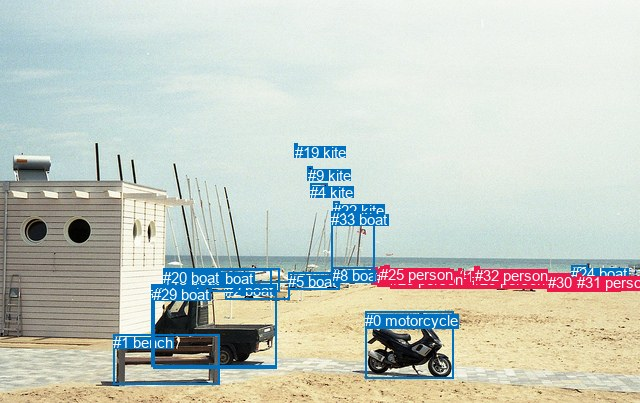
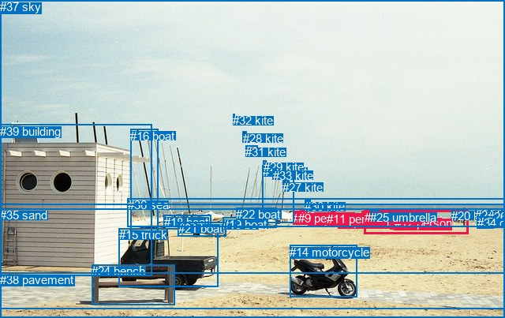

# 图片 0146：2318112.jpg

随机样本序号：425。图片 SHA256：`0c6655788cf20761d9c650c631d254cea96be405cc5f8ab06a6f1446844ad5d5`。

红色框表示人，蓝色框表示其他物体。两个模式分别保留自身框编号，可依据位置比较对应对象。

## 自动检测框与输出

人的框编号：`[6, 7, 10, 11, 12, 14, 15, 16, 18, 21, 23, 25, 26, 27, 28, 30, 31, 32]`。状态：`ok`。

### 自动检测全部物体框

| 编号 | 类别 | 是否为人 | 检测分数 | 像素坐标 xyxy |
|---|---|---|---|---|
| 0 | motorcycle | False | 0.9973 | 365.5, 311.6, 453.1, 378.4 |
| 1 | bench | False | 0.9965 | 113.1, 334.3, 219.9, 384.9 |
| 2 | boat | False | 0.9414 | 225.5, 281.8, 290.0, 299.7 |
| 3 | truck | False | 0.9365 | 151.4, 284.3, 276.9, 366.9 |
| 4 | kite | False | 0.9307 | 310.4, 183.6, 327.0, 189.9 |
| 5 | boat | False | 0.9275 | 288.2, 272.9, 339.8, 289.1 |
| 6 | person | True | 0.9152 | 371.3, 267.6, 377.8, 283.6 |
| 7 | person | True | 0.8961 | 384.2, 265.9, 389.5, 281.5 |
| 8 | boat | False | 0.8635 | 332.2, 267.2, 374.6, 282.4 |
| 9 | kite | False | 0.8604 | 307.9, 166.7, 312.2, 170.4 |
| 10 | person | True | 0.8022 | 377.2, 269.2, 382.3, 283.1 |
| 11 | person | True | 0.7517 | 413.6, 268.0, 418.8, 279.0 |
| 12 | person | True | 0.7359 | 419.0, 268.2, 424.7, 278.9 |
| 13 | boat | False | 0.7132 | 163.4, 270.8, 211.7, 292.0 |
| 14 | person | True | 0.7074 | 427.7, 271.9, 434.5, 279.4 |
| 15 | person | True | 0.7048 | 585.0, 273.3, 590.2, 285.8 |
| 16 | person | True | 0.6726 | 578.7, 273.3, 583.6, 282.5 |
| 17 | boat | False | 0.6614 | 197.5, 269.7, 271.7, 286.9 |
| 18 | person | True | 0.6545 | 458.3, 268.5, 461.9, 279.1 |
| 19 | kite | False | 0.6514 | 294.6, 143.9, 297.6, 147.8 |
| 20 | boat | False | 0.6284 | 163.2, 268.8, 279.2, 291.2 |
| 21 | person | True | 0.6229 | 501.4, 270.8, 506.3, 280.1 |
| 22 | kite | False | 0.5819 | 333.3, 201.6, 339.5, 207.0 |
| 23 | person | True | 0.5809 | 390.3, 271.1, 394.1, 278.1 |
| 24 | boat | False | 0.5715 | 571.4, 265.3, 587.8, 270.9 |
| 25 | person | True | 0.5455 | 380.2, 266.1, 385.0, 282.2 |
| 26 | person | True | 0.4711 | 496.7, 271.5, 501.9, 279.9 |
| 27 | person | True | 0.4418 | 474.8, 266.5, 478.8, 273.9 |
| 28 | person | True | 0.3826 | 471.7, 271.2, 476.3, 281.0 |
| 29 | boat | False | 0.3774 | 153.0, 286.5, 276.2, 368.5 |
| 30 | person | True | 0.3754 | 547.8, 274.1, 555.6, 280.7 |
| 31 | person | True | 0.3655 | 577.3, 273.7, 581.6, 281.8 |
| 32 | person | True | 0.3636 | 475.0, 266.9, 479.6, 279.9 |
| 33 | boat | False | 0.3531 | 331.5, 211.4, 374.6, 282.2 |

### 自动检测 Top50 人相关候选

评分物体对：1122；人相关物体对：882；输出关系：50。

| 排名 | 主语编号与类别 | 关系 | 宾语编号与类别 | 类型 | 人与人 | 排序分数 | 原始融合 logit |
|---|---|---|---|---|---|---|---|
| 1 | #32 person | wearing | #27 person | semantic | True | 0.97250 | 3.5655 |
| 2 | #16 person | wearing | #31 person | semantic | True | 0.92729 | 2.5459 |
| 3 | #32 person | in | #27 person | spatial | True | 0.92245 | 2.4762 |
| 4 | #16 person | in | #31 person | spatial | True | 0.89390 | 2.1312 |
| 5 | #24 boat | on | #16 person | spatial | False | 0.87310 | 1.9286 |
| 6 | #24 boat | on | #31 person | spatial | False | 0.86841 | 1.8869 |
| 7 | #16 person | on | #24 boat | spatial | False | 0.86331 | 1.8430 |
| 8 | #31 person | on | #24 boat | spatial | False | 0.85780 | 1.7971 |
| 9 | #15 person | on | #24 boat | spatial | False | 0.84837 | 1.7219 |
| 10 | #24 boat | on | #15 person | spatial | False | 0.83241 | 1.6028 |
| 11 | #31 person | standing on | #24 boat | semantic | False | 0.82973 | 1.5837 |
| 12 | #31 person | in | #16 person | spatial | True | 0.81668 | 1.4940 |
| 13 | #16 person | standing on | #24 boat | semantic | False | 0.80794 | 1.4367 |
| 14 | #31 person | wearing | #16 person | semantic | True | 0.79955 | 1.3835 |
| 15 | #16 person | standing on | #15 person | semantic | True | 0.73886 | 1.0400 |
| 16 | #27 person | in | #28 person | spatial | True | 0.72576 | 0.9732 |
| 17 | #15 person | standing on | #24 boat | semantic | False | 0.70933 | 0.8921 |
| 18 | #15 person | on | #16 person | spatial | True | 0.70366 | 0.8648 |
| 19 | #28 person | in | #27 person | spatial | True | 0.69969 | 0.8458 |
| 20 | #28 person | holding | #27 person | semantic | True | 0.69298 | 0.8141 |
| 21 | #27 person | playing with | #28 person | semantic | True | 0.67769 | 0.7432 |
| 22 | #31 person | standing on | #15 person | semantic | True | 0.66846 | 0.7012 |
| 23 | #16 person | on | #15 person | spatial | True | 0.66012 | 0.6638 |
| 24 | #32 person | in | #28 person | spatial | True | 0.65712 | 0.6505 |
| 25 | #24 boat | on | #30 person | spatial | False | 0.65047 | 0.6211 |
| 26 | #15 person | walking on | #16 person | semantic | True | 0.62808 | 0.5240 |
| 27 | #32 person | holding | #28 person | semantic | True | 0.62670 | 0.5181 |
| 28 | #15 person | on | #31 person | spatial | True | 0.62460 | 0.5091 |
| 29 | #12 person | on | #14 person | spatial | True | 0.62174 | 0.4969 |
| 30 | #24 boat | parked on | #15 person | semantic | False | 0.61551 | 0.4705 |
| 31 | #6 person | looking at | #19 kite | semantic | False | 0.60727 | 0.4359 |
| 32 | #15 person | walking on | #31 person | semantic | True | 0.60330 | 0.4192 |
| 33 | #24 boat | parked on | #31 person | semantic | False | 0.60256 | 0.4161 |
| 34 | #6 person | looking at | #9 kite | semantic | False | 0.60209 | 0.4142 |
| 35 | #24 boat | standing on | #16 person | semantic | False | 0.59995 | 0.4053 |
| 36 | #21 person | in | #26 person | spatial | True | 0.59827 | 0.3983 |
| 37 | #6 person | standing on | #8 boat | semantic | False | 0.56391 | 0.2571 |
| 38 | #25 person | looking at | #9 kite | semantic | False | 0.55202 | 0.2088 |
| 39 | #31 person | on | #15 person | spatial | True | 0.53595 | 0.1441 |
| 40 | #27 person | on | #32 person | spatial | True | 0.53466 | 0.1389 |
| 41 | #25 person | looking at | #19 kite | semantic | False | 0.53240 | 0.1298 |
| 42 | #10 person | looking at | #19 kite | semantic | False | 0.52172 | 0.0869 |
| 43 | #7 person | looking at | #9 kite | semantic | False | 0.52163 | 0.0866 |
| 44 | #10 person | looking at | #9 kite | semantic | False | 0.51927 | 0.0771 |
| 45 | #14 person | looking at | #19 kite | semantic | False | 0.51208 | 0.0483 |
| 46 | #12 person | looking at | #19 kite | semantic | False | 0.50504 | 0.0202 |
| 47 | #14 person | looking at | #9 kite | semantic | False | 0.50286 | 0.0114 |
| 48 | #7 person | looking at | #19 kite | semantic | False | 0.49928 | -0.0029 |
| 49 | #12 person | looking at | #9 kite | semantic | False | 0.49842 | -0.0063 |
| 50 | #26 person | in | #21 person | spatial | True | 0.49673 | -0.0131 |

### 自动检测逐条人相关 GT 核验

本图没有人相关 GT，R@50 无分母；预测候选继续展示。

## 真实框与输出

人的框编号：`[0, 1, 2, 3, 4, 5, 6, 7, 8, 9, 10, 11, 12, 13]`。

### 真实框全部物体框

| 编号 | 类别 | 是否为人 | 检测分数 | 像素坐标 xyxy |
|---|---|---|---|---|
| 0 | person | True | GT | 459.0, 268.0, 462.0, 279.0 |
| 1 | person | True | GT | 372.0, 268.0, 379.0, 284.0 |
| 2 | person | True | GT | 419.0, 268.0, 424.0, 279.0 |
| 3 | person | True | GT | 494.0, 273.0, 499.0, 280.0 |
| 4 | person | True | GT | 472.0, 271.0, 475.0, 275.0 |
| 5 | person | True | GT | 428.0, 272.0, 435.0, 279.0 |
| 6 | person | True | GT | 380.0, 266.0, 385.0, 280.0 |
| 7 | person | True | GT | 391.0, 271.0, 394.0, 278.0 |
| 8 | person | True | GT | 384.0, 266.0, 389.0, 282.0 |
| 9 | person | True | GT | 378.0, 268.0, 382.0, 282.0 |
| 10 | person | True | GT | 462.0, 268.0, 465.0, 279.0 |
| 11 | person | True | GT | 414.0, 269.0, 419.0, 279.0 |
| 12 | person | True | GT | 500.0, 274.0, 506.0, 279.0 |
| 13 | person | True | GT | 462.0, 267.0, 593.0, 297.0 |
| 14 | motorcycle | False | GT | 367.0, 311.0, 452.0, 377.0 |
| 15 | truck | False | GT | 151.0, 289.0, 277.0, 363.0 |
| 16 | boat | False | GT | 165.0, 164.0, 200.0, 294.0 |
| 17 | boat | False | GT | 333.0, 209.0, 373.0, 283.0 |
| 18 | boat | False | GT | 208.0, 273.0, 268.0, 286.0 |
| 19 | boat | False | GT | 282.0, 276.0, 327.0, 291.0 |
| 20 | boat | False | GT | 572.0, 265.0, 587.0, 270.0 |
| 21 | boat | False | GT | 226.0, 281.0, 287.0, 299.0 |
| 22 | boat | False | GT | 299.0, 263.0, 351.0, 288.0 |
| 23 | boat | False | GT | 602.0, 264.0, 636.0, 274.0 |
| 24 | bench | False | GT | 116.0, 335.0, 221.0, 387.0 |
| 25 | umbrella | False | GT | 469.0, 267.0, 480.0, 273.0 |
| 26 | umbrella | False | GT | 618.0, 266.0, 621.0, 268.0 |
| 27 | kite | False | GT | 358.0, 229.0, 366.0, 234.0 |
| 28 | kite | False | GT | 308.0, 167.0, 312.0, 171.0 |
| 29 | kite | False | GT | 334.0, 203.0, 338.0, 207.0 |
| 30 | kite | False | GT | 386.0, 253.0, 393.0, 256.0 |
| 31 | kite | False | GT | 311.0, 184.0, 326.0, 189.0 |
| 32 | kite | False | GT | 295.0, 144.0, 297.0, 146.0 |
| 33 | kite | False | GT | 346.0, 214.0, 350.0, 217.0 |
| 34 | chair | False | GT | 605.0, 274.0, 626.0, 289.0 |
| 35 | sand | False | GT | 0.0, 264.0, 640.0, 403.0 |
| 36 | sea | False | GT | 162.0, 251.0, 640.0, 288.0 |
| 37 | sky | False | GT | 0.0, 0.0, 640.0, 259.0 |
| 38 | pavement | False | GT | 0.0, 346.0, 640.0, 392.0 |
| 39 | building | False | GT | 0.0, 158.0, 193.0, 350.0 |

### 真实框 Top50 人相关候选

评分物体对：1560；人相关物体对：910；输出关系：50。

| 排名 | 主语编号与类别 | 关系 | 宾语编号与类别 | 类型 | 人与人 | 排序分数 | 原始融合 logit |
|---|---|---|---|---|---|---|---|
| 1 | #3 person | standing on | #35 sand | semantic | False | 0.97476 | 3.6539 |
| 2 | #13 person | on | #35 sand | spatial | False | 0.97391 | 3.6198 |
| 3 | #12 person | standing on | #35 sand | semantic | False | 0.97286 | 3.5792 |
| 4 | #7 person | standing on | #35 sand | semantic | False | 0.97127 | 3.5207 |
| 5 | #10 person | standing on | #35 sand | semantic | False | 0.97115 | 3.5163 |
| 6 | #8 person | standing on | #35 sand | semantic | False | 0.97039 | 3.4895 |
| 7 | #6 person | standing on | #35 sand | semantic | False | 0.96973 | 3.4669 |
| 8 | #9 person | standing on | #35 sand | semantic | False | 0.96878 | 3.4349 |
| 9 | #0 person | standing on | #35 sand | semantic | False | 0.96861 | 3.4294 |
| 10 | #11 person | standing on | #35 sand | semantic | False | 0.96844 | 3.4238 |
| 11 | #2 person | standing on | #35 sand | semantic | False | 0.96757 | 3.3958 |
| 12 | #4 person | standing on | #35 sand | semantic | False | 0.96740 | 3.3904 |
| 13 | #1 person | standing on | #35 sand | semantic | False | 0.96217 | 3.2360 |
| 14 | #5 person | on | #35 sand | spatial | False | 0.95855 | 3.1410 |
| 15 | #5 person | standing on | #35 sand | semantic | False | 0.95813 | 3.1303 |
| 16 | #20 boat | standing on | #13 person | semantic | False | 0.94799 | 2.9028 |
| 17 | #0 person | on | #35 sand | spatial | False | 0.94407 | 2.8260 |
| 18 | #4 person | on | #35 sand | spatial | False | 0.94250 | 2.7967 |
| 19 | #13 person | lying on | #35 sand | semantic | False | 0.94020 | 2.7552 |
| 20 | #10 person | on | #35 sand | spatial | False | 0.93820 | 2.7201 |
| 21 | #11 person | on | #35 sand | spatial | False | 0.93581 | 2.6796 |
| 22 | #2 person | on | #35 sand | spatial | False | 0.93522 | 2.6698 |
| 23 | #12 person | on | #35 sand | spatial | False | 0.93292 | 2.6325 |
| 24 | #1 person | on | #35 sand | spatial | False | 0.93040 | 2.5929 |
| 25 | #3 person | on | #35 sand | spatial | False | 0.92747 | 2.5485 |
| 26 | #3 person | standing on | #13 person | semantic | True | 0.92157 | 2.4639 |
| 27 | #12 person | standing on | #13 person | semantic | True | 0.91632 | 2.3934 |
| 28 | #20 boat | on | #13 person | spatial | False | 0.90576 | 2.2629 |
| 29 | #7 person | on | #35 sand | spatial | False | 0.89817 | 2.1771 |
| 30 | #9 person | on | #35 sand | spatial | False | 0.89188 | 2.1101 |
| 31 | #6 person | on | #35 sand | spatial | False | 0.88680 | 2.0584 |
| 32 | #8 person | on | #35 sand | spatial | False | 0.88274 | 2.0187 |
| 33 | #10 person | standing on | #13 person | semantic | True | 0.87927 | 1.9855 |
| 34 | #25 umbrella | standing on | #13 person | semantic | False | 0.87130 | 1.9125 |
| 35 | #34 chair | on | #13 person | spatial | False | 0.86446 | 1.8528 |
| 36 | #4 person | standing on | #13 person | semantic | True | 0.83134 | 1.5952 |
| 37 | #2 person | standing on | #36 sea | semantic | False | 0.82429 | 1.5457 |
| 38 | #11 person | standing on | #36 sea | semantic | False | 0.79328 | 1.3448 |
| 39 | #23 boat | on | #13 person | spatial | False | 0.77103 | 1.2141 |
| 40 | #13 person | on | #36 sea | spatial | False | 0.75118 | 1.1049 |
| 41 | #0 person | standing on | #36 sea | semantic | False | 0.73962 | 1.0440 |
| 42 | #8 person | standing on | #36 sea | semantic | False | 0.73671 | 1.0290 |
| 43 | #34 chair | parked on | #13 person | semantic | False | 0.72277 | 0.9582 |
| 44 | #12 person | on | #13 person | spatial | True | 0.71794 | 0.9343 |
| 45 | #6 person | standing on | #36 sea | semantic | False | 0.71173 | 0.9038 |
| 46 | #10 person | standing on | #36 sea | semantic | False | 0.70542 | 0.8733 |
| 47 | #5 person | standing on | #36 sea | semantic | False | 0.69995 | 0.8471 |
| 48 | #25 umbrella | on | #13 person | spatial | False | 0.67116 | 0.7134 |
| 49 | #4 person | standing on | #25 umbrella | semantic | False | 0.66513 | 0.6862 |
| 50 | #13 person | standing on | #36 sea | semantic | False | 0.65293 | 0.6319 |

### 真实框逐条人相关 GT 核验

本图没有人相关 GT，R@50 无分母；预测候选继续展示。

## 全部人相关 GT

| 主语编号与类别 | 关系 | 宾语编号与类别 |
|---|---|---|

原始记录、全部人相关物体对的两项预测与分项分数见 [逐图证据 JSON](../evidence/cases/0146.json)。全部56类 logits 保留于本机 HOR/output/random500/logits/。

<!-- HOR_COMPLETE_RESULTS -->

## 六组条件的完整输出对照

以下保留同一图片三种框与候选模式、两种谓词输出规则的全部 Top50。框编号各自在所属模式内解释。

### 自动检测框完整枚举：空间与语义各保留一个谓词

| 排名 | 主语编号与类别 | 谓词 | 宾语编号与类别 | 分组 | 排序分数 | predicate logit | pair logit |
|---|---|---|---|---|---|---|---|
| 1 | #32 person | wearing | #27 person | semantic | 0.9724963 | 3.8009620 | -0.2354168 |
| 2 | #16 person | wearing | #31 person | semantic | 0.9272944 | 2.9581146 | -0.4122629 |
| 3 | #32 person | in | #27 person | spatial | 0.9224545 | 2.7115898 | -0.2354168 |
| 4 | #16 person | in | #31 person | spatial | 0.8938954 | 2.5434270 | -0.4122629 |
| 5 | #24 boat | on | #16 person | spatial | 0.8730978 | 2.2572021 | -0.3285720 |
| 6 | #24 boat | on | #31 person | spatial | 0.8684058 | 2.2187991 | -0.3318630 |
| 7 | #16 person | on | #24 boat | spatial | 0.8633053 | 2.2554655 | -0.4124470 |
| 8 | #31 person | on | #24 boat | spatial | 0.8578000 | 2.1843929 | -0.3872566 |
| 9 | #15 person | on | #24 boat | spatial | 0.8483675 | 2.1350999 | -0.4132466 |
| 10 | #24 boat | on | #15 person | spatial | 0.8324111 | 1.9402452 | -0.3374324 |
| 11 | #31 person | standing on | #24 boat | semantic | 0.8297255 | 1.9709396 | -0.3872566 |
| 12 | #31 person | in | #16 person | spatial | 0.8166814 | 1.8809743 | -0.3869506 |
| 13 | #16 person | standing on | #24 boat | semantic | 0.8079429 | 1.8491459 | -0.4124470 |
| 14 | #31 person | wearing | #16 person | semantic | 0.7995476 | 1.7704196 | -0.3869506 |
| 15 | #16 person | standing on | #15 person | semantic | 0.7388595 | 1.4529581 | -0.4129087 |
| 16 | #27 person | in | #28 person | spatial | 0.7257641 | 1.1621037 | -0.1888672 |
| 17 | #15 person | standing on | #24 boat | semantic | 0.7093260 | 1.3053594 | -0.4132466 |
| 18 | #15 person | on | #16 person | spatial | 0.7036611 | 1.2707658 | -0.4059725 |
| 19 | #28 person | in | #27 person | spatial | 0.6996852 | 1.1375365 | -0.2917373 |
| 20 | #28 person | holding | #27 person | semantic | 0.6929833 | 1.1058407 | -0.2917373 |
| 21 | #27 person | playing with | #28 person | semantic | 0.6776890 | 0.9320388 | -0.1888672 |
| 22 | #31 person | standing on | #15 person | semantic | 0.6684615 | 1.0925770 | -0.3913422 |
| 23 | #16 person | on | #15 person | spatial | 0.6601230 | 1.0767512 | -0.4129087 |
| 24 | #32 person | in | #28 person | spatial | 0.6571174 | 0.8304319 | -0.1799573 |
| 25 | #24 boat | on | #30 person | spatial | 0.6504729 | 0.8606963 | -0.2395775 |
| 26 | #15 person | walking on | #16 person | semantic | 0.6280797 | 0.9299598 | -0.4059725 |
| 27 | #32 person | holding | #28 person | semantic | 0.6266963 | 0.6980271 | -0.1799573 |
| 28 | #15 person | on | #31 person | spatial | 0.6246035 | 0.9205604 | -0.4114264 |
| 29 | #12 person | on | #14 person | spatial | 0.6217358 | 0.7491941 | -0.2522721 |
| 30 | #24 boat | parked on | #15 person | semantic | 0.6155092 | 0.8079624 | -0.3374324 |
| 31 | #6 person | looking at | #19 kite | semantic | 0.6072723 | 1.1698751 | -0.7340145 |
| 32 | #15 person | walking on | #31 person | semantic | 0.6032984 | 0.8306541 | -0.4114264 |
| 33 | #24 boat | parked on | #31 person | semantic | 0.6025569 | 0.7479935 | -0.3318630 |
| 34 | #6 person | looking at | #9 kite | semantic | 0.6020879 | 1.0799503 | -0.6657779 |
| 35 | #24 boat | standing on | #16 person | semantic | 0.5999490 | 0.7338247 | -0.3285720 |
| 36 | #21 person | in | #26 person | spatial | 0.5982701 | 0.5339508 | -0.1356887 |
| 37 | #6 person | standing on | #8 boat | semantic | 0.5639121 | 0.8803105 | -0.6232560 |
| 38 | #25 person | looking at | #9 kite | semantic | 0.5520175 | 0.7517347 | -0.5429093 |
| 39 | #31 person | on | #15 person | spatial | 0.5359518 | 0.5353980 | -0.3913422 |
| 40 | #27 person | on | #32 person | spatial | 0.5346569 | 0.3795257 | -0.2406756 |
| 41 | #25 person | looking at | #19 kite | semantic | 0.5324027 | 0.7524323 | -0.6226397 |
| 42 | #10 person | looking at | #19 kite | semantic | 0.5217195 | 0.7828727 | -0.6959401 |
| 43 | #7 person | looking at | #9 kite | semantic | 0.5216339 | 0.5725822 | -0.4859928 |
| 44 | #10 person | looking at | #9 kite | semantic | 0.5192662 | 0.6922503 | -0.6151473 |
| 45 | #14 person | looking at | #19 kite | semantic | 0.5120757 | 0.8868513 | -0.8385394 |
| 46 | #12 person | looking at | #19 kite | semantic | 0.5050378 | 0.6828370 | -0.6626852 |
| 47 | #14 person | looking at | #9 kite | semantic | 0.5028620 | 0.7965779 | -0.7851297 |
| 48 | #7 person | looking at | #19 kite | semantic | 0.4992774 | 0.5732799 | -0.5761701 |
| 49 | #12 person | looking at | #9 kite | semantic | 0.4984231 | 0.5925632 | -0.5988706 |
| 50 | #26 person | in | #21 person | spatial | 0.4967338 | 0.1620097 | -0.1750748 |

没有人相关 GT，本条件的召回率无分母。

### 自动检测框完整枚举：每对只保留一个谓词

| 排名 | 主语编号与类别 | 谓词 | 宾语编号与类别 | 分组 | 排序分数 | predicate logit | pair logit |
|---|---|---|---|---|---|---|---|
| 1 | #32 person | wearing | #27 person | single | 0.9724963 | 3.8009620 | -0.2354168 |
| 2 | #16 person | wearing | #31 person | single | 0.9272944 | 2.9581146 | -0.4122629 |
| 3 | #24 boat | on | #16 person | single | 0.8730978 | 2.2572021 | -0.3285720 |
| 4 | #24 boat | on | #31 person | single | 0.8684058 | 2.2187991 | -0.3318630 |
| 5 | #16 person | on | #24 boat | single | 0.8633053 | 2.2554655 | -0.4124470 |
| 6 | #31 person | on | #24 boat | single | 0.8578000 | 2.1843929 | -0.3872566 |
| 7 | #15 person | on | #24 boat | single | 0.8483675 | 2.1350999 | -0.4132466 |
| 8 | #24 boat | on | #15 person | single | 0.8324111 | 1.9402452 | -0.3374324 |
| 9 | #31 person | in | #16 person | single | 0.8166814 | 1.8809743 | -0.3869506 |
| 10 | #16 person | standing on | #15 person | single | 0.7388595 | 1.4529581 | -0.4129087 |
| 11 | #27 person | in | #28 person | single | 0.7257641 | 1.1621037 | -0.1888672 |
| 12 | #15 person | on | #16 person | single | 0.7036611 | 1.2707658 | -0.4059725 |
| 13 | #28 person | in | #27 person | single | 0.6996852 | 1.1375365 | -0.2917373 |
| 14 | #31 person | standing on | #15 person | single | 0.6684615 | 1.0925770 | -0.3913422 |
| 15 | #32 person | in | #28 person | single | 0.6571174 | 0.8304319 | -0.1799573 |
| 16 | #24 boat | on | #30 person | single | 0.6504729 | 0.8606963 | -0.2395775 |
| 17 | #15 person | on | #31 person | single | 0.6246035 | 0.9205604 | -0.4114264 |
| 18 | #12 person | on | #14 person | single | 0.6217358 | 0.7491941 | -0.2522721 |
| 19 | #6 person | looking at | #19 kite | single | 0.6072723 | 1.1698751 | -0.7340145 |
| 20 | #6 person | looking at | #9 kite | single | 0.6020879 | 1.0799503 | -0.6657779 |
| 21 | #21 person | in | #26 person | single | 0.5982701 | 0.5339508 | -0.1356887 |
| 22 | #6 person | standing on | #8 boat | single | 0.5639121 | 0.8803105 | -0.6232560 |
| 23 | #25 person | looking at | #9 kite | single | 0.5520175 | 0.7517347 | -0.5429093 |
| 24 | #27 person | on | #32 person | single | 0.5346569 | 0.3795257 | -0.2406756 |
| 25 | #25 person | looking at | #19 kite | single | 0.5324027 | 0.7524323 | -0.6226397 |
| 26 | #10 person | looking at | #19 kite | single | 0.5217195 | 0.7828727 | -0.6959401 |
| 27 | #7 person | looking at | #9 kite | single | 0.5216339 | 0.5725822 | -0.4859928 |
| 28 | #10 person | looking at | #9 kite | single | 0.5192662 | 0.6922503 | -0.6151473 |
| 29 | #14 person | looking at | #19 kite | single | 0.5120757 | 0.8868513 | -0.8385394 |
| 30 | #12 person | looking at | #19 kite | single | 0.5050378 | 0.6828370 | -0.6626852 |
| 31 | #14 person | looking at | #9 kite | single | 0.5028620 | 0.7965779 | -0.7851297 |
| 32 | #7 person | looking at | #19 kite | single | 0.4992774 | 0.5732799 | -0.5761701 |
| 33 | #12 person | looking at | #9 kite | single | 0.4984231 | 0.5925632 | -0.5988706 |
| 34 | #26 person | in | #21 person | single | 0.4967338 | 0.1620097 | -0.1750748 |
| 35 | #11 person | looking at | #9 kite | single | 0.4875764 | 0.4742899 | -0.5239946 |
| 36 | #11 person | looking at | #19 kite | single | 0.4771292 | 0.5050788 | -0.5966262 |
| 37 | #18 person | looking at | #9 kite | single | 0.4747254 | 0.5936089 | -0.6947937 |
| 38 | #18 person | looking at | #19 kite | single | 0.4683626 | 0.6261411 | -0.7528601 |
| 39 | #32 person | looking at | #9 kite | single | 0.4555026 | 0.4158506 | -0.5943126 |
| 40 | #11 person | on | #12 person | single | 0.4499413 | 0.1688585 | -0.3697664 |
| 41 | #28 person | in | #32 person | single | 0.4442307 | 0.0644302 | -0.2884395 |
| 42 | #27 person | looking at | #9 kite | single | 0.4387881 | 0.3553195 | -0.6014014 |
| 43 | #32 person | looking at | #19 kite | single | 0.4283698 | 0.3899431 | -0.6784484 |
| 44 | #6 person | standing on | #10 person | single | 0.4209216 | 0.3865047 | -0.7054961 |
| 45 | #25 person | standing on | #7 person | single | 0.4179349 | 0.3842616 | -0.7155184 |
| 46 | #27 person | looking at | #19 kite | single | 0.4139664 | 0.3290634 | -0.6766558 |
| 47 | #23 person | looking at | #9 kite | single | 0.4077321 | 0.1205168 | -0.4938655 |
| 48 | #28 person | looking at | #9 kite | single | 0.4056413 | 0.2657433 | -0.6477567 |
| 49 | #25 person | in | #10 person | single | 0.3997050 | 0.1761746 | -0.5828688 |
| 50 | #28 person | looking at | #19 kite | single | 0.3906218 | 0.2979259 | -0.7426251 |

没有人相关 GT，本条件的召回率无分母。

### 真实框完整枚举：空间与语义各保留一个谓词

| 排名 | 主语编号与类别 | 谓词 | 宾语编号与类别 | 分组 | 排序分数 | predicate logit | pair logit |
|---|---|---|---|---|---|---|---|
| 1 | #3 person | standing on | #35 sand | semantic | 0.9747642 | 3.2288575 | 0.4250721 |
| 2 | #13 person | on | #35 sand | spatial | 0.9739115 | 3.5353999 | 0.0844233 |
| 3 | #12 person | standing on | #35 sand | semantic | 0.9728587 | 3.1466422 | 0.4325397 |
| 4 | #7 person | standing on | #35 sand | semantic | 0.9712705 | 3.2259989 | 0.2946831 |
| 5 | #10 person | standing on | #35 sand | semantic | 0.9711486 | 3.1878495 | 0.3284717 |
| 6 | #8 person | standing on | #35 sand | semantic | 0.9703869 | 3.1892786 | 0.3002030 |
| 7 | #6 person | standing on | #35 sand | semantic | 0.9697315 | 3.1599016 | 0.3070093 |
| 8 | #9 person | standing on | #35 sand | semantic | 0.9687783 | 3.1364398 | 0.2984831 |
| 9 | #0 person | standing on | #35 sand | semantic | 0.9686106 | 3.1643877 | 0.2650061 |
| 10 | #11 person | standing on | #35 sand | semantic | 0.9684401 | 3.2392588 | 0.1845398 |
| 11 | #2 person | standing on | #35 sand | semantic | 0.9675717 | 3.2319140 | 0.1638453 |
| 12 | #4 person | standing on | #35 sand | semantic | 0.9674027 | 3.0234184 | 0.3669673 |
| 13 | #1 person | standing on | #35 sand | semantic | 0.9621665 | 2.9310012 | 0.3049895 |
| 14 | #5 person | on | #35 sand | spatial | 0.9585520 | 3.0092225 | 0.1317633 |
| 15 | #5 person | standing on | #35 sand | semantic | 0.9581252 | 2.9985285 | 0.1317633 |
| 16 | #20 boat | standing on | #13 person | semantic | 0.9479870 | 2.8765354 | 0.0263126 |
| 17 | #0 person | on | #35 sand | spatial | 0.9440657 | 2.5610108 | 0.2650061 |
| 18 | #4 person | on | #35 sand | spatial | 0.9424985 | 2.4297557 | 0.3669673 |
| 19 | #13 person | lying on | #35 sand | semantic | 0.9402042 | 2.6707373 | 0.0844233 |
| 20 | #10 person | on | #35 sand | spatial | 0.9382031 | 2.3916421 | 0.3284717 |
| 21 | #11 person | on | #35 sand | spatial | 0.9358141 | 2.4950933 | 0.1845398 |
| 22 | #2 person | on | #35 sand | spatial | 0.9352227 | 2.5059834 | 0.1638453 |
| 23 | #12 person | on | #35 sand | spatial | 0.9329214 | 2.1999154 | 0.4325397 |
| 24 | #1 person | on | #35 sand | spatial | 0.9304026 | 2.2879014 | 0.3049895 |
| 25 | #3 person | on | #35 sand | spatial | 0.9274707 | 2.1233983 | 0.4250721 |
| 26 | #3 person | standing on | #13 person | semantic | 0.9215688 | 2.4038491 | 0.0600064 |
| 27 | #12 person | standing on | #13 person | semantic | 0.9163223 | 2.3275485 | 0.0658470 |
| 28 | #20 boat | on | #13 person | spatial | 0.9057570 | 2.2365813 | 0.0263126 |
| 29 | #7 person | on | #35 sand | spatial | 0.8981707 | 1.8823791 | 0.2946831 |
| 30 | #9 person | on | #35 sand | spatial | 0.8918790 | 1.8115964 | 0.2984831 |
| 31 | #6 person | on | #35 sand | spatial | 0.8867959 | 1.7514138 | 0.3070093 |
| 32 | #8 person | on | #35 sand | spatial | 0.8827423 | 1.7184558 | 0.3002030 |
| 33 | #10 person | standing on | #13 person | semantic | 0.8792713 | 2.0346951 | -0.0491475 |
| 34 | #25 umbrella | standing on | #13 person | semantic | 0.8712992 | 1.9121866 | 0.0003085 |
| 35 | #34 chair | on | #13 person | spatial | 0.8644555 | 1.9422722 | -0.0894722 |
| 36 | #4 person | standing on | #13 person | semantic | 0.8313416 | 1.5899558 | 0.0052100 |
| 37 | #2 person | standing on | #36 sea | semantic | 0.8242933 | 1.6458511 | -0.1001408 |
| 38 | #11 person | standing on | #36 sea | semantic | 0.7932832 | 1.4572449 | -0.1124146 |
| 39 | #23 boat | on | #13 person | spatial | 0.7710273 | 1.3948956 | -0.1807742 |
| 40 | #13 person | on | #36 sea | spatial | 0.7511786 | 1.5209665 | -0.4160585 |
| 41 | #0 person | standing on | #36 sea | semantic | 0.7396177 | 1.0630016 | -0.0190188 |
| 42 | #8 person | standing on | #36 sea | semantic | 0.7367139 | 1.1401157 | -0.1111574 |
| 43 | #34 chair | parked on | #13 person | semantic | 0.7227669 | 1.0477004 | -0.0894722 |
| 44 | #12 person | on | #13 person | spatial | 0.7179421 | 0.8684292 | 0.0658470 |
| 45 | #6 person | standing on | #36 sea | semantic | 0.7117282 | 1.0006762 | -0.0968837 |
| 46 | #10 person | standing on | #36 sea | semantic | 0.7054221 | 0.8897986 | -0.0165458 |
| 47 | #5 person | standing on | #36 sea | semantic | 0.6999525 | 0.9788418 | -0.1317702 |
| 48 | #25 umbrella | on | #13 person | spatial | 0.6711555 | 0.7131071 | 0.0003085 |
| 49 | #4 person | standing on | #25 umbrella | semantic | 0.6651298 | 0.9421210 | -0.2558815 |
| 50 | #13 person | standing on | #36 sea | semantic | 0.6529288 | 1.0479965 | -0.4160585 |

没有人相关 GT，本条件的召回率无分母。

### 真实框完整枚举：每对只保留一个谓词

| 排名 | 主语编号与类别 | 谓词 | 宾语编号与类别 | 分组 | 排序分数 | predicate logit | pair logit |
|---|---|---|---|---|---|---|---|
| 1 | #3 person | standing on | #35 sand | single | 0.9747642 | 3.2288575 | 0.4250721 |
| 2 | #13 person | on | #35 sand | single | 0.9739115 | 3.5353999 | 0.0844233 |
| 3 | #12 person | standing on | #35 sand | single | 0.9728587 | 3.1466422 | 0.4325397 |
| 4 | #7 person | standing on | #35 sand | single | 0.9712705 | 3.2259989 | 0.2946831 |
| 5 | #10 person | standing on | #35 sand | single | 0.9711486 | 3.1878495 | 0.3284717 |
| 6 | #8 person | standing on | #35 sand | single | 0.9703869 | 3.1892786 | 0.3002030 |
| 7 | #6 person | standing on | #35 sand | single | 0.9697315 | 3.1599016 | 0.3070093 |
| 8 | #9 person | standing on | #35 sand | single | 0.9687783 | 3.1364398 | 0.2984831 |
| 9 | #0 person | standing on | #35 sand | single | 0.9686106 | 3.1643877 | 0.2650061 |
| 10 | #11 person | standing on | #35 sand | single | 0.9684401 | 3.2392588 | 0.1845398 |
| 11 | #2 person | standing on | #35 sand | single | 0.9675717 | 3.2319140 | 0.1638453 |
| 12 | #4 person | standing on | #35 sand | single | 0.9674027 | 3.0234184 | 0.3669673 |
| 13 | #1 person | standing on | #35 sand | single | 0.9621665 | 2.9310012 | 0.3049895 |
| 14 | #5 person | on | #35 sand | single | 0.9585520 | 3.0092225 | 0.1317633 |
| 15 | #20 boat | standing on | #13 person | single | 0.9479870 | 2.8765354 | 0.0263126 |
| 16 | #3 person | standing on | #13 person | single | 0.9215688 | 2.4038491 | 0.0600064 |
| 17 | #12 person | standing on | #13 person | single | 0.9163223 | 2.3275485 | 0.0658470 |
| 18 | #10 person | standing on | #13 person | single | 0.8792713 | 2.0346951 | -0.0491475 |
| 19 | #25 umbrella | standing on | #13 person | single | 0.8712992 | 1.9121866 | 0.0003085 |
| 20 | #34 chair | on | #13 person | single | 0.8644555 | 1.9422722 | -0.0894722 |
| 21 | #4 person | standing on | #13 person | single | 0.8313416 | 1.5899558 | 0.0052100 |
| 22 | #2 person | standing on | #36 sea | single | 0.8242933 | 1.6458511 | -0.1001408 |
| 23 | #11 person | standing on | #36 sea | single | 0.7932832 | 1.4572449 | -0.1124146 |
| 24 | #23 boat | on | #13 person | single | 0.7710273 | 1.3948956 | -0.1807742 |
| 25 | #13 person | on | #36 sea | single | 0.7511786 | 1.5209665 | -0.4160585 |
| 26 | #0 person | standing on | #36 sea | single | 0.7396177 | 1.0630016 | -0.0190188 |
| 27 | #8 person | standing on | #36 sea | single | 0.7367139 | 1.1401157 | -0.1111574 |
| 28 | #6 person | standing on | #36 sea | single | 0.7117282 | 1.0006762 | -0.0968837 |
| 29 | #10 person | standing on | #36 sea | single | 0.7054221 | 0.8897986 | -0.0165458 |
| 30 | #5 person | standing on | #36 sea | single | 0.6999525 | 0.9788418 | -0.1317702 |
| 31 | #4 person | standing on | #25 umbrella | single | 0.6651298 | 0.9421210 | -0.2558815 |
| 32 | #7 person | standing on | #36 sea | single | 0.6481714 | 0.7379131 | -0.1269023 |
| 33 | #9 person | standing on | #36 sea | single | 0.6166548 | 0.5992875 | -0.1239142 |
| 34 | #1 person | standing on | #36 sea | single | 0.6089242 | 0.5817409 | -0.1389483 |
| 35 | #1 person | looking at | #32 kite | single | 0.5135055 | 0.8091283 | -0.7550931 |
| 36 | #3 person | standing on | #36 sea | single | 0.4841523 | 0.0259256 | -0.0893379 |
| 37 | #4 person | standing on | #36 sea | single | 0.4818714 | -0.0217118 | -0.0508344 |
| 38 | #6 person | looking at | #32 kite | single | 0.4663793 | 0.4536119 | -0.5882977 |
| 39 | #9 person | looking at | #32 kite | single | 0.4471567 | 0.4515200 | -0.6636854 |
| 40 | #8 person | looking at | #32 kite | single | 0.4419385 | 0.3629894 | -0.5962880 |
| 41 | #8 person | walking on | #38 pavement | single | 0.4255223 | 0.0904155 | -0.3905594 |
| 42 | #6 person | looking at | #28 kite | single | 0.4134639 | 0.1537452 | -0.5034091 |
| 43 | #1 person | looking at | #28 kite | single | 0.4041843 | 0.2972288 | -0.6852891 |
| 44 | #0 person | standing on | #13 person | single | 0.4003721 | -0.2938628 | -0.1100522 |
| 45 | #36 sea | on | #13 person | single | 0.3974256 | 0.3032699 | -0.7194732 |
| 46 | #6 person | walking on | #38 pavement | single | 0.3970510 | -0.0510092 | -0.3667586 |
| 47 | #8 person | looking at | #28 kite | single | 0.3922235 | 0.0634713 | -0.5014468 |
| 48 | #9 person | looking at | #28 kite | single | 0.3872259 | 0.1222596 | -0.5812479 |
| 49 | #9 person | walking on | #38 pavement | single | 0.3783930 | -0.1172128 | -0.3791620 |
| 50 | #7 person | walking on | #38 pavement | single | 0.3750529 | -0.1021605 | -0.4084394 |

没有人相关 GT，本条件的召回率无分母。

### 真实框400候选：空间与语义各保留一个谓词

| 排名 | 主语编号与类别 | 谓词 | 宾语编号与类别 | 分组 | 排序分数 | predicate logit | pair logit |
|---|---|---|---|---|---|---|---|
| 1 | #13 person | lying on | #35 sand | semantic | 0.9708623 | 3.4217315 | 0.0844233 |
| 2 | #13 person | on | #35 sand | spatial | 0.9657604 | 3.2551079 | 0.0844233 |
| 3 | #12 person | standing on | #13 person | semantic | 0.8732713 | 1.8643503 | 0.0658470 |
| 4 | #34 chair | parked on | #13 person | semantic | 0.8687456 | 1.9793854 | -0.0894722 |
| 5 | #3 person | standing on | #13 person | semantic | 0.8637190 | 1.7865219 | 0.0600064 |
| 6 | #34 chair | on | #13 person | spatial | 0.8280997 | 1.6616912 | -0.0894722 |
| 7 | #23 boat | parked on | #13 person | semantic | 0.8217677 | 1.7091441 | -0.1807742 |
| 8 | #13 person | on | #36 sea | spatial | 0.8102103 | 1.8674359 | -0.4160585 |
| 9 | #13 person | standing on | #36 sea | semantic | 0.7903265 | 1.7429533 | -0.4160585 |
| 10 | #23 boat | on | #13 person | spatial | 0.7822096 | 1.4593639 | -0.1807742 |
| 11 | #4 person | standing on | #25 umbrella | semantic | 0.7683859 | 1.4551015 | -0.2558815 |
| 12 | #15 truck | parked on | #13 person | semantic | 0.7468551 | 2.1587896 | -1.0768802 |
| 13 | #22 boat | parked on | #13 person | semantic | 0.6243444 | 1.0757942 | -0.5677646 |
| 14 | #4 person | hanging from | #25 umbrella | spatial | 0.6209192 | 0.7493329 | -0.2558815 |
| 15 | #36 sea | on | #13 person | spatial | 0.5441399 | 0.8964934 | -0.7194732 |
| 16 | #25 umbrella | standing on | #13 person | semantic | 0.5437036 | 0.1749530 | 0.0003085 |
| 17 | #21 boat | parked on | #13 person | semantic | 0.5424522 | 0.8356819 | -0.6654636 |
| 18 | #18 boat | parked on | #13 person | semantic | 0.5341783 | 0.7146420 | -0.5777153 |
| 19 | #12 person | on | #13 person | spatial | 0.5329105 | 0.0659857 | 0.0658470 |
| 20 | #24 bench | on | #13 person | spatial | 0.5202686 | 1.7060900 | -1.6249714 |
| 21 | #10 person | standing on | #13 person | semantic | 0.5189471 | 0.1249723 | -0.0491475 |
| 22 | #19 boat | parked on | #13 person | semantic | 0.5158508 | 0.6550736 | -0.5916492 |
| 23 | #21 boat | on | #13 person | spatial | 0.5056041 | 0.6878810 | -0.6654636 |
| 24 | #17 boat | on | #13 person | spatial | 0.4962553 | 0.6199665 | -0.6349455 |
| 25 | #37 sky | over | #13 person | spatial | 0.4643101 | 1.0481896 | -1.1911924 |
| 26 | #19 boat | on | #13 person | spatial | 0.4619438 | 0.4391294 | -0.5916492 |
| 27 | #3 person | on | #13 person | spatial | 0.4448884 | -0.2813520 | 0.0600064 |
| 28 | #14 motorcycle | parked on | #13 person | semantic | 0.4044737 | 0.9557800 | -1.3426389 |
| 29 | #9 person | standing on | #6 person | semantic | 0.3925681 | 0.3188787 | -0.7554089 |
| 30 | #22 boat | on | #13 person | spatial | 0.3704859 | 0.0376320 | -0.5677646 |
| 31 | #10 person | standing on | #25 umbrella | semantic | 0.3613833 | -0.2138915 | -0.3554738 |
| 32 | #18 boat | on | #13 person | spatial | 0.3235732 | -0.1596837 | -0.5777153 |
| 33 | #17 boat | standing on | #13 person | semantic | 0.3182044 | -0.1270905 | -0.6349455 |
| 34 | #6 person | standing on | #9 person | semantic | 0.3067425 | -0.2169480 | -0.5984448 |
| 35 | #39 building | beside | #13 person | spatial | 0.2997993 | 0.2547240 | -1.1029778 |
| 36 | #4 person | standing on | #13 person | semantic | 0.2996732 | -0.8540647 | 0.0052100 |
| 37 | #15 truck | in | #13 person | spatial | 0.2910519 | 0.1865993 | -1.0768802 |
| 38 | #20 boat | standing on | #13 person | semantic | 0.2858180 | -0.9420953 | 0.0263126 |
| 39 | #0 person | standing on | #10 person | semantic | 0.2794986 | -0.5617266 | -0.3852236 |
| 40 | #1 person | standing on | #9 person | semantic | 0.2700734 | -0.2153201 | -0.7789301 |
| 41 | #36 sea | lying on | #13 person | semantic | 0.2693160 | -0.2786222 | -0.7194732 |
| 42 | #6 person | standing on | #8 person | semantic | 0.2576313 | -0.4010682 | -0.6572485 |
| 43 | #0 person | standing on | #25 umbrella | semantic | 0.2562677 | -0.6248665 | -0.4405923 |
| 44 | #8 person | standing on | #6 person | semantic | 0.2486492 | -0.4414611 | -0.6643685 |
| 45 | #25 umbrella | on | #13 person | spatial | 0.2470213 | -1.1148710 | 0.0003085 |
| 46 | #13 person | beside | #39 building | spatial | 0.2443648 | 0.3239851 | -1.4528818 |
| 47 | #24 bench | sitting on | #13 person | semantic | 0.2303180 | 0.4184546 | -1.6249714 |
| 48 | #0 person | beside | #10 person | spatial | 0.2238626 | -0.8580737 | -0.3852236 |
| 49 | #11 person | standing on | #2 person | semantic | 0.2146793 | -0.9256799 | -0.3712670 |
| 50 | #10 person | beside | #25 umbrella | spatial | 0.2088901 | -0.9761546 | -0.3554738 |

没有人相关 GT，本条件的召回率无分母。

### 真实框400候选：每对只保留一个谓词

| 排名 | 主语编号与类别 | 谓词 | 宾语编号与类别 | 分组 | 排序分数 | predicate logit | pair logit |
|---|---|---|---|---|---|---|---|
| 1 | #13 person | lying on | #35 sand | single | 0.9708623 | 3.4217315 | 0.0844233 |
| 2 | #12 person | standing on | #13 person | single | 0.8732713 | 1.8643503 | 0.0658470 |
| 3 | #34 chair | parked on | #13 person | single | 0.8687456 | 1.9793854 | -0.0894722 |
| 4 | #3 person | standing on | #13 person | single | 0.8637190 | 1.7865219 | 0.0600064 |
| 5 | #23 boat | parked on | #13 person | single | 0.8217677 | 1.7091441 | -0.1807742 |
| 6 | #13 person | on | #36 sea | single | 0.8102103 | 1.8674359 | -0.4160585 |
| 7 | #4 person | standing on | #25 umbrella | single | 0.7683859 | 1.4551015 | -0.2558815 |
| 8 | #15 truck | parked on | #13 person | single | 0.7468551 | 2.1587896 | -1.0768802 |
| 9 | #22 boat | parked on | #13 person | single | 0.6243444 | 1.0757942 | -0.5677646 |
| 10 | #36 sea | on | #13 person | single | 0.5441399 | 0.8964934 | -0.7194732 |
| 11 | #25 umbrella | standing on | #13 person | single | 0.5437036 | 0.1749530 | 0.0003085 |
| 12 | #21 boat | parked on | #13 person | single | 0.5424522 | 0.8356819 | -0.6654636 |
| 13 | #18 boat | parked on | #13 person | single | 0.5341783 | 0.7146420 | -0.5777153 |
| 14 | #24 bench | on | #13 person | single | 0.5202686 | 1.7060900 | -1.6249714 |
| 15 | #10 person | standing on | #13 person | single | 0.5189471 | 0.1249723 | -0.0491475 |
| 16 | #19 boat | parked on | #13 person | single | 0.5158508 | 0.6550736 | -0.5916492 |
| 17 | #17 boat | on | #13 person | single | 0.4962553 | 0.6199665 | -0.6349455 |
| 18 | #37 sky | over | #13 person | single | 0.4643101 | 1.0481896 | -1.1911924 |
| 19 | #14 motorcycle | parked on | #13 person | single | 0.4044737 | 0.9557800 | -1.3426389 |
| 20 | #9 person | standing on | #6 person | single | 0.3925681 | 0.3188787 | -0.7554089 |
| 21 | #10 person | standing on | #25 umbrella | single | 0.3613833 | -0.2138915 | -0.3554738 |
| 22 | #6 person | standing on | #9 person | single | 0.3067425 | -0.2169480 | -0.5984448 |
| 23 | #39 building | beside | #13 person | single | 0.2997993 | 0.2547240 | -1.1029778 |
| 24 | #4 person | standing on | #13 person | single | 0.2996732 | -0.8540647 | 0.0052100 |
| 25 | #20 boat | standing on | #13 person | single | 0.2858180 | -0.9420953 | 0.0263126 |
| 26 | #0 person | standing on | #10 person | single | 0.2794986 | -0.5617266 | -0.3852236 |
| 27 | #1 person | standing on | #9 person | single | 0.2700734 | -0.2153201 | -0.7789301 |
| 28 | #6 person | standing on | #8 person | single | 0.2576313 | -0.4010682 | -0.6572485 |
| 29 | #0 person | standing on | #25 umbrella | single | 0.2562677 | -0.6248665 | -0.4405923 |
| 30 | #8 person | standing on | #6 person | single | 0.2486492 | -0.4414611 | -0.6643685 |
| 31 | #13 person | beside | #39 building | single | 0.2443648 | 0.3239851 | -1.4528818 |
| 32 | #11 person | standing on | #2 person | single | 0.2146793 | -0.9256799 | -0.3712670 |
| 33 | #13 person | wearing | #12 person | single | 0.2053088 | -0.4291759 | -0.9242626 |
| 34 | #9 person | standing on | #1 person | single | 0.2041987 | -0.7588980 | -0.6013582 |
| 35 | #1 person | standing on | #35 sand | single | 0.1716231 | -1.8791571 | 0.3049895 |
| 36 | #3 person | standing on | #12 person | single | 0.1710131 | -1.4145339 | -0.1639303 |
| 37 | #13 person | on | #38 pavement | single | 0.1699152 | -0.9058249 | -0.6804036 |
| 38 | #2 person | standing on | #5 person | single | 0.1555871 | -1.4137695 | -0.2776665 |
| 39 | #13 person | looking at | #37 sky | single | 0.1535846 | -0.1688914 | -1.5378674 |
| 40 | #13 person | sitting on | #24 bench | single | 0.1515015 | 0.4274035 | -2.1502764 |
| 41 | #10 person | standing on | #0 person | single | 0.1512572 | -1.4813457 | -0.2434286 |
| 42 | #13 person | wearing | #20 boat | single | 0.1508467 | -0.8997245 | -0.8282512 |
| 43 | #1 person | standing on | #17 boat | single | 0.1448895 | -1.0504315 | -0.7248275 |
| 44 | #9 person | standing on | #22 boat | single | 0.1401123 | -1.1923132 | -0.6220440 |
| 45 | #25 umbrella | on | #4 person | single | 0.1363857 | -1.6132872 | -0.2323521 |
| 46 | #9 person | standing on | #8 person | single | 0.1317002 | -1.1525354 | -0.7334734 |
| 47 | #1 person | standing on | #6 person | single | 0.1298920 | -1.0372717 | -0.8646426 |
| 48 | #13 person | wearing | #3 person | single | 0.1182584 | -1.0497320 | -0.9592949 |
| 49 | #2 person | beside | #11 person | single | 0.1178553 | -1.5645490 | -0.4483491 |
| 50 | #8 person | standing on | #7 person | single | 0.1177910 | -1.3933649 | -0.6201518 |

没有人相关 GT，本条件的召回率无分母。
