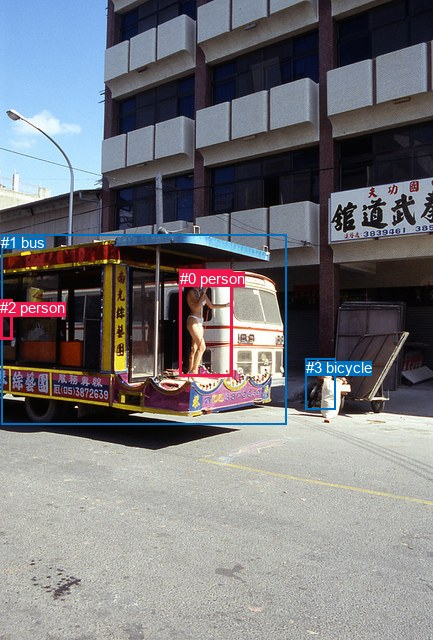
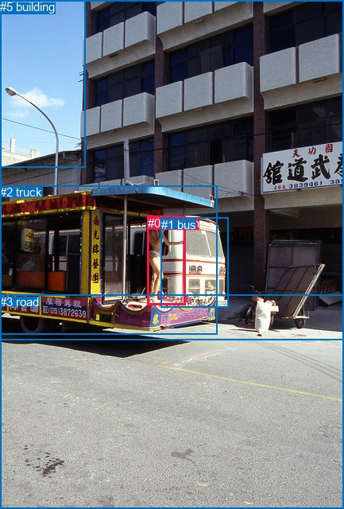

# 图片 0163：2319267.jpg

随机样本序号：438。图片 SHA256：`a58ae7aa5a2afea886f3dcdb9efab1c2ab2e918df6d0d41d001a493ff859ad23`。

红色框表示人，蓝色框表示其他物体。两个模式分别保留自身框编号，可依据位置比较对应对象。

## 自动检测框与输出

人的框编号：`[0, 2]`。状态：`ok`。

### 自动检测全部物体框

| 编号 | 类别 | 是否为人 | 检测分数 | 像素坐标 xyxy |
|---|---|---|---|---|
| 0 | person | True | 0.9937 | 179.6, 269.9, 232.7, 376.4 |
| 1 | bus | False | 0.9328 | 1.3, 234.4, 286.2, 424.0 |
| 2 | person | True | 0.6416 | 0.0, 299.4, 12.9, 339.2 |
| 3 | bicycle | False | 0.4780 | 305.5, 358.6, 335.5, 409.3 |

### 自动检测 Top50 人相关候选

评分物体对：12；人相关物体对：10；输出关系：20。

| 排名 | 主语编号与类别 | 关系 | 宾语编号与类别 | 类型 | 人与人 | 排序分数 | 原始融合 logit |
|---|---|---|---|---|---|---|---|
| 1 | #2 person | riding | #1 bus | semantic | False | 0.98724 | 4.3485 |
| 2 | #0 person | riding | #1 bus | semantic | False | 0.98374 | 4.1026 |
| 3 | #0 person | on | #1 bus | spatial | False | 0.94956 | 2.9352 |
| 4 | #2 person | in | #1 bus | spatial | False | 0.90859 | 2.2965 |
| 5 | #1 bus | carrying | #0 person | semantic | False | 0.68209 | 0.7634 |
| 6 | #3 bicycle | looking at | #0 person | semantic | False | 0.66749 | 0.6969 |
| 7 | #3 bicycle | beside | #0 person | spatial | False | 0.62029 | 0.4908 |
| 8 | #1 bus | carrying | #2 person | semantic | False | 0.52171 | 0.0869 |
| 9 | #0 person | looking at | #3 bicycle | semantic | False | 0.45442 | -0.1828 |
| 10 | #2 person | looking at | #0 person | semantic | True | 0.39549 | -0.4243 |
| 11 | #0 person | beside | #3 bicycle | spatial | False | 0.28557 | -0.9170 |
| 12 | #2 person | beside | #0 person | spatial | True | 0.11031 | -2.0876 |
| 13 | #2 person | looking at | #3 bicycle | semantic | False | 0.08978 | -2.3163 |
| 14 | #0 person | looking at | #2 person | semantic | True | 0.08879 | -2.3285 |
| 15 | #1 bus | beside | #0 person | spatial | False | 0.06482 | -2.6692 |
| 16 | #1 bus | beside | #2 person | spatial | False | 0.05832 | -2.7817 |
| 17 | #0 person | beside | #2 person | spatial | True | 0.02256 | -3.7687 |
| 18 | #2 person | beside | #3 bicycle | spatial | False | 0.02207 | -3.7911 |
| 19 | #3 bicycle | looking at | #2 person | semantic | False | 0.01412 | -4.2462 |
| 20 | #3 bicycle | beside | #2 person | spatial | False | 0.00365 | -5.6098 |

### 自动检测逐条人相关 GT 核验

R@50：0.00%；命中 0/2。

| GT 主语编号 | GT 关系 | GT 宾语编号 | 结果阶段 | 匹配预测主语编号 | 匹配预测宾语编号 |
|---|---|---|---|---|---|
| 0 | on | 2 | endpoint_missing_or_wrong_class | [0] | [] |
| 0 | standing on | 2 | endpoint_missing_or_wrong_class | [0] | [] |

## 真实框与输出

人的框编号：`[0]`。

### 真实框全部物体框

| 编号 | 类别 | 是否为人 | 检测分数 | 像素坐标 xyxy |
|---|---|---|---|---|
| 0 | person | True | GT | 186.0, 272.0, 234.0, 383.0 |
| 1 | bus | False | GT | 203.0, 274.0, 287.0, 387.0 |
| 2 | truck | False | GT | 0.0, 233.0, 273.0, 420.0 |
| 3 | road | False | GT | 0.0, 371.0, 433.0, 640.0 |
| 4 | sky | False | GT | 0.0, 0.0, 107.0, 210.0 |
| 5 | building | False | GT | 0.0, 0.0, 433.0, 427.0 |

### 真实框 Top50 人相关候选

评分物体对：30；人相关物体对：10；输出关系：20。

| 排名 | 主语编号与类别 | 关系 | 宾语编号与类别 | 类型 | 人与人 | 排序分数 | 原始融合 logit |
|---|---|---|---|---|---|---|---|
| 1 | #0 person | standing on | #2 truck | semantic | False | 0.96795 | 3.4080 |
| 2 | #0 person | on | #2 truck | spatial | False | 0.95972 | 3.1709 |
| 3 | #0 person | beside | #1 bus | spatial | False | 0.89179 | 2.1091 |
| 4 | #0 person | standing on | #1 bus | semantic | False | 0.85593 | 1.7819 |
| 5 | #0 person | on | #3 road | spatial | False | 0.85531 | 1.7769 |
| 6 | #1 bus | beside | #0 person | spatial | False | 0.67200 | 0.7172 |
| 7 | #0 person | standing on | #3 road | semantic | False | 0.63861 | 0.5693 |
| 8 | #0 person | in | #5 building | spatial | False | 0.33540 | -0.6838 |
| 9 | #4 sky | over | #0 person | spatial | False | 0.21848 | -1.2746 |
| 10 | #2 truck | carrying | #0 person | semantic | False | 0.19668 | -1.4072 |
| 11 | #1 bus | parked on | #0 person | semantic | False | 0.18270 | -1.4982 |
| 12 | #2 truck | in | #0 person | spatial | False | 0.16839 | -1.5971 |
| 13 | #0 person | parked on | #5 building | semantic | False | 0.11708 | -2.0204 |
| 14 | #0 person | looking at | #4 sky | semantic | False | 0.03599 | -3.2880 |
| 15 | #5 building | over | #0 person | spatial | False | 0.02690 | -3.5882 |
| 16 | #3 road | beside | #0 person | spatial | False | 0.02686 | -3.5898 |
| 17 | #0 person | beside | #4 sky | spatial | False | 0.02053 | -3.8652 |
| 18 | #4 sky | flying over | #0 person | semantic | False | 0.00964 | -4.6322 |
| 19 | #3 road | holding | #0 person | semantic | False | 0.00675 | -4.9920 |
| 20 | #5 building | looking at | #0 person | semantic | False | 0.00628 | -5.0635 |

### 真实框逐条人相关 GT 核验

R@50：100.00%；命中 2/2。

| GT 主语编号 | GT 关系 | GT 宾语编号 | 结果阶段 | 匹配预测主语编号 | 匹配预测宾语编号 |
|---|---|---|---|---|---|
| 0 | on | 2 | hit50 | [0] | [2] |
| 0 | standing on | 2 | hit50 | [0] | [2] |

## 全部人相关 GT

| 主语编号与类别 | 关系 | 宾语编号与类别 |
|---|---|---|
| #0 person | on | #2 truck |
| #0 person | standing on | #2 truck |

原始记录、全部人相关物体对的两项预测与分项分数见 [逐图证据 JSON](../evidence/cases/0163.json)。全部56类 logits 保留于本机 HOR/output/random500/logits/。

<!-- HOR_COMPLETE_RESULTS -->

## 六组条件的完整输出对照

以下保留同一图片三种框与候选模式、两种谓词输出规则的全部 Top50。框编号各自在所属模式内解释。

### 自动检测框完整枚举：空间与语义各保留一个谓词

| 排名 | 主语编号与类别 | 谓词 | 宾语编号与类别 | 分组 | 排序分数 | predicate logit | pair logit |
|---|---|---|---|---|---|---|---|
| 1 | #2 person | riding | #1 bus | semantic | 0.9872386 | 4.3626103 | -0.0141235 |
| 2 | #0 person | riding | #1 bus | semantic | 0.9837390 | 4.0064034 | 0.0961897 |
| 3 | #0 person | on | #1 bus | spatial | 0.9495581 | 2.8389854 | 0.0961897 |
| 4 | #2 person | in | #1 bus | spatial | 0.9085907 | 2.3106704 | -0.0141235 |
| 5 | #1 bus | carrying | #0 person | semantic | 0.6820934 | 1.4651217 | -0.7017128 |
| 6 | #3 bicycle | looking at | #0 person | semantic | 0.6674916 | 1.7784328 | -1.0815711 |
| 7 | #3 bicycle | beside | #0 person | spatial | 0.6202897 | 1.5723491 | -1.0815711 |
| 8 | #1 bus | carrying | #2 person | semantic | 0.5217088 | 1.0789247 | -0.9920347 |
| 9 | #0 person | looking at | #3 bicycle | semantic | 0.4544185 | 1.1344881 | -1.3173220 |
| 10 | #2 person | looking at | #0 person | semantic | 0.3954850 | 0.8321815 | -1.2564950 |
| 11 | #0 person | beside | #3 bicycle | spatial | 0.2855653 | 0.4003015 | -1.3173220 |
| 12 | #2 person | beside | #0 person | spatial | 0.1103097 | -0.8310869 | -1.2564950 |
| 13 | #2 person | looking at | #3 bicycle | semantic | 0.0897845 | -1.4298041 | -0.8864654 |
| 14 | #0 person | looking at | #2 person | semantic | 0.0887937 | -0.8530369 | -1.4754174 |
| 15 | #1 bus | beside | #0 person | spatial | 0.0648177 | -1.9674492 | -0.7017128 |
| 16 | #1 bus | beside | #2 person | spatial | 0.0583237 | -1.7896192 | -0.9920347 |
| 17 | #0 person | beside | #2 person | spatial | 0.0225620 | -2.2932487 | -1.4754174 |
| 18 | #2 person | beside | #3 bicycle | spatial | 0.0220715 | -2.9046834 | -0.8864654 |
| 19 | #3 bicycle | looking at | #2 person | semantic | 0.0141166 | -3.2625103 | -0.9836731 |
| 20 | #3 bicycle | beside | #2 person | spatial | 0.0036486 | -4.6260834 | -0.9836731 |

GT 命中：0/2，R@50=0.00%。

| GT主语 | GT谓词 | GT宾语 | 结果阶段 | 匹配主语框 | 匹配宾语框 |
|---|---|---|---|---|---|
| 0 | on | 2 | endpoint_missing_or_wrong_class | [0] | [] |
| 0 | standing on | 2 | endpoint_missing_or_wrong_class | [0] | [] |

### 自动检测框完整枚举：每对只保留一个谓词

| 排名 | 主语编号与类别 | 谓词 | 宾语编号与类别 | 分组 | 排序分数 | predicate logit | pair logit |
|---|---|---|---|---|---|---|---|
| 1 | #2 person | riding | #1 bus | single | 0.9872386 | 4.3626103 | -0.0141235 |
| 2 | #0 person | riding | #1 bus | single | 0.9837390 | 4.0064034 | 0.0961897 |
| 3 | #1 bus | carrying | #0 person | single | 0.6820934 | 1.4651217 | -0.7017128 |
| 4 | #3 bicycle | looking at | #0 person | single | 0.6674916 | 1.7784328 | -1.0815711 |
| 5 | #1 bus | carrying | #2 person | single | 0.5217088 | 1.0789247 | -0.9920347 |
| 6 | #0 person | looking at | #3 bicycle | single | 0.4544185 | 1.1344881 | -1.3173220 |
| 7 | #2 person | looking at | #0 person | single | 0.3954850 | 0.8321815 | -1.2564950 |
| 8 | #2 person | looking at | #3 bicycle | single | 0.0897845 | -1.4298041 | -0.8864654 |
| 9 | #0 person | looking at | #2 person | single | 0.0887937 | -0.8530369 | -1.4754174 |
| 10 | #3 bicycle | looking at | #2 person | single | 0.0141166 | -3.2625103 | -0.9836731 |

GT 命中：0/2，R@50=0.00%。

| GT主语 | GT谓词 | GT宾语 | 结果阶段 | 匹配主语框 | 匹配宾语框 |
|---|---|---|---|---|---|
| 0 | on | 2 | endpoint_missing_or_wrong_class | [0] | [] |
| 0 | standing on | 2 | endpoint_missing_or_wrong_class | [0] | [] |

### 真实框完整枚举：空间与语义各保留一个谓词

| 排名 | 主语编号与类别 | 谓词 | 宾语编号与类别 | 分组 | 排序分数 | predicate logit | pair logit |
|---|---|---|---|---|---|---|---|
| 1 | #0 person | standing on | #2 truck | semantic | 0.9679542 | 3.4589877 | -0.0509679 |
| 2 | #0 person | on | #2 truck | spatial | 0.9597240 | 3.2218595 | -0.0509679 |
| 3 | #0 person | beside | #1 bus | spatial | 0.8917871 | 2.5109315 | -0.4018049 |
| 4 | #0 person | standing on | #1 bus | semantic | 0.8559334 | 2.1837220 | -0.4018049 |
| 5 | #0 person | on | #3 road | spatial | 0.8553090 | 2.4211831 | -0.6443207 |
| 6 | #1 bus | beside | #0 person | spatial | 0.6719975 | 1.4289765 | -0.7117429 |
| 7 | #0 person | standing on | #3 road | semantic | 0.6386100 | 1.2136569 | -0.6443207 |
| 8 | #0 person | in | #5 building | spatial | 0.3354034 | 0.0522685 | -0.7361146 |
| 9 | #4 sky | over | #0 person | spatial | 0.2184764 | 0.2537227 | -1.5282900 |
| 10 | #2 truck | carrying | #0 person | semantic | 0.1966839 | -0.7619610 | -0.6451893 |
| 11 | #1 bus | parked on | #0 person | semantic | 0.1827001 | -0.7864170 | -0.7117429 |
| 12 | #2 truck | in | #0 person | spatial | 0.1683870 | -0.9519129 | -0.6451893 |
| 13 | #0 person | parked on | #5 building | semantic | 0.1170762 | -1.2842987 | -0.7361146 |
| 14 | #0 person | looking at | #4 sky | semantic | 0.0359852 | -1.1433382 | -2.1446602 |
| 15 | #5 building | over | #0 person | spatial | 0.0269041 | -2.4554362 | -1.1327665 |
| 16 | #3 road | beside | #0 person | spatial | 0.0268613 | -2.0144091 | -1.5754315 |
| 17 | #0 person | beside | #4 sky | spatial | 0.0205281 | -1.7205606 | -2.1446602 |
| 18 | #4 sky | flying over | #0 person | semantic | 0.0096399 | -3.1038637 | -1.5282900 |
| 19 | #3 road | holding | #0 person | semantic | 0.0067464 | -3.4165392 | -1.5754315 |
| 20 | #5 building | looking at | #0 person | semantic | 0.0062840 | -3.9306865 | -1.1327665 |

GT 命中：2/2，R@50=100.00%。

| GT主语 | GT谓词 | GT宾语 | 结果阶段 | 匹配主语框 | 匹配宾语框 |
|---|---|---|---|---|---|
| 0 | on | 2 | hit50 | [0] | [2] |
| 0 | standing on | 2 | hit50 | [0] | [2] |

### 真实框完整枚举：每对只保留一个谓词

| 排名 | 主语编号与类别 | 谓词 | 宾语编号与类别 | 分组 | 排序分数 | predicate logit | pair logit |
|---|---|---|---|---|---|---|---|
| 1 | #0 person | standing on | #2 truck | single | 0.9679542 | 3.4589877 | -0.0509679 |
| 2 | #0 person | beside | #1 bus | single | 0.8917871 | 2.5109315 | -0.4018049 |
| 3 | #0 person | on | #3 road | single | 0.8553090 | 2.4211831 | -0.6443207 |
| 4 | #1 bus | beside | #0 person | single | 0.6719975 | 1.4289765 | -0.7117429 |
| 5 | #0 person | in | #5 building | single | 0.3354034 | 0.0522685 | -0.7361146 |
| 6 | #4 sky | over | #0 person | single | 0.2184764 | 0.2537227 | -1.5282900 |
| 7 | #2 truck | carrying | #0 person | single | 0.1966839 | -0.7619610 | -0.6451893 |
| 8 | #0 person | looking at | #4 sky | single | 0.0359852 | -1.1433382 | -2.1446602 |
| 9 | #5 building | over | #0 person | single | 0.0269041 | -2.4554362 | -1.1327665 |
| 10 | #3 road | beside | #0 person | single | 0.0268613 | -2.0144091 | -1.5754315 |

GT 命中：1/2，R@50=50.00%。

| GT主语 | GT谓词 | GT宾语 | 结果阶段 | 匹配主语框 | 匹配宾语框 |
|---|---|---|---|---|---|
| 0 | on | 2 | wrong_predicate | [0] | [2] |
| 0 | standing on | 2 | hit50 | [0] | [2] |

### 真实框400候选：空间与语义各保留一个谓词

| 排名 | 主语编号与类别 | 谓词 | 宾语编号与类别 | 分组 | 排序分数 | predicate logit | pair logit |
|---|---|---|---|---|---|---|---|
| 1 | #0 person | standing on | #2 truck | semantic | 0.9665127 | 3.4134936 | -0.0509679 |
| 2 | #0 person | on | #2 truck | spatial | 0.9582132 | 3.1834564 | -0.0509679 |
| 3 | #0 person | beside | #1 bus | spatial | 0.8888545 | 2.4808984 | -0.4018049 |
| 4 | #0 person | standing on | #1 bus | semantic | 0.8568367 | 2.1910663 | -0.4018049 |
| 5 | #0 person | on | #3 road | spatial | 0.8553090 | 2.4211831 | -0.6443207 |
| 6 | #1 bus | beside | #0 person | spatial | 0.6719849 | 1.4289188 | -0.7117429 |
| 7 | #0 person | standing on | #3 road | semantic | 0.6333439 | 1.1909099 | -0.6443207 |
| 8 | #0 person | in | #5 building | spatial | 0.3235749 | -0.0012765 | -0.7361146 |
| 9 | #4 sky | over | #0 person | spatial | 0.2171250 | 0.2457905 | -1.5282900 |
| 10 | #2 truck | pulling | #0 person | semantic | 0.1929914 | -0.7854996 | -0.6451893 |
| 11 | #1 bus | parked on | #0 person | semantic | 0.1782565 | -0.8164618 | -0.7117429 |
| 12 | #2 truck | in | #0 person | spatial | 0.1683870 | -0.9519129 | -0.6451893 |
| 13 | #0 person | parked on | #5 building | semantic | 0.1155284 | -1.2993596 | -0.7361146 |
| 14 | #0 person | looking at | #4 sky | semantic | 0.0354758 | -1.1581225 | -2.1446602 |
| 15 | #3 road | beside | #0 person | spatial | 0.0268611 | -2.0144165 | -1.5754315 |
| 16 | #5 building | over | #0 person | spatial | 0.0268350 | -2.4580803 | -1.1327665 |
| 17 | #0 person | beside | #4 sky | spatial | 0.0205286 | -1.7205317 | -2.1446602 |
| 18 | #4 sky | flying over | #0 person | semantic | 0.0094273 | -3.1263862 | -1.5282900 |
| 19 | #3 road | holding | #0 person | semantic | 0.0067871 | -3.4104936 | -1.5754315 |
| 20 | #5 building | looking at | #0 person | semantic | 0.0064483 | -3.9047055 | -1.1327665 |

GT 命中：2/2，R@50=100.00%。

| GT主语 | GT谓词 | GT宾语 | 结果阶段 | 匹配主语框 | 匹配宾语框 |
|---|---|---|---|---|---|
| 0 | on | 2 | hit50 | [0] | [2] |
| 0 | standing on | 2 | hit50 | [0] | [2] |

### 真实框400候选：每对只保留一个谓词

| 排名 | 主语编号与类别 | 谓词 | 宾语编号与类别 | 分组 | 排序分数 | predicate logit | pair logit |
|---|---|---|---|---|---|---|---|
| 1 | #0 person | standing on | #2 truck | single | 0.9665127 | 3.4134936 | -0.0509679 |
| 2 | #0 person | beside | #1 bus | single | 0.8888545 | 2.4808984 | -0.4018049 |
| 3 | #0 person | on | #3 road | single | 0.8553090 | 2.4211831 | -0.6443207 |
| 4 | #1 bus | beside | #0 person | single | 0.6719849 | 1.4289188 | -0.7117429 |
| 5 | #0 person | in | #5 building | single | 0.3235749 | -0.0012765 | -0.7361146 |
| 6 | #4 sky | over | #0 person | single | 0.2171250 | 0.2457905 | -1.5282900 |
| 7 | #2 truck | pulling | #0 person | single | 0.1929914 | -0.7854996 | -0.6451893 |
| 8 | #0 person | looking at | #4 sky | single | 0.0354758 | -1.1581225 | -2.1446602 |
| 9 | #3 road | beside | #0 person | single | 0.0268611 | -2.0144165 | -1.5754315 |
| 10 | #5 building | over | #0 person | single | 0.0268350 | -2.4580803 | -1.1327665 |

GT 命中：1/2，R@50=50.00%。

| GT主语 | GT谓词 | GT宾语 | 结果阶段 | 匹配主语框 | 匹配宾语框 |
|---|---|---|---|---|---|
| 0 | on | 2 | wrong_predicate | [0] | [2] |
| 0 | standing on | 2 | hit50 | [0] | [2] |
