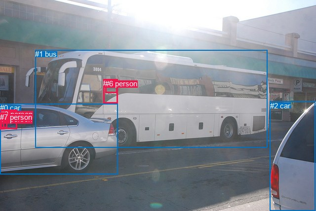
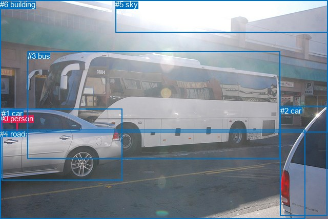

# 图片 0164：2319298.jpg

随机样本序号：28。图片 SHA256：`92fa8e2adf6ad0fc3a2dc38f41ee25e1923fa45d7926dad96e4ac3d58b2bc4f6`。

红色框表示人，蓝色框表示其他物体。两个模式分别保留自身框编号，可依据位置比较对应对象。

## 自动检测框与输出

人的框编号：`[3, 4, 5, 6, 7]`。状态：`ok`。

### 自动检测全部物体框

| 编号 | 类别 | 是否为人 | 检测分数 | 像素坐标 xyxy |
|---|---|---|---|---|
| 0 | car | False | 0.9997 | 0.2, 210.0, 238.9, 353.6 |
| 1 | bus | False | 0.9989 | 71.5, 101.0, 541.8, 299.6 |
| 2 | car | False | 0.9878 | 546.9, 205.7, 639.0, 428.0 |
| 3 | person | True | 0.8959 | 1.4, 222.7, 34.1, 261.8 |
| 4 | person | True | 0.6225 | 0.0, 233.5, 9.0, 262.7 |
| 5 | person | True | 0.5928 | 209.3, 160.3, 238.6, 209.9 |
| 6 | person | True | 0.5096 | 213.4, 161.0, 237.5, 188.0 |
| 7 | person | True | 0.4928 | 0.2, 229.0, 14.6, 259.7 |

### 自动检测 Top50 人相关候选

评分物体对：56；人相关物体对：50；输出关系：50。

| 排名 | 主语编号与类别 | 关系 | 宾语编号与类别 | 类型 | 人与人 | 排序分数 | 原始融合 logit |
|---|---|---|---|---|---|---|---|
| 1 | #6 person | riding | #1 bus | semantic | False | 0.98430 | 4.1380 |
| 2 | #5 person | riding | #1 bus | semantic | False | 0.97973 | 3.8781 |
| 3 | #5 person | on | #1 bus | spatial | False | 0.96273 | 3.2517 |
| 4 | #3 person | riding | #0 car | semantic | False | 0.95346 | 3.0197 |
| 5 | #7 person | riding | #0 car | semantic | False | 0.94559 | 2.8552 |
| 6 | #4 person | riding | #0 car | semantic | False | 0.92932 | 2.5763 |
| 7 | #3 person | in | #0 car | spatial | False | 0.91307 | 2.3517 |
| 8 | #6 person | in | #1 bus | spatial | False | 0.91175 | 2.3352 |
| 9 | #7 person | wearing | #4 person | semantic | True | 0.90203 | 2.2199 |
| 10 | #7 person | in | #0 car | spatial | False | 0.87119 | 1.9115 |
| 11 | #4 person | in | #0 car | spatial | False | 0.83662 | 1.6333 |
| 12 | #7 person | in | #4 person | spatial | True | 0.74257 | 1.0594 |
| 13 | #3 person | riding | #1 bus | semantic | False | 0.70086 | 0.8514 |
| 14 | #3 person | holding | #7 person | semantic | True | 0.69643 | 0.8304 |
| 15 | #7 person | in | #3 person | spatial | True | 0.66201 | 0.6723 |
| 16 | #7 person | riding | #1 bus | semantic | False | 0.65603 | 0.6457 |
| 17 | #4 person | in | #7 person | spatial | True | 0.65386 | 0.6360 |
| 18 | #7 person | sitting on | #3 person | semantic | True | 0.64803 | 0.6104 |
| 19 | #3 person | holding | #4 person | semantic | True | 0.62642 | 0.5169 |
| 20 | #3 person | in | #7 person | spatial | True | 0.61745 | 0.4787 |
| 21 | #6 person | in | #5 person | spatial | True | 0.60582 | 0.4298 |
| 22 | #5 person | in front of | #6 person | spatial | True | 0.59955 | 0.4036 |
| 23 | #4 person | in | #3 person | spatial | True | 0.56305 | 0.2535 |
| 24 | #6 person | looking at | #5 person | semantic | True | 0.52320 | 0.0929 |
| 25 | #3 person | in | #4 person | spatial | True | 0.51872 | 0.0749 |
| 26 | #3 person | in | #1 bus | spatial | False | 0.48395 | -0.0642 |
| 27 | #4 person | riding | #1 bus | semantic | False | 0.44532 | -0.2196 |
| 28 | #7 person | in | #1 bus | spatial | False | 0.44486 | -0.2214 |
| 29 | #0 car | carrying | #4 person | semantic | False | 0.38243 | -0.4792 |
| 30 | #0 car | carrying | #3 person | semantic | False | 0.37596 | -0.5067 |
| 31 | #0 car | carrying | #7 person | semantic | False | 0.33526 | -0.6845 |
| 32 | #4 person | sitting on | #3 person | semantic | True | 0.32153 | -0.7468 |
| 33 | #4 person | sitting on | #7 person | semantic | True | 0.30297 | -0.8332 |
| 34 | #4 person | in | #1 bus | spatial | False | 0.26393 | -1.0257 |
| 35 | #5 person | wearing | #6 person | semantic | True | 0.24870 | -1.1056 |
| 36 | #1 bus | carrying | #6 person | semantic | False | 0.24442 | -1.1286 |
| 37 | #0 car | beside | #3 person | spatial | False | 0.23877 | -1.1595 |
| 38 | #1 bus | carrying | #5 person | semantic | False | 0.23718 | -1.1682 |
| 39 | #1 bus | beside | #5 person | spatial | False | 0.23541 | -1.1780 |
| 40 | #1 bus | beside | #6 person | spatial | False | 0.21955 | -1.2683 |
| 41 | #0 car | beside | #7 person | spatial | False | 0.11694 | -2.0217 |
| 42 | #5 person | riding | #0 car | semantic | False | 0.10288 | -2.1656 |
| 43 | #6 person | riding | #0 car | semantic | False | 0.08516 | -2.3742 |
| 44 | #0 car | beside | #4 person | spatial | False | 0.08424 | -2.3861 |
| 45 | #6 person | in | #0 car | spatial | False | 0.07091 | -2.5728 |
| 46 | #5 person | beside | #0 car | spatial | False | 0.04565 | -3.0400 |
| 47 | #4 person | walking on | #2 car | semantic | False | 0.03563 | -3.2983 |
| 48 | #7 person | walking on | #2 car | semantic | False | 0.03366 | -3.3573 |
| 49 | #3 person | walking on | #2 car | semantic | False | 0.02514 | -3.6578 |
| 50 | #0 car | parked on | #5 person | semantic | False | 0.02186 | -3.8008 |

### 自动检测逐条人相关 GT 核验

R@50：0.00%；命中 0/1。

| GT 主语编号 | GT 关系 | GT 宾语编号 | 结果阶段 | 匹配预测主语编号 | 匹配预测宾语编号 |
|---|---|---|---|---|---|
| 0 | driving | 1 | wrong_predicate | [3] | [0] |

## 真实框与输出

人的框编号：`[0]`。

### 真实框全部物体框

| 编号 | 类别 | 是否为人 | 检测分数 | 像素坐标 xyxy |
|---|---|---|---|---|
| 0 | person | True | GT | 0.0, 223.0, 34.0, 265.0 |
| 1 | car | False | GT | 3.0, 213.0, 238.0, 353.0 |
| 2 | car | False | GT | 547.0, 208.0, 638.0, 422.0 |
| 3 | bus | False | GT | 54.0, 101.0, 546.0, 311.0 |
| 4 | road | False | GT | 0.0, 253.0, 595.0, 428.0 |
| 5 | sky | False | GT | 225.0, 0.0, 640.0, 63.0 |
| 6 | building | False | GT | 0.0, 0.0, 640.0, 258.0 |

### 真实框 Top50 人相关候选

评分物体对：42；人相关物体对：12；输出关系：24。

| 排名 | 主语编号与类别 | 关系 | 宾语编号与类别 | 类型 | 人与人 | 排序分数 | 原始融合 logit |
|---|---|---|---|---|---|---|---|
| 1 | #0 person | driving on | #1 car | semantic | False | 0.97521 | 3.6723 |
| 2 | #0 person | in | #1 car | spatial | False | 0.97317 | 3.5910 |
| 3 | #0 person | driving on | #3 bus | semantic | False | 0.90815 | 2.2913 |
| 4 | #0 person | in | #3 bus | spatial | False | 0.83660 | 1.6332 |
| 5 | #0 person | in | #6 building | spatial | False | 0.37405 | -0.5149 |
| 6 | #0 person | in | #4 road | spatial | False | 0.11787 | -2.0127 |
| 7 | #0 person | walking on | #4 road | semantic | False | 0.11750 | -2.0163 |
| 8 | #0 person | sitting on | #6 building | semantic | False | 0.09450 | -2.2598 |
| 9 | #1 car | in | #0 person | spatial | False | 0.09415 | -2.2640 |
| 10 | #1 car | holding | #0 person | semantic | False | 0.05337 | -2.8756 |
| 11 | #0 person | in | #2 car | spatial | False | 0.01667 | -4.0776 |
| 12 | #3 bus | beside | #0 person | spatial | False | 0.00822 | -4.7933 |
| 13 | #0 person | sitting on | #2 car | semantic | False | 0.00773 | -4.8550 |
| 14 | #0 person | looking at | #5 sky | semantic | False | 0.00504 | -5.2863 |
| 15 | #0 person | in | #5 sky | spatial | False | 0.00356 | -5.6358 |
| 16 | #3 bus | holding | #0 person | semantic | False | 0.00262 | -5.9437 |
| 17 | #2 car | in | #0 person | spatial | False | 0.00236 | -6.0484 |
| 18 | #5 sky | over | #0 person | spatial | False | 0.00139 | -6.5780 |
| 19 | #2 car | looking at | #0 person | semantic | False | 0.00107 | -6.8409 |
| 20 | #6 building | in | #0 person | spatial | False | 0.00084 | -7.0782 |
| 21 | #4 road | in | #0 person | spatial | False | 0.00075 | -7.1883 |
| 22 | #6 building | holding | #0 person | semantic | False | 0.00039 | -7.8459 |
| 23 | #4 road | holding | #0 person | semantic | False | 0.00032 | -8.0546 |
| 24 | #5 sky | looking at | #0 person | semantic | False | 0.00021 | -8.4818 |

### 真实框逐条人相关 GT 核验

R@50：0.00%；命中 0/1。

| GT 主语编号 | GT 关系 | GT 宾语编号 | 结果阶段 | 匹配预测主语编号 | 匹配预测宾语编号 |
|---|---|---|---|---|---|
| 0 | driving | 1 | wrong_predicate | [0] | [1] |

## 全部人相关 GT

| 主语编号与类别 | 关系 | 宾语编号与类别 |
|---|---|---|
| #0 person | driving | #1 car |

原始记录、全部人相关物体对的两项预测与分项分数见 [逐图证据 JSON](../evidence/cases/0164.json)。全部56类 logits 保留于本机 HOR/output/random500/logits/。

<!-- HOR_COMPLETE_RESULTS -->

## 六组条件的完整输出对照

以下保留同一图片三种框与候选模式、两种谓词输出规则的全部 Top50。框编号各自在所属模式内解释。

### 自动检测框完整枚举：空间与语义各保留一个谓词

| 排名 | 主语编号与类别 | 谓词 | 宾语编号与类别 | 分组 | 排序分数 | predicate logit | pair logit |
|---|---|---|---|---|---|---|---|
| 1 | #6 person | riding | #1 bus | semantic | 0.9842956 | 3.9435334 | 0.1944499 |
| 2 | #5 person | riding | #1 bus | semantic | 0.9797290 | 3.6516614 | 0.2264223 |
| 3 | #5 person | on | #1 bus | spatial | 0.9627339 | 3.0252681 | 0.2264223 |
| 4 | #3 person | riding | #0 car | semantic | 0.9534565 | 3.1596942 | -0.1399897 |
| 5 | #7 person | riding | #0 car | semantic | 0.9455888 | 2.9835453 | -0.1283077 |
| 6 | #4 person | riding | #0 car | semantic | 0.9293219 | 2.5644670 | 0.0118525 |
| 7 | #3 person | in | #0 car | spatial | 0.9130672 | 2.4916635 | -0.1399897 |
| 8 | #6 person | in | #1 bus | spatial | 0.9117487 | 2.1407270 | 0.1944499 |
| 9 | #7 person | wearing | #4 person | semantic | 0.9020263 | 2.5603089 | -0.3403644 |
| 10 | #7 person | in | #0 car | spatial | 0.8711922 | 2.0398488 | -0.1283077 |
| 11 | #4 person | in | #0 car | spatial | 0.8366209 | 1.6214452 | 0.0118525 |
| 12 | #7 person | in | #4 person | spatial | 0.7425707 | 1.3997374 | -0.3403644 |
| 13 | #3 person | riding | #1 bus | semantic | 0.7008581 | 1.1019692 | -0.2505819 |
| 14 | #3 person | holding | #7 person | semantic | 0.6964294 | 1.1805053 | -0.3501529 |
| 15 | #7 person | in | #3 person | spatial | 0.6620136 | 1.1063528 | -0.4340720 |
| 16 | #7 person | riding | #1 bus | semantic | 0.6560308 | 0.9532232 | -0.3075675 |
| 17 | #4 person | in | #7 person | spatial | 0.6538558 | 1.2528224 | -0.6167911 |
| 18 | #7 person | sitting on | #3 person | semantic | 0.6480324 | 1.0444736 | -0.4340720 |
| 19 | #3 person | holding | #4 person | semantic | 0.6264151 | 0.8124042 | -0.2955360 |
| 20 | #3 person | in | #7 person | spatial | 0.6174506 | 0.8288941 | -0.3501529 |
| 21 | #6 person | in | #5 person | spatial | 0.6058183 | 0.9499063 | -0.5201380 |
| 22 | #5 person | in front of | #6 person | spatial | 0.5995529 | 1.0444264 | -0.6408241 |
| 23 | #4 person | in | #3 person | spatial | 0.5630482 | 0.9027963 | -0.6492537 |
| 24 | #6 person | looking at | #5 person | semantic | 0.5232047 | 0.6130238 | -0.5201380 |
| 25 | #3 person | in | #4 person | spatial | 0.5187178 | 0.3704424 | -0.2955360 |
| 26 | #3 person | in | #1 bus | spatial | 0.4839485 | 0.1863537 | -0.2505819 |
| 27 | #4 person | riding | #1 bus | semantic | 0.4453151 | 0.2936592 | -0.5132775 |
| 28 | #7 person | in | #1 bus | spatial | 0.4448643 | 0.0861239 | -0.3075675 |
| 29 | #0 car | carrying | #4 person | semantic | 0.3824336 | -0.0446830 | -0.4345484 |
| 30 | #0 car | carrying | #3 person | semantic | 0.3759633 | 0.2308893 | -0.7376068 |
| 31 | #0 car | carrying | #7 person | semantic | 0.3352626 | -0.0002284 | -0.6842496 |
| 32 | #4 person | sitting on | #3 person | semantic | 0.3215274 | -0.0975075 | -0.6492537 |
| 33 | #4 person | sitting on | #7 person | semantic | 0.3029736 | -0.2163863 | -0.6167911 |
| 34 | #4 person | in | #1 bus | spatial | 0.2639264 | -0.5123820 | -0.5132775 |
| 35 | #5 person | wearing | #6 person | semantic | 0.2486974 | -0.4647474 | -0.6408241 |
| 36 | #1 bus | carrying | #6 person | semantic | 0.2444154 | -0.5466623 | -0.5819600 |
| 37 | #0 car | beside | #3 person | spatial | 0.2387650 | -0.4218554 | -0.7376068 |
| 38 | #1 bus | carrying | #5 person | semantic | 0.2371781 | -0.7050738 | -0.4631394 |
| 39 | #1 bus | beside | #5 person | spatial | 0.2354095 | -0.7148745 | -0.4631394 |
| 40 | #1 bus | beside | #6 person | spatial | 0.2195525 | -0.6863160 | -0.5819600 |
| 41 | #0 car | beside | #7 person | spatial | 0.1169443 | -1.3374412 | -0.6842496 |
| 42 | #5 person | riding | #0 car | semantic | 0.1028806 | -1.4774485 | -0.6881714 |
| 43 | #6 person | riding | #0 car | semantic | 0.0851615 | -1.5571969 | -0.8170013 |
| 44 | #0 car | beside | #4 person | spatial | 0.0842355 | -1.9515939 | -0.4345484 |
| 45 | #6 person | in | #0 car | spatial | 0.0709124 | -1.7557559 | -0.8170013 |
| 46 | #5 person | beside | #0 car | spatial | 0.0456519 | -2.3518119 | -0.6881714 |
| 47 | #4 person | walking on | #2 car | semantic | 0.0356300 | -2.1401279 | -1.1581601 |
| 48 | #7 person | walking on | #2 car | semantic | 0.0336582 | -2.2409387 | -1.1163224 |
| 49 | #3 person | walking on | #2 car | semantic | 0.0251405 | -2.5659354 | -1.0918784 |
| 50 | #0 car | parked on | #5 person | semantic | 0.0218636 | -2.6849713 | -1.1158555 |

GT 命中：0/1，R@50=0.00%。

| GT主语 | GT谓词 | GT宾语 | 结果阶段 | 匹配主语框 | 匹配宾语框 |
|---|---|---|---|---|---|
| 0 | driving | 1 | wrong_predicate | [3] | [0] |

### 自动检测框完整枚举：每对只保留一个谓词

| 排名 | 主语编号与类别 | 谓词 | 宾语编号与类别 | 分组 | 排序分数 | predicate logit | pair logit |
|---|---|---|---|---|---|---|---|
| 1 | #6 person | riding | #1 bus | single | 0.9842956 | 3.9435334 | 0.1944499 |
| 2 | #5 person | riding | #1 bus | single | 0.9797290 | 3.6516614 | 0.2264223 |
| 3 | #3 person | riding | #0 car | single | 0.9534565 | 3.1596942 | -0.1399897 |
| 4 | #7 person | riding | #0 car | single | 0.9455888 | 2.9835453 | -0.1283077 |
| 5 | #4 person | riding | #0 car | single | 0.9293219 | 2.5644670 | 0.0118525 |
| 6 | #7 person | wearing | #4 person | single | 0.9020263 | 2.5603089 | -0.3403644 |
| 7 | #3 person | riding | #1 bus | single | 0.7008581 | 1.1019692 | -0.2505819 |
| 8 | #3 person | holding | #7 person | single | 0.6964294 | 1.1805053 | -0.3501529 |
| 9 | #7 person | in | #3 person | single | 0.6620136 | 1.1063528 | -0.4340720 |
| 10 | #7 person | riding | #1 bus | single | 0.6560308 | 0.9532232 | -0.3075675 |
| 11 | #4 person | in | #7 person | single | 0.6538558 | 1.2528224 | -0.6167911 |
| 12 | #3 person | holding | #4 person | single | 0.6264151 | 0.8124042 | -0.2955360 |
| 13 | #6 person | in | #5 person | single | 0.6058183 | 0.9499063 | -0.5201380 |
| 14 | #5 person | in front of | #6 person | single | 0.5995529 | 1.0444264 | -0.6408241 |
| 15 | #4 person | in | #3 person | single | 0.5630482 | 0.9027963 | -0.6492537 |
| 16 | #4 person | riding | #1 bus | single | 0.4453151 | 0.2936592 | -0.5132775 |
| 17 | #0 car | carrying | #4 person | single | 0.3824336 | -0.0446830 | -0.4345484 |
| 18 | #0 car | carrying | #3 person | single | 0.3759633 | 0.2308893 | -0.7376068 |
| 19 | #0 car | carrying | #7 person | single | 0.3352626 | -0.0002284 | -0.6842496 |
| 20 | #1 bus | carrying | #6 person | single | 0.2444154 | -0.5466623 | -0.5819600 |
| 21 | #1 bus | carrying | #5 person | single | 0.2371781 | -0.7050738 | -0.4631394 |
| 22 | #5 person | riding | #0 car | single | 0.1028806 | -1.4774485 | -0.6881714 |
| 23 | #6 person | riding | #0 car | single | 0.0851615 | -1.5571969 | -0.8170013 |
| 24 | #4 person | walking on | #2 car | single | 0.0356300 | -2.1401279 | -1.1581601 |
| 25 | #7 person | walking on | #2 car | single | 0.0336582 | -2.2409387 | -1.1163224 |
| 26 | #3 person | walking on | #2 car | single | 0.0251405 | -2.5659354 | -1.0918784 |
| 27 | #0 car | parked on | #5 person | single | 0.0218636 | -2.6849713 | -1.1158555 |
| 28 | #1 bus | beside | #3 person | single | 0.0163958 | -2.6421311 | -1.4520693 |
| 29 | #0 car | parked on | #6 person | single | 0.0111544 | -3.1662178 | -1.3184898 |
| 30 | #1 bus | beside | #7 person | single | 0.0065789 | -3.5730519 | -1.4442418 |
| 31 | #5 person | walking on | #2 car | single | 0.0043223 | -4.0637484 | -1.3758898 |
| 32 | #6 person | walking on | #2 car | single | 0.0040109 | -4.0618687 | -1.4528610 |
| 33 | #1 bus | driving | #4 person | single | 0.0025437 | -4.6724277 | -1.2991540 |
| 34 | #2 car | parked on | #5 person | single | 0.0021720 | -4.3875880 | -1.7423240 |
| 35 | #3 person | sitting on | #5 person | single | 0.0020984 | -4.2088618 | -1.9556243 |
| 36 | #7 person | sitting on | #5 person | single | 0.0020834 | -4.2052665 | -1.9663851 |
| 37 | #3 person | sitting on | #6 person | single | 0.0017539 | -4.3478551 | -1.9962971 |
| 38 | #7 person | sitting on | #6 person | single | 0.0016855 | -4.3788671 | -2.0051363 |
| 39 | #5 person | looking at | #3 person | single | 0.0013710 | -4.0591359 | -2.5317225 |
| 40 | #2 car | parked on | #6 person | single | 0.0013641 | -4.6774020 | -1.9185293 |
| 41 | #4 person | sitting on | #5 person | single | 0.0012861 | -4.6893563 | -1.9654824 |
| 42 | #6 person | looking at | #3 person | single | 0.0012044 | -4.1919184 | -2.5286827 |
| 43 | #2 car | parked on | #3 person | single | 0.0011893 | -5.4814901 | -1.2517438 |
| 44 | #4 person | sitting on | #6 person | single | 0.0010887 | -4.8091960 | -2.0124750 |
| 45 | #5 person | looking at | #7 person | single | 0.0010288 | -4.3302388 | -2.5480645 |
| 46 | #2 car | parked on | #7 person | single | 0.0009525 | -5.7146440 | -1.2408550 |
| 47 | #6 person | looking at | #7 person | single | 0.0008966 | -4.4666958 | -2.5493572 |
| 48 | #2 car | parked on | #4 person | single | 0.0007031 | -6.0832086 | -1.1761379 |
| 49 | #5 person | looking at | #4 person | single | 0.0005809 | -4.9274316 | -2.5229199 |
| 50 | #6 person | looking at | #4 person | single | 0.0005063 | -5.0497608 | -2.5381360 |

GT 命中：0/1，R@50=0.00%。

| GT主语 | GT谓词 | GT宾语 | 结果阶段 | 匹配主语框 | 匹配宾语框 |
|---|---|---|---|---|---|
| 0 | driving | 1 | wrong_predicate | [3] | [0] |

### 真实框完整枚举：空间与语义各保留一个谓词

| 排名 | 主语编号与类别 | 谓词 | 宾语编号与类别 | 分组 | 排序分数 | predicate logit | pair logit |
|---|---|---|---|---|---|---|---|
| 1 | #0 person | driving on | #1 car | semantic | 0.9752122 | 3.7248454 | -0.0525386 |
| 2 | #0 person | in | #1 car | spatial | 0.9731693 | 3.6435494 | -0.0525386 |
| 3 | #0 person | driving on | #3 bus | semantic | 0.9081544 | 2.5519643 | -0.2606587 |
| 4 | #0 person | in | #3 bus | spatial | 0.8366029 | 1.8938246 | -0.2606587 |
| 5 | #0 person | in | #6 building | spatial | 0.3740542 | 0.5310779 | -1.0459409 |
| 6 | #0 person | in | #4 road | spatial | 0.1178708 | -0.7305589 | -1.2821904 |
| 7 | #0 person | walking on | #4 road | semantic | 0.1175041 | -0.7340903 | -1.2821904 |
| 8 | #0 person | sitting on | #6 building | semantic | 0.0945050 | -1.2138882 | -1.0459409 |
| 9 | #1 car | in | #0 person | spatial | 0.0941489 | -1.6254447 | -0.6385527 |
| 10 | #1 car | holding | #0 person | semantic | 0.0533717 | -2.2370722 | -0.6385527 |
| 11 | #0 person | in | #2 car | spatial | 0.0166660 | -3.0253253 | -1.0522528 |
| 12 | #3 bus | beside | #0 person | spatial | 0.0082168 | -3.4520273 | -1.3412944 |
| 13 | #0 person | sitting on | #2 car | semantic | 0.0077292 | -3.8027360 | -1.0522528 |
| 14 | #0 person | looking at | #5 sky | semantic | 0.0050352 | -3.5166898 | -1.7695730 |
| 15 | #0 person | in | #5 sky | spatial | 0.0035551 | -3.8662362 | -1.7695730 |
| 16 | #3 bus | holding | #0 person | semantic | 0.0026156 | -4.6023574 | -1.3412944 |
| 17 | #2 car | in | #0 person | spatial | 0.0023561 | -4.8103895 | -1.2379937 |
| 18 | #5 sky | over | #0 person | spatial | 0.0013887 | -4.7019258 | -1.8760985 |
| 19 | #2 car | looking at | #0 person | semantic | 0.0010680 | -5.6029105 | -1.2379937 |
| 20 | #6 building | in | #0 person | spatial | 0.0008426 | -5.3026996 | -1.7754972 |
| 21 | #4 road | in | #0 person | spatial | 0.0007548 | -4.9575953 | -2.2306995 |
| 22 | #6 building | holding | #0 person | semantic | 0.0003912 | -6.0704379 | -1.7754972 |
| 23 | #4 road | holding | #0 person | semantic | 0.0003175 | -5.8238716 | -2.2306995 |
| 24 | #5 sky | looking at | #0 person | semantic | 0.0002072 | -6.6057377 | -1.8760985 |

GT 命中：0/1，R@50=0.00%。

| GT主语 | GT谓词 | GT宾语 | 结果阶段 | 匹配主语框 | 匹配宾语框 |
|---|---|---|---|---|---|
| 0 | driving | 1 | wrong_predicate | [0] | [1] |

### 真实框完整枚举：每对只保留一个谓词

| 排名 | 主语编号与类别 | 谓词 | 宾语编号与类别 | 分组 | 排序分数 | predicate logit | pair logit |
|---|---|---|---|---|---|---|---|
| 1 | #0 person | driving on | #1 car | single | 0.9752122 | 3.7248454 | -0.0525386 |
| 2 | #0 person | driving on | #3 bus | single | 0.9081544 | 2.5519643 | -0.2606587 |
| 3 | #0 person | in | #6 building | single | 0.3740542 | 0.5310779 | -1.0459409 |
| 4 | #0 person | in | #4 road | single | 0.1178708 | -0.7305589 | -1.2821904 |
| 5 | #1 car | in | #0 person | single | 0.0941489 | -1.6254447 | -0.6385527 |
| 6 | #0 person | in | #2 car | single | 0.0166660 | -3.0253253 | -1.0522528 |
| 7 | #3 bus | beside | #0 person | single | 0.0082168 | -3.4520273 | -1.3412944 |
| 8 | #0 person | looking at | #5 sky | single | 0.0050352 | -3.5166898 | -1.7695730 |
| 9 | #2 car | in | #0 person | single | 0.0023561 | -4.8103895 | -1.2379937 |
| 10 | #5 sky | over | #0 person | single | 0.0013887 | -4.7019258 | -1.8760985 |
| 11 | #6 building | in | #0 person | single | 0.0008426 | -5.3026996 | -1.7754972 |
| 12 | #4 road | in | #0 person | single | 0.0007548 | -4.9575953 | -2.2306995 |

GT 命中：0/1，R@50=0.00%。

| GT主语 | GT谓词 | GT宾语 | 结果阶段 | 匹配主语框 | 匹配宾语框 |
|---|---|---|---|---|---|
| 0 | driving | 1 | wrong_predicate | [0] | [1] |

### 真实框400候选：空间与语义各保留一个谓词

| 排名 | 主语编号与类别 | 谓词 | 宾语编号与类别 | 分组 | 排序分数 | predicate logit | pair logit |
|---|---|---|---|---|---|---|---|
| 1 | #0 person | driving on | #1 car | semantic | 0.9752122 | 3.7248454 | -0.0525386 |
| 2 | #0 person | in | #1 car | spatial | 0.9733420 | 3.6501870 | -0.0525386 |
| 3 | #0 person | driving on | #3 bus | semantic | 0.9081537 | 2.5519557 | -0.2606587 |
| 4 | #0 person | in | #3 bus | spatial | 0.8333714 | 1.8703709 | -0.2606587 |
| 5 | #0 person | in | #6 building | spatial | 0.3740542 | 0.5310779 | -1.0459409 |
| 6 | #0 person | in | #4 road | spatial | 0.1179139 | -0.7301443 | -1.2821904 |
| 7 | #0 person | walking on | #4 road | semantic | 0.1148778 | -0.7596657 | -1.2821904 |
| 8 | #1 car | in | #0 person | spatial | 0.0961863 | -1.6017838 | -0.6385527 |
| 9 | #0 person | sitting on | #6 building | semantic | 0.0954100 | -1.2033570 | -1.0459409 |
| 10 | #1 car | holding | #0 person | semantic | 0.0534651 | -2.2352259 | -0.6385527 |
| 11 | #0 person | in | #2 car | spatial | 0.0166117 | -3.0286441 | -1.0522528 |
| 12 | #3 bus | beside | #0 person | spatial | 0.0081557 | -3.4595499 | -1.3412944 |
| 13 | #0 person | sitting on | #2 car | semantic | 0.0077090 | -3.8053689 | -1.0522528 |
| 14 | #0 person | looking at | #5 sky | semantic | 0.0048866 | -3.5467811 | -1.7695730 |
| 15 | #0 person | in | #5 sky | spatial | 0.0034760 | -3.8888047 | -1.7695730 |
| 16 | #3 bus | holding | #0 person | semantic | 0.0025806 | -4.6158576 | -1.3412944 |
| 17 | #2 car | in | #0 person | spatial | 0.0023699 | -4.8045263 | -1.2379937 |
| 18 | #5 sky | over | #0 person | spatial | 0.0013844 | -4.7050257 | -1.8760985 |
| 19 | #2 car | looking at | #0 person | semantic | 0.0010759 | -5.5955620 | -1.2379937 |
| 20 | #6 building | in | #0 person | spatial | 0.0008194 | -5.3305917 | -1.7754972 |
| 21 | #4 road | in | #0 person | spatial | 0.0007520 | -4.9613013 | -2.2306995 |
| 22 | #6 building | holding | #0 person | semantic | 0.0003807 | -6.0975752 | -1.7754972 |
| 23 | #4 road | holding | #0 person | semantic | 0.0003175 | -5.8238716 | -2.2306995 |
| 24 | #5 sky | looking at | #0 person | semantic | 0.0002041 | -6.6207833 | -1.8760985 |

GT 命中：0/1，R@50=0.00%。

| GT主语 | GT谓词 | GT宾语 | 结果阶段 | 匹配主语框 | 匹配宾语框 |
|---|---|---|---|---|---|
| 0 | driving | 1 | wrong_predicate | [0] | [1] |

### 真实框400候选：每对只保留一个谓词

| 排名 | 主语编号与类别 | 谓词 | 宾语编号与类别 | 分组 | 排序分数 | predicate logit | pair logit |
|---|---|---|---|---|---|---|---|
| 1 | #0 person | driving on | #1 car | single | 0.9752122 | 3.7248454 | -0.0525386 |
| 2 | #0 person | driving on | #3 bus | single | 0.9081537 | 2.5519557 | -0.2606587 |
| 3 | #0 person | in | #6 building | single | 0.3740542 | 0.5310779 | -1.0459409 |
| 4 | #0 person | in | #4 road | single | 0.1179139 | -0.7301443 | -1.2821904 |
| 5 | #1 car | in | #0 person | single | 0.0961863 | -1.6017838 | -0.6385527 |
| 6 | #0 person | in | #2 car | single | 0.0166117 | -3.0286441 | -1.0522528 |
| 7 | #3 bus | beside | #0 person | single | 0.0081557 | -3.4595499 | -1.3412944 |
| 8 | #0 person | looking at | #5 sky | single | 0.0048866 | -3.5467811 | -1.7695730 |
| 9 | #2 car | in | #0 person | single | 0.0023699 | -4.8045263 | -1.2379937 |
| 10 | #5 sky | over | #0 person | single | 0.0013844 | -4.7050257 | -1.8760985 |
| 11 | #6 building | in | #0 person | single | 0.0008194 | -5.3305917 | -1.7754972 |
| 12 | #4 road | in | #0 person | single | 0.0007520 | -4.9613013 | -2.2306995 |

GT 命中：0/1，R@50=0.00%。

| GT主语 | GT谓词 | GT宾语 | 结果阶段 | 匹配主语框 | 匹配宾语框 |
|---|---|---|---|---|---|
| 0 | driving | 1 | wrong_predicate | [0] | [1] |
