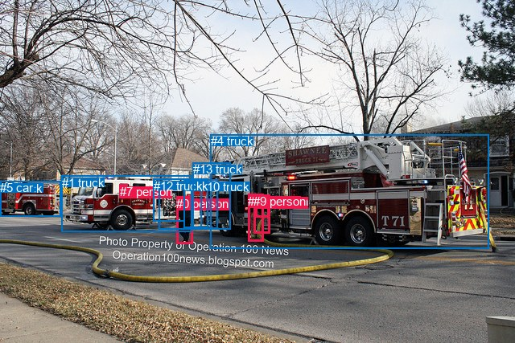
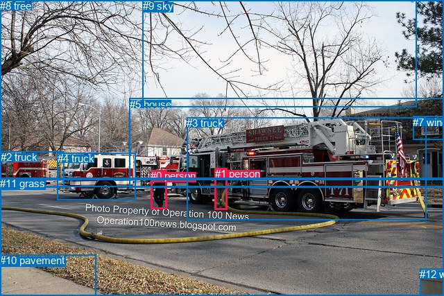

# 图片 0166：2319395.jpg

随机样本序号：55。图片 SHA256：`4f874927c52b52ccbea9d74202fba956222195b63cf8aa3074afb77df08890f8`。

红色框表示人，蓝色框表示其他物体。两个模式分别保留自身框编号，可依据位置比较对应对象。

## 自动检测框与输出

人的框编号：`[0, 3, 7, 8, 9]`。状态：`ok`。

### 自动检测全部物体框

| 编号 | 类别 | 是否为人 | 检测分数 | 像素坐标 xyxy |
|---|---|---|---|---|
| 0 | person | True | 0.9965 | 219.3, 244.6, 239.6, 303.5 |
| 1 | truck | False | 0.9799 | 76.6, 218.6, 238.8, 288.5 |
| 2 | truck | False | 0.9736 | 0.0, 225.8, 75.6, 269.5 |
| 3 | person | True | 0.9588 | 308.5, 241.6, 327.6, 300.9 |
| 4 | truck | False | 0.9489 | 261.7, 167.3, 607.1, 309.3 |
| 5 | car | False | 0.7600 | 0.1, 225.3, 16.3, 239.9 |
| 6 | truck | False | 0.7147 | 228.1, 223.1, 258.7, 283.5 |
| 7 | person | True | 0.6895 | 148.5, 229.7, 158.8, 241.2 |
| 8 | person | True | 0.5673 | 317.8, 242.4, 334.9, 270.5 |
| 9 | person | True | 0.5606 | 315.1, 242.3, 335.5, 290.5 |
| 10 | truck | False | 0.5551 | 249.4, 223.6, 270.7, 284.3 |
| 11 | truck | False | 0.4975 | 198.0, 222.7, 258.5, 285.3 |
| 12 | truck | False | 0.4792 | 190.9, 222.6, 229.4, 275.3 |
| 13 | truck | False | 0.3563 | 239.6, 202.3, 286.5, 285.1 |

### 自动检测 Top50 人相关候选

评分物体对：182；人相关物体对：110；输出关系：50。

| 排名 | 主语编号与类别 | 关系 | 宾语编号与类别 | 类型 | 人与人 | 排序分数 | 原始融合 logit |
|---|---|---|---|---|---|---|---|
| 1 | #3 person | entering | #4 truck | semantic | False | 0.97976 | 3.8797 |
| 2 | #9 person | entering | #4 truck | semantic | False | 0.97958 | 3.8708 |
| 3 | #7 person | riding | #1 truck | semantic | False | 0.97341 | 3.6004 |
| 4 | #9 person | wearing | #8 person | semantic | True | 0.97318 | 3.5914 |
| 5 | #8 person | entering | #4 truck | semantic | False | 0.96865 | 3.4306 |
| 6 | #7 person | on | #1 truck | spatial | False | 0.96619 | 3.3527 |
| 7 | #3 person | pushing | #9 person | semantic | True | 0.95787 | 3.1241 |
| 8 | #0 person | walking on | #1 truck | semantic | False | 0.93364 | 2.6441 |
| 9 | #9 person | in | #8 person | spatial | True | 0.91811 | 2.4170 |
| 10 | #0 person | walking on | #11 truck | semantic | False | 0.87874 | 1.9805 |
| 11 | #3 person | pushing | #8 person | semantic | True | 0.86520 | 1.8591 |
| 12 | #0 person | walking on | #4 truck | semantic | False | 0.86212 | 1.8330 |
| 13 | #0 person | walking on | #6 truck | semantic | False | 0.83059 | 1.5898 |
| 14 | #9 person | pushing | #3 person | semantic | True | 0.82812 | 1.5724 |
| 15 | #9 person | on | #4 truck | spatial | False | 0.80839 | 1.4396 |
| 16 | #3 person | beside | #4 truck | spatial | False | 0.79349 | 1.3461 |
| 17 | #8 person | on | #4 truck | spatial | False | 0.76888 | 1.2020 |
| 18 | #0 person | walking on | #12 truck | semantic | False | 0.71180 | 0.9042 |
| 19 | #0 person | beside | #1 truck | spatial | False | 0.57356 | 0.2964 |
| 20 | #8 person | pushing | #3 person | semantic | True | 0.56480 | 0.2607 |
| 21 | #3 person | in | #8 person | spatial | True | 0.55962 | 0.2396 |
| 22 | #3 person | in | #9 person | spatial | True | 0.53590 | 0.1438 |
| 23 | #8 person | on | #9 person | spatial | True | 0.43567 | -0.2588 |
| 24 | #0 person | in | #11 truck | spatial | False | 0.43401 | -0.2655 |
| 25 | #0 person | walking on | #13 truck | semantic | False | 0.40196 | -0.3973 |
| 26 | #7 person | on | #4 truck | spatial | False | 0.39353 | -0.4325 |
| 27 | #0 person | beside | #4 truck | spatial | False | 0.37068 | -0.5293 |
| 28 | #9 person | on | #3 person | spatial | True | 0.31039 | -0.7983 |
| 29 | #7 person | on | #2 truck | spatial | False | 0.29739 | -0.8598 |
| 30 | #8 person | walking on | #9 person | semantic | True | 0.29571 | -0.8678 |
| 31 | #0 person | in | #6 truck | spatial | False | 0.28040 | -0.9425 |
| 32 | #8 person | on | #3 person | spatial | True | 0.24830 | -1.1077 |
| 33 | #1 truck | in | #7 person | spatial | False | 0.21725 | -1.2818 |
| 34 | #3 person | walking on | #1 truck | semantic | False | 0.20412 | -1.3608 |
| 35 | #0 person | beside | #12 truck | spatial | False | 0.18549 | -1.4796 |
| 36 | #7 person | riding | #4 truck | semantic | False | 0.18532 | -1.4807 |
| 37 | #0 person | walking on | #10 truck | semantic | False | 0.18169 | -1.5050 |
| 38 | #9 person | entering | #1 truck | semantic | False | 0.18069 | -1.5117 |
| 39 | #7 person | on | #12 truck | spatial | False | 0.16667 | -1.6094 |
| 40 | #8 person | walking on | #1 truck | semantic | False | 0.16357 | -1.6319 |
| 41 | #10 truck | pushing | #9 person | semantic | False | 0.16011 | -1.6574 |
| 42 | #0 person | walking on | #2 truck | semantic | False | 0.15607 | -1.6878 |
| 43 | #1 truck | carrying | #7 person | semantic | False | 0.12600 | -1.9368 |
| 44 | #10 truck | pushing | #3 person | semantic | False | 0.12293 | -1.9650 |
| 45 | #6 truck | walking on | #0 person | semantic | False | 0.10628 | -2.1293 |
| 46 | #13 truck | pushing | #9 person | semantic | False | 0.09982 | -2.1993 |
| 47 | #13 truck | pushing | #3 person | semantic | False | 0.09913 | -2.2069 |
| 48 | #3 person | pushing | #13 truck | semantic | False | 0.09300 | -2.2776 |
| 49 | #0 person | on | #13 truck | spatial | False | 0.09184 | -2.2914 |
| 50 | #7 person | riding | #2 truck | semantic | False | 0.08772 | -2.3417 |

### 自动检测逐条人相关 GT 核验

R@50：0.00%；命中 0/2。

| GT 主语编号 | GT 关系 | GT 宾语编号 | 结果阶段 | 匹配预测主语编号 | 匹配预测宾语编号 |
|---|---|---|---|---|---|
| 0 | walking on | 6 | endpoint_missing_or_wrong_class | [0] | [] |
| 1 | standing on | 6 | endpoint_missing_or_wrong_class | [3] | [] |

## 真实框与输出

人的框编号：`[0, 1]`。

### 真实框全部物体框

| 编号 | 类别 | 是否为人 | 检测分数 | 像素坐标 xyxy |
|---|---|---|---|---|
| 0 | person | True | GT | 217.0, 245.0, 240.0, 301.0 |
| 1 | person | True | GT | 310.0, 242.0, 328.0, 302.0 |
| 2 | truck | False | GT | 1.0, 218.0, 93.0, 270.0 |
| 3 | truck | False | GT | 269.0, 169.0, 614.0, 317.0 |
| 4 | truck | False | GT | 83.0, 220.0, 196.0, 288.0 |
| 5 | house | False | GT | 187.0, 142.0, 640.0, 271.0 |
| 6 | road | False | GT | 0.0, 259.0, 640.0, 427.0 |
| 7 | window | False | GT | 595.0, 168.0, 640.0, 202.0 |
| 8 | tree | False | GT | 0.0, 0.0, 640.0, 270.0 |
| 9 | sky | False | GT | 206.0, 0.0, 600.0, 155.0 |
| 10 | pavement | False | GT | 0.0, 367.0, 139.0, 427.0 |
| 11 | grass | False | GT | 0.0, 256.0, 640.0, 427.0 |
| 12 | wall | False | GT | 605.0, 387.0, 640.0, 427.0 |

### 真实框 Top50 人相关候选

评分物体对：156；人相关物体对：46；输出关系：50。

| 排名 | 主语编号与类别 | 关系 | 宾语编号与类别 | 类型 | 人与人 | 排序分数 | 原始融合 logit |
|---|---|---|---|---|---|---|---|
| 1 | #1 person | entering | #3 truck | semantic | False | 0.98489 | 4.1773 |
| 2 | #0 person | crossing | #11 grass | semantic | False | 0.92278 | 2.4807 |
| 3 | #1 person | beside | #3 truck | spatial | False | 0.91661 | 2.3972 |
| 4 | #0 person | entering | #3 truck | semantic | False | 0.91653 | 2.3961 |
| 5 | #0 person | crossing | #6 road | semantic | False | 0.90828 | 2.2928 |
| 6 | #1 person | crossing | #11 grass | semantic | False | 0.81550 | 1.4861 |
| 7 | #1 person | on | #11 grass | spatial | False | 0.78840 | 1.3153 |
| 8 | #1 person | crossing | #6 road | semantic | False | 0.78776 | 1.3115 |
| 9 | #1 person | on | #6 road | spatial | False | 0.78653 | 1.3041 |
| 10 | #0 person | beside | #3 truck | spatial | False | 0.70782 | 0.8848 |
| 11 | #1 person | entering | #5 house | semantic | False | 0.56935 | 0.2792 |
| 12 | #0 person | walking on | #4 truck | semantic | False | 0.56882 | 0.2770 |
| 13 | #0 person | beside | #4 truck | spatial | False | 0.54194 | 0.1682 |
| 14 | #0 person | on | #11 grass | spatial | False | 0.50495 | 0.0198 |
| 15 | #0 person | on | #6 road | spatial | False | 0.49328 | -0.0269 |
| 16 | #1 person | entering | #4 truck | semantic | False | 0.42446 | -0.3045 |
| 17 | #0 person | walking on | #5 house | semantic | False | 0.16137 | -1.6481 |
| 18 | #1 person | beside | #4 truck | spatial | False | 0.15309 | -1.7106 |
| 19 | #0 person | pushing | #1 person | semantic | True | 0.14296 | -1.7909 |
| 20 | #3 truck | pulling | #1 person | semantic | False | 0.14121 | -1.8053 |
| 21 | #3 truck | beside | #1 person | spatial | False | 0.11813 | -2.0102 |
| 22 | #1 person | in | #5 house | spatial | False | 0.10375 | -2.1562 |
| 23 | #0 person | walking on | #10 pavement | semantic | False | 0.08262 | -2.4073 |
| 24 | #0 person | walking on | #2 truck | semantic | False | 0.05477 | -2.8482 |
| 25 | #0 person | beside | #1 person | spatial | True | 0.05073 | -2.9291 |
| 26 | #0 person | beside | #5 house | spatial | False | 0.04689 | -3.0118 |
| 27 | #1 person | walking on | #0 person | semantic | True | 0.04118 | -3.1478 |
| 28 | #1 person | walking on | #10 pavement | semantic | False | 0.03499 | -3.3170 |
| 29 | #0 person | beside | #2 truck | spatial | False | 0.03241 | -3.3963 |
| 30 | #1 person | entering | #2 truck | semantic | False | 0.02444 | -3.6867 |
| 31 | #1 person | beside | #2 truck | spatial | False | 0.02201 | -3.7939 |
| 32 | #3 truck | beside | #0 person | spatial | False | 0.01851 | -3.9706 |
| 33 | #1 person | on | #10 pavement | spatial | False | 0.01801 | -3.9988 |
| 34 | #0 person | on | #10 pavement | spatial | False | 0.01761 | -4.0214 |
| 35 | #1 person | in | #0 person | spatial | True | 0.01650 | -4.0875 |
| 36 | #1 person | in | #8 tree | spatial | False | 0.01646 | -4.0904 |
| 37 | #4 truck | beside | #0 person | spatial | False | 0.01606 | -4.1155 |
| 38 | #0 person | walking on | #8 tree | semantic | False | 0.01521 | -4.1708 |
| 39 | #4 truck | beside | #1 person | spatial | False | 0.01020 | -4.5756 |
| 40 | #0 person | in | #8 tree | spatial | False | 0.00825 | -4.7893 |
| 41 | #1 person | entering | #8 tree | semantic | False | 0.00638 | -5.0481 |
| 42 | #10 pavement | beside | #0 person | spatial | False | 0.00638 | -5.0485 |
| 43 | #10 pavement | beside | #1 person | spatial | False | 0.00535 | -5.2256 |
| 44 | #9 sky | hanging from | #1 person | spatial | False | 0.00458 | -5.3813 |
| 45 | #3 truck | parked on | #0 person | semantic | False | 0.00455 | -5.3872 |
| 46 | #1 person | holding | #9 sky | semantic | False | 0.00405 | -5.5058 |
| 47 | #0 person | walking on | #12 wall | semantic | False | 0.00307 | -5.7840 |
| 48 | #4 truck | parked on | #1 person | semantic | False | 0.00295 | -5.8221 |
| 49 | #9 sky | over | #0 person | spatial | False | 0.00235 | -6.0525 |
| 50 | #1 person | walking on | #12 wall | semantic | False | 0.00231 | -6.0668 |

### 真实框逐条人相关 GT 核验

R@50：0.00%；命中 0/2。

| GT 主语编号 | GT 关系 | GT 宾语编号 | 结果阶段 | 匹配预测主语编号 | 匹配预测宾语编号 |
|---|---|---|---|---|---|
| 0 | walking on | 6 | wrong_predicate | [0] | [6] |
| 1 | standing on | 6 | wrong_predicate | [1] | [6] |

## 全部人相关 GT

| 主语编号与类别 | 关系 | 宾语编号与类别 |
|---|---|---|
| #0 person | walking on | #6 road |
| #1 person | standing on | #6 road |

原始记录、全部人相关物体对的两项预测与分项分数见 [逐图证据 JSON](../evidence/cases/0166.json)。全部56类 logits 保留于本机 HOR/output/random500/logits/。

<!-- HOR_COMPLETE_RESULTS -->

## 六组条件的完整输出对照

以下保留同一图片三种框与候选模式、两种谓词输出规则的全部 Top50。框编号各自在所属模式内解释。

### 自动检测框完整枚举：空间与语义各保留一个谓词

| 排名 | 主语编号与类别 | 谓词 | 宾语编号与类别 | 分组 | 排序分数 | predicate logit | pair logit |
|---|---|---|---|---|---|---|---|
| 1 | #3 person | entering | #4 truck | semantic | 0.9797601 | 3.9061112 | -0.0264578 |
| 2 | #9 person | entering | #4 truck | semantic | 0.9795846 | 3.9061112 | -0.0352740 |
| 3 | #7 person | riding | #1 truck | semantic | 0.9734133 | 3.2895894 | 0.3108093 |
| 4 | #9 person | wearing | #8 person | semantic | 0.9731786 | 4.0607991 | -0.4694298 |
| 5 | #8 person | entering | #4 truck | semantic | 0.9686475 | 3.6702018 | -0.2395961 |
| 6 | #7 person | on | #1 truck | spatial | 0.9661932 | 3.0418911 | 0.3108093 |
| 7 | #3 person | pushing | #9 person | semantic | 0.9578747 | 3.5458026 | -0.4217348 |
| 8 | #0 person | walking on | #1 truck | semantic | 0.9336441 | 3.5357585 | -0.8916963 |
| 9 | #9 person | in | #8 person | spatial | 0.9181116 | 2.8863907 | -0.4694298 |
| 10 | #0 person | walking on | #11 truck | semantic | 0.8787369 | 2.7443542 | -0.7638313 |
| 11 | #3 person | pushing | #8 person | semantic | 0.8651967 | 2.2824545 | -0.4233146 |
| 12 | #0 person | walking on | #4 truck | semantic | 0.8621208 | 2.8316741 | -0.9986563 |
| 13 | #0 person | walking on | #6 truck | semantic | 0.8305863 | 2.1064034 | -0.5166156 |
| 14 | #9 person | pushing | #3 person | semantic | 0.8281226 | 2.1019011 | -0.5295210 |
| 15 | #9 person | on | #4 truck | spatial | 0.8083858 | 1.4748297 | -0.0352740 |
| 16 | #3 person | beside | #4 truck | spatial | 0.7934905 | 1.3725529 | -0.0264578 |
| 17 | #8 person | on | #4 truck | spatial | 0.7688779 | 1.4415817 | -0.2395961 |
| 18 | #0 person | walking on | #12 truck | semantic | 0.7118019 | 1.9499540 | -1.0458024 |
| 19 | #0 person | beside | #1 truck | spatial | 0.5735567 | 1.1880736 | -0.8916963 |
| 20 | #8 person | pushing | #3 person | semantic | 0.5647966 | 0.9588766 | -0.6982244 |
| 21 | #3 person | in | #8 person | spatial | 0.5596205 | 0.6629367 | -0.4233146 |
| 22 | #3 person | in | #9 person | spatial | 0.5358995 | 0.5655804 | -0.4217348 |
| 23 | #8 person | on | #9 person | spatial | 0.4356695 | 0.3835220 | -0.6422781 |
| 24 | #0 person | in | #11 truck | spatial | 0.4340132 | 0.4983354 | -0.7638313 |
| 25 | #0 person | walking on | #13 truck | semantic | 0.4019570 | 0.3642049 | -0.7615225 |
| 26 | #7 person | on | #4 truck | spatial | 0.3935264 | -0.0211029 | -0.4114100 |
| 27 | #0 person | beside | #4 truck | spatial | 0.3706795 | 0.4693532 | -0.9986563 |
| 28 | #9 person | on | #3 person | spatial | 0.3103886 | -0.2687821 | -0.5295210 |
| 29 | #7 person | on | #2 truck | spatial | 0.2973906 | -0.3376255 | -0.5221293 |
| 30 | #8 person | walking on | #9 person | semantic | 0.2957064 | -0.2255502 | -0.6422781 |
| 31 | #0 person | in | #6 truck | spatial | 0.2803980 | -0.4258728 | -0.5166156 |
| 32 | #8 person | on | #3 person | spatial | 0.2482994 | -0.4094787 | -0.6982244 |
| 33 | #1 truck | in | #7 person | spatial | 0.2172463 | -0.7914398 | -0.4903465 |
| 34 | #3 person | walking on | #1 truck | semantic | 0.2041167 | -0.5655570 | -0.7952037 |
| 35 | #0 person | beside | #12 truck | spatial | 0.1854934 | -0.4337606 | -1.0458024 |
| 36 | #7 person | riding | #4 truck | semantic | 0.1853233 | -1.0692797 | -0.4114100 |
| 37 | #0 person | walking on | #10 truck | semantic | 0.1816866 | -0.9748623 | -0.5301000 |
| 38 | #9 person | entering | #1 truck | semantic | 0.1806942 | -0.6929073 | -0.8187437 |
| 39 | #7 person | on | #12 truck | spatial | 0.1666699 | -1.4113493 | -0.1980656 |
| 40 | #8 person | walking on | #1 truck | semantic | 0.1635734 | -0.7009745 | -0.9309022 |
| 41 | #10 truck | pushing | #9 person | semantic | 0.1601144 | -1.0122359 | -0.6451411 |
| 42 | #0 person | walking on | #2 truck | semantic | 0.1560650 | 0.0813694 | -1.7691721 |
| 43 | #1 truck | carrying | #7 person | semantic | 0.1259980 | -1.4464698 | -0.4903465 |
| 44 | #10 truck | pushing | #3 person | semantic | 0.1229314 | -1.2980313 | -0.6669272 |
| 45 | #6 truck | walking on | #0 person | semantic | 0.1062805 | -1.5804782 | -0.5488323 |
| 46 | #13 truck | pushing | #9 person | semantic | 0.0998172 | -1.5234358 | -0.6758221 |
| 47 | #13 truck | pushing | #3 person | semantic | 0.0991337 | -1.4933929 | -0.7134944 |
| 48 | #3 person | pushing | #13 truck | semantic | 0.0929961 | -1.5381730 | -0.7394161 |
| 49 | #0 person | on | #13 truck | spatial | 0.0918389 | -1.5298634 | -0.7615225 |
| 50 | #7 person | riding | #2 truck | semantic | 0.0877249 | -1.8196061 | -0.5221293 |

GT 命中：0/2，R@50=0.00%。

| GT主语 | GT谓词 | GT宾语 | 结果阶段 | 匹配主语框 | 匹配宾语框 |
|---|---|---|---|---|---|
| 0 | walking on | 6 | endpoint_missing_or_wrong_class | [0] | [] |
| 1 | standing on | 6 | endpoint_missing_or_wrong_class | [3] | [] |

### 自动检测框完整枚举：每对只保留一个谓词

| 排名 | 主语编号与类别 | 谓词 | 宾语编号与类别 | 分组 | 排序分数 | predicate logit | pair logit |
|---|---|---|---|---|---|---|---|
| 1 | #3 person | entering | #4 truck | single | 0.9797601 | 3.9061112 | -0.0264578 |
| 2 | #9 person | entering | #4 truck | single | 0.9795846 | 3.9061112 | -0.0352740 |
| 3 | #7 person | riding | #1 truck | single | 0.9734133 | 3.2895894 | 0.3108093 |
| 4 | #9 person | wearing | #8 person | single | 0.9731786 | 4.0607991 | -0.4694298 |
| 5 | #8 person | entering | #4 truck | single | 0.9686475 | 3.6702018 | -0.2395961 |
| 6 | #3 person | pushing | #9 person | single | 0.9578747 | 3.5458026 | -0.4217348 |
| 7 | #0 person | walking on | #1 truck | single | 0.9336441 | 3.5357585 | -0.8916963 |
| 8 | #0 person | walking on | #11 truck | single | 0.8787369 | 2.7443542 | -0.7638313 |
| 9 | #3 person | pushing | #8 person | single | 0.8651967 | 2.2824545 | -0.4233146 |
| 10 | #0 person | walking on | #4 truck | single | 0.8621208 | 2.8316741 | -0.9986563 |
| 11 | #0 person | walking on | #6 truck | single | 0.8305863 | 2.1064034 | -0.5166156 |
| 12 | #9 person | pushing | #3 person | single | 0.8281226 | 2.1019011 | -0.5295210 |
| 13 | #0 person | walking on | #12 truck | single | 0.7118019 | 1.9499540 | -1.0458024 |
| 14 | #8 person | pushing | #3 person | single | 0.5647966 | 0.9588766 | -0.6982244 |
| 15 | #8 person | on | #9 person | single | 0.4356695 | 0.3835220 | -0.6422781 |
| 16 | #0 person | walking on | #13 truck | single | 0.4019570 | 0.3642049 | -0.7615225 |
| 17 | #7 person | on | #4 truck | single | 0.3935264 | -0.0211029 | -0.4114100 |
| 18 | #7 person | on | #2 truck | single | 0.2973906 | -0.3376255 | -0.5221293 |
| 19 | #1 truck | in | #7 person | single | 0.2172463 | -0.7914398 | -0.4903465 |
| 20 | #3 person | walking on | #1 truck | single | 0.2041167 | -0.5655570 | -0.7952037 |
| 21 | #0 person | walking on | #10 truck | single | 0.1816866 | -0.9748623 | -0.5301000 |
| 22 | #9 person | entering | #1 truck | single | 0.1806942 | -0.6929073 | -0.8187437 |
| 23 | #7 person | on | #12 truck | single | 0.1666699 | -1.4113493 | -0.1980656 |
| 24 | #8 person | walking on | #1 truck | single | 0.1635734 | -0.7009745 | -0.9309022 |
| 25 | #10 truck | pushing | #9 person | single | 0.1601144 | -1.0122359 | -0.6451411 |
| 26 | #0 person | walking on | #2 truck | single | 0.1560650 | 0.0813694 | -1.7691721 |
| 27 | #10 truck | pushing | #3 person | single | 0.1229314 | -1.2980313 | -0.6669272 |
| 28 | #6 truck | walking on | #0 person | single | 0.1062805 | -1.5804782 | -0.5488323 |
| 29 | #13 truck | pushing | #9 person | single | 0.0998172 | -1.5234358 | -0.6758221 |
| 30 | #13 truck | pushing | #3 person | single | 0.0991337 | -1.4933929 | -0.7134944 |
| 31 | #3 person | pushing | #13 truck | single | 0.0929961 | -1.5381730 | -0.7394161 |
| 32 | #10 truck | walking on | #0 person | single | 0.0772973 | -1.9167085 | -0.5629392 |
| 33 | #9 person | pushing | #13 truck | single | 0.0756110 | -1.7336700 | -0.7698607 |
| 34 | #4 truck | parked on | #8 person | single | 0.0689587 | -1.5400970 | -1.0626991 |
| 35 | #10 truck | pushing | #8 person | single | 0.0594275 | -2.2155638 | -0.5461671 |
| 36 | #6 truck | pushing | #9 person | single | 0.0566514 | -2.0651150 | -0.7474046 |
| 37 | #4 truck | parked on | #9 person | single | 0.0492926 | -1.9307001 | -1.0287322 |
| 38 | #6 truck | pushing | #3 person | single | 0.0491064 | -2.2005019 | -0.7629118 |
| 39 | #0 person | walking on | #3 person | single | 0.0484296 | -2.0866985 | -0.8913044 |
| 40 | #11 truck | walking on | #0 person | single | 0.0437090 | -2.4418209 | -0.6436881 |
| 41 | #13 truck | pushing | #8 person | single | 0.0404098 | -2.5913379 | -0.5760969 |
| 42 | #8 person | on | #13 truck | single | 0.0394575 | -2.4309502 | -0.7613236 |
| 43 | #0 person | walking on | #9 person | single | 0.0388574 | -2.2913089 | -0.9169153 |
| 44 | #8 person | walking on | #11 truck | single | 0.0382067 | -2.1167479 | -1.1090415 |
| 45 | #7 person | on | #5 car | single | 0.0376926 | -2.0966747 | -1.1431960 |
| 46 | #3 person | walking on | #11 truck | single | 0.0363552 | -2.1724143 | -1.1049714 |
| 47 | #7 person | on | #11 truck | single | 0.0349809 | -2.5415411 | -0.7758052 |
| 48 | #3 person | pushing | #10 truck | single | 0.0347368 | -2.5312204 | -0.7933822 |
| 49 | #3 person | walking on | #2 truck | single | 0.0339602 | -2.0008984 | -1.3471177 |
| 50 | #9 person | walking on | #11 truck | single | 0.0333009 | -2.2250638 | -1.1432377 |

GT 命中：0/2，R@50=0.00%。

| GT主语 | GT谓词 | GT宾语 | 结果阶段 | 匹配主语框 | 匹配宾语框 |
|---|---|---|---|---|---|
| 0 | walking on | 6 | endpoint_missing_or_wrong_class | [0] | [] |
| 1 | standing on | 6 | endpoint_missing_or_wrong_class | [3] | [] |

### 真实框完整枚举：空间与语义各保留一个谓词

| 排名 | 主语编号与类别 | 谓词 | 宾语编号与类别 | 分组 | 排序分数 | predicate logit | pair logit |
|---|---|---|---|---|---|---|---|
| 1 | #1 person | entering | #3 truck | semantic | 0.9848914 | 4.2311292 | -0.0538625 |
| 2 | #0 person | crossing | #11 grass | semantic | 0.9227812 | 3.1591668 | -0.6784176 |
| 3 | #1 person | beside | #3 truck | spatial | 0.9166117 | 2.4510384 | -0.0538625 |
| 4 | #0 person | entering | #3 truck | semantic | 0.9165289 | 3.4535775 | -1.0574839 |
| 5 | #0 person | crossing | #6 road | semantic | 0.9082767 | 2.9794726 | -0.6867000 |
| 6 | #1 person | crossing | #11 grass | semantic | 0.8154982 | 1.9380069 | -0.4518674 |
| 7 | #1 person | on | #11 grass | spatial | 0.7883990 | 1.7671695 | -0.4518674 |
| 8 | #1 person | crossing | #6 road | semantic | 0.7877578 | 1.7581706 | -0.4467083 |
| 9 | #1 person | on | #6 road | spatial | 0.7865286 | 1.7508345 | -0.4467083 |
| 10 | #0 person | beside | #3 truck | spatial | 0.7078236 | 1.9423208 | -1.0574839 |
| 11 | #1 person | entering | #5 house | semantic | 0.5693538 | 1.5325990 | -1.2533840 |
| 12 | #0 person | walking on | #4 truck | semantic | 0.5688171 | 1.2067323 | -0.9297056 |
| 13 | #0 person | beside | #4 truck | spatial | 0.5419393 | 1.0978575 | -0.9297056 |
| 14 | #0 person | on | #11 grass | spatial | 0.5049505 | 0.6982203 | -0.6784176 |
| 15 | #0 person | on | #6 road | spatial | 0.4932796 | 0.6598167 | -0.6867000 |
| 16 | #1 person | entering | #4 truck | semantic | 0.4244564 | 0.6683898 | -0.9728954 |
| 17 | #0 person | walking on | #5 house | semantic | 0.1613667 | 0.2814441 | -1.9295379 |
| 18 | #1 person | beside | #4 truck | spatial | 0.1530854 | -0.7377088 | -0.9728954 |
| 19 | #0 person | pushing | #1 person | semantic | 0.1429569 | -0.8617506 | -0.9291948 |
| 20 | #3 truck | pulling | #1 person | semantic | 0.1412123 | -0.6950755 | -1.1101822 |
| 21 | #3 truck | beside | #1 person | spatial | 0.1181348 | -0.9000301 | -1.1101822 |
| 22 | #1 person | in | #5 house | spatial | 0.1037548 | -0.9027998 | -1.2533840 |
| 23 | #0 person | walking on | #10 pavement | semantic | 0.0826204 | -0.7386203 | -1.6686440 |
| 24 | #0 person | walking on | #2 truck | semantic | 0.0547740 | -1.1252904 | -1.7229190 |
| 25 | #0 person | beside | #1 person | spatial | 0.0507349 | -1.9998786 | -0.9291948 |
| 26 | #0 person | beside | #5 house | spatial | 0.0468940 | -1.0822980 | -1.9295379 |
| 27 | #1 person | walking on | #0 person | semantic | 0.0411779 | -2.1619544 | -0.9858499 |
| 28 | #1 person | walking on | #10 pavement | semantic | 0.0349928 | -1.9437406 | -1.3732526 |
| 29 | #0 person | beside | #2 truck | spatial | 0.0324116 | -1.6733711 | -1.7229190 |
| 30 | #1 person | entering | #2 truck | semantic | 0.0244430 | -2.3621867 | -1.3244801 |
| 31 | #1 person | beside | #2 truck | spatial | 0.0220132 | -2.4693723 | -1.3244801 |
| 32 | #3 truck | beside | #0 person | spatial | 0.0185123 | -2.2426472 | -1.7279856 |
| 33 | #1 person | on | #10 pavement | spatial | 0.0180080 | -2.6255155 | -1.3732526 |
| 34 | #0 person | on | #10 pavement | spatial | 0.0176121 | -2.3527541 | -1.6686440 |
| 35 | #1 person | in | #0 person | spatial | 0.0165037 | -3.1016767 | -0.9858499 |
| 36 | #1 person | in | #8 tree | spatial | 0.0164569 | -2.6696031 | -1.4208138 |
| 37 | #4 truck | beside | #0 person | spatial | 0.0160551 | -2.5009379 | -1.6146076 |
| 38 | #0 person | walking on | #8 tree | semantic | 0.0152056 | -2.4493194 | -1.7214499 |
| 39 | #4 truck | beside | #1 person | spatial | 0.0101956 | -2.8828089 | -1.6927463 |
| 40 | #0 person | in | #8 tree | spatial | 0.0082495 | -3.0678720 | -1.7214499 |
| 41 | #1 person | entering | #8 tree | semantic | 0.0063807 | -3.6272593 | -1.4208138 |
| 42 | #10 pavement | beside | #0 person | spatial | 0.0063783 | -2.7982364 | -2.2502189 |
| 43 | #10 pavement | beside | #1 person | spatial | 0.0053483 | -3.3251803 | -1.9004362 |
| 44 | #9 sky | hanging from | #1 person | spatial | 0.0045806 | -3.8959866 | -1.4853553 |
| 45 | #3 truck | parked on | #0 person | semantic | 0.0045538 | -3.6592464 | -1.7279856 |
| 46 | #1 person | holding | #9 sky | semantic | 0.0040466 | -3.8621044 | -1.6437168 |
| 47 | #0 person | walking on | #12 wall | semantic | 0.0030671 | -4.1057892 | -1.6781642 |
| 48 | #4 truck | parked on | #1 person | semantic | 0.0029526 | -4.1293688 | -1.6927463 |
| 49 | #9 sky | over | #0 person | spatial | 0.0023464 | -4.3408561 | -1.7116771 |
| 50 | #1 person | walking on | #12 wall | semantic | 0.0023132 | -4.2703338 | -1.7964551 |

GT 命中：0/2，R@50=0.00%。

| GT主语 | GT谓词 | GT宾语 | 结果阶段 | 匹配主语框 | 匹配宾语框 |
|---|---|---|---|---|---|
| 0 | walking on | 6 | wrong_predicate | [0] | [6] |
| 1 | standing on | 6 | wrong_predicate | [1] | [6] |

### 真实框完整枚举：每对只保留一个谓词

| 排名 | 主语编号与类别 | 谓词 | 宾语编号与类别 | 分组 | 排序分数 | predicate logit | pair logit |
|---|---|---|---|---|---|---|---|
| 1 | #1 person | entering | #3 truck | single | 0.9848914 | 4.2311292 | -0.0538625 |
| 2 | #0 person | crossing | #11 grass | single | 0.9227812 | 3.1591668 | -0.6784176 |
| 3 | #0 person | entering | #3 truck | single | 0.9165289 | 3.4535775 | -1.0574839 |
| 4 | #0 person | crossing | #6 road | single | 0.9082767 | 2.9794726 | -0.6867000 |
| 5 | #1 person | crossing | #11 grass | single | 0.8154982 | 1.9380069 | -0.4518674 |
| 6 | #1 person | crossing | #6 road | single | 0.7877578 | 1.7581706 | -0.4467083 |
| 7 | #1 person | entering | #5 house | single | 0.5693538 | 1.5325990 | -1.2533840 |
| 8 | #0 person | walking on | #4 truck | single | 0.5688171 | 1.2067323 | -0.9297056 |
| 9 | #1 person | entering | #4 truck | single | 0.4244564 | 0.6683898 | -0.9728954 |
| 10 | #0 person | walking on | #5 house | single | 0.1613667 | 0.2814441 | -1.9295379 |
| 11 | #0 person | pushing | #1 person | single | 0.1429569 | -0.8617506 | -0.9291948 |
| 12 | #3 truck | pulling | #1 person | single | 0.1412123 | -0.6950755 | -1.1101822 |
| 13 | #0 person | walking on | #10 pavement | single | 0.0826204 | -0.7386203 | -1.6686440 |
| 14 | #0 person | walking on | #2 truck | single | 0.0547740 | -1.1252904 | -1.7229190 |
| 15 | #1 person | walking on | #0 person | single | 0.0411779 | -2.1619544 | -0.9858499 |
| 16 | #1 person | walking on | #10 pavement | single | 0.0349928 | -1.9437406 | -1.3732526 |
| 17 | #1 person | entering | #2 truck | single | 0.0244430 | -2.3621867 | -1.3244801 |
| 18 | #3 truck | beside | #0 person | single | 0.0185123 | -2.2426472 | -1.7279856 |
| 19 | #1 person | in | #8 tree | single | 0.0164569 | -2.6696031 | -1.4208138 |
| 20 | #4 truck | beside | #0 person | single | 0.0160551 | -2.5009379 | -1.6146076 |
| 21 | #0 person | walking on | #8 tree | single | 0.0152056 | -2.4493194 | -1.7214499 |
| 22 | #4 truck | beside | #1 person | single | 0.0101956 | -2.8828089 | -1.6927463 |
| 23 | #10 pavement | beside | #0 person | single | 0.0063783 | -2.7982364 | -2.2502189 |
| 24 | #10 pavement | beside | #1 person | single | 0.0053483 | -3.3251803 | -1.9004362 |
| 25 | #9 sky | hanging from | #1 person | single | 0.0045806 | -3.8959866 | -1.4853553 |
| 26 | #1 person | holding | #9 sky | single | 0.0040466 | -3.8621044 | -1.6437168 |
| 27 | #0 person | walking on | #12 wall | single | 0.0030671 | -4.1057892 | -1.6781642 |
| 28 | #9 sky | over | #0 person | single | 0.0023464 | -4.3408561 | -1.7116771 |
| 29 | #1 person | walking on | #12 wall | single | 0.0023132 | -4.2703338 | -1.7964551 |
| 30 | #6 road | beside | #1 person | single | 0.0019702 | -4.3206949 | -1.9069412 |
| 31 | #11 grass | beside | #1 person | single | 0.0019653 | -4.3017869 | -1.9283372 |
| 32 | #2 truck | beside | #1 person | single | 0.0016317 | -4.4940147 | -1.9224819 |
| 33 | #0 person | walking on | #9 sky | single | 0.0015860 | -4.2978449 | -2.1470981 |
| 34 | #12 wall | in | #1 person | single | 0.0015363 | -4.5670667 | -1.9097925 |
| 35 | #6 road | in | #0 person | single | 0.0015082 | -4.3360705 | -2.1592762 |
| 36 | #11 grass | in | #0 person | single | 0.0014930 | -4.3184800 | -2.1869826 |
| 37 | #2 truck | beside | #0 person | single | 0.0014489 | -4.1785541 | -2.3569660 |
| 38 | #12 wall | in | #0 person | single | 0.0014399 | -4.6273556 | -1.9143652 |
| 39 | #0 person | walking on | #7 window | single | 0.0013474 | -4.1656041 | -2.4426117 |
| 40 | #5 house | beside | #1 person | single | 0.0013056 | -4.7380161 | -1.9017816 |
| 41 | #1 person | looking at | #7 window | single | 0.0010610 | -3.7915611 | -3.0559013 |
| 42 | #8 tree | in | #1 person | single | 0.0007457 | -5.4854527 | -1.7149677 |
| 43 | #5 house | beside | #0 person | single | 0.0005387 | -5.1273999 | -2.3985009 |
| 44 | #8 tree | wearing | #0 person | single | 0.0004790 | -5.4706368 | -2.1726787 |
| 45 | #7 window | on | #0 person | single | 0.0002686 | -5.8329239 | -2.3892026 |
| 46 | #7 window | on | #1 person | single | 0.0002327 | -5.7925196 | -2.5729947 |

GT 命中：0/2，R@50=0.00%。

| GT主语 | GT谓词 | GT宾语 | 结果阶段 | 匹配主语框 | 匹配宾语框 |
|---|---|---|---|---|---|
| 0 | walking on | 6 | wrong_predicate | [0] | [6] |
| 1 | standing on | 6 | wrong_predicate | [1] | [6] |

### 真实框400候选：空间与语义各保留一个谓词

| 排名 | 主语编号与类别 | 谓词 | 宾语编号与类别 | 分组 | 排序分数 | predicate logit | pair logit |
|---|---|---|---|---|---|---|---|
| 1 | #1 person | entering | #3 truck | semantic | 0.9848914 | 4.2311292 | -0.0538625 |
| 2 | #0 person | entering | #3 truck | semantic | 0.9206678 | 3.5089393 | -1.0574839 |
| 3 | #0 person | crossing | #11 grass | semantic | 0.9184036 | 3.0992684 | -0.6784176 |
| 4 | #1 person | beside | #3 truck | spatial | 0.9166117 | 2.4510384 | -0.0538625 |
| 5 | #0 person | crossing | #6 road | semantic | 0.9082767 | 2.9794726 | -0.6867000 |
| 6 | #1 person | crossing | #11 grass | semantic | 0.8155088 | 1.9380779 | -0.4518674 |
| 7 | #1 person | on | #11 grass | spatial | 0.7893059 | 1.7726140 | -0.4518674 |
| 8 | #1 person | crossing | #6 road | semantic | 0.7877578 | 1.7581706 | -0.4467083 |
| 9 | #1 person | on | #6 road | spatial | 0.7856131 | 1.7453899 | -0.4467083 |
| 10 | #0 person | beside | #3 truck | spatial | 0.7140074 | 1.9724116 | -1.0574839 |
| 11 | #1 person | entering | #5 house | semantic | 0.5764216 | 1.5614848 | -1.2533840 |
| 12 | #0 person | walking on | #4 truck | semantic | 0.5547434 | 1.1495605 | -0.9297056 |
| 13 | #0 person | beside | #4 truck | spatial | 0.5344604 | 1.0677662 | -0.9297056 |
| 14 | #0 person | on | #11 grass | spatial | 0.5063115 | 0.7036648 | -0.6784176 |
| 15 | #0 person | on | #6 road | spatial | 0.4919188 | 0.6543722 | -0.6867000 |
| 16 | #1 person | entering | #4 truck | semantic | 0.4315280 | 0.6972756 | -0.9728954 |
| 17 | #0 person | walking on | #5 house | semantic | 0.1579356 | 0.2558684 | -1.9295379 |
| 18 | #1 person | beside | #4 truck | spatial | 0.1530872 | -0.7376943 | -0.9728954 |
| 19 | #3 truck | pulling | #1 person | semantic | 0.1412127 | -0.6950722 | -1.1101822 |
| 20 | #0 person | pushing | #1 person | semantic | 0.1411235 | -0.8767946 | -0.9291948 |
| 21 | #3 truck | beside | #1 person | spatial | 0.1213028 | -0.8699679 | -1.1101822 |
| 22 | #1 person | in | #5 house | spatial | 0.1042186 | -0.8978217 | -1.2533840 |
| 23 | #0 person | walking on | #10 pavement | semantic | 0.0803681 | -0.7687116 | -1.6686440 |
| 24 | #0 person | walking on | #2 truck | semantic | 0.0533126 | -1.1538765 | -1.7229190 |
| 25 | #0 person | beside | #1 person | spatial | 0.0493070 | -2.0299299 | -0.9291948 |
| 26 | #0 person | beside | #5 house | spatial | 0.0462242 | -1.0973871 | -1.9295379 |
| 27 | #1 person | walking on | #0 person | semantic | 0.0400639 | -2.1905403 | -0.9858499 |
| 28 | #1 person | walking on | #10 pavement | semantic | 0.0344883 | -1.9587860 | -1.3732526 |
| 29 | #0 person | beside | #2 truck | spatial | 0.0319422 | -1.6884456 | -1.7229190 |
| 30 | #1 person | entering | #2 truck | semantic | 0.0237635 | -2.3910730 | -1.3244801 |
| 31 | #1 person | beside | #2 truck | spatial | 0.0213753 | -2.4994345 | -1.3244801 |
| 32 | #3 truck | beside | #0 person | spatial | 0.0182401 | -2.2577360 | -1.7279856 |
| 33 | #1 person | on | #10 pavement | spatial | 0.0179119 | -2.6309605 | -1.3732526 |
| 34 | #0 person | on | #10 pavement | spatial | 0.0175182 | -2.3581986 | -1.6686440 |
| 35 | #1 person | in | #0 person | spatial | 0.0162746 | -3.1158926 | -0.9858499 |
| 36 | #4 truck | beside | #0 person | spatial | 0.0160551 | -2.5009379 | -1.6146076 |
| 37 | #1 person | in | #8 tree | spatial | 0.0159899 | -2.6988647 | -1.4208138 |
| 38 | #0 person | walking on | #8 tree | semantic | 0.0147615 | -2.4794106 | -1.7214499 |
| 39 | #4 truck | beside | #1 person | spatial | 0.0100454 | -2.8977966 | -1.6927463 |
| 40 | #0 person | in | #8 tree | spatial | 0.0080135 | -3.0971336 | -1.7214499 |
| 41 | #10 pavement | beside | #0 person | spatial | 0.0063304 | -2.8058171 | -2.2502189 |
| 42 | #1 person | entering | #8 tree | semantic | 0.0062378 | -3.6500540 | -1.4208138 |
| 43 | #10 pavement | beside | #1 person | spatial | 0.0053484 | -3.3251514 | -1.9004362 |
| 44 | #9 sky | hanging from | #1 person | spatial | 0.0047553 | -3.8583736 | -1.4853553 |
| 45 | #3 truck | parked on | #0 person | semantic | 0.0045537 | -3.6592655 | -1.7279856 |
| 46 | #1 person | holding | #9 sky | semantic | 0.0040956 | -3.8500130 | -1.6437168 |
| 47 | #0 person | walking on | #12 wall | semantic | 0.0030728 | -4.1039095 | -1.6781642 |
| 48 | #4 truck | parked on | #1 person | semantic | 0.0030084 | -4.1105886 | -1.6927463 |
| 49 | #9 sky | over | #0 person | spatial | 0.0022972 | -4.3621025 | -1.7116771 |
| 50 | #1 person | walking on | #12 wall | semantic | 0.0021948 | -4.3229918 | -1.7964551 |

GT 命中：0/2，R@50=0.00%。

| GT主语 | GT谓词 | GT宾语 | 结果阶段 | 匹配主语框 | 匹配宾语框 |
|---|---|---|---|---|---|
| 0 | walking on | 6 | wrong_predicate | [0] | [6] |
| 1 | standing on | 6 | wrong_predicate | [1] | [6] |

### 真实框400候选：每对只保留一个谓词

| 排名 | 主语编号与类别 | 谓词 | 宾语编号与类别 | 分组 | 排序分数 | predicate logit | pair logit |
|---|---|---|---|---|---|---|---|
| 1 | #1 person | entering | #3 truck | single | 0.9848914 | 4.2311292 | -0.0538625 |
| 2 | #0 person | entering | #3 truck | single | 0.9206678 | 3.5089393 | -1.0574839 |
| 3 | #0 person | crossing | #11 grass | single | 0.9184036 | 3.0992684 | -0.6784176 |
| 4 | #0 person | crossing | #6 road | single | 0.9082767 | 2.9794726 | -0.6867000 |
| 5 | #1 person | crossing | #11 grass | single | 0.8155088 | 1.9380779 | -0.4518674 |
| 6 | #1 person | crossing | #6 road | single | 0.7877578 | 1.7581706 | -0.4467083 |
| 7 | #1 person | entering | #5 house | single | 0.5764216 | 1.5614848 | -1.2533840 |
| 8 | #0 person | walking on | #4 truck | single | 0.5547434 | 1.1495605 | -0.9297056 |
| 9 | #1 person | entering | #4 truck | single | 0.4315280 | 0.6972756 | -0.9728954 |
| 10 | #0 person | walking on | #5 house | single | 0.1579356 | 0.2558684 | -1.9295379 |
| 11 | #3 truck | pulling | #1 person | single | 0.1412127 | -0.6950722 | -1.1101822 |
| 12 | #0 person | pushing | #1 person | single | 0.1411235 | -0.8767946 | -0.9291948 |
| 13 | #0 person | walking on | #10 pavement | single | 0.0803681 | -0.7687116 | -1.6686440 |
| 14 | #0 person | walking on | #2 truck | single | 0.0533126 | -1.1538765 | -1.7229190 |
| 15 | #1 person | walking on | #0 person | single | 0.0400639 | -2.1905403 | -0.9858499 |
| 16 | #1 person | walking on | #10 pavement | single | 0.0344883 | -1.9587860 | -1.3732526 |
| 17 | #1 person | entering | #2 truck | single | 0.0237635 | -2.3910730 | -1.3244801 |
| 18 | #3 truck | beside | #0 person | single | 0.0182401 | -2.2577360 | -1.7279856 |
| 19 | #4 truck | beside | #0 person | single | 0.0160551 | -2.5009379 | -1.6146076 |
| 20 | #1 person | in | #8 tree | single | 0.0159899 | -2.6988647 | -1.4208138 |
| 21 | #0 person | walking on | #8 tree | single | 0.0147615 | -2.4794106 | -1.7214499 |
| 22 | #4 truck | beside | #1 person | single | 0.0100454 | -2.8977966 | -1.6927463 |
| 23 | #10 pavement | beside | #0 person | single | 0.0063304 | -2.8058171 | -2.2502189 |
| 24 | #10 pavement | beside | #1 person | single | 0.0053484 | -3.3251514 | -1.9004362 |
| 25 | #9 sky | hanging from | #1 person | single | 0.0047553 | -3.8583736 | -1.4853553 |
| 26 | #1 person | holding | #9 sky | single | 0.0040956 | -3.8500130 | -1.6437168 |
| 27 | #0 person | walking on | #12 wall | single | 0.0030728 | -4.1039095 | -1.6781642 |
| 28 | #9 sky | over | #0 person | single | 0.0022972 | -4.3621025 | -1.7116771 |
| 29 | #1 person | walking on | #12 wall | single | 0.0021948 | -4.3229918 | -1.7964551 |
| 30 | #6 road | beside | #1 person | single | 0.0019776 | -4.3169479 | -1.9069412 |
| 31 | #11 grass | beside | #1 person | single | 0.0019580 | -4.3055339 | -1.9283372 |
| 32 | #2 truck | beside | #1 person | single | 0.0016363 | -4.4912047 | -1.9224819 |
| 33 | #0 person | walking on | #9 sky | single | 0.0016008 | -4.2885365 | -2.1470981 |
| 34 | #12 wall | in | #1 person | single | 0.0015589 | -4.5524082 | -1.9097925 |
| 35 | #11 grass | in | #0 person | single | 0.0015206 | -4.3001156 | -2.1869826 |
| 36 | #6 road | in | #0 person | single | 0.0015120 | -4.3335257 | -2.1592762 |
| 37 | #12 wall | in | #0 person | single | 0.0014357 | -4.6302872 | -1.9143652 |
| 38 | #2 truck | beside | #0 person | single | 0.0014167 | -4.2010360 | -2.3569660 |
| 39 | #0 person | walking on | #7 window | single | 0.0013404 | -4.1708708 | -2.4426117 |
| 40 | #5 house | beside | #1 person | single | 0.0013047 | -4.7387185 | -1.9017816 |
| 41 | #1 person | looking at | #7 window | single | 0.0010454 | -3.8064322 | -3.0559013 |
| 42 | #8 tree | on | #1 person | single | 0.0007508 | -5.4786720 | -1.7149677 |
| 43 | #5 house | beside | #0 person | single | 0.0005306 | -5.1423874 | -2.3985009 |
| 44 | #8 tree | wearing | #0 person | single | 0.0004820 | -5.4643974 | -2.1726787 |
| 45 | #7 window | on | #0 person | single | 0.0002622 | -5.8569698 | -2.3892026 |
| 46 | #7 window | on | #1 person | single | 0.0002343 | -5.7855134 | -2.5729947 |

GT 命中：0/2，R@50=0.00%。

| GT主语 | GT谓词 | GT宾语 | 结果阶段 | 匹配主语框 | 匹配宾语框 |
|---|---|---|---|---|---|
| 0 | walking on | 6 | wrong_predicate | [0] | [6] |
| 1 | standing on | 6 | wrong_predicate | [1] | [6] |
