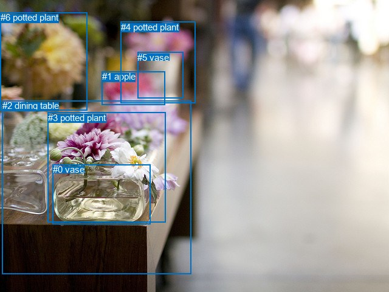
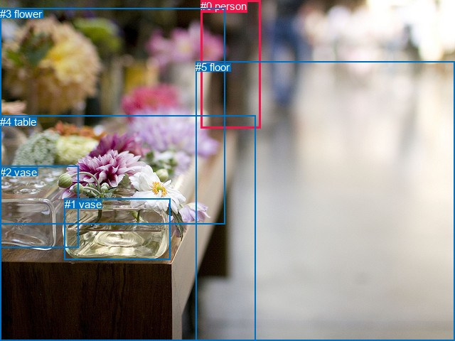

# 图片 0170：2319643.jpg

随机样本序号：409。图片 SHA256：`fcb95a366d4be811cf5e95ec5b4627c2754acb7556fbefbd909362610e50e43d`。

红色框表示人，蓝色框表示其他物体。两个模式分别保留自身框编号，可依据位置比较对应对象。

## 自动检测框与输出

人的框编号：`[]`。状态：`no_person`。

### 自动检测全部物体框

| 编号 | 类别 | 是否为人 | 检测分数 | 像素坐标 xyxy |
|---|---|---|---|---|
| 0 | vase | False | 0.9806 | 86.7, 270.1, 247.9, 368.7 |
| 1 | apple | False | 0.8459 | 167.8, 117.2, 271.6, 172.4 |
| 2 | dining table | False | 0.6580 | 3.9, 165.5, 314.8, 450.7 |
| 3 | potted plant | False | 0.6353 | 78.9, 184.8, 272.1, 365.4 |
| 4 | potted plant | False | 0.6039 | 198.9, 35.5, 321.7, 169.8 |
| 5 | vase | False | 0.5860 | 226.3, 85.9, 301.3, 161.9 |
| 6 | potted plant | False | 0.5262 | 0.7, 20.1, 143.8, 181.7 |

### 自动检测 Top50 人相关候选

评分物体对：0；人相关物体对：0；输出关系：0。

| 排名 | 主语编号与类别 | 关系 | 宾语编号与类别 | 类型 | 人与人 | 排序分数 | 原始融合 logit |
|---|---|---|---|---|---|---|---|

### 自动检测逐条人相关 GT 核验

本图没有人相关 GT，R@50 无分母；预测候选继续展示。

## 真实框与输出

人的框编号：`[0]`。

### 真实框全部物体框

| 编号 | 类别 | 是否为人 | 检测分数 | 像素坐标 xyxy |
|---|---|---|---|---|
| 0 | person | True | GT | 282.0, 0.0, 366.0, 180.0 |
| 1 | vase | False | GT | 91.0, 279.0, 240.0, 365.0 |
| 2 | vase | False | GT | 0.0, 234.0, 110.0, 349.0 |
| 3 | flower | False | GT | 0.0, 11.0, 316.0, 315.0 |
| 4 | table | False | GT | 0.0, 163.0, 359.0, 480.0 |
| 5 | floor | False | GT | 275.0, 86.0, 640.0, 480.0 |

### 真实框 Top50 人相关候选

评分物体对：30；人相关物体对：10；输出关系：20。

| 排名 | 主语编号与类别 | 关系 | 宾语编号与类别 | 类型 | 人与人 | 排序分数 | 原始融合 logit |
|---|---|---|---|---|---|---|---|
| 1 | #0 person | on | #5 floor | spatial | False | 0.93985 | 2.7489 |
| 2 | #0 person | walking on | #5 floor | semantic | False | 0.87765 | 1.9704 |
| 3 | #0 person | beside | #4 table | spatial | False | 0.87250 | 1.9232 |
| 4 | #0 person | holding | #3 flower | semantic | False | 0.63663 | 0.5608 |
| 5 | #3 flower | in | #0 person | spatial | False | 0.60353 | 0.4202 |
| 6 | #0 person | beside | #3 flower | spatial | False | 0.46479 | -0.1411 |
| 7 | #0 person | holding | #4 table | semantic | False | 0.34185 | -0.6551 |
| 8 | #4 table | beside | #0 person | spatial | False | 0.29242 | -0.8837 |
| 9 | #5 floor | in | #0 person | spatial | False | 0.26620 | -1.0140 |
| 10 | #3 flower | looking at | #0 person | semantic | False | 0.15660 | -1.6837 |
| 11 | #4 table | holding | #0 person | semantic | False | 0.06211 | -2.7148 |
| 12 | #5 floor | holding | #0 person | semantic | False | 0.04105 | -3.1511 |
| 13 | #2 vase | in | #0 person | spatial | False | 0.02175 | -3.8062 |
| 14 | #1 vase | in | #0 person | spatial | False | 0.01945 | -3.9204 |
| 15 | #0 person | beside | #1 vase | spatial | False | 0.01220 | -4.3937 |
| 16 | #1 vase | looking at | #0 person | semantic | False | 0.00519 | -5.2550 |
| 17 | #0 person | holding | #1 vase | semantic | False | 0.00506 | -5.2821 |
| 18 | #0 person | beside | #2 vase | spatial | False | 0.00475 | -5.3445 |
| 19 | #2 vase | looking at | #0 person | semantic | False | 0.00397 | -5.5238 |
| 20 | #0 person | holding | #2 vase | semantic | False | 0.00334 | -5.6983 |

### 真实框逐条人相关 GT 核验

本图没有人相关 GT，R@50 无分母；预测候选继续展示。

## 全部人相关 GT

| 主语编号与类别 | 关系 | 宾语编号与类别 |
|---|---|---|

原始记录、全部人相关物体对的两项预测与分项分数见 [逐图证据 JSON](../evidence/cases/0170.json)。全部56类 logits 保留于本机 HOR/output/random500/logits/。

<!-- HOR_COMPLETE_RESULTS -->

## 六组条件的完整输出对照

以下保留同一图片三种框与候选模式、两种谓词输出规则的全部 Top50。框编号各自在所属模式内解释。

### 自动检测框完整枚举：空间与语义各保留一个谓词

| 排名 | 主语编号与类别 | 谓词 | 宾语编号与类别 | 分组 | 排序分数 | predicate logit | pair logit |
|---|---|---|---|---|---|---|---|

没有人相关 GT，本条件的召回率无分母。

### 自动检测框完整枚举：每对只保留一个谓词

| 排名 | 主语编号与类别 | 谓词 | 宾语编号与类别 | 分组 | 排序分数 | predicate logit | pair logit |
|---|---|---|---|---|---|---|---|

没有人相关 GT，本条件的召回率无分母。

### 真实框完整枚举：空间与语义各保留一个谓词

| 排名 | 主语编号与类别 | 谓词 | 宾语编号与类别 | 分组 | 排序分数 | predicate logit | pair logit |
|---|---|---|---|---|---|---|---|
| 1 | #0 person | on | #5 floor | spatial | 0.9398502 | 3.0143776 | -0.2654958 |
| 2 | #0 person | walking on | #5 floor | semantic | 0.8776498 | 2.2358556 | -0.2654958 |
| 3 | #0 person | beside | #4 table | spatial | 0.8724993 | 2.4243588 | -0.5011192 |
| 4 | #0 person | holding | #3 flower | semantic | 0.6366268 | 1.3782296 | -0.8174760 |
| 5 | #3 flower | in | #0 person | spatial | 0.6035258 | 1.1014757 | -0.6812980 |
| 6 | #0 person | beside | #3 flower | spatial | 0.4647911 | 0.6764069 | -0.8174760 |
| 7 | #0 person | holding | #4 table | semantic | 0.3418505 | -0.1539392 | -0.5011192 |
| 8 | #4 table | beside | #0 person | spatial | 0.2924191 | 0.1682091 | -1.0518731 |
| 9 | #5 floor | in | #0 person | spatial | 0.2661958 | 0.0887747 | -1.1027846 |
| 10 | #3 flower | looking at | #0 person | semantic | 0.1566017 | -1.0024359 | -0.6812980 |
| 11 | #4 table | holding | #0 person | semantic | 0.0621053 | -1.6629333 | -1.0518731 |
| 12 | #5 floor | holding | #0 person | semantic | 0.0410490 | -2.0482895 | -1.1027846 |
| 13 | #2 vase | in | #0 person | spatial | 0.0217484 | -2.1016536 | -1.7045745 |
| 14 | #1 vase | in | #0 person | spatial | 0.0194470 | -2.3399248 | -1.5804965 |
| 15 | #0 person | beside | #1 vase | spatial | 0.0122046 | -2.6202910 | -1.7733674 |
| 16 | #1 vase | looking at | #0 person | semantic | 0.0051943 | -3.6744888 | -1.5804965 |
| 17 | #0 person | holding | #1 vase | semantic | 0.0050562 | -3.5087020 | -1.7733674 |
| 18 | #0 person | beside | #2 vase | spatial | 0.0047519 | -3.2606554 | -2.0837994 |
| 19 | #2 vase | looking at | #0 person | semantic | 0.0039749 | -3.8191872 | -1.7045745 |
| 20 | #0 person | holding | #2 vase | semantic | 0.0033404 | -3.6145053 | -2.0837994 |

没有人相关 GT，本条件的召回率无分母。

### 真实框完整枚举：每对只保留一个谓词

| 排名 | 主语编号与类别 | 谓词 | 宾语编号与类别 | 分组 | 排序分数 | predicate logit | pair logit |
|---|---|---|---|---|---|---|---|
| 1 | #0 person | on | #5 floor | single | 0.9398502 | 3.0143776 | -0.2654958 |
| 2 | #0 person | beside | #4 table | single | 0.8724993 | 2.4243588 | -0.5011192 |
| 3 | #0 person | holding | #3 flower | single | 0.6366268 | 1.3782296 | -0.8174760 |
| 4 | #3 flower | in | #0 person | single | 0.6035258 | 1.1014757 | -0.6812980 |
| 5 | #4 table | beside | #0 person | single | 0.2924191 | 0.1682091 | -1.0518731 |
| 6 | #5 floor | in | #0 person | single | 0.2661958 | 0.0887747 | -1.1027846 |
| 7 | #2 vase | in | #0 person | single | 0.0217484 | -2.1016536 | -1.7045745 |
| 8 | #1 vase | in | #0 person | single | 0.0194470 | -2.3399248 | -1.5804965 |
| 9 | #0 person | beside | #1 vase | single | 0.0122046 | -2.6202910 | -1.7733674 |
| 10 | #0 person | beside | #2 vase | single | 0.0047519 | -3.2606554 | -2.0837994 |

没有人相关 GT，本条件的召回率无分母。

### 真实框400候选：空间与语义各保留一个谓词

| 排名 | 主语编号与类别 | 谓词 | 宾语编号与类别 | 分组 | 排序分数 | predicate logit | pair logit |
|---|---|---|---|---|---|---|---|
| 1 | #0 person | on | #5 floor | spatial | 0.9398502 | 3.0143776 | -0.2654958 |
| 2 | #0 person | walking on | #5 floor | semantic | 0.8776498 | 2.2358556 | -0.2654958 |
| 3 | #0 person | beside | #4 table | spatial | 0.8724864 | 2.4242435 | -0.5011192 |
| 4 | #0 person | holding | #3 flower | semantic | 0.6366268 | 1.3782296 | -0.8174760 |
| 5 | #3 flower | in | #0 person | spatial | 0.6091239 | 1.1249294 | -0.6812980 |
| 6 | #0 person | beside | #3 flower | spatial | 0.4647766 | 0.6763487 | -0.8174760 |
| 7 | #0 person | holding | #4 table | semantic | 0.3418505 | -0.1539392 | -0.5011192 |
| 8 | #4 table | beside | #0 person | spatial | 0.2924191 | 0.1682091 | -1.0518731 |
| 9 | #5 floor | in | #0 person | spatial | 0.2774500 | 0.1456389 | -1.1027846 |
| 10 | #3 flower | looking at | #0 person | semantic | 0.1585526 | -0.9877388 | -0.6812980 |
| 11 | #4 table | holding | #0 person | semantic | 0.0621053 | -1.6629333 | -1.0518731 |
| 12 | #5 floor | holding | #0 person | semantic | 0.0427873 | -2.0049989 | -1.1027846 |
| 13 | #2 vase | in | #0 person | spatial | 0.0213264 | -2.1216774 | -1.7045745 |
| 14 | #1 vase | in | #0 person | spatial | 0.0193366 | -2.3457327 | -1.5804965 |
| 15 | #0 person | beside | #1 vase | spatial | 0.0120239 | -2.6353946 | -1.7733674 |
| 16 | #1 vase | looking at | #0 person | semantic | 0.0050818 | -3.6964905 | -1.5804965 |
| 17 | #0 person | holding | #1 vase | semantic | 0.0049811 | -3.5237477 | -1.7733674 |
| 18 | #0 person | beside | #2 vase | spatial | 0.0048233 | -3.2456675 | -2.0837994 |
| 19 | #2 vase | looking at | #0 person | semantic | 0.0038873 | -3.8415785 | -1.7045745 |
| 20 | #0 person | holding | #2 vase | semantic | 0.0033809 | -3.6024141 | -2.0837994 |

没有人相关 GT，本条件的召回率无分母。

### 真实框400候选：每对只保留一个谓词

| 排名 | 主语编号与类别 | 谓词 | 宾语编号与类别 | 分组 | 排序分数 | predicate logit | pair logit |
|---|---|---|---|---|---|---|---|
| 1 | #0 person | on | #5 floor | single | 0.9398502 | 3.0143776 | -0.2654958 |
| 2 | #0 person | beside | #4 table | single | 0.8724864 | 2.4242435 | -0.5011192 |
| 3 | #0 person | holding | #3 flower | single | 0.6366268 | 1.3782296 | -0.8174760 |
| 4 | #3 flower | in | #0 person | single | 0.6091239 | 1.1249294 | -0.6812980 |
| 5 | #4 table | beside | #0 person | single | 0.2924191 | 0.1682091 | -1.0518731 |
| 6 | #5 floor | in | #0 person | single | 0.2774500 | 0.1456389 | -1.1027846 |
| 7 | #2 vase | in | #0 person | single | 0.0213264 | -2.1216774 | -1.7045745 |
| 8 | #1 vase | in | #0 person | single | 0.0193366 | -2.3457327 | -1.5804965 |
| 9 | #0 person | beside | #1 vase | single | 0.0120239 | -2.6353946 | -1.7733674 |
| 10 | #0 person | beside | #2 vase | single | 0.0048233 | -3.2456675 | -2.0837994 |

没有人相关 GT，本条件的召回率无分母。
