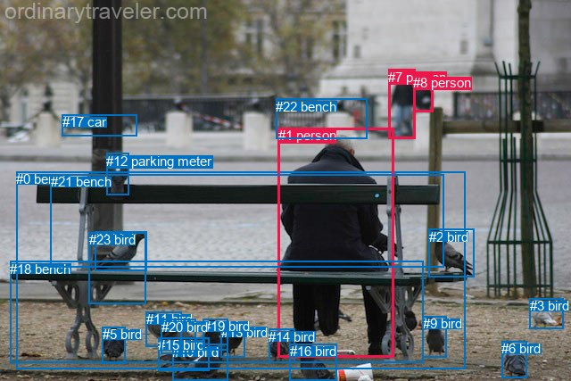
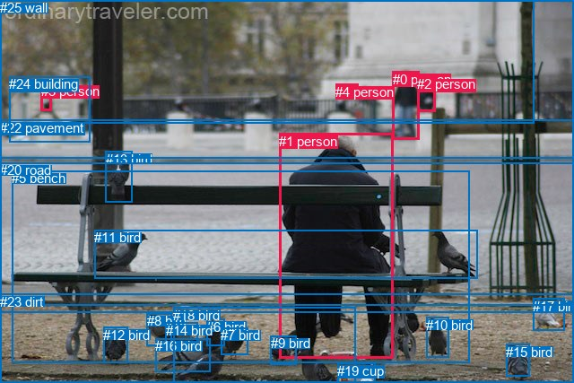

# 图片 0192：2321324.jpg

随机样本序号：443。图片 SHA256：`479a1d13dd9f3744a61e8abc34df64b41793e807be0bcbf3ad3bc3768eda4f71`。

红色框表示人，蓝色框表示其他物体。两个模式分别保留自身框编号，可依据位置比较对应对象。

## 自动检测框与输出

人的框编号：`[1, 7, 8]`。状态：`ok`。

### 自动检测全部物体框

| 编号 | 类别 | 是否为人 | 检测分数 | 像素坐标 xyxy |
|---|---|---|---|---|
| 0 | bench | False | 0.9974 | 18.3, 192.4, 521.9, 413.6 |
| 1 | person | True | 0.9972 | 311.7, 143.0, 441.4, 400.4 |
| 2 | bird | False | 0.9944 | 480.8, 256.6, 531.7, 310.6 |
| 3 | bird | False | 0.9896 | 593.9, 334.4, 631.0, 368.4 |
| 4 | bird | False | 0.9893 | 106.1, 259.2, 164.9, 303.8 |
| 5 | bird | False | 0.9843 | 115.0, 366.4, 140.9, 407.1 |
| 6 | bird | False | 0.9838 | 562.3, 382.1, 590.3, 423.5 |
| 7 | person | True | 0.9829 | 435.1, 77.7, 465.8, 155.4 |
| 8 | person | True | 0.9743 | 463.2, 83.8, 485.7, 125.3 |
| 9 | bird | False | 0.9735 | 473.8, 354.1, 500.1, 400.0 |
| 10 | bird | False | 0.9511 | 193.4, 386.0, 255.9, 426.5 |
| 11 | bird | False | 0.9433 | 163.9, 349.2, 203.9, 388.2 |
| 12 | parking meter | False | 0.9211 | 119.3, 171.9, 144.4, 219.0 |
| 13 | bird | False | 0.9040 | 247.6, 363.7, 274.6, 400.2 |
| 14 | bird | False | 0.9016 | 301.5, 368.8, 331.0, 406.6 |
| 15 | bird | False | 0.8970 | 177.1, 378.0, 234.2, 415.5 |
| 16 | bird | False | 0.7741 | 324.8, 385.2, 377.3, 427.0 |
| 17 | car | False | 0.7089 | 69.7, 128.0, 153.2, 152.4 |
| 18 | bench | False | 0.6073 | 11.3, 293.0, 474.5, 406.7 |
| 19 | bird | False | 0.5987 | 228.0, 357.1, 255.1, 392.2 |
| 20 | bird | False | 0.5706 | 180.7, 357.6, 219.4, 396.3 |
| 21 | bench | False | 0.5635 | 56.7, 195.4, 497.2, 299.0 |
| 22 | bench | False | 0.4596 | 309.3, 110.7, 412.0, 155.1 |
| 23 | bird | False | 0.3951 | 99.7, 260.1, 163.7, 340.7 |

### 自动检测 Top50 人相关候选

评分物体对：552；人相关物体对：132；输出关系：50。

| 排名 | 主语编号与类别 | 关系 | 宾语编号与类别 | 类型 | 人与人 | 排序分数 | 原始融合 logit |
|---|---|---|---|---|---|---|---|
| 1 | #1 person | sitting on | #0 bench | semantic | False | 0.98921 | 4.5186 |
| 2 | #1 person | sitting on | #21 bench | semantic | False | 0.98641 | 4.2844 |
| 3 | #7 person | walking on | #22 bench | semantic | False | 0.96688 | 3.3740 |
| 4 | #1 person | on | #0 bench | spatial | False | 0.96043 | 3.1894 |
| 5 | #1 person | sitting on | #18 bench | semantic | False | 0.95730 | 3.1099 |
| 6 | #1 person | on | #21 bench | spatial | False | 0.94718 | 2.8866 |
| 7 | #7 person | walking on | #8 person | semantic | True | 0.93623 | 2.6866 |
| 8 | #1 person | on | #18 bench | spatial | False | 0.93322 | 2.6373 |
| 9 | #7 person | in | #8 person | spatial | True | 0.84888 | 1.7259 |
| 10 | #7 person | on | #22 bench | spatial | False | 0.77158 | 1.2172 |
| 11 | #1 person | looking at | #2 bird | semantic | False | 0.67953 | 0.7516 |
| 12 | #8 person | on | #7 person | spatial | True | 0.66885 | 0.7030 |
| 13 | #8 person | walking on | #7 person | semantic | True | 0.61191 | 0.4554 |
| 14 | #8 person | walking on | #22 bench | semantic | False | 0.57154 | 0.2881 |
| 15 | #2 bird | beside | #1 person | spatial | False | 0.57073 | 0.2848 |
| 16 | #14 bird | beside | #1 person | spatial | False | 0.55686 | 0.2284 |
| 17 | #1 person | looking at | #14 bird | semantic | False | 0.48583 | -0.0567 |
| 18 | #7 person | looking at | #2 bird | semantic | False | 0.47805 | -0.0878 |
| 19 | #7 person | looking at | #1 person | semantic | True | 0.44135 | -0.2357 |
| 20 | #16 bird | beside | #1 person | spatial | False | 0.42560 | -0.2998 |
| 21 | #1 person | beside | #2 bird | spatial | False | 0.39806 | -0.4136 |
| 22 | #7 person | walking on | #17 car | semantic | False | 0.36798 | -0.5409 |
| 23 | #1 person | in | #14 bird | spatial | False | 0.36125 | -0.5700 |
| 24 | #2 bird | looking at | #1 person | semantic | False | 0.36053 | -0.5731 |
| 25 | #14 bird | looking at | #1 person | semantic | False | 0.35639 | -0.5911 |
| 26 | #1 person | wearing | #22 bench | semantic | False | 0.35582 | -0.5936 |
| 27 | #7 person | walking on | #18 bench | semantic | False | 0.33763 | -0.6739 |
| 28 | #1 person | in | #22 bench | spatial | False | 0.33725 | -0.6756 |
| 29 | #7 person | walking on | #0 bench | semantic | False | 0.32808 | -0.7169 |
| 30 | #22 bench | beside | #1 person | spatial | False | 0.30784 | -0.8102 |
| 31 | #3 bird | looking at | #1 person | semantic | False | 0.26622 | -1.0139 |
| 32 | #16 bird | looking at | #1 person | semantic | False | 0.26491 | -1.0206 |
| 33 | #8 person | looking at | #1 person | semantic | True | 0.26359 | -1.0274 |
| 34 | #7 person | walking on | #21 bench | semantic | False | 0.26236 | -1.0338 |
| 35 | #8 person | on | #22 bench | spatial | False | 0.26199 | -1.0356 |
| 36 | #1 person | looking at | #7 person | semantic | True | 0.25818 | -1.0554 |
| 37 | #1 person | in front of | #7 person | spatial | True | 0.21265 | -1.3090 |
| 38 | #6 bird | beside | #1 person | spatial | False | 0.20698 | -1.3432 |
| 39 | #7 person | on | #0 bench | spatial | False | 0.20655 | -1.3458 |
| 40 | #6 bird | looking at | #1 person | semantic | False | 0.20156 | -1.3766 |
| 41 | #22 bench | beside | #7 person | spatial | False | 0.20134 | -1.3780 |
| 42 | #1 person | looking at | #16 bird | semantic | False | 0.20059 | -1.3826 |
| 43 | #9 bird | looking at | #1 person | semantic | False | 0.20051 | -1.3831 |
| 44 | #8 person | looking at | #2 bird | semantic | False | 0.19417 | -1.4232 |
| 45 | #1 person | looking at | #8 person | semantic | True | 0.17884 | -1.5242 |
| 46 | #1 person | looking at | #9 bird | semantic | False | 0.17670 | -1.5389 |
| 47 | #12 parking meter | on | #1 person | spatial | False | 0.16371 | -1.6308 |
| 48 | #7 person | on | #21 bench | spatial | False | 0.15485 | -1.6971 |
| 49 | #1 person | looking at | #23 bird | semantic | False | 0.15160 | -1.7221 |
| 50 | #1 person | wearing | #12 parking meter | semantic | False | 0.14815 | -1.7492 |

### 自动检测逐条人相关 GT 核验

R@50：33.33%；命中 1/3。

| GT 主语编号 | GT 关系 | GT 宾语编号 | 结果阶段 | 匹配预测主语编号 | 匹配预测宾语编号 |
|---|---|---|---|---|---|
| 0 | walking on | 22 | endpoint_missing_or_wrong_class | [7] | [] |
| 1 | sitting on | 5 | hit50 | [1] | [0] |
| 1 | feeding | 11 | endpoint_missing_or_wrong_class | [1] | [] |

## 真实框与输出

人的框编号：`[0, 1, 2, 3, 4]`。

### 真实框全部物体框

| 编号 | 类别 | 是否为人 | 检测分数 | 像素坐标 xyxy |
|---|---|---|---|---|
| 0 | person | True | GT | 438.0, 80.0, 467.0, 156.0 |
| 1 | person | True | GT | 311.0, 149.0, 438.0, 400.0 |
| 2 | person | True | GT | 465.0, 85.0, 485.0, 124.0 |
| 3 | person | True | GT | 46.0, 93.0, 58.0, 124.0 |
| 4 | person | True | GT | 374.0, 94.0, 399.0, 108.0 |
| 5 | bench | False | GT | 13.0, 190.0, 524.0, 405.0 |
| 6 | bird | False | GT | 230.0, 356.0, 250.0, 386.0 |
| 7 | bird | False | GT | 246.0, 365.0, 276.0, 395.0 |
| 8 | bird | False | GT | 164.0, 349.0, 192.0, 385.0 |
| 9 | bird | False | GT | 302.0, 374.0, 331.0, 406.0 |
| 10 | bird | False | GT | 475.0, 354.0, 500.0, 399.0 |
| 11 | bird | False | GT | 105.0, 256.0, 533.0, 310.0 |
| 12 | bird | False | GT | 115.0, 365.0, 142.0, 405.0 |
| 13 | bird | False | GT | 118.0, 169.0, 147.0, 226.0 |
| 14 | bird | False | GT | 185.0, 360.0, 221.0, 391.0 |
| 15 | bird | False | GT | 564.0, 384.0, 590.0, 420.0 |
| 16 | bird | False | GT | 173.0, 377.0, 234.0, 414.0 |
| 17 | bird | False | GT | 594.0, 333.0, 629.0, 369.0 |
| 18 | bird | False | GT | 193.0, 343.0, 397.0, 427.0 |
| 19 | cup | False | GT | 376.0, 405.0, 418.0, 427.0 |
| 20 | road | False | GT | 0.0, 181.0, 640.0, 341.0 |
| 21 | tree | False | GT | 0.0, 0.0, 596.0, 137.0 |
| 22 | pavement | False | GT | 0.0, 134.0, 640.0, 349.0 |
| 23 | dirt | False | GT | 0.0, 328.0, 640.0, 427.0 |
| 24 | building | False | GT | 10.0, 85.0, 100.0, 158.0 |
| 25 | wall | False | GT | 0.0, 0.0, 640.0, 177.0 |

### 真实框 Top50 人相关候选

评分物体对：650；人相关物体对：230；输出关系：50。

| 排名 | 主语编号与类别 | 关系 | 宾语编号与类别 | 类型 | 人与人 | 排序分数 | 原始融合 logit |
|---|---|---|---|---|---|---|---|
| 1 | #1 person | sitting on | #5 bench | semantic | False | 0.99045 | 4.6415 |
| 2 | #0 person | walking on | #22 pavement | semantic | False | 0.98556 | 4.2229 |
| 3 | #0 person | walking on | #20 road | semantic | False | 0.98373 | 4.1018 |
| 4 | #3 person | walking on | #22 pavement | semantic | False | 0.96539 | 3.3283 |
| 5 | #3 person | walking on | #24 building | semantic | False | 0.95999 | 3.1777 |
| 6 | #1 person | on | #5 bench | spatial | False | 0.95628 | 3.0853 |
| 7 | #3 person | walking on | #20 road | semantic | False | 0.95611 | 3.0812 |
| 8 | #3 person | on | #24 building | spatial | False | 0.95477 | 3.0497 |
| 9 | #3 person | on | #22 pavement | spatial | False | 0.94523 | 2.8483 |
| 10 | #0 person | on | #22 pavement | spatial | False | 0.92536 | 2.5175 |
| 11 | #3 person | on | #20 road | spatial | False | 0.90481 | 2.2519 |
| 12 | #0 person | holding | #2 person | semantic | True | 0.89734 | 2.1680 |
| 13 | #0 person | on | #20 road | spatial | False | 0.89563 | 2.1496 |
| 14 | #4 person | walking on | #20 road | semantic | False | 0.88711 | 2.0615 |
| 15 | #1 person | sitting on | #20 road | semantic | False | 0.87371 | 1.9342 |
| 16 | #2 person | walking on | #22 pavement | semantic | False | 0.87217 | 1.9203 |
| 17 | #0 person | walking on | #25 wall | semantic | False | 0.86889 | 1.8912 |
| 18 | #1 person | looking at | #11 bird | semantic | False | 0.86157 | 1.8284 |
| 19 | #2 person | walking on | #20 road | semantic | False | 0.85991 | 1.8146 |
| 20 | #1 person | on | #20 road | spatial | False | 0.85624 | 1.7844 |
| 21 | #4 person | on | #22 pavement | spatial | False | 0.85171 | 1.7480 |
| 22 | #1 person | sitting on | #22 pavement | semantic | False | 0.84370 | 1.6860 |
| 23 | #1 person | on | #22 pavement | spatial | False | 0.82804 | 1.5718 |
| 24 | #4 person | on | #20 road | spatial | False | 0.82687 | 1.5636 |
| 25 | #4 person | walking on | #22 pavement | semantic | False | 0.80980 | 1.4487 |
| 26 | #1 person | sitting on | #23 dirt | semantic | False | 0.79607 | 1.3619 |
| 27 | #1 person | in | #11 bird | spatial | False | 0.78598 | 1.3009 |
| 28 | #1 person | on | #23 dirt | spatial | False | 0.77480 | 1.2356 |
| 29 | #1 person | looking at | #18 bird | semantic | False | 0.75335 | 1.1165 |
| 30 | #11 bird | on | #1 person | spatial | False | 0.74715 | 1.0834 |
| 31 | #1 person | beside | #18 bird | spatial | False | 0.70398 | 0.8663 |
| 32 | #0 person | in | #25 wall | spatial | False | 0.68951 | 0.7978 |
| 33 | #2 person | on | #22 pavement | spatial | False | 0.68539 | 0.7787 |
| 34 | #3 person | in | #25 wall | spatial | False | 0.66929 | 0.7050 |
| 35 | #0 person | in | #2 person | spatial | True | 0.66287 | 0.6761 |
| 36 | #11 bird | sitting on | #1 person | semantic | False | 0.64522 | 0.5981 |
| 37 | #0 person | walking on | #21 tree | semantic | False | 0.62536 | 0.5124 |
| 38 | #4 person | in | #25 wall | spatial | False | 0.62422 | 0.5075 |
| 39 | #3 person | on | #21 tree | spatial | False | 0.58648 | 0.3494 |
| 40 | #2 person | on | #20 road | spatial | False | 0.55973 | 0.2401 |
| 41 | #24 building | wearing | #3 person | semantic | False | 0.55334 | 0.2142 |
| 42 | #18 bird | beside | #1 person | spatial | False | 0.54986 | 0.2001 |
| 43 | #1 person | looking at | #9 bird | semantic | False | 0.45610 | -0.1761 |
| 44 | #18 bird | looking at | #1 person | semantic | False | 0.45271 | -0.1897 |
| 45 | #4 person | on | #21 tree | spatial | False | 0.44996 | -0.2008 |
| 46 | #24 building | on | #3 person | spatial | False | 0.44146 | -0.2352 |
| 47 | #1 person | in | #9 bird | spatial | False | 0.43511 | -0.2610 |
| 48 | #3 person | walking on | #25 wall | semantic | False | 0.40526 | -0.3836 |
| 49 | #2 person | beside | #0 person | spatial | True | 0.39594 | -0.4224 |
| 50 | #0 person | walking on | #4 person | semantic | True | 0.35550 | -0.5949 |

### 真实框逐条人相关 GT 核验

R@50：66.67%；命中 2/3。

| GT 主语编号 | GT 关系 | GT 宾语编号 | 结果阶段 | 匹配预测主语编号 | 匹配预测宾语编号 |
|---|---|---|---|---|---|
| 0 | walking on | 22 | hit50 | [0] | [22] |
| 1 | sitting on | 5 | hit50 | [1] | [5] |
| 1 | feeding | 11 | wrong_predicate | [1] | [11] |

## 全部人相关 GT

| 主语编号与类别 | 关系 | 宾语编号与类别 |
|---|---|---|
| #0 person | walking on | #22 pavement |
| #1 person | sitting on | #5 bench |
| #1 person | feeding | #11 bird |

原始记录、全部人相关物体对的两项预测与分项分数见 [逐图证据 JSON](../evidence/cases/0192.json)。全部56类 logits 保留于本机 HOR/output/random500/logits/。

<!-- HOR_COMPLETE_RESULTS -->

## 六组条件的完整输出对照

以下保留同一图片三种框与候选模式、两种谓词输出规则的全部 Top50。框编号各自在所属模式内解释。

### 自动检测框完整枚举：空间与语义各保留一个谓词

| 排名 | 主语编号与类别 | 谓词 | 宾语编号与类别 | 分组 | 排序分数 | predicate logit | pair logit |
|---|---|---|---|---|---|---|---|
| 1 | #1 person | sitting on | #0 bench | semantic | 0.9892130 | 4.0747237 | 0.4438545 |
| 2 | #1 person | sitting on | #21 bench | semantic | 0.9864059 | 4.0115380 | 0.2728948 |
| 3 | #7 person | walking on | #22 bench | semantic | 0.9668824 | 3.6290288 | -0.2550151 |
| 4 | #1 person | on | #0 bench | spatial | 0.9604338 | 2.7455549 | 0.4438545 |
| 5 | #1 person | sitting on | #18 bench | semantic | 0.9573013 | 3.1810007 | -0.0710527 |
| 6 | #1 person | on | #21 bench | spatial | 0.9471807 | 2.6137209 | 0.2728948 |
| 7 | #7 person | walking on | #8 person | semantic | 0.9362342 | 2.2538629 | 0.4327862 |
| 8 | #1 person | on | #18 bench | spatial | 0.9332212 | 2.7083101 | -0.0710527 |
| 9 | #7 person | in | #8 person | spatial | 0.8488844 | 1.2930923 | 0.4327862 |
| 10 | #7 person | on | #22 bench | spatial | 0.7715770 | 1.4722524 | -0.2550151 |
| 11 | #1 person | looking at | #2 bird | semantic | 0.6795256 | 0.9930539 | -0.2414613 |
| 12 | #8 person | on | #7 person | spatial | 0.6688464 | 1.1323576 | -0.4293852 |
| 13 | #8 person | walking on | #7 person | semantic | 0.6119132 | 0.8847466 | -0.4293852 |
| 14 | #8 person | walking on | #22 bench | semantic | 0.5715414 | 0.8320899 | -0.5439471 |
| 15 | #2 bird | beside | #1 person | spatial | 0.5707327 | 1.0358243 | -0.7509832 |
| 16 | #14 bird | beside | #1 person | spatial | 0.5568582 | 0.7098517 | -0.4814308 |
| 17 | #1 person | looking at | #14 bird | semantic | 0.4858278 | -0.2386398 | 0.1819357 |
| 18 | #7 person | looking at | #2 bird | semantic | 0.4780533 | 0.9832921 | -1.0711354 |
| 19 | #7 person | looking at | #1 person | semantic | 0.4413540 | 0.4262013 | -0.6618699 |
| 20 | #16 bird | beside | #1 person | spatial | 0.4255973 | 0.1978378 | -0.4976751 |
| 21 | #1 person | beside | #2 bird | spatial | 0.3980609 | -0.1720901 | -0.2414613 |
| 22 | #7 person | walking on | #17 car | semantic | 0.3679782 | 0.7283106 | -1.2692108 |
| 23 | #1 person | in | #14 bird | spatial | 0.3612455 | -0.7518981 | 0.1819357 |
| 24 | #2 bird | looking at | #1 person | semantic | 0.3605280 | 0.1779099 | -0.7509832 |
| 25 | #14 bird | looking at | #1 person | semantic | 0.3563879 | -0.1096458 | -0.4814308 |
| 26 | #1 person | wearing | #22 bench | semantic | 0.3558163 | 0.2356195 | -0.8291889 |
| 27 | #7 person | walking on | #18 bench | semantic | 0.3376320 | 0.1415524 | -0.8154174 |
| 28 | #1 person | in | #22 bench | spatial | 0.3372491 | 0.1536117 | -0.8291889 |
| 29 | #7 person | walking on | #0 bench | semantic | 0.3280814 | -0.2466373 | -0.4702382 |
| 30 | #22 bench | beside | #1 person | spatial | 0.3078414 | -0.2217627 | -0.5884680 |
| 31 | #3 bird | looking at | #1 person | semantic | 0.2662218 | -0.3072762 | -0.7066008 |
| 32 | #16 bird | looking at | #1 person | semantic | 0.2649143 | -0.5229053 | -0.4976751 |
| 33 | #8 person | looking at | #1 person | semantic | 0.2635901 | -0.1300845 | -0.8973070 |
| 34 | #7 person | walking on | #21 bench | semantic | 0.2623554 | -0.2496476 | -0.7841145 |
| 35 | #8 person | on | #22 bench | spatial | 0.2619905 | -0.4917011 | -0.5439471 |
| 36 | #1 person | looking at | #7 person | semantic | 0.2581815 | -0.0810580 | -0.9743841 |
| 37 | #1 person | in front of | #7 person | spatial | 0.2126493 | -0.3346457 | -0.9743841 |
| 38 | #6 bird | beside | #1 person | spatial | 0.2069786 | -0.6753578 | -0.6678768 |
| 39 | #7 person | on | #0 bench | spatial | 0.2065534 | -0.8755891 | -0.4702382 |
| 40 | #6 bird | looking at | #1 person | semantic | 0.2015623 | -0.7086818 | -0.6678768 |
| 41 | #22 bench | beside | #7 person | spatial | 0.2013363 | -0.5534892 | -0.8244743 |
| 42 | #1 person | looking at | #16 bird | semantic | 0.2005885 | -1.1247299 | -0.2578907 |
| 43 | #9 bird | looking at | #1 person | semantic | 0.2005143 | -0.6574764 | -0.7256066 |
| 44 | #8 person | looking at | #2 bird | semantic | 0.1941666 | 0.1782589 | -1.6014192 |
| 45 | #1 person | looking at | #8 person | semantic | 0.1788422 | -0.9475486 | -0.5766631 |
| 46 | #1 person | looking at | #9 bird | semantic | 0.1767020 | -1.2907548 | -0.2480990 |
| 47 | #12 parking meter | on | #1 person | spatial | 0.1637145 | -0.6407099 | -0.9901360 |
| 48 | #7 person | on | #21 bench | spatial | 0.1548453 | -0.9129789 | -0.7841145 |
| 49 | #1 person | looking at | #23 bird | semantic | 0.1516038 | -1.1648114 | -0.5572656 |
| 50 | #1 person | wearing | #12 parking meter | semantic | 0.1481471 | -1.0313766 | -0.7178317 |

GT 命中：1/3，R@50=33.33%。

| GT主语 | GT谓词 | GT宾语 | 结果阶段 | 匹配主语框 | 匹配宾语框 |
|---|---|---|---|---|---|
| 0 | walking on | 22 | endpoint_missing_or_wrong_class | [7] | [] |
| 1 | sitting on | 5 | hit50 | [1] | [0] |
| 1 | feeding | 11 | endpoint_missing_or_wrong_class | [1] | [] |

### 自动检测框完整枚举：每对只保留一个谓词

| 排名 | 主语编号与类别 | 谓词 | 宾语编号与类别 | 分组 | 排序分数 | predicate logit | pair logit |
|---|---|---|---|---|---|---|---|
| 1 | #1 person | sitting on | #0 bench | single | 0.9892130 | 4.0747237 | 0.4438545 |
| 2 | #1 person | sitting on | #21 bench | single | 0.9864059 | 4.0115380 | 0.2728948 |
| 3 | #7 person | walking on | #22 bench | single | 0.9668824 | 3.6290288 | -0.2550151 |
| 4 | #1 person | sitting on | #18 bench | single | 0.9573013 | 3.1810007 | -0.0710527 |
| 5 | #7 person | walking on | #8 person | single | 0.9362342 | 2.2538629 | 0.4327862 |
| 6 | #1 person | looking at | #2 bird | single | 0.6795256 | 0.9930539 | -0.2414613 |
| 7 | #8 person | on | #7 person | single | 0.6688464 | 1.1323576 | -0.4293852 |
| 8 | #8 person | walking on | #22 bench | single | 0.5715414 | 0.8320899 | -0.5439471 |
| 9 | #2 bird | beside | #1 person | single | 0.5707327 | 1.0358243 | -0.7509832 |
| 10 | #14 bird | beside | #1 person | single | 0.5568582 | 0.7098517 | -0.4814308 |
| 11 | #1 person | looking at | #14 bird | single | 0.4858278 | -0.2386398 | 0.1819357 |
| 12 | #7 person | looking at | #2 bird | single | 0.4780533 | 0.9832921 | -1.0711354 |
| 13 | #7 person | looking at | #1 person | single | 0.4413540 | 0.4262013 | -0.6618699 |
| 14 | #16 bird | beside | #1 person | single | 0.4255973 | 0.1978378 | -0.4976751 |
| 15 | #7 person | walking on | #17 car | single | 0.3679782 | 0.7283106 | -1.2692108 |
| 16 | #1 person | wearing | #22 bench | single | 0.3558163 | 0.2356195 | -0.8291889 |
| 17 | #7 person | walking on | #18 bench | single | 0.3376320 | 0.1415524 | -0.8154174 |
| 18 | #7 person | walking on | #0 bench | single | 0.3280814 | -0.2466373 | -0.4702382 |
| 19 | #22 bench | beside | #1 person | single | 0.3078414 | -0.2217627 | -0.5884680 |
| 20 | #3 bird | looking at | #1 person | single | 0.2662218 | -0.3072762 | -0.7066008 |
| 21 | #8 person | looking at | #1 person | single | 0.2635901 | -0.1300845 | -0.8973070 |
| 22 | #7 person | walking on | #21 bench | single | 0.2623554 | -0.2496476 | -0.7841145 |
| 23 | #1 person | looking at | #7 person | single | 0.2581815 | -0.0810580 | -0.9743841 |
| 24 | #6 bird | beside | #1 person | single | 0.2069786 | -0.6753578 | -0.6678768 |
| 25 | #22 bench | beside | #7 person | single | 0.2013363 | -0.5534892 | -0.8244743 |
| 26 | #1 person | looking at | #16 bird | single | 0.2005885 | -1.1247299 | -0.2578907 |
| 27 | #9 bird | looking at | #1 person | single | 0.2005143 | -0.6574764 | -0.7256066 |
| 28 | #8 person | looking at | #2 bird | single | 0.1941666 | 0.1782589 | -1.6014192 |
| 29 | #1 person | looking at | #8 person | single | 0.1788422 | -0.9475486 | -0.5766631 |
| 30 | #1 person | looking at | #9 bird | single | 0.1767020 | -1.2907548 | -0.2480990 |
| 31 | #12 parking meter | on | #1 person | single | 0.1637145 | -0.6407099 | -0.9901360 |
| 32 | #1 person | looking at | #23 bird | single | 0.1516038 | -1.1648114 | -0.5572656 |
| 33 | #1 person | wearing | #12 parking meter | single | 0.1481471 | -1.0313766 | -0.7178317 |
| 34 | #23 bird | looking at | #1 person | single | 0.1383139 | -1.0453181 | -0.7840476 |
| 35 | #1 person | looking at | #6 bird | single | 0.1297759 | -1.4025781 | -0.5003639 |
| 36 | #1 person | looking at | #10 bird | single | 0.1166116 | -1.9567716 | -0.0681449 |
| 37 | #8 person | walking on | #17 car | single | 0.1156647 | -0.4753394 | -1.5588012 |
| 38 | #1 person | looking at | #4 bird | single | 0.1108270 | -1.5125604 | -0.5697606 |
| 39 | #13 bird | looking at | #1 person | single | 0.1092661 | -1.4477041 | -0.6505552 |
| 40 | #21 bench | in front of | #1 person | single | 0.0993945 | -1.2307973 | -0.9731731 |
| 41 | #1 person | looking at | #15 bird | single | 0.0941653 | -2.1326995 | -0.1311054 |
| 42 | #18 bench | beside | #1 person | single | 0.0833463 | -1.5789735 | -0.8187525 |
| 43 | #4 bird | looking at | #1 person | single | 0.0813247 | -1.5297415 | -0.8947412 |
| 44 | #19 bird | looking at | #1 person | single | 0.0808135 | -1.7052231 | -0.7261213 |
| 45 | #7 person | looking at | #9 bird | single | 0.0756246 | -1.3473308 | -1.1560056 |
| 46 | #7 person | looking at | #6 bird | single | 0.0715064 | -1.3574955 | -1.2062809 |
| 47 | #1 person | looking at | #20 bird | single | 0.0673561 | -2.4443867 | -0.1836433 |
| 48 | #20 bird | looking at | #1 person | single | 0.0659272 | -1.8639920 | -0.7870120 |
| 49 | #17 car | beside | #1 person | single | 0.0588244 | -1.7898886 | -0.9826837 |
| 50 | #2 bird | looking at | #7 person | single | 0.0572528 | -1.3710272 | -1.4302942 |

GT 命中：1/3，R@50=33.33%。

| GT主语 | GT谓词 | GT宾语 | 结果阶段 | 匹配主语框 | 匹配宾语框 |
|---|---|---|---|---|---|
| 0 | walking on | 22 | endpoint_missing_or_wrong_class | [7] | [] |
| 1 | sitting on | 5 | hit50 | [1] | [0] |
| 1 | feeding | 11 | endpoint_missing_or_wrong_class | [1] | [] |

### 真实框完整枚举：空间与语义各保留一个谓词

| 排名 | 主语编号与类别 | 谓词 | 宾语编号与类别 | 分组 | 排序分数 | predicate logit | pair logit |
|---|---|---|---|---|---|---|---|
| 1 | #1 person | sitting on | #5 bench | semantic | 0.9904492 | 4.2582765 | 0.3832593 |
| 2 | #0 person | walking on | #22 pavement | semantic | 0.9855562 | 4.3151488 | -0.0922090 |
| 3 | #0 person | walking on | #20 road | semantic | 0.9837263 | 4.2609868 | -0.1591900 |
| 4 | #3 person | walking on | #22 pavement | semantic | 0.9653879 | 3.0513158 | 0.2770125 |
| 5 | #3 person | walking on | #24 building | semantic | 0.9599876 | 3.3883271 | -0.2105950 |
| 6 | #1 person | on | #5 bench | spatial | 0.9562805 | 2.7019963 | 0.3832593 |
| 7 | #3 person | walking on | #20 road | semantic | 0.9561109 | 2.9851127 | 0.0960940 |
| 8 | #3 person | on | #24 building | spatial | 0.9547682 | 3.2602630 | -0.2105950 |
| 9 | #3 person | on | #22 pavement | spatial | 0.9452325 | 2.5713205 | 0.2770125 |
| 10 | #0 person | on | #22 pavement | spatial | 0.9253606 | 2.6097245 | -0.0922090 |
| 11 | #3 person | on | #20 road | spatial | 0.9048119 | 2.1557779 | 0.0960940 |
| 12 | #0 person | holding | #2 person | semantic | 0.8973414 | 1.7475080 | 0.4205185 |
| 13 | #0 person | on | #20 road | spatial | 0.8956335 | 2.3088121 | -0.1591900 |
| 14 | #4 person | walking on | #20 road | semantic | 0.8871062 | 2.1275468 | -0.0660300 |
| 15 | #1 person | sitting on | #20 road | semantic | 0.8737115 | 2.5279417 | -0.5937603 |
| 16 | #2 person | walking on | #22 pavement | semantic | 0.8721665 | 2.3562350 | -0.4359838 |
| 17 | #0 person | walking on | #25 wall | semantic | 0.8688883 | 2.0432663 | -0.1521013 |
| 18 | #1 person | looking at | #11 bird | semantic | 0.8615741 | 2.0016217 | -0.1731960 |
| 19 | #2 person | walking on | #20 road | semantic | 0.8599130 | 2.2749929 | -0.4604252 |
| 20 | #1 person | on | #20 road | spatial | 0.8562376 | 2.3781462 | -0.5937603 |
| 21 | #4 person | on | #22 pavement | spatial | 0.8517059 | 1.6625595 | 0.0854842 |
| 22 | #1 person | sitting on | #22 pavement | semantic | 0.8437032 | 2.2510962 | -0.5650520 |
| 23 | #1 person | on | #22 pavement | spatial | 0.8280380 | 2.1368380 | -0.5650520 |
| 24 | #4 person | on | #20 road | spatial | 0.8268651 | 1.6296010 | -0.0660300 |
| 25 | #4 person | walking on | #22 pavement | semantic | 0.8098037 | 1.3632512 | 0.0854842 |
| 26 | #1 person | sitting on | #23 dirt | semantic | 0.7960719 | 1.7455692 | -0.3836471 |
| 27 | #1 person | in | #11 bird | spatial | 0.7859847 | 1.4740858 | -0.1731960 |
| 28 | #1 person | on | #23 dirt | spatial | 0.7748048 | 1.6192908 | -0.3836471 |
| 29 | #1 person | looking at | #18 bird | semantic | 0.7533478 | 1.1069031 | 0.0096450 |
| 30 | #11 bird | on | #1 person | spatial | 0.7471455 | 1.7614346 | -0.6779884 |
| 31 | #1 person | beside | #18 bird | spatial | 0.7039772 | 0.8566647 | 0.0096450 |
| 32 | #0 person | in | #25 wall | spatial | 0.6895092 | 0.9499269 | -0.1521013 |
| 33 | #2 person | on | #22 pavement | spatial | 0.6853898 | 1.2146373 | -0.4359838 |
| 34 | #3 person | in | #25 wall | spatial | 0.6692936 | 0.6914907 | 0.0135014 |
| 35 | #0 person | in | #2 person | spatial | 0.6628724 | 0.2556024 | 0.4205185 |
| 36 | #11 bird | sitting on | #1 person | semantic | 0.6452230 | 1.2760949 | -0.6779884 |
| 37 | #0 person | walking on | #21 tree | semantic | 0.6253645 | 0.9238830 | -0.4115018 |
| 38 | #4 person | in | #25 wall | spatial | 0.6242242 | 0.5481167 | -0.0405998 |
| 39 | #3 person | on | #21 tree | spatial | 0.5864785 | 0.4565930 | -0.1071665 |
| 40 | #2 person | on | #20 road | spatial | 0.5597340 | 0.7005081 | -0.4604252 |
| 41 | #24 building | wearing | #3 person | semantic | 0.5533364 | 0.5219355 | -0.3077750 |
| 42 | #18 bird | beside | #1 person | spatial | 0.5498648 | 0.7098517 | -0.5097271 |
| 43 | #1 person | looking at | #9 bird | semantic | 0.4560991 | -0.3320513 | 0.1559945 |
| 44 | #18 bird | looking at | #1 person | semantic | 0.4527097 | 0.3199987 | -0.5097271 |
| 45 | #4 person | on | #21 tree | spatial | 0.4499632 | -0.0325999 | -0.1682193 |
| 46 | #24 building | on | #3 person | spatial | 0.4414590 | 0.0725322 | -0.3077750 |
| 47 | #1 person | in | #9 bird | spatial | 0.4351093 | -0.4170294 | 0.1559945 |
| 48 | #3 person | walking on | #25 wall | semantic | 0.4052608 | -0.3970938 | 0.0135014 |
| 49 | #2 person | beside | #0 person | spatial | 0.3959357 | 0.0149775 | -0.4374063 |
| 50 | #0 person | walking on | #4 person | semantic | 0.3555013 | -0.1954861 | -0.3994578 |

GT 命中：2/3，R@50=66.67%。

| GT主语 | GT谓词 | GT宾语 | 结果阶段 | 匹配主语框 | 匹配宾语框 |
|---|---|---|---|---|---|
| 0 | walking on | 22 | hit50 | [0] | [22] |
| 1 | sitting on | 5 | hit50 | [1] | [5] |
| 1 | feeding | 11 | wrong_predicate | [1] | [11] |

### 真实框完整枚举：每对只保留一个谓词

| 排名 | 主语编号与类别 | 谓词 | 宾语编号与类别 | 分组 | 排序分数 | predicate logit | pair logit |
|---|---|---|---|---|---|---|---|
| 1 | #1 person | sitting on | #5 bench | single | 0.9904492 | 4.2582765 | 0.3832593 |
| 2 | #0 person | walking on | #22 pavement | single | 0.9855562 | 4.3151488 | -0.0922090 |
| 3 | #0 person | walking on | #20 road | single | 0.9837263 | 4.2609868 | -0.1591900 |
| 4 | #3 person | walking on | #22 pavement | single | 0.9653879 | 3.0513158 | 0.2770125 |
| 5 | #3 person | walking on | #24 building | single | 0.9599876 | 3.3883271 | -0.2105950 |
| 6 | #3 person | walking on | #20 road | single | 0.9561109 | 2.9851127 | 0.0960940 |
| 7 | #0 person | holding | #2 person | single | 0.8973414 | 1.7475080 | 0.4205185 |
| 8 | #4 person | walking on | #20 road | single | 0.8871062 | 2.1275468 | -0.0660300 |
| 9 | #1 person | sitting on | #20 road | single | 0.8737115 | 2.5279417 | -0.5937603 |
| 10 | #2 person | walking on | #22 pavement | single | 0.8721665 | 2.3562350 | -0.4359838 |
| 11 | #0 person | walking on | #25 wall | single | 0.8688883 | 2.0432663 | -0.1521013 |
| 12 | #1 person | looking at | #11 bird | single | 0.8615741 | 2.0016217 | -0.1731960 |
| 13 | #2 person | walking on | #20 road | single | 0.8599130 | 2.2749929 | -0.4604252 |
| 14 | #4 person | on | #22 pavement | single | 0.8517059 | 1.6625595 | 0.0854842 |
| 15 | #1 person | sitting on | #22 pavement | single | 0.8437032 | 2.2510962 | -0.5650520 |
| 16 | #1 person | sitting on | #23 dirt | single | 0.7960719 | 1.7455692 | -0.3836471 |
| 17 | #1 person | looking at | #18 bird | single | 0.7533478 | 1.1069031 | 0.0096450 |
| 18 | #11 bird | on | #1 person | single | 0.7471455 | 1.7614346 | -0.6779884 |
| 19 | #3 person | in | #25 wall | single | 0.6692936 | 0.6914907 | 0.0135014 |
| 20 | #0 person | walking on | #21 tree | single | 0.6253645 | 0.9238830 | -0.4115018 |
| 21 | #4 person | in | #25 wall | single | 0.6242242 | 0.5481167 | -0.0405998 |
| 22 | #3 person | on | #21 tree | single | 0.5864785 | 0.4565930 | -0.1071665 |
| 23 | #24 building | wearing | #3 person | single | 0.5533364 | 0.5219355 | -0.3077750 |
| 24 | #18 bird | beside | #1 person | single | 0.5498648 | 0.7098517 | -0.5097271 |
| 25 | #1 person | looking at | #9 bird | single | 0.4560991 | -0.3320513 | 0.1559945 |
| 26 | #4 person | on | #21 tree | single | 0.4499632 | -0.0325999 | -0.1682193 |
| 27 | #2 person | beside | #0 person | single | 0.3959357 | 0.0149775 | -0.4374063 |
| 28 | #0 person | walking on | #4 person | single | 0.3555013 | -0.1954861 | -0.3994578 |
| 29 | #0 person | looking at | #1 person | single | 0.3214106 | -0.0618830 | -0.6854137 |
| 30 | #9 bird | beside | #1 person | single | 0.3085520 | -0.3406816 | -0.4662161 |
| 31 | #0 person | looking at | #11 bird | single | 0.2923124 | 0.2215981 | -1.1057780 |
| 32 | #1 person | looking at | #25 wall | single | 0.2588538 | -0.2518435 | -0.8000913 |
| 33 | #0 person | on | #5 bench | single | 0.2392347 | -0.6648054 | -0.4920748 |
| 34 | #0 person | walking on | #23 dirt | single | 0.2298612 | -0.5836201 | -0.6254751 |
| 35 | #13 bird | on | #1 person | single | 0.1808597 | -0.5157685 | -0.9947654 |
| 36 | #2 person | walking on | #25 wall | single | 0.1767669 | -1.1538975 | -0.3845098 |
| 37 | #1 person | looking at | #10 bird | single | 0.1716903 | -1.2788467 | -0.2948481 |
| 38 | #1 person | looking at | #0 person | single | 0.1667380 | -0.6286273 | -0.9802971 |
| 39 | #17 bird | looking at | #1 person | single | 0.1563670 | -0.9762130 | -0.7092990 |
| 40 | #1 person | wearing | #13 bird | single | 0.1538964 | -0.9635198 | -0.7408424 |
| 41 | #1 person | looking at | #15 bird | single | 0.1458516 | -1.2123017 | -0.5552132 |
| 42 | #10 bird | looking at | #1 person | single | 0.1196410 | -1.2764392 | -0.7193952 |
| 43 | #4 person | looking at | #1 person | single | 0.1080359 | -1.2754691 | -0.8354930 |
| 44 | #2 person | looking at | #11 bird | single | 0.1064113 | -0.4214749 | -1.7064592 |
| 45 | #5 bench | beside | #1 person | single | 0.1063714 | -1.2315400 | -0.8968141 |
| 46 | #15 bird | beside | #1 person | single | 0.1054064 | -1.4701159 | -0.6684300 |
| 47 | #1 person | looking at | #16 bird | single | 0.1029246 | -1.9958725 | -0.1692705 |
| 48 | #3 person | on | #5 bench | single | 0.1021860 | -1.2937095 | -0.8794583 |
| 49 | #2 person | looking at | #1 person | single | 0.0992464 | -1.2913864 | -0.9142394 |
| 50 | #1 person | wearing | #2 person | single | 0.0924547 | -1.6830788 | -0.6009461 |

GT 命中：2/3，R@50=66.67%。

| GT主语 | GT谓词 | GT宾语 | 结果阶段 | 匹配主语框 | 匹配宾语框 |
|---|---|---|---|---|---|
| 0 | walking on | 22 | hit50 | [0] | [22] |
| 1 | sitting on | 5 | hit50 | [1] | [5] |
| 1 | feeding | 11 | wrong_predicate | [1] | [11] |

### 真实框400候选：空间与语义各保留一个谓词

| 排名 | 主语编号与类别 | 谓词 | 宾语编号与类别 | 分组 | 排序分数 | predicate logit | pair logit |
|---|---|---|---|---|---|---|---|
| 1 | #1 person | sitting on | #5 bench | semantic | 0.9910020 | 4.3184590 | 0.3832593 |
| 2 | #0 person | walking on | #22 pavement | semantic | 0.9877686 | 4.4836535 | -0.0922090 |
| 3 | #0 person | walking on | #20 road | semantic | 0.9846166 | 4.3181596 | -0.1591900 |
| 4 | #3 person | walking on | #24 building | semantic | 0.9623456 | 3.4515195 | -0.2105950 |
| 5 | #1 person | on | #5 bench | spatial | 0.9509625 | 2.5816317 | 0.3832593 |
| 6 | #3 person | on | #24 building | spatial | 0.9451511 | 3.0573573 | -0.2105950 |
| 7 | #2 person | walking on | #22 pavement | semantic | 0.9273142 | 2.9821296 | -0.4359838 |
| 8 | #2 person | walking on | #20 road | semantic | 0.9256494 | 2.9821296 | -0.4604252 |
| 9 | #0 person | on | #22 pavement | spatial | 0.9186456 | 2.5162940 | -0.0922090 |
| 10 | #0 person | walking on | #25 wall | semantic | 0.9032799 | 2.3863125 | -0.1521013 |
| 11 | #0 person | holding | #2 person | semantic | 0.8945878 | 1.7179661 | 0.4205185 |
| 12 | #0 person | on | #20 road | spatial | 0.8832448 | 2.1827126 | -0.1591900 |
| 13 | #1 person | looking at | #11 bird | semantic | 0.8696279 | 2.0708690 | -0.1731960 |
| 14 | #1 person | sitting on | #22 pavement | semantic | 0.8495623 | 2.2962246 | -0.5650520 |
| 15 | #1 person | sitting on | #20 road | semantic | 0.8366171 | 2.2270298 | -0.5937603 |
| 16 | #1 person | on | #22 pavement | spatial | 0.8143240 | 2.0434070 | -0.5650520 |
| 17 | #1 person | on | #20 road | spatial | 0.8125781 | 2.0606103 | -0.5937603 |
| 18 | #1 person | looking at | #18 bird | semantic | 0.7707233 | 1.2027550 | 0.0096450 |
| 19 | #2 person | on | #22 pavement | spatial | 0.7625449 | 1.6026669 | -0.4359838 |
| 20 | #1 person | sitting on | #23 dirt | semantic | 0.7619348 | 1.5469637 | -0.3836471 |
| 21 | #1 person | on | #11 bird | spatial | 0.7425312 | 1.2323623 | -0.1731960 |
| 22 | #0 person | in | #25 wall | spatial | 0.7240970 | 1.1169772 | -0.1521013 |
| 23 | #1 person | on | #23 dirt | spatial | 0.7135447 | 1.2963095 | -0.3836471 |
| 24 | #0 person | walking on | #21 tree | semantic | 0.7092077 | 1.3030410 | -0.4115018 |
| 25 | #1 person | beside | #18 bird | spatial | 0.7038205 | 0.8559127 | 0.0096450 |
| 26 | #4 person | in | #25 wall | spatial | 0.6974537 | 0.8758016 | -0.0405998 |
| 27 | #2 person | on | #20 road | spatial | 0.6631594 | 1.1378307 | -0.4604252 |
| 28 | #11 bird | on | #1 person | spatial | 0.6485966 | 1.2908645 | -0.6779884 |
| 29 | #0 person | in | #2 person | spatial | 0.6292459 | 0.1084647 | 0.4205185 |
| 30 | #11 bird | sitting on | #1 person | semantic | 0.6292253 | 1.2068834 | -0.6779884 |
| 31 | #24 building | wearing | #3 person | semantic | 0.6275435 | 0.8294678 | -0.3077750 |
| 32 | #18 bird | beside | #1 person | spatial | 0.6227573 | 1.0109954 | -0.5097271 |
| 33 | #18 bird | looking at | #1 person | semantic | 0.5439482 | 0.6859746 | -0.5097271 |
| 34 | #4 person | in | #21 tree | spatial | 0.5280691 | 0.2806139 | -0.1682193 |
| 35 | #4 person | standing on | #25 wall | semantic | 0.5093317 | 0.0779309 | -0.0405998 |
| 36 | #1 person | looking at | #9 bird | semantic | 0.5086011 | -0.1215868 | 0.1559945 |
| 37 | #0 person | walking on | #4 person | semantic | 0.5002150 | 0.4003177 | -0.3994578 |
| 38 | #24 building | on | #3 person | spatial | 0.4692414 | 0.1845851 | -0.3077750 |
| 39 | #1 person | in | #9 bird | spatial | 0.4057894 | -0.5373940 | 0.1559945 |
| 40 | #2 person | walking on | #25 wall | semantic | 0.3999989 | -0.0209599 | -0.3845098 |
| 41 | #0 person | in | #21 tree | spatial | 0.3985662 | 0.0000591 | -0.4115018 |
| 42 | #0 person | in | #4 person | spatial | 0.3972629 | -0.0174251 | -0.3994578 |
| 43 | #0 person | looking at | #18 bird | semantic | 0.3685935 | 0.6557751 | -1.1940303 |
| 44 | #0 person | looking at | #1 person | semantic | 0.3627928 | 0.1221509 | -0.6854137 |
| 45 | #2 person | beside | #0 person | spatial | 0.3333040 | -0.2558727 | -0.4374063 |
| 46 | #2 person | talking to | #0 person | semantic | 0.3248732 | -0.2940593 | -0.4374063 |
| 47 | #9 bird | beside | #1 person | spatial | 0.3216004 | -0.2802105 | -0.4662161 |
| 48 | #4 person | parked on | #21 tree | semantic | 0.3154834 | -0.6063876 | -0.1682193 |
| 49 | #1 person | looking at | #25 wall | semantic | 0.3149066 | 0.0228124 | -0.8000913 |
| 50 | #2 person | in | #25 wall | spatial | 0.3091084 | -0.4197812 | -0.3845098 |

GT 命中：2/3，R@50=66.67%。

| GT主语 | GT谓词 | GT宾语 | 结果阶段 | 匹配主语框 | 匹配宾语框 |
|---|---|---|---|---|---|
| 0 | walking on | 22 | hit50 | [0] | [22] |
| 1 | sitting on | 5 | hit50 | [1] | [5] |
| 1 | feeding | 11 | wrong_predicate | [1] | [11] |

### 真实框400候选：每对只保留一个谓词

| 排名 | 主语编号与类别 | 谓词 | 宾语编号与类别 | 分组 | 排序分数 | predicate logit | pair logit |
|---|---|---|---|---|---|---|---|
| 1 | #1 person | sitting on | #5 bench | single | 0.9910020 | 4.3184590 | 0.3832593 |
| 2 | #0 person | walking on | #22 pavement | single | 0.9877686 | 4.4836535 | -0.0922090 |
| 3 | #0 person | walking on | #20 road | single | 0.9846166 | 4.3181596 | -0.1591900 |
| 4 | #3 person | walking on | #24 building | single | 0.9623456 | 3.4515195 | -0.2105950 |
| 5 | #2 person | walking on | #22 pavement | single | 0.9273142 | 2.9821296 | -0.4359838 |
| 6 | #2 person | walking on | #20 road | single | 0.9256494 | 2.9821296 | -0.4604252 |
| 7 | #0 person | walking on | #25 wall | single | 0.9032799 | 2.3863125 | -0.1521013 |
| 8 | #0 person | holding | #2 person | single | 0.8945878 | 1.7179661 | 0.4205185 |
| 9 | #1 person | looking at | #11 bird | single | 0.8696279 | 2.0708690 | -0.1731960 |
| 10 | #1 person | sitting on | #22 pavement | single | 0.8495623 | 2.2962246 | -0.5650520 |
| 11 | #1 person | sitting on | #20 road | single | 0.8366171 | 2.2270298 | -0.5937603 |
| 12 | #1 person | looking at | #18 bird | single | 0.7707233 | 1.2027550 | 0.0096450 |
| 13 | #1 person | sitting on | #23 dirt | single | 0.7619348 | 1.5469637 | -0.3836471 |
| 14 | #0 person | walking on | #21 tree | single | 0.7092077 | 1.3030410 | -0.4115018 |
| 15 | #4 person | in | #25 wall | single | 0.6974537 | 0.8758016 | -0.0405998 |
| 16 | #11 bird | on | #1 person | single | 0.6485966 | 1.2908645 | -0.6779884 |
| 17 | #24 building | wearing | #3 person | single | 0.6275435 | 0.8294678 | -0.3077750 |
| 18 | #18 bird | beside | #1 person | single | 0.6227573 | 1.0109954 | -0.5097271 |
| 19 | #4 person | in | #21 tree | single | 0.5280691 | 0.2806139 | -0.1682193 |
| 20 | #1 person | looking at | #9 bird | single | 0.5086011 | -0.1215868 | 0.1559945 |
| 21 | #0 person | walking on | #4 person | single | 0.5002150 | 0.4003177 | -0.3994578 |
| 22 | #2 person | walking on | #25 wall | single | 0.3999989 | -0.0209599 | -0.3845098 |
| 23 | #0 person | looking at | #18 bird | single | 0.3685935 | 0.6557751 | -1.1940303 |
| 24 | #0 person | looking at | #1 person | single | 0.3627928 | 0.1221509 | -0.6854137 |
| 25 | #2 person | beside | #0 person | single | 0.3333040 | -0.2558727 | -0.4374063 |
| 26 | #9 bird | beside | #1 person | single | 0.3216004 | -0.2802105 | -0.4662161 |
| 27 | #1 person | looking at | #25 wall | single | 0.3149066 | 0.0228124 | -0.8000913 |
| 28 | #0 person | looking at | #11 bird | single | 0.3063955 | 0.2887530 | -1.1057780 |
| 29 | #0 person | sitting on | #5 bench | single | 0.2919285 | -0.3939614 | -0.4920748 |
| 30 | #17 bird | looking at | #1 person | single | 0.2447949 | -0.4172697 | -0.7092990 |
| 31 | #2 person | walking on | #21 tree | single | 0.2053144 | -0.7642095 | -0.5891948 |
| 32 | #1 person | looking at | #10 bird | single | 0.1981483 | -1.1030600 | -0.2948481 |
| 33 | #1 person | wearing | #13 bird | single | 0.1958792 | -0.6714091 | -0.7408424 |
| 34 | #0 person | looking at | #10 bird | single | 0.1925873 | -0.2577701 | -1.1755154 |
| 35 | #1 person | looking at | #15 bird | single | 0.1833494 | -0.9386044 | -0.5552132 |
| 36 | #15 bird | beside | #1 person | single | 0.1642623 | -0.9584200 | -0.6684300 |
| 37 | #4 person | walking on | #20 road | single | 0.1604743 | -1.5886736 | -0.0660300 |
| 38 | #10 bird | looking at | #1 person | single | 0.1596576 | -0.9413824 | -0.7193952 |
| 39 | #0 person | walking on | #24 building | single | 0.1595004 | -0.4813461 | -1.1806037 |
| 40 | #1 person | looking at | #0 person | single | 0.1587527 | -0.6872406 | -0.9802971 |
| 41 | #1 person | looking at | #16 bird | single | 0.1572051 | -1.5099020 | -0.1692705 |
| 42 | #3 person | on back of | #5 bench | single | 0.1529792 | -0.8319650 | -0.8794583 |
| 43 | #2 person | walking on | #4 person | single | 0.1494187 | -1.0560904 | -0.6830776 |
| 44 | #4 person | on | #22 pavement | single | 0.1357491 | -1.9365392 | 0.0854842 |
| 45 | #13 bird | on | #1 person | single | 0.1286879 | -0.9178445 | -0.9947654 |
| 46 | #1 person | looking at | #21 tree | single | 0.1213041 | -1.0142896 | -0.9658484 |
| 47 | #5 bench | beside | #1 person | single | 0.1152270 | -1.1416130 | -0.8968141 |
| 48 | #1 person | looking at | #19 cup | single | 0.1131574 | -1.3671594 | -0.6917281 |
| 49 | #20 road | beside | #1 person | single | 0.1034142 | -1.1745126 | -0.9853386 |
| 50 | #1 person | wearing | #2 person | single | 0.1017478 | -1.5770078 | -0.6009461 |

GT 命中：2/3，R@50=66.67%。

| GT主语 | GT谓词 | GT宾语 | 结果阶段 | 匹配主语框 | 匹配宾语框 |
|---|---|---|---|---|---|
| 0 | walking on | 22 | hit50 | [0] | [22] |
| 1 | sitting on | 5 | hit50 | [1] | [5] |
| 1 | feeding | 11 | wrong_predicate | [1] | [11] |
