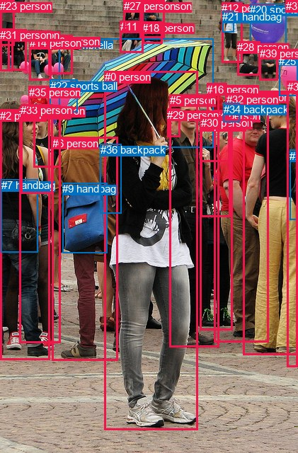
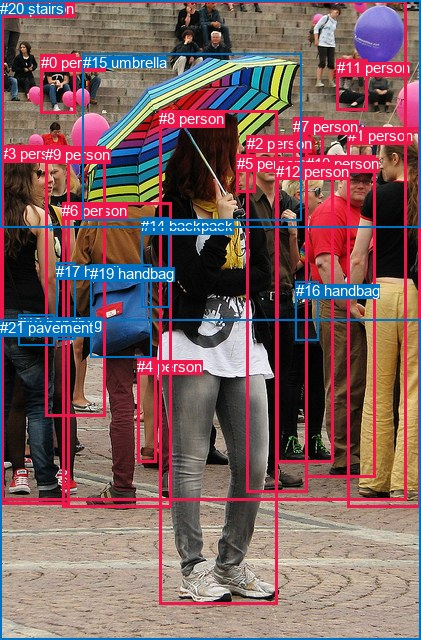

# 图片 0205：2321647.jpg

随机样本序号：348。图片 SHA256：`30df28745b0b675a6b7d00556dd516a4ad5afacb9a7a92bbb4fa638ea9753274`。

红色框表示人，蓝色框表示其他物体。两个模式分别保留自身框编号，可依据位置比较对应对象。

## 自动检测框与输出

人的框编号：`[0, 2, 3, 4, 5, 6, 8, 10, 11, 12, 13, 14, 15, 16, 17, 18, 19, 23, 26, 27, 28, 29, 30, 31, 32, 33, 35, 37, 38, 39]`。状态：`ok`。

### 自动检测全部物体框

| 编号 | 类别 | 是否为人 | 检测分数 | 像素坐标 xyxy |
|---|---|---|---|---|
| 0 | person | True | 0.9988 | 147.8, 100.4, 279.7, 607.4 |
| 1 | umbrella | False | 0.9964 | 83.8, 54.5, 301.1, 208.1 |
| 2 | person | True | 0.9955 | 0.0, 154.8, 70.1, 508.2 |
| 3 | person | True | 0.9947 | 343.8, 129.0, 421.0, 501.5 |
| 4 | person | True | 0.9923 | 302.9, 155.3, 379.2, 483.5 |
| 5 | person | True | 0.9773 | 240.0, 133.0, 309.4, 490.9 |
| 6 | person | True | 0.9567 | 73.7, 193.9, 166.2, 509.9 |
| 7 | handbag | False | 0.9448 | 1.8, 253.5, 53.8, 356.7 |
| 8 | person | True | 0.9053 | 282.4, 168.4, 328.9, 466.4 |
| 9 | handbag | False | 0.8840 | 88.2, 258.4, 151.9, 357.8 |
| 10 | person | True | 0.8779 | 47.3, 148.2, 85.3, 236.1 |
| 11 | person | True | 0.8734 | 169.7, 29.5, 202.5, 74.7 |
| 12 | person | True | 0.8547 | 313.5, 3.1, 342.4, 88.3 |
| 13 | person | True | 0.8462 | 68.1, 49.7, 102.1, 104.7 |
| 14 | person | True | 0.8457 | 41.7, 52.3, 72.7, 113.1 |
| 15 | person | True | 0.8348 | 27.4, 151.1, 85.2, 484.5 |
| 16 | person | True | 0.8286 | 292.3, 117.7, 320.1, 166.6 |
| 17 | person | True | 0.8278 | 282.5, 165.5, 324.8, 228.2 |
| 18 | person | True | 0.8141 | 201.5, 30.6, 229.1, 61.0 |
| 19 | person | True | 0.7961 | 197.7, 0.0, 232.6, 53.3 |
| 20 | sports ball | False | 0.7860 | 353.2, 5.1, 404.8, 66.2 |
| 21 | handbag | False | 0.7795 | 314.0, 15.4, 330.0, 45.6 |
| 22 | sports ball | False | 0.6479 | 70.7, 112.6, 110.0, 158.1 |
| 23 | person | True | 0.6316 | 0.0, 0.5, 20.9, 64.2 |
| 24 | handbag | False | 0.5940 | 409.0, 211.7, 420.9, 310.5 |
| 25 | umbrella | False | 0.5741 | 394.4, 78.0, 420.7, 135.9 |
| 26 | person | True | 0.5687 | 11.4, 41.1, 37.3, 99.6 |
| 27 | person | True | 0.5687 | 174.5, 0.2, 202.6, 46.8 |
| 28 | person | True | 0.5637 | 335.5, 58.1, 367.4, 106.6 |
| 29 | person | True | 0.5401 | 236.3, 153.8, 254.4, 193.1 |
| 30 | person | True | 0.5349 | 283.8, 165.3, 325.2, 306.3 |
| 31 | person | True | 0.5342 | 0.0, 40.7, 19.0, 100.3 |
| 32 | person | True | 0.5339 | 320.5, 132.0, 353.8, 181.1 |
| 33 | person | True | 0.5308 | 29.2, 147.3, 74.4, 273.1 |
| 34 | backpack | False | 0.5184 | 315.8, 145.6, 338.9, 172.3 |
| 35 | person | True | 0.5167 | 40.8, 121.9, 69.2, 150.1 |
| 36 | backpack | False | 0.5133 | 141.9, 203.0, 171.6, 301.2 |
| 37 | person | True | 0.5041 | 403.9, 0.1, 420.3, 9.4 |
| 38 | person | True | 0.4688 | 405.5, 114.5, 421.0, 518.6 |
| 39 | person | True | 0.4677 | 366.6, 66.8, 392.3, 113.2 |

### 自动检测 Top50 人相关候选

评分物体对：1560；人相关物体对：1470；输出关系：50。

| 排名 | 主语编号与类别 | 关系 | 宾语编号与类别 | 类型 | 人与人 | 排序分数 | 原始融合 logit |
|---|---|---|---|---|---|---|---|
| 1 | #0 person | holding | #1 umbrella | semantic | False | 0.99376 | 5.0707 |
| 2 | #38 person | wearing | #24 handbag | semantic | False | 0.99209 | 4.8319 |
| 3 | #2 person | wearing | #7 handbag | semantic | False | 0.99083 | 4.6821 |
| 4 | #20 sports ball | attached to | #28 person | spatial | False | 0.98390 | 4.1129 |
| 5 | #3 person | wearing | #24 handbag | semantic | False | 0.97763 | 3.7775 |
| 6 | #38 person | in | #24 handbag | spatial | False | 0.96640 | 3.3591 |
| 7 | #20 sports ball | attached to | #39 person | spatial | False | 0.96573 | 3.3385 |
| 8 | #12 person | wearing | #21 handbag | semantic | False | 0.96301 | 3.2593 |
| 9 | #20 sports ball | attached to | #37 person | spatial | False | 0.95978 | 3.1723 |
| 10 | #2 person | in | #7 handbag | spatial | False | 0.94703 | 2.8836 |
| 11 | #6 person | carrying | #9 handbag | semantic | False | 0.94647 | 2.8725 |
| 12 | #14 person | sitting on | #13 person | semantic | True | 0.94582 | 2.8598 |
| 13 | #26 person | sitting on | #31 person | semantic | True | 0.92362 | 2.4925 |
| 14 | #23 person | sitting on | #31 person | semantic | True | 0.91764 | 2.4107 |
| 15 | #19 person | wearing | #18 person | semantic | True | 0.90034 | 2.2010 |
| 16 | #12 person | in | #21 handbag | spatial | False | 0.89948 | 2.1914 |
| 17 | #3 person | in | #24 handbag | spatial | False | 0.89192 | 2.1105 |
| 18 | #19 person | in | #18 person | spatial | True | 0.87883 | 1.9814 |
| 19 | #8 person | holding | #17 person | semantic | True | 0.86906 | 1.8926 |
| 20 | #0 person | wearing | #36 backpack | semantic | False | 0.86636 | 1.8692 |
| 21 | #15 person | wearing | #7 handbag | semantic | False | 0.86239 | 1.8353 |
| 22 | #31 person | sitting on | #26 person | semantic | True | 0.86224 | 1.8340 |
| 23 | #28 person | holding | #20 sports ball | semantic | False | 0.86203 | 1.8322 |
| 24 | #29 person | holding | #1 umbrella | semantic | False | 0.85372 | 1.7641 |
| 25 | #27 person | in | #11 person | spatial | True | 0.84666 | 1.7087 |
| 26 | #6 person | wearing | #36 backpack | semantic | False | 0.83966 | 1.6557 |
| 27 | #28 person | on | #20 sports ball | spatial | False | 0.83108 | 1.5933 |
| 28 | #23 person | on | #31 person | spatial | True | 0.82633 | 1.5598 |
| 29 | #39 person | holding | #20 sports ball | semantic | False | 0.82225 | 1.5317 |
| 30 | #31 person | sitting on | #23 person | semantic | True | 0.81562 | 1.4869 |
| 31 | #0 person | in | #1 umbrella | spatial | False | 0.81270 | 1.4677 |
| 32 | #14 person | on | #13 person | spatial | True | 0.81140 | 1.4591 |
| 33 | #33 person | wearing | #7 handbag | semantic | False | 0.80387 | 1.4107 |
| 34 | #30 person | holding | #17 person | semantic | True | 0.79866 | 1.3779 |
| 35 | #39 person | in | #20 sports ball | spatial | False | 0.79555 | 1.3587 |
| 36 | #30 person | in | #17 person | spatial | True | 0.77803 | 1.2542 |
| 37 | #12 person | holding | #28 person | semantic | True | 0.77375 | 1.2296 |
| 38 | #0 person | wearing | #9 handbag | semantic | False | 0.76295 | 1.1689 |
| 39 | #5 person | looking at | #0 person | semantic | True | 0.75994 | 1.1523 |
| 40 | #39 person | on | #28 person | spatial | True | 0.74966 | 1.0968 |
| 41 | #11 person | holding | #27 person | semantic | True | 0.74482 | 1.0712 |
| 42 | #26 person | sitting on | #23 person | semantic | True | 0.74402 | 1.0670 |
| 43 | #27 person | sitting on | #11 person | semantic | True | 0.73093 | 0.9993 |
| 44 | #26 person | in | #31 person | spatial | True | 0.72948 | 0.9920 |
| 45 | #18 person | in | #19 person | spatial | True | 0.72878 | 0.9885 |
| 46 | #38 person | holding | #25 umbrella | semantic | False | 0.72465 | 0.9676 |
| 47 | #28 person | on | #39 person | spatial | True | 0.71726 | 0.9309 |
| 48 | #32 person | wearing | #34 backpack | semantic | False | 0.71502 | 0.9199 |
| 49 | #25 umbrella | attached to | #37 person | spatial | False | 0.71438 | 0.9168 |
| 50 | #23 person | sitting on | #26 person | semantic | True | 0.70543 | 0.8733 |

### 自动检测逐条人相关 GT 核验

R@50：16.67%；命中 1/6。

| GT 主语编号 | GT 关系 | GT 宾语编号 | 结果阶段 | 匹配预测主语编号 | 匹配预测宾语编号 |
|---|---|---|---|---|---|
| 2 | standing on | 21 | endpoint_missing_or_wrong_class | [5] | [] |
| 3 | carrying | 18 | endpoint_missing_or_wrong_class | [2] | [] |
| 8 | in front of | 2 | wrong_predicate | [0] | [5] |
| 8 | holding | 15 | hit50 | [0] | [1] |
| 8 | standing on | 21 | endpoint_missing_or_wrong_class | [0] | [] |
| 12 | carrying | 16 | endpoint_missing_or_wrong_class | [8] | [] |

## 真实框与输出

人的框编号：`[0, 1, 2, 3, 4, 5, 6, 7, 8, 9, 10, 11, 12, 13]`。

### 真实框全部物体框

| 编号 | 类别 | 是否为人 | 检测分数 | 像素坐标 xyxy |
|---|---|---|---|---|
| 0 | person | True | GT | 41.0, 54.0, 76.0, 113.0 |
| 1 | person | True | GT | 348.0, 127.0, 421.0, 507.0 |
| 2 | person | True | GT | 247.0, 135.0, 308.0, 493.0 |
| 3 | person | True | GT | 0.0, 145.0, 70.0, 504.0 |
| 4 | person | True | GT | 137.0, 358.0, 156.0, 463.0 |
| 5 | person | True | GT | 237.0, 155.0, 256.0, 193.0 |
| 6 | person | True | GT | 62.0, 202.0, 171.0, 507.0 |
| 7 | person | True | GT | 293.0, 118.0, 323.0, 160.0 |
| 8 | person | True | GT | 159.0, 110.0, 277.0, 604.0 |
| 9 | person | True | GT | 45.0, 146.0, 105.0, 416.0 |
| 10 | person | True | GT | 306.0, 155.0, 376.0, 477.0 |
| 11 | person | True | GT | 337.0, 59.0, 368.0, 111.0 |
| 12 | person | True | GT | 276.0, 163.0, 333.0, 463.0 |
| 13 | person | True | GT | 1.0, 0.0, 406.0, 500.0 |
| 14 | backpack | False | GT | 141.0, 217.0, 169.0, 307.0 |
| 15 | umbrella | False | GT | 83.0, 54.0, 301.0, 220.0 |
| 16 | handbag | False | GT | 296.0, 282.0, 319.0, 341.0 |
| 17 | handbag | False | GT | 56.0, 263.0, 75.0, 340.0 |
| 18 | handbag | False | GT | 18.0, 315.0, 55.0, 346.0 |
| 19 | handbag | False | GT | 90.0, 265.0, 151.0, 358.0 |
| 20 | stairs | False | GT | 0.0, 0.0, 421.0, 227.0 |
| 21 | pavement | False | GT | 0.0, 319.0, 421.0, 640.0 |

### 真实框 Top50 人相关候选

评分物体对：462；人相关物体对：406；输出关系：50。

| 排名 | 主语编号与类别 | 关系 | 宾语编号与类别 | 类型 | 人与人 | 排序分数 | 原始融合 logit |
|---|---|---|---|---|---|---|---|
| 1 | #8 person | holding | #15 umbrella | semantic | False | 0.99408 | 5.1242 |
| 2 | #0 person | sitting on | #20 stairs | semantic | False | 0.98329 | 4.0751 |
| 3 | #11 person | sitting on | #20 stairs | semantic | False | 0.98284 | 4.0480 |
| 4 | #6 person | carrying | #19 handbag | semantic | False | 0.97086 | 3.5062 |
| 5 | #3 person | holding | #18 handbag | semantic | False | 0.96833 | 3.4203 |
| 6 | #12 person | holding | #16 handbag | semantic | False | 0.96484 | 3.3120 |
| 7 | #1 person | standing on | #21 pavement | semantic | False | 0.95889 | 3.1494 |
| 8 | #0 person | on | #20 stairs | spatial | False | 0.95717 | 3.1067 |
| 9 | #2 person | standing on | #21 pavement | semantic | False | 0.95680 | 3.0979 |
| 10 | #11 person | on | #20 stairs | spatial | False | 0.95635 | 3.0868 |
| 11 | #10 person | standing on | #21 pavement | semantic | False | 0.95281 | 3.0053 |
| 12 | #9 person | holding | #17 handbag | semantic | False | 0.94698 | 2.8826 |
| 13 | #8 person | standing on | #21 pavement | semantic | False | 0.94244 | 2.7957 |
| 14 | #3 person | standing on | #21 pavement | semantic | False | 0.94215 | 2.7904 |
| 15 | #12 person | standing on | #21 pavement | semantic | False | 0.94150 | 2.7785 |
| 16 | #13 person | standing on | #21 pavement | semantic | False | 0.93917 | 2.7368 |
| 17 | #2 person | talking to | #5 person | semantic | True | 0.93620 | 2.6861 |
| 18 | #9 person | standing on | #21 pavement | semantic | False | 0.92904 | 2.5720 |
| 19 | #13 person | holding | #15 umbrella | semantic | False | 0.92567 | 2.5220 |
| 20 | #0 person | sitting on | #13 person | semantic | True | 0.92391 | 2.4967 |
| 21 | #3 person | holding | #17 handbag | semantic | False | 0.92027 | 2.4460 |
| 22 | #5 person | holding | #15 umbrella | semantic | False | 0.91230 | 2.3421 |
| 23 | #6 person | standing on | #21 pavement | semantic | False | 0.91195 | 2.3377 |
| 24 | #11 person | sitting on | #13 person | semantic | True | 0.91169 | 2.3345 |
| 25 | #2 person | holding | #16 handbag | semantic | False | 0.89428 | 2.1352 |
| 26 | #7 person | sitting on | #20 stairs | semantic | False | 0.89024 | 2.0932 |
| 27 | #20 stairs | in | #13 person | spatial | False | 0.88469 | 2.0377 |
| 28 | #6 person | wearing | #14 backpack | semantic | False | 0.87041 | 1.9046 |
| 29 | #6 person | wearing | #4 person | semantic | True | 0.86755 | 1.8794 |
| 30 | #10 person | holding | #16 handbag | semantic | False | 0.86600 | 1.8660 |
| 31 | #8 person | on | #21 pavement | spatial | False | 0.86276 | 1.8384 |
| 32 | #19 handbag | hanging from | #6 person | spatial | False | 0.84097 | 1.6655 |
| 33 | #8 person | talking to | #5 person | semantic | True | 0.83851 | 1.6472 |
| 34 | #13 person | on | #21 pavement | spatial | False | 0.83676 | 1.6343 |
| 35 | #18 handbag | on | #3 person | spatial | False | 0.82324 | 1.5384 |
| 36 | #3 person | in | #18 handbag | spatial | False | 0.81932 | 1.5118 |
| 37 | #8 person | in | #15 umbrella | spatial | False | 0.80496 | 1.4176 |
| 38 | #0 person | in | #13 person | spatial | True | 0.80052 | 1.3896 |
| 39 | #13 person | in | #20 stairs | spatial | False | 0.79419 | 1.3504 |
| 40 | #2 person | looking at | #8 person | semantic | True | 0.75516 | 1.1263 |
| 41 | #7 person | on | #20 stairs | spatial | False | 0.74216 | 1.0572 |
| 42 | #11 person | on | #13 person | spatial | True | 0.72875 | 0.9883 |
| 43 | #9 person | holding | #18 handbag | semantic | False | 0.72639 | 0.9764 |
| 44 | #12 person | in | #16 handbag | spatial | False | 0.70287 | 0.8610 |
| 45 | #20 stairs | sitting on | #13 person | semantic | False | 0.68571 | 0.7801 |
| 46 | #1 person | on | #21 pavement | spatial | False | 0.67880 | 0.7483 |
| 47 | #9 person | in | #17 handbag | spatial | False | 0.66607 | 0.6905 |
| 48 | #14 backpack | on | #6 person | spatial | False | 0.66529 | 0.6870 |
| 49 | #12 person | talking to | #2 person | semantic | True | 0.66422 | 0.6821 |
| 50 | #10 person | standing on | #13 person | semantic | True | 0.65694 | 0.6497 |

### 真实框逐条人相关 GT 核验

R@50：50.00%；命中 3/6。

| GT 主语编号 | GT 关系 | GT 宾语编号 | 结果阶段 | 匹配预测主语编号 | 匹配预测宾语编号 |
|---|---|---|---|---|---|
| 2 | standing on | 21 | hit50 | [2] | [21] |
| 3 | carrying | 18 | wrong_predicate | [3] | [18] |
| 8 | in front of | 2 | wrong_predicate | [8] | [2] |
| 8 | holding | 15 | hit50 | [8] | [15] |
| 8 | standing on | 21 | hit50 | [8] | [21] |
| 12 | carrying | 16 | wrong_predicate | [12] | [16] |

## 全部人相关 GT

| 主语编号与类别 | 关系 | 宾语编号与类别 |
|---|---|---|
| #2 person | standing on | #21 pavement |
| #3 person | carrying | #18 handbag |
| #8 person | in front of | #2 person |
| #8 person | holding | #15 umbrella |
| #8 person | standing on | #21 pavement |
| #12 person | carrying | #16 handbag |

原始记录、全部人相关物体对的两项预测与分项分数见 [逐图证据 JSON](../evidence/cases/0205.json)。全部56类 logits 保留于本机 HOR/output/random500/logits/。

<!-- HOR_COMPLETE_RESULTS -->

## 六组条件的完整输出对照

以下保留同一图片三种框与候选模式、两种谓词输出规则的全部 Top50。框编号各自在所属模式内解释。

### 自动检测框完整枚举：空间与语义各保留一个谓词

| 排名 | 主语编号与类别 | 谓词 | 宾语编号与类别 | 分组 | 排序分数 | predicate logit | pair logit |
|---|---|---|---|---|---|---|---|
| 1 | #0 person | holding | #1 umbrella | semantic | 0.9937611 | 4.3290286 | 0.7416756 |
| 2 | #38 person | wearing | #24 handbag | semantic | 0.9920914 | 4.1179748 | 0.7138893 |
| 3 | #2 person | wearing | #7 handbag | semantic | 0.9908257 | 4.0901380 | 0.5919926 |
| 4 | #20 sports ball | attached to | #28 person | spatial | 0.9839029 | 4.0859170 | 0.0269754 |
| 5 | #3 person | wearing | #24 handbag | semantic | 0.9776312 | 3.1622801 | 0.6151816 |
| 6 | #38 person | in | #24 handbag | spatial | 0.9664018 | 2.6452155 | 0.7138893 |
| 7 | #20 sports ball | attached to | #39 person | spatial | 0.9657274 | 3.2625728 | 0.0759633 |
| 8 | #12 person | wearing | #21 handbag | semantic | 0.9630055 | 3.1813865 | 0.0779047 |
| 9 | #20 sports ball | attached to | #37 person | spatial | 0.9597782 | 2.9162545 | 0.2560382 |
| 10 | #2 person | in | #7 handbag | spatial | 0.9470318 | 2.2916489 | 0.5919926 |
| 11 | #6 person | carrying | #9 handbag | semantic | 0.9464697 | 3.1269655 | -0.2544741 |
| 12 | #14 person | sitting on | #13 person | semantic | 0.9458213 | 2.9823627 | -0.1225972 |
| 13 | #26 person | sitting on | #31 person | semantic | 0.9236158 | 2.3835425 | 0.1089774 |
| 14 | #23 person | sitting on | #31 person | semantic | 0.9176365 | 2.0946469 | 0.3160124 |
| 15 | #19 person | wearing | #18 person | semantic | 0.9003419 | 2.2130589 | -0.0120297 |
| 16 | #12 person | in | #21 handbag | spatial | 0.8994777 | 2.1135292 | 0.0779047 |
| 17 | #3 person | in | #24 handbag | spatial | 0.8919210 | 1.4953337 | 0.6151816 |
| 18 | #19 person | in | #18 person | spatial | 0.8788257 | 1.9933863 | -0.0120297 |
| 19 | #8 person | holding | #17 person | semantic | 0.8690551 | 1.9267483 | -0.0341188 |
| 20 | #0 person | wearing | #36 backpack | semantic | 0.8663614 | 2.1545258 | -0.2853621 |
| 21 | #15 person | wearing | #7 handbag | semantic | 0.8623936 | 1.6386099 | 0.1967038 |
| 22 | #31 person | sitting on | #26 person | semantic | 0.8622359 | 1.7696676 | 0.0643187 |
| 23 | #28 person | holding | #20 sports ball | semantic | 0.8620251 | 1.7183051 | 0.1139081 |
| 24 | #29 person | holding | #1 umbrella | semantic | 0.8537163 | 2.2606268 | -0.4965753 |
| 25 | #27 person | in | #11 person | spatial | 0.8466632 | 1.7537699 | -0.0451034 |
| 26 | #6 person | wearing | #36 backpack | semantic | 0.8396598 | 1.8924336 | -0.2367342 |
| 27 | #28 person | on | #20 sports ball | spatial | 0.8310819 | 1.4794064 | 0.1139081 |
| 28 | #23 person | on | #31 person | spatial | 0.8263309 | 1.2438312 | 0.3160124 |
| 29 | #39 person | holding | #20 sports ball | semantic | 0.8222488 | 1.4421248 | 0.0895333 |
| 30 | #31 person | sitting on | #23 person | semantic | 0.8156194 | 1.3453383 | 0.1416075 |
| 31 | #0 person | in | #1 umbrella | spatial | 0.8127027 | 0.7259927 | 0.7416756 |
| 32 | #14 person | on | #13 person | spatial | 0.8113997 | 1.5817280 | -0.1225972 |
| 33 | #33 person | wearing | #7 handbag | semantic | 0.8038736 | 1.5519495 | -0.1412672 |
| 34 | #30 person | holding | #17 person | semantic | 0.7986568 | 1.4116940 | -0.0337737 |
| 35 | #39 person | in | #20 sports ball | spatial | 0.7955527 | 1.2691936 | 0.0895333 |
| 36 | #30 person | in | #17 person | spatial | 0.7780328 | 1.2880130 | -0.0337737 |
| 37 | #12 person | holding | #28 person | semantic | 0.7737488 | 1.2126622 | 0.0169389 |
| 38 | #0 person | wearing | #9 handbag | semantic | 0.7629467 | 1.4476848 | -0.2787816 |
| 39 | #5 person | looking at | #0 person | semantic | 0.7599382 | 2.0372920 | -0.8849509 |
| 40 | #39 person | on | #28 person | spatial | 0.7496564 | 1.0139909 | 0.0827899 |
| 41 | #11 person | holding | #27 person | semantic | 0.7448213 | 1.4353280 | -0.3641480 |
| 42 | #26 person | sitting on | #23 person | semantic | 0.7440250 | 0.9300857 | 0.1369091 |
| 43 | #27 person | sitting on | #11 person | semantic | 0.7309285 | 1.0444417 | -0.0451034 |
| 44 | #26 person | in | #31 person | spatial | 0.7294794 | 0.8830056 | 0.1089774 |
| 45 | #18 person | in | #19 person | spatial | 0.7287828 | 1.2342453 | -0.2457895 |
| 46 | #38 person | holding | #25 umbrella | semantic | 0.7246470 | 1.0714087 | -0.1037776 |
| 47 | #28 person | on | #39 person | spatial | 0.7172598 | 0.8162403 | 0.1146692 |
| 48 | #32 person | wearing | #34 backpack | semantic | 0.7150174 | 0.8920512 | 0.0278275 |
| 49 | #25 umbrella | attached to | #37 person | spatial | 0.7143797 | 0.6337533 | 0.2829977 |
| 50 | #23 person | sitting on | #26 person | semantic | 0.7054281 | 0.6231484 | 0.2501333 |

GT 命中：1/6，R@50=16.67%。

| GT主语 | GT谓词 | GT宾语 | 结果阶段 | 匹配主语框 | 匹配宾语框 |
|---|---|---|---|---|---|
| 2 | standing on | 21 | endpoint_missing_or_wrong_class | [5] | [] |
| 3 | carrying | 18 | endpoint_missing_or_wrong_class | [2] | [] |
| 8 | in front of | 2 | wrong_predicate | [0] | [5] |
| 8 | holding | 15 | hit50 | [0] | [1] |
| 8 | standing on | 21 | endpoint_missing_or_wrong_class | [0] | [] |
| 12 | carrying | 16 | endpoint_missing_or_wrong_class | [8] | [] |

### 自动检测框完整枚举：每对只保留一个谓词

| 排名 | 主语编号与类别 | 谓词 | 宾语编号与类别 | 分组 | 排序分数 | predicate logit | pair logit |
|---|---|---|---|---|---|---|---|
| 1 | #0 person | holding | #1 umbrella | single | 0.9937611 | 4.3290286 | 0.7416756 |
| 2 | #38 person | wearing | #24 handbag | single | 0.9920914 | 4.1179748 | 0.7138893 |
| 3 | #2 person | wearing | #7 handbag | single | 0.9908257 | 4.0901380 | 0.5919926 |
| 4 | #20 sports ball | attached to | #28 person | single | 0.9839029 | 4.0859170 | 0.0269754 |
| 5 | #3 person | wearing | #24 handbag | single | 0.9776312 | 3.1622801 | 0.6151816 |
| 6 | #20 sports ball | attached to | #39 person | single | 0.9657274 | 3.2625728 | 0.0759633 |
| 7 | #12 person | wearing | #21 handbag | single | 0.9630055 | 3.1813865 | 0.0779047 |
| 8 | #20 sports ball | attached to | #37 person | single | 0.9597782 | 2.9162545 | 0.2560382 |
| 9 | #6 person | carrying | #9 handbag | single | 0.9464697 | 3.1269655 | -0.2544741 |
| 10 | #14 person | sitting on | #13 person | single | 0.9458213 | 2.9823627 | -0.1225972 |
| 11 | #26 person | sitting on | #31 person | single | 0.9236158 | 2.3835425 | 0.1089774 |
| 12 | #23 person | sitting on | #31 person | single | 0.9176365 | 2.0946469 | 0.3160124 |
| 13 | #19 person | wearing | #18 person | single | 0.9003419 | 2.2130589 | -0.0120297 |
| 14 | #8 person | holding | #17 person | single | 0.8690551 | 1.9267483 | -0.0341188 |
| 15 | #0 person | wearing | #36 backpack | single | 0.8663614 | 2.1545258 | -0.2853621 |
| 16 | #15 person | wearing | #7 handbag | single | 0.8623936 | 1.6386099 | 0.1967038 |
| 17 | #31 person | sitting on | #26 person | single | 0.8622359 | 1.7696676 | 0.0643187 |
| 18 | #28 person | holding | #20 sports ball | single | 0.8620251 | 1.7183051 | 0.1139081 |
| 19 | #29 person | holding | #1 umbrella | single | 0.8537163 | 2.2606268 | -0.4965753 |
| 20 | #27 person | in | #11 person | single | 0.8466632 | 1.7537699 | -0.0451034 |
| 21 | #6 person | wearing | #36 backpack | single | 0.8396598 | 1.8924336 | -0.2367342 |
| 22 | #39 person | holding | #20 sports ball | single | 0.8222488 | 1.4421248 | 0.0895333 |
| 23 | #31 person | sitting on | #23 person | single | 0.8156194 | 1.3453383 | 0.1416075 |
| 24 | #33 person | wearing | #7 handbag | single | 0.8038736 | 1.5519495 | -0.1412672 |
| 25 | #30 person | holding | #17 person | single | 0.7986568 | 1.4116940 | -0.0337737 |
| 26 | #12 person | holding | #28 person | single | 0.7737488 | 1.2126622 | 0.0169389 |
| 27 | #0 person | wearing | #9 handbag | single | 0.7629467 | 1.4476848 | -0.2787816 |
| 28 | #5 person | looking at | #0 person | single | 0.7599382 | 2.0372920 | -0.8849509 |
| 29 | #39 person | on | #28 person | single | 0.7496564 | 1.0139909 | 0.0827899 |
| 30 | #11 person | holding | #27 person | single | 0.7448213 | 1.4353280 | -0.3641480 |
| 31 | #26 person | sitting on | #23 person | single | 0.7440250 | 0.9300857 | 0.1369091 |
| 32 | #18 person | in | #19 person | single | 0.7287828 | 1.2342453 | -0.2457895 |
| 33 | #38 person | holding | #25 umbrella | single | 0.7246470 | 1.0714087 | -0.1037776 |
| 34 | #28 person | on | #39 person | single | 0.7172598 | 0.8162403 | 0.1146692 |
| 35 | #32 person | wearing | #34 backpack | single | 0.7150174 | 0.8920512 | 0.0278275 |
| 36 | #25 umbrella | attached to | #37 person | single | 0.7143797 | 0.6337533 | 0.2829977 |
| 37 | #23 person | sitting on | #26 person | single | 0.7054281 | 0.6231484 | 0.2501333 |
| 38 | #28 person | in | #37 person | single | 0.7011425 | 0.6850758 | 0.1676686 |
| 39 | #9 handbag | on | #6 person | single | 0.7007083 | 2.0044813 | -1.1538082 |
| 40 | #25 umbrella | beside | #39 person | single | 0.6919717 | 0.7043004 | 0.1050529 |
| 41 | #33 person | wearing | #35 person | single | 0.6691920 | 0.8194542 | -0.1149211 |
| 42 | #15 person | in | #33 person | single | 0.6618135 | 0.9364295 | -0.2650431 |
| 43 | #10 person | wearing | #35 person | single | 0.6546767 | 0.6389065 | 0.0007539 |
| 44 | #21 handbag | on | #12 person | single | 0.6528915 | 0.8939438 | -0.2621702 |
| 45 | #8 person | holding | #30 person | single | 0.6523294 | 0.8864694 | -0.2571749 |
| 46 | #10 person | holding | #22 sports ball | single | 0.6426682 | 1.0202584 | -0.4332944 |
| 47 | #5 person | talking to | #29 person | single | 0.6305960 | 0.6552300 | -0.1204557 |
| 48 | #14 person | sitting on | #26 person | single | 0.6299347 | 0.8097363 | -0.2777995 |
| 49 | #39 person | in | #37 person | single | 0.6279711 | 0.3638048 | 0.1597179 |
| 50 | #27 person | talking to | #19 person | single | 0.6255251 | 0.7180386 | -0.2049718 |

GT 命中：1/6，R@50=16.67%。

| GT主语 | GT谓词 | GT宾语 | 结果阶段 | 匹配主语框 | 匹配宾语框 |
|---|---|---|---|---|---|
| 2 | standing on | 21 | endpoint_missing_or_wrong_class | [5] | [] |
| 3 | carrying | 18 | endpoint_missing_or_wrong_class | [2] | [] |
| 8 | in front of | 2 | wrong_predicate | [0] | [5] |
| 8 | holding | 15 | hit50 | [0] | [1] |
| 8 | standing on | 21 | endpoint_missing_or_wrong_class | [0] | [] |
| 12 | carrying | 16 | endpoint_missing_or_wrong_class | [8] | [] |

### 真实框完整枚举：空间与语义各保留一个谓词

| 排名 | 主语编号与类别 | 谓词 | 宾语编号与类别 | 分组 | 排序分数 | predicate logit | pair logit |
|---|---|---|---|---|---|---|---|
| 1 | #8 person | holding | #15 umbrella | semantic | 0.9940844 | 4.3822045 | 0.7420182 |
| 2 | #0 person | sitting on | #20 stairs | semantic | 0.9832932 | 3.9242845 | 0.1508076 |
| 3 | #11 person | sitting on | #20 stairs | semantic | 0.9828420 | 3.9543605 | 0.0936285 |
| 4 | #6 person | carrying | #19 handbag | semantic | 0.9708637 | 3.8118739 | -0.3056724 |
| 5 | #3 person | holding | #18 handbag | semantic | 0.9683318 | 2.9743733 | 0.4458902 |
| 6 | #12 person | holding | #16 handbag | semantic | 0.9648395 | 3.2162008 | 0.0958373 |
| 7 | #1 person | standing on | #21 pavement | semantic | 0.9588862 | 3.5707784 | -0.4213506 |
| 8 | #0 person | on | #20 stairs | spatial | 0.9571699 | 2.9559326 | 0.1508076 |
| 9 | #2 person | standing on | #21 pavement | semantic | 0.9568050 | 3.5018220 | -0.4039462 |
| 10 | #11 person | on | #20 stairs | spatial | 0.9563452 | 2.9931774 | 0.0936285 |
| 11 | #10 person | standing on | #21 pavement | semantic | 0.9528137 | 3.4577575 | -0.4524411 |
| 12 | #9 person | holding | #17 handbag | semantic | 0.9469818 | 2.7336431 | 0.1490008 |
| 13 | #8 person | standing on | #21 pavement | semantic | 0.9424423 | 3.1892786 | -0.3935918 |
| 14 | #3 person | standing on | #21 pavement | semantic | 0.9421538 | 3.1274676 | -0.3370883 |
| 15 | #12 person | standing on | #21 pavement | semantic | 0.9415014 | 3.2464042 | -0.4679304 |
| 16 | #13 person | standing on | #21 pavement | semantic | 0.9391652 | 3.3345332 | -0.5977033 |
| 17 | #2 person | talking to | #5 person | semantic | 0.9361989 | 2.7795787 | -0.0935209 |
| 18 | #9 person | standing on | #21 pavement | semantic | 0.9290403 | 2.9675241 | -0.3954838 |
| 19 | #13 person | holding | #15 umbrella | semantic | 0.9256715 | 2.8801770 | -0.3581531 |
| 20 | #0 person | sitting on | #13 person | semantic | 0.9239091 | 2.6935315 | -0.1968462 |
| 21 | #3 person | holding | #17 handbag | semantic | 0.9202673 | 2.2492290 | 0.1967556 |
| 22 | #5 person | holding | #15 umbrella | semantic | 0.9123007 | 2.8779812 | -0.5359254 |
| 23 | #6 person | standing on | #21 pavement | semantic | 0.9119496 | 3.0438242 | -0.7061483 |
| 24 | #11 person | sitting on | #13 person | semantic | 0.9116905 | 2.6212678 | -0.2868150 |
| 25 | #2 person | holding | #16 handbag | semantic | 0.8942788 | 2.1498823 | -0.0146700 |
| 26 | #7 person | sitting on | #20 stairs | semantic | 0.8902411 | 2.4437566 | -0.3505509 |
| 27 | #20 stairs | in | #13 person | spatial | 0.8846945 | 2.5305977 | -0.4929402 |
| 28 | #6 person | wearing | #14 backpack | semantic | 0.8704138 | 2.1969590 | -0.2923368 |
| 29 | #6 person | wearing | #4 person | semantic | 0.8675466 | 1.7786884 | 0.1007494 |
| 30 | #10 person | holding | #16 handbag | semantic | 0.8659974 | 1.8331017 | 0.0329213 |
| 31 | #8 person | on | #21 pavement | spatial | 0.8627609 | 2.2320051 | -0.3935918 |
| 32 | #19 handbag | hanging from | #6 person | spatial | 0.8409703 | 2.8255343 | -1.1600688 |
| 33 | #8 person | talking to | #5 person | semantic | 0.8385116 | 1.8542528 | -0.2070574 |
| 34 | #13 person | on | #21 pavement | spatial | 0.8367581 | 2.2320051 | -0.5977033 |
| 35 | #18 handbag | on | #3 person | spatial | 0.8232363 | 2.0910192 | -0.5525893 |
| 36 | #3 person | in | #18 handbag | spatial | 0.8193205 | 1.0658603 | 0.4458902 |
| 37 | #8 person | in | #15 umbrella | spatial | 0.8049559 | 0.6755433 | 0.7420182 |
| 38 | #0 person | in | #13 person | spatial | 0.8005204 | 1.5863962 | -0.1968462 |
| 39 | #13 person | in | #20 stairs | spatial | 0.7941931 | 1.8336220 | -0.4832340 |
| 40 | #2 person | looking at | #8 person | semantic | 0.7551633 | 2.0085945 | -0.8822517 |
| 41 | #7 person | on | #20 stairs | spatial | 0.7421613 | 1.4077835 | -0.3505509 |
| 42 | #11 person | on | #13 person | spatial | 0.7287453 | 1.2750812 | -0.2868150 |
| 43 | #9 person | holding | #18 handbag | semantic | 0.7263880 | 1.0595918 | -0.0832186 |
| 44 | #12 person | in | #16 handbag | spatial | 0.7028710 | 0.7651696 | 0.0958373 |
| 45 | #20 stairs | sitting on | #13 person | semantic | 0.6857091 | 1.2730746 | -0.4929402 |
| 46 | #1 person | on | #21 pavement | spatial | 0.6788037 | 1.1696305 | -0.4213506 |
| 47 | #9 person | in | #17 handbag | spatial | 0.6660737 | 0.5414791 | 0.1490008 |
| 48 | #14 backpack | on | #6 person | spatial | 0.6652910 | 1.9053168 | -1.2183535 |
| 49 | #12 person | talking to | #2 person | semantic | 0.6642170 | 1.5223742 | -0.8402304 |
| 50 | #10 person | standing on | #13 person | semantic | 0.6569388 | 1.3725882 | -0.7229061 |

GT 命中：3/6，R@50=50.00%。

| GT主语 | GT谓词 | GT宾语 | 结果阶段 | 匹配主语框 | 匹配宾语框 |
|---|---|---|---|---|---|
| 2 | standing on | 21 | hit50 | [2] | [21] |
| 3 | carrying | 18 | wrong_predicate | [3] | [18] |
| 8 | in front of | 2 | wrong_predicate | [8] | [2] |
| 8 | holding | 15 | hit50 | [8] | [15] |
| 8 | standing on | 21 | hit50 | [8] | [21] |
| 12 | carrying | 16 | wrong_predicate | [12] | [16] |

### 真实框完整枚举：每对只保留一个谓词

| 排名 | 主语编号与类别 | 谓词 | 宾语编号与类别 | 分组 | 排序分数 | predicate logit | pair logit |
|---|---|---|---|---|---|---|---|
| 1 | #8 person | holding | #15 umbrella | single | 0.9940844 | 4.3822045 | 0.7420182 |
| 2 | #0 person | sitting on | #20 stairs | single | 0.9832932 | 3.9242845 | 0.1508076 |
| 3 | #11 person | sitting on | #20 stairs | single | 0.9828420 | 3.9543605 | 0.0936285 |
| 4 | #6 person | carrying | #19 handbag | single | 0.9708637 | 3.8118739 | -0.3056724 |
| 5 | #3 person | holding | #18 handbag | single | 0.9683318 | 2.9743733 | 0.4458902 |
| 6 | #12 person | holding | #16 handbag | single | 0.9648395 | 3.2162008 | 0.0958373 |
| 7 | #1 person | standing on | #21 pavement | single | 0.9588862 | 3.5707784 | -0.4213506 |
| 8 | #2 person | standing on | #21 pavement | single | 0.9568050 | 3.5018220 | -0.4039462 |
| 9 | #10 person | standing on | #21 pavement | single | 0.9528137 | 3.4577575 | -0.4524411 |
| 10 | #9 person | holding | #17 handbag | single | 0.9469818 | 2.7336431 | 0.1490008 |
| 11 | #8 person | standing on | #21 pavement | single | 0.9424423 | 3.1892786 | -0.3935918 |
| 12 | #3 person | standing on | #21 pavement | single | 0.9421538 | 3.1274676 | -0.3370883 |
| 13 | #12 person | standing on | #21 pavement | single | 0.9415014 | 3.2464042 | -0.4679304 |
| 14 | #13 person | standing on | #21 pavement | single | 0.9391652 | 3.3345332 | -0.5977033 |
| 15 | #2 person | talking to | #5 person | single | 0.9361989 | 2.7795787 | -0.0935209 |
| 16 | #9 person | standing on | #21 pavement | single | 0.9290403 | 2.9675241 | -0.3954838 |
| 17 | #13 person | holding | #15 umbrella | single | 0.9256715 | 2.8801770 | -0.3581531 |
| 18 | #0 person | sitting on | #13 person | single | 0.9239091 | 2.6935315 | -0.1968462 |
| 19 | #3 person | holding | #17 handbag | single | 0.9202673 | 2.2492290 | 0.1967556 |
| 20 | #5 person | holding | #15 umbrella | single | 0.9123007 | 2.8779812 | -0.5359254 |
| 21 | #6 person | standing on | #21 pavement | single | 0.9119496 | 3.0438242 | -0.7061483 |
| 22 | #11 person | sitting on | #13 person | single | 0.9116905 | 2.6212678 | -0.2868150 |
| 23 | #2 person | holding | #16 handbag | single | 0.8942788 | 2.1498823 | -0.0146700 |
| 24 | #7 person | sitting on | #20 stairs | single | 0.8902411 | 2.4437566 | -0.3505509 |
| 25 | #20 stairs | in | #13 person | single | 0.8846945 | 2.5305977 | -0.4929402 |
| 26 | #6 person | wearing | #14 backpack | single | 0.8704138 | 2.1969590 | -0.2923368 |
| 27 | #6 person | wearing | #4 person | single | 0.8675466 | 1.7786884 | 0.1007494 |
| 28 | #10 person | holding | #16 handbag | single | 0.8659974 | 1.8331017 | 0.0329213 |
| 29 | #19 handbag | hanging from | #6 person | single | 0.8409703 | 2.8255343 | -1.1600688 |
| 30 | #8 person | talking to | #5 person | single | 0.8385116 | 1.8542528 | -0.2070574 |
| 31 | #18 handbag | on | #3 person | single | 0.8232363 | 2.0910192 | -0.5525893 |
| 32 | #13 person | in | #20 stairs | single | 0.7941931 | 1.8336220 | -0.4832340 |
| 33 | #2 person | looking at | #8 person | single | 0.7551633 | 2.0085945 | -0.8822517 |
| 34 | #9 person | holding | #18 handbag | single | 0.7263880 | 1.0595918 | -0.0832186 |
| 35 | #14 backpack | on | #6 person | single | 0.6652910 | 1.9053168 | -1.2183535 |
| 36 | #12 person | talking to | #2 person | single | 0.6642170 | 1.5223742 | -0.8402304 |
| 37 | #10 person | standing on | #13 person | single | 0.6569388 | 1.3725882 | -0.7229061 |
| 38 | #2 person | talking to | #12 person | single | 0.6222624 | 1.4603157 | -0.9611539 |
| 39 | #9 person | carrying | #19 handbag | single | 0.6199832 | 1.1213374 | -0.6318604 |
| 40 | #12 person | looking at | #8 person | single | 0.6143624 | 1.4057240 | -0.9400374 |
| 41 | #2 person | standing on | #13 person | single | 0.6010752 | 0.9623270 | -0.5523800 |
| 42 | #6 person | standing on | #13 person | single | 0.5952783 | 1.0826917 | -0.6968623 |
| 43 | #8 person | wearing | #14 backpack | single | 0.5885959 | 0.7174444 | -0.3592803 |
| 44 | #4 person | standing on | #21 pavement | single | 0.5638534 | 1.4513297 | -1.1945140 |
| 45 | #9 person | standing on | #13 person | single | 0.5523361 | 0.6321373 | -0.4220234 |
| 46 | #16 handbag | on | #12 person | single | 0.5494372 | 1.0590258 | -0.8606288 |
| 47 | #9 person | looking at | #8 person | single | 0.5391017 | 1.2535243 | -1.0967978 |
| 48 | #6 person | holding | #17 handbag | single | 0.5137935 | 0.3728523 | -0.3176646 |
| 49 | #10 person | looking at | #8 person | single | 0.5053221 | 1.0981874 | -1.0768981 |
| 50 | #1 person | standing on | #13 person | single | 0.5003008 | 0.7150669 | -0.7138637 |

GT 命中：3/6，R@50=50.00%。

| GT主语 | GT谓词 | GT宾语 | 结果阶段 | 匹配主语框 | 匹配宾语框 |
|---|---|---|---|---|---|
| 2 | standing on | 21 | hit50 | [2] | [21] |
| 3 | carrying | 18 | wrong_predicate | [3] | [18] |
| 8 | in front of | 2 | wrong_predicate | [8] | [2] |
| 8 | holding | 15 | hit50 | [8] | [15] |
| 8 | standing on | 21 | hit50 | [8] | [21] |
| 12 | carrying | 16 | wrong_predicate | [12] | [16] |

### 真实框400候选：空间与语义各保留一个谓词

| 排名 | 主语编号与类别 | 谓词 | 宾语编号与类别 | 分组 | 排序分数 | predicate logit | pair logit |
|---|---|---|---|---|---|---|---|
| 1 | #8 person | holding | #15 umbrella | semantic | 0.9941190 | 4.3881125 | 0.7420182 |
| 2 | #0 person | sitting on | #20 stairs | semantic | 0.9832932 | 3.9242845 | 0.1508076 |
| 3 | #11 person | sitting on | #20 stairs | semantic | 0.9831440 | 3.9724174 | 0.0936285 |
| 4 | #6 person | carrying | #19 handbag | semantic | 0.9723939 | 3.8673959 | -0.3056724 |
| 5 | #3 person | holding | #18 handbag | semantic | 0.9683318 | 2.9743733 | 0.4458902 |
| 6 | #12 person | holding | #16 handbag | semantic | 0.9664438 | 3.2645664 | 0.0958373 |
| 7 | #1 person | standing on | #21 pavement | semantic | 0.9622754 | 3.6603379 | -0.4213506 |
| 8 | #2 person | standing on | #21 pavement | semantic | 0.9595114 | 3.5693498 | -0.4039462 |
| 9 | #10 person | standing on | #21 pavement | semantic | 0.9563755 | 3.5399728 | -0.4524411 |
| 10 | #0 person | on | #20 stairs | spatial | 0.9551029 | 2.9066401 | 0.1508076 |
| 11 | #11 person | on | #20 stairs | spatial | 0.9547136 | 2.9547749 | 0.0936285 |
| 12 | #9 person | holding | #17 handbag | semantic | 0.9493582 | 2.7820086 | 0.1490008 |
| 13 | #3 person | standing on | #21 pavement | semantic | 0.9457259 | 3.1949940 | -0.3370883 |
| 14 | #8 person | standing on | #21 pavement | semantic | 0.9456213 | 3.2494612 | -0.3935918 |
| 15 | #12 person | standing on | #21 pavement | semantic | 0.9451116 | 3.3139300 | -0.4679304 |
| 16 | #13 person | standing on | #21 pavement | semantic | 0.9433048 | 3.4094043 | -0.5977033 |
| 17 | #2 person | talking to | #5 person | semantic | 0.9361839 | 2.7793283 | -0.0935209 |
| 18 | #13 person | holding | #15 umbrella | semantic | 0.9300928 | 2.9462686 | -0.3581531 |
| 19 | #9 person | standing on | #21 pavement | semantic | 0.9300025 | 2.9822125 | -0.3954838 |
| 20 | #6 person | standing on | #21 pavement | semantic | 0.9232550 | 3.1935654 | -0.7061483 |
| 21 | #0 person | sitting on | #13 person | semantic | 0.9221998 | 2.6694651 | -0.1968462 |
| 22 | #3 person | holding | #17 handbag | semantic | 0.9198326 | 2.2433205 | 0.1967556 |
| 23 | #5 person | holding | #15 umbrella | semantic | 0.9169978 | 2.9381638 | -0.5359254 |
| 24 | #11 person | sitting on | #13 person | semantic | 0.9128950 | 2.6363215 | -0.2868150 |
| 25 | #7 person | sitting on | #20 stairs | semantic | 0.9011943 | 2.5611172 | -0.3505509 |
| 26 | #2 person | holding | #16 handbag | semantic | 0.8884524 | 2.0897002 | -0.0146700 |
| 27 | #20 stairs | in | #13 person | spatial | 0.8819121 | 2.5036025 | -0.4929402 |
| 28 | #6 person | wearing | #4 person | semantic | 0.8763137 | 1.8572264 | 0.1007494 |
| 29 | #10 person | holding | #16 handbag | semantic | 0.8684418 | 1.8543296 | 0.0329213 |
| 30 | #6 person | wearing | #14 backpack | semantic | 0.8648506 | 2.1485124 | -0.2923368 |
| 31 | #8 person | on | #21 pavement | spatial | 0.8640453 | 2.2428951 | -0.3935918 |
| 32 | #19 handbag | hanging from | #6 person | spatial | 0.8526748 | 2.9158049 | -1.1600688 |
| 33 | #8 person | talking to | #5 person | semantic | 0.8502858 | 1.9439015 | -0.2070574 |
| 34 | #13 person | on | #21 pavement | spatial | 0.8397112 | 2.2537847 | -0.5977033 |
| 35 | #18 handbag | on | #3 person | spatial | 0.8151295 | 2.0362811 | -0.5525893 |
| 36 | #3 person | in | #18 handbag | spatial | 0.8112580 | 1.0123148 | 0.4458902 |
| 37 | #13 person | in | #20 stairs | spatial | 0.8011910 | 1.8769884 | -0.4832340 |
| 38 | #8 person | in | #15 umbrella | spatial | 0.8001882 | 0.6454525 | 0.7420182 |
| 39 | #0 person | in | #13 person | spatial | 0.7893599 | 1.5179172 | -0.1968462 |
| 40 | #2 person | looking at | #8 person | semantic | 0.7663689 | 2.0701718 | -0.8822517 |
| 41 | #7 person | on | #20 stairs | spatial | 0.7432018 | 1.4132280 | -0.3505509 |
| 42 | #10 person | standing on | #13 person | semantic | 0.7151446 | 1.6434093 | -0.7229061 |
| 43 | #9 person | holding | #18 handbag | semantic | 0.7083898 | 0.9707952 | -0.0832186 |
| 44 | #11 person | on | #13 person | spatial | 0.7082320 | 1.1736279 | -0.2868150 |
| 45 | #20 stairs | sitting on | #13 person | semantic | 0.6959918 | 1.3212233 | -0.4929402 |
| 46 | #12 person | in | #16 handbag | spatial | 0.6922761 | 0.7149444 | 0.0958373 |
| 47 | #1 person | on | #21 pavement | spatial | 0.6823547 | 1.1859651 | -0.4213506 |
| 48 | #12 person | talking to | #2 person | semantic | 0.6709224 | 1.5525904 | -0.8402304 |
| 49 | #4 person | standing on | #21 pavement | semantic | 0.6582142 | 1.8498602 | -1.1945140 |
| 50 | #9 person | in | #17 handbag | spatial | 0.6533089 | 0.4846153 | 0.1490008 |

GT 命中：3/6，R@50=50.00%。

| GT主语 | GT谓词 | GT宾语 | 结果阶段 | 匹配主语框 | 匹配宾语框 |
|---|---|---|---|---|---|
| 2 | standing on | 21 | hit50 | [2] | [21] |
| 3 | carrying | 18 | wrong_predicate | [3] | [18] |
| 8 | in front of | 2 | wrong_predicate | [8] | [2] |
| 8 | holding | 15 | hit50 | [8] | [15] |
| 8 | standing on | 21 | hit50 | [8] | [21] |
| 12 | carrying | 16 | wrong_predicate | [12] | [16] |

### 真实框400候选：每对只保留一个谓词

| 排名 | 主语编号与类别 | 谓词 | 宾语编号与类别 | 分组 | 排序分数 | predicate logit | pair logit |
|---|---|---|---|---|---|---|---|
| 1 | #8 person | holding | #15 umbrella | single | 0.9941190 | 4.3881125 | 0.7420182 |
| 2 | #0 person | sitting on | #20 stairs | single | 0.9832932 | 3.9242845 | 0.1508076 |
| 3 | #11 person | sitting on | #20 stairs | single | 0.9831440 | 3.9724174 | 0.0936285 |
| 4 | #6 person | carrying | #19 handbag | single | 0.9723939 | 3.8673959 | -0.3056724 |
| 5 | #3 person | holding | #18 handbag | single | 0.9683318 | 2.9743733 | 0.4458902 |
| 6 | #12 person | holding | #16 handbag | single | 0.9664438 | 3.2645664 | 0.0958373 |
| 7 | #1 person | standing on | #21 pavement | single | 0.9622754 | 3.6603379 | -0.4213506 |
| 8 | #2 person | standing on | #21 pavement | single | 0.9595114 | 3.5693498 | -0.4039462 |
| 9 | #10 person | standing on | #21 pavement | single | 0.9563755 | 3.5399728 | -0.4524411 |
| 10 | #9 person | holding | #17 handbag | single | 0.9493582 | 2.7820086 | 0.1490008 |
| 11 | #3 person | standing on | #21 pavement | single | 0.9457259 | 3.1949940 | -0.3370883 |
| 12 | #8 person | standing on | #21 pavement | single | 0.9456213 | 3.2494612 | -0.3935918 |
| 13 | #12 person | standing on | #21 pavement | single | 0.9451116 | 3.3139300 | -0.4679304 |
| 14 | #13 person | standing on | #21 pavement | single | 0.9433048 | 3.4094043 | -0.5977033 |
| 15 | #2 person | talking to | #5 person | single | 0.9361839 | 2.7793283 | -0.0935209 |
| 16 | #13 person | holding | #15 umbrella | single | 0.9300928 | 2.9462686 | -0.3581531 |
| 17 | #9 person | standing on | #21 pavement | single | 0.9300025 | 2.9822125 | -0.3954838 |
| 18 | #6 person | standing on | #21 pavement | single | 0.9232550 | 3.1935654 | -0.7061483 |
| 19 | #0 person | sitting on | #13 person | single | 0.9221998 | 2.6694651 | -0.1968462 |
| 20 | #3 person | holding | #17 handbag | single | 0.9198326 | 2.2433205 | 0.1967556 |
| 21 | #5 person | holding | #15 umbrella | single | 0.9169978 | 2.9381638 | -0.5359254 |
| 22 | #11 person | sitting on | #13 person | single | 0.9128950 | 2.6363215 | -0.2868150 |
| 23 | #7 person | sitting on | #20 stairs | single | 0.9011943 | 2.5611172 | -0.3505509 |
| 24 | #2 person | holding | #16 handbag | single | 0.8884524 | 2.0897002 | -0.0146700 |
| 25 | #20 stairs | in | #13 person | single | 0.8819121 | 2.5036025 | -0.4929402 |
| 26 | #6 person | wearing | #4 person | single | 0.8763137 | 1.8572264 | 0.1007494 |
| 27 | #10 person | holding | #16 handbag | single | 0.8684418 | 1.8543296 | 0.0329213 |
| 28 | #6 person | wearing | #14 backpack | single | 0.8648506 | 2.1485124 | -0.2923368 |
| 29 | #19 handbag | hanging from | #6 person | single | 0.8526748 | 2.9158049 | -1.1600688 |
| 30 | #8 person | talking to | #5 person | single | 0.8502858 | 1.9439015 | -0.2070574 |
| 31 | #18 handbag | on | #3 person | single | 0.8151295 | 2.0362811 | -0.5525893 |
| 32 | #13 person | in | #20 stairs | single | 0.8011910 | 1.8769884 | -0.4832340 |
| 33 | #2 person | looking at | #8 person | single | 0.7663689 | 2.0701718 | -0.8822517 |
| 34 | #10 person | standing on | #13 person | single | 0.7151446 | 1.6434093 | -0.7229061 |
| 35 | #9 person | holding | #18 handbag | single | 0.7083898 | 0.9707952 | -0.0832186 |
| 36 | #12 person | talking to | #2 person | single | 0.6709224 | 1.5525904 | -0.8402304 |
| 37 | #4 person | standing on | #21 pavement | single | 0.6582142 | 1.8498602 | -1.1945140 |
| 38 | #2 person | standing on | #13 person | single | 0.6478428 | 1.1619501 | -0.5523800 |
| 39 | #14 backpack | on | #6 person | single | 0.6429927 | 1.8067307 | -1.2183535 |
| 40 | #2 person | talking to | #12 person | single | 0.6293234 | 1.4904690 | -0.9611539 |
| 41 | #6 person | standing on | #13 person | single | 0.6168274 | 1.1729660 | -0.6968623 |
| 42 | #12 person | looking at | #8 person | single | 0.6146102 | 1.4067702 | -0.9400374 |
| 43 | #9 person | carrying | #19 handbag | single | 0.6120389 | 1.0877509 | -0.6318604 |
| 44 | #9 person | standing on | #13 person | single | 0.5929015 | 0.7979965 | -0.4220234 |
| 45 | #8 person | wearing | #14 backpack | single | 0.5687351 | 0.6359725 | -0.3592803 |
| 46 | #1 person | standing on | #13 person | single | 0.5648842 | 0.9748721 | -0.7138637 |
| 47 | #9 person | looking at | #8 person | single | 0.5616956 | 1.3448443 | -1.0967978 |
| 48 | #10 person | looking at | #8 person | single | 0.5280355 | 1.1891580 | -1.0768981 |
| 49 | #6 person | holding | #17 handbag | single | 0.5176197 | 0.3881726 | -0.3176646 |
| 50 | #16 handbag | on | #12 person | single | 0.5174230 | 0.9303489 | -0.8606288 |

GT 命中：3/6，R@50=50.00%。

| GT主语 | GT谓词 | GT宾语 | 结果阶段 | 匹配主语框 | 匹配宾语框 |
|---|---|---|---|---|---|
| 2 | standing on | 21 | hit50 | [2] | [21] |
| 3 | carrying | 18 | wrong_predicate | [3] | [18] |
| 8 | in front of | 2 | wrong_predicate | [8] | [2] |
| 8 | holding | 15 | hit50 | [8] | [15] |
| 8 | standing on | 21 | hit50 | [8] | [21] |
| 12 | carrying | 16 | wrong_predicate | [12] | [16] |
