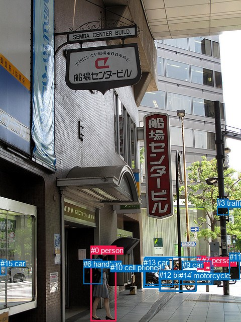
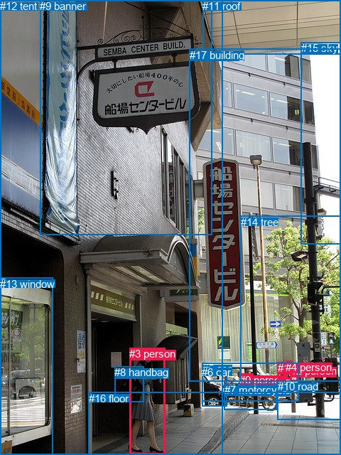

# 图片 0208：2321715.jpg

随机样本序号：40。图片 SHA256：`78effdbaecaa4db9353c72b69b27969ef20359cf144ad47b244ffd0ab3265bf0`。

红色框表示人，蓝色框表示其他物体。两个模式分别保留自身框编号，可依据位置比较对应对象。

## 自动检测框与输出

人的框编号：`[0, 2, 4, 7]`。状态：`ok`。

### 自动检测全部物体框

| 编号 | 类别 | 是否为人 | 检测分数 | 像素坐标 xyxy |
|---|---|---|---|---|
| 0 | person | True | 0.9990 | 180.9, 488.6, 232.0, 638.0 |
| 1 | car | False | 0.9699 | 285.4, 520.2, 318.7, 571.9 |
| 2 | person | True | 0.9609 | 406.7, 512.3, 419.8, 537.9 |
| 3 | traffic light | False | 0.9563 | 432.4, 395.4, 455.1, 427.8 |
| 4 | person | True | 0.9509 | 392.2, 508.6, 403.8, 535.6 |
| 5 | car | False | 0.9371 | 288.9, 510.1, 424.1, 565.2 |
| 6 | handbag | False | 0.9350 | 166.3, 515.9, 203.0, 564.5 |
| 7 | person | True | 0.9178 | 401.6, 508.5, 410.5, 534.6 |
| 8 | motorcycle | False | 0.8528 | 319.4, 538.1, 390.6, 579.3 |
| 9 | car | False | 0.6448 | 362.9, 518.1, 420.8, 564.2 |
| 10 | cell phone | False | 0.5780 | 219.9, 523.5, 229.1, 528.8 |
| 11 | parking meter | False | 0.5589 | 456.7, 502.1, 477.0, 556.2 |
| 12 | bicycle | False | 0.5111 | 316.9, 537.5, 390.2, 578.2 |
| 13 | car | False | 0.4198 | 286.2, 512.7, 344.8, 569.9 |
| 14 | motorcycle | False | 0.3743 | 357.0, 539.1, 391.3, 578.6 |
| 15 | car | False | 0.3635 | 0.5, 515.3, 12.1, 546.2 |

### 自动检测 Top50 人相关候选

评分物体对：240；人相关物体对：108；输出关系：50。

| 排名 | 主语编号与类别 | 关系 | 宾语编号与类别 | 类型 | 人与人 | 排序分数 | 原始融合 logit |
|---|---|---|---|---|---|---|---|
| 1 | #0 person | holding | #10 cell phone | semantic | False | 0.99419 | 5.1426 |
| 2 | #0 person | carrying | #6 handbag | semantic | False | 0.99331 | 5.0009 |
| 3 | #7 person | walking on | #9 car | semantic | False | 0.96245 | 3.2438 |
| 4 | #4 person | walking on | #9 car | semantic | False | 0.95826 | 3.1338 |
| 5 | #4 person | walking on | #5 car | semantic | False | 0.95093 | 2.9643 |
| 6 | #7 person | walking on | #5 car | semantic | False | 0.94661 | 2.8753 |
| 7 | #2 person | walking on | #9 car | semantic | False | 0.94288 | 2.8037 |
| 8 | #4 person | on | #9 car | spatial | False | 0.93622 | 2.6864 |
| 9 | #2 person | walking on | #5 car | semantic | False | 0.92355 | 2.4915 |
| 10 | #7 person | on | #9 car | spatial | False | 0.90380 | 2.2402 |
| 11 | #0 person | on | #10 cell phone | spatial | False | 0.89398 | 2.1320 |
| 12 | #0 person | in | #6 handbag | spatial | False | 0.85625 | 1.7845 |
| 13 | #7 person | walking on | #2 person | semantic | True | 0.85372 | 1.7641 |
| 14 | #2 person | on | #9 car | spatial | False | 0.84161 | 1.6703 |
| 15 | #7 person | walking on | #4 person | semantic | True | 0.81738 | 1.4987 |
| 16 | #4 person | walking on | #12 bicycle | semantic | False | 0.80627 | 1.4259 |
| 17 | #4 person | walking on | #8 motorcycle | semantic | False | 0.80475 | 1.4162 |
| 18 | #4 person | in | #5 car | spatial | False | 0.79036 | 1.3271 |
| 19 | #6 handbag | on | #0 person | spatial | False | 0.77882 | 1.2588 |
| 20 | #4 person | walking on | #2 person | semantic | True | 0.77427 | 1.2326 |
| 21 | #7 person | walking on | #12 bicycle | semantic | False | 0.75307 | 1.1151 |
| 22 | #7 person | walking on | #8 motorcycle | semantic | False | 0.74006 | 1.0463 |
| 23 | #4 person | walking on | #7 person | semantic | True | 0.70520 | 0.8722 |
| 24 | #7 person | beside | #5 car | spatial | False | 0.69326 | 0.8154 |
| 25 | #2 person | in | #5 car | spatial | False | 0.68119 | 0.7592 |
| 26 | #2 person | walking on | #12 bicycle | semantic | False | 0.63800 | 0.5667 |
| 27 | #2 person | walking on | #4 person | semantic | True | 0.62783 | 0.5229 |
| 28 | #2 person | walking on | #8 motorcycle | semantic | False | 0.62183 | 0.4973 |
| 29 | #10 cell phone | on | #0 person | spatial | False | 0.59537 | 0.3862 |
| 30 | #2 person | walking on | #11 parking meter | semantic | False | 0.57720 | 0.3113 |
| 31 | #2 person | walking on | #7 person | semantic | True | 0.56707 | 0.2699 |
| 32 | #6 handbag | carrying | #0 person | semantic | False | 0.54499 | 0.1804 |
| 33 | #7 person | walking on | #13 car | semantic | False | 0.51991 | 0.0797 |
| 34 | #4 person | walking on | #11 parking meter | semantic | False | 0.51910 | 0.0764 |
| 35 | #7 person | walking on | #1 car | semantic | False | 0.51199 | 0.0480 |
| 36 | #7 person | walking on | #11 parking meter | semantic | False | 0.50258 | 0.0103 |
| 37 | #10 cell phone | holding | #0 person | semantic | False | 0.48948 | -0.0421 |
| 38 | #4 person | walking on | #13 car | semantic | False | 0.48684 | -0.0526 |
| 39 | #4 person | on | #8 motorcycle | spatial | False | 0.45991 | -0.1607 |
| 40 | #4 person | walking on | #1 car | semantic | False | 0.45736 | -0.1710 |
| 41 | #4 person | on | #12 bicycle | spatial | False | 0.44474 | -0.2219 |
| 42 | #4 person | walking on | #14 motorcycle | semantic | False | 0.43672 | -0.2545 |
| 43 | #7 person | on | #2 person | spatial | True | 0.38104 | -0.4851 |
| 44 | #2 person | walking on | #13 car | semantic | False | 0.35847 | -0.5820 |
| 45 | #4 person | beside | #2 person | spatial | True | 0.33085 | -0.7043 |
| 46 | #2 person | walking on | #1 car | semantic | False | 0.33077 | -0.7047 |
| 47 | #7 person | beside | #12 bicycle | spatial | False | 0.32664 | -0.7234 |
| 48 | #7 person | beside | #8 motorcycle | spatial | False | 0.32409 | -0.7351 |
| 49 | #7 person | on | #4 person | spatial | True | 0.32186 | -0.7452 |
| 50 | #7 person | beside | #13 car | spatial | False | 0.31224 | -0.7897 |

### 自动检测逐条人相关 GT 核验

R@50：20.00%；命中 1/5。

| GT 主语编号 | GT 关系 | GT 宾语编号 | 结果阶段 | 匹配预测主语编号 | 匹配预测宾语编号 |
|---|---|---|---|---|---|
| 0 | on | 7 | endpoint_missing_or_wrong_class | [] | [8] |
| 0 | riding | 7 | endpoint_missing_or_wrong_class | [] | [8] |
| 3 | carrying | 8 | hit50 | [0] | [6] |
| 3 | exiting | 12 | endpoint_missing_or_wrong_class | [0] | [] |
| 3 | walking on | 16 | endpoint_missing_or_wrong_class | [0] | [] |

## 真实框与输出

人的框编号：`[0, 1, 2, 3, 4]`。

### 真实框全部物体框

| 编号 | 类别 | 是否为人 | 检测分数 | 像素坐标 xyxy |
|---|---|---|---|---|
| 0 | person | True | GT | 337.0, 526.0, 356.0, 555.0 |
| 1 | person | True | GT | 391.0, 509.0, 402.0, 534.0 |
| 2 | person | True | GT | 409.0, 513.0, 420.0, 536.0 |
| 3 | person | True | GT | 182.0, 489.0, 232.0, 639.0 |
| 4 | person | True | GT | 402.0, 508.0, 410.0, 534.0 |
| 5 | car | False | GT | 285.0, 510.0, 421.0, 564.0 |
| 6 | car | False | GT | 284.0, 515.0, 319.0, 572.0 |
| 7 | motorcycle | False | GT | 316.0, 540.0, 390.0, 577.0 |
| 8 | handbag | False | GT | 161.0, 515.0, 202.0, 565.0 |
| 9 | banner | False | GT | 56.0, 0.0, 298.0, 331.0 |
| 10 | road | False | GT | 391.0, 535.0, 480.0, 590.0 |
| 11 | roof | False | GT | 285.0, 0.0, 480.0, 77.0 |
| 12 | tent | False | GT | 0.0, 0.0, 314.0, 640.0 |
| 13 | window | False | GT | 0.0, 391.0, 74.0, 640.0 |
| 14 | tree | False | GT | 339.0, 304.0, 480.0, 537.0 |
| 15 | sky | False | GT | 424.0, 59.0, 480.0, 343.0 |
| 16 | floor | False | GT | 125.0, 552.0, 480.0, 640.0 |
| 17 | building | False | GT | 267.0, 69.0, 480.0, 536.0 |

### 真实框 Top50 人相关候选

评分物体对：306；人相关物体对：150；输出关系：50。

| 排名 | 主语编号与类别 | 关系 | 宾语编号与类别 | 类型 | 人与人 | 排序分数 | 原始融合 logit |
|---|---|---|---|---|---|---|---|
| 1 | #3 person | carrying | #8 handbag | semantic | False | 0.99407 | 5.1222 |
| 2 | #4 person | walking on | #10 road | semantic | False | 0.98134 | 3.9626 |
| 3 | #2 person | walking on | #10 road | semantic | False | 0.97955 | 3.8693 |
| 4 | #3 person | walking on | #16 floor | semantic | False | 0.97921 | 3.8525 |
| 5 | #0 person | parked on | #7 motorcycle | semantic | False | 0.97792 | 3.7907 |
| 6 | #1 person | walking on | #10 road | semantic | False | 0.97628 | 3.7174 |
| 7 | #0 person | parked on | #16 floor | semantic | False | 0.97446 | 3.6415 |
| 8 | #4 person | walking on | #16 floor | semantic | False | 0.96803 | 3.4103 |
| 9 | #1 person | walking on | #16 floor | semantic | False | 0.96356 | 3.2748 |
| 10 | #2 person | walking on | #16 floor | semantic | False | 0.95834 | 3.1357 |
| 11 | #2 person | on | #10 road | spatial | False | 0.95742 | 3.1129 |
| 12 | #0 person | parked on | #10 road | semantic | False | 0.94783 | 2.8996 |
| 13 | #0 person | on | #7 motorcycle | spatial | False | 0.94604 | 2.8640 |
| 14 | #4 person | pushing | #2 person | semantic | True | 0.94039 | 2.7585 |
| 15 | #1 person | on | #10 road | spatial | False | 0.93145 | 2.6092 |
| 16 | #4 person | on | #10 road | spatial | False | 0.92407 | 2.4990 |
| 17 | #0 person | parked on | #5 car | semantic | False | 0.92344 | 2.4900 |
| 18 | #0 person | in | #5 car | spatial | False | 0.92242 | 2.4756 |
| 19 | #3 person | on | #16 floor | spatial | False | 0.91199 | 2.3382 |
| 20 | #0 person | on | #16 floor | spatial | False | 0.88914 | 2.0820 |
| 21 | #4 person | walking on | #5 car | semantic | False | 0.88892 | 2.0798 |
| 22 | #1 person | walking on | #5 car | semantic | False | 0.88073 | 1.9994 |
| 23 | #1 person | in | #5 car | spatial | False | 0.86787 | 1.8822 |
| 24 | #3 person | exiting | #12 tent | semantic | False | 0.83919 | 1.6522 |
| 25 | #2 person | walking on | #5 car | semantic | False | 0.83523 | 1.6232 |
| 26 | #3 person | in front of | #12 tent | spatial | False | 0.83408 | 1.6149 |
| 27 | #8 handbag | carrying | #3 person | semantic | False | 0.80737 | 1.4330 |
| 28 | #3 person | in | #8 handbag | spatial | False | 0.80074 | 1.3909 |
| 29 | #4 person | in | #5 car | spatial | False | 0.78834 | 1.3150 |
| 30 | #2 person | in | #5 car | spatial | False | 0.78204 | 1.2776 |
| 31 | #1 person | on | #16 floor | spatial | False | 0.78147 | 1.2742 |
| 32 | #2 person | on | #16 floor | spatial | False | 0.76962 | 1.2062 |
| 33 | #8 handbag | on | #3 person | spatial | False | 0.76031 | 1.1544 |
| 34 | #4 person | on | #16 floor | spatial | False | 0.75587 | 1.1302 |
| 35 | #0 person | on | #10 road | spatial | False | 0.75304 | 1.1149 |
| 36 | #0 person | parked on | #12 tent | semantic | False | 0.67628 | 0.7367 |
| 37 | #4 person | walking on | #14 tree | semantic | False | 0.54642 | 0.1862 |
| 38 | #4 person | beside | #2 person | spatial | True | 0.52514 | 0.1007 |
| 39 | #5 car | parked on | #0 person | semantic | False | 0.48933 | -0.0427 |
| 40 | #5 car | in | #0 person | spatial | False | 0.48068 | -0.0773 |
| 41 | #2 person | pushing | #4 person | semantic | True | 0.47838 | -0.0865 |
| 42 | #1 person | talking to | #4 person | semantic | True | 0.46017 | -0.1597 |
| 43 | #4 person | walking on | #1 person | semantic | True | 0.45117 | -0.1960 |
| 44 | #1 person | walking on | #14 tree | semantic | False | 0.38897 | -0.4516 |
| 45 | #1 person | on | #7 motorcycle | spatial | False | 0.38241 | -0.4793 |
| 46 | #2 person | walking on | #14 tree | semantic | False | 0.37830 | -0.4968 |
| 47 | #4 person | beside | #14 tree | spatial | False | 0.36497 | -0.5539 |
| 48 | #4 person | walking on | #17 building | semantic | False | 0.36179 | -0.5676 |
| 49 | #1 person | walking on | #7 motorcycle | semantic | False | 0.36134 | -0.5695 |
| 50 | #4 person | walking on | #7 motorcycle | semantic | False | 0.34633 | -0.6352 |

### 真实框逐条人相关 GT 核验

R@50：80.00%；命中 4/5。

| GT 主语编号 | GT 关系 | GT 宾语编号 | 结果阶段 | 匹配预测主语编号 | 匹配预测宾语编号 |
|---|---|---|---|---|---|
| 0 | on | 7 | hit50 | [0] | [7] |
| 0 | riding | 7 | wrong_predicate | [0] | [7] |
| 3 | carrying | 8 | hit50 | [3] | [8] |
| 3 | exiting | 12 | hit50 | [3] | [12] |
| 3 | walking on | 16 | hit50 | [3] | [16] |

## 全部人相关 GT

| 主语编号与类别 | 关系 | 宾语编号与类别 |
|---|---|---|
| #0 person | on | #7 motorcycle |
| #0 person | riding | #7 motorcycle |
| #3 person | carrying | #8 handbag |
| #3 person | exiting | #12 tent |
| #3 person | walking on | #16 floor |

原始记录、全部人相关物体对的两项预测与分项分数见 [逐图证据 JSON](../evidence/cases/0208.json)。全部56类 logits 保留于本机 HOR/output/random500/logits/。

<!-- HOR_COMPLETE_RESULTS -->

## 六组条件的完整输出对照

以下保留同一图片三种框与候选模式、两种谓词输出规则的全部 Top50。框编号各自在所属模式内解释。

### 自动检测框完整枚举：空间与语义各保留一个谓词

| 排名 | 主语编号与类别 | 谓词 | 宾语编号与类别 | 分组 | 排序分数 | predicate logit | pair logit |
|---|---|---|---|---|---|---|---|
| 1 | #0 person | holding | #10 cell phone | semantic | 0.9941915 | 4.5165811 | 0.6260198 |
| 2 | #0 person | carrying | #6 handbag | semantic | 0.9933131 | 4.4183593 | 0.5825461 |
| 3 | #7 person | walking on | #9 car | semantic | 0.9624507 | 3.5026984 | -0.2588698 |
| 4 | #4 person | walking on | #9 car | semantic | 0.9582648 | 3.4124389 | -0.2786587 |
| 5 | #4 person | walking on | #5 car | semantic | 0.9509338 | 3.4575410 | -0.4932683 |
| 6 | #7 person | walking on | #5 car | semantic | 0.9466122 | 3.3943477 | -0.5190396 |
| 7 | #2 person | walking on | #9 car | semantic | 0.9428764 | 3.1837225 | -0.3800060 |
| 8 | #4 person | on | #9 car | spatial | 0.9362209 | 2.9650850 | -0.2786587 |
| 9 | #2 person | walking on | #5 car | semantic | 0.9235465 | 3.1415758 | -0.6500379 |
| 10 | #7 person | on | #9 car | spatial | 0.9038036 | 2.4990902 | -0.2588698 |
| 11 | #0 person | on | #10 cell phone | spatial | 0.8939787 | 1.5060225 | 0.6260198 |
| 12 | #0 person | in | #6 handbag | spatial | 0.8562511 | 1.2019491 | 0.5825461 |
| 13 | #7 person | walking on | #2 person | semantic | 0.8537196 | 1.8686700 | -0.1045924 |
| 14 | #2 person | on | #9 car | spatial | 0.8416149 | 2.0502992 | -0.3800060 |
| 15 | #7 person | walking on | #4 person | semantic | 0.8173815 | 1.5647750 | -0.0660685 |
| 16 | #4 person | walking on | #12 bicycle | semantic | 0.8062684 | 1.8898277 | -0.4638848 |
| 17 | #4 person | walking on | #8 motorcycle | semantic | 0.8047454 | 1.8928375 | -0.4766161 |
| 18 | #4 person | in | #5 car | spatial | 0.7903604 | 1.8203673 | -0.4932683 |
| 19 | #6 handbag | on | #0 person | spatial | 0.7788157 | 1.8723583 | -0.6135800 |
| 20 | #4 person | walking on | #2 person | semantic | 0.7742747 | 1.4384170 | -0.2058092 |
| 21 | #7 person | walking on | #12 bicycle | semantic | 0.7530741 | 1.6370554 | -0.5219798 |
| 22 | #7 person | walking on | #8 motorcycle | semantic | 0.7400600 | 1.5798836 | -0.5336034 |
| 23 | #4 person | walking on | #7 person | semantic | 0.7052001 | 1.0817819 | -0.2095968 |
| 24 | #7 person | beside | #5 car | spatial | 0.6932556 | 1.3344235 | -0.5190396 |
| 25 | #2 person | in | #5 car | spatial | 0.6811868 | 1.4092689 | -0.6500379 |
| 26 | #2 person | walking on | #12 bicycle | semantic | 0.6379973 | 1.2217984 | -0.6551158 |
| 27 | #2 person | walking on | #4 person | semantic | 0.6278318 | 0.7147217 | -0.1917956 |
| 28 | #2 person | walking on | #8 motorcycle | semantic | 0.6218305 | 1.1616163 | -0.6642914 |
| 29 | #10 cell phone | on | #0 person | spatial | 0.5953727 | 1.3415771 | -0.9553556 |
| 30 | #2 person | walking on | #11 parking meter | semantic | 0.5771990 | 0.4228549 | -0.1115693 |
| 31 | #2 person | walking on | #7 person | semantic | 0.5670723 | 0.5010443 | -0.2311285 |
| 32 | #6 handbag | carrying | #0 person | semantic | 0.5449902 | 0.7940288 | -0.6135800 |
| 33 | #7 person | walking on | #13 car | semantic | 0.5199091 | 0.9660306 | -0.8863521 |
| 34 | #4 person | walking on | #11 parking meter | semantic | 0.5190984 | 0.3386159 | -0.2621850 |
| 35 | #7 person | walking on | #1 car | semantic | 0.5119873 | 0.9660163 | -0.9180578 |
| 36 | #7 person | walking on | #11 parking meter | semantic | 0.5025756 | 0.1926889 | -0.1823866 |
| 37 | #10 cell phone | holding | #0 person | semantic | 0.4894794 | 0.9132671 | -0.9553556 |
| 38 | #4 person | walking on | #13 car | semantic | 0.4868414 | 0.7854829 | -0.8381296 |
| 39 | #4 person | on | #8 motorcycle | spatial | 0.4599065 | 0.3158970 | -0.4766161 |
| 40 | #4 person | walking on | #1 car | semantic | 0.4573605 | 0.6921849 | -0.8631580 |
| 41 | #4 person | on | #12 bicycle | spatial | 0.4447448 | 0.2419577 | -0.4638848 |
| 42 | #4 person | walking on | #14 motorcycle | semantic | 0.4367244 | 0.5508156 | -0.8052822 |
| 43 | #7 person | on | #2 person | spatial | 0.3810396 | -0.3805456 | -0.1045924 |
| 44 | #2 person | walking on | #13 car | semantic | 0.3584729 | 0.4424372 | -1.0244358 |
| 45 | #4 person | beside | #2 person | spatial | 0.3308518 | -0.4985256 | -0.2058092 |
| 46 | #2 person | walking on | #1 car | semantic | 0.3307664 | 0.3476334 | -1.0523541 |
| 47 | #7 person | beside | #12 bicycle | spatial | 0.3266426 | -0.2014298 | -0.5219798 |
| 48 | #7 person | beside | #8 motorcycle | spatial | 0.3240873 | -0.2014475 | -0.5336034 |
| 49 | #7 person | on | #4 person | spatial | 0.3218598 | -0.6791697 | -0.0660685 |
| 50 | #7 person | beside | #13 car | spatial | 0.3122387 | 0.0966783 | -0.8863521 |

GT 命中：1/5，R@50=20.00%。

| GT主语 | GT谓词 | GT宾语 | 结果阶段 | 匹配主语框 | 匹配宾语框 |
|---|---|---|---|---|---|
| 0 | on | 7 | endpoint_missing_or_wrong_class | [] | [8] |
| 0 | riding | 7 | endpoint_missing_or_wrong_class | [] | [8] |
| 3 | carrying | 8 | hit50 | [0] | [6] |
| 3 | exiting | 12 | endpoint_missing_or_wrong_class | [0] | [] |
| 3 | walking on | 16 | endpoint_missing_or_wrong_class | [0] | [] |

### 自动检测框完整枚举：每对只保留一个谓词

| 排名 | 主语编号与类别 | 谓词 | 宾语编号与类别 | 分组 | 排序分数 | predicate logit | pair logit |
|---|---|---|---|---|---|---|---|
| 1 | #0 person | holding | #10 cell phone | single | 0.9941915 | 4.5165811 | 0.6260198 |
| 2 | #0 person | carrying | #6 handbag | single | 0.9933131 | 4.4183593 | 0.5825461 |
| 3 | #7 person | walking on | #9 car | single | 0.9624507 | 3.5026984 | -0.2588698 |
| 4 | #4 person | walking on | #9 car | single | 0.9582648 | 3.4124389 | -0.2786587 |
| 5 | #4 person | walking on | #5 car | single | 0.9509338 | 3.4575410 | -0.4932683 |
| 6 | #7 person | walking on | #5 car | single | 0.9466122 | 3.3943477 | -0.5190396 |
| 7 | #2 person | walking on | #9 car | single | 0.9428764 | 3.1837225 | -0.3800060 |
| 8 | #2 person | walking on | #5 car | single | 0.9235465 | 3.1415758 | -0.6500379 |
| 9 | #7 person | walking on | #2 person | single | 0.8537196 | 1.8686700 | -0.1045924 |
| 10 | #7 person | walking on | #4 person | single | 0.8173815 | 1.5647750 | -0.0660685 |
| 11 | #4 person | walking on | #12 bicycle | single | 0.8062684 | 1.8898277 | -0.4638848 |
| 12 | #4 person | walking on | #8 motorcycle | single | 0.8047454 | 1.8928375 | -0.4766161 |
| 13 | #6 handbag | on | #0 person | single | 0.7788157 | 1.8723583 | -0.6135800 |
| 14 | #4 person | walking on | #2 person | single | 0.7742747 | 1.4384170 | -0.2058092 |
| 15 | #7 person | walking on | #12 bicycle | single | 0.7530741 | 1.6370554 | -0.5219798 |
| 16 | #7 person | walking on | #8 motorcycle | single | 0.7400600 | 1.5798836 | -0.5336034 |
| 17 | #4 person | walking on | #7 person | single | 0.7052001 | 1.0817819 | -0.2095968 |
| 18 | #2 person | walking on | #12 bicycle | single | 0.6379973 | 1.2217984 | -0.6551158 |
| 19 | #2 person | walking on | #4 person | single | 0.6278318 | 0.7147217 | -0.1917956 |
| 20 | #2 person | walking on | #8 motorcycle | single | 0.6218305 | 1.1616163 | -0.6642914 |
| 21 | #10 cell phone | on | #0 person | single | 0.5953727 | 1.3415771 | -0.9553556 |
| 22 | #2 person | walking on | #11 parking meter | single | 0.5771990 | 0.4228549 | -0.1115693 |
| 23 | #2 person | walking on | #7 person | single | 0.5670723 | 0.5010443 | -0.2311285 |
| 24 | #7 person | walking on | #13 car | single | 0.5199091 | 0.9660306 | -0.8863521 |
| 25 | #4 person | walking on | #11 parking meter | single | 0.5190984 | 0.3386159 | -0.2621850 |
| 26 | #7 person | walking on | #1 car | single | 0.5119873 | 0.9660163 | -0.9180578 |
| 27 | #7 person | walking on | #11 parking meter | single | 0.5025756 | 0.1926889 | -0.1823866 |
| 28 | #4 person | walking on | #13 car | single | 0.4868414 | 0.7854829 | -0.8381296 |
| 29 | #4 person | walking on | #1 car | single | 0.4573605 | 0.6921849 | -0.8631580 |
| 30 | #4 person | walking on | #14 motorcycle | single | 0.4367244 | 0.5508156 | -0.8052822 |
| 31 | #2 person | walking on | #13 car | single | 0.3584729 | 0.4424372 | -1.0244358 |
| 32 | #2 person | walking on | #1 car | single | 0.3307664 | 0.3476334 | -1.0523541 |
| 33 | #7 person | walking on | #14 motorcycle | single | 0.3024257 | 0.0302329 | -0.8660061 |
| 34 | #9 car | parked on | #4 person | single | 0.2856921 | -0.1868639 | -0.7295356 |
| 35 | #9 car | parked on | #2 person | single | 0.2678021 | -0.2172484 | -0.7885543 |
| 36 | #2 person | walking on | #14 motorcycle | single | 0.2375846 | -0.1969776 | -0.9689903 |
| 37 | #7 person | looking at | #0 person | single | 0.2357931 | 0.2699270 | -1.4458108 |
| 38 | #7 person | holding | #10 cell phone | single | 0.2306780 | 0.1308546 | -1.3353412 |
| 39 | #5 car | beside | #4 person | single | 0.2250381 | -0.4732342 | -0.7633100 |
| 40 | #0 person | beside | #5 car | single | 0.2128628 | 0.0081716 | -1.3159262 |
| 41 | #4 person | looking at | #0 person | single | 0.2122874 | 0.2692294 | -1.5804217 |
| 42 | #9 car | parked on | #7 person | single | 0.2065489 | -0.5178871 | -0.8279679 |
| 43 | #0 person | beside | #13 car | single | 0.2024214 | 0.0670500 | -1.4382788 |
| 44 | #2 person | looking at | #0 person | single | 0.1964409 | 0.1184249 | -1.5271140 |
| 45 | #4 person | holding | #10 cell phone | single | 0.1879288 | -0.0024252 | -1.4610999 |
| 46 | #5 car | parked on | #2 person | single | 0.1682882 | -0.7285676 | -0.8692400 |
| 47 | #5 car | beside | #7 person | single | 0.1622049 | -0.7742186 | -0.8676949 |
| 48 | #0 person | walking on | #1 car | single | 0.1571445 | -0.2195287 | -1.4601008 |
| 49 | #8 motorcycle | parked on | #4 person | single | 0.1520625 | -0.5788317 | -1.1396834 |
| 50 | #12 bicycle | parked on | #4 person | single | 0.1502350 | -0.6088881 | -1.1238706 |

GT 命中：1/5，R@50=20.00%。

| GT主语 | GT谓词 | GT宾语 | 结果阶段 | 匹配主语框 | 匹配宾语框 |
|---|---|---|---|---|---|
| 0 | on | 7 | endpoint_missing_or_wrong_class | [] | [8] |
| 0 | riding | 7 | endpoint_missing_or_wrong_class | [] | [8] |
| 3 | carrying | 8 | hit50 | [0] | [6] |
| 3 | exiting | 12 | endpoint_missing_or_wrong_class | [0] | [] |
| 3 | walking on | 16 | endpoint_missing_or_wrong_class | [0] | [] |

### 真实框完整枚举：空间与语义各保留一个谓词

| 排名 | 主语编号与类别 | 谓词 | 宾语编号与类别 | 分组 | 排序分数 | predicate logit | pair logit |
|---|---|---|---|---|---|---|---|
| 1 | #3 person | carrying | #8 handbag | semantic | 0.9940727 | 4.5480437 | 0.5742039 |
| 2 | #4 person | walking on | #10 road | semantic | 0.9813402 | 3.8276677 | 0.1348827 |
| 3 | #2 person | walking on | #10 road | semantic | 0.9795539 | 3.6681943 | 0.2011121 |
| 4 | #3 person | walking on | #16 floor | semantic | 0.9792138 | 4.0202575 | -0.1677976 |
| 5 | #0 person | parked on | #7 motorcycle | semantic | 0.9779182 | 4.0849795 | -0.2943045 |
| 6 | #1 person | walking on | #10 road | semantic | 0.9762792 | 3.5929580 | 0.1244381 |
| 7 | #0 person | parked on | #16 floor | semantic | 0.9744555 | 3.4829879 | 0.1584712 |
| 8 | #4 person | walking on | #16 floor | semantic | 0.9680257 | 3.3612599 | 0.0490663 |
| 9 | #1 person | walking on | #16 floor | semantic | 0.9635557 | 3.2378845 | 0.0369598 |
| 10 | #2 person | walking on | #16 floor | semantic | 0.9583417 | 3.0573373 | 0.0783658 |
| 11 | #2 person | on | #10 road | spatial | 0.9574220 | 2.9117951 | 0.2011121 |
| 12 | #0 person | parked on | #10 road | semantic | 0.9478290 | 3.0007501 | -0.1011022 |
| 13 | #0 person | on | #7 motorcycle | spatial | 0.9460356 | 3.1582599 | -0.2943045 |
| 14 | #4 person | pushing | #2 person | semantic | 0.9403890 | 2.8841572 | -0.1257048 |
| 15 | #1 person | on | #10 road | spatial | 0.9314527 | 2.4847836 | 0.1244381 |
| 16 | #4 person | on | #10 road | spatial | 0.9240725 | 2.3641286 | 0.1348827 |
| 17 | #0 person | parked on | #5 car | semantic | 0.9234406 | 3.0025797 | -0.5125402 |
| 18 | #0 person | in | #5 car | spatial | 0.9224163 | 2.9881792 | -0.5125402 |
| 19 | #3 person | on | #16 floor | spatial | 0.9119906 | 2.5059834 | -0.1677976 |
| 20 | #0 person | on | #16 floor | spatial | 0.8891446 | 1.9235616 | 0.1584712 |
| 21 | #4 person | walking on | #5 car | semantic | 0.8889223 | 2.6511259 | -0.5713460 |
| 22 | #1 person | walking on | #5 car | semantic | 0.8807293 | 2.5187335 | -0.5193794 |
| 23 | #1 person | in | #5 car | spatial | 0.8678674 | 2.4016118 | -0.5193794 |
| 24 | #3 person | exiting | #12 tent | semantic | 0.8391858 | 1.8216376 | -0.1694553 |
| 25 | #2 person | walking on | #5 car | semantic | 0.8352299 | 2.3261433 | -0.7029877 |
| 26 | #3 person | in front of | #12 tent | spatial | 0.8340846 | 1.7843118 | -0.1694553 |
| 27 | #8 handbag | carrying | #3 person | semantic | 0.8073665 | 2.0446458 | -0.6116568 |
| 28 | #3 person | in | #8 handbag | spatial | 0.8007417 | 0.8167319 | 0.5742039 |
| 29 | #4 person | in | #5 car | spatial | 0.7883404 | 1.8862972 | -0.5713460 |
| 30 | #2 person | in | #5 car | spatial | 0.7820357 | 1.9805570 | -0.7029877 |
| 31 | #1 person | on | #16 floor | spatial | 0.7814686 | 1.2372856 | 0.0369598 |
| 32 | #2 person | on | #16 floor | spatial | 0.7696216 | 1.1278100 | 0.0783658 |
| 33 | #8 handbag | on | #3 person | spatial | 0.7603053 | 1.7660112 | -0.6116568 |
| 34 | #4 person | on | #16 floor | spatial | 0.7558686 | 1.0810947 | 0.0490663 |
| 35 | #0 person | on | #10 road | spatial | 0.7530352 | 1.2159686 | -0.1011022 |
| 36 | #0 person | parked on | #12 tent | semantic | 0.6762813 | 1.3756680 | -0.6389339 |
| 37 | #4 person | walking on | #14 tree | semantic | 0.5464171 | 1.1179218 | -0.9317172 |
| 38 | #4 person | beside | #2 person | spatial | 0.5251445 | 0.2263675 | -0.1257048 |
| 39 | #5 car | parked on | #0 person | semantic | 0.4893346 | 0.4161501 | -0.4588180 |
| 40 | #5 car | in | #0 person | spatial | 0.4806832 | 0.3815122 | -0.4588180 |
| 41 | #2 person | pushing | #4 person | semantic | 0.4783818 | 0.1165252 | -0.2030522 |
| 42 | #1 person | talking to | #4 person | semantic | 0.4601711 | 0.0303793 | -0.1900330 |
| 43 | #4 person | walking on | #1 person | semantic | 0.4511676 | -0.1187739 | -0.0771804 |
| 44 | #1 person | walking on | #14 tree | semantic | 0.3889702 | 0.4514132 | -0.9030561 |
| 45 | #1 person | on | #7 motorcycle | spatial | 0.3824094 | -0.0480652 | -0.4312689 |
| 46 | #2 person | walking on | #14 tree | semantic | 0.3783025 | 0.4950376 | -0.9917973 |
| 47 | #4 person | beside | #14 tree | spatial | 0.3649710 | 0.3778644 | -0.9317172 |
| 48 | #4 person | walking on | #17 building | semantic | 0.3617876 | -0.0014195 | -0.5661941 |
| 49 | #1 person | walking on | #7 motorcycle | semantic | 0.3613426 | -0.1382728 | -0.4312689 |
| 50 | #4 person | walking on | #7 motorcycle | semantic | 0.3463285 | -0.1202230 | -0.5149941 |

GT 命中：4/5，R@50=80.00%。

| GT主语 | GT谓词 | GT宾语 | 结果阶段 | 匹配主语框 | 匹配宾语框 |
|---|---|---|---|---|---|
| 0 | on | 7 | hit50 | [0] | [7] |
| 0 | riding | 7 | wrong_predicate | [0] | [7] |
| 3 | carrying | 8 | hit50 | [3] | [8] |
| 3 | exiting | 12 | hit50 | [3] | [12] |
| 3 | walking on | 16 | hit50 | [3] | [16] |

### 真实框完整枚举：每对只保留一个谓词

| 排名 | 主语编号与类别 | 谓词 | 宾语编号与类别 | 分组 | 排序分数 | predicate logit | pair logit |
|---|---|---|---|---|---|---|---|
| 1 | #3 person | carrying | #8 handbag | single | 0.9940727 | 4.5480437 | 0.5742039 |
| 2 | #4 person | walking on | #10 road | single | 0.9813402 | 3.8276677 | 0.1348827 |
| 3 | #2 person | walking on | #10 road | single | 0.9795539 | 3.6681943 | 0.2011121 |
| 4 | #3 person | walking on | #16 floor | single | 0.9792138 | 4.0202575 | -0.1677976 |
| 5 | #0 person | parked on | #7 motorcycle | single | 0.9779182 | 4.0849795 | -0.2943045 |
| 6 | #1 person | walking on | #10 road | single | 0.9762792 | 3.5929580 | 0.1244381 |
| 7 | #0 person | parked on | #16 floor | single | 0.9744555 | 3.4829879 | 0.1584712 |
| 8 | #4 person | walking on | #16 floor | single | 0.9680257 | 3.3612599 | 0.0490663 |
| 9 | #1 person | walking on | #16 floor | single | 0.9635557 | 3.2378845 | 0.0369598 |
| 10 | #2 person | walking on | #16 floor | single | 0.9583417 | 3.0573373 | 0.0783658 |
| 11 | #0 person | parked on | #10 road | single | 0.9478290 | 3.0007501 | -0.1011022 |
| 12 | #4 person | pushing | #2 person | single | 0.9403890 | 2.8841572 | -0.1257048 |
| 13 | #0 person | parked on | #5 car | single | 0.9234406 | 3.0025797 | -0.5125402 |
| 14 | #4 person | walking on | #5 car | single | 0.8889223 | 2.6511259 | -0.5713460 |
| 15 | #1 person | walking on | #5 car | single | 0.8807293 | 2.5187335 | -0.5193794 |
| 16 | #3 person | exiting | #12 tent | single | 0.8391858 | 1.8216376 | -0.1694553 |
| 17 | #2 person | walking on | #5 car | single | 0.8352299 | 2.3261433 | -0.7029877 |
| 18 | #8 handbag | carrying | #3 person | single | 0.8073665 | 2.0446458 | -0.6116568 |
| 19 | #0 person | parked on | #12 tent | single | 0.6762813 | 1.3756680 | -0.6389339 |
| 20 | #4 person | walking on | #14 tree | single | 0.5464171 | 1.1179218 | -0.9317172 |
| 21 | #5 car | parked on | #0 person | single | 0.4893346 | 0.4161501 | -0.4588180 |
| 22 | #2 person | pushing | #4 person | single | 0.4783818 | 0.1165252 | -0.2030522 |
| 23 | #1 person | talking to | #4 person | single | 0.4601711 | 0.0303793 | -0.1900330 |
| 24 | #4 person | walking on | #1 person | single | 0.4511676 | -0.1187739 | -0.0771804 |
| 25 | #1 person | walking on | #14 tree | single | 0.3889702 | 0.4514132 | -0.9030561 |
| 26 | #1 person | on | #7 motorcycle | single | 0.3824094 | -0.0480652 | -0.4312689 |
| 27 | #2 person | walking on | #14 tree | single | 0.3783025 | 0.4950376 | -0.9917973 |
| 28 | #4 person | walking on | #17 building | single | 0.3617876 | -0.0014195 | -0.5661941 |
| 29 | #4 person | walking on | #7 motorcycle | single | 0.3463285 | -0.1202230 | -0.5149941 |
| 30 | #3 person | standing on | #9 banner | single | 0.3406253 | 0.2369614 | -0.8974702 |
| 31 | #1 person | pushing | #2 person | single | 0.3121721 | -0.5755997 | -0.2143842 |
| 32 | #0 person | parked on | #17 building | single | 0.3072173 | -0.1880031 | -0.6251580 |
| 33 | #1 person | walking on | #17 building | single | 0.3065236 | -0.2902899 | -0.5261325 |
| 34 | #7 motorcycle | parked on | #0 person | single | 0.2596687 | -0.5474100 | -0.5002814 |
| 35 | #1 person | walking on | #12 tent | single | 0.2515922 | -0.2752371 | -0.8149016 |
| 36 | #2 person | walking on | #17 building | single | 0.2217118 | -0.5942130 | -0.6615058 |
| 37 | #2 person | walking on | #7 motorcycle | single | 0.2169067 | -0.6453218 | -0.6384625 |
| 38 | #3 person | looking at | #13 window | single | 0.2142537 | -0.2444139 | -1.0550592 |
| 39 | #4 person | walking on | #12 tent | single | 0.2002619 | -0.5370269 | -0.8476317 |
| 40 | #2 person | walking on | #12 tent | single | 0.1945745 | -0.5114512 | -0.9091040 |
| 41 | #2 person | walking on | #1 person | single | 0.1666091 | -1.4232206 | -0.1866320 |
| 42 | #4 person | holding | #8 handbag | single | 0.1420655 | -0.1320319 | -1.6662077 |
| 43 | #3 person | looking at | #5 car | single | 0.1056659 | -0.8411834 | -1.2946134 |
| 44 | #6 car | beside | #0 person | single | 0.1047094 | -1.6562362 | -0.4897237 |
| 45 | #1 person | holding | #8 handbag | single | 0.1022494 | -0.3901086 | -1.7823684 |
| 46 | #3 person | walking on | #10 road | single | 0.1007662 | -1.4547405 | -0.7339998 |
| 47 | #3 person | in front of | #17 building | single | 0.0986720 | -1.0772696 | -1.1347979 |
| 48 | #0 person | parked on | #9 banner | single | 0.0948023 | -0.9096467 | -1.3467127 |
| 49 | #4 person | looking at | #3 person | single | 0.0927764 | -0.8298316 | -1.4503648 |
| 50 | #2 person | holding | #8 handbag | single | 0.0910417 | -0.6147795 | -1.6862022 |

GT 命中：3/5，R@50=60.00%。

| GT主语 | GT谓词 | GT宾语 | 结果阶段 | 匹配主语框 | 匹配宾语框 |
|---|---|---|---|---|---|
| 0 | on | 7 | wrong_predicate | [0] | [7] |
| 0 | riding | 7 | wrong_predicate | [0] | [7] |
| 3 | carrying | 8 | hit50 | [3] | [8] |
| 3 | exiting | 12 | hit50 | [3] | [12] |
| 3 | walking on | 16 | hit50 | [3] | [16] |

### 真实框400候选：空间与语义各保留一个谓词

| 排名 | 主语编号与类别 | 谓词 | 宾语编号与类别 | 分组 | 排序分数 | predicate logit | pair logit |
|---|---|---|---|---|---|---|---|
| 1 | #3 person | carrying | #8 handbag | semantic | 0.9940727 | 4.5480437 | 0.5742039 |
| 2 | #4 person | walking on | #10 road | semantic | 0.9813402 | 3.8276677 | 0.1348827 |
| 3 | #2 person | walking on | #10 road | semantic | 0.9795539 | 3.6681943 | 0.2011121 |
| 4 | #3 person | walking on | #16 floor | semantic | 0.9792138 | 4.0202575 | -0.1677976 |
| 5 | #0 person | parked on | #7 motorcycle | semantic | 0.9779189 | 4.0850101 | -0.2943045 |
| 6 | #1 person | walking on | #10 road | semantic | 0.9762792 | 3.5929580 | 0.1244381 |
| 7 | #0 person | parked on | #16 floor | semantic | 0.9744555 | 3.4829879 | 0.1584712 |
| 8 | #4 person | walking on | #16 floor | semantic | 0.9680257 | 3.3612599 | 0.0490663 |
| 9 | #1 person | walking on | #16 floor | semantic | 0.9634498 | 3.2348747 | 0.0369598 |
| 10 | #2 person | walking on | #16 floor | semantic | 0.9582214 | 3.0543270 | 0.0783658 |
| 11 | #2 person | on | #10 road | spatial | 0.9574220 | 2.9117951 | 0.2011121 |
| 12 | #0 person | parked on | #10 road | semantic | 0.9478298 | 3.0007653 | -0.1011022 |
| 13 | #0 person | on | #7 motorcycle | spatial | 0.9465888 | 3.1691489 | -0.2943045 |
| 14 | #4 person | pushing | #2 person | semantic | 0.9386799 | 2.8540716 | -0.1257048 |
| 15 | #1 person | on | #10 road | spatial | 0.9314527 | 2.4847836 | 0.1244381 |
| 16 | #4 person | on | #10 road | spatial | 0.9240725 | 2.3641286 | 0.1348827 |
| 17 | #0 person | parked on | #5 car | semantic | 0.9234406 | 3.0025797 | -0.5125402 |
| 18 | #0 person | in | #5 car | spatial | 0.9226534 | 2.9914980 | -0.5125402 |
| 19 | #3 person | on | #16 floor | spatial | 0.9119906 | 2.5059834 | -0.1677976 |
| 20 | #0 person | on | #16 floor | spatial | 0.8891446 | 1.9235616 | 0.1584712 |
| 21 | #4 person | walking on | #5 car | semantic | 0.8862200 | 2.6240454 | -0.5713460 |
| 22 | #1 person | walking on | #5 car | semantic | 0.8807293 | 2.5187335 | -0.5193794 |
| 23 | #1 person | in | #5 car | spatial | 0.8678674 | 2.4016118 | -0.5193794 |
| 24 | #3 person | exiting | #12 tent | semantic | 0.8431841 | 1.8515682 | -0.1694553 |
| 25 | #2 person | walking on | #5 car | semantic | 0.8348152 | 2.3231330 | -0.7029877 |
| 26 | #3 person | in front of | #12 tent | spatial | 0.8341693 | 1.7849245 | -0.1694553 |
| 27 | #8 handbag | carrying | #3 person | semantic | 0.8073665 | 2.0446458 | -0.6116568 |
| 28 | #3 person | in | #8 handbag | spatial | 0.8007417 | 0.8167319 | 0.5742039 |
| 29 | #2 person | in | #5 car | spatial | 0.7865648 | 2.0073295 | -0.7029877 |
| 30 | #4 person | in | #5 car | spatial | 0.7838387 | 1.8595247 | -0.5713460 |
| 31 | #1 person | on | #16 floor | spatial | 0.7814686 | 1.2372856 | 0.0369598 |
| 32 | #2 person | on | #16 floor | spatial | 0.7696216 | 1.1278100 | 0.0783658 |
| 33 | #8 handbag | on | #3 person | spatial | 0.7603053 | 1.7660112 | -0.6116568 |
| 34 | #0 person | on | #10 road | spatial | 0.7535412 | 1.2186909 | -0.1011022 |
| 35 | #4 person | on | #16 floor | spatial | 0.7512919 | 1.0564480 | 0.0490663 |
| 36 | #0 person | parked on | #12 tent | semantic | 0.6696644 | 1.3456016 | -0.6389339 |
| 37 | #4 person | walking on | #14 tree | semantic | 0.5464171 | 1.1179218 | -0.9317172 |
| 38 | #4 person | beside | #2 person | spatial | 0.5251300 | 0.2263098 | -0.1257048 |
| 39 | #5 car | parked on | #0 person | semantic | 0.4818221 | 0.3860745 | -0.4588180 |
| 40 | #5 car | in | #0 person | spatial | 0.4740038 | 0.3547392 | -0.4588180 |
| 41 | #2 person | pushing | #4 person | semantic | 0.4708800 | 0.0864401 | -0.2030522 |
| 42 | #1 person | talking to | #4 person | semantic | 0.4601401 | 0.0302544 | -0.1900330 |
| 43 | #4 person | walking on | #1 person | semantic | 0.4578815 | -0.0916934 | -0.0771804 |
| 44 | #1 person | walking on | #14 tree | semantic | 0.3957853 | 0.4799986 | -0.9030561 |
| 45 | #2 person | walking on | #14 tree | semantic | 0.3850486 | 0.5236235 | -0.9917973 |
| 46 | #1 person | on | #7 motorcycle | spatial | 0.3836960 | -0.0426207 | -0.4312689 |
| 47 | #4 person | walking on | #17 building | semantic | 0.3684138 | 0.0271664 | -0.5661941 |
| 48 | #1 person | walking on | #7 motorcycle | semantic | 0.3676153 | -0.1111917 | -0.4312689 |
| 49 | #4 person | beside | #14 tree | spatial | 0.3649577 | 0.3778071 | -0.9317172 |
| 50 | #4 person | walking on | #7 motorcycle | semantic | 0.3524844 | -0.0931425 | -0.5149941 |

GT 命中：4/5，R@50=80.00%。

| GT主语 | GT谓词 | GT宾语 | 结果阶段 | 匹配主语框 | 匹配宾语框 |
|---|---|---|---|---|---|
| 0 | on | 7 | hit50 | [0] | [7] |
| 0 | riding | 7 | wrong_predicate | [0] | [7] |
| 3 | carrying | 8 | hit50 | [3] | [8] |
| 3 | exiting | 12 | hit50 | [3] | [12] |
| 3 | walking on | 16 | hit50 | [3] | [16] |

### 真实框400候选：每对只保留一个谓词

| 排名 | 主语编号与类别 | 谓词 | 宾语编号与类别 | 分组 | 排序分数 | predicate logit | pair logit |
|---|---|---|---|---|---|---|---|
| 1 | #3 person | carrying | #8 handbag | single | 0.9940727 | 4.5480437 | 0.5742039 |
| 2 | #4 person | walking on | #10 road | single | 0.9813402 | 3.8276677 | 0.1348827 |
| 3 | #2 person | walking on | #10 road | single | 0.9795539 | 3.6681943 | 0.2011121 |
| 4 | #3 person | walking on | #16 floor | single | 0.9792138 | 4.0202575 | -0.1677976 |
| 5 | #0 person | parked on | #7 motorcycle | single | 0.9779189 | 4.0850101 | -0.2943045 |
| 6 | #1 person | walking on | #10 road | single | 0.9762792 | 3.5929580 | 0.1244381 |
| 7 | #0 person | parked on | #16 floor | single | 0.9744555 | 3.4829879 | 0.1584712 |
| 8 | #4 person | walking on | #16 floor | single | 0.9680257 | 3.3612599 | 0.0490663 |
| 9 | #1 person | walking on | #16 floor | single | 0.9634498 | 3.2348747 | 0.0369598 |
| 10 | #2 person | walking on | #16 floor | single | 0.9582214 | 3.0543270 | 0.0783658 |
| 11 | #0 person | parked on | #10 road | single | 0.9478298 | 3.0007653 | -0.1011022 |
| 12 | #4 person | pushing | #2 person | single | 0.9386799 | 2.8540716 | -0.1257048 |
| 13 | #0 person | parked on | #5 car | single | 0.9234406 | 3.0025797 | -0.5125402 |
| 14 | #4 person | walking on | #5 car | single | 0.8862200 | 2.6240454 | -0.5713460 |
| 15 | #1 person | walking on | #5 car | single | 0.8807293 | 2.5187335 | -0.5193794 |
| 16 | #3 person | exiting | #12 tent | single | 0.8431841 | 1.8515682 | -0.1694553 |
| 17 | #2 person | walking on | #5 car | single | 0.8348152 | 2.3231330 | -0.7029877 |
| 18 | #8 handbag | carrying | #3 person | single | 0.8073665 | 2.0446458 | -0.6116568 |
| 19 | #0 person | parked on | #12 tent | single | 0.6696644 | 1.3456016 | -0.6389339 |
| 20 | #4 person | walking on | #14 tree | single | 0.5464171 | 1.1179218 | -0.9317172 |
| 21 | #5 car | parked on | #0 person | single | 0.4818221 | 0.3860745 | -0.4588180 |
| 22 | #2 person | pushing | #4 person | single | 0.4708800 | 0.0864401 | -0.2030522 |
| 23 | #1 person | talking to | #4 person | single | 0.4601401 | 0.0302544 | -0.1900330 |
| 24 | #4 person | walking on | #1 person | single | 0.4578815 | -0.0916934 | -0.0771804 |
| 25 | #1 person | walking on | #14 tree | single | 0.3957853 | 0.4799986 | -0.9030561 |
| 26 | #2 person | walking on | #14 tree | single | 0.3850486 | 0.5236235 | -0.9917973 |
| 27 | #1 person | on | #7 motorcycle | single | 0.3836960 | -0.0426207 | -0.4312689 |
| 28 | #4 person | walking on | #17 building | single | 0.3684138 | 0.0271664 | -0.5661941 |
| 29 | #4 person | walking on | #7 motorcycle | single | 0.3524844 | -0.0931425 | -0.5149941 |
| 30 | #3 person | standing on | #9 banner | single | 0.3406253 | 0.2369614 | -0.8974702 |
| 31 | #1 person | walking on | #17 building | single | 0.3123100 | -0.2632093 | -0.5261325 |
| 32 | #1 person | pushing | #2 person | single | 0.3121728 | -0.5755963 | -0.2143842 |
| 33 | #0 person | parked on | #17 building | single | 0.3008561 | -0.2180667 | -0.6251580 |
| 34 | #7 motorcycle | parked on | #0 person | single | 0.2539331 | -0.5774632 | -0.5002814 |
| 35 | #1 person | walking on | #12 tent | single | 0.2459686 | -0.3053284 | -0.8149016 |
| 36 | #2 person | walking on | #17 building | single | 0.2266838 | -0.5656266 | -0.6615058 |
| 37 | #2 person | walking on | #7 motorcycle | single | 0.2123421 | -0.6724029 | -0.6384625 |
| 38 | #3 person | looking at | #13 window | single | 0.2092892 | -0.2741561 | -1.0550592 |
| 39 | #4 person | walking on | #12 tent | single | 0.1957227 | -0.5656133 | -0.8476317 |
| 40 | #2 person | walking on | #12 tent | single | 0.1901337 | -0.5400376 | -0.9091040 |
| 41 | #2 person | walking on | #1 person | single | 0.1687087 | -1.4081750 | -0.1866320 |
| 42 | #4 person | holding | #8 handbag | single | 0.1418855 | -0.1335092 | -1.6662077 |
| 43 | #6 car | beside | #0 person | single | 0.1061316 | -1.6411545 | -0.4897237 |
| 44 | #1 person | holding | #8 handbag | single | 0.1051838 | -0.3585401 | -1.7823684 |
| 45 | #3 person | looking at | #5 car | single | 0.1028719 | -0.8711004 | -1.2946134 |
| 46 | #3 person | walking on | #10 road | single | 0.1007662 | -1.4547405 | -0.7339998 |
| 47 | #3 person | in front of | #17 building | single | 0.1000355 | -1.0620325 | -1.1347979 |
| 48 | #0 person | parked on | #9 banner | single | 0.0948033 | -0.9096353 | -1.3467127 |
| 49 | #2 person | holding | #8 handbag | single | 0.0933749 | -0.5869040 | -1.6862022 |
| 50 | #4 person | looking at | #3 person | single | 0.0927838 | -0.8297443 | -1.4503648 |

GT 命中：3/5，R@50=60.00%。

| GT主语 | GT谓词 | GT宾语 | 结果阶段 | 匹配主语框 | 匹配宾语框 |
|---|---|---|---|---|---|
| 0 | on | 7 | wrong_predicate | [0] | [7] |
| 0 | riding | 7 | wrong_predicate | [0] | [7] |
| 3 | carrying | 8 | hit50 | [3] | [8] |
| 3 | exiting | 12 | hit50 | [3] | [12] |
| 3 | walking on | 16 | hit50 | [3] | [16] |
