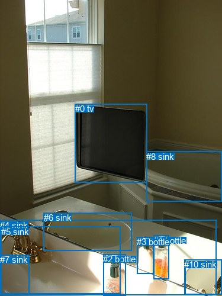
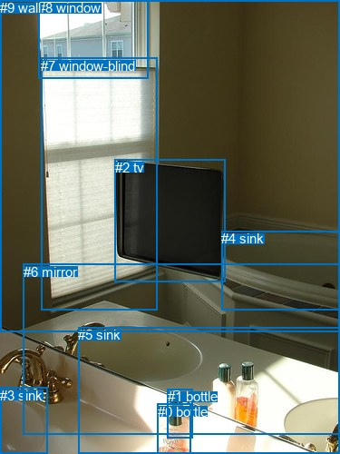

# 图片 0215：2321981.jpg

随机样本序号：384。图片 SHA256：`168313f61dbe42e31e509d7e06343ff85fc41e2bcbc225f4e8ed1929ed8d5dc7`。

红色框表示人，蓝色框表示其他物体。两个模式分别保留自身框编号，可依据位置比较对应对象。

## 自动检测框与输出

人的框编号：`[]`。状态：`no_person`。

### 自动检测全部物体框

| 编号 | 类别 | 是否为人 | 检测分数 | 像素坐标 xyxy |
|---|---|---|---|---|
| 0 | tv | False | 0.9979 | 126.8, 175.3, 248.0, 308.2 |
| 1 | bottle | False | 0.9929 | 259.1, 397.7, 285.8, 471.6 |
| 2 | bottle | False | 0.9832 | 174.5, 429.3, 212.7, 499.5 |
| 3 | bottle | False | 0.9693 | 231.1, 400.3, 259.9, 462.7 |
| 4 | sink | False | 0.9412 | 0.0, 371.5, 365.8, 498.8 |
| 5 | sink | False | 0.9181 | 1.7, 382.9, 203.8, 496.9 |
| 6 | sink | False | 0.8751 | 73.8, 359.0, 222.8, 423.6 |
| 7 | sink | False | 0.8175 | 0.3, 430.2, 49.5, 497.8 |
| 8 | sink | False | 0.7611 | 247.0, 255.7, 374.2, 341.0 |
| 9 | chair | False | 0.6313 | 313.0, 438.2, 374.6, 497.1 |
| 10 | sink | False | 0.3650 | 311.3, 438.1, 374.9, 497.7 |

### 自动检测 Top50 人相关候选

评分物体对：0；人相关物体对：0；输出关系：0。

| 排名 | 主语编号与类别 | 关系 | 宾语编号与类别 | 类型 | 人与人 | 排序分数 | 原始融合 logit |
|---|---|---|---|---|---|---|---|

### 自动检测逐条人相关 GT 核验

本图没有人相关 GT，R@50 无分母；预测候选继续展示。

## 真实框与输出

人的框编号：`[]`。

### 真实框全部物体框

| 编号 | 类别 | 是否为人 | 检测分数 | 像素坐标 xyxy |
|---|---|---|---|---|
| 0 | bottle | False | GT | 174.0, 445.0, 211.0, 500.0 |
| 1 | bottle | False | GT | 185.0, 428.0, 213.0, 482.0 |
| 2 | tv | False | GT | 127.0, 176.0, 248.0, 311.0 |
| 3 | sink | False | GT | 0.0, 427.0, 53.0, 500.0 |
| 4 | sink | False | GT | 244.0, 254.0, 375.0, 341.0 |
| 5 | sink | False | GT | 86.0, 360.0, 374.0, 499.0 |
| 6 | mirror | False | GT | 26.0, 291.0, 375.0, 478.0 |
| 7 | window-blind | False | GT | 45.0, 64.0, 173.0, 342.0 |
| 8 | window | False | GT | 42.0, 0.0, 164.0, 86.0 |
| 9 | wall | False | GT | 0.0, 0.0, 375.0, 366.0 |

### 真实框 Top50 人相关候选

评分物体对：0；人相关物体对：0；输出关系：0。

| 排名 | 主语编号与类别 | 关系 | 宾语编号与类别 | 类型 | 人与人 | 排序分数 | 原始融合 logit |
|---|---|---|---|---|---|---|---|

### 真实框逐条人相关 GT 核验

本图没有人相关 GT，R@50 无分母；预测候选继续展示。

## 全部人相关 GT

| 主语编号与类别 | 关系 | 宾语编号与类别 |
|---|---|---|

原始记录、全部人相关物体对的两项预测与分项分数见 [逐图证据 JSON](../evidence/cases/0215.json)。全部56类 logits 保留于本机 HOR/output/random500/logits/。

<!-- HOR_COMPLETE_RESULTS -->

## 六组条件的完整输出对照

以下保留同一图片三种框与候选模式、两种谓词输出规则的全部 Top50。框编号各自在所属模式内解释。

### 自动检测框完整枚举：空间与语义各保留一个谓词

| 排名 | 主语编号与类别 | 谓词 | 宾语编号与类别 | 分组 | 排序分数 | predicate logit | pair logit |
|---|---|---|---|---|---|---|---|

没有人相关 GT，本条件的召回率无分母。

### 自动检测框完整枚举：每对只保留一个谓词

| 排名 | 主语编号与类别 | 谓词 | 宾语编号与类别 | 分组 | 排序分数 | predicate logit | pair logit |
|---|---|---|---|---|---|---|---|

没有人相关 GT，本条件的召回率无分母。

### 真实框完整枚举：空间与语义各保留一个谓词

| 排名 | 主语编号与类别 | 谓词 | 宾语编号与类别 | 分组 | 排序分数 | predicate logit | pair logit |
|---|---|---|---|---|---|---|---|

没有人相关 GT，本条件的召回率无分母。

### 真实框完整枚举：每对只保留一个谓词

| 排名 | 主语编号与类别 | 谓词 | 宾语编号与类别 | 分组 | 排序分数 | predicate logit | pair logit |
|---|---|---|---|---|---|---|---|

没有人相关 GT，本条件的召回率无分母。

### 真实框400候选：空间与语义各保留一个谓词

| 排名 | 主语编号与类别 | 谓词 | 宾语编号与类别 | 分组 | 排序分数 | predicate logit | pair logit |
|---|---|---|---|---|---|---|---|

没有人相关 GT，本条件的召回率无分母。

### 真实框400候选：每对只保留一个谓词

| 排名 | 主语编号与类别 | 谓词 | 宾语编号与类别 | 分组 | 排序分数 | predicate logit | pair logit |
|---|---|---|---|---|---|---|---|

没有人相关 GT，本条件的召回率无分母。
