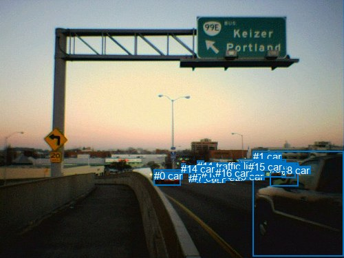
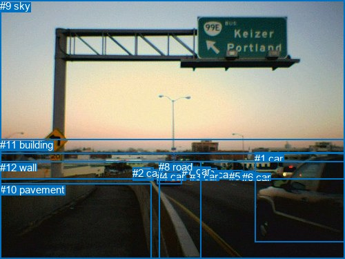

# 图片 0221：2322264.jpg

随机样本序号：497。图片 SHA256：`5a07bffd50042e13421fbdb48eb2e89badb941fa1c27ba20a2f9c9f69b5f35db`。

红色框表示人，蓝色框表示其他物体。两个模式分别保留自身框编号，可依据位置比较对应对象。

## 自动检测框与输出

人的框编号：`[]`。状态：`no_person`。

### 自动检测全部物体框

| 编号 | 类别 | 是否为人 | 检测分数 | 像素坐标 xyxy |
|---|---|---|---|---|
| 0 | car | False | 0.9994 | 223.9, 246.7, 262.5, 269.6 |
| 1 | car | False | 0.9843 | 367.9, 219.4, 500.0, 372.5 |
| 2 | car | False | 0.9063 | 313.0, 249.0, 326.7, 256.1 |
| 3 | car | False | 0.9028 | 392.2, 236.9, 433.6, 271.0 |
| 4 | car | False | 0.8280 | 274.3, 250.9, 287.0, 258.7 |
| 5 | traffic light | False | 0.7534 | 290.7, 233.4, 296.5, 238.6 |
| 6 | car | False | 0.7491 | 286.0, 251.6, 294.1, 258.4 |
| 7 | car | False | 0.6792 | 279.1, 250.5, 293.8, 258.7 |
| 8 | car | False | 0.6050 | 409.2, 238.7, 429.7, 258.4 |
| 9 | car | False | 0.5980 | 342.3, 247.7, 361.2, 257.2 |
| 10 | bus | False | 0.5851 | 347.7, 231.6, 415.6, 257.1 |
| 11 | traffic light | False | 0.5585 | 286.5, 233.0, 290.9, 238.1 |
| 12 | car | False | 0.5583 | 294.1, 245.9, 308.5, 258.7 |
| 13 | car | False | 0.5496 | 292.5, 244.1, 317.3, 259.3 |
| 14 | car | False | 0.5287 | 263.2, 237.2, 270.0, 243.5 |
| 15 | car | False | 0.4351 | 361.3, 234.2, 415.8, 257.8 |
| 16 | car | False | 0.3815 | 312.7, 243.1, 327.7, 256.7 |

### 自动检测 Top50 人相关候选

评分物体对：0；人相关物体对：0；输出关系：0。

| 排名 | 主语编号与类别 | 关系 | 宾语编号与类别 | 类型 | 人与人 | 排序分数 | 原始融合 logit |
|---|---|---|---|---|---|---|---|

### 自动检测逐条人相关 GT 核验

本图没有人相关 GT，R@50 无分母；预测候选继续展示。

## 真实框与输出

人的框编号：`[]`。

### 真实框全部物体框

| 编号 | 类别 | 是否为人 | 检测分数 | 像素坐标 xyxy |
|---|---|---|---|---|
| 0 | car | False | GT | 295.0, 244.0, 314.0, 260.0 |
| 1 | car | False | GT | 369.0, 221.0, 500.0, 351.0 |
| 2 | car | False | GT | 192.0, 242.0, 222.0, 261.0 |
| 3 | car | False | GT | 275.0, 247.0, 297.0, 258.0 |
| 4 | car | False | GT | 227.0, 247.0, 263.0, 266.0 |
| 5 | car | False | GT | 332.0, 247.0, 351.0, 257.0 |
| 6 | car | False | GT | 351.0, 248.0, 368.0, 258.0 |
| 7 | car | False | GT | 264.0, 239.0, 270.0, 243.0 |
| 8 | road | False | GT | 230.0, 233.0, 500.0, 375.0 |
| 9 | sky | False | GT | 0.0, 0.0, 500.0, 223.0 |
| 10 | pavement | False | GT | 0.0, 266.0, 220.0, 375.0 |
| 11 | building | False | GT | 0.0, 201.0, 500.0, 259.0 |
| 12 | wall | False | GT | 0.0, 234.0, 292.0, 375.0 |

### 真实框 Top50 人相关候选

评分物体对：0；人相关物体对：0；输出关系：0。

| 排名 | 主语编号与类别 | 关系 | 宾语编号与类别 | 类型 | 人与人 | 排序分数 | 原始融合 logit |
|---|---|---|---|---|---|---|---|

### 真实框逐条人相关 GT 核验

本图没有人相关 GT，R@50 无分母；预测候选继续展示。

## 全部人相关 GT

| 主语编号与类别 | 关系 | 宾语编号与类别 |
|---|---|---|

原始记录、全部人相关物体对的两项预测与分项分数见 [逐图证据 JSON](../evidence/cases/0221.json)。全部56类 logits 保留于本机 HOR/output/random500/logits/。

<!-- HOR_COMPLETE_RESULTS -->

## 六组条件的完整输出对照

以下保留同一图片三种框与候选模式、两种谓词输出规则的全部 Top50。框编号各自在所属模式内解释。

### 自动检测框完整枚举：空间与语义各保留一个谓词

| 排名 | 主语编号与类别 | 谓词 | 宾语编号与类别 | 分组 | 排序分数 | predicate logit | pair logit |
|---|---|---|---|---|---|---|---|

没有人相关 GT，本条件的召回率无分母。

### 自动检测框完整枚举：每对只保留一个谓词

| 排名 | 主语编号与类别 | 谓词 | 宾语编号与类别 | 分组 | 排序分数 | predicate logit | pair logit |
|---|---|---|---|---|---|---|---|

没有人相关 GT，本条件的召回率无分母。

### 真实框完整枚举：空间与语义各保留一个谓词

| 排名 | 主语编号与类别 | 谓词 | 宾语编号与类别 | 分组 | 排序分数 | predicate logit | pair logit |
|---|---|---|---|---|---|---|---|

没有人相关 GT，本条件的召回率无分母。

### 真实框完整枚举：每对只保留一个谓词

| 排名 | 主语编号与类别 | 谓词 | 宾语编号与类别 | 分组 | 排序分数 | predicate logit | pair logit |
|---|---|---|---|---|---|---|---|

没有人相关 GT，本条件的召回率无分母。

### 真实框400候选：空间与语义各保留一个谓词

| 排名 | 主语编号与类别 | 谓词 | 宾语编号与类别 | 分组 | 排序分数 | predicate logit | pair logit |
|---|---|---|---|---|---|---|---|

没有人相关 GT，本条件的召回率无分母。

### 真实框400候选：每对只保留一个谓词

| 排名 | 主语编号与类别 | 谓词 | 宾语编号与类别 | 分组 | 排序分数 | predicate logit | pair logit |
|---|---|---|---|---|---|---|---|

没有人相关 GT，本条件的召回率无分母。
