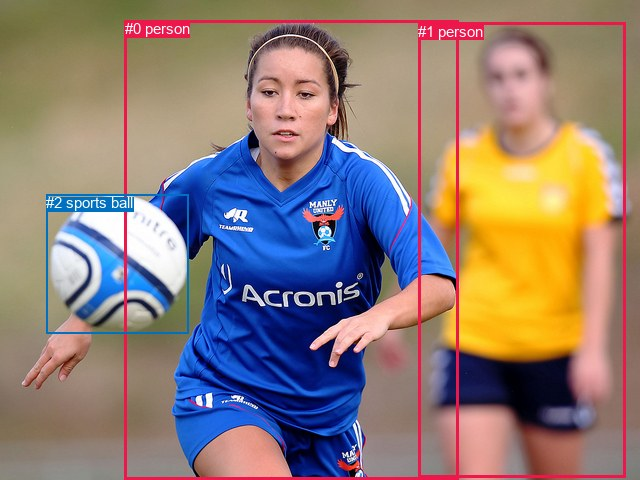

# 图片 0227：2322480.jpg

随机样本序号：93。图片 SHA256：`90fad7bfc9fab88492d9722ea1aa14ee77514d8c10dbda86086bd37d8a05acf0`。

红色框表示人，蓝色框表示其他物体。两个模式分别保留自身框编号，可依据位置比较对应对象。

## 自动检测框与输出

人的框编号：`[0, 1]`。状态：`ok`。

### 自动检测全部物体框

| 编号 | 类别 | 是否为人 | 检测分数 | 像素坐标 xyxy |
|---|---|---|---|---|
| 0 | person | True | 0.9995 | 125.0, 20.0, 458.5, 480.0 |
| 1 | person | True | 0.9994 | 418.4, 22.8, 626.0, 477.5 |
| 2 | sports ball | False | 0.9993 | 46.1, 194.1, 188.2, 333.6 |

### 自动检测 Top50 人相关候选

评分物体对：6；人相关物体对：6；输出关系：12。

| 排名 | 主语编号与类别 | 关系 | 宾语编号与类别 | 类型 | 人与人 | 排序分数 | 原始融合 logit |
|---|---|---|---|---|---|---|---|
| 1 | #0 person | kicking | #2 sports ball | semantic | False | 0.98700 | 4.3301 |
| 2 | #1 person | running on | #0 person | semantic | True | 0.95286 | 3.0063 |
| 3 | #0 person | beside | #1 person | spatial | True | 0.94740 | 2.8910 |
| 4 | #1 person | beside | #0 person | spatial | True | 0.85224 | 1.7523 |
| 5 | #0 person | running on | #1 person | semantic | True | 0.82588 | 1.5567 |
| 6 | #0 person | beside | #2 sports ball | spatial | False | 0.74341 | 1.0637 |
| 7 | #2 sports ball | beside | #0 person | spatial | False | 0.72769 | 0.9829 |
| 8 | #1 person | kicking | #2 sports ball | semantic | False | 0.56825 | 0.2747 |
| 9 | #1 person | beside | #2 sports ball | spatial | False | 0.23234 | -1.1951 |
| 10 | #2 sports ball | flying over | #0 person | semantic | False | 0.20102 | -1.3799 |
| 11 | #2 sports ball | beside | #1 person | spatial | False | 0.10002 | -2.1970 |
| 12 | #2 sports ball | holding | #1 person | semantic | False | 0.00899 | -4.7031 |

### 自动检测逐条人相关 GT 核验

R@50：20.00%；命中 1/5。

| GT 主语编号 | GT 关系 | GT 宾语编号 | 结果阶段 | 匹配预测主语编号 | 匹配预测宾语编号 |
|---|---|---|---|---|---|
| 0 | looking at | 1 | wrong_predicate | [1] | [0] |
| 1 | chasing | 2 | wrong_predicate | [0] | [2] |
| 1 | playing | 2 | wrong_predicate | [0] | [2] |
| 1 | kicking | 2 | hit50 | [0] | [2] |
| 2 | in front of | 1 | wrong_predicate | [2] | [0] |

## 真实框与输出

人的框编号：`[0, 1]`。

### 真实框全部物体框

| 编号 | 类别 | 是否为人 | 检测分数 | 像素坐标 xyxy |
|---|---|---|---|---|
| 0 | person | True | GT | 423.0, 26.0, 634.0, 475.0 |
| 1 | person | True | GT | 21.0, 18.0, 456.0, 474.0 |
| 2 | sports ball | False | GT | 49.0, 195.0, 188.0, 334.0 |

### 真实框 Top50 人相关候选

评分物体对：6；人相关物体对：6；输出关系：12。

| 排名 | 主语编号与类别 | 关系 | 宾语编号与类别 | 类型 | 人与人 | 排序分数 | 原始融合 logit |
|---|---|---|---|---|---|---|---|
| 1 | #1 person | kicking | #2 sports ball | semantic | False | 0.98469 | 4.1641 |
| 2 | #0 person | running on | #1 person | semantic | True | 0.94554 | 2.8542 |
| 3 | #1 person | beside | #0 person | spatial | True | 0.90880 | 2.2991 |
| 4 | #0 person | beside | #1 person | spatial | True | 0.79792 | 1.3734 |
| 5 | #1 person | running on | #0 person | semantic | True | 0.77426 | 1.2325 |
| 6 | #1 person | in | #2 sports ball | spatial | False | 0.71791 | 0.9341 |
| 7 | #0 person | kicking | #2 sports ball | semantic | False | 0.55796 | 0.2329 |
| 8 | #2 sports ball | beside | #1 person | spatial | False | 0.28159 | -0.9366 |
| 9 | #0 person | beside | #2 sports ball | spatial | False | 0.18548 | -1.4796 |
| 10 | #2 sports ball | flying over | #1 person | semantic | False | 0.07877 | -2.4592 |
| 11 | #2 sports ball | beside | #0 person | spatial | False | 0.05847 | -2.7789 |
| 12 | #2 sports ball | holding | #0 person | semantic | False | 0.00549 | -5.2000 |

### 真实框逐条人相关 GT 核验

R@50：20.00%；命中 1/5。

| GT 主语编号 | GT 关系 | GT 宾语编号 | 结果阶段 | 匹配预测主语编号 | 匹配预测宾语编号 |
|---|---|---|---|---|---|
| 0 | looking at | 1 | wrong_predicate | [0] | [1] |
| 1 | chasing | 2 | wrong_predicate | [1] | [2] |
| 1 | playing | 2 | wrong_predicate | [1] | [2] |
| 1 | kicking | 2 | hit50 | [1] | [2] |
| 2 | in front of | 1 | wrong_predicate | [2] | [1] |

## 全部人相关 GT

| 主语编号与类别 | 关系 | 宾语编号与类别 |
|---|---|---|
| #0 person | looking at | #1 person |
| #1 person | chasing | #2 sports ball |
| #1 person | playing | #2 sports ball |
| #1 person | kicking | #2 sports ball |
| #2 sports ball | in front of | #1 person |

原始记录、全部人相关物体对的两项预测与分项分数见 [逐图证据 JSON](../evidence/cases/0227.json)。全部56类 logits 保留于本机 HOR/output/random500/logits/。

<!-- HOR_COMPLETE_RESULTS -->

## 六组条件的完整输出对照

以下保留同一图片三种框与候选模式、两种谓词输出规则的全部 Top50。框编号各自在所属模式内解释。

### 自动检测框完整枚举：空间与语义各保留一个谓词

| 排名 | 主语编号与类别 | 谓词 | 宾语编号与类别 | 分组 | 排序分数 | predicate logit | pair logit |
|---|---|---|---|---|---|---|---|
| 1 | #0 person | kicking | #2 sports ball | semantic | 0.9870042 | 3.6129231 | 0.7171298 |
| 2 | #1 person | running on | #0 person | semantic | 0.9528588 | 3.1061006 | -0.0997816 |
| 3 | #0 person | beside | #1 person | spatial | 0.9474013 | 3.5320687 | -0.6410369 |
| 4 | #1 person | beside | #0 person | spatial | 0.8522383 | 1.8520470 | -0.0997816 |
| 5 | #0 person | running on | #1 person | semantic | 0.8258821 | 2.1977558 | -0.6410369 |
| 6 | #0 person | beside | #2 sports ball | spatial | 0.7434060 | 0.3466172 | 0.7171298 |
| 7 | #2 sports ball | beside | #0 person | spatial | 0.7276887 | 1.3010077 | -0.3180799 |
| 8 | #1 person | kicking | #2 sports ball | semantic | 0.5682471 | 0.4514637 | -0.1767608 |
| 9 | #1 person | beside | #2 sports ball | spatial | 0.2323424 | -1.0183711 | -0.1767608 |
| 10 | #2 sports ball | flying over | #0 person | semantic | 0.2010209 | -1.0618463 | -0.3180799 |
| 11 | #2 sports ball | beside | #1 person | spatial | 0.1000167 | -1.0578592 | -1.1391796 |
| 12 | #2 sports ball | holding | #1 person | semantic | 0.0089854 | -3.5639510 | -1.1391796 |

GT 命中：1/5，R@50=20.00%。

| GT主语 | GT谓词 | GT宾语 | 结果阶段 | 匹配主语框 | 匹配宾语框 |
|---|---|---|---|---|---|
| 0 | looking at | 1 | wrong_predicate | [1] | [0] |
| 1 | chasing | 2 | wrong_predicate | [0] | [2] |
| 1 | playing | 2 | wrong_predicate | [0] | [2] |
| 1 | kicking | 2 | hit50 | [0] | [2] |
| 2 | in front of | 1 | wrong_predicate | [2] | [0] |

### 自动检测框完整枚举：每对只保留一个谓词

| 排名 | 主语编号与类别 | 谓词 | 宾语编号与类别 | 分组 | 排序分数 | predicate logit | pair logit |
|---|---|---|---|---|---|---|---|
| 1 | #0 person | kicking | #2 sports ball | single | 0.9870042 | 3.6129231 | 0.7171298 |
| 2 | #1 person | running on | #0 person | single | 0.9528588 | 3.1061006 | -0.0997816 |
| 3 | #0 person | beside | #1 person | single | 0.9474013 | 3.5320687 | -0.6410369 |
| 4 | #2 sports ball | beside | #0 person | single | 0.7276887 | 1.3010077 | -0.3180799 |
| 5 | #1 person | kicking | #2 sports ball | single | 0.5682471 | 0.4514637 | -0.1767608 |
| 6 | #2 sports ball | beside | #1 person | single | 0.1000167 | -1.0578592 | -1.1391796 |

GT 命中：1/5，R@50=20.00%。

| GT主语 | GT谓词 | GT宾语 | 结果阶段 | 匹配主语框 | 匹配宾语框 |
|---|---|---|---|---|---|
| 0 | looking at | 1 | wrong_predicate | [1] | [0] |
| 1 | chasing | 2 | wrong_predicate | [0] | [2] |
| 1 | playing | 2 | wrong_predicate | [0] | [2] |
| 1 | kicking | 2 | hit50 | [0] | [2] |
| 2 | in front of | 1 | wrong_predicate | [2] | [0] |

### 真实框完整枚举：空间与语义各保留一个谓词

| 排名 | 主语编号与类别 | 谓词 | 宾语编号与类别 | 分组 | 排序分数 | predicate logit | pair logit |
|---|---|---|---|---|---|---|---|
| 1 | #1 person | kicking | #2 sports ball | semantic | 0.9846938 | 3.4979157 | 0.6661533 |
| 2 | #0 person | running on | #1 person | semantic | 0.9455365 | 2.8822365 | -0.0280144 |
| 3 | #1 person | beside | #0 person | spatial | 0.9088016 | 3.0510707 | -0.7519825 |
| 4 | #0 person | beside | #1 person | spatial | 0.7979221 | 1.4013724 | -0.0280144 |
| 5 | #1 person | running on | #0 person | semantic | 0.7742551 | 1.9844780 | -0.7519825 |
| 6 | #1 person | in | #2 sports ball | spatial | 0.7179143 | 0.2679863 | 0.6661533 |
| 7 | #0 person | kicking | #2 sports ball | semantic | 0.5579593 | 0.4238729 | -0.1909890 |
| 8 | #2 sports ball | beside | #1 person | spatial | 0.2815901 | -0.6218400 | -0.3147480 |
| 9 | #0 person | beside | #2 sports ball | spatial | 0.1854829 | -1.2886434 | -0.1909890 |
| 10 | #2 sports ball | flying over | #1 person | semantic | 0.0787682 | -2.1444547 | -0.3147480 |
| 11 | #2 sports ball | beside | #0 person | spatial | 0.0584725 | -1.6437712 | -1.1351758 |
| 12 | #2 sports ball | holding | #0 person | semantic | 0.0054865 | -4.0647836 | -1.1351758 |

GT 命中：1/5，R@50=20.00%。

| GT主语 | GT谓词 | GT宾语 | 结果阶段 | 匹配主语框 | 匹配宾语框 |
|---|---|---|---|---|---|
| 0 | looking at | 1 | wrong_predicate | [0] | [1] |
| 1 | chasing | 2 | wrong_predicate | [1] | [2] |
| 1 | playing | 2 | wrong_predicate | [1] | [2] |
| 1 | kicking | 2 | hit50 | [1] | [2] |
| 2 | in front of | 1 | wrong_predicate | [2] | [1] |

### 真实框完整枚举：每对只保留一个谓词

| 排名 | 主语编号与类别 | 谓词 | 宾语编号与类别 | 分组 | 排序分数 | predicate logit | pair logit |
|---|---|---|---|---|---|---|---|
| 1 | #1 person | kicking | #2 sports ball | single | 0.9846938 | 3.4979157 | 0.6661533 |
| 2 | #0 person | running on | #1 person | single | 0.9455365 | 2.8822365 | -0.0280144 |
| 3 | #1 person | beside | #0 person | single | 0.9088016 | 3.0510707 | -0.7519825 |
| 4 | #0 person | kicking | #2 sports ball | single | 0.5579593 | 0.4238729 | -0.1909890 |
| 5 | #2 sports ball | beside | #1 person | single | 0.2815901 | -0.6218400 | -0.3147480 |
| 6 | #2 sports ball | beside | #0 person | single | 0.0584725 | -1.6437712 | -1.1351758 |

GT 命中：1/5，R@50=20.00%。

| GT主语 | GT谓词 | GT宾语 | 结果阶段 | 匹配主语框 | 匹配宾语框 |
|---|---|---|---|---|---|
| 0 | looking at | 1 | wrong_predicate | [0] | [1] |
| 1 | chasing | 2 | wrong_predicate | [1] | [2] |
| 1 | playing | 2 | wrong_predicate | [1] | [2] |
| 1 | kicking | 2 | hit50 | [1] | [2] |
| 2 | in front of | 1 | wrong_predicate | [2] | [1] |

### 真实框400候选：空间与语义各保留一个谓词

| 排名 | 主语编号与类别 | 谓词 | 宾语编号与类别 | 分组 | 排序分数 | predicate logit | pair logit |
|---|---|---|---|---|---|---|---|
| 1 | #1 person | kicking | #2 sports ball | semantic | 0.9846938 | 3.4979157 | 0.6661533 |
| 2 | #0 person | running on | #1 person | semantic | 0.9455365 | 2.8822365 | -0.0280144 |
| 3 | #1 person | beside | #0 person | spatial | 0.9088063 | 3.0511284 | -0.7519825 |
| 4 | #0 person | beside | #1 person | spatial | 0.7930455 | 1.3713961 | -0.0280144 |
| 5 | #1 person | running on | #0 person | semantic | 0.7693045 | 1.9563708 | -0.7519825 |
| 6 | #1 person | in | #2 sports ball | spatial | 0.7185860 | 0.2713051 | 0.6661533 |
| 7 | #0 person | kicking | #2 sports ball | semantic | 0.5580032 | 0.4240513 | -0.1909890 |
| 8 | #2 sports ball | beside | #1 person | spatial | 0.2877099 | -0.5917845 | -0.3147480 |
| 9 | #0 person | beside | #2 sports ball | spatial | 0.1854742 | -1.2887011 | -0.1909890 |
| 10 | #2 sports ball | flying over | #1 person | semantic | 0.0787697 | -2.1444340 | -0.3147480 |
| 11 | #2 sports ball | beside | #0 person | spatial | 0.0576544 | -1.6587298 | -1.1351758 |
| 12 | #2 sports ball | holding | #0 person | semantic | 0.0054376 | -4.0737834 | -1.1351758 |

GT 命中：1/5，R@50=20.00%。

| GT主语 | GT谓词 | GT宾语 | 结果阶段 | 匹配主语框 | 匹配宾语框 |
|---|---|---|---|---|---|
| 0 | looking at | 1 | wrong_predicate | [0] | [1] |
| 1 | chasing | 2 | wrong_predicate | [1] | [2] |
| 1 | playing | 2 | wrong_predicate | [1] | [2] |
| 1 | kicking | 2 | hit50 | [1] | [2] |
| 2 | in front of | 1 | wrong_predicate | [2] | [1] |

### 真实框400候选：每对只保留一个谓词

| 排名 | 主语编号与类别 | 谓词 | 宾语编号与类别 | 分组 | 排序分数 | predicate logit | pair logit |
|---|---|---|---|---|---|---|---|
| 1 | #1 person | kicking | #2 sports ball | single | 0.9846938 | 3.4979157 | 0.6661533 |
| 2 | #0 person | running on | #1 person | single | 0.9455365 | 2.8822365 | -0.0280144 |
| 3 | #1 person | beside | #0 person | single | 0.9088063 | 3.0511284 | -0.7519825 |
| 4 | #0 person | kicking | #2 sports ball | single | 0.5580032 | 0.4240513 | -0.1909890 |
| 5 | #2 sports ball | beside | #1 person | single | 0.2877099 | -0.5917845 | -0.3147480 |
| 6 | #2 sports ball | beside | #0 person | single | 0.0576544 | -1.6587298 | -1.1351758 |

GT 命中：1/5，R@50=20.00%。

| GT主语 | GT谓词 | GT宾语 | 结果阶段 | 匹配主语框 | 匹配宾语框 |
|---|---|---|---|---|---|
| 0 | looking at | 1 | wrong_predicate | [0] | [1] |
| 1 | chasing | 2 | wrong_predicate | [1] | [2] |
| 1 | playing | 2 | wrong_predicate | [1] | [2] |
| 1 | kicking | 2 | hit50 | [1] | [2] |
| 2 | in front of | 1 | wrong_predicate | [2] | [1] |
