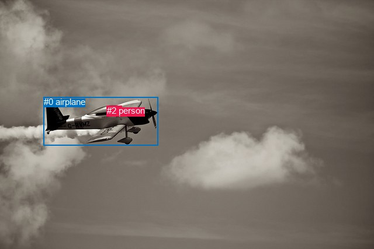
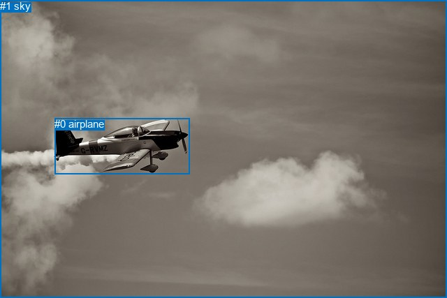

# 图片 0229：2322627.jpg

随机样本序号：151。图片 SHA256：`807b8765af872023b004a7b2bf0f158c8a176dfa8c07d405f107eb9857c4b2e3`。

红色框表示人，蓝色框表示其他物体。两个模式分别保留自身框编号，可依据位置比较对应对象。

## 自动检测框与输出

人的框编号：`[1, 2]`。状态：`ok`。

### 自动检测全部物体框

| 编号 | 类别 | 是否为人 | 检测分数 | 像素坐标 xyxy |
|---|---|---|---|---|
| 0 | airplane | False | 0.9993 | 74.8, 166.4, 270.6, 249.0 |
| 1 | person | True | 0.9471 | 182.7, 182.8, 198.2, 197.0 |
| 2 | person | True | 0.3792 | 182.7, 181.5, 208.8, 198.5 |

### 自动检测 Top50 人相关候选

评分物体对：6；人相关物体对：6；输出关系：12。

| 排名 | 主语编号与类别 | 关系 | 宾语编号与类别 | 类型 | 人与人 | 排序分数 | 原始融合 logit |
|---|---|---|---|---|---|---|---|
| 1 | #2 person | flying over | #0 airplane | semantic | False | 0.98470 | 4.1646 |
| 2 | #1 person | flying over | #0 airplane | semantic | False | 0.97953 | 3.8682 |
| 3 | #1 person | in | #0 airplane | spatial | False | 0.36537 | -0.5522 |
| 4 | #2 person | on | #0 airplane | spatial | False | 0.33455 | -0.6877 |
| 5 | #1 person | sitting on | #2 person | semantic | True | 0.09873 | -2.2115 |
| 6 | #1 person | beside | #2 person | spatial | True | 0.08741 | -2.3457 |
| 7 | #2 person | in front of | #1 person | spatial | True | 0.04059 | -3.1627 |
| 8 | #2 person | wearing | #1 person | semantic | True | 0.00548 | -5.2018 |
| 9 | #0 airplane | in | #2 person | spatial | False | 0.00102 | -6.8841 |
| 10 | #0 airplane | in | #1 person | spatial | False | 0.00069 | -7.2722 |
| 11 | #0 airplane | carrying | #2 person | semantic | False | 0.00063 | -7.3663 |
| 12 | #0 airplane | carrying | #1 person | semantic | False | 0.00056 | -7.4867 |

### 自动检测逐条人相关 GT 核验

本图没有人相关 GT，R@50 无分母；预测候选继续展示。

## 真实框与输出

人的框编号：`[]`。

### 真实框全部物体框

| 编号 | 类别 | 是否为人 | 检测分数 | 像素坐标 xyxy |
|---|---|---|---|---|
| 0 | airplane | False | GT | 78.0, 169.0, 271.0, 249.0 |
| 1 | sky | False | GT | 0.0, 0.0, 640.0, 427.0 |

### 真实框 Top50 人相关候选

评分物体对：0；人相关物体对：0；输出关系：0。

| 排名 | 主语编号与类别 | 关系 | 宾语编号与类别 | 类型 | 人与人 | 排序分数 | 原始融合 logit |
|---|---|---|---|---|---|---|---|

### 真实框逐条人相关 GT 核验

本图没有人相关 GT，R@50 无分母；预测候选继续展示。

## 全部人相关 GT

| 主语编号与类别 | 关系 | 宾语编号与类别 |
|---|---|---|

原始记录、全部人相关物体对的两项预测与分项分数见 [逐图证据 JSON](../evidence/cases/0229.json)。全部56类 logits 保留于本机 HOR/output/random500/logits/。

<!-- HOR_COMPLETE_RESULTS -->

## 六组条件的完整输出对照

以下保留同一图片三种框与候选模式、两种谓词输出规则的全部 Top50。框编号各自在所属模式内解释。

### 自动检测框完整枚举：空间与语义各保留一个谓词

| 排名 | 主语编号与类别 | 谓词 | 宾语编号与类别 | 分组 | 排序分数 | predicate logit | pair logit |
|---|---|---|---|---|---|---|---|
| 1 | #2 person | flying over | #0 airplane | semantic | 0.9847018 | 3.3584571 | 0.8061519 |
| 2 | #1 person | flying over | #0 airplane | semantic | 0.9795312 | 3.0580673 | 0.8101010 |
| 3 | #1 person | in | #0 airplane | spatial | 0.3653653 | -1.3622530 | 0.8101010 |
| 4 | #2 person | on | #0 airplane | spatial | 0.3345521 | -1.4938195 | 0.8061519 |
| 5 | #1 person | sitting on | #2 person | semantic | 0.0987252 | -1.4952083 | -0.7162616 |
| 6 | #1 person | beside | #2 person | spatial | 0.0874120 | -1.6293905 | -0.7162616 |
| 7 | #2 person | in front of | #1 person | spatial | 0.0405944 | -2.4363205 | -0.7263634 |
| 8 | #2 person | wearing | #1 person | semantic | 0.0054763 | -4.4754663 | -0.7263634 |
| 9 | #0 airplane | in | #2 person | spatial | 0.0010229 | -5.6145086 | -1.2695453 |
| 10 | #0 airplane | in | #1 person | spatial | 0.0006941 | -6.0004597 | -1.2717326 |
| 11 | #0 airplane | carrying | #2 person | semantic | 0.0006318 | -6.0967326 | -1.2695453 |
| 12 | #0 airplane | carrying | #1 person | semantic | 0.0005602 | -6.2149673 | -1.2717326 |

没有人相关 GT，本条件的召回率无分母。

### 自动检测框完整枚举：每对只保留一个谓词

| 排名 | 主语编号与类别 | 谓词 | 宾语编号与类别 | 分组 | 排序分数 | predicate logit | pair logit |
|---|---|---|---|---|---|---|---|
| 1 | #2 person | flying over | #0 airplane | single | 0.9847018 | 3.3584571 | 0.8061519 |
| 2 | #1 person | flying over | #0 airplane | single | 0.9795312 | 3.0580673 | 0.8101010 |
| 3 | #1 person | sitting on | #2 person | single | 0.0987252 | -1.4952083 | -0.7162616 |
| 4 | #2 person | in front of | #1 person | single | 0.0405944 | -2.4363205 | -0.7263634 |
| 5 | #0 airplane | in | #2 person | single | 0.0010229 | -5.6145086 | -1.2695453 |
| 6 | #0 airplane | in | #1 person | single | 0.0006941 | -6.0004597 | -1.2717326 |

没有人相关 GT，本条件的召回率无分母。

### 真实框完整枚举：空间与语义各保留一个谓词

| 排名 | 主语编号与类别 | 谓词 | 宾语编号与类别 | 分组 | 排序分数 | predicate logit | pair logit |
|---|---|---|---|---|---|---|---|

没有人相关 GT，本条件的召回率无分母。

### 真实框完整枚举：每对只保留一个谓词

| 排名 | 主语编号与类别 | 谓词 | 宾语编号与类别 | 分组 | 排序分数 | predicate logit | pair logit |
|---|---|---|---|---|---|---|---|

没有人相关 GT，本条件的召回率无分母。

### 真实框400候选：空间与语义各保留一个谓词

| 排名 | 主语编号与类别 | 谓词 | 宾语编号与类别 | 分组 | 排序分数 | predicate logit | pair logit |
|---|---|---|---|---|---|---|---|

没有人相关 GT，本条件的召回率无分母。

### 真实框400候选：每对只保留一个谓词

| 排名 | 主语编号与类别 | 谓词 | 宾语编号与类别 | 分组 | 排序分数 | predicate logit | pair logit |
|---|---|---|---|---|---|---|---|

没有人相关 GT，本条件的召回率无分母。
