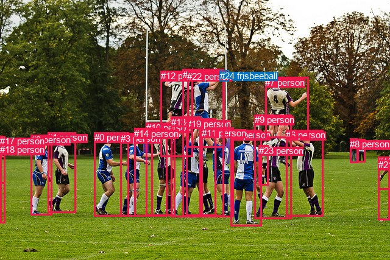
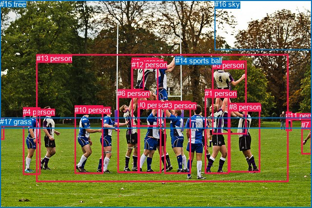

# 图片 0237：2323211.jpg

随机样本序号：54。图片 SHA256：`a688d105dcba71b91a54d447287b8fc48ef6c1bbbeb9641cf85122fc11b5b7ad`。

红色框表示人，蓝色框表示其他物体。两个模式分别保留自身框编号，可依据位置比较对应对象。

## 自动检测框与输出

人的框编号：`[0, 1, 2, 3, 4, 5, 6, 7, 8, 9, 10, 11, 12, 13, 14, 15, 16, 17, 18, 19, 21, 22, 23]`。状态：`ok`。

### 自动检测全部物体框

| 编号 | 类别 | 是否为人 | 检测分数 | 像素坐标 xyxy |
|---|---|---|---|---|
| 0 | person | True | 0.9995 | 154.6, 217.5, 211.1, 355.5 |
| 1 | person | True | 0.9994 | 78.5, 217.4, 124.2, 349.2 |
| 2 | person | True | 0.9993 | 50.6, 221.3, 85.8, 353.5 |
| 3 | person | True | 0.9989 | 197.8, 218.7, 250.9, 355.8 |
| 4 | person | True | 0.9971 | 378.5, 213.3, 429.4, 371.4 |
| 5 | person | True | 0.9970 | 586.0, 228.3, 599.8, 266.4 |
| 6 | person | True | 0.9967 | 469.4, 213.3, 530.8, 355.2 |
| 7 | person | True | 0.9965 | 435.1, 126.7, 506.3, 226.2 |
| 8 | person | True | 0.9956 | 574.1, 227.8, 587.1, 267.2 |
| 9 | person | True | 0.9935 | 417.6, 188.3, 478.9, 359.0 |
| 10 | person | True | 0.9888 | 239.5, 201.3, 287.9, 354.7 |
| 11 | person | True | 0.9853 | 330.8, 209.5, 383.9, 356.8 |
| 12 | person | True | 0.9768 | 263.7, 116.3, 316.8, 257.1 |
| 13 | person | True | 0.9635 | 281.0, 191.6, 329.7, 356.6 |
| 14 | person | True | 0.9621 | 220.4, 210.9, 274.1, 355.4 |
| 15 | person | True | 0.9526 | 299.7, 113.7, 367.9, 355.2 |
| 16 | person | True | 0.9389 | 620.3, 257.2, 640.0, 361.3 |
| 17 | person | True | 0.9349 | 0.0, 223.2, 8.8, 366.2 |
| 18 | person | True | 0.9088 | 0.0, 237.2, 8.8, 301.8 |
| 19 | person | True | 0.8711 | 305.9, 194.9, 354.3, 354.1 |
| 20 | sports ball | False | 0.6996 | 360.4, 115.7, 375.7, 134.0 |
| 21 | person | True | 0.5771 | 620.8, 262.2, 640.0, 311.3 |
| 22 | person | True | 0.5744 | 307.1, 116.6, 368.3, 242.2 |
| 23 | person | True | 0.5662 | 424.6, 238.7, 440.0, 304.4 |
| 24 | frisbee | False | 0.5599 | 360.7, 115.6, 375.9, 133.0 |

### 自动检测 Top50 人相关候选

评分物体对：600；人相关物体对：598；输出关系：50。

| 排名 | 主语编号与类别 | 关系 | 宾语编号与类别 | 类型 | 人与人 | 排序分数 | 原始融合 logit |
|---|---|---|---|---|---|---|---|
| 1 | #15 person | catching | #24 frisbee | semantic | False | 0.99047 | 4.6433 |
| 2 | #15 person | catching | #20 sports ball | semantic | False | 0.99009 | 4.6042 |
| 3 | #17 person | wearing | #18 person | semantic | True | 0.98660 | 4.2989 |
| 4 | #16 person | wearing | #21 person | semantic | True | 0.98437 | 4.1429 |
| 5 | #12 person | catching | #20 sports ball | semantic | False | 0.97969 | 3.8759 |
| 6 | #12 person | catching | #24 frisbee | semantic | False | 0.97937 | 3.8603 |
| 7 | #22 person | catching | #20 sports ball | semantic | False | 0.97596 | 3.7035 |
| 8 | #22 person | catching | #24 frisbee | semantic | False | 0.97574 | 3.6946 |
| 9 | #19 person | catching | #20 sports ball | semantic | False | 0.95616 | 3.0823 |
| 10 | #19 person | catching | #24 frisbee | semantic | False | 0.95520 | 3.0598 |
| 11 | #17 person | in | #18 person | spatial | True | 0.94621 | 2.8673 |
| 12 | #16 person | in | #21 person | spatial | True | 0.94402 | 2.8251 |
| 13 | #13 person | catching | #24 frisbee | semantic | False | 0.93986 | 2.7491 |
| 14 | #13 person | catching | #20 sports ball | semantic | False | 0.93980 | 2.7480 |
| 15 | #9 person | wearing | #23 person | semantic | True | 0.93568 | 2.6775 |
| 16 | #11 person | playing | #24 frisbee | semantic | False | 0.92321 | 2.4867 |
| 17 | #11 person | playing | #20 sports ball | semantic | False | 0.92086 | 2.4541 |
| 18 | #6 person | catching | #20 sports ball | semantic | False | 0.89229 | 2.1144 |
| 19 | #9 person | catching | #24 frisbee | semantic | False | 0.89174 | 2.1086 |
| 20 | #6 person | catching | #24 frisbee | semantic | False | 0.89050 | 2.0958 |
| 21 | #9 person | catching | #20 sports ball | semantic | False | 0.89050 | 2.0958 |
| 22 | #0 person | playing | #20 sports ball | semantic | False | 0.88087 | 2.0007 |
| 23 | #0 person | playing | #24 frisbee | semantic | False | 0.87820 | 1.9755 |
| 24 | #7 person | catching | #20 sports ball | semantic | False | 0.87752 | 1.9691 |
| 25 | #7 person | catching | #24 frisbee | semantic | False | 0.87548 | 1.9503 |
| 26 | #21 person | on | #16 person | spatial | True | 0.87300 | 1.9277 |
| 27 | #10 person | catching | #20 sports ball | semantic | False | 0.86381 | 1.8473 |
| 28 | #10 person | catching | #24 frisbee | semantic | False | 0.86367 | 1.8461 |
| 29 | #5 person | holding | #8 person | semantic | True | 0.85934 | 1.8098 |
| 30 | #15 person | wearing | #22 person | semantic | True | 0.85632 | 1.7851 |
| 31 | #3 person | playing | #20 sports ball | semantic | False | 0.84874 | 1.7247 |
| 32 | #3 person | playing | #24 frisbee | semantic | False | 0.84528 | 1.6980 |
| 33 | #14 person | playing | #20 sports ball | semantic | False | 0.83839 | 1.6463 |
| 34 | #14 person | playing | #24 frisbee | semantic | False | 0.83451 | 1.6179 |
| 35 | #4 person | playing | #20 sports ball | semantic | False | 0.83105 | 1.5931 |
| 36 | #4 person | playing | #24 frisbee | semantic | False | 0.82923 | 1.5802 |
| 37 | #8 person | holding | #5 person | semantic | True | 0.81912 | 1.5104 |
| 38 | #9 person | in | #23 person | spatial | True | 0.80990 | 1.4494 |
| 39 | #2 person | playing | #20 sports ball | semantic | False | 0.80142 | 1.3952 |
| 40 | #1 person | playing | #20 sports ball | semantic | False | 0.79361 | 1.3468 |
| 41 | #2 person | playing | #24 frisbee | semantic | False | 0.78917 | 1.3199 |
| 42 | #1 person | playing | #24 frisbee | semantic | False | 0.78497 | 1.2949 |
| 43 | #4 person | wearing | #23 person | semantic | True | 0.77234 | 1.2215 |
| 44 | #15 person | in | #22 person | spatial | True | 0.75034 | 1.1004 |
| 45 | #16 person | throwing | #20 sports ball | semantic | False | 0.74959 | 1.0964 |
| 46 | #16 person | throwing | #24 frisbee | semantic | False | 0.73853 | 1.0383 |
| 47 | #5 person | in | #8 person | spatial | True | 0.67144 | 0.7147 |
| 48 | #15 person | wearing | #19 person | semantic | True | 0.63718 | 0.5631 |
| 49 | #15 person | on | #24 frisbee | spatial | False | 0.63473 | 0.5526 |
| 50 | #15 person | on | #20 sports ball | spatial | False | 0.63335 | 0.5466 |

### 自动检测逐条人相关 GT 核验

R@50：0.00%；命中 0/8。

| GT 主语编号 | GT 关系 | GT 宾语编号 | 结果阶段 | 匹配预测主语编号 | 匹配预测宾语编号 |
|---|---|---|---|---|---|
| 1 | on | 17 | endpoint_missing_or_wrong_class | [9] | [] |
| 3 | on | 17 | endpoint_missing_or_wrong_class | [11] | [] |
| 5 | over | 1 | wrong_predicate | [7] | [9] |
| 5 | over | 8 | wrong_predicate | [7] | [6] |
| 5 | on | 17 | endpoint_missing_or_wrong_class | [7] | [] |
| 5 | jumping from | 17 | endpoint_missing_or_wrong_class | [7] | [] |
| 8 | on | 17 | endpoint_missing_or_wrong_class | [6] | [] |
| 11 | standing on | 17 | endpoint_missing_or_wrong_class | [5] | [] |

## 真实框与输出

人的框编号：`[0, 1, 2, 3, 4, 5, 6, 7, 8, 9, 10, 11, 12, 13]`。

### 真实框全部物体框

| 编号 | 类别 | 是否为人 | 检测分数 | 像素坐标 xyxy |
|---|---|---|---|---|
| 0 | person | True | GT | 282.0, 207.0, 330.0, 356.0 |
| 1 | person | True | GT | 420.0, 183.0, 469.0, 356.0 |
| 2 | person | True | GT | 271.0, 118.0, 324.0, 259.0 |
| 3 | person | True | GT | 337.0, 208.0, 391.0, 357.0 |
| 4 | person | True | GT | 47.0, 221.0, 83.0, 359.0 |
| 5 | person | True | GT | 436.0, 125.0, 506.0, 276.0 |
| 6 | person | True | GT | 241.0, 183.0, 286.0, 354.0 |
| 7 | person | True | GT | 618.0, 248.0, 640.0, 316.0 |
| 8 | person | True | GT | 470.0, 211.0, 533.0, 353.0 |
| 9 | person | True | GT | 0.0, 242.0, 9.0, 286.0 |
| 10 | person | True | GT | 153.0, 217.0, 211.0, 357.0 |
| 11 | person | True | GT | 586.0, 229.0, 599.0, 268.0 |
| 12 | person | True | GT | 270.0, 124.0, 296.0, 185.0 |
| 13 | person | True | GT | 75.0, 111.0, 592.0, 373.0 |
| 14 | sports ball | False | GT | 360.0, 116.0, 376.0, 133.0 |
| 15 | tree | False | GT | 0.0, 0.0, 640.0, 263.0 |
| 16 | sky | False | GT | 440.0, 0.0, 640.0, 103.0 |
| 17 | grass | False | GT | 0.0, 241.0, 640.0, 427.0 |

### 真实框 Top50 人相关候选

评分物体对：306；人相关物体对：294；输出关系：50。

| 排名 | 主语编号与类别 | 关系 | 宾语编号与类别 | 类型 | 人与人 | 排序分数 | 原始融合 logit |
|---|---|---|---|---|---|---|---|
| 1 | #2 person | catching | #14 sports ball | semantic | False | 0.99339 | 5.0125 |
| 2 | #2 person | wearing | #12 person | semantic | True | 0.98859 | 4.4621 |
| 3 | #13 person | catching | #14 sports ball | semantic | False | 0.98006 | 3.8951 |
| 4 | #5 person | catching | #14 sports ball | semantic | False | 0.97957 | 3.8700 |
| 5 | #11 person | standing on | #17 grass | semantic | False | 0.96754 | 3.3949 |
| 6 | #7 person | running on | #17 grass | semantic | False | 0.96525 | 3.3243 |
| 7 | #9 person | on | #17 grass | spatial | False | 0.96306 | 3.2608 |
| 8 | #9 person | standing on | #17 grass | semantic | False | 0.96300 | 3.2592 |
| 9 | #7 person | on | #17 grass | spatial | False | 0.95396 | 3.0312 |
| 10 | #4 person | on | #17 grass | spatial | False | 0.95346 | 3.0197 |
| 11 | #10 person | on | #17 grass | spatial | False | 0.95273 | 3.0034 |
| 12 | #3 person | standing on | #17 grass | semantic | False | 0.95234 | 2.9948 |
| 13 | #8 person | standing on | #17 grass | semantic | False | 0.95164 | 2.9795 |
| 14 | #10 person | standing on | #17 grass | semantic | False | 0.95107 | 2.9672 |
| 15 | #6 person | standing on | #17 grass | semantic | False | 0.94963 | 2.9366 |
| 16 | #3 person | catching | #14 sports ball | semantic | False | 0.94648 | 2.8726 |
| 17 | #11 person | on | #17 grass | spatial | False | 0.94558 | 2.8550 |
| 18 | #1 person | standing on | #17 grass | semantic | False | 0.94333 | 2.8122 |
| 19 | #6 person | catching | #14 sports ball | semantic | False | 0.94326 | 2.8108 |
| 20 | #1 person | catching | #14 sports ball | semantic | False | 0.94226 | 2.7923 |
| 21 | #4 person | standing on | #17 grass | semantic | False | 0.94033 | 2.7575 |
| 22 | #8 person | catching | #14 sports ball | semantic | False | 0.94016 | 2.7544 |
| 23 | #0 person | standing on | #17 grass | semantic | False | 0.93971 | 2.7464 |
| 24 | #0 person | on | #17 grass | spatial | False | 0.93967 | 2.7456 |
| 25 | #2 person | in | #12 person | spatial | True | 0.93818 | 2.7196 |
| 26 | #6 person | on | #17 grass | spatial | False | 0.93242 | 2.6245 |
| 27 | #8 person | on | #17 grass | spatial | False | 0.93078 | 2.5987 |
| 28 | #3 person | on | #17 grass | spatial | False | 0.93044 | 2.5935 |
| 29 | #13 person | on | #17 grass | spatial | False | 0.92888 | 2.5696 |
| 30 | #1 person | on | #17 grass | spatial | False | 0.91914 | 2.4307 |
| 31 | #0 person | catching | #14 sports ball | semantic | False | 0.89732 | 2.1678 |
| 32 | #8 person | playing | #13 person | semantic | True | 0.88421 | 2.0329 |
| 33 | #5 person | playing with | #13 person | semantic | True | 0.88326 | 2.0236 |
| 34 | #13 person | standing on | #17 grass | semantic | False | 0.87753 | 1.9693 |
| 35 | #5 person | on | #17 grass | spatial | False | 0.86727 | 1.8770 |
| 36 | #2 person | on | #17 grass | spatial | False | 0.86368 | 1.8462 |
| 37 | #7 person | throwing | #14 sports ball | semantic | False | 0.85659 | 1.7872 |
| 38 | #2 person | jumping from | #17 grass | semantic | False | 0.84961 | 1.7315 |
| 39 | #13 person | playing | #5 person | semantic | True | 0.82811 | 1.5723 |
| 40 | #5 person | playing with | #17 grass | semantic | False | 0.82341 | 1.5396 |
| 41 | #2 person | playing with | #13 person | semantic | True | 0.81905 | 1.5099 |
| 42 | #6 person | catching | #2 person | semantic | True | 0.80765 | 1.4348 |
| 43 | #13 person | playing | #2 person | semantic | True | 0.80538 | 1.4203 |
| 44 | #10 person | playing | #13 person | semantic | True | 0.80537 | 1.4202 |
| 45 | #4 person | catching | #14 sports ball | semantic | False | 0.79887 | 1.3792 |
| 46 | #12 person | on | #2 person | spatial | True | 0.77416 | 1.2319 |
| 47 | #10 person | playing | #14 sports ball | semantic | False | 0.76568 | 1.1841 |
| 48 | #11 person | throwing | #14 sports ball | semantic | False | 0.69536 | 0.8253 |
| 49 | #2 person | in | #13 person | spatial | True | 0.69458 | 0.8216 |
| 50 | #6 person | playing | #13 person | semantic | True | 0.68248 | 0.7652 |

### 真实框逐条人相关 GT 核验

R@50：62.50%；命中 5/8。

| GT 主语编号 | GT 关系 | GT 宾语编号 | 结果阶段 | 匹配预测主语编号 | 匹配预测宾语编号 |
|---|---|---|---|---|---|
| 1 | on | 17 | hit50 | [1] | [17] |
| 3 | on | 17 | hit50 | [3] | [17] |
| 5 | over | 1 | wrong_predicate | [5] | [1] |
| 5 | over | 8 | wrong_predicate | [5] | [8] |
| 5 | on | 17 | hit50 | [5] | [17] |
| 5 | jumping from | 17 | wrong_predicate | [5] | [17] |
| 8 | on | 17 | hit50 | [8] | [17] |
| 11 | standing on | 17 | hit50 | [11] | [17] |

## 全部人相关 GT

| 主语编号与类别 | 关系 | 宾语编号与类别 |
|---|---|---|
| #1 person | on | #17 grass |
| #3 person | on | #17 grass |
| #5 person | over | #1 person |
| #5 person | over | #8 person |
| #5 person | on | #17 grass |
| #5 person | jumping from | #17 grass |
| #8 person | on | #17 grass |
| #11 person | standing on | #17 grass |

原始记录、全部人相关物体对的两项预测与分项分数见 [逐图证据 JSON](../evidence/cases/0237.json)。全部56类 logits 保留于本机 HOR/output/random500/logits/。

<!-- HOR_COMPLETE_RESULTS -->

## 六组条件的完整输出对照

以下保留同一图片三种框与候选模式、两种谓词输出规则的全部 Top50。框编号各自在所属模式内解释。

### 自动检测框完整枚举：空间与语义各保留一个谓词

| 排名 | 主语编号与类别 | 谓词 | 宾语编号与类别 | 分组 | 排序分数 | predicate logit | pair logit |
|---|---|---|---|---|---|---|---|
| 1 | #15 person | catching | #24 frisbee | semantic | 0.9904654 | 4.1216426 | 0.5216084 |
| 2 | #15 person | catching | #20 sports ball | semantic | 0.9900895 | 4.0693669 | 0.5348356 |
| 3 | #17 person | wearing | #18 person | semantic | 0.9865980 | 4.0564342 | 0.2424302 |
| 4 | #16 person | wearing | #21 person | semantic | 0.9843714 | 3.8948483 | 0.2480531 |
| 5 | #12 person | catching | #20 sports ball | semantic | 0.9796857 | 3.3990178 | 0.4768912 |
| 6 | #12 person | catching | #24 frisbee | semantic | 0.9793722 | 3.3990178 | 0.4612528 |
| 7 | #22 person | catching | #20 sports ball | semantic | 0.9759557 | 3.6898227 | 0.0137005 |
| 8 | #22 person | catching | #24 frisbee | semantic | 0.9757448 | 3.6845517 | 0.0100187 |
| 9 | #19 person | catching | #20 sports ball | semantic | 0.9561580 | 2.4877081 | 0.5946248 |
| 10 | #19 person | catching | #24 frisbee | semantic | 0.9552040 | 2.4903440 | 0.5694613 |
| 11 | #17 person | in | #18 person | spatial | 0.9462056 | 2.6248584 | 0.2424302 |
| 12 | #16 person | in | #21 person | spatial | 0.9440179 | 2.5770602 | 0.2480531 |
| 13 | #13 person | catching | #24 frisbee | semantic | 0.9398613 | 2.2390718 | 0.5100069 |
| 14 | #13 person | catching | #20 sports ball | semantic | 0.9398014 | 2.2089806 | 0.5390387 |
| 15 | #9 person | wearing | #23 person | semantic | 0.9356834 | 2.8336043 | -0.1561450 |
| 16 | #11 person | playing | #24 frisbee | semantic | 0.9232074 | 2.1650844 | 0.3216624 |
| 17 | #11 person | playing | #20 sports ball | semantic | 0.9208642 | 2.1097493 | 0.3443981 |
| 18 | #6 person | catching | #20 sports ball | semantic | 0.8922910 | 2.1318846 | -0.0175250 |
| 19 | #9 person | catching | #24 frisbee | semantic | 0.8917373 | 1.9344234 | 0.1741878 |
| 20 | #6 person | catching | #24 frisbee | semantic | 0.8904954 | 2.1345201 | -0.0387090 |
| 21 | #9 person | catching | #20 sports ball | semantic | 0.8904951 | 1.9043322 | 0.1914757 |
| 22 | #0 person | playing | #20 sports ball | semantic | 0.8808733 | 2.5505991 | -0.5498733 |
| 23 | #0 person | playing | #24 frisbee | semantic | 0.8781996 | 2.5505991 | -0.5751079 |
| 24 | #7 person | catching | #20 sports ball | semantic | 0.8775159 | 2.2790527 | -0.3099388 |
| 25 | #7 person | catching | #24 frisbee | semantic | 0.8754839 | 2.2803702 | -0.3300292 |
| 26 | #21 person | on | #16 person | spatial | 0.8729954 | 1.8089910 | 0.1187158 |
| 27 | #10 person | catching | #20 sports ball | semantic | 0.8638076 | 1.6086903 | 0.2385911 |
| 28 | #10 person | catching | #24 frisbee | semantic | 0.8636677 | 1.6361461 | 0.2099466 |
| 29 | #5 person | holding | #8 person | semantic | 0.8593392 | 1.8547487 | -0.0449365 |
| 30 | #15 person | wearing | #22 person | semantic | 0.8563247 | 2.1861939 | -0.4011003 |
| 31 | #3 person | playing | #20 sports ball | semantic | 0.8487371 | 1.9564571 | -0.2317274 |
| 32 | #3 person | playing | #24 frisbee | semantic | 0.8452778 | 1.9564571 | -0.2584233 |
| 33 | #14 person | playing | #20 sports ball | semantic | 0.8383887 | 1.6234417 | 0.0228461 |
| 34 | #14 person | playing | #24 frisbee | semantic | 0.8345116 | 1.6234417 | -0.0054962 |
| 35 | #4 person | playing | #20 sports ball | semantic | 0.8310538 | 1.4903646 | 0.1027497 |
| 36 | #4 person | playing | #24 frisbee | semantic | 0.8292289 | 1.4903646 | 0.0898076 |
| 37 | #8 person | holding | #5 person | semantic | 0.8191244 | 1.6559272 | -0.1455009 |
| 38 | #9 person | in | #23 person | spatial | 0.8099021 | 1.6055193 | -0.1561450 |
| 39 | #2 person | playing | #20 sports ball | semantic | 0.8014177 | 1.9602985 | -0.5651199 |
| 40 | #1 person | playing | #20 sports ball | semantic | 0.7936124 | 1.9195065 | -0.5726670 |
| 41 | #2 person | playing | #24 frisbee | semantic | 0.7891719 | 1.9049640 | -0.5850229 |
| 42 | #1 person | playing | #24 frisbee | semantic | 0.7849686 | 1.8894157 | -0.5945558 |
| 43 | #4 person | wearing | #23 person | semantic | 0.7723358 | 1.3810287 | -0.1594811 |
| 44 | #15 person | in | #22 person | spatial | 0.7503397 | 1.5015254 | -0.4011003 |
| 45 | #16 person | throwing | #20 sports ball | semantic | 0.7495915 | 1.9339538 | -0.8375190 |
| 46 | #16 person | throwing | #24 frisbee | semantic | 0.7385280 | 1.9039474 | -0.8656156 |
| 47 | #5 person | in | #8 person | spatial | 0.6714363 | 0.7596250 | -0.0449365 |
| 48 | #15 person | wearing | #19 person | semantic | 0.6371804 | 1.5792527 | -1.0161053 |
| 49 | #15 person | on | #24 frisbee | spatial | 0.6347341 | 0.0309720 | 0.5216084 |
| 50 | #15 person | on | #20 sports ball | spatial | 0.6333479 | 0.0117707 | 0.5348356 |

GT 命中：0/8，R@50=0.00%。

| GT主语 | GT谓词 | GT宾语 | 结果阶段 | 匹配主语框 | 匹配宾语框 |
|---|---|---|---|---|---|
| 1 | on | 17 | endpoint_missing_or_wrong_class | [9] | [] |
| 3 | on | 17 | endpoint_missing_or_wrong_class | [11] | [] |
| 5 | over | 1 | wrong_predicate | [7] | [9] |
| 5 | over | 8 | wrong_predicate | [7] | [6] |
| 5 | on | 17 | endpoint_missing_or_wrong_class | [7] | [] |
| 5 | jumping from | 17 | endpoint_missing_or_wrong_class | [7] | [] |
| 8 | on | 17 | endpoint_missing_or_wrong_class | [6] | [] |
| 11 | standing on | 17 | endpoint_missing_or_wrong_class | [5] | [] |

### 自动检测框完整枚举：每对只保留一个谓词

| 排名 | 主语编号与类别 | 谓词 | 宾语编号与类别 | 分组 | 排序分数 | predicate logit | pair logit |
|---|---|---|---|---|---|---|---|
| 1 | #15 person | catching | #24 frisbee | single | 0.9904654 | 4.1216426 | 0.5216084 |
| 2 | #15 person | catching | #20 sports ball | single | 0.9900895 | 4.0693669 | 0.5348356 |
| 3 | #17 person | wearing | #18 person | single | 0.9865980 | 4.0564342 | 0.2424302 |
| 4 | #16 person | wearing | #21 person | single | 0.9843714 | 3.8948483 | 0.2480531 |
| 5 | #12 person | catching | #20 sports ball | single | 0.9796857 | 3.3990178 | 0.4768912 |
| 6 | #12 person | catching | #24 frisbee | single | 0.9793722 | 3.3990178 | 0.4612528 |
| 7 | #22 person | catching | #20 sports ball | single | 0.9759557 | 3.6898227 | 0.0137005 |
| 8 | #22 person | catching | #24 frisbee | single | 0.9757448 | 3.6845517 | 0.0100187 |
| 9 | #19 person | catching | #20 sports ball | single | 0.9561580 | 2.4877081 | 0.5946248 |
| 10 | #19 person | catching | #24 frisbee | single | 0.9552040 | 2.4903440 | 0.5694613 |
| 11 | #13 person | catching | #24 frisbee | single | 0.9398613 | 2.2390718 | 0.5100069 |
| 12 | #13 person | catching | #20 sports ball | single | 0.9398014 | 2.2089806 | 0.5390387 |
| 13 | #9 person | wearing | #23 person | single | 0.9356834 | 2.8336043 | -0.1561450 |
| 14 | #11 person | playing | #24 frisbee | single | 0.9232074 | 2.1650844 | 0.3216624 |
| 15 | #11 person | playing | #20 sports ball | single | 0.9208642 | 2.1097493 | 0.3443981 |
| 16 | #6 person | catching | #20 sports ball | single | 0.8922910 | 2.1318846 | -0.0175250 |
| 17 | #9 person | catching | #24 frisbee | single | 0.8917373 | 1.9344234 | 0.1741878 |
| 18 | #6 person | catching | #24 frisbee | single | 0.8904954 | 2.1345201 | -0.0387090 |
| 19 | #9 person | catching | #20 sports ball | single | 0.8904951 | 1.9043322 | 0.1914757 |
| 20 | #0 person | playing | #20 sports ball | single | 0.8808733 | 2.5505991 | -0.5498733 |
| 21 | #0 person | playing | #24 frisbee | single | 0.8781996 | 2.5505991 | -0.5751079 |
| 22 | #7 person | catching | #20 sports ball | single | 0.8775159 | 2.2790527 | -0.3099388 |
| 23 | #7 person | catching | #24 frisbee | single | 0.8754839 | 2.2803702 | -0.3300292 |
| 24 | #21 person | on | #16 person | single | 0.8729954 | 1.8089910 | 0.1187158 |
| 25 | #10 person | catching | #20 sports ball | single | 0.8638076 | 1.6086903 | 0.2385911 |
| 26 | #10 person | catching | #24 frisbee | single | 0.8636677 | 1.6361461 | 0.2099466 |
| 27 | #5 person | holding | #8 person | single | 0.8593392 | 1.8547487 | -0.0449365 |
| 28 | #15 person | wearing | #22 person | single | 0.8563247 | 2.1861939 | -0.4011003 |
| 29 | #3 person | playing | #20 sports ball | single | 0.8487371 | 1.9564571 | -0.2317274 |
| 30 | #3 person | playing | #24 frisbee | single | 0.8452778 | 1.9564571 | -0.2584233 |
| 31 | #14 person | playing | #20 sports ball | single | 0.8383887 | 1.6234417 | 0.0228461 |
| 32 | #14 person | playing | #24 frisbee | single | 0.8345116 | 1.6234417 | -0.0054962 |
| 33 | #4 person | playing | #20 sports ball | single | 0.8310538 | 1.4903646 | 0.1027497 |
| 34 | #4 person | playing | #24 frisbee | single | 0.8292289 | 1.4903646 | 0.0898076 |
| 35 | #8 person | holding | #5 person | single | 0.8191244 | 1.6559272 | -0.1455009 |
| 36 | #2 person | playing | #20 sports ball | single | 0.8014177 | 1.9602985 | -0.5651199 |
| 37 | #1 person | playing | #20 sports ball | single | 0.7936124 | 1.9195065 | -0.5726670 |
| 38 | #2 person | playing | #24 frisbee | single | 0.7891719 | 1.9049640 | -0.5850229 |
| 39 | #1 person | playing | #24 frisbee | single | 0.7849686 | 1.8894157 | -0.5945558 |
| 40 | #4 person | wearing | #23 person | single | 0.7723358 | 1.3810287 | -0.1594811 |
| 41 | #16 person | throwing | #20 sports ball | single | 0.7495915 | 1.9339538 | -0.8375190 |
| 42 | #16 person | throwing | #24 frisbee | single | 0.7385280 | 1.9039474 | -0.8656156 |
| 43 | #15 person | wearing | #19 person | single | 0.6371804 | 1.5792527 | -1.0161053 |
| 44 | #15 person | playing | #12 person | single | 0.5671243 | 0.9179873 | -0.6478594 |
| 45 | #5 person | catching | #20 sports ball | single | 0.5196329 | 0.9704027 | -0.8918308 |
| 46 | #21 person | throwing | #20 sports ball | single | 0.5105462 | 1.0917387 | -1.0495477 |
| 47 | #5 person | catching | #24 frisbee | single | 0.5040743 | 0.9416294 | -0.9253318 |
| 48 | #21 person | throwing | #24 frisbee | single | 0.5037470 | 1.0916538 | -1.0766656 |
| 49 | #18 person | playing | #20 sports ball | single | 0.4932697 | 0.7051554 | -0.7320780 |
| 50 | #18 person | playing | #24 frisbee | single | 0.4740438 | 0.6522446 | -0.7561630 |

GT 命中：0/8，R@50=0.00%。

| GT主语 | GT谓词 | GT宾语 | 结果阶段 | 匹配主语框 | 匹配宾语框 |
|---|---|---|---|---|---|
| 1 | on | 17 | endpoint_missing_or_wrong_class | [9] | [] |
| 3 | on | 17 | endpoint_missing_or_wrong_class | [11] | [] |
| 5 | over | 1 | wrong_predicate | [7] | [9] |
| 5 | over | 8 | wrong_predicate | [7] | [6] |
| 5 | on | 17 | endpoint_missing_or_wrong_class | [7] | [] |
| 5 | jumping from | 17 | endpoint_missing_or_wrong_class | [7] | [] |
| 8 | on | 17 | endpoint_missing_or_wrong_class | [6] | [] |
| 11 | standing on | 17 | endpoint_missing_or_wrong_class | [5] | [] |

### 真实框完整枚举：空间与语义各保留一个谓词

| 排名 | 主语编号与类别 | 谓词 | 宾语编号与类别 | 分组 | 排序分数 | predicate logit | pair logit |
|---|---|---|---|---|---|---|---|
| 1 | #2 person | catching | #14 sports ball | semantic | 0.9933896 | 4.4432054 | 0.5692797 |
| 2 | #2 person | wearing | #12 person | semantic | 0.9885939 | 4.3412471 | 0.1208943 |
| 3 | #13 person | catching | #14 sports ball | semantic | 0.9800646 | 3.9828286 | -0.0877102 |
| 4 | #5 person | catching | #14 sports ball | semantic | 0.9795678 | 3.7078366 | 0.1621623 |
| 5 | #11 person | standing on | #17 grass | semantic | 0.9675447 | 3.3198457 | 0.0750533 |
| 6 | #7 person | running on | #17 grass | semantic | 0.9652547 | 3.4348102 | -0.1104605 |
| 7 | #9 person | on | #17 grass | spatial | 0.9630591 | 3.1467910 | 0.1140059 |
| 8 | #9 person | standing on | #17 grass | semantic | 0.9630030 | 3.1452131 | 0.1140059 |
| 9 | #7 person | on | #17 grass | spatial | 0.9539628 | 3.1416354 | -0.1104605 |
| 10 | #4 person | on | #17 grass | spatial | 0.9534572 | 3.1416354 | -0.1219144 |
| 11 | #10 person | on | #17 grass | spatial | 0.9527253 | 3.0212708 | -0.0179204 |
| 12 | #3 person | standing on | #17 grass | semantic | 0.9523407 | 3.1274676 | -0.1326224 |
| 13 | #8 person | standing on | #17 grass | semantic | 0.9516379 | 3.1068645 | -0.1273966 |
| 14 | #10 person | standing on | #17 grass | semantic | 0.9510678 | 2.9850707 | -0.0179204 |
| 15 | #6 person | standing on | #17 grass | semantic | 0.9496261 | 3.0760589 | -0.1394631 |
| 16 | #3 person | catching | #14 sports ball | semantic | 0.9464756 | 2.4771662 | 0.3954415 |
| 17 | #11 person | on | #17 grass | spatial | 0.9455773 | 2.7799611 | 0.0750533 |
| 18 | #1 person | standing on | #17 grass | semantic | 0.9433315 | 3.0144477 | -0.2022468 |
| 19 | #6 person | catching | #14 sports ball | semantic | 0.9432554 | 2.4993510 | 0.3114267 |
| 20 | #1 person | catching | #14 sports ball | semantic | 0.9422586 | 2.5817184 | 0.2105860 |
| 21 | #4 person | standing on | #17 grass | semantic | 0.9403343 | 2.8793941 | -0.1219144 |
| 22 | #8 person | catching | #14 sports ball | semantic | 0.9401596 | 2.8002629 | -0.0458933 |
| 23 | #0 person | standing on | #17 grass | semantic | 0.9397097 | 2.9234591 | -0.1770592 |
| 24 | #0 person | on | #17 grass | spatial | 0.9396658 | 2.9226847 | -0.1770592 |
| 25 | #2 person | in | #12 person | spatial | 0.9381761 | 2.5987535 | 0.1208943 |
| 26 | #6 person | on | #17 grass | spatial | 0.9324189 | 2.7639165 | -0.1394631 |
| 27 | #8 person | on | #17 grass | spatial | 0.9307776 | 2.7260923 | -0.1273966 |
| 28 | #3 person | on | #17 grass | spatial | 0.9304401 | 2.7260923 | -0.1326224 |
| 29 | #13 person | on | #17 grass | spatial | 0.9288815 | 3.0980773 | -0.5284439 |
| 30 | #1 person | on | #17 grass | spatial | 0.9191390 | 2.6329513 | -0.2022468 |
| 31 | #0 person | catching | #14 sports ball | semantic | 0.8973179 | 2.0126195 | 0.1551530 |
| 32 | #8 person | playing | #13 person | semantic | 0.8842110 | 2.4665418 | -0.4336157 |
| 33 | #5 person | playing with | #13 person | semantic | 0.8832558 | 2.4627228 | -0.4390934 |
| 34 | #13 person | standing on | #17 grass | semantic | 0.8775307 | 2.4976954 | -0.5284439 |
| 35 | #5 person | on | #17 grass | spatial | 0.8672680 | 2.3753080 | -0.4982924 |
| 36 | #2 person | on | #17 grass | spatial | 0.8636809 | 2.3804631 | -0.5342580 |
| 37 | #7 person | throwing | #14 sports ball | semantic | 0.8565853 | 2.5613656 | -0.7741516 |
| 38 | #2 person | jumping from | #17 grass | semantic | 0.8496065 | 2.2657762 | -0.5342580 |
| 39 | #13 person | playing | #5 person | semantic | 0.8281091 | 2.2468500 | -0.6745647 |
| 40 | #5 person | playing with | #17 grass | semantic | 0.8234131 | 2.0379372 | -0.4982924 |
| 41 | #2 person | playing with | #13 person | semantic | 0.8190473 | 1.9431324 | -0.4332263 |
| 42 | #6 person | catching | #2 person | semantic | 0.8076486 | 1.9234467 | -0.4886436 |
| 43 | #13 person | playing | #2 person | semantic | 0.8053842 | 2.2254486 | -0.8051564 |
| 44 | #10 person | playing | #13 person | semantic | 0.8053666 | 1.7738490 | -0.3536695 |
| 45 | #4 person | catching | #14 sports ball | semantic | 0.7988695 | 1.9664845 | -0.5872412 |
| 46 | #12 person | on | #2 person | spatial | 0.7741575 | 2.0142131 | -0.7822756 |
| 47 | #10 person | playing | #14 sports ball | semantic | 0.7656844 | 1.7583489 | -0.5742483 |
| 48 | #11 person | throwing | #14 sports ball | semantic | 0.6953629 | 1.7200003 | -0.8946878 |
| 49 | #2 person | in | #13 person | spatial | 0.6945757 | 1.2548256 | -0.4332263 |
| 50 | #6 person | playing | #13 person | semantic | 0.6824757 | 1.2263536 | -0.4611809 |

GT 命中：5/8，R@50=62.50%。

| GT主语 | GT谓词 | GT宾语 | 结果阶段 | 匹配主语框 | 匹配宾语框 |
|---|---|---|---|---|---|
| 1 | on | 17 | hit50 | [1] | [17] |
| 3 | on | 17 | hit50 | [3] | [17] |
| 5 | over | 1 | wrong_predicate | [5] | [1] |
| 5 | over | 8 | wrong_predicate | [5] | [8] |
| 5 | on | 17 | hit50 | [5] | [17] |
| 5 | jumping from | 17 | wrong_predicate | [5] | [17] |
| 8 | on | 17 | hit50 | [8] | [17] |
| 11 | standing on | 17 | hit50 | [11] | [17] |

### 真实框完整枚举：每对只保留一个谓词

| 排名 | 主语编号与类别 | 谓词 | 宾语编号与类别 | 分组 | 排序分数 | predicate logit | pair logit |
|---|---|---|---|---|---|---|---|
| 1 | #2 person | catching | #14 sports ball | single | 0.9933896 | 4.4432054 | 0.5692797 |
| 2 | #2 person | wearing | #12 person | single | 0.9885939 | 4.3412471 | 0.1208943 |
| 3 | #13 person | catching | #14 sports ball | single | 0.9800646 | 3.9828286 | -0.0877102 |
| 4 | #5 person | catching | #14 sports ball | single | 0.9795678 | 3.7078366 | 0.1621623 |
| 5 | #11 person | standing on | #17 grass | single | 0.9675447 | 3.3198457 | 0.0750533 |
| 6 | #7 person | running on | #17 grass | single | 0.9652547 | 3.4348102 | -0.1104605 |
| 7 | #9 person | on | #17 grass | single | 0.9630591 | 3.1467910 | 0.1140059 |
| 8 | #4 person | on | #17 grass | single | 0.9534572 | 3.1416354 | -0.1219144 |
| 9 | #10 person | on | #17 grass | single | 0.9527253 | 3.0212708 | -0.0179204 |
| 10 | #3 person | standing on | #17 grass | single | 0.9523407 | 3.1274676 | -0.1326224 |
| 11 | #8 person | standing on | #17 grass | single | 0.9516379 | 3.1068645 | -0.1273966 |
| 12 | #6 person | standing on | #17 grass | single | 0.9496261 | 3.0760589 | -0.1394631 |
| 13 | #3 person | catching | #14 sports ball | single | 0.9464756 | 2.4771662 | 0.3954415 |
| 14 | #1 person | standing on | #17 grass | single | 0.9433315 | 3.0144477 | -0.2022468 |
| 15 | #6 person | catching | #14 sports ball | single | 0.9432554 | 2.4993510 | 0.3114267 |
| 16 | #1 person | catching | #14 sports ball | single | 0.9422586 | 2.5817184 | 0.2105860 |
| 17 | #8 person | catching | #14 sports ball | single | 0.9401596 | 2.8002629 | -0.0458933 |
| 18 | #0 person | standing on | #17 grass | single | 0.9397097 | 2.9234591 | -0.1770592 |
| 19 | #13 person | on | #17 grass | single | 0.9288815 | 3.0980773 | -0.5284439 |
| 20 | #0 person | catching | #14 sports ball | single | 0.8973179 | 2.0126195 | 0.1551530 |
| 21 | #8 person | playing | #13 person | single | 0.8842110 | 2.4665418 | -0.4336157 |
| 22 | #5 person | playing with | #13 person | single | 0.8832558 | 2.4627228 | -0.4390934 |
| 23 | #5 person | on | #17 grass | single | 0.8672680 | 2.3753080 | -0.4982924 |
| 24 | #2 person | on | #17 grass | single | 0.8636809 | 2.3804631 | -0.5342580 |
| 25 | #7 person | throwing | #14 sports ball | single | 0.8565853 | 2.5613656 | -0.7741516 |
| 26 | #13 person | playing | #5 person | single | 0.8281091 | 2.2468500 | -0.6745647 |
| 27 | #2 person | playing with | #13 person | single | 0.8190473 | 1.9431324 | -0.4332263 |
| 28 | #6 person | catching | #2 person | single | 0.8076486 | 1.9234467 | -0.4886436 |
| 29 | #13 person | playing | #2 person | single | 0.8053842 | 2.2254486 | -0.8051564 |
| 30 | #10 person | playing | #13 person | single | 0.8053666 | 1.7738490 | -0.3536695 |
| 31 | #4 person | catching | #14 sports ball | single | 0.7988695 | 1.9664845 | -0.5872412 |
| 32 | #12 person | on | #2 person | single | 0.7741575 | 2.0142131 | -0.7822756 |
| 33 | #10 person | playing | #14 sports ball | single | 0.7656844 | 1.7583489 | -0.5742483 |
| 34 | #11 person | throwing | #14 sports ball | single | 0.6953629 | 1.7200003 | -0.8946878 |
| 35 | #6 person | playing | #13 person | single | 0.6824757 | 1.2263536 | -0.4611809 |
| 36 | #1 person | playing | #13 person | single | 0.6553966 | 1.2515969 | -0.6087502 |
| 37 | #4 person | playing | #13 person | single | 0.6074017 | 0.7404575 | -0.3040545 |
| 38 | #8 person | playing | #5 person | single | 0.5898598 | 0.9553504 | -0.5919645 |
| 39 | #6 person | wearing | #12 person | single | 0.5500197 | 0.2610326 | -0.0602823 |
| 40 | #1 person | playing | #5 person | single | 0.5376096 | 0.8267083 | -0.6759852 |
| 41 | #9 person | looking at | #13 person | single | 0.5236884 | 0.6360111 | -0.5411863 |
| 42 | #3 person | playing | #13 person | single | 0.4635357 | 0.4292564 | -0.5753731 |
| 43 | #9 person | looking at | #5 person | single | 0.4597008 | 0.5541043 | -0.7156514 |
| 44 | #13 person | wearing | #12 person | single | 0.4569952 | 0.6052027 | -0.7776479 |
| 45 | #11 person | looking at | #13 person | single | 0.4333052 | 0.1660562 | -0.4344347 |
| 46 | #9 person | looking at | #2 person | single | 0.4293258 | 0.7868156 | -1.0714178 |
| 47 | #9 person | playing | #14 sports ball | single | 0.4250357 | 0.4581604 | -0.7602954 |
| 48 | #4 person | looking at | #2 person | single | 0.3981511 | 0.3571711 | -0.7703457 |
| 49 | #11 person | looking at | #5 person | single | 0.3977300 | 0.5254083 | -0.9403408 |
| 50 | #14 sports ball | in | #13 person | single | 0.3099900 | 0.1996284 | -0.9997945 |

GT 命中：2/8，R@50=25.00%。

| GT主语 | GT谓词 | GT宾语 | 结果阶段 | 匹配主语框 | 匹配宾语框 |
|---|---|---|---|---|---|
| 1 | on | 17 | wrong_predicate | [1] | [17] |
| 3 | on | 17 | wrong_predicate | [3] | [17] |
| 5 | over | 1 | wrong_predicate | [5] | [1] |
| 5 | over | 8 | wrong_predicate | [5] | [8] |
| 5 | on | 17 | hit50 | [5] | [17] |
| 5 | jumping from | 17 | wrong_predicate | [5] | [17] |
| 8 | on | 17 | wrong_predicate | [8] | [17] |
| 11 | standing on | 17 | hit50 | [11] | [17] |

### 真实框400候选：空间与语义各保留一个谓词

| 排名 | 主语编号与类别 | 谓词 | 宾语编号与类别 | 分组 | 排序分数 | predicate logit | pair logit |
|---|---|---|---|---|---|---|---|
| 1 | #2 person | catching | #14 sports ball | semantic | 0.9933896 | 4.4432054 | 0.5692797 |
| 2 | #2 person | wearing | #12 person | semantic | 0.9885939 | 4.3412471 | 0.1208943 |
| 3 | #13 person | catching | #14 sports ball | semantic | 0.9800646 | 3.9828286 | -0.0877102 |
| 4 | #5 person | catching | #14 sports ball | semantic | 0.9795150 | 3.7052007 | 0.1621623 |
| 5 | #11 person | standing on | #17 grass | semantic | 0.9675447 | 3.3198457 | 0.0750533 |
| 6 | #7 person | running on | #17 grass | semantic | 0.9652547 | 3.4348102 | -0.1104605 |
| 7 | #9 person | on | #17 grass | spatial | 0.9630591 | 3.1467910 | 0.1140059 |
| 8 | #9 person | standing on | #17 grass | semantic | 0.9630030 | 3.1452131 | 0.1140059 |
| 9 | #10 person | on | #17 grass | spatial | 0.9544252 | 3.0596733 | -0.0179204 |
| 10 | #7 person | on | #17 grass | spatial | 0.9539628 | 3.1416354 | -0.1104605 |
| 11 | #4 person | on | #17 grass | spatial | 0.9534572 | 3.1416354 | -0.1219144 |
| 12 | #3 person | standing on | #17 grass | semantic | 0.9523407 | 3.1274676 | -0.1326224 |
| 13 | #8 person | standing on | #17 grass | semantic | 0.9512987 | 3.0995197 | -0.1273966 |
| 14 | #10 person | standing on | #17 grass | semantic | 0.9510678 | 2.9850707 | -0.0179204 |
| 15 | #6 person | standing on | #17 grass | semantic | 0.9496261 | 3.0760589 | -0.1394631 |
| 16 | #3 person | catching | #14 sports ball | semantic | 0.9463420 | 2.4745307 | 0.3954415 |
| 17 | #11 person | on | #17 grass | spatial | 0.9455773 | 2.7799611 | 0.0750533 |
| 18 | #6 person | catching | #14 sports ball | semantic | 0.9432554 | 2.4993510 | 0.3114267 |
| 19 | #1 person | standing on | #17 grass | semantic | 0.9429376 | 3.0071030 | -0.2022468 |
| 20 | #1 person | catching | #14 sports ball | semantic | 0.9424017 | 2.5843534 | 0.2105860 |
| 21 | #4 person | standing on | #17 grass | semantic | 0.9403343 | 2.8793941 | -0.1219144 |
| 22 | #0 person | standing on | #17 grass | semantic | 0.9397097 | 2.9234591 | -0.1770592 |
| 23 | #0 person | on | #17 grass | spatial | 0.9396658 | 2.9226847 | -0.1770592 |
| 24 | #2 person | in | #12 person | spatial | 0.9381761 | 2.5987535 | 0.1208943 |
| 25 | #8 person | catching | #14 sports ball | semantic | 0.9369947 | 2.7453518 | -0.0458933 |
| 26 | #6 person | on | #17 grass | spatial | 0.9331018 | 2.7748060 | -0.1394631 |
| 27 | #8 person | on | #17 grass | spatial | 0.9307776 | 2.7260923 | -0.1273966 |
| 28 | #3 person | on | #17 grass | spatial | 0.9304401 | 2.7260923 | -0.1326224 |
| 29 | #13 person | on | #17 grass | spatial | 0.9288815 | 3.0980773 | -0.5284439 |
| 30 | #1 person | on | #17 grass | spatial | 0.9191390 | 2.6329513 | -0.2022468 |
| 31 | #0 person | catching | #14 sports ball | semantic | 0.8973179 | 2.0126195 | 0.1551530 |
| 32 | #8 person | playing | #13 person | semantic | 0.8842110 | 2.4665418 | -0.4336157 |
| 33 | #5 person | playing with | #13 person | semantic | 0.8801699 | 2.4331331 | -0.4390934 |
| 34 | #13 person | standing on | #17 grass | semantic | 0.8775307 | 2.4976954 | -0.5284439 |
| 35 | #5 person | on | #17 grass | spatial | 0.8678934 | 2.3807526 | -0.4982924 |
| 36 | #2 person | on | #17 grass | spatial | 0.8630387 | 2.3750186 | -0.5342580 |
| 37 | #7 person | throwing | #14 sports ball | semantic | 0.8565853 | 2.5613656 | -0.7741516 |
| 38 | #2 person | playing with | #17 grass | semantic | 0.8473307 | 2.2480750 | -0.5342580 |
| 39 | #13 person | playing | #5 person | semantic | 0.8281091 | 2.2468500 | -0.6745647 |
| 40 | #5 person | running on | #17 grass | semantic | 0.8219348 | 2.0278034 | -0.4982924 |
| 41 | #2 person | playing with | #13 person | semantic | 0.8191215 | 1.9436336 | -0.4332263 |
| 42 | #10 person | playing | #13 person | semantic | 0.8089188 | 1.7966695 | -0.3536695 |
| 43 | #6 person | catching | #2 person | semantic | 0.8074437 | 1.9221287 | -0.4886436 |
| 44 | #13 person | playing | #2 person | semantic | 0.8053842 | 2.2254486 | -0.8051564 |
| 45 | #4 person | catching | #14 sports ball | semantic | 0.8032448 | 1.9939404 | -0.5872412 |
| 46 | #10 person | playing | #14 sports ball | semantic | 0.7656844 | 1.7583489 | -0.5742483 |
| 47 | #12 person | on | #2 person | spatial | 0.7634621 | 1.9540305 | -0.7822756 |
| 48 | #11 person | throwing | #14 sports ball | semantic | 0.6953629 | 1.7200003 | -0.8946878 |
| 49 | #2 person | in | #13 person | spatial | 0.6945757 | 1.2548256 | -0.4332263 |
| 50 | #6 person | playing | #13 person | semantic | 0.6769801 | 1.2011089 | -0.4611809 |

GT 命中：5/8，R@50=62.50%。

| GT主语 | GT谓词 | GT宾语 | 结果阶段 | 匹配主语框 | 匹配宾语框 |
|---|---|---|---|---|---|
| 1 | on | 17 | hit50 | [1] | [17] |
| 3 | on | 17 | hit50 | [3] | [17] |
| 5 | over | 1 | wrong_predicate | [5] | [1] |
| 5 | over | 8 | wrong_predicate | [5] | [8] |
| 5 | on | 17 | hit50 | [5] | [17] |
| 5 | jumping from | 17 | wrong_predicate | [5] | [17] |
| 8 | on | 17 | hit50 | [8] | [17] |
| 11 | standing on | 17 | hit50 | [11] | [17] |

### 真实框400候选：每对只保留一个谓词

| 排名 | 主语编号与类别 | 谓词 | 宾语编号与类别 | 分组 | 排序分数 | predicate logit | pair logit |
|---|---|---|---|---|---|---|---|
| 1 | #2 person | catching | #14 sports ball | single | 0.9933896 | 4.4432054 | 0.5692797 |
| 2 | #2 person | wearing | #12 person | single | 0.9885939 | 4.3412471 | 0.1208943 |
| 3 | #13 person | catching | #14 sports ball | single | 0.9800646 | 3.9828286 | -0.0877102 |
| 4 | #5 person | catching | #14 sports ball | single | 0.9795150 | 3.7052007 | 0.1621623 |
| 5 | #11 person | standing on | #17 grass | single | 0.9675447 | 3.3198457 | 0.0750533 |
| 6 | #7 person | running on | #17 grass | single | 0.9652547 | 3.4348102 | -0.1104605 |
| 7 | #9 person | on | #17 grass | single | 0.9630591 | 3.1467910 | 0.1140059 |
| 8 | #10 person | on | #17 grass | single | 0.9544252 | 3.0596733 | -0.0179204 |
| 9 | #4 person | on | #17 grass | single | 0.9534572 | 3.1416354 | -0.1219144 |
| 10 | #3 person | standing on | #17 grass | single | 0.9523407 | 3.1274676 | -0.1326224 |
| 11 | #8 person | standing on | #17 grass | single | 0.9512987 | 3.0995197 | -0.1273966 |
| 12 | #6 person | standing on | #17 grass | single | 0.9496261 | 3.0760589 | -0.1394631 |
| 13 | #3 person | catching | #14 sports ball | single | 0.9463420 | 2.4745307 | 0.3954415 |
| 14 | #6 person | catching | #14 sports ball | single | 0.9432554 | 2.4993510 | 0.3114267 |
| 15 | #1 person | standing on | #17 grass | single | 0.9429376 | 3.0071030 | -0.2022468 |
| 16 | #1 person | catching | #14 sports ball | single | 0.9424017 | 2.5843534 | 0.2105860 |
| 17 | #0 person | standing on | #17 grass | single | 0.9397097 | 2.9234591 | -0.1770592 |
| 18 | #8 person | catching | #14 sports ball | single | 0.9369947 | 2.7453518 | -0.0458933 |
| 19 | #13 person | on | #17 grass | single | 0.9288815 | 3.0980773 | -0.5284439 |
| 20 | #0 person | catching | #14 sports ball | single | 0.8973179 | 2.0126195 | 0.1551530 |
| 21 | #8 person | playing | #13 person | single | 0.8842110 | 2.4665418 | -0.4336157 |
| 22 | #5 person | playing with | #13 person | single | 0.8801699 | 2.4331331 | -0.4390934 |
| 23 | #5 person | on | #17 grass | single | 0.8678934 | 2.3807526 | -0.4982924 |
| 24 | #2 person | on | #17 grass | single | 0.8630387 | 2.3750186 | -0.5342580 |
| 25 | #7 person | throwing | #14 sports ball | single | 0.8565853 | 2.5613656 | -0.7741516 |
| 26 | #13 person | playing | #5 person | single | 0.8281091 | 2.2468500 | -0.6745647 |
| 27 | #2 person | playing with | #13 person | single | 0.8191215 | 1.9436336 | -0.4332263 |
| 28 | #10 person | playing | #13 person | single | 0.8089188 | 1.7966695 | -0.3536695 |
| 29 | #6 person | catching | #2 person | single | 0.8074437 | 1.9221287 | -0.4886436 |
| 30 | #13 person | playing | #2 person | single | 0.8053842 | 2.2254486 | -0.8051564 |
| 31 | #4 person | catching | #14 sports ball | single | 0.8032448 | 1.9939404 | -0.5872412 |
| 32 | #10 person | playing | #14 sports ball | single | 0.7656844 | 1.7583489 | -0.5742483 |
| 33 | #12 person | on | #2 person | single | 0.7634621 | 1.9540305 | -0.7822756 |
| 34 | #11 person | throwing | #14 sports ball | single | 0.6953629 | 1.7200003 | -0.8946878 |
| 35 | #6 person | playing | #13 person | single | 0.6769801 | 1.2011089 | -0.4611809 |
| 36 | #1 person | playing | #13 person | single | 0.6553966 | 1.2515969 | -0.6087502 |
| 37 | #4 person | playing | #13 person | single | 0.6139794 | 0.7681251 | -0.3040545 |
| 38 | #8 person | playing | #5 person | single | 0.5904461 | 0.9577742 | -0.5919645 |
| 39 | #6 person | wearing | #12 person | single | 0.5567315 | 0.2881899 | -0.0602823 |
| 40 | #1 person | playing | #5 person | single | 0.5376096 | 0.8267083 | -0.6759852 |
| 41 | #9 person | looking at | #13 person | single | 0.5236884 | 0.6360111 | -0.5411863 |
| 42 | #3 person | playing | #13 person | single | 0.4641384 | 0.4316802 | -0.5753731 |
| 43 | #9 person | looking at | #5 person | single | 0.4596144 | 0.5537562 | -0.7156514 |
| 44 | #13 person | wearing | #12 person | single | 0.4562672 | 0.6022687 | -0.7776479 |
| 45 | #11 person | looking at | #13 person | single | 0.4334337 | 0.1665792 | -0.4344347 |
| 46 | #9 person | looking at | #2 person | single | 0.4293258 | 0.7868156 | -1.0714178 |
| 47 | #9 person | playing | #14 sports ball | single | 0.4188786 | 0.4329166 | -0.7602954 |
| 48 | #4 person | looking at | #2 person | single | 0.3981511 | 0.3571711 | -0.7703457 |
| 49 | #11 person | looking at | #5 person | single | 0.3906275 | 0.4956656 | -0.9403408 |
| 50 | #14 sports ball | in | #13 person | single | 0.3042929 | 0.1728563 | -0.9997945 |

GT 命中：2/8，R@50=25.00%。

| GT主语 | GT谓词 | GT宾语 | 结果阶段 | 匹配主语框 | 匹配宾语框 |
|---|---|---|---|---|---|
| 1 | on | 17 | wrong_predicate | [1] | [17] |
| 3 | on | 17 | wrong_predicate | [3] | [17] |
| 5 | over | 1 | wrong_predicate | [5] | [1] |
| 5 | over | 8 | wrong_predicate | [5] | [8] |
| 5 | on | 17 | hit50 | [5] | [17] |
| 5 | jumping from | 17 | wrong_predicate | [5] | [17] |
| 8 | on | 17 | wrong_predicate | [8] | [17] |
| 11 | standing on | 17 | hit50 | [11] | [17] |
