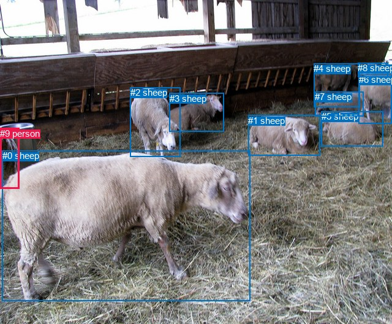
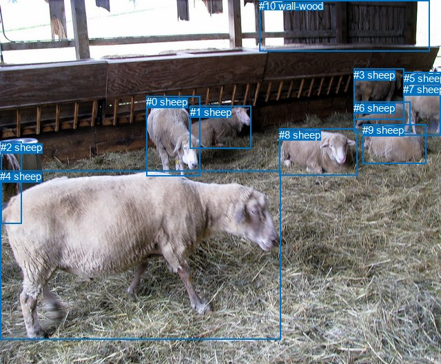

# 图片 0243：2323539.jpg

随机样本序号：150。图片 SHA256：`7f39a23bb285305c59adb1b03b913dfd69f6e86a95e518cbecc950c901332d7f`。

红色框表示人，蓝色框表示其他物体。两个模式分别保留自身框编号，可依据位置比较对应对象。

## 自动检测框与输出

人的框编号：`[9]`。状态：`ok`。

### 自动检测全部物体框

| 编号 | 类别 | 是否为人 | 检测分数 | 像素坐标 xyxy |
|---|---|---|---|---|
| 0 | sheep | False | 0.9985 | 3.8, 245.4, 408.4, 490.4 |
| 1 | sheep | False | 0.9972 | 405.3, 188.0, 522.0, 253.5 |
| 2 | sheep | False | 0.9963 | 212.5, 142.4, 294.1, 255.2 |
| 3 | sheep | False | 0.9956 | 276.5, 151.8, 365.4, 214.8 |
| 4 | sheep | False | 0.9916 | 512.2, 103.4, 587.7, 175.0 |
| 5 | sheep | False | 0.9840 | 524.7, 181.2, 625.9, 238.7 |
| 6 | sheep | False | 0.9800 | 585.6, 121.5, 640.0, 201.1 |
| 7 | sheep | False | 0.9646 | 514.5, 149.2, 593.9, 189.1 |
| 8 | sheep | False | 0.7934 | 584.5, 102.4, 633.9, 125.1 |
| 9 | person | True | 0.6942 | 0.1, 208.8, 31.7, 307.4 |

### 自动检测 Top50 人相关候选

评分物体对：90；人相关物体对：18；输出关系：36。

| 排名 | 主语编号与类别 | 关系 | 宾语编号与类别 | 类型 | 人与人 | 排序分数 | 原始融合 logit |
|---|---|---|---|---|---|---|---|
| 1 | #9 person | beside | #0 sheep | spatial | False | 0.87230 | 1.9214 |
| 2 | #0 sheep | beside | #9 person | spatial | False | 0.81598 | 1.4893 |
| 3 | #9 person | looking at | #0 sheep | semantic | False | 0.75152 | 1.1068 |
| 4 | #9 person | looking at | #2 sheep | semantic | False | 0.46540 | -0.1386 |
| 5 | #0 sheep | walking on | #9 person | semantic | False | 0.45992 | -0.1607 |
| 6 | #9 person | looking at | #8 sheep | semantic | False | 0.13968 | -1.8180 |
| 7 | #9 person | looking at | #3 sheep | semantic | False | 0.09795 | -2.2202 |
| 8 | #9 person | looking at | #1 sheep | semantic | False | 0.09751 | -2.2251 |
| 9 | #9 person | looking at | #6 sheep | semantic | False | 0.08473 | -2.3798 |
| 10 | #9 person | looking at | #4 sheep | semantic | False | 0.06260 | -2.7064 |
| 11 | #8 sheep | looking at | #9 person | semantic | False | 0.05985 | -2.7542 |
| 12 | #9 person | beside | #2 sheep | spatial | False | 0.05693 | -2.8074 |
| 13 | #9 person | looking at | #5 sheep | semantic | False | 0.04456 | -3.0654 |
| 14 | #2 sheep | looking at | #9 person | semantic | False | 0.04229 | -3.1201 |
| 15 | #9 person | walking on | #7 sheep | semantic | False | 0.03351 | -3.3619 |
| 16 | #2 sheep | beside | #9 person | spatial | False | 0.01958 | -3.9133 |
| 17 | #6 sheep | looking at | #9 person | semantic | False | 0.01484 | -4.1953 |
| 18 | #3 sheep | looking at | #9 person | semantic | False | 0.01239 | -4.3783 |
| 19 | #4 sheep | looking at | #9 person | semantic | False | 0.01059 | -4.5375 |
| 20 | #9 person | in front of | #3 sheep | spatial | False | 0.01028 | -4.5671 |
| 21 | #1 sheep | looking at | #9 person | semantic | False | 0.00759 | -4.8727 |
| 22 | #9 person | in front of | #4 sheep | spatial | False | 0.00719 | -4.9281 |
| 23 | #9 person | in front of | #8 sheep | spatial | False | 0.00683 | -4.9797 |
| 24 | #5 sheep | eating | #9 person | semantic | False | 0.00624 | -5.0698 |
| 25 | #7 sheep | eating | #9 person | semantic | False | 0.00597 | -5.1143 |
| 26 | #9 person | in front of | #6 sheep | spatial | False | 0.00536 | -5.2236 |
| 27 | #6 sheep | in front of | #9 person | spatial | False | 0.00404 | -5.5067 |
| 28 | #9 person | in front of | #7 sheep | spatial | False | 0.00239 | -6.0352 |
| 29 | #9 person | beside | #1 sheep | spatial | False | 0.00172 | -6.3635 |
| 30 | #3 sheep | in front of | #9 person | spatial | False | 0.00139 | -6.5804 |
| 31 | #9 person | in front of | #5 sheep | spatial | False | 0.00110 | -6.8116 |
| 32 | #8 sheep | in | #9 person | spatial | False | 0.00102 | -6.8914 |
| 33 | #4 sheep | in | #9 person | spatial | False | 0.00071 | -7.2538 |
| 34 | #7 sheep | in front of | #9 person | spatial | False | 0.00051 | -7.5881 |
| 35 | #1 sheep | in | #9 person | spatial | False | 0.00049 | -7.6152 |
| 36 | #5 sheep | in front of | #9 person | spatial | False | 0.00044 | -7.7284 |

### 自动检测逐条人相关 GT 核验

本图没有人相关 GT，R@50 无分母；预测候选继续展示。

## 真实框与输出

人的框编号：`[]`。

### 真实框全部物体框

| 编号 | 类别 | 是否为人 | 检测分数 | 像素坐标 xyxy |
|---|---|---|---|---|
| 0 | sheep | False | GT | 212.0, 139.0, 290.0, 255.0 |
| 1 | sheep | False | GT | 276.0, 154.0, 364.0, 216.0 |
| 2 | sheep | False | GT | 1.0, 205.0, 31.0, 324.0 |
| 3 | sheep | False | GT | 513.0, 100.0, 586.0, 174.0 |
| 4 | sheep | False | GT | 0.0, 247.0, 408.0, 492.0 |
| 5 | sheep | False | GT | 586.0, 105.0, 640.0, 127.0 |
| 6 | sheep | False | GT | 513.0, 148.0, 595.0, 193.0 |
| 7 | sheep | False | GT | 585.0, 121.0, 640.0, 196.0 |
| 8 | sheep | False | GT | 405.0, 187.0, 518.0, 255.0 |
| 9 | sheep | False | GT | 526.0, 180.0, 618.0, 237.0 |
| 10 | wall-wood | False | GT | 376.0, 0.0, 623.0, 74.0 |

### 真实框 Top50 人相关候选

评分物体对：0；人相关物体对：0；输出关系：0。

| 排名 | 主语编号与类别 | 关系 | 宾语编号与类别 | 类型 | 人与人 | 排序分数 | 原始融合 logit |
|---|---|---|---|---|---|---|---|

### 真实框逐条人相关 GT 核验

本图没有人相关 GT，R@50 无分母；预测候选继续展示。

## 全部人相关 GT

| 主语编号与类别 | 关系 | 宾语编号与类别 |
|---|---|---|

原始记录、全部人相关物体对的两项预测与分项分数见 [逐图证据 JSON](../evidence/cases/0243.json)。全部56类 logits 保留于本机 HOR/output/random500/logits/。

<!-- HOR_COMPLETE_RESULTS -->

## 六组条件的完整输出对照

以下保留同一图片三种框与候选模式、两种谓词输出规则的全部 Top50。框编号各自在所属模式内解释。

### 自动检测框完整枚举：空间与语义各保留一个谓词

| 排名 | 主语编号与类别 | 谓词 | 宾语编号与类别 | 分组 | 排序分数 | predicate logit | pair logit |
|---|---|---|---|---|---|---|---|
| 1 | #9 person | beside | #0 sheep | spatial | 0.8722962 | 2.6571088 | -0.7356933 |
| 2 | #0 sheep | beside | #9 person | spatial | 0.8159770 | 2.4384036 | -0.9490783 |
| 3 | #9 person | looking at | #0 sheep | semantic | 0.7515240 | 1.8424501 | -0.7356933 |
| 4 | #9 person | looking at | #2 sheep | semantic | 0.4653973 | 0.9420877 | -1.0807199 |
| 5 | #0 sheep | walking on | #9 person | semantic | 0.4599224 | 0.7884235 | -0.9490783 |
| 6 | #9 person | looking at | #8 sheep | semantic | 0.1396760 | -0.5768561 | -1.2411277 |
| 7 | #9 person | looking at | #3 sheep | semantic | 0.0979534 | -0.8841527 | -1.3360223 |
| 8 | #9 person | looking at | #1 sheep | semantic | 0.0975149 | -1.3448145 | -0.8803324 |
| 9 | #9 person | looking at | #6 sheep | semantic | 0.0847277 | -1.2113214 | -1.1684582 |
| 10 | #9 person | looking at | #4 sheep | semantic | 0.0625986 | -1.3148105 | -1.3915575 |
| 11 | #8 sheep | looking at | #9 person | semantic | 0.0598484 | -1.3726182 | -1.3816077 |
| 12 | #9 person | beside | #2 sheep | spatial | 0.0569276 | -1.7266433 | -1.0807199 |
| 13 | #9 person | looking at | #5 sheep | semantic | 0.0445557 | -1.9416714 | -1.1237653 |
| 14 | #2 sheep | looking at | #9 person | semantic | 0.0422863 | -1.8591819 | -1.2609036 |
| 15 | #9 person | walking on | #7 sheep | semantic | 0.0335072 | -2.1830139 | -1.1788982 |
| 16 | #2 sheep | beside | #9 person | spatial | 0.0195826 | -2.6524351 | -1.2609036 |
| 17 | #6 sheep | looking at | #9 person | semantic | 0.0148430 | -3.0953579 | -1.0999166 |
| 18 | #3 sheep | looking at | #9 person | semantic | 0.0123915 | -2.9562867 | -1.4219927 |
| 19 | #4 sheep | looking at | #9 person | semantic | 0.0105864 | -3.3773355 | -1.1602087 |
| 20 | #9 person | in front of | #3 sheep | spatial | 0.0102817 | -3.2310352 | -1.3360223 |
| 21 | #1 sheep | looking at | #9 person | semantic | 0.0075946 | -3.7835674 | -1.0891272 |
| 22 | #9 person | in front of | #4 sheep | spatial | 0.0071883 | -3.5365248 | -1.3915575 |
| 23 | #9 person | in front of | #8 sheep | spatial | 0.0068292 | -3.7385685 | -1.2411277 |
| 24 | #5 sheep | eating | #9 person | semantic | 0.0062446 | -3.9273884 | -1.1423857 |
| 25 | #7 sheep | eating | #9 person | semantic | 0.0059741 | -3.8106036 | -1.3037179 |
| 26 | #9 person | in front of | #6 sheep | spatial | 0.0053588 | -4.0551748 | -1.1684582 |
| 27 | #6 sheep | in front of | #9 person | spatial | 0.0040432 | -4.4067426 | -1.0999166 |
| 28 | #9 person | in front of | #7 sheep | spatial | 0.0023873 | -4.8562980 | -1.1788982 |
| 29 | #9 person | beside | #1 sheep | spatial | 0.0017204 | -5.4831343 | -0.8803324 |
| 30 | #3 sheep | in front of | #9 person | spatial | 0.0013853 | -5.1584511 | -1.4219927 |
| 31 | #9 person | in front of | #5 sheep | spatial | 0.0010997 | -5.6878409 | -1.1237653 |
| 32 | #8 sheep | in | #9 person | spatial | 0.0010154 | -5.5098314 | -1.3816077 |
| 33 | #4 sheep | in | #9 person | spatial | 0.0007070 | -6.0935555 | -1.1602087 |
| 34 | #7 sheep | in front of | #9 person | spatial | 0.0005062 | -6.2844315 | -1.3037179 |
| 35 | #1 sheep | in | #9 person | spatial | 0.0004926 | -6.5261145 | -1.0891272 |
| 36 | #5 sheep | in front of | #9 person | spatial | 0.0004400 | -6.5859747 | -1.1423857 |

没有人相关 GT，本条件的召回率无分母。

### 自动检测框完整枚举：每对只保留一个谓词

| 排名 | 主语编号与类别 | 谓词 | 宾语编号与类别 | 分组 | 排序分数 | predicate logit | pair logit |
|---|---|---|---|---|---|---|---|
| 1 | #9 person | beside | #0 sheep | single | 0.8722962 | 2.6571088 | -0.7356933 |
| 2 | #0 sheep | beside | #9 person | single | 0.8159770 | 2.4384036 | -0.9490783 |
| 3 | #9 person | looking at | #2 sheep | single | 0.4653973 | 0.9420877 | -1.0807199 |
| 4 | #9 person | looking at | #8 sheep | single | 0.1396760 | -0.5768561 | -1.2411277 |
| 5 | #9 person | looking at | #3 sheep | single | 0.0979534 | -0.8841527 | -1.3360223 |
| 6 | #9 person | looking at | #1 sheep | single | 0.0975149 | -1.3448145 | -0.8803324 |
| 7 | #9 person | looking at | #6 sheep | single | 0.0847277 | -1.2113214 | -1.1684582 |
| 8 | #9 person | looking at | #4 sheep | single | 0.0625986 | -1.3148105 | -1.3915575 |
| 9 | #8 sheep | looking at | #9 person | single | 0.0598484 | -1.3726182 | -1.3816077 |
| 10 | #9 person | looking at | #5 sheep | single | 0.0445557 | -1.9416714 | -1.1237653 |
| 11 | #2 sheep | looking at | #9 person | single | 0.0422863 | -1.8591819 | -1.2609036 |
| 12 | #9 person | walking on | #7 sheep | single | 0.0335072 | -2.1830139 | -1.1788982 |
| 13 | #6 sheep | looking at | #9 person | single | 0.0148430 | -3.0953579 | -1.0999166 |
| 14 | #3 sheep | looking at | #9 person | single | 0.0123915 | -2.9562867 | -1.4219927 |
| 15 | #4 sheep | looking at | #9 person | single | 0.0105864 | -3.3773355 | -1.1602087 |
| 16 | #1 sheep | looking at | #9 person | single | 0.0075946 | -3.7835674 | -1.0891272 |
| 17 | #5 sheep | eating | #9 person | single | 0.0062446 | -3.9273884 | -1.1423857 |
| 18 | #7 sheep | eating | #9 person | single | 0.0059741 | -3.8106036 | -1.3037179 |

没有人相关 GT，本条件的召回率无分母。

### 真实框完整枚举：空间与语义各保留一个谓词

| 排名 | 主语编号与类别 | 谓词 | 宾语编号与类别 | 分组 | 排序分数 | predicate logit | pair logit |
|---|---|---|---|---|---|---|---|

没有人相关 GT，本条件的召回率无分母。

### 真实框完整枚举：每对只保留一个谓词

| 排名 | 主语编号与类别 | 谓词 | 宾语编号与类别 | 分组 | 排序分数 | predicate logit | pair logit |
|---|---|---|---|---|---|---|---|

没有人相关 GT，本条件的召回率无分母。

### 真实框400候选：空间与语义各保留一个谓词

| 排名 | 主语编号与类别 | 谓词 | 宾语编号与类别 | 分组 | 排序分数 | predicate logit | pair logit |
|---|---|---|---|---|---|---|---|

没有人相关 GT，本条件的召回率无分母。

### 真实框400候选：每对只保留一个谓词

| 排名 | 主语编号与类别 | 谓词 | 宾语编号与类别 | 分组 | 排序分数 | predicate logit | pair logit |
|---|---|---|---|---|---|---|---|

没有人相关 GT，本条件的召回率无分母。
