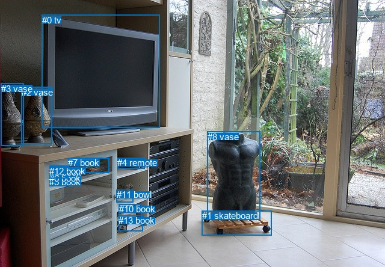
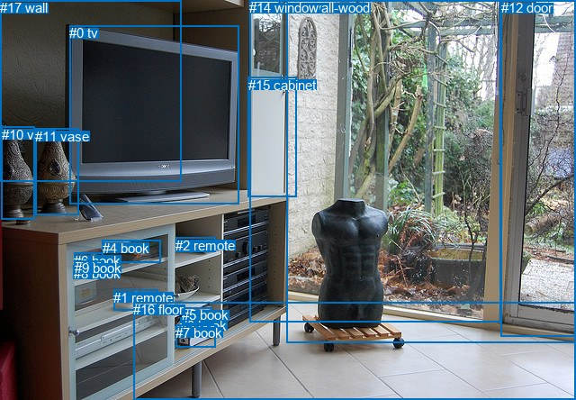

# 图片 0244：2323662.jpg

随机样本序号：275。图片 SHA256：`64eb99d549bd4e20a1768c9fd8e20e1b9177d38ed612ac5be3a91ef9a317be38`。

红色框表示人，蓝色框表示其他物体。两个模式分别保留自身框编号，可依据位置比较对应对象。

## 自动检测框与输出

人的框编号：`[]`。状态：`no_person`。

### 自动检测全部物体框

| 编号 | 类别 | 是否为人 | 检测分数 | 像素坐标 xyxy |
|---|---|---|---|---|
| 0 | tv | False | 0.9995 | 69.7, 24.7, 265.9, 212.9 |
| 1 | skateboard | False | 0.9753 | 335.6, 350.0, 451.9, 391.6 |
| 2 | vase | False | 0.9447 | 35.9, 144.8, 86.1, 239.1 |
| 3 | vase | False | 0.8406 | 1.9, 138.7, 39.3, 242.8 |
| 4 | remote | False | 0.8287 | 195.4, 262.4, 240.5, 280.3 |
| 5 | book | False | 0.7831 | 82.0, 294.3, 117.3, 309.9 |
| 6 | book | False | 0.6565 | 82.0, 288.4, 115.5, 302.8 |
| 7 | book | False | 0.6400 | 113.3, 262.2, 181.4, 287.6 |
| 8 | vase | False | 0.6224 | 344.5, 218.5, 432.2, 365.7 |
| 9 | book | False | 0.5582 | 82.6, 277.9, 113.7, 296.3 |
| 10 | book | False | 0.4956 | 198.0, 339.3, 235.4, 370.0 |
| 11 | bowl | False | 0.4186 | 193.7, 315.4, 221.2, 336.1 |
| 12 | book | False | 0.4136 | 82.4, 275.5, 114.6, 287.9 |
| 13 | book | False | 0.3885 | 197.0, 358.1, 237.4, 384.9 |

### 自动检测 Top50 人相关候选

评分物体对：0；人相关物体对：0；输出关系：0。

| 排名 | 主语编号与类别 | 关系 | 宾语编号与类别 | 类型 | 人与人 | 排序分数 | 原始融合 logit |
|---|---|---|---|---|---|---|---|

### 自动检测逐条人相关 GT 核验

本图没有人相关 GT，R@50 无分母；预测候选继续展示。

## 真实框与输出

人的框编号：`[]`。

### 真实框全部物体框

| 编号 | 类别 | 是否为人 | 检测分数 | 像素坐标 xyxy |
|---|---|---|---|---|
| 0 | tv | False | GT | 77.0, 28.0, 265.0, 226.0 |
| 1 | remote | False | GT | 126.0, 322.0, 175.0, 345.0 |
| 2 | remote | False | GT | 195.0, 264.0, 239.0, 280.0 |
| 3 | book | False | GT | 200.0, 353.0, 229.0, 371.0 |
| 4 | book | False | GT | 114.0, 267.0, 179.0, 292.0 |
| 5 | book | False | GT | 202.0, 341.0, 235.0, 359.0 |
| 6 | book | False | GT | 82.0, 281.0, 114.0, 297.0 |
| 7 | book | False | GT | 195.0, 361.0, 239.0, 386.0 |
| 8 | book | False | GT | 82.0, 295.0, 117.0, 310.0 |
| 9 | book | False | GT | 83.0, 289.0, 115.0, 303.0 |
| 10 | vase | False | GT | 2.0, 141.0, 39.0, 244.0 |
| 11 | vase | False | GT | 39.0, 143.0, 87.0, 238.0 |
| 12 | door | False | GT | 557.0, 0.0, 640.0, 373.0 |
| 13 | wall-wood | False | GT | 318.0, 0.0, 640.0, 380.0 |
| 14 | window | False | GT | 277.0, 0.0, 556.0, 358.0 |
| 15 | cabinet | False | GT | 276.0, 86.0, 330.0, 219.0 |
| 16 | floor | False | GT | 148.0, 335.0, 640.0, 444.0 |
| 17 | wall | False | GT | 0.0, 0.0, 201.0, 202.0 |

### 真实框 Top50 人相关候选

评分物体对：0；人相关物体对：0；输出关系：0。

| 排名 | 主语编号与类别 | 关系 | 宾语编号与类别 | 类型 | 人与人 | 排序分数 | 原始融合 logit |
|---|---|---|---|---|---|---|---|

### 真实框逐条人相关 GT 核验

本图没有人相关 GT，R@50 无分母；预测候选继续展示。

## 全部人相关 GT

| 主语编号与类别 | 关系 | 宾语编号与类别 |
|---|---|---|

原始记录、全部人相关物体对的两项预测与分项分数见 [逐图证据 JSON](../evidence/cases/0244.json)。全部56类 logits 保留于本机 HOR/output/random500/logits/。

<!-- HOR_COMPLETE_RESULTS -->

## 六组条件的完整输出对照

以下保留同一图片三种框与候选模式、两种谓词输出规则的全部 Top50。框编号各自在所属模式内解释。

### 自动检测框完整枚举：空间与语义各保留一个谓词

| 排名 | 主语编号与类别 | 谓词 | 宾语编号与类别 | 分组 | 排序分数 | predicate logit | pair logit |
|---|---|---|---|---|---|---|---|

没有人相关 GT，本条件的召回率无分母。

### 自动检测框完整枚举：每对只保留一个谓词

| 排名 | 主语编号与类别 | 谓词 | 宾语编号与类别 | 分组 | 排序分数 | predicate logit | pair logit |
|---|---|---|---|---|---|---|---|

没有人相关 GT，本条件的召回率无分母。

### 真实框完整枚举：空间与语义各保留一个谓词

| 排名 | 主语编号与类别 | 谓词 | 宾语编号与类别 | 分组 | 排序分数 | predicate logit | pair logit |
|---|---|---|---|---|---|---|---|

没有人相关 GT，本条件的召回率无分母。

### 真实框完整枚举：每对只保留一个谓词

| 排名 | 主语编号与类别 | 谓词 | 宾语编号与类别 | 分组 | 排序分数 | predicate logit | pair logit |
|---|---|---|---|---|---|---|---|

没有人相关 GT，本条件的召回率无分母。

### 真实框400候选：空间与语义各保留一个谓词

| 排名 | 主语编号与类别 | 谓词 | 宾语编号与类别 | 分组 | 排序分数 | predicate logit | pair logit |
|---|---|---|---|---|---|---|---|

没有人相关 GT，本条件的召回率无分母。

### 真实框400候选：每对只保留一个谓词

| 排名 | 主语编号与类别 | 谓词 | 宾语编号与类别 | 分组 | 排序分数 | predicate logit | pair logit |
|---|---|---|---|---|---|---|---|

没有人相关 GT，本条件的召回率无分母。
