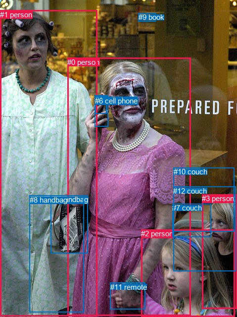
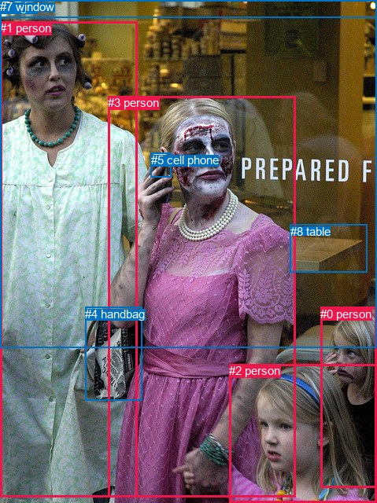

# 图片 0265：2324812.jpg

随机样本序号：494。图片 SHA256：`f3247a56b457942d6a1237338f64949f410361471634b5610f348dfbc6641be6`。

红色框表示人，蓝色框表示其他物体。两个模式分别保留自身框编号，可依据位置比较对应对象。

## 自动检测框与输出

人的框编号：`[0, 1, 2, 3]`。状态：`ok`。

### 自动检测全部物体框

| 编号 | 类别 | 是否为人 | 检测分数 | 像素坐标 xyxy |
|---|---|---|---|---|
| 0 | person | True | 0.9997 | 136.3, 116.9, 385.3, 637.4 |
| 1 | person | True | 0.9985 | 0.0, 20.8, 196.3, 638.2 |
| 2 | person | True | 0.9985 | 285.1, 463.5, 474.7, 639.4 |
| 3 | person | True | 0.9766 | 408.5, 392.2, 478.7, 623.8 |
| 4 | cell phone | False | 0.9518 | 191.4, 192.9, 218.7, 255.6 |
| 5 | handbag | False | 0.9381 | 102.4, 394.5, 177.7, 511.6 |
| 6 | cell phone | False | 0.8481 | 192.1, 194.5, 215.4, 229.0 |
| 7 | couch | False | 0.7733 | 348.2, 411.4, 426.8, 479.0 |
| 8 | handbag | False | 0.6137 | 59.6, 394.9, 169.3, 630.6 |
| 9 | book | False | 0.4829 | 279.6, 26.2, 314.2, 43.1 |
| 10 | couch | False | 0.4450 | 350.7, 338.1, 473.2, 467.3 |
| 11 | remote | False | 0.3842 | 222.8, 571.0, 293.4, 624.7 |
| 12 | couch | False | 0.3584 | 350.4, 377.0, 476.4, 547.5 |

### 自动检测 Top50 人相关候选

评分物体对：156；人相关物体对：84；输出关系：50。

| 排名 | 主语编号与类别 | 关系 | 宾语编号与类别 | 类型 | 人与人 | 排序分数 | 原始融合 logit |
|---|---|---|---|---|---|---|---|
| 1 | #0 person | talking to | #6 cell phone | semantic | False | 0.98460 | 4.1577 |
| 2 | #0 person | wearing | #11 remote | semantic | False | 0.98304 | 4.0601 |
| 3 | #1 person | carrying | #8 handbag | semantic | False | 0.97984 | 3.8836 |
| 4 | #0 person | talking to | #4 cell phone | semantic | False | 0.97841 | 3.8138 |
| 5 | #1 person | carrying | #5 handbag | semantic | False | 0.97058 | 3.4961 |
| 6 | #0 person | on | #6 cell phone | spatial | False | 0.95370 | 3.0252 |
| 7 | #0 person | on | #4 cell phone | spatial | False | 0.94285 | 2.8032 |
| 8 | #1 person | talking to | #6 cell phone | semantic | False | 0.93995 | 2.7506 |
| 9 | #0 person | holding | #5 handbag | semantic | False | 0.92467 | 2.5076 |
| 10 | #2 person | wearing | #11 remote | semantic | False | 0.87842 | 1.9776 |
| 11 | #1 person | talking to | #4 cell phone | semantic | False | 0.87622 | 1.9572 |
| 12 | #0 person | holding | #8 handbag | semantic | False | 0.87317 | 1.9293 |
| 13 | #3 person | leaning on | #7 couch | spatial | False | 0.87203 | 1.9191 |
| 14 | #3 person | in | #10 couch | spatial | False | 0.86603 | 1.8663 |
| 15 | #3 person | in | #12 couch | spatial | False | 0.85860 | 1.8037 |
| 16 | #0 person | in | #11 remote | spatial | False | 0.85354 | 1.7627 |
| 17 | #3 person | sitting on | #7 couch | semantic | False | 0.84756 | 1.7156 |
| 18 | #3 person | looking at | #0 person | semantic | True | 0.81825 | 1.5046 |
| 19 | #2 person | beside | #0 person | spatial | True | 0.81487 | 1.4820 |
| 20 | #1 person | beside | #0 person | spatial | True | 0.79901 | 1.3801 |
| 21 | #8 handbag | carrying | #1 person | semantic | False | 0.79497 | 1.3552 |
| 22 | #5 handbag | carrying | #1 person | semantic | False | 0.78172 | 1.2757 |
| 23 | #1 person | standing on | #0 person | semantic | True | 0.78015 | 1.2666 |
| 24 | #2 person | looking at | #0 person | semantic | True | 0.76793 | 1.1967 |
| 25 | #3 person | sitting on | #10 couch | semantic | False | 0.75356 | 1.1177 |
| 26 | #0 person | holding | #2 person | semantic | True | 0.75151 | 1.1067 |
| 27 | #1 person | on | #6 cell phone | spatial | False | 0.73656 | 1.0282 |
| 28 | #1 person | in | #8 handbag | spatial | False | 0.72667 | 0.9778 |
| 29 | #5 handbag | on | #1 person | spatial | False | 0.70548 | 0.8735 |
| 30 | #11 remote | on | #0 person | spatial | False | 0.69452 | 0.8213 |
| 31 | #2 person | in | #11 remote | spatial | False | 0.67100 | 0.7127 |
| 32 | #1 person | on | #4 cell phone | spatial | False | 0.66562 | 0.6884 |
| 33 | #0 person | beside | #2 person | spatial | True | 0.66499 | 0.6856 |
| 34 | #12 couch | looking at | #0 person | semantic | False | 0.65228 | 0.6291 |
| 35 | #3 person | holding | #12 couch | semantic | False | 0.65146 | 0.6255 |
| 36 | #1 person | in | #5 handbag | spatial | False | 0.64491 | 0.5967 |
| 37 | #0 person | beside | #1 person | spatial | True | 0.64098 | 0.5796 |
| 38 | #2 person | in | #7 couch | spatial | False | 0.60003 | 0.4056 |
| 39 | #8 handbag | beside | #1 person | spatial | False | 0.59412 | 0.3810 |
| 40 | #5 handbag | carrying | #0 person | semantic | False | 0.54298 | 0.1724 |
| 41 | #0 person | in | #5 handbag | spatial | False | 0.51455 | 0.0582 |
| 42 | #5 handbag | beside | #0 person | spatial | False | 0.48736 | -0.0506 |
| 43 | #3 person | looking at | #2 person | semantic | True | 0.47752 | -0.0900 |
| 44 | #2 person | sitting on | #7 couch | semantic | False | 0.47127 | -0.1150 |
| 45 | #2 person | in | #10 couch | spatial | False | 0.45822 | -0.1675 |
| 46 | #0 person | holding | #1 person | semantic | True | 0.45188 | -0.1931 |
| 47 | #2 person | in | #12 couch | spatial | False | 0.44693 | -0.2131 |
| 48 | #3 person | beside | #0 person | spatial | True | 0.44170 | -0.2343 |
| 49 | #11 remote | on | #2 person | spatial | False | 0.41596 | -0.3394 |
| 50 | #8 handbag | carrying | #0 person | semantic | False | 0.37534 | -0.5094 |

### 自动检测逐条人相关 GT 核验

R@50：14.29%；命中 1/7。

| GT 主语编号 | GT 关系 | GT 宾语编号 | 结果阶段 | 匹配预测主语编号 | 匹配预测宾语编号 |
|---|---|---|---|---|---|
| 0 | touching | 2 | wrong_predicate | [3] | [2] |
| 0 | looking at | 3 | hit50 | [3] | [0] |
| 1 | attached to | 3 | wrong_predicate | [1] | [0] |
| 3 | carrying | 4 | wrong_predicate | [0] | [5] |
| 3 | holding | 5 | wrong_predicate | [0] | [6] |
| 3 | in front of | 7 | endpoint_missing_or_wrong_class | [0] | [] |
| 5 | touching | 3 | wrong_predicate | [6] | [0] |

## 真实框与输出

人的框编号：`[0, 1, 2, 3]`。

### 真实框全部物体框

| 编号 | 类别 | 是否为人 | 检测分数 | 像素坐标 xyxy |
|---|---|---|---|---|
| 0 | person | True | GT | 407.0, 391.0, 479.0, 621.0 |
| 1 | person | True | GT | 0.0, 27.0, 175.0, 632.0 |
| 2 | person | True | GT | 291.0, 463.0, 478.0, 640.0 |
| 3 | person | True | GT | 137.0, 122.0, 375.0, 633.0 |
| 4 | handbag | False | GT | 108.0, 391.0, 180.0, 509.0 |
| 5 | cell phone | False | GT | 192.0, 195.0, 218.0, 226.0 |
| 6 | light | False | GT | 0.0, 0.0, 479.0, 22.0 |
| 7 | window | False | GT | 0.0, 0.0, 479.0, 442.0 |
| 8 | table | False | GT | 369.0, 286.0, 467.0, 347.0 |

### 真实框 Top50 人相关候选

评分物体对：72；人相关物体对：52；输出关系：50。

| 排名 | 主语编号与类别 | 关系 | 宾语编号与类别 | 类型 | 人与人 | 排序分数 | 原始融合 logit |
|---|---|---|---|---|---|---|---|
| 1 | #3 person | holding | #5 cell phone | semantic | False | 0.98598 | 4.2528 |
| 2 | #1 person | carrying | #4 handbag | semantic | False | 0.97993 | 3.8883 |
| 3 | #3 person | holding | #4 handbag | semantic | False | 0.96230 | 3.2398 |
| 4 | #0 person | looking at | #3 person | semantic | True | 0.95801 | 3.1274 |
| 5 | #2 person | looking at | #3 person | semantic | True | 0.95173 | 2.9816 |
| 6 | #0 person | beside | #3 person | spatial | True | 0.94879 | 2.9194 |
| 7 | #3 person | on | #5 cell phone | spatial | False | 0.94678 | 2.8786 |
| 8 | #4 handbag | beside | #1 person | spatial | False | 0.94463 | 2.8368 |
| 9 | #4 handbag | beside | #3 person | spatial | False | 0.94363 | 2.8179 |
| 10 | #2 person | beside | #3 person | spatial | True | 0.94199 | 2.7874 |
| 11 | #3 person | beside | #1 person | spatial | True | 0.93842 | 2.7239 |
| 12 | #4 handbag | carrying | #1 person | semantic | False | 0.91254 | 2.3451 |
| 13 | #1 person | beside | #3 person | spatial | True | 0.90043 | 2.2020 |
| 14 | #3 person | beside | #2 person | spatial | True | 0.89120 | 2.1031 |
| 15 | #2 person | beside | #0 person | spatial | True | 0.87001 | 1.9011 |
| 16 | #3 person | in front of | #7 window | spatial | False | 0.85443 | 1.7698 |
| 17 | #4 handbag | carrying | #3 person | semantic | False | 0.85260 | 1.7551 |
| 18 | #0 person | looking at | #2 person | semantic | True | 0.85179 | 1.7487 |
| 19 | #1 person | in | #7 window | spatial | False | 0.85170 | 1.7480 |
| 20 | #0 person | beside | #2 person | spatial | True | 0.83761 | 1.6406 |
| 21 | #3 person | touching | #2 person | semantic | True | 0.81400 | 1.4762 |
| 22 | #1 person | standing on | #3 person | semantic | True | 0.80796 | 1.4368 |
| 23 | #1 person | talking to | #5 cell phone | semantic | False | 0.72890 | 0.9890 |
| 24 | #3 person | beside | #0 person | spatial | True | 0.72602 | 0.9745 |
| 25 | #3 person | wearing | #7 window | semantic | False | 0.72578 | 0.9733 |
| 26 | #5 cell phone | holding | #3 person | semantic | False | 0.71604 | 0.9249 |
| 27 | #1 person | standing on | #7 window | semantic | False | 0.70568 | 0.8745 |
| 28 | #3 person | holding | #1 person | semantic | True | 0.66996 | 0.7080 |
| 29 | #5 cell phone | on | #3 person | spatial | False | 0.65061 | 0.6217 |
| 30 | #2 person | looking at | #0 person | semantic | True | 0.63540 | 0.5555 |
| 31 | #0 person | looking at | #1 person | semantic | True | 0.58540 | 0.3450 |
| 32 | #3 person | in | #4 handbag | spatial | False | 0.58351 | 0.3372 |
| 33 | #2 person | looking at | #1 person | semantic | True | 0.58288 | 0.3346 |
| 34 | #1 person | looking at | #2 person | semantic | True | 0.58266 | 0.3337 |
| 35 | #3 person | looking at | #0 person | semantic | True | 0.55470 | 0.2197 |
| 36 | #1 person | in | #4 handbag | spatial | False | 0.53952 | 0.1584 |
| 37 | #2 person | beside | #1 person | spatial | True | 0.51913 | 0.0766 |
| 38 | #0 person | in | #7 window | spatial | False | 0.45700 | -0.1724 |
| 39 | #1 person | on | #5 cell phone | spatial | False | 0.43943 | -0.2435 |
| 40 | #0 person | beside | #8 table | spatial | False | 0.43202 | -0.2736 |
| 41 | #1 person | beside | #2 person | spatial | True | 0.42921 | -0.2851 |
| 42 | #0 person | sitting on | #8 table | semantic | False | 0.40770 | -0.3735 |
| 43 | #3 person | wearing | #8 table | semantic | False | 0.35199 | -0.6103 |
| 44 | #1 person | in | #6 light | spatial | False | 0.33992 | -0.6637 |
| 45 | #0 person | beside | #1 person | spatial | True | 0.33913 | -0.6672 |
| 46 | #0 person | looking at | #7 window | semantic | False | 0.30183 | -0.8386 |
| 47 | #3 person | in front of | #8 table | spatial | False | 0.26328 | -1.0290 |
| 48 | #0 person | holding | #4 handbag | semantic | False | 0.25031 | -1.0969 |
| 49 | #1 person | beside | #0 person | spatial | True | 0.24252 | -1.1389 |
| 50 | #1 person | looking at | #0 person | semantic | True | 0.24099 | -1.1472 |

### 真实框逐条人相关 GT 核验

R@50：42.86%；命中 3/7。

| GT 主语编号 | GT 关系 | GT 宾语编号 | 结果阶段 | 匹配预测主语编号 | 匹配预测宾语编号 |
|---|---|---|---|---|---|
| 0 | touching | 2 | wrong_predicate | [0] | [2] |
| 0 | looking at | 3 | hit50 | [0] | [3] |
| 1 | attached to | 3 | wrong_predicate | [1] | [3] |
| 3 | carrying | 4 | wrong_predicate | [3] | [4] |
| 3 | holding | 5 | hit50 | [3] | [5] |
| 3 | in front of | 7 | hit50 | [3] | [7] |
| 5 | touching | 3 | wrong_predicate | [5] | [3] |

## 全部人相关 GT

| 主语编号与类别 | 关系 | 宾语编号与类别 |
|---|---|---|
| #0 person | touching | #2 person |
| #0 person | looking at | #3 person |
| #1 person | attached to | #3 person |
| #3 person | carrying | #4 handbag |
| #3 person | holding | #5 cell phone |
| #3 person | in front of | #7 window |
| #5 cell phone | touching | #3 person |

原始记录、全部人相关物体对的两项预测与分项分数见 [逐图证据 JSON](../evidence/cases/0265.json)。全部56类 logits 保留于本机 HOR/output/random500/logits/。

<!-- HOR_COMPLETE_RESULTS -->

## 六组条件的完整输出对照

以下保留同一图片三种框与候选模式、两种谓词输出规则的全部 Top50。框编号各自在所属模式内解释。

### 自动检测框完整枚举：空间与语义各保留一个谓词

| 排名 | 主语编号与类别 | 谓词 | 宾语编号与类别 | 分组 | 排序分数 | predicate logit | pair logit |
|---|---|---|---|---|---|---|---|
| 1 | #0 person | talking to | #6 cell phone | semantic | 0.9845974 | 3.5748315 | 0.5828719 |
| 2 | #0 person | wearing | #11 remote | semantic | 0.9830446 | 3.6393752 | 0.4206939 |
| 3 | #1 person | carrying | #8 handbag | semantic | 0.9798387 | 3.6783280 | 0.2052986 |
| 4 | #0 person | talking to | #4 cell phone | semantic | 0.9784128 | 3.3319755 | 0.4818563 |
| 5 | #1 person | carrying | #5 handbag | semantic | 0.9705758 | 3.5047708 | -0.0087001 |
| 6 | #0 person | on | #6 cell phone | spatial | 0.9536996 | 2.4423256 | 0.5828719 |
| 7 | #0 person | on | #4 cell phone | spatial | 0.9428505 | 2.3213816 | 0.4818563 |
| 8 | #1 person | talking to | #6 cell phone | semantic | 0.9399467 | 2.6673422 | 0.0832484 |
| 9 | #0 person | holding | #5 handbag | semantic | 0.9246721 | 2.7062964 | -0.1987072 |
| 10 | #2 person | wearing | #11 remote | semantic | 0.8784217 | 1.9658556 | 0.0117128 |
| 11 | #1 person | talking to | #4 cell phone | semantic | 0.8762243 | 1.8852196 | 0.0719316 |
| 12 | #0 person | holding | #8 handbag | semantic | 0.8731699 | 2.1635561 | -0.2342740 |
| 13 | #3 person | leaning on | #7 couch | spatial | 0.8720335 | 2.0574174 | -0.1383585 |
| 14 | #3 person | in | #10 couch | spatial | 0.8660306 | 2.1721740 | -0.3058649 |
| 15 | #3 person | in | #12 couch | spatial | 0.8585958 | 2.1646461 | -0.3609706 |
| 16 | #0 person | in | #11 remote | spatial | 0.8535446 | 1.3419828 | 0.4206939 |
| 17 | #3 person | sitting on | #7 couch | semantic | 0.8475600 | 1.8539491 | -0.1383585 |
| 18 | #3 person | looking at | #0 person | semantic | 0.8182539 | 2.0863180 | -0.5817562 |
| 19 | #2 person | beside | #0 person | spatial | 0.8148704 | 2.1818943 | -0.6999218 |
| 20 | #1 person | beside | #0 person | spatial | 0.7990137 | 1.7051759 | -0.3250341 |
| 21 | #8 handbag | carrying | #1 person | semantic | 0.7949721 | 1.7113118 | -0.3561503 |
| 22 | #5 handbag | carrying | #1 person | semantic | 0.7817178 | 1.5781312 | -0.3024262 |
| 23 | #1 person | standing on | #0 person | semantic | 0.7801516 | 1.5915842 | -0.3250341 |
| 24 | #2 person | looking at | #0 person | semantic | 0.7679328 | 1.8965974 | -0.6999218 |
| 25 | #3 person | sitting on | #10 couch | semantic | 0.7535644 | 1.4235787 | -0.3058649 |
| 26 | #0 person | holding | #2 person | semantic | 0.7515103 | 1.4351978 | -0.3285139 |
| 27 | #1 person | on | #6 cell phone | spatial | 0.7365602 | 0.9449177 | 0.0832484 |
| 28 | #1 person | in | #8 handbag | spatial | 0.7266663 | 0.7724752 | 0.2052986 |
| 29 | #5 handbag | on | #1 person | spatial | 0.7054774 | 1.1759448 | -0.3024262 |
| 30 | #11 remote | on | #0 person | spatial | 0.6945153 | 1.3622265 | -0.5409117 |
| 31 | #2 person | in | #11 remote | spatial | 0.6710005 | 0.7010012 | 0.0117128 |
| 32 | #1 person | on | #4 cell phone | spatial | 0.6656159 | 0.6164908 | 0.0719316 |
| 33 | #0 person | beside | #2 person | spatial | 0.6649883 | 1.0141177 | -0.3285139 |
| 34 | #12 couch | looking at | #0 person | semantic | 0.6522767 | 1.2270284 | -0.5979667 |
| 35 | #3 person | holding | #12 couch | semantic | 0.6514622 | 0.9864435 | -0.3609706 |
| 36 | #1 person | in | #5 handbag | spatial | 0.6449069 | 0.6054258 | -0.0087001 |
| 37 | #0 person | beside | #1 person | spatial | 0.6409848 | 1.1643429 | -0.5847020 |
| 38 | #2 person | in | #7 couch | spatial | 0.6000277 | 0.7917404 | -0.3861600 |
| 39 | #8 handbag | beside | #1 person | spatial | 0.5941184 | 0.7371674 | -0.3561503 |
| 40 | #5 handbag | carrying | #0 person | semantic | 0.5429813 | 0.6882095 | -0.5158589 |
| 41 | #0 person | in | #5 handbag | spatial | 0.5145535 | 0.2569375 | -0.1987072 |
| 42 | #5 handbag | beside | #0 person | spatial | 0.4873643 | 0.4653053 | -0.5158589 |
| 43 | #3 person | looking at | #2 person | semantic | 0.4775242 | 0.6936450 | -0.7836088 |
| 44 | #2 person | sitting on | #7 couch | semantic | 0.4712703 | 0.2711143 | -0.3861600 |
| 45 | #2 person | in | #10 couch | spatial | 0.4582187 | 0.5361772 | -0.7036930 |
| 46 | #0 person | holding | #1 person | semantic | 0.4518803 | 0.3916254 | -0.5847020 |
| 47 | #2 person | in | #12 couch | spatial | 0.4469269 | 0.4168038 | -0.6298989 |
| 48 | #3 person | beside | #0 person | spatial | 0.4416984 | 0.3474841 | -0.5817562 |
| 49 | #11 remote | on | #2 person | spatial | 0.4159563 | 0.5689640 | -0.9083598 |
| 50 | #8 handbag | carrying | #0 person | semantic | 0.3753426 | 0.1225924 | -0.6319563 |

GT 命中：1/7，R@50=14.29%。

| GT主语 | GT谓词 | GT宾语 | 结果阶段 | 匹配主语框 | 匹配宾语框 |
|---|---|---|---|---|---|
| 0 | touching | 2 | wrong_predicate | [3] | [2] |
| 0 | looking at | 3 | hit50 | [3] | [0] |
| 1 | attached to | 3 | wrong_predicate | [1] | [0] |
| 3 | carrying | 4 | wrong_predicate | [0] | [5] |
| 3 | holding | 5 | wrong_predicate | [0] | [6] |
| 3 | in front of | 7 | endpoint_missing_or_wrong_class | [0] | [] |
| 5 | touching | 3 | wrong_predicate | [6] | [0] |

### 自动检测框完整枚举：每对只保留一个谓词

| 排名 | 主语编号与类别 | 谓词 | 宾语编号与类别 | 分组 | 排序分数 | predicate logit | pair logit |
|---|---|---|---|---|---|---|---|
| 1 | #0 person | talking to | #6 cell phone | single | 0.9845974 | 3.5748315 | 0.5828719 |
| 2 | #0 person | wearing | #11 remote | single | 0.9830446 | 3.6393752 | 0.4206939 |
| 3 | #1 person | carrying | #8 handbag | single | 0.9798387 | 3.6783280 | 0.2052986 |
| 4 | #0 person | talking to | #4 cell phone | single | 0.9784128 | 3.3319755 | 0.4818563 |
| 5 | #1 person | carrying | #5 handbag | single | 0.9705758 | 3.5047708 | -0.0087001 |
| 6 | #1 person | talking to | #6 cell phone | single | 0.9399467 | 2.6673422 | 0.0832484 |
| 7 | #0 person | holding | #5 handbag | single | 0.9246721 | 2.7062964 | -0.1987072 |
| 8 | #2 person | wearing | #11 remote | single | 0.8784217 | 1.9658556 | 0.0117128 |
| 9 | #1 person | talking to | #4 cell phone | single | 0.8762243 | 1.8852196 | 0.0719316 |
| 10 | #0 person | holding | #8 handbag | single | 0.8731699 | 2.1635561 | -0.2342740 |
| 11 | #3 person | leaning on | #7 couch | single | 0.8720335 | 2.0574174 | -0.1383585 |
| 12 | #3 person | in | #10 couch | single | 0.8660306 | 2.1721740 | -0.3058649 |
| 13 | #3 person | in | #12 couch | single | 0.8585958 | 2.1646461 | -0.3609706 |
| 14 | #3 person | looking at | #0 person | single | 0.8182539 | 2.0863180 | -0.5817562 |
| 15 | #2 person | beside | #0 person | single | 0.8148704 | 2.1818943 | -0.6999218 |
| 16 | #1 person | beside | #0 person | single | 0.7990137 | 1.7051759 | -0.3250341 |
| 17 | #8 handbag | carrying | #1 person | single | 0.7949721 | 1.7113118 | -0.3561503 |
| 18 | #5 handbag | carrying | #1 person | single | 0.7817178 | 1.5781312 | -0.3024262 |
| 19 | #0 person | holding | #2 person | single | 0.7515103 | 1.4351978 | -0.3285139 |
| 20 | #11 remote | on | #0 person | single | 0.6945153 | 1.3622265 | -0.5409117 |
| 21 | #12 couch | looking at | #0 person | single | 0.6522767 | 1.2270284 | -0.5979667 |
| 22 | #0 person | beside | #1 person | single | 0.6409848 | 1.1643429 | -0.5847020 |
| 23 | #2 person | in | #7 couch | single | 0.6000277 | 0.7917404 | -0.3861600 |
| 24 | #5 handbag | carrying | #0 person | single | 0.5429813 | 0.6882095 | -0.5158589 |
| 25 | #3 person | looking at | #2 person | single | 0.4775242 | 0.6936450 | -0.7836088 |
| 26 | #2 person | in | #10 couch | single | 0.4582187 | 0.5361772 | -0.7036930 |
| 27 | #2 person | in | #12 couch | single | 0.4469269 | 0.4168038 | -0.6298989 |
| 28 | #11 remote | on | #2 person | single | 0.4159563 | 0.5689640 | -0.9083598 |
| 29 | #8 handbag | carrying | #0 person | single | 0.3753426 | 0.1225924 | -0.6319563 |
| 30 | #6 cell phone | on | #0 person | single | 0.3743103 | 0.0195608 | -0.5333300 |
| 31 | #12 couch | looking at | #2 person | single | 0.3445819 | -0.0376096 | -0.6053320 |
| 32 | #0 person | in | #12 couch | single | 0.3420252 | -0.0917726 | -0.5625095 |
| 33 | #4 cell phone | on | #0 person | single | 0.3085204 | -0.3223329 | -0.4847128 |
| 34 | #0 person | in | #10 couch | single | 0.3079604 | -0.1776147 | -0.6320574 |
| 35 | #12 couch | looking at | #3 person | single | 0.2914806 | -0.4366407 | -0.4515634 |
| 36 | #0 person | in | #7 couch | single | 0.2908379 | -0.2070384 | -0.6842795 |
| 37 | #9 book | on back of | #0 person | single | 0.2831276 | -0.0634260 | -0.8655741 |
| 38 | #2 person | beside | #3 person | single | 0.2779479 | 0.0495210 | -1.0041845 |
| 39 | #2 person | looking at | #1 person | single | 0.2717513 | 0.0215268 | -1.0072820 |
| 40 | #1 person | looking at | #2 person | single | 0.2605328 | -0.2503405 | -0.7928609 |
| 41 | #10 couch | beside | #3 person | single | 0.2422376 | -0.5549350 | -0.5855159 |
| 42 | #3 person | looking at | #1 person | single | 0.2238480 | -0.1544886 | -1.0888928 |
| 43 | #3 person | holding | #5 handbag | single | 0.2141933 | -0.1531157 | -1.1467165 |
| 44 | #3 person | holding | #8 handbag | single | 0.2100673 | -0.1582856 | -1.1662345 |
| 45 | #2 person | holding | #8 handbag | single | 0.2008479 | -0.2522273 | -1.1287763 |
| 46 | #1 person | wearing | #11 remote | single | 0.1914997 | -0.4422688 | -0.9980263 |
| 47 | #3 person | wearing | #11 remote | single | 0.1881337 | -0.3057308 | -1.1564522 |
| 48 | #0 person | looking at | #3 person | single | 0.1740360 | -0.7209713 | -0.8363177 |
| 49 | #2 person | holding | #5 handbag | single | 0.1599028 | -0.4665589 | -1.1923923 |
| 50 | #9 book | on back of | #1 person | single | 0.1547919 | -0.0497527 | -1.6477482 |

GT 命中：1/7，R@50=14.29%。

| GT主语 | GT谓词 | GT宾语 | 结果阶段 | 匹配主语框 | 匹配宾语框 |
|---|---|---|---|---|---|
| 0 | touching | 2 | wrong_predicate | [3] | [2] |
| 0 | looking at | 3 | hit50 | [3] | [0] |
| 1 | attached to | 3 | wrong_predicate | [1] | [0] |
| 3 | carrying | 4 | wrong_predicate | [0] | [5] |
| 3 | holding | 5 | wrong_predicate | [0] | [6] |
| 3 | in front of | 7 | endpoint_missing_or_wrong_class | [0] | [] |
| 5 | touching | 3 | wrong_predicate | [6] | [0] |

### 真实框完整枚举：空间与语义各保留一个谓词

| 排名 | 主语编号与类别 | 谓词 | 宾语编号与类别 | 分组 | 排序分数 | predicate logit | pair logit |
|---|---|---|---|---|---|---|---|
| 1 | #3 person | holding | #5 cell phone | semantic | 0.9859752 | 3.7012935 | 0.5515147 |
| 2 | #1 person | carrying | #4 handbag | semantic | 0.9799312 | 3.9372983 | -0.0489834 |
| 3 | #3 person | holding | #4 handbag | semantic | 0.9623048 | 3.3801208 | -0.1403242 |
| 4 | #0 person | looking at | #3 person | semantic | 0.9580081 | 3.7342553 | -0.6068761 |
| 5 | #2 person | looking at | #3 person | semantic | 0.9517342 | 3.6622195 | -0.6806584 |
| 6 | #0 person | beside | #3 person | spatial | 0.9487948 | 3.5262284 | -0.6068761 |
| 7 | #3 person | on | #5 cell phone | spatial | 0.9467799 | 2.3271160 | 0.5515147 |
| 8 | #4 handbag | beside | #1 person | spatial | 0.9446337 | 3.1686606 | -0.3318336 |
| 9 | #4 handbag | beside | #3 person | spatial | 0.9436343 | 3.2896609 | -0.4717822 |
| 10 | #2 person | beside | #3 person | spatial | 0.9419916 | 3.4680686 | -0.6806584 |
| 11 | #3 person | beside | #1 person | spatial | 0.9384219 | 3.2952700 | -0.5713764 |
| 12 | #4 handbag | carrying | #1 person | semantic | 0.9125435 | 2.6769276 | -0.3318336 |
| 13 | #1 person | beside | #3 person | spatial | 0.9004294 | 2.5762029 | -0.3741979 |
| 14 | #3 person | beside | #2 person | spatial | 0.8912032 | 2.4836164 | -0.3805258 |
| 15 | #2 person | beside | #0 person | spatial | 0.8700128 | 2.8702922 | -0.9692211 |
| 16 | #3 person | in front of | #7 window | spatial | 0.8544290 | 2.3533597 | -0.5835899 |
| 17 | #4 handbag | carrying | #3 person | semantic | 0.8526001 | 2.2269239 | -0.4717822 |
| 18 | #0 person | looking at | #2 person | semantic | 0.8517894 | 2.4984221 | -0.7497172 |
| 19 | #1 person | in | #7 window | spatial | 0.8516951 | 2.2787981 | -0.5308399 |
| 20 | #0 person | beside | #2 person | spatial | 0.8376113 | 2.3902779 | -0.7497172 |
| 21 | #3 person | touching | #2 person | semantic | 0.8140010 | 1.8567457 | -0.3805258 |
| 22 | #1 person | standing on | #3 person | semantic | 0.8079583 | 1.8109961 | -0.3741979 |
| 23 | #1 person | talking to | #5 cell phone | semantic | 0.7288955 | 0.9949870 | -0.0059609 |
| 24 | #3 person | beside | #0 person | spatial | 0.7260213 | 1.8478251 | -0.8732960 |
| 25 | #3 person | wearing | #7 window | semantic | 0.7257827 | 1.5569196 | -0.5835899 |
| 26 | #5 cell phone | holding | #3 person | semantic | 0.7160351 | 1.4573145 | -0.5324358 |
| 27 | #1 person | standing on | #7 window | semantic | 0.7056771 | 1.4053202 | -0.5308399 |
| 28 | #3 person | holding | #1 person | semantic | 0.6699603 | 1.2793818 | -0.5713764 |
| 29 | #5 cell phone | on | #3 person | spatial | 0.6506053 | 1.1541367 | -0.5324358 |
| 30 | #2 person | looking at | #0 person | semantic | 0.6354046 | 1.5246949 | -0.9692211 |
| 31 | #0 person | looking at | #1 person | semantic | 0.5854034 | 1.4417424 | -1.0967470 |
| 32 | #3 person | in | #4 handbag | spatial | 0.5835122 | 0.4775324 | -0.1403242 |
| 33 | #2 person | looking at | #1 person | semantic | 0.5828819 | 1.3504224 | -1.0158073 |
| 34 | #1 person | looking at | #2 person | semantic | 0.5826645 | 1.2041497 | -0.8704286 |
| 35 | #3 person | looking at | #0 person | semantic | 0.5546957 | 1.0929580 | -0.8732960 |
| 36 | #1 person | in | #4 handbag | spatial | 0.5395163 | 0.2073789 | -0.0489834 |
| 37 | #2 person | beside | #1 person | spatial | 0.5191298 | 1.0923638 | -1.0158073 |
| 38 | #0 person | in | #7 window | spatial | 0.4570021 | 0.5284266 | -0.7008439 |
| 39 | #1 person | on | #5 cell phone | spatial | 0.4394257 | -0.2375321 | -0.0059609 |
| 40 | #0 person | beside | #8 table | spatial | 0.4320244 | 0.7921309 | -1.0657272 |
| 41 | #1 person | beside | #2 person | spatial | 0.4292096 | 0.5853519 | -0.8704286 |
| 42 | #0 person | sitting on | #8 table | semantic | 0.4077005 | 0.6922479 | -1.0657272 |
| 43 | #3 person | wearing | #8 table | semantic | 0.3519935 | 0.3693700 | -0.9796579 |
| 44 | #1 person | in | #6 light | spatial | 0.3399150 | 0.0690851 | -0.7327580 |
| 45 | #0 person | beside | #1 person | spatial | 0.3391297 | 0.4295721 | -1.0967470 |
| 46 | #0 person | looking at | #7 window | semantic | 0.3018301 | -0.1377540 | -0.7008439 |
| 47 | #3 person | in front of | #8 table | spatial | 0.2632763 | -0.0493507 | -0.9796579 |
| 48 | #0 person | holding | #4 handbag | semantic | 0.2503150 | 0.0462599 | -1.1431930 |
| 49 | #1 person | beside | #0 person | spatial | 0.2425210 | 0.0382199 | -1.1771274 |
| 50 | #1 person | looking at | #0 person | semantic | 0.2409948 | 0.0298939 | -1.1771274 |

GT 命中：3/7，R@50=42.86%。

| GT主语 | GT谓词 | GT宾语 | 结果阶段 | 匹配主语框 | 匹配宾语框 |
|---|---|---|---|---|---|
| 0 | touching | 2 | wrong_predicate | [0] | [2] |
| 0 | looking at | 3 | hit50 | [0] | [3] |
| 1 | attached to | 3 | wrong_predicate | [1] | [3] |
| 3 | carrying | 4 | wrong_predicate | [3] | [4] |
| 3 | holding | 5 | hit50 | [3] | [5] |
| 3 | in front of | 7 | hit50 | [3] | [7] |
| 5 | touching | 3 | wrong_predicate | [5] | [3] |

### 真实框完整枚举：每对只保留一个谓词

| 排名 | 主语编号与类别 | 谓词 | 宾语编号与类别 | 分组 | 排序分数 | predicate logit | pair logit |
|---|---|---|---|---|---|---|---|
| 1 | #3 person | holding | #5 cell phone | single | 0.9859752 | 3.7012935 | 0.5515147 |
| 2 | #1 person | carrying | #4 handbag | single | 0.9799312 | 3.9372983 | -0.0489834 |
| 3 | #3 person | holding | #4 handbag | single | 0.9623048 | 3.3801208 | -0.1403242 |
| 4 | #0 person | looking at | #3 person | single | 0.9580081 | 3.7342553 | -0.6068761 |
| 5 | #2 person | looking at | #3 person | single | 0.9517342 | 3.6622195 | -0.6806584 |
| 6 | #4 handbag | beside | #1 person | single | 0.9446337 | 3.1686606 | -0.3318336 |
| 7 | #4 handbag | beside | #3 person | single | 0.9436343 | 3.2896609 | -0.4717822 |
| 8 | #3 person | beside | #1 person | single | 0.9384219 | 3.2952700 | -0.5713764 |
| 9 | #1 person | beside | #3 person | single | 0.9004294 | 2.5762029 | -0.3741979 |
| 10 | #3 person | beside | #2 person | single | 0.8912032 | 2.4836164 | -0.3805258 |
| 11 | #2 person | beside | #0 person | single | 0.8700128 | 2.8702922 | -0.9692211 |
| 12 | #3 person | in front of | #7 window | single | 0.8544290 | 2.3533597 | -0.5835899 |
| 13 | #0 person | looking at | #2 person | single | 0.8517894 | 2.4984221 | -0.7497172 |
| 14 | #1 person | in | #7 window | single | 0.8516951 | 2.2787981 | -0.5308399 |
| 15 | #1 person | talking to | #5 cell phone | single | 0.7288955 | 0.9949870 | -0.0059609 |
| 16 | #3 person | beside | #0 person | single | 0.7260213 | 1.8478251 | -0.8732960 |
| 17 | #5 cell phone | holding | #3 person | single | 0.7160351 | 1.4573145 | -0.5324358 |
| 18 | #0 person | looking at | #1 person | single | 0.5854034 | 1.4417424 | -1.0967470 |
| 19 | #2 person | looking at | #1 person | single | 0.5828819 | 1.3504224 | -1.0158073 |
| 20 | #1 person | looking at | #2 person | single | 0.5826645 | 1.2041497 | -0.8704286 |
| 21 | #0 person | in | #7 window | single | 0.4570021 | 0.5284266 | -0.7008439 |
| 22 | #0 person | beside | #8 table | single | 0.4320244 | 0.7921309 | -1.0657272 |
| 23 | #3 person | wearing | #8 table | single | 0.3519935 | 0.3693700 | -0.9796579 |
| 24 | #1 person | in | #6 light | single | 0.3399150 | 0.0690851 | -0.7327580 |
| 25 | #0 person | holding | #4 handbag | single | 0.2503150 | 0.0462599 | -1.1431930 |
| 26 | #1 person | beside | #0 person | single | 0.2425210 | 0.0382199 | -1.1771274 |
| 27 | #8 table | beside | #3 person | single | 0.2228914 | -0.7108161 | -0.5380792 |
| 28 | #7 window | beside | #3 person | single | 0.2002876 | -0.8034425 | -0.5810552 |
| 29 | #2 person | holding | #5 cell phone | single | 0.1983041 | -0.5182481 | -0.8786795 |
| 30 | #2 person | in front of | #7 window | single | 0.1786365 | -0.3028641 | -1.2227488 |
| 31 | #2 person | holding | #4 handbag | single | 0.1773975 | -0.3592982 | -1.1747816 |
| 32 | #7 window | beside | #1 person | single | 0.1448464 | -0.8685980 | -0.9070093 |
| 33 | #8 table | beside | #0 person | single | 0.1339110 | -0.9551709 | -0.9116415 |
| 34 | #3 person | looking at | #6 light | single | 0.1212292 | -0.8324676 | -1.1483738 |
| 35 | #0 person | holding | #5 cell phone | single | 0.0978628 | -0.6928768 | -1.5283233 |
| 36 | #5 cell phone | holding | #1 person | single | 0.0686717 | -1.6307313 | -0.9765427 |
| 37 | #4 handbag | carrying | #0 person | single | 0.0626166 | -1.2842064 | -1.4218557 |
| 38 | #6 light | over | #3 person | single | 0.0623195 | -1.9573612 | -0.7537732 |
| 39 | #6 light | over | #1 person | single | 0.0568256 | -1.9452753 | -0.8639898 |
| 40 | #1 person | standing on | #8 table | single | 0.0566924 | -1.5044007 | -1.3073523 |
| 41 | #2 person | in front of | #8 table | single | 0.0520661 | -1.2120755 | -1.6896956 |
| 42 | #4 handbag | carrying | #2 person | single | 0.0510425 | -1.3627839 | -1.5599225 |
| 43 | #7 window | looking at | #2 person | single | 0.0505389 | -1.5644734 | -1.3686774 |
| 44 | #8 table | beside | #1 person | single | 0.0422320 | -1.9619555 | -1.1594718 |
| 45 | #5 cell phone | holding | #2 person | single | 0.0331792 | -1.8057592 | -1.5663321 |
| 46 | #2 person | looking at | #6 light | single | 0.0185310 | -2.1470151 | -1.8225923 |
| 47 | #0 person | looking at | #6 light | single | 0.0131600 | -2.6547639 | -1.6625601 |
| 48 | #8 table | beside | #2 person | single | 0.0122983 | -3.2406602 | -1.1452622 |
| 49 | #7 window | beside | #0 person | single | 0.0115502 | -3.1443958 | -1.3050357 |
| 50 | #5 cell phone | holding | #0 person | single | 0.0100235 | -2.8460281 | -1.7467196 |

GT 命中：3/7，R@50=42.86%。

| GT主语 | GT谓词 | GT宾语 | 结果阶段 | 匹配主语框 | 匹配宾语框 |
|---|---|---|---|---|---|
| 0 | touching | 2 | wrong_predicate | [0] | [2] |
| 0 | looking at | 3 | hit50 | [0] | [3] |
| 1 | attached to | 3 | wrong_predicate | [1] | [3] |
| 3 | carrying | 4 | wrong_predicate | [3] | [4] |
| 3 | holding | 5 | hit50 | [3] | [5] |
| 3 | in front of | 7 | hit50 | [3] | [7] |
| 5 | touching | 3 | wrong_predicate | [5] | [3] |

### 真实框400候选：空间与语义各保留一个谓词

| 排名 | 主语编号与类别 | 谓词 | 宾语编号与类别 | 分组 | 排序分数 | predicate logit | pair logit |
|---|---|---|---|---|---|---|---|
| 1 | #3 person | holding | #5 cell phone | semantic | 0.9859752 | 3.7012935 | 0.5515147 |
| 2 | #1 person | carrying | #4 handbag | semantic | 0.9799312 | 3.9372983 | -0.0489834 |
| 3 | #3 person | holding | #4 handbag | semantic | 0.9623048 | 3.3801208 | -0.1403242 |
| 4 | #0 person | looking at | #3 person | semantic | 0.9603104 | 3.7930436 | -0.6068761 |
| 5 | #2 person | looking at | #3 person | semantic | 0.9517661 | 3.6629167 | -0.6806584 |
| 6 | #0 person | beside | #3 person | spatial | 0.9487920 | 3.5261703 | -0.6068761 |
| 7 | #3 person | on | #5 cell phone | spatial | 0.9467799 | 2.3271160 | 0.5515147 |
| 8 | #4 handbag | beside | #1 person | spatial | 0.9446337 | 3.1686606 | -0.3318336 |
| 9 | #4 handbag | beside | #3 person | spatial | 0.9403563 | 3.2296519 | -0.4717822 |
| 10 | #2 person | beside | #3 person | spatial | 0.9386310 | 3.4081759 | -0.6806584 |
| 11 | #3 person | beside | #1 person | spatial | 0.9348722 | 3.2354345 | -0.5713764 |
| 12 | #4 handbag | carrying | #1 person | semantic | 0.9125435 | 2.6769276 | -0.3318336 |
| 13 | #1 person | beside | #3 person | spatial | 0.9030849 | 2.6061783 | -0.3741979 |
| 14 | #3 person | beside | #2 person | spatial | 0.8912032 | 2.4836164 | -0.3805258 |
| 15 | #2 person | beside | #0 person | spatial | 0.8665850 | 2.8403163 | -0.9692211 |
| 16 | #4 handbag | carrying | #3 person | semantic | 0.8526001 | 2.2269239 | -0.4717822 |
| 17 | #0 person | looking at | #2 person | semantic | 0.8517894 | 2.4984221 | -0.7497172 |
| 18 | #1 person | in | #7 window | spatial | 0.8516951 | 2.2787981 | -0.5308399 |
| 19 | #3 person | in front of | #7 window | spatial | 0.8506852 | 2.3235745 | -0.5835899 |
| 20 | #0 person | beside | #2 person | spatial | 0.8334845 | 2.3602438 | -0.7497172 |
| 21 | #3 person | touching | #2 person | semantic | 0.8185033 | 1.8867655 | -0.3805258 |
| 22 | #1 person | standing on | #3 person | semantic | 0.8079583 | 1.8109961 | -0.3741979 |
| 23 | #1 person | talking to | #5 cell phone | semantic | 0.7288955 | 0.9949870 | -0.0059609 |
| 24 | #3 person | beside | #0 person | spatial | 0.7260213 | 1.8478251 | -0.8732960 |
| 25 | #3 person | wearing | #7 window | semantic | 0.7209355 | 1.5326962 | -0.5835899 |
| 26 | #5 cell phone | holding | #3 person | semantic | 0.7160351 | 1.4573145 | -0.5324358 |
| 27 | #1 person | standing on | #7 window | semantic | 0.6993888 | 1.3752289 | -0.5308399 |
| 28 | #3 person | holding | #1 person | semantic | 0.6645913 | 1.2551990 | -0.5713764 |
| 29 | #5 cell phone | on | #3 person | spatial | 0.6506053 | 1.1541367 | -0.5324358 |
| 30 | #2 person | looking at | #0 person | semantic | 0.6285682 | 1.4953003 | -0.9692211 |
| 31 | #0 person | looking at | #1 person | semantic | 0.5854880 | 1.4420910 | -1.0967470 |
| 32 | #3 person | in | #4 handbag | spatial | 0.5843186 | 0.4808512 | -0.1403242 |
| 33 | #1 person | looking at | #2 person | semantic | 0.5828340 | 1.2048469 | -0.8704286 |
| 34 | #2 person | looking at | #1 person | semantic | 0.5827971 | 1.3500733 | -1.0158073 |
| 35 | #3 person | looking at | #0 person | semantic | 0.5475104 | 1.0639129 | -0.8732960 |
| 36 | #1 person | in | #4 handbag | spatial | 0.5395163 | 0.2073789 | -0.0489834 |
| 37 | #2 person | beside | #1 person | spatial | 0.5116721 | 1.0625043 | -1.0158073 |
| 38 | #0 person | in | #7 window | spatial | 0.4636530 | 0.5551991 | -0.7008439 |
| 39 | #1 person | on | #5 cell phone | spatial | 0.4380849 | -0.2429771 | -0.0059609 |
| 40 | #1 person | beside | #2 person | spatial | 0.4365897 | 0.6154141 | -0.8704286 |
| 41 | #0 person | beside | #8 table | spatial | 0.4246846 | 0.7621555 | -1.0657272 |
| 42 | #0 person | sitting on | #8 table | semantic | 0.4026245 | 0.6711855 | -1.0657272 |
| 43 | #3 person | wearing | #8 table | semantic | 0.3464883 | 0.3451467 | -0.9796579 |
| 44 | #0 person | beside | #1 person | spatial | 0.3391459 | 0.4296446 | -1.0967470 |
| 45 | #1 person | in | #6 light | spatial | 0.3339339 | 0.0423121 | -0.7327580 |
| 46 | #0 person | looking at | #7 window | semantic | 0.2955998 | -0.1674962 | -0.7008439 |
| 47 | #3 person | in front of | #8 table | spatial | 0.2575695 | -0.0789819 | -0.9796579 |
| 48 | #0 person | holding | #4 handbag | semantic | 0.2499686 | 0.0444136 | -1.1431930 |
| 49 | #1 person | beside | #0 person | spatial | 0.2425057 | 0.0381365 | -1.1771274 |
| 50 | #1 person | looking at | #0 person | semantic | 0.2410586 | 0.0302429 | -1.1771274 |

GT 命中：3/7，R@50=42.86%。

| GT主语 | GT谓词 | GT宾语 | 结果阶段 | 匹配主语框 | 匹配宾语框 |
|---|---|---|---|---|---|
| 0 | touching | 2 | wrong_predicate | [0] | [2] |
| 0 | looking at | 3 | hit50 | [0] | [3] |
| 1 | attached to | 3 | wrong_predicate | [1] | [3] |
| 3 | carrying | 4 | wrong_predicate | [3] | [4] |
| 3 | holding | 5 | hit50 | [3] | [5] |
| 3 | in front of | 7 | hit50 | [3] | [7] |
| 5 | touching | 3 | wrong_predicate | [5] | [3] |

### 真实框400候选：每对只保留一个谓词

| 排名 | 主语编号与类别 | 谓词 | 宾语编号与类别 | 分组 | 排序分数 | predicate logit | pair logit |
|---|---|---|---|---|---|---|---|
| 1 | #3 person | holding | #5 cell phone | single | 0.9859752 | 3.7012935 | 0.5515147 |
| 2 | #1 person | carrying | #4 handbag | single | 0.9799312 | 3.9372983 | -0.0489834 |
| 3 | #3 person | holding | #4 handbag | single | 0.9623048 | 3.3801208 | -0.1403242 |
| 4 | #0 person | looking at | #3 person | single | 0.9603104 | 3.7930436 | -0.6068761 |
| 5 | #2 person | looking at | #3 person | single | 0.9517661 | 3.6629167 | -0.6806584 |
| 6 | #4 handbag | beside | #1 person | single | 0.9446337 | 3.1686606 | -0.3318336 |
| 7 | #4 handbag | beside | #3 person | single | 0.9403563 | 3.2296519 | -0.4717822 |
| 8 | #3 person | beside | #1 person | single | 0.9348722 | 3.2354345 | -0.5713764 |
| 9 | #1 person | beside | #3 person | single | 0.9030849 | 2.6061783 | -0.3741979 |
| 10 | #3 person | beside | #2 person | single | 0.8912032 | 2.4836164 | -0.3805258 |
| 11 | #2 person | beside | #0 person | single | 0.8665850 | 2.8403163 | -0.9692211 |
| 12 | #0 person | looking at | #2 person | single | 0.8517894 | 2.4984221 | -0.7497172 |
| 13 | #1 person | in | #7 window | single | 0.8516951 | 2.2787981 | -0.5308399 |
| 14 | #3 person | in front of | #7 window | single | 0.8506852 | 2.3235745 | -0.5835899 |
| 15 | #1 person | talking to | #5 cell phone | single | 0.7288955 | 0.9949870 | -0.0059609 |
| 16 | #3 person | beside | #0 person | single | 0.7260213 | 1.8478251 | -0.8732960 |
| 17 | #5 cell phone | holding | #3 person | single | 0.7160351 | 1.4573145 | -0.5324358 |
| 18 | #0 person | looking at | #1 person | single | 0.5854880 | 1.4420910 | -1.0967470 |
| 19 | #1 person | looking at | #2 person | single | 0.5828340 | 1.2048469 | -0.8704286 |
| 20 | #2 person | looking at | #1 person | single | 0.5827971 | 1.3500733 | -1.0158073 |
| 21 | #0 person | in | #7 window | single | 0.4636530 | 0.5551991 | -0.7008439 |
| 22 | #0 person | beside | #8 table | single | 0.4246846 | 0.7621555 | -1.0657272 |
| 23 | #3 person | wearing | #8 table | single | 0.3464883 | 0.3451467 | -0.9796579 |
| 24 | #1 person | in | #6 light | single | 0.3339339 | 0.0423121 | -0.7327580 |
| 25 | #0 person | holding | #4 handbag | single | 0.2499686 | 0.0444136 | -1.1431930 |
| 26 | #1 person | beside | #0 person | single | 0.2425057 | 0.0381365 | -1.1771274 |
| 27 | #8 table | beside | #3 person | single | 0.2228948 | -0.7107964 | -0.5380792 |
| 28 | #2 person | holding | #5 cell phone | single | 0.2028327 | -0.4900036 | -0.8786795 |
| 29 | #7 window | beside | #3 person | single | 0.2003108 | -0.8032980 | -0.5810552 |
| 30 | #2 person | holding | #4 handbag | single | 0.1776132 | -0.3578210 | -1.1747816 |
| 31 | #2 person | in front of | #7 window | single | 0.1743093 | -0.3326402 | -1.2227488 |
| 32 | #7 window | beside | #1 person | single | 0.1430068 | -0.8835280 | -0.9070093 |
| 33 | #8 table | beside | #0 person | single | 0.1304626 | -0.9852333 | -0.9116415 |
| 34 | #3 person | looking at | #6 light | single | 0.1180417 | -0.8627331 | -1.1483738 |
| 35 | #0 person | holding | #5 cell phone | single | 0.1000187 | -0.6686940 | -1.5283233 |
| 36 | #5 cell phone | holding | #1 person | single | 0.0686717 | -1.6307313 | -0.9765427 |
| 37 | #4 handbag | carrying | #0 person | single | 0.0634882 | -1.2694519 | -1.4218557 |
| 38 | #6 light | over | #3 person | single | 0.0617518 | -1.9671187 | -0.7537732 |
| 39 | #1 person | standing on | #8 table | single | 0.0557963 | -1.5212822 | -1.3073523 |
| 40 | #6 light | over | #1 person | single | 0.0556495 | -1.9674344 | -0.8639898 |
| 41 | #2 person | in front of | #8 table | single | 0.0513359 | -1.2269681 | -1.6896956 |
| 42 | #7 window | looking at | #2 person | single | 0.0512488 | -1.5497766 | -1.3686774 |
| 43 | #4 handbag | carrying | #2 person | single | 0.0504022 | -1.3760819 | -1.5599225 |
| 44 | #8 table | beside | #1 person | single | 0.0422320 | -1.9619555 | -1.1594718 |
| 45 | #5 cell phone | holding | #2 person | single | 0.0332029 | -1.8050206 | -1.5663321 |
| 46 | #2 person | looking at | #6 light | single | 0.0185151 | -2.1478868 | -1.8225923 |
| 47 | #0 person | looking at | #6 light | single | 0.0129649 | -2.6698971 | -1.6625601 |
| 48 | #8 table | beside | #2 person | single | 0.0122076 | -3.2481542 | -1.1452622 |
| 49 | #7 window | beside | #0 person | single | 0.0112957 | -3.1669354 | -1.3050357 |
| 50 | #5 cell phone | holding | #0 person | single | 0.0100529 | -2.8430738 | -1.7467196 |

GT 命中：3/7，R@50=42.86%。

| GT主语 | GT谓词 | GT宾语 | 结果阶段 | 匹配主语框 | 匹配宾语框 |
|---|---|---|---|---|---|
| 0 | touching | 2 | wrong_predicate | [0] | [2] |
| 0 | looking at | 3 | hit50 | [0] | [3] |
| 1 | attached to | 3 | wrong_predicate | [1] | [3] |
| 3 | carrying | 4 | wrong_predicate | [3] | [4] |
| 3 | holding | 5 | hit50 | [3] | [5] |
| 3 | in front of | 7 | hit50 | [3] | [7] |
| 5 | touching | 3 | wrong_predicate | [5] | [3] |
