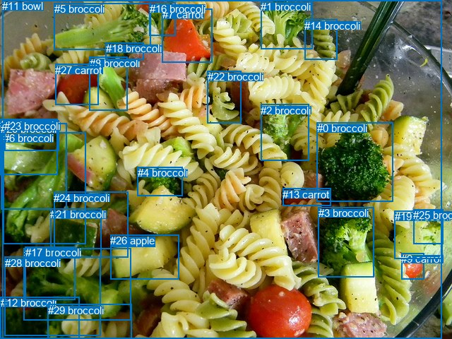
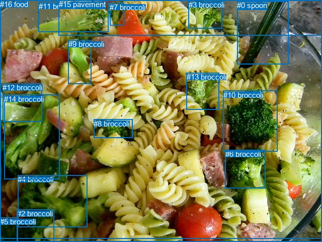

# 图片 0266：2324868.jpg

随机样本序号：270。图片 SHA256：`51c1b46c85fc415d986c4d7e2559ca08267ede426ff5d31d9c9476699ca19cd8`。

红色框表示人，蓝色框表示其他物体。两个模式分别保留自身框编号，可依据位置比较对应对象。

## 自动检测框与输出

人的框编号：`[]`。状态：`no_person`。

### 自动检测全部物体框

| 编号 | 类别 | 是否为人 | 检测分数 | 像素坐标 xyxy |
|---|---|---|---|---|
| 0 | broccoli | False | 0.9932 | 449.0, 173.2, 556.3, 285.3 |
| 1 | broccoli | False | 0.9919 | 369.1, 0.7, 442.1, 69.1 |
| 2 | broccoli | False | 0.9895 | 369.1, 147.7, 437.3, 227.9 |
| 3 | broccoli | False | 0.9776 | 450.8, 293.4, 529.3, 392.4 |
| 4 | broccoli | False | 0.9740 | 194.6, 236.5, 258.8, 277.8 |
| 5 | broccoli | False | 0.9636 | 76.7, 4.5, 213.5, 70.3 |
| 6 | broccoli | False | 0.9570 | 4.5, 187.1, 121.2, 345.5 |
| 7 | carrot | False | 0.9330 | 229.6, 12.3, 300.1, 88.6 |
| 8 | broccoli | False | 0.9321 | 126.5, 80.8, 180.3, 156.2 |
| 9 | carrot | False | 0.8954 | 568.3, 358.1, 600.1, 395.1 |
| 10 | broccoli | False | 0.8558 | 33.8, 351.4, 185.6, 453.1 |
| 11 | bowl | False | 0.8483 | 3.4, 0.0, 625.9, 480.0 |
| 12 | broccoli | False | 0.8237 | 0.7, 420.1, 112.9, 479.7 |
| 13 | carrot | False | 0.7505 | 400.4, 266.6, 468.8, 291.5 |
| 14 | broccoli | False | 0.7398 | 431.3, 27.7, 477.7, 84.7 |
| 15 | broccoli | False | 0.7084 | 0.1, 168.3, 81.7, 247.2 |
| 16 | broccoli | False | 0.6568 | 211.5, 3.5, 248.0, 50.8 |
| 17 | broccoli | False | 0.6044 | 35.6, 349.4, 106.3, 424.4 |
| 18 | broccoli | False | 0.5822 | 149.8, 60.5, 203.4, 84.7 |
| 19 | broccoli | False | 0.5406 | 558.5, 298.3, 626.1, 366.4 |
| 20 | broccoli | False | 0.5369 | 1.0, 174.5, 94.0, 296.8 |
| 21 | broccoli | False | 0.5134 | 71.5, 295.2, 143.9, 364.4 |
| 22 | broccoli | False | 0.5044 | 293.5, 100.0, 341.1, 174.6 |
| 23 | broccoli | False | 0.4586 | 6.4, 170.1, 83.4, 213.2 |
| 24 | broccoli | False | 0.4532 | 76.3, 271.7, 181.9, 364.8 |
| 25 | broccoli | False | 0.4506 | 585.3, 296.3, 627.1, 345.3 |
| 26 | apple | False | 0.4500 | 156.2, 332.2, 253.6, 395.5 |
| 27 | carrot | False | 0.4448 | 78.1, 90.7, 139.6, 148.1 |
| 28 | broccoli | False | 0.3995 | 6.6, 363.5, 142.2, 475.3 |
| 29 | broccoli | False | 0.3783 | 68.0, 430.9, 186.1, 480.0 |

### 自动检测 Top50 人相关候选

评分物体对：0；人相关物体对：0；输出关系：0。

| 排名 | 主语编号与类别 | 关系 | 宾语编号与类别 | 类型 | 人与人 | 排序分数 | 原始融合 logit |
|---|---|---|---|---|---|---|---|

### 自动检测逐条人相关 GT 核验

本图没有人相关 GT，R@50 无分母；预测候选继续展示。

## 真实框与输出

人的框编号：`[]`。

### 真实框全部物体框

| 编号 | 类别 | 是否为人 | 检测分数 | 像素坐标 xyxy |
|---|---|---|---|---|
| 0 | spoon | False | GT | 471.0, 2.0, 573.0, 128.0 |
| 1 | bowl | False | GT | 1.0, 1.0, 640.0, 474.0 |
| 2 | broccoli | False | GT | 34.0, 415.0, 108.0, 480.0 |
| 3 | broccoli | False | GT | 375.0, 1.0, 442.0, 56.0 |
| 4 | broccoli | False | GT | 35.0, 347.0, 174.0, 450.0 |
| 5 | broccoli | False | GT | 0.0, 431.0, 35.0, 480.0 |
| 6 | broccoli | False | GT | 448.0, 297.0, 527.0, 373.0 |
| 7 | broccoli | False | GT | 218.0, 6.0, 246.0, 50.0 |
| 8 | broccoli | False | GT | 186.0, 237.0, 263.0, 274.0 |
| 9 | broccoli | False | GT | 136.0, 79.0, 182.0, 166.0 |
| 10 | broccoli | False | GT | 444.0, 180.0, 552.0, 301.0 |
| 11 | broccoli | False | GT | 77.0, 4.0, 216.0, 64.0 |
| 12 | broccoli | False | GT | 5.0, 165.0, 83.0, 241.0 |
| 13 | broccoli | False | GT | 371.0, 144.0, 436.0, 217.0 |
| 14 | broccoli | False | GT | 8.0, 188.0, 118.0, 356.0 |
| 15 | pavement | False | GT | 117.0, 0.0, 640.0, 71.0 |
| 16 | food | False | GT | 0.0, 0.0, 640.0, 480.0 |

### 真实框 Top50 人相关候选

评分物体对：0；人相关物体对：0；输出关系：0。

| 排名 | 主语编号与类别 | 关系 | 宾语编号与类别 | 类型 | 人与人 | 排序分数 | 原始融合 logit |
|---|---|---|---|---|---|---|---|

### 真实框逐条人相关 GT 核验

本图没有人相关 GT，R@50 无分母；预测候选继续展示。

## 全部人相关 GT

| 主语编号与类别 | 关系 | 宾语编号与类别 |
|---|---|---|

原始记录、全部人相关物体对的两项预测与分项分数见 [逐图证据 JSON](../evidence/cases/0266.json)。全部56类 logits 保留于本机 HOR/output/random500/logits/。

<!-- HOR_COMPLETE_RESULTS -->

## 六组条件的完整输出对照

以下保留同一图片三种框与候选模式、两种谓词输出规则的全部 Top50。框编号各自在所属模式内解释。

### 自动检测框完整枚举：空间与语义各保留一个谓词

| 排名 | 主语编号与类别 | 谓词 | 宾语编号与类别 | 分组 | 排序分数 | predicate logit | pair logit |
|---|---|---|---|---|---|---|---|

没有人相关 GT，本条件的召回率无分母。

### 自动检测框完整枚举：每对只保留一个谓词

| 排名 | 主语编号与类别 | 谓词 | 宾语编号与类别 | 分组 | 排序分数 | predicate logit | pair logit |
|---|---|---|---|---|---|---|---|

没有人相关 GT，本条件的召回率无分母。

### 真实框完整枚举：空间与语义各保留一个谓词

| 排名 | 主语编号与类别 | 谓词 | 宾语编号与类别 | 分组 | 排序分数 | predicate logit | pair logit |
|---|---|---|---|---|---|---|---|

没有人相关 GT，本条件的召回率无分母。

### 真实框完整枚举：每对只保留一个谓词

| 排名 | 主语编号与类别 | 谓词 | 宾语编号与类别 | 分组 | 排序分数 | predicate logit | pair logit |
|---|---|---|---|---|---|---|---|

没有人相关 GT，本条件的召回率无分母。

### 真实框400候选：空间与语义各保留一个谓词

| 排名 | 主语编号与类别 | 谓词 | 宾语编号与类别 | 分组 | 排序分数 | predicate logit | pair logit |
|---|---|---|---|---|---|---|---|

没有人相关 GT，本条件的召回率无分母。

### 真实框400候选：每对只保留一个谓词

| 排名 | 主语编号与类别 | 谓词 | 宾语编号与类别 | 分组 | 排序分数 | predicate logit | pair logit |
|---|---|---|---|---|---|---|---|

没有人相关 GT，本条件的召回率无分母。
