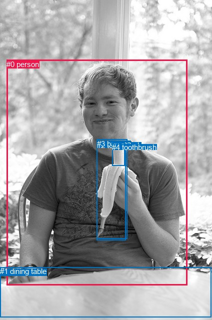
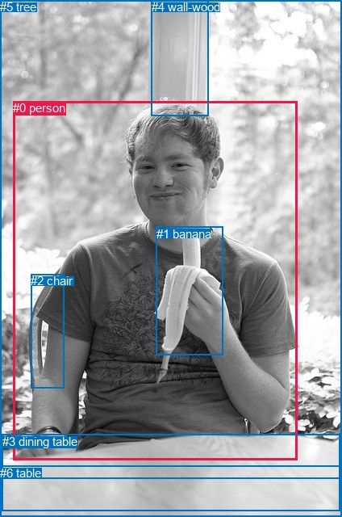

# 图片 0280：2325881.jpg

随机样本序号：413。图片 SHA256：`0e66a2748ad65ccd3cb04e5163b77def18ae135109bfe19935ff7d3183eba7b4`。

红色框表示人，蓝色框表示其他物体。两个模式分别保留自身框编号，可依据位置比较对应对象。

## 自动检测框与输出

人的框编号：`[0]`。状态：`ok`。

### 自动检测全部物体框

| 编号 | 类别 | 是否为人 | 检测分数 | 像素坐标 xyxy |
|---|---|---|---|---|
| 0 | person | True | 0.9996 | 13.5, 119.8, 374.7, 570.6 |
| 1 | dining table | False | 0.7219 | 0.3, 534.3, 422.5, 634.2 |
| 2 | toothbrush | False | 0.6695 | 193.8, 281.9, 251.8, 480.1 |
| 3 | banana | False | 0.6124 | 193.9, 278.9, 254.7, 477.5 |
| 4 | toothbrush | False | 0.5935 | 224.3, 285.9, 249.9, 331.4 |

### 自动检测 Top50 人相关候选

评分物体对：20；人相关物体对：8；输出关系：16。

| 排名 | 主语编号与类别 | 关系 | 宾语编号与类别 | 类型 | 人与人 | 排序分数 | 原始融合 logit |
|---|---|---|---|---|---|---|---|
| 1 | #0 person | eating | #2 toothbrush | semantic | False | 0.99553 | 5.4057 |
| 2 | #0 person | eating | #3 banana | semantic | False | 0.99552 | 5.4039 |
| 3 | #0 person | sitting on | #1 dining table | semantic | False | 0.98665 | 4.3026 |
| 4 | #0 person | eating | #4 toothbrush | semantic | False | 0.95709 | 3.1048 |
| 5 | #0 person | on | #1 dining table | spatial | False | 0.91089 | 2.3246 |
| 6 | #1 dining table | in front of | #0 person | spatial | False | 0.77753 | 1.2513 |
| 7 | #0 person | in | #3 banana | spatial | False | 0.73412 | 1.0156 |
| 8 | #0 person | in | #2 toothbrush | spatial | False | 0.73053 | 0.9973 |
| 9 | #0 person | in | #4 toothbrush | spatial | False | 0.50259 | 0.0104 |
| 10 | #4 toothbrush | on | #0 person | spatial | False | 0.47166 | -0.1135 |
| 11 | #1 dining table | holding | #0 person | semantic | False | 0.33758 | -0.6741 |
| 12 | #3 banana | hanging from | #0 person | spatial | False | 0.13616 | -1.8475 |
| 13 | #2 toothbrush | hanging from | #0 person | spatial | False | 0.12287 | -1.9656 |
| 14 | #4 toothbrush | wearing | #0 person | semantic | False | 0.04004 | -3.1769 |
| 15 | #3 banana | holding | #0 person | semantic | False | 0.02199 | -3.7950 |
| 16 | #2 toothbrush | holding | #0 person | semantic | False | 0.02066 | -3.8588 |

### 自动检测逐条人相关 GT 核验

R@50：40.00%；命中 2/5。

| GT 主语编号 | GT 关系 | GT 宾语编号 | 结果阶段 | 匹配预测主语编号 | 匹配预测宾语编号 |
|---|---|---|---|---|---|
| 0 | holding | 1 | wrong_predicate | [0] | [3] |
| 0 | eating | 1 | hit50 | [0] | [3] |
| 0 | sitting on | 2 | endpoint_missing_or_wrong_class | [0] | [] |
| 0 | in front of | 4 | endpoint_missing_or_wrong_class | [0] | [] |
| 3 | in front of | 0 | hit50 | [1] | [0] |

## 真实框与输出

人的框编号：`[0]`。

### 真实框全部物体框

| 编号 | 类别 | 是否为人 | 检测分数 | 像素坐标 xyxy |
|---|---|---|---|---|
| 0 | person | True | GT | 16.0, 125.0, 368.0, 569.0 |
| 1 | banana | False | GT | 194.0, 281.0, 277.0, 439.0 |
| 2 | chair | False | GT | 38.0, 339.0, 79.0, 481.0 |
| 3 | dining table | False | GT | 3.0, 538.0, 422.0, 633.0 |
| 4 | wall-wood | False | GT | 188.0, 0.0, 259.0, 144.0 |
| 5 | tree | False | GT | 0.0, 0.0, 424.0, 593.0 |
| 6 | table | False | GT | 0.0, 577.0, 424.0, 640.0 |

### 真实框 Top50 人相关候选

评分物体对：42；人相关物体对：12；输出关系：24。

| 排名 | 主语编号与类别 | 关系 | 宾语编号与类别 | 类型 | 人与人 | 排序分数 | 原始融合 logit |
|---|---|---|---|---|---|---|---|
| 1 | #0 person | eating | #1 banana | semantic | False | 0.99597 | 5.5089 |
| 2 | #0 person | sitting on | #3 dining table | semantic | False | 0.97332 | 3.5967 |
| 3 | #0 person | sitting on | #6 table | semantic | False | 0.97219 | 3.5541 |
| 4 | #0 person | sitting on | #2 chair | semantic | False | 0.93226 | 2.6219 |
| 5 | #0 person | on | #3 dining table | spatial | False | 0.91636 | 2.3939 |
| 6 | #0 person | on | #6 table | spatial | False | 0.90370 | 2.2391 |
| 7 | #0 person | looking at | #5 tree | semantic | False | 0.89575 | 2.1509 |
| 8 | #0 person | on | #2 chair | spatial | False | 0.88187 | 2.0102 |
| 9 | #0 person | in | #5 tree | spatial | False | 0.84677 | 1.7095 |
| 10 | #2 chair | on | #0 person | spatial | False | 0.83539 | 1.6243 |
| 11 | #4 wall-wood | beside | #0 person | spatial | False | 0.81978 | 1.5149 |
| 12 | #0 person | in | #1 banana | spatial | False | 0.80262 | 1.4027 |
| 13 | #5 tree | beside | #0 person | spatial | False | 0.80117 | 1.3936 |
| 14 | #0 person | looking at | #4 wall-wood | semantic | False | 0.71156 | 0.9030 |
| 15 | #0 person | beside | #4 wall-wood | spatial | False | 0.68642 | 0.7835 |
| 16 | #3 dining table | in front of | #0 person | spatial | False | 0.59329 | 0.3776 |
| 17 | #5 tree | looking at | #0 person | semantic | False | 0.56467 | 0.2601 |
| 18 | #1 banana | hanging from | #0 person | spatial | False | 0.56253 | 0.2514 |
| 19 | #6 table | in front of | #0 person | spatial | False | 0.53489 | 0.1398 |
| 20 | #4 wall-wood | looking at | #0 person | semantic | False | 0.44375 | -0.2260 |
| 21 | #2 chair | holding | #0 person | semantic | False | 0.35557 | -0.5946 |
| 22 | #1 banana | holding | #0 person | semantic | False | 0.15616 | -1.6871 |
| 23 | #3 dining table | holding | #0 person | semantic | False | 0.12838 | -1.9154 |
| 24 | #6 table | holding | #0 person | semantic | False | 0.09785 | -2.2214 |

### 真实框逐条人相关 GT 核验

R@50：60.00%；命中 3/5。

| GT 主语编号 | GT 关系 | GT 宾语编号 | 结果阶段 | 匹配预测主语编号 | 匹配预测宾语编号 |
|---|---|---|---|---|---|
| 0 | holding | 1 | wrong_predicate | [0] | [1] |
| 0 | eating | 1 | hit50 | [0] | [1] |
| 0 | sitting on | 2 | hit50 | [0] | [2] |
| 0 | in front of | 4 | wrong_predicate | [0] | [4] |
| 3 | in front of | 0 | hit50 | [3] | [0] |

## 全部人相关 GT

| 主语编号与类别 | 关系 | 宾语编号与类别 |
|---|---|---|
| #0 person | holding | #1 banana |
| #0 person | eating | #1 banana |
| #0 person | sitting on | #2 chair |
| #0 person | in front of | #4 wall-wood |
| #3 dining table | in front of | #0 person |

原始记录、全部人相关物体对的两项预测与分项分数见 [逐图证据 JSON](../evidence/cases/0280.json)。全部56类 logits 保留于本机 HOR/output/random500/logits/。

<!-- HOR_COMPLETE_RESULTS -->

## 六组条件的完整输出对照

以下保留同一图片三种框与候选模式、两种谓词输出规则的全部 Top50。框编号各自在所属模式内解释。

### 自动检测框完整枚举：空间与语义各保留一个谓词

| 排名 | 主语编号与类别 | 谓词 | 宾语编号与类别 | 分组 | 排序分数 | predicate logit | pair logit |
|---|---|---|---|---|---|---|---|
| 1 | #0 person | eating | #2 toothbrush | semantic | 0.9955294 | 4.3843541 | 1.0213878 |
| 2 | #0 person | eating | #3 banana | semantic | 0.9955211 | 4.3843541 | 1.0195333 |
| 3 | #0 person | sitting on | #1 dining table | semantic | 0.9866475 | 4.0987916 | 0.2038164 |
| 4 | #0 person | eating | #4 toothbrush | semantic | 0.9570892 | 3.1298547 | -0.0250832 |
| 5 | #0 person | on | #1 dining table | spatial | 0.9108947 | 2.1207924 | 0.2038164 |
| 6 | #1 dining table | in front of | #0 person | spatial | 0.7775263 | 1.8639355 | -0.6126266 |
| 7 | #0 person | in | #3 banana | spatial | 0.7341158 | -0.0039272 | 1.0195333 |
| 8 | #0 person | in | #2 toothbrush | spatial | 0.7305323 | -0.0240626 | 1.0213878 |
| 9 | #0 person | in | #4 toothbrush | spatial | 0.5025923 | 0.0354524 | -0.0250832 |
| 10 | #4 toothbrush | on | #0 person | spatial | 0.4716620 | 0.8102732 | -0.9237471 |
| 11 | #1 dining table | holding | #0 person | semantic | 0.3375802 | -0.0614700 | -0.6126266 |
| 12 | #3 banana | hanging from | #0 person | spatial | 0.1361637 | 0.5386262 | -2.3861513 |
| 13 | #2 toothbrush | hanging from | #0 person | spatial | 0.1228654 | 0.4483557 | -2.4139271 |
| 14 | #4 toothbrush | wearing | #0 person | semantic | 0.0400448 | -2.2531407 | -0.9237471 |
| 15 | #3 banana | holding | #0 person | semantic | 0.0219889 | -1.4088299 | -2.3861513 |
| 16 | #2 toothbrush | holding | #0 person | semantic | 0.0206584 | -1.4448295 | -2.4139271 |

GT 命中：2/5，R@50=40.00%。

| GT主语 | GT谓词 | GT宾语 | 结果阶段 | 匹配主语框 | 匹配宾语框 |
|---|---|---|---|---|---|
| 0 | holding | 1 | wrong_predicate | [0] | [3] |
| 0 | eating | 1 | hit50 | [0] | [3] |
| 0 | sitting on | 2 | endpoint_missing_or_wrong_class | [0] | [] |
| 0 | in front of | 4 | endpoint_missing_or_wrong_class | [0] | [] |
| 3 | in front of | 0 | hit50 | [1] | [0] |

### 自动检测框完整枚举：每对只保留一个谓词

| 排名 | 主语编号与类别 | 谓词 | 宾语编号与类别 | 分组 | 排序分数 | predicate logit | pair logit |
|---|---|---|---|---|---|---|---|
| 1 | #0 person | eating | #2 toothbrush | single | 0.9955294 | 4.3843541 | 1.0213878 |
| 2 | #0 person | eating | #3 banana | single | 0.9955211 | 4.3843541 | 1.0195333 |
| 3 | #0 person | sitting on | #1 dining table | single | 0.9866475 | 4.0987916 | 0.2038164 |
| 4 | #0 person | eating | #4 toothbrush | single | 0.9570892 | 3.1298547 | -0.0250832 |
| 5 | #1 dining table | in front of | #0 person | single | 0.7775263 | 1.8639355 | -0.6126266 |
| 6 | #4 toothbrush | on | #0 person | single | 0.4716620 | 0.8102732 | -0.9237471 |
| 7 | #3 banana | hanging from | #0 person | single | 0.1361637 | 0.5386262 | -2.3861513 |
| 8 | #2 toothbrush | hanging from | #0 person | single | 0.1228654 | 0.4483557 | -2.4139271 |

GT 命中：2/5，R@50=40.00%。

| GT主语 | GT谓词 | GT宾语 | 结果阶段 | 匹配主语框 | 匹配宾语框 |
|---|---|---|---|---|---|
| 0 | holding | 1 | wrong_predicate | [0] | [3] |
| 0 | eating | 1 | hit50 | [0] | [3] |
| 0 | sitting on | 2 | endpoint_missing_or_wrong_class | [0] | [] |
| 0 | in front of | 4 | endpoint_missing_or_wrong_class | [0] | [] |
| 3 | in front of | 0 | hit50 | [1] | [0] |

### 真实框完整枚举：空间与语义各保留一个谓词

| 排名 | 主语编号与类别 | 谓词 | 宾语编号与类别 | 分组 | 排序分数 | predicate logit | pair logit |
|---|---|---|---|---|---|---|---|
| 1 | #0 person | eating | #1 banana | semantic | 0.9959660 | 4.5961194 | 0.9128158 |
| 2 | #0 person | sitting on | #3 dining table | semantic | 0.9733170 | 3.4548106 | 0.1418758 |
| 3 | #0 person | sitting on | #6 table | semantic | 0.9721871 | 3.3916230 | 0.1624285 |
| 4 | #0 person | sitting on | #2 chair | semantic | 0.9322578 | 2.4587460 | 0.1631548 |
| 5 | #0 person | on | #3 dining table | spatial | 0.9163627 | 2.2520475 | 0.1418758 |
| 6 | #0 person | on | #6 table | spatial | 0.9037047 | 2.0766549 | 0.1624285 |
| 7 | #0 person | looking at | #5 tree | semantic | 0.8957496 | 2.3555274 | -0.2046620 |
| 8 | #0 person | on | #2 chair | spatial | 0.8818670 | 1.8470755 | 0.1631548 |
| 9 | #0 person | in | #5 tree | spatial | 0.8467714 | 1.9141617 | -0.2046620 |
| 10 | #2 chair | on | #0 person | spatial | 0.8353940 | 2.2537847 | -0.6294358 |
| 11 | #4 wall-wood | beside | #0 person | spatial | 0.8197814 | 1.6659479 | -0.1510812 |
| 12 | #0 person | in | #1 banana | spatial | 0.8026173 | 0.4899173 | 0.9128158 |
| 13 | #5 tree | beside | #0 person | spatial | 0.8011678 | 1.7290797 | -0.3354703 |
| 14 | #0 person | looking at | #4 wall-wood | semantic | 0.7115561 | 1.7019958 | -0.7990421 |
| 15 | #0 person | beside | #4 wall-wood | spatial | 0.6864244 | 1.5824981 | -0.7990421 |
| 16 | #3 dining table | in front of | #0 person | spatial | 0.5932866 | 1.0093575 | -0.6317887 |
| 17 | #5 tree | looking at | #0 person | semantic | 0.5646663 | 0.5955925 | -0.3354703 |
| 18 | #1 banana | hanging from | #0 person | spatial | 0.5625308 | 2.4644270 | -2.2129874 |
| 19 | #6 table | in front of | #0 person | spatial | 0.5348864 | 0.7082915 | -0.5685191 |
| 20 | #4 wall-wood | looking at | #0 person | semantic | 0.4437461 | -0.0748911 | -0.1510812 |
| 21 | #2 chair | holding | #0 person | semantic | 0.3555699 | 0.0347915 | -0.6294358 |
| 22 | #1 banana | holding | #0 person | semantic | 0.1561556 | 0.5258722 | -2.2129874 |
| 23 | #3 dining table | holding | #0 person | semantic | 0.1283807 | -1.2835641 | -0.6317887 |
| 24 | #6 table | holding | #0 person | semantic | 0.0978463 | -1.6528680 | -0.5685191 |

GT 命中：3/5，R@50=60.00%。

| GT主语 | GT谓词 | GT宾语 | 结果阶段 | 匹配主语框 | 匹配宾语框 |
|---|---|---|---|---|---|
| 0 | holding | 1 | wrong_predicate | [0] | [1] |
| 0 | eating | 1 | hit50 | [0] | [1] |
| 0 | sitting on | 2 | hit50 | [0] | [2] |
| 0 | in front of | 4 | wrong_predicate | [0] | [4] |
| 3 | in front of | 0 | hit50 | [3] | [0] |

### 真实框完整枚举：每对只保留一个谓词

| 排名 | 主语编号与类别 | 谓词 | 宾语编号与类别 | 分组 | 排序分数 | predicate logit | pair logit |
|---|---|---|---|---|---|---|---|
| 1 | #0 person | eating | #1 banana | single | 0.9959660 | 4.5961194 | 0.9128158 |
| 2 | #0 person | sitting on | #3 dining table | single | 0.9733170 | 3.4548106 | 0.1418758 |
| 3 | #0 person | sitting on | #6 table | single | 0.9721871 | 3.3916230 | 0.1624285 |
| 4 | #0 person | sitting on | #2 chair | single | 0.9322578 | 2.4587460 | 0.1631548 |
| 5 | #0 person | looking at | #5 tree | single | 0.8957496 | 2.3555274 | -0.2046620 |
| 6 | #2 chair | on | #0 person | single | 0.8353940 | 2.2537847 | -0.6294358 |
| 7 | #4 wall-wood | beside | #0 person | single | 0.8197814 | 1.6659479 | -0.1510812 |
| 8 | #5 tree | beside | #0 person | single | 0.8011678 | 1.7290797 | -0.3354703 |
| 9 | #0 person | looking at | #4 wall-wood | single | 0.7115561 | 1.7019958 | -0.7990421 |
| 10 | #3 dining table | in front of | #0 person | single | 0.5932866 | 1.0093575 | -0.6317887 |
| 11 | #1 banana | hanging from | #0 person | single | 0.5625308 | 2.4644270 | -2.2129874 |
| 12 | #6 table | in front of | #0 person | single | 0.5348864 | 0.7082915 | -0.5685191 |

GT 命中：3/5，R@50=60.00%。

| GT主语 | GT谓词 | GT宾语 | 结果阶段 | 匹配主语框 | 匹配宾语框 |
|---|---|---|---|---|---|
| 0 | holding | 1 | wrong_predicate | [0] | [1] |
| 0 | eating | 1 | hit50 | [0] | [1] |
| 0 | sitting on | 2 | hit50 | [0] | [2] |
| 0 | in front of | 4 | wrong_predicate | [0] | [4] |
| 3 | in front of | 0 | hit50 | [3] | [0] |

### 真实框400候选：空间与语义各保留一个谓词

| 排名 | 主语编号与类别 | 谓词 | 宾语编号与类别 | 分组 | 排序分数 | predicate logit | pair logit |
|---|---|---|---|---|---|---|---|
| 1 | #0 person | eating | #1 banana | semantic | 0.9959660 | 4.5961194 | 0.9128158 |
| 2 | #0 person | sitting on | #3 dining table | semantic | 0.9733170 | 3.4548106 | 0.1418758 |
| 3 | #0 person | sitting on | #6 table | semantic | 0.9727510 | 3.4126859 | 0.1624285 |
| 4 | #0 person | wearing | #2 chair | semantic | 0.9331461 | 2.4728961 | 0.1631548 |
| 5 | #0 person | on | #3 dining table | spatial | 0.9200639 | 2.3013401 | 0.1418758 |
| 6 | #0 person | on | #6 table | spatial | 0.9037047 | 2.0766549 | 0.1624285 |
| 7 | #0 person | looking at | #5 tree | semantic | 0.8957496 | 2.3555274 | -0.2046620 |
| 8 | #0 person | on | #2 chair | spatial | 0.8829968 | 1.8579655 | 0.1631548 |
| 9 | #0 person | in | #5 tree | spatial | 0.8467714 | 1.9141617 | -0.2046620 |
| 10 | #2 chair | on | #0 person | spatial | 0.8368860 | 2.2646742 | -0.6294358 |
| 11 | #4 wall-wood | beside | #0 person | spatial | 0.8152929 | 1.6358571 | -0.1510812 |
| 12 | #5 tree | beside | #0 person | spatial | 0.8058998 | 1.7590551 | -0.3354703 |
| 13 | #0 person | in | #1 banana | spatial | 0.8031425 | 0.4932361 | 0.9128158 |
| 14 | #0 person | looking at | #4 wall-wood | semantic | 0.7115561 | 1.7019958 | -0.7990421 |
| 15 | #0 person | beside | #4 wall-wood | spatial | 0.6799240 | 1.5524645 | -0.7990421 |
| 16 | #3 dining table | in front of | #0 person | spatial | 0.5861728 | 0.9799547 | -0.6317887 |
| 17 | #5 tree | looking at | #0 person | semantic | 0.5648377 | 0.5962896 | -0.3354703 |
| 18 | #1 banana | hanging from | #0 person | spatial | 0.5625309 | 2.4644275 | -2.2129874 |
| 19 | #6 table | in front of | #0 person | spatial | 0.5348672 | 0.7082148 | -0.5685191 |
| 20 | #4 wall-wood | looking at | #0 person | semantic | 0.4291164 | -0.1343760 | -0.1510812 |
| 21 | #2 chair | holding | #0 person | semantic | 0.3555699 | 0.0347915 | -0.6294358 |
| 22 | #1 banana | holding | #0 person | semantic | 0.1593688 | 0.5500550 | -2.2129874 |
| 23 | #3 dining table | holding | #0 person | semantic | 0.1282155 | -1.2850411 | -0.6317887 |
| 24 | #6 table | holding | #0 person | semantic | 0.0956045 | -1.6785281 | -0.5685191 |

GT 命中：2/5，R@50=40.00%。

| GT主语 | GT谓词 | GT宾语 | 结果阶段 | 匹配主语框 | 匹配宾语框 |
|---|---|---|---|---|---|
| 0 | holding | 1 | wrong_predicate | [0] | [1] |
| 0 | eating | 1 | hit50 | [0] | [1] |
| 0 | sitting on | 2 | wrong_predicate | [0] | [2] |
| 0 | in front of | 4 | wrong_predicate | [0] | [4] |
| 3 | in front of | 0 | hit50 | [3] | [0] |

### 真实框400候选：每对只保留一个谓词

| 排名 | 主语编号与类别 | 谓词 | 宾语编号与类别 | 分组 | 排序分数 | predicate logit | pair logit |
|---|---|---|---|---|---|---|---|
| 1 | #0 person | eating | #1 banana | single | 0.9959660 | 4.5961194 | 0.9128158 |
| 2 | #0 person | sitting on | #3 dining table | single | 0.9733170 | 3.4548106 | 0.1418758 |
| 3 | #0 person | sitting on | #6 table | single | 0.9727510 | 3.4126859 | 0.1624285 |
| 4 | #0 person | wearing | #2 chair | single | 0.9331461 | 2.4728961 | 0.1631548 |
| 5 | #0 person | looking at | #5 tree | single | 0.8957496 | 2.3555274 | -0.2046620 |
| 6 | #2 chair | on | #0 person | single | 0.8368860 | 2.2646742 | -0.6294358 |
| 7 | #4 wall-wood | beside | #0 person | single | 0.8152929 | 1.6358571 | -0.1510812 |
| 8 | #5 tree | beside | #0 person | single | 0.8058998 | 1.7590551 | -0.3354703 |
| 9 | #0 person | looking at | #4 wall-wood | single | 0.7115561 | 1.7019958 | -0.7990421 |
| 10 | #3 dining table | in front of | #0 person | single | 0.5861728 | 0.9799547 | -0.6317887 |
| 11 | #1 banana | hanging from | #0 person | single | 0.5625309 | 2.4644275 | -2.2129874 |
| 12 | #6 table | in front of | #0 person | single | 0.5348672 | 0.7082148 | -0.5685191 |

GT 命中：2/5，R@50=40.00%。

| GT主语 | GT谓词 | GT宾语 | 结果阶段 | 匹配主语框 | 匹配宾语框 |
|---|---|---|---|---|---|
| 0 | holding | 1 | wrong_predicate | [0] | [1] |
| 0 | eating | 1 | hit50 | [0] | [1] |
| 0 | sitting on | 2 | wrong_predicate | [0] | [2] |
| 0 | in front of | 4 | wrong_predicate | [0] | [4] |
| 3 | in front of | 0 | hit50 | [3] | [0] |
