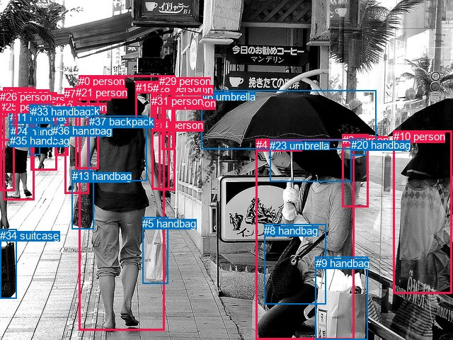
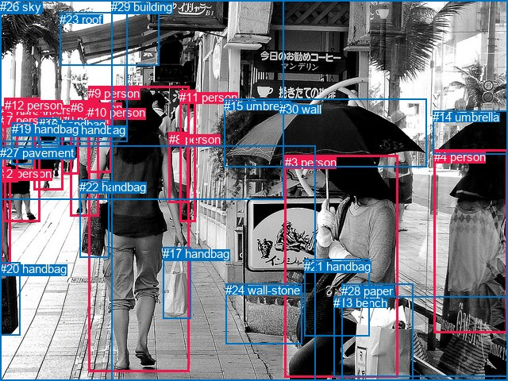

# 图片 0283：2326062.jpg

随机样本序号：190。图片 SHA256：`30e5b2591b14fc61ea7488608459c7a197e24eaeb97e09a9b1483bd9d35f1f71`。

红色框表示人，蓝色框表示其他物体。两个模式分别保留自身框编号，可依据位置比较对应对象。

## 自动检测框与输出

人的框编号：`[0, 1, 2, 3, 4, 7, 10, 12, 14, 15, 16, 18, 21, 22, 25, 26, 28, 29, 30, 31]`。状态：`ok`。

### 自动检测全部物体框

| 编号 | 类别 | 是否为人 | 检测分数 | 像素坐标 xyxy |
|---|---|---|---|---|
| 0 | person | True | 0.9992 | 111.4, 106.1, 232.7, 466.2 |
| 1 | person | True | 0.9975 | 43.2, 130.7, 80.7, 240.9 |
| 2 | person | True | 0.9936 | 4.5, 123.9, 48.5, 282.2 |
| 3 | person | True | 0.9916 | 483.8, 189.1, 520.9, 293.0 |
| 4 | person | True | 0.9884 | 361.8, 196.4, 500.7, 480.0 |
| 5 | handbag | False | 0.9865 | 201.2, 306.9, 237.8, 400.0 |
| 6 | umbrella | False | 0.9861 | 284.9, 127.6, 531.1, 210.8 |
| 7 | person | True | 0.9815 | 91.0, 124.0, 125.3, 273.7 |
| 8 | handbag | False | 0.9768 | 373.1, 316.6, 460.4, 429.1 |
| 9 | handbag | False | 0.9701 | 445.9, 362.5, 519.4, 480.0 |
| 10 | person | True | 0.9414 | 555.6, 184.3, 638.3, 414.0 |
| 11 | handbag | False | 0.9388 | 14.0, 157.1, 41.4, 207.2 |
| 12 | person | True | 0.9349 | 77.7, 142.6, 96.8, 219.5 |
| 13 | handbag | False | 0.9256 | 101.6, 240.4, 132.1, 323.7 |
| 14 | person | True | 0.9212 | 214.2, 168.1, 239.1, 267.4 |
| 15 | person | True | 0.9037 | 191.5, 114.6, 216.6, 175.9 |
| 16 | person | True | 0.8862 | 218.4, 114.4, 244.2, 183.1 |
| 17 | handbag | False | 0.8789 | 0.1, 324.0, 23.3, 421.1 |
| 18 | person | True | 0.8152 | 0.1, 138.8, 20.0, 269.8 |
| 19 | handbag | False | 0.8046 | 49.8, 147.5, 72.6, 182.1 |
| 20 | handbag | False | 0.7953 | 495.6, 195.7, 516.2, 219.7 |
| 21 | person | True | 0.7598 | 106.7, 121.9, 139.4, 238.8 |
| 22 | person | True | 0.7100 | 228.4, 117.6, 245.7, 211.1 |
| 23 | umbrella | False | 0.6868 | 381.2, 197.1, 496.4, 256.2 |
| 24 | handbag | False | 0.6828 | 14.5, 177.4, 36.8, 204.9 |
| 25 | person | True | 0.6361 | 0.3, 142.3, 10.4, 164.6 |
| 26 | person | True | 0.6022 | 0.2, 128.4, 24.1, 198.4 |
| 27 | backpack | False | 0.5673 | 48.8, 147.7, 72.6, 182.0 |
| 28 | person | True | 0.5334 | 216.0, 115.9, 234.8, 173.3 |
| 29 | person | True | 0.5077 | 225.0, 106.2, 247.1, 268.5 |
| 30 | person | True | 0.5064 | 231.7, 137.5, 244.3, 190.4 |
| 31 | person | True | 0.4922 | 213.9, 133.8, 221.9, 172.3 |
| 32 | handbag | False | 0.4776 | 41.5, 147.2, 56.6, 218.9 |
| 33 | handbag | False | 0.4560 | 44.3, 148.7, 53.6, 204.3 |
| 34 | suitcase | False | 0.4529 | 0.0, 323.6, 23.4, 421.2 |
| 35 | handbag | False | 0.3989 | 13.6, 190.2, 34.6, 206.2 |
| 36 | handbag | False | 0.3833 | 74.0, 175.9, 84.2, 200.9 |
| 37 | backpack | False | 0.3577 | 125.8, 163.2, 207.5, 255.8 |

### 自动检测 Top50 人相关候选

评分物体对：1406；人相关物体对：1100；输出关系：50。

| 排名 | 主语编号与类别 | 关系 | 宾语编号与类别 | 类型 | 人与人 | 排序分数 | 原始融合 logit |
|---|---|---|---|---|---|---|---|
| 1 | #4 person | holding | #6 umbrella | semantic | False | 0.99720 | 5.8765 |
| 2 | #4 person | carrying | #8 handbag | semantic | False | 0.99199 | 4.8195 |
| 3 | #4 person | carrying | #9 handbag | semantic | False | 0.99185 | 4.8020 |
| 4 | #0 person | carrying | #5 handbag | semantic | False | 0.98825 | 4.4318 |
| 5 | #4 person | wearing | #23 umbrella | semantic | False | 0.98785 | 4.3982 |
| 6 | #0 person | carrying | #13 handbag | semantic | False | 0.98361 | 4.0943 |
| 7 | #0 person | wearing | #37 backpack | semantic | False | 0.97419 | 3.6307 |
| 8 | #18 person | wearing | #25 person | semantic | True | 0.97339 | 3.5995 |
| 9 | #2 person | wearing | #11 handbag | semantic | False | 0.96392 | 3.2853 |
| 10 | #2 person | carrying | #24 handbag | semantic | False | 0.95882 | 3.1477 |
| 11 | #1 person | wearing | #27 backpack | semantic | False | 0.94821 | 2.9073 |
| 12 | #2 person | carrying | #35 handbag | semantic | False | 0.94756 | 2.8943 |
| 13 | #1 person | wearing | #19 handbag | semantic | False | 0.94601 | 2.8635 |
| 14 | #22 person | wearing | #30 person | semantic | True | 0.93993 | 2.7503 |
| 15 | #7 person | carrying | #13 handbag | semantic | False | 0.93883 | 2.7309 |
| 16 | #1 person | carrying | #33 handbag | semantic | False | 0.91962 | 2.4372 |
| 17 | #18 person | wearing | #26 person | semantic | True | 0.91538 | 2.3812 |
| 18 | #3 person | carrying | #20 handbag | semantic | False | 0.90209 | 2.2207 |
| 19 | #26 person | wearing | #25 person | semantic | True | 0.89636 | 2.1574 |
| 20 | #1 person | carrying | #36 handbag | semantic | False | 0.89487 | 2.1415 |
| 21 | #4 person | beside | #0 person | spatial | True | 0.89328 | 2.1247 |
| 22 | #1 person | carrying | #32 handbag | semantic | False | 0.89158 | 2.1070 |
| 23 | #29 person | wearing | #30 person | semantic | True | 0.88940 | 2.0847 |
| 24 | #9 handbag | beside | #4 person | spatial | False | 0.88875 | 2.0780 |
| 25 | #13 handbag | beside | #0 person | spatial | False | 0.88525 | 2.0431 |
| 26 | #4 person | beside | #10 person | spatial | True | 0.87537 | 1.9493 |
| 27 | #10 person | beside | #4 person | spatial | True | 0.85681 | 1.7890 |
| 28 | #2 person | wearing | #26 person | semantic | True | 0.84382 | 1.6869 |
| 29 | #8 handbag | on | #4 person | spatial | False | 0.84148 | 1.6693 |
| 30 | #29 person | wearing | #22 person | semantic | True | 0.83715 | 1.6371 |
| 31 | #18 person | carrying | #24 handbag | semantic | False | 0.82944 | 1.5817 |
| 32 | #18 person | carrying | #11 handbag | semantic | False | 0.82699 | 1.5645 |
| 33 | #5 handbag | beside | #0 person | spatial | False | 0.82340 | 1.5395 |
| 34 | #18 person | carrying | #35 handbag | semantic | False | 0.82224 | 1.5316 |
| 35 | #0 person | beside | #21 person | spatial | True | 0.81538 | 1.4854 |
| 36 | #2 person | carrying | #32 handbag | semantic | False | 0.81257 | 1.4668 |
| 37 | #2 person | carrying | #33 handbag | semantic | False | 0.81041 | 1.4526 |
| 38 | #21 person | beside | #7 person | spatial | True | 0.80075 | 1.3910 |
| 39 | #0 person | beside | #7 person | spatial | True | 0.79662 | 1.3653 |
| 40 | #4 person | beside | #6 umbrella | spatial | False | 0.79218 | 1.3381 |
| 41 | #0 person | beside | #4 person | spatial | True | 0.78007 | 1.2661 |
| 42 | #2 person | wearing | #25 person | semantic | True | 0.77329 | 1.2270 |
| 43 | #2 person | walking on | #18 person | semantic | True | 0.76917 | 1.2037 |
| 44 | #0 person | in | #37 backpack | spatial | False | 0.76126 | 1.1596 |
| 45 | #18 person | in | #25 person | spatial | True | 0.75972 | 1.1511 |
| 46 | #6 umbrella | over | #4 person | spatial | False | 0.74875 | 1.0919 |
| 47 | #12 person | carrying | #36 handbag | semantic | False | 0.74834 | 1.0898 |
| 48 | #4 person | on | #8 handbag | spatial | False | 0.73530 | 1.0217 |
| 49 | #23 umbrella | on | #4 person | spatial | False | 0.72855 | 0.9873 |
| 50 | #2 person | beside | #18 person | spatial | True | 0.72617 | 0.9753 |

### 自动检测逐条人相关 GT 核验

R@50：8.33%；命中 1/12。

| GT 主语编号 | GT 关系 | GT 宾语编号 | 结果阶段 | 匹配预测主语编号 | 匹配预测宾语编号 |
|---|---|---|---|---|---|
| 0 | on | 27 | endpoint_missing_or_wrong_class | [12] | [] |
| 0 | walking on | 27 | endpoint_missing_or_wrong_class | [12] | [] |
| 3 | sitting on | 13 | endpoint_missing_or_wrong_class | [4] | [] |
| 3 | holding | 15 | hit50 | [4] | [6] |
| 3 | on | 27 | endpoint_missing_or_wrong_class | [4] | [] |
| 9 | looking at | 10 | wrong_predicate | [0] | [21] |
| 9 | holding | 17 | wrong_predicate | [0] | [5] |
| 9 | walking on | 27 | endpoint_missing_or_wrong_class | [0] | [] |
| 12 | on | 27 | endpoint_missing_or_wrong_class | [2] | [] |
| 21 | hanging from | 3 | wrong_predicate | [8] | [4] |
| 22 | hanging from | 9 | wrong_predicate | [13] | [0] |
| 28 | beside | 3 | endpoint_missing_or_wrong_class | [] | [4] |

## 真实框与输出

人的框编号：`[0, 1, 2, 3, 4, 5, 6, 7, 8, 9, 10, 11, 12]`。

### 真实框全部物体框

| 编号 | 类别 | 是否为人 | 检测分数 | 像素坐标 xyxy |
|---|---|---|---|---|
| 0 | person | True | GT | 77.0, 142.0, 99.0, 220.0 |
| 1 | person | True | GT | 42.0, 130.0, 79.0, 240.0 |
| 2 | person | True | GT | 0.0, 210.0, 14.0, 332.0 |
| 3 | person | True | GT | 359.0, 196.0, 502.0, 475.0 |
| 4 | person | True | GT | 547.0, 189.0, 640.0, 420.0 |
| 5 | person | True | GT | 0.0, 134.0, 22.0, 229.0 |
| 6 | person | True | GT | 89.0, 127.0, 125.0, 273.0 |
| 7 | person | True | GT | 0.0, 143.0, 11.0, 161.0 |
| 8 | person | True | GT | 213.0, 167.0, 237.0, 255.0 |
| 9 | person | True | GT | 111.0, 109.0, 238.0, 469.0 |
| 10 | person | True | GT | 110.0, 133.0, 140.0, 217.0 |
| 11 | person | True | GT | 226.0, 114.0, 246.0, 280.0 |
| 12 | person | True | GT | 6.0, 124.0, 50.0, 280.0 |
| 13 | bench | False | GT | 420.0, 373.0, 640.0, 474.0 |
| 14 | umbrella | False | GT | 545.0, 139.0, 640.0, 194.0 |
| 15 | umbrella | False | GT | 282.0, 125.0, 537.0, 211.0 |
| 16 | handbag | False | GT | 49.0, 148.0, 73.0, 182.0 |
| 17 | handbag | False | GT | 205.0, 311.0, 240.0, 401.0 |
| 18 | handbag | False | GT | 74.0, 155.0, 93.0, 186.0 |
| 19 | handbag | False | GT | 15.0, 154.0, 42.0, 207.0 |
| 20 | handbag | False | GT | 0.0, 330.0, 26.0, 422.0 |
| 21 | handbag | False | GT | 383.0, 327.0, 465.0, 423.0 |
| 22 | handbag | False | GT | 100.0, 227.0, 137.0, 325.0 |
| 23 | roof | False | GT | 75.0, 16.0, 200.0, 83.0 |
| 24 | wall-stone | False | GT | 284.0, 357.0, 380.0, 433.0 |
| 25 | tree | False | GT | 0.0, 0.0, 357.0, 252.0 |
| 26 | sky | False | GT | 0.0, 0.0, 160.0, 178.0 |
| 27 | pavement | False | GT | 0.0, 184.0, 397.0, 480.0 |
| 28 | paper | False | GT | 430.0, 358.0, 520.0, 480.0 |
| 29 | building | False | GT | 140.0, 0.0, 640.0, 480.0 |
| 30 | wall | False | GT | 352.0, 129.0, 374.0, 139.0 |

### 真实框 Top50 人相关候选

评分物体对：930；人相关物体对：624；输出关系：50。

| 排名 | 主语编号与类别 | 关系 | 宾语编号与类别 | 类型 | 人与人 | 排序分数 | 原始融合 logit |
|---|---|---|---|---|---|---|---|
| 1 | #3 person | holding | #15 umbrella | semantic | False | 0.99667 | 5.7007 |
| 2 | #3 person | carrying | #28 paper | semantic | False | 0.99142 | 4.7494 |
| 3 | #9 person | walking on | #27 pavement | semantic | False | 0.99071 | 4.6693 |
| 4 | #3 person | carrying | #21 handbag | semantic | False | 0.98997 | 4.5925 |
| 5 | #9 person | carrying | #17 handbag | semantic | False | 0.98740 | 4.3613 |
| 6 | #4 person | holding | #14 umbrella | semantic | False | 0.98585 | 4.2436 |
| 7 | #3 person | sitting on | #13 bench | semantic | False | 0.98568 | 4.2314 |
| 8 | #9 person | carrying | #22 handbag | semantic | False | 0.98544 | 4.2148 |
| 9 | #12 person | walking on | #27 pavement | semantic | False | 0.98236 | 4.0197 |
| 10 | #6 person | walking on | #27 pavement | semantic | False | 0.97890 | 3.8371 |
| 11 | #4 person | sitting on | #13 bench | semantic | False | 0.97857 | 3.8212 |
| 12 | #12 person | wearing | #19 handbag | semantic | False | 0.97642 | 3.7235 |
| 13 | #1 person | walking on | #27 pavement | semantic | False | 0.97624 | 3.7157 |
| 14 | #8 person | walking on | #27 pavement | semantic | False | 0.97234 | 3.5598 |
| 15 | #11 person | walking on | #27 pavement | semantic | False | 0.97159 | 3.5322 |
| 16 | #5 person | wearing | #7 person | semantic | True | 0.96899 | 3.4419 |
| 17 | #1 person | wearing | #16 handbag | semantic | False | 0.96081 | 3.1994 |
| 18 | #11 person | walking on | #29 building | semantic | False | 0.95368 | 3.0248 |
| 19 | #6 person | carrying | #22 handbag | semantic | False | 0.94884 | 2.9203 |
| 20 | #4 person | walking on | #29 building | semantic | False | 0.94825 | 2.9083 |
| 21 | #4 person | on | #13 bench | spatial | False | 0.93264 | 2.6280 |
| 22 | #3 person | on | #13 bench | spatial | False | 0.92965 | 2.5814 |
| 23 | #12 person | carrying | #2 person | semantic | True | 0.90287 | 2.2295 |
| 24 | #8 person | walking on | #29 building | semantic | False | 0.90228 | 2.2228 |
| 25 | #9 person | on | #27 pavement | spatial | False | 0.90184 | 2.2178 |
| 26 | #9 person | wearing | #10 person | semantic | True | 0.89880 | 2.1840 |
| 27 | #12 person | wearing | #7 person | semantic | True | 0.87857 | 1.9789 |
| 28 | #12 person | in | #19 handbag | spatial | False | 0.85625 | 1.7845 |
| 29 | #3 person | sitting on | #29 building | semantic | False | 0.85104 | 1.7428 |
| 30 | #21 handbag | on | #3 person | spatial | False | 0.84693 | 1.7107 |
| 31 | #0 person | wearing | #18 handbag | semantic | False | 0.83979 | 1.6567 |
| 32 | #0 person | walking on | #27 pavement | semantic | False | 0.83660 | 1.6332 |
| 33 | #3 person | sitting on | #24 wall-stone | semantic | False | 0.82857 | 1.5755 |
| 34 | #9 person | walking on | #29 building | semantic | False | 0.82087 | 1.5223 |
| 35 | #2 person | walking on | #27 pavement | semantic | False | 0.81914 | 1.5105 |
| 36 | #5 person | walking on | #27 pavement | semantic | False | 0.81875 | 1.5079 |
| 37 | #10 person | walking on | #27 pavement | semantic | False | 0.81531 | 1.4849 |
| 38 | #11 person | carrying | #8 person | semantic | True | 0.80743 | 1.4334 |
| 39 | #12 person | wearing | #16 handbag | semantic | False | 0.80704 | 1.4309 |
| 40 | #5 person | in | #7 person | spatial | True | 0.79933 | 1.3821 |
| 41 | #6 person | wearing | #10 person | semantic | True | 0.78613 | 1.3017 |
| 42 | #12 person | wearing | #5 person | semantic | True | 0.78446 | 1.2919 |
| 43 | #3 person | in | #15 umbrella | spatial | False | 0.78263 | 1.2810 |
| 44 | #6 person | on | #27 pavement | spatial | False | 0.78164 | 1.2753 |
| 45 | #5 person | carrying | #19 handbag | semantic | False | 0.78078 | 1.2702 |
| 46 | #12 person | on | #27 pavement | spatial | False | 0.77134 | 1.2159 |
| 47 | #1 person | in | #16 handbag | spatial | False | 0.77015 | 1.2092 |
| 48 | #5 person | carrying | #2 person | semantic | True | 0.76874 | 1.2012 |
| 49 | #3 person | in | #21 handbag | spatial | False | 0.76600 | 1.1859 |
| 50 | #1 person | carrying | #18 handbag | semantic | False | 0.76170 | 1.1620 |

### 真实框逐条人相关 GT 核验

R@50：41.67%；命中 5/12。

| GT 主语编号 | GT 关系 | GT 宾语编号 | 结果阶段 | 匹配预测主语编号 | 匹配预测宾语编号 |
|---|---|---|---|---|---|
| 0 | on | 27 | rank_below50 | [0] | [27] |
| 0 | walking on | 27 | hit50 | [0] | [27] |
| 3 | sitting on | 13 | hit50 | [3] | [13] |
| 3 | holding | 15 | hit50 | [3] | [15] |
| 3 | on | 27 | rank_below50 | [3] | [27] |
| 9 | looking at | 10 | wrong_predicate | [9] | [10] |
| 9 | holding | 17 | wrong_predicate | [9] | [17] |
| 9 | walking on | 27 | hit50 | [9] | [27] |
| 12 | on | 27 | hit50 | [12] | [27] |
| 21 | hanging from | 3 | wrong_predicate | [21] | [3] |
| 22 | hanging from | 9 | wrong_predicate | [22] | [9] |
| 28 | beside | 3 | rank_below50 | [28] | [3] |

## 全部人相关 GT

| 主语编号与类别 | 关系 | 宾语编号与类别 |
|---|---|---|
| #0 person | on | #27 pavement |
| #0 person | walking on | #27 pavement |
| #3 person | sitting on | #13 bench |
| #3 person | holding | #15 umbrella |
| #3 person | on | #27 pavement |
| #9 person | looking at | #10 person |
| #9 person | holding | #17 handbag |
| #9 person | walking on | #27 pavement |
| #12 person | on | #27 pavement |
| #21 handbag | hanging from | #3 person |
| #22 handbag | hanging from | #9 person |
| #28 paper | beside | #3 person |

原始记录、全部人相关物体对的两项预测与分项分数见 [逐图证据 JSON](../evidence/cases/0283.json)。全部56类 logits 保留于本机 HOR/output/random500/logits/。

<!-- HOR_COMPLETE_RESULTS -->

## 六组条件的完整输出对照

以下保留同一图片三种框与候选模式、两种谓词输出规则的全部 Top50。框编号各自在所属模式内解释。

### 自动检测框完整枚举：空间与语义各保留一个谓词

| 排名 | 主语编号与类别 | 谓词 | 宾语编号与类别 | 分组 | 排序分数 | predicate logit | pair logit |
|---|---|---|---|---|---|---|---|
| 1 | #4 person | holding | #6 umbrella | semantic | 0.9972031 | 4.9995589 | 0.8768964 |
| 2 | #4 person | carrying | #8 handbag | semantic | 0.9919935 | 4.0964761 | 0.7229922 |
| 3 | #4 person | carrying | #9 handbag | semantic | 0.9918534 | 4.3391366 | 0.4628345 |
| 4 | #0 person | carrying | #5 handbag | semantic | 0.9882470 | 4.1469388 | 0.2848852 |
| 5 | #4 person | wearing | #23 umbrella | semantic | 0.9878498 | 4.1811633 | 0.2170205 |
| 6 | #0 person | carrying | #13 handbag | semantic | 0.9836056 | 4.0999360 | -0.0056483 |
| 7 | #0 person | wearing | #37 backpack | semantic | 0.9741856 | 3.7964511 | -0.1657836 |
| 8 | #18 person | wearing | #25 person | semantic | 0.9733901 | 3.4177527 | 0.1817480 |
| 9 | #2 person | wearing | #11 handbag | semantic | 0.9639224 | 3.0491405 | 0.2361977 |
| 10 | #2 person | carrying | #24 handbag | semantic | 0.9588194 | 2.9390278 | 0.2087071 |
| 11 | #1 person | wearing | #27 backpack | semantic | 0.9482061 | 3.0799837 | -0.1726828 |
| 12 | #2 person | carrying | #35 handbag | semantic | 0.9475633 | 2.6464705 | 0.2478157 |
| 13 | #1 person | wearing | #19 handbag | semantic | 0.9460124 | 3.0315366 | -0.1680344 |
| 14 | #22 person | wearing | #30 person | semantic | 0.9399298 | 3.1785259 | -0.4282352 |
| 15 | #7 person | carrying | #13 handbag | semantic | 0.9388275 | 3.3897977 | -0.6588634 |
| 16 | #1 person | carrying | #33 handbag | semantic | 0.9196191 | 2.6551914 | -0.2180085 |
| 17 | #18 person | wearing | #26 person | semantic | 0.9153811 | 2.2646585 | 0.1165237 |
| 18 | #3 person | carrying | #20 handbag | semantic | 0.9020925 | 2.7235289 | -0.5028356 |
| 19 | #26 person | wearing | #25 person | semantic | 0.8963581 | 2.4444542 | -0.2870559 |
| 20 | #1 person | carrying | #36 handbag | semantic | 0.8948748 | 2.4055409 | -0.2640092 |
| 21 | #4 person | beside | #0 person | spatial | 0.8932765 | 2.9488125 | -0.8241576 |
| 22 | #1 person | carrying | #32 handbag | semantic | 0.8915814 | 2.3647642 | -0.2577682 |
| 23 | #29 person | wearing | #30 person | semantic | 0.8894039 | 2.4533291 | -0.3686620 |
| 24 | #9 handbag | beside | #4 person | spatial | 0.8887476 | 2.3283601 | -0.2503478 |
| 25 | #13 handbag | beside | #0 person | spatial | 0.8852489 | 2.3541436 | -0.3110407 |
| 26 | #4 person | beside | #10 person | spatial | 0.8753686 | 2.8302689 | -0.8809843 |
| 27 | #10 person | beside | #4 person | spatial | 0.8568058 | 2.4967828 | -0.7077731 |
| 28 | #2 person | wearing | #26 person | semantic | 0.8438190 | 1.4550557 | 0.2318665 |
| 29 | #8 handbag | on | #4 person | spatial | 0.8414841 | 1.8666234 | -0.1973114 |
| 30 | #29 person | wearing | #22 person | semantic | 0.8371453 | 2.2596154 | -0.6224762 |
| 31 | #18 person | carrying | #24 handbag | semantic | 0.8294421 | 1.5332942 | 0.0483842 |
| 32 | #18 person | carrying | #11 handbag | semantic | 0.8269949 | 1.4799023 | 0.0845752 |
| 33 | #5 handbag | beside | #0 person | spatial | 0.8233975 | 1.8727417 | -0.3332040 |
| 34 | #18 person | carrying | #35 handbag | semantic | 0.8222415 | 1.4455504 | 0.0860581 |
| 35 | #0 person | beside | #21 person | spatial | 0.8153805 | 1.8036537 | -0.3182953 |
| 36 | #2 person | carrying | #32 handbag | semantic | 0.8125708 | 1.2875047 | 0.1792965 |
| 37 | #2 person | carrying | #33 handbag | semantic | 0.8104052 | 1.2614908 | 0.1911543 |
| 38 | #21 person | beside | #7 person | spatial | 0.8007467 | 2.0764914 | -0.6855235 |
| 39 | #0 person | beside | #7 person | spatial | 0.7966205 | 1.8642559 | -0.4989515 |
| 40 | #4 person | beside | #6 umbrella | spatial | 0.7921765 | 0.4611993 | 0.8768964 |
| 41 | #0 person | beside | #4 person | spatial | 0.7800723 | 1.9852858 | -0.7191981 |
| 42 | #2 person | wearing | #25 person | semantic | 0.7732894 | 0.9354544 | 0.2915246 |
| 43 | #2 person | walking on | #18 person | semantic | 0.7691749 | 1.3736491 | -0.1699906 |
| 44 | #0 person | in | #37 backpack | spatial | 0.7612648 | 1.3254099 | -0.1657836 |
| 45 | #18 person | in | #25 person | spatial | 0.7597194 | 0.9693942 | 0.1817480 |
| 46 | #6 umbrella | over | #4 person | spatial | 0.7487454 | 1.6007838 | -0.5088512 |
| 47 | #12 person | carrying | #36 handbag | semantic | 0.7483444 | 2.0846224 | -0.9948206 |
| 48 | #4 person | on | #8 handbag | spatial | 0.7353009 | 0.2986937 | 0.7229922 |
| 49 | #23 umbrella | on | #4 person | spatial | 0.7285457 | 1.3522053 | -0.3649487 |
| 50 | #2 person | beside | #18 person | spatial | 0.7261716 | 1.1452751 | -0.1699906 |

GT 命中：1/12，R@50=8.33%。

| GT主语 | GT谓词 | GT宾语 | 结果阶段 | 匹配主语框 | 匹配宾语框 |
|---|---|---|---|---|---|
| 0 | on | 27 | endpoint_missing_or_wrong_class | [12] | [] |
| 0 | walking on | 27 | endpoint_missing_or_wrong_class | [12] | [] |
| 3 | sitting on | 13 | endpoint_missing_or_wrong_class | [4] | [] |
| 3 | holding | 15 | hit50 | [4] | [6] |
| 3 | on | 27 | endpoint_missing_or_wrong_class | [4] | [] |
| 9 | looking at | 10 | wrong_predicate | [0] | [21] |
| 9 | holding | 17 | wrong_predicate | [0] | [5] |
| 9 | walking on | 27 | endpoint_missing_or_wrong_class | [0] | [] |
| 12 | on | 27 | endpoint_missing_or_wrong_class | [2] | [] |
| 21 | hanging from | 3 | wrong_predicate | [8] | [4] |
| 22 | hanging from | 9 | wrong_predicate | [13] | [0] |
| 28 | beside | 3 | endpoint_missing_or_wrong_class | [] | [4] |

### 自动检测框完整枚举：每对只保留一个谓词

| 排名 | 主语编号与类别 | 谓词 | 宾语编号与类别 | 分组 | 排序分数 | predicate logit | pair logit |
|---|---|---|---|---|---|---|---|
| 1 | #4 person | holding | #6 umbrella | single | 0.9972031 | 4.9995589 | 0.8768964 |
| 2 | #4 person | carrying | #8 handbag | single | 0.9919935 | 4.0964761 | 0.7229922 |
| 3 | #4 person | carrying | #9 handbag | single | 0.9918534 | 4.3391366 | 0.4628345 |
| 4 | #0 person | carrying | #5 handbag | single | 0.9882470 | 4.1469388 | 0.2848852 |
| 5 | #4 person | wearing | #23 umbrella | single | 0.9878498 | 4.1811633 | 0.2170205 |
| 6 | #0 person | carrying | #13 handbag | single | 0.9836056 | 4.0999360 | -0.0056483 |
| 7 | #0 person | wearing | #37 backpack | single | 0.9741856 | 3.7964511 | -0.1657836 |
| 8 | #18 person | wearing | #25 person | single | 0.9733901 | 3.4177527 | 0.1817480 |
| 9 | #2 person | wearing | #11 handbag | single | 0.9639224 | 3.0491405 | 0.2361977 |
| 10 | #2 person | carrying | #24 handbag | single | 0.9588194 | 2.9390278 | 0.2087071 |
| 11 | #1 person | wearing | #27 backpack | single | 0.9482061 | 3.0799837 | -0.1726828 |
| 12 | #2 person | carrying | #35 handbag | single | 0.9475633 | 2.6464705 | 0.2478157 |
| 13 | #1 person | wearing | #19 handbag | single | 0.9460124 | 3.0315366 | -0.1680344 |
| 14 | #22 person | wearing | #30 person | single | 0.9399298 | 3.1785259 | -0.4282352 |
| 15 | #7 person | carrying | #13 handbag | single | 0.9388275 | 3.3897977 | -0.6588634 |
| 16 | #1 person | carrying | #33 handbag | single | 0.9196191 | 2.6551914 | -0.2180085 |
| 17 | #18 person | wearing | #26 person | single | 0.9153811 | 2.2646585 | 0.1165237 |
| 18 | #3 person | carrying | #20 handbag | single | 0.9020925 | 2.7235289 | -0.5028356 |
| 19 | #26 person | wearing | #25 person | single | 0.8963581 | 2.4444542 | -0.2870559 |
| 20 | #1 person | carrying | #36 handbag | single | 0.8948748 | 2.4055409 | -0.2640092 |
| 21 | #4 person | beside | #0 person | single | 0.8932765 | 2.9488125 | -0.8241576 |
| 22 | #1 person | carrying | #32 handbag | single | 0.8915814 | 2.3647642 | -0.2577682 |
| 23 | #29 person | wearing | #30 person | single | 0.8894039 | 2.4533291 | -0.3686620 |
| 24 | #9 handbag | beside | #4 person | single | 0.8887476 | 2.3283601 | -0.2503478 |
| 25 | #13 handbag | beside | #0 person | single | 0.8852489 | 2.3541436 | -0.3110407 |
| 26 | #4 person | beside | #10 person | single | 0.8753686 | 2.8302689 | -0.8809843 |
| 27 | #10 person | beside | #4 person | single | 0.8568058 | 2.4967828 | -0.7077731 |
| 28 | #2 person | wearing | #26 person | single | 0.8438190 | 1.4550557 | 0.2318665 |
| 29 | #8 handbag | on | #4 person | single | 0.8414841 | 1.8666234 | -0.1973114 |
| 30 | #29 person | wearing | #22 person | single | 0.8371453 | 2.2596154 | -0.6224762 |
| 31 | #18 person | carrying | #24 handbag | single | 0.8294421 | 1.5332942 | 0.0483842 |
| 32 | #18 person | carrying | #11 handbag | single | 0.8269949 | 1.4799023 | 0.0845752 |
| 33 | #5 handbag | beside | #0 person | single | 0.8233975 | 1.8727417 | -0.3332040 |
| 34 | #18 person | carrying | #35 handbag | single | 0.8222415 | 1.4455504 | 0.0860581 |
| 35 | #0 person | beside | #21 person | single | 0.8153805 | 1.8036537 | -0.3182953 |
| 36 | #2 person | carrying | #32 handbag | single | 0.8125708 | 1.2875047 | 0.1792965 |
| 37 | #2 person | carrying | #33 handbag | single | 0.8104052 | 1.2614908 | 0.1911543 |
| 38 | #21 person | beside | #7 person | single | 0.8007467 | 2.0764914 | -0.6855235 |
| 39 | #0 person | beside | #7 person | single | 0.7966205 | 1.8642559 | -0.4989515 |
| 40 | #0 person | beside | #4 person | single | 0.7800723 | 1.9852858 | -0.7191981 |
| 41 | #2 person | wearing | #25 person | single | 0.7732894 | 0.9354544 | 0.2915246 |
| 42 | #2 person | walking on | #18 person | single | 0.7691749 | 1.3736491 | -0.1699906 |
| 43 | #6 umbrella | over | #4 person | single | 0.7487454 | 1.6007838 | -0.5088512 |
| 44 | #12 person | carrying | #36 handbag | single | 0.7483444 | 2.0846224 | -0.9948206 |
| 45 | #23 umbrella | on | #4 person | single | 0.7285457 | 1.3522053 | -0.3649487 |
| 46 | #18 person | walking on | #2 person | single | 0.7177269 | 1.2216735 | -0.2884592 |
| 47 | #16 person | wearing | #30 person | single | 0.7103255 | 1.3238525 | -0.4268869 |
| 48 | #3 person | holding | #6 umbrella | single | 0.7095478 | 1.6488414 | -0.7556524 |
| 49 | #26 person | beside | #2 person | single | 0.7088888 | 1.5356660 | -0.6456729 |
| 50 | #7 person | beside | #21 person | single | 0.7066310 | 1.3249841 | -0.4459066 |

GT 命中：1/12，R@50=8.33%。

| GT主语 | GT谓词 | GT宾语 | 结果阶段 | 匹配主语框 | 匹配宾语框 |
|---|---|---|---|---|---|
| 0 | on | 27 | endpoint_missing_or_wrong_class | [12] | [] |
| 0 | walking on | 27 | endpoint_missing_or_wrong_class | [12] | [] |
| 3 | sitting on | 13 | endpoint_missing_or_wrong_class | [4] | [] |
| 3 | holding | 15 | hit50 | [4] | [6] |
| 3 | on | 27 | endpoint_missing_or_wrong_class | [4] | [] |
| 9 | looking at | 10 | wrong_predicate | [0] | [21] |
| 9 | holding | 17 | wrong_predicate | [0] | [5] |
| 9 | walking on | 27 | endpoint_missing_or_wrong_class | [0] | [] |
| 12 | on | 27 | endpoint_missing_or_wrong_class | [2] | [] |
| 21 | hanging from | 3 | wrong_predicate | [8] | [4] |
| 22 | hanging from | 9 | wrong_predicate | [13] | [0] |
| 28 | beside | 3 | endpoint_missing_or_wrong_class | [] | [4] |

### 真实框完整枚举：空间与语义各保留一个谓词

| 排名 | 主语编号与类别 | 谓词 | 宾语编号与类别 | 分组 | 排序分数 | predicate logit | pair logit |
|---|---|---|---|---|---|---|---|
| 1 | #3 person | holding | #15 umbrella | semantic | 0.9966674 | 4.7953773 | 0.9052975 |
| 2 | #3 person | carrying | #28 paper | semantic | 0.9914175 | 4.2308211 | 0.5185783 |
| 3 | #9 person | walking on | #27 pavement | semantic | 0.9907085 | 4.5047002 | 0.1646166 |
| 4 | #3 person | carrying | #21 handbag | semantic | 0.9899744 | 3.8421655 | 0.7503834 |
| 5 | #9 person | carrying | #17 handbag | semantic | 0.9873986 | 4.0273728 | 0.3338982 |
| 6 | #4 person | holding | #14 umbrella | semantic | 0.9858471 | 3.9502072 | 0.2933728 |
| 7 | #3 person | sitting on | #13 bench | semantic | 0.9856762 | 4.0236192 | 0.2077886 |
| 8 | #9 person | carrying | #22 handbag | semantic | 0.9854401 | 4.2284913 | -0.0136725 |
| 9 | #12 person | walking on | #27 pavement | semantic | 0.9823589 | 3.8336606 | 0.1860624 |
| 10 | #6 person | walking on | #27 pavement | semantic | 0.9788989 | 3.6681666 | 0.1689366 |
| 11 | #4 person | sitting on | #13 bench | semantic | 0.9785669 | 3.7467418 | 0.0744118 |
| 12 | #12 person | wearing | #19 handbag | semantic | 0.9764198 | 3.4558206 | 0.2676626 |
| 13 | #1 person | walking on | #27 pavement | semantic | 0.9762393 | 3.7042642 | 0.0114068 |
| 14 | #8 person | walking on | #27 pavement | semantic | 0.9723415 | 3.5838990 | -0.0241256 |
| 15 | #11 person | walking on | #27 pavement | semantic | 0.9715891 | 3.4876189 | 0.0445396 |
| 16 | #5 person | wearing | #7 person | semantic | 0.9689877 | 3.5674567 | -0.1255865 |
| 17 | #1 person | wearing | #16 handbag | semantic | 0.9608122 | 3.3530593 | -0.1536460 |
| 18 | #11 person | walking on | #29 building | semantic | 0.9536811 | 3.2287970 | -0.2040180 |
| 19 | #6 person | carrying | #22 handbag | semantic | 0.9488423 | 3.5711436 | -0.6508136 |
| 20 | #4 person | walking on | #29 building | semantic | 0.9482529 | 3.3551831 | -0.4469305 |
| 21 | #4 person | on | #13 bench | spatial | 0.9326388 | 2.5535383 | 0.0744118 |
| 22 | #3 person | on | #13 bench | spatial | 0.9296522 | 2.3735704 | 0.2077886 |
| 23 | #12 person | carrying | #2 person | semantic | 0.9028682 | 1.8709230 | 0.3585848 |
| 24 | #8 person | walking on | #29 building | semantic | 0.9022813 | 2.7142220 | -0.4913880 |
| 25 | #9 person | on | #27 pavement | spatial | 0.9018376 | 2.0531950 | 0.1646166 |
| 26 | #9 person | wearing | #10 person | semantic | 0.8988034 | 2.3740392 | -0.1900400 |
| 27 | #12 person | wearing | #7 person | semantic | 0.8785689 | 1.6832986 | 0.2956481 |
| 28 | #12 person | in | #19 handbag | spatial | 0.8562475 | 1.5168042 | 0.2676626 |
| 29 | #3 person | sitting on | #29 building | semantic | 0.8510386 | 1.9562244 | -0.2134542 |
| 30 | #21 handbag | on | #3 person | spatial | 0.8469275 | 1.8884034 | -0.1777002 |
| 31 | #0 person | wearing | #18 handbag | semantic | 0.8397936 | 2.5618124 | -0.9051192 |
| 32 | #0 person | walking on | #27 pavement | semantic | 0.8366008 | 2.2809720 | -0.6478212 |
| 33 | #3 person | sitting on | #24 wall-stone | semantic | 0.8285697 | 2.1157737 | -0.5402502 |
| 34 | #9 person | walking on | #29 building | semantic | 0.8208737 | 1.8717365 | -0.3494585 |
| 35 | #2 person | walking on | #27 pavement | semantic | 0.8191421 | 2.1515751 | -0.6410292 |
| 36 | #5 person | walking on | #27 pavement | semantic | 0.8187526 | 1.7875113 | -0.2795923 |
| 37 | #10 person | walking on | #27 pavement | semantic | 0.8153145 | 2.1094699 | -0.6245503 |
| 38 | #11 person | carrying | #8 person | semantic | 0.8074323 | 1.8654628 | -0.4320512 |
| 39 | #12 person | wearing | #16 handbag | semantic | 0.8070368 | 1.2796245 | 0.1512449 |
| 40 | #5 person | in | #7 person | spatial | 0.7993332 | 1.5077181 | -0.1255865 |
| 41 | #6 person | wearing | #10 person | semantic | 0.7861277 | 1.5739169 | -0.2721767 |
| 42 | #12 person | wearing | #5 person | semantic | 0.7844610 | 1.1651273 | 0.1267277 |
| 43 | #3 person | in | #15 umbrella | spatial | 0.7826271 | 0.3757443 | 0.9052975 |
| 44 | #6 person | on | #27 pavement | spatial | 0.7816412 | 1.1063199 | 0.1689366 |
| 45 | #5 person | carrying | #19 handbag | semantic | 0.7807795 | 1.6851153 | -0.4149008 |
| 46 | #12 person | on | #27 pavement | spatial | 0.7713351 | 1.0298028 | 0.1860624 |
| 47 | #1 person | in | #16 handbag | spatial | 0.7701504 | 1.3628063 | -0.1536460 |
| 48 | #5 person | carrying | #2 person | semantic | 0.7687368 | 1.4335346 | -0.2323425 |
| 49 | #3 person | in | #21 handbag | spatial | 0.7660043 | 0.4355016 | 0.7503834 |
| 50 | #1 person | carrying | #18 handbag | semantic | 0.7616976 | 1.4397254 | -0.2777164 |

GT 命中：5/12，R@50=41.67%。

| GT主语 | GT谓词 | GT宾语 | 结果阶段 | 匹配主语框 | 匹配宾语框 |
|---|---|---|---|---|---|
| 0 | on | 27 | rank_below50 | [0] | [27] |
| 0 | walking on | 27 | hit50 | [0] | [27] |
| 3 | sitting on | 13 | hit50 | [3] | [13] |
| 3 | holding | 15 | hit50 | [3] | [15] |
| 3 | on | 27 | rank_below50 | [3] | [27] |
| 9 | looking at | 10 | wrong_predicate | [9] | [10] |
| 9 | holding | 17 | wrong_predicate | [9] | [17] |
| 9 | walking on | 27 | hit50 | [9] | [27] |
| 12 | on | 27 | hit50 | [12] | [27] |
| 21 | hanging from | 3 | wrong_predicate | [21] | [3] |
| 22 | hanging from | 9 | wrong_predicate | [22] | [9] |
| 28 | beside | 3 | rank_below50 | [28] | [3] |

### 真实框完整枚举：每对只保留一个谓词

| 排名 | 主语编号与类别 | 谓词 | 宾语编号与类别 | 分组 | 排序分数 | predicate logit | pair logit |
|---|---|---|---|---|---|---|---|
| 1 | #3 person | holding | #15 umbrella | single | 0.9966674 | 4.7953773 | 0.9052975 |
| 2 | #3 person | carrying | #28 paper | single | 0.9914175 | 4.2308211 | 0.5185783 |
| 3 | #9 person | walking on | #27 pavement | single | 0.9907085 | 4.5047002 | 0.1646166 |
| 4 | #3 person | carrying | #21 handbag | single | 0.9899744 | 3.8421655 | 0.7503834 |
| 5 | #9 person | carrying | #17 handbag | single | 0.9873986 | 4.0273728 | 0.3338982 |
| 6 | #4 person | holding | #14 umbrella | single | 0.9858471 | 3.9502072 | 0.2933728 |
| 7 | #3 person | sitting on | #13 bench | single | 0.9856762 | 4.0236192 | 0.2077886 |
| 8 | #9 person | carrying | #22 handbag | single | 0.9854401 | 4.2284913 | -0.0136725 |
| 9 | #12 person | walking on | #27 pavement | single | 0.9823589 | 3.8336606 | 0.1860624 |
| 10 | #6 person | walking on | #27 pavement | single | 0.9788989 | 3.6681666 | 0.1689366 |
| 11 | #4 person | sitting on | #13 bench | single | 0.9785669 | 3.7467418 | 0.0744118 |
| 12 | #12 person | wearing | #19 handbag | single | 0.9764198 | 3.4558206 | 0.2676626 |
| 13 | #1 person | walking on | #27 pavement | single | 0.9762393 | 3.7042642 | 0.0114068 |
| 14 | #8 person | walking on | #27 pavement | single | 0.9723415 | 3.5838990 | -0.0241256 |
| 15 | #11 person | walking on | #27 pavement | single | 0.9715891 | 3.4876189 | 0.0445396 |
| 16 | #5 person | wearing | #7 person | single | 0.9689877 | 3.5674567 | -0.1255865 |
| 17 | #1 person | wearing | #16 handbag | single | 0.9608122 | 3.3530593 | -0.1536460 |
| 18 | #11 person | walking on | #29 building | single | 0.9536811 | 3.2287970 | -0.2040180 |
| 19 | #6 person | carrying | #22 handbag | single | 0.9488423 | 3.5711436 | -0.6508136 |
| 20 | #4 person | walking on | #29 building | single | 0.9482529 | 3.3551831 | -0.4469305 |
| 21 | #12 person | carrying | #2 person | single | 0.9028682 | 1.8709230 | 0.3585848 |
| 22 | #8 person | walking on | #29 building | single | 0.9022813 | 2.7142220 | -0.4913880 |
| 23 | #9 person | wearing | #10 person | single | 0.8988034 | 2.3740392 | -0.1900400 |
| 24 | #12 person | wearing | #7 person | single | 0.8785689 | 1.6832986 | 0.2956481 |
| 25 | #3 person | sitting on | #29 building | single | 0.8510386 | 1.9562244 | -0.2134542 |
| 26 | #21 handbag | on | #3 person | single | 0.8469275 | 1.8884034 | -0.1777002 |
| 27 | #0 person | wearing | #18 handbag | single | 0.8397936 | 2.5618124 | -0.9051192 |
| 28 | #0 person | walking on | #27 pavement | single | 0.8366008 | 2.2809720 | -0.6478212 |
| 29 | #3 person | sitting on | #24 wall-stone | single | 0.8285697 | 2.1157737 | -0.5402502 |
| 30 | #9 person | walking on | #29 building | single | 0.8208737 | 1.8717365 | -0.3494585 |
| 31 | #2 person | walking on | #27 pavement | single | 0.8191421 | 2.1515751 | -0.6410292 |
| 32 | #5 person | walking on | #27 pavement | single | 0.8187526 | 1.7875113 | -0.2795923 |
| 33 | #10 person | walking on | #27 pavement | single | 0.8153145 | 2.1094699 | -0.6245503 |
| 34 | #11 person | carrying | #8 person | single | 0.8074323 | 1.8654628 | -0.4320512 |
| 35 | #12 person | wearing | #16 handbag | single | 0.8070368 | 1.2796245 | 0.1512449 |
| 36 | #6 person | wearing | #10 person | single | 0.7861277 | 1.5739169 | -0.2721767 |
| 37 | #12 person | wearing | #5 person | single | 0.7844610 | 1.1651273 | 0.1267277 |
| 38 | #5 person | carrying | #19 handbag | single | 0.7807795 | 1.6851153 | -0.4149008 |
| 39 | #5 person | carrying | #2 person | single | 0.7687368 | 1.4335346 | -0.2323425 |
| 40 | #1 person | carrying | #18 handbag | single | 0.7616976 | 1.4397254 | -0.2777164 |
| 41 | #1 person | walking on | #25 tree | single | 0.7609377 | 1.5677714 | -0.4099443 |
| 42 | #6 person | carrying | #18 handbag | single | 0.7570720 | 1.2729588 | -0.1362654 |
| 43 | #20 handbag | on | #2 person | single | 0.7494279 | 1.7514138 | -0.6558504 |
| 44 | #6 person | carrying | #0 person | single | 0.7474229 | 1.2855740 | -0.2006591 |
| 45 | #12 person | walking on | #25 tree | single | 0.7455369 | 1.4489121 | -0.3739631 |
| 46 | #22 handbag | carrying | #9 person | single | 0.7434176 | 1.4113646 | -0.3475566 |
| 47 | #28 paper | beside | #3 person | single | 0.7386002 | 1.2784047 | -0.2396991 |
| 48 | #19 handbag | on | #12 person | single | 0.7303853 | 1.6424017 | -0.6458232 |
| 49 | #4 person | beside | #3 person | single | 0.7291392 | 1.6880665 | -0.6978067 |
| 50 | #15 umbrella | over | #3 person | single | 0.7065946 | 1.4112973 | -0.5323957 |

GT 命中：5/12，R@50=41.67%。

| GT主语 | GT谓词 | GT宾语 | 结果阶段 | 匹配主语框 | 匹配宾语框 |
|---|---|---|---|---|---|
| 0 | on | 27 | wrong_predicate | [0] | [27] |
| 0 | walking on | 27 | hit50 | [0] | [27] |
| 3 | sitting on | 13 | hit50 | [3] | [13] |
| 3 | holding | 15 | hit50 | [3] | [15] |
| 3 | on | 27 | rank_below50 | [3] | [27] |
| 9 | looking at | 10 | wrong_predicate | [9] | [10] |
| 9 | holding | 17 | wrong_predicate | [9] | [17] |
| 9 | walking on | 27 | hit50 | [9] | [27] |
| 12 | on | 27 | wrong_predicate | [12] | [27] |
| 21 | hanging from | 3 | wrong_predicate | [21] | [3] |
| 22 | hanging from | 9 | wrong_predicate | [22] | [9] |
| 28 | beside | 3 | hit50 | [28] | [3] |

### 真实框400候选：空间与语义各保留一个谓词

| 排名 | 主语编号与类别 | 谓词 | 宾语编号与类别 | 分组 | 排序分数 | predicate logit | pair logit |
|---|---|---|---|---|---|---|---|
| 1 | #3 person | holding | #15 umbrella | semantic | 0.9956889 | 4.5369229 | 0.9052975 |
| 2 | #9 person | walking on | #27 pavement | semantic | 0.9901671 | 4.4475274 | 0.1646166 |
| 3 | #3 person | carrying | #28 paper | semantic | 0.9900856 | 4.0852246 | 0.5185783 |
| 4 | #3 person | carrying | #21 handbag | semantic | 0.9895537 | 3.8006234 | 0.7503834 |
| 5 | #3 person | sitting on | #13 bench | semantic | 0.9845743 | 3.9483829 | 0.2077886 |
| 6 | #9 person | carrying | #17 handbag | semantic | 0.9834713 | 3.7520919 | 0.3338982 |
| 7 | #12 person | walking on | #27 pavement | semantic | 0.9832238 | 3.8848119 | 0.1860624 |
| 8 | #1 person | walking on | #27 pavement | semantic | 0.9808352 | 3.9239211 | 0.0114068 |
| 9 | #4 person | holding | #14 umbrella | semantic | 0.9801852 | 3.6079364 | 0.2933728 |
| 10 | #6 person | walking on | #27 pavement | semantic | 0.9799891 | 3.7223277 | 0.1689366 |
| 11 | #9 person | carrying | #22 handbag | semantic | 0.9799383 | 3.9023471 | -0.0136725 |
| 12 | #8 person | walking on | #27 pavement | semantic | 0.9766675 | 3.7584262 | -0.0241256 |
| 13 | #11 person | walking on | #27 pavement | semantic | 0.9760299 | 3.6621451 | 0.0445396 |
| 14 | #11 person | walking on | #29 building | semantic | 0.9739307 | 3.8246007 | -0.2040180 |
| 15 | #4 person | sitting on | #13 bench | semantic | 0.9728915 | 3.5060115 | 0.0744118 |
| 16 | #12 person | wearing | #19 handbag | semantic | 0.9714000 | 3.2576699 | 0.2676626 |
| 17 | #5 person | wearing | #7 person | semantic | 0.9688109 | 3.5615888 | -0.1255865 |
| 18 | #8 person | walking on | #29 building | semantic | 0.9574474 | 3.6049170 | -0.4913880 |
| 19 | #4 person | walking on | #29 building | semantic | 0.9538503 | 3.4755483 | -0.4469305 |
| 20 | #1 person | wearing | #16 handbag | semantic | 0.9526311 | 3.1549077 | -0.1536460 |
| 21 | #6 person | carrying | #22 handbag | semantic | 0.9339930 | 3.3005228 | -0.6508136 |
| 22 | #4 person | on | #13 bench | spatial | 0.9269553 | 2.4664216 | 0.0744118 |
| 23 | #3 person | on | #13 bench | spatial | 0.9221471 | 2.2640948 | 0.2077886 |
| 24 | #9 person | on | #27 pavement | spatial | 0.8834789 | 1.8611789 | 0.1646166 |
| 25 | #10 person | walking on | #27 pavement | semantic | 0.8778672 | 2.5969367 | -0.6245503 |
| 26 | #12 person | carrying | #2 person | semantic | 0.8746349 | 1.5839915 | 0.3585848 |
| 27 | #1 person | walking on | #29 building | semantic | 0.8732319 | 2.3351192 | -0.4052778 |
| 28 | #3 person | sitting on | #29 building | semantic | 0.8728418 | 2.1397758 | -0.2134542 |
| 29 | #0 person | walking on | #27 pavement | semantic | 0.8713546 | 2.5608106 | -0.6478212 |
| 30 | #9 person | wearing | #10 person | semantic | 0.8693898 | 2.0856142 | -0.1900400 |
| 31 | #9 person | walking on | #29 building | semantic | 0.8693701 | 2.2448592 | -0.3494585 |
| 32 | #5 person | walking on | #27 pavement | semantic | 0.8529172 | 2.0372591 | -0.2795923 |
| 33 | #21 handbag | on | #3 person | spatial | 0.8426440 | 1.8557343 | -0.1777002 |
| 34 | #12 person | wearing | #7 person | semantic | 0.8393040 | 1.3574109 | 0.2956481 |
| 35 | #12 person | in | #19 handbag | spatial | 0.8353229 | 1.3561687 | 0.2676626 |
| 36 | #2 person | walking on | #27 pavement | semantic | 0.8321328 | 2.2418485 | -0.6410292 |
| 37 | #6 person | walking on | #29 building | semantic | 0.8290044 | 1.9349289 | -0.3563408 |
| 38 | #3 person | sitting on | #24 wall-stone | semantic | 0.8238150 | 2.0826621 | -0.5402502 |
| 39 | #4 person | walking on | #27 pavement | semantic | 0.8235864 | 2.1816664 | -0.6408294 |
| 40 | #4 person | in | #29 building | spatial | 0.8214348 | 1.9730291 | -0.4469305 |
| 41 | #1 person | walking on | #25 tree | semantic | 0.7951801 | 1.7663822 | -0.4099443 |
| 42 | #0 person | wearing | #18 handbag | semantic | 0.7950731 | 2.2609000 | -0.9051192 |
| 43 | #12 person | walking on | #29 building | semantic | 0.7879096 | 1.5708237 | -0.2584530 |
| 44 | #5 person | in | #7 person | spatial | 0.7809233 | 1.3966417 | -0.1255865 |
| 45 | #3 person | in | #21 handbag | spatial | 0.7771550 | 0.4987803 | 0.7503834 |
| 46 | #5 person | walking on | #29 building | semantic | 0.7764035 | 1.9379258 | -0.6930962 |
| 47 | #12 person | carrying | #5 person | semantic | 0.7721874 | 1.0939760 | 0.1267277 |
| 48 | #12 person | walking on | #25 tree | semantic | 0.7703637 | 1.5843296 | -0.3739631 |
| 49 | #12 person | on | #27 pavement | spatial | 0.7678792 | 1.0103121 | 0.1860624 |
| 50 | #6 person | on | #27 pavement | spatial | 0.7672264 | 1.0237789 | 0.1689366 |

GT 命中：5/12，R@50=41.67%。

| GT主语 | GT谓词 | GT宾语 | 结果阶段 | 匹配主语框 | 匹配宾语框 |
|---|---|---|---|---|---|
| 0 | on | 27 | rank_below50 | [0] | [27] |
| 0 | walking on | 27 | hit50 | [0] | [27] |
| 3 | sitting on | 13 | hit50 | [3] | [13] |
| 3 | holding | 15 | hit50 | [3] | [15] |
| 3 | on | 27 | rank_below50 | [3] | [27] |
| 9 | looking at | 10 | wrong_predicate | [9] | [10] |
| 9 | holding | 17 | wrong_predicate | [9] | [17] |
| 9 | walking on | 27 | hit50 | [9] | [27] |
| 12 | on | 27 | hit50 | [12] | [27] |
| 21 | hanging from | 3 | wrong_predicate | [21] | [3] |
| 22 | hanging from | 9 | wrong_predicate | [22] | [9] |
| 28 | beside | 3 | rank_below50 | [28] | [3] |

### 真实框400候选：每对只保留一个谓词

| 排名 | 主语编号与类别 | 谓词 | 宾语编号与类别 | 分组 | 排序分数 | predicate logit | pair logit |
|---|---|---|---|---|---|---|---|
| 1 | #3 person | holding | #15 umbrella | single | 0.9956889 | 4.5369229 | 0.9052975 |
| 2 | #9 person | walking on | #27 pavement | single | 0.9901671 | 4.4475274 | 0.1646166 |
| 3 | #3 person | carrying | #28 paper | single | 0.9900856 | 4.0852246 | 0.5185783 |
| 4 | #3 person | carrying | #21 handbag | single | 0.9895537 | 3.8006234 | 0.7503834 |
| 5 | #3 person | sitting on | #13 bench | single | 0.9845743 | 3.9483829 | 0.2077886 |
| 6 | #9 person | carrying | #17 handbag | single | 0.9834713 | 3.7520919 | 0.3338982 |
| 7 | #12 person | walking on | #27 pavement | single | 0.9832238 | 3.8848119 | 0.1860624 |
| 8 | #1 person | walking on | #27 pavement | single | 0.9808352 | 3.9239211 | 0.0114068 |
| 9 | #4 person | holding | #14 umbrella | single | 0.9801852 | 3.6079364 | 0.2933728 |
| 10 | #6 person | walking on | #27 pavement | single | 0.9799891 | 3.7223277 | 0.1689366 |
| 11 | #9 person | carrying | #22 handbag | single | 0.9799383 | 3.9023471 | -0.0136725 |
| 12 | #8 person | walking on | #27 pavement | single | 0.9766675 | 3.7584262 | -0.0241256 |
| 13 | #11 person | walking on | #27 pavement | single | 0.9760299 | 3.6621451 | 0.0445396 |
| 14 | #11 person | walking on | #29 building | single | 0.9739307 | 3.8246007 | -0.2040180 |
| 15 | #4 person | sitting on | #13 bench | single | 0.9728915 | 3.5060115 | 0.0744118 |
| 16 | #12 person | wearing | #19 handbag | single | 0.9714000 | 3.2576699 | 0.2676626 |
| 17 | #5 person | wearing | #7 person | single | 0.9688109 | 3.5615888 | -0.1255865 |
| 18 | #8 person | walking on | #29 building | single | 0.9574474 | 3.6049170 | -0.4913880 |
| 19 | #4 person | walking on | #29 building | single | 0.9538503 | 3.4755483 | -0.4469305 |
| 20 | #1 person | wearing | #16 handbag | single | 0.9526311 | 3.1549077 | -0.1536460 |
| 21 | #6 person | carrying | #22 handbag | single | 0.9339930 | 3.3005228 | -0.6508136 |
| 22 | #10 person | walking on | #27 pavement | single | 0.8778672 | 2.5969367 | -0.6245503 |
| 23 | #12 person | carrying | #2 person | single | 0.8746349 | 1.5839915 | 0.3585848 |
| 24 | #1 person | walking on | #29 building | single | 0.8732319 | 2.3351192 | -0.4052778 |
| 25 | #3 person | sitting on | #29 building | single | 0.8728418 | 2.1397758 | -0.2134542 |
| 26 | #0 person | walking on | #27 pavement | single | 0.8713546 | 2.5608106 | -0.6478212 |
| 27 | #9 person | wearing | #10 person | single | 0.8693898 | 2.0856142 | -0.1900400 |
| 28 | #9 person | walking on | #29 building | single | 0.8693701 | 2.2448592 | -0.3494585 |
| 29 | #5 person | walking on | #27 pavement | single | 0.8529172 | 2.0372591 | -0.2795923 |
| 30 | #21 handbag | on | #3 person | single | 0.8426440 | 1.8557343 | -0.1777002 |
| 31 | #12 person | wearing | #7 person | single | 0.8393040 | 1.3574109 | 0.2956481 |
| 32 | #2 person | walking on | #27 pavement | single | 0.8321328 | 2.2418485 | -0.6410292 |
| 33 | #6 person | walking on | #29 building | single | 0.8290044 | 1.9349289 | -0.3563408 |
| 34 | #3 person | sitting on | #24 wall-stone | single | 0.8238150 | 2.0826621 | -0.5402502 |
| 35 | #4 person | walking on | #27 pavement | single | 0.8235864 | 2.1816664 | -0.6408294 |
| 36 | #1 person | walking on | #25 tree | single | 0.7951801 | 1.7663822 | -0.4099443 |
| 37 | #0 person | wearing | #18 handbag | single | 0.7950731 | 2.2609000 | -0.9051192 |
| 38 | #12 person | walking on | #29 building | single | 0.7879096 | 1.5708237 | -0.2584530 |
| 39 | #5 person | walking on | #29 building | single | 0.7764035 | 1.9379258 | -0.6930962 |
| 40 | #12 person | carrying | #5 person | single | 0.7721874 | 1.0939760 | 0.1267277 |
| 41 | #12 person | walking on | #25 tree | single | 0.7703637 | 1.5843296 | -0.3739631 |
| 42 | #5 person | carrying | #2 person | single | 0.7484095 | 1.3224902 | -0.2323425 |
| 43 | #11 person | carrying | #8 person | single | 0.7366144 | 1.4604964 | -0.4320512 |
| 44 | #17 handbag | hanging from | #9 person | single | 0.7280074 | 1.3209972 | -0.3364607 |
| 45 | #28 paper | beside | #3 person | single | 0.7087914 | 1.1292205 | -0.2396991 |
| 46 | #6 person | wearing | #10 person | single | 0.6794611 | 1.0234733 | -0.2721767 |
| 47 | #22 handbag | carrying | #9 person | single | 0.6763574 | 1.0846386 | -0.3475566 |
| 48 | #3 person | sitting on | #27 pavement | single | 0.6763543 | 1.2761908 | -0.5391227 |
| 49 | #20 handbag | hanging from | #2 person | single | 0.6737850 | 1.3812046 | -0.6558504 |
| 50 | #6 person | carrying | #18 handbag | single | 0.6729242 | 0.8577061 | -0.1362654 |

GT 命中：5/12，R@50=41.67%。

| GT主语 | GT谓词 | GT宾语 | 结果阶段 | 匹配主语框 | 匹配宾语框 |
|---|---|---|---|---|---|
| 0 | on | 27 | wrong_predicate | [0] | [27] |
| 0 | walking on | 27 | hit50 | [0] | [27] |
| 3 | sitting on | 13 | hit50 | [3] | [13] |
| 3 | holding | 15 | hit50 | [3] | [15] |
| 3 | on | 27 | wrong_predicate | [3] | [27] |
| 9 | looking at | 10 | wrong_predicate | [9] | [10] |
| 9 | holding | 17 | wrong_predicate | [9] | [17] |
| 9 | walking on | 27 | hit50 | [9] | [27] |
| 12 | on | 27 | wrong_predicate | [12] | [27] |
| 21 | hanging from | 3 | wrong_predicate | [21] | [3] |
| 22 | hanging from | 9 | wrong_predicate | [22] | [9] |
| 28 | beside | 3 | hit50 | [28] | [3] |
