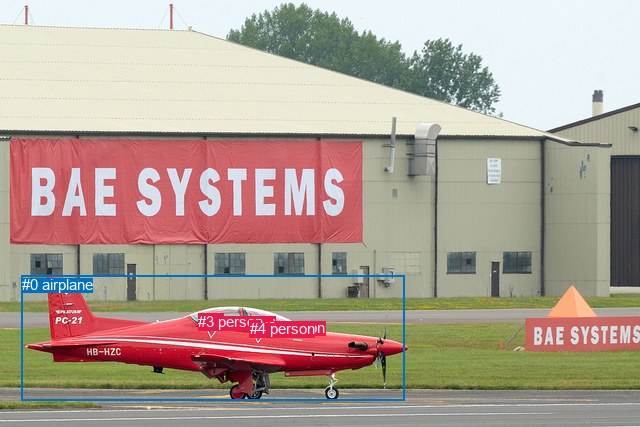
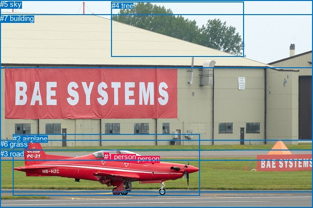

# 图片 0284：2326073.jpg

随机样本序号：331。图片 SHA256：`bba5cfd5761b87880d5e939b101e86285ee58bc22a52e8eb01a5badda5e7962d`。

红色框表示人，蓝色框表示其他物体。两个模式分别保留自身框编号，可依据位置比较对应对象。

## 自动检测框与输出

人的框编号：`[1, 2, 3, 4]`。状态：`ok`。

### 自动检测全部物体框

| 编号 | 类别 | 是否为人 | 检测分数 | 像素坐标 xyxy |
|---|---|---|---|---|
| 0 | airplane | False | 0.9991 | 21.8, 275.9, 404.3, 400.5 |
| 1 | person | True | 0.9180 | 210.7, 313.0, 223.8, 326.4 |
| 2 | person | True | 0.8246 | 260.2, 318.7, 272.9, 331.2 |
| 3 | person | True | 0.4783 | 198.2, 313.2, 211.6, 325.1 |
| 4 | person | True | 0.3743 | 249.9, 320.2, 260.6, 329.2 |

### 自动检测 Top50 人相关候选

评分物体对：20；人相关物体对：20；输出关系：40。

| 排名 | 主语编号与类别 | 关系 | 宾语编号与类别 | 类型 | 人与人 | 排序分数 | 原始融合 logit |
|---|---|---|---|---|---|---|---|
| 1 | #3 person | flying over | #0 airplane | semantic | False | 0.98506 | 4.1885 |
| 2 | #4 person | riding | #0 airplane | semantic | False | 0.98311 | 4.0637 |
| 3 | #1 person | flying over | #0 airplane | semantic | False | 0.98088 | 3.9377 |
| 4 | #2 person | riding | #0 airplane | semantic | False | 0.98052 | 3.9188 |
| 5 | #4 person | in | #0 airplane | spatial | False | 0.81124 | 1.4581 |
| 6 | #2 person | in | #0 airplane | spatial | False | 0.75840 | 1.1439 |
| 7 | #1 person | in | #0 airplane | spatial | False | 0.67516 | 0.7316 |
| 8 | #3 person | in | #0 airplane | spatial | False | 0.60959 | 0.4456 |
| 9 | #0 airplane | carrying | #4 person | semantic | False | 0.18016 | -1.5152 |
| 10 | #0 airplane | carrying | #2 person | semantic | False | 0.14303 | -1.7903 |
| 11 | #1 person | beside | #3 person | spatial | True | 0.11697 | -2.0214 |
| 12 | #3 person | beside | #1 person | spatial | True | 0.11297 | -2.0608 |
| 13 | #0 airplane | carrying | #3 person | semantic | False | 0.08740 | -2.3458 |
| 14 | #0 airplane | carrying | #1 person | semantic | False | 0.08614 | -2.3617 |
| 15 | #0 airplane | in | #2 person | spatial | False | 0.06859 | -2.6085 |
| 16 | #0 airplane | in | #4 person | spatial | False | 0.06639 | -2.6435 |
| 17 | #4 person | beside | #2 person | spatial | True | 0.06543 | -2.6591 |
| 18 | #0 airplane | in | #3 person | spatial | False | 0.04614 | -3.0289 |
| 19 | #2 person | beside | #4 person | spatial | True | 0.04325 | -3.0966 |
| 20 | #0 airplane | in | #1 person | spatial | False | 0.03425 | -3.3392 |
| 21 | #1 person | beside | #4 person | spatial | True | 0.01223 | -4.3912 |
| 22 | #1 person | standing on | #3 person | semantic | True | 0.00810 | -4.8083 |
| 23 | #3 person | holding | #1 person | semantic | True | 0.00802 | -4.8172 |
| 24 | #4 person | holding | #2 person | semantic | True | 0.00696 | -4.9602 |
| 25 | #1 person | beside | #2 person | spatial | True | 0.00535 | -5.2252 |
| 26 | #2 person | standing on | #4 person | semantic | True | 0.00437 | -5.4297 |
| 27 | #4 person | beside | #1 person | spatial | True | 0.00409 | -5.4960 |
| 28 | #3 person | beside | #4 person | spatial | True | 0.00372 | -5.5913 |
| 29 | #3 person | beside | #2 person | spatial | True | 0.00200 | -6.2147 |
| 30 | #1 person | holding | #4 person | semantic | True | 0.00192 | -6.2522 |
| 31 | #2 person | beside | #1 person | spatial | True | 0.00178 | -6.3311 |
| 32 | #4 person | beside | #3 person | spatial | True | 0.00159 | -6.4397 |
| 33 | #1 person | holding | #2 person | semantic | True | 0.00128 | -6.6591 |
| 34 | #3 person | holding | #4 person | semantic | True | 0.00106 | -6.8447 |
| 35 | #2 person | beside | #3 person | spatial | True | 0.00086 | -7.0581 |
| 36 | #4 person | sitting on | #1 person | semantic | True | 0.00078 | -7.1510 |
| 37 | #3 person | holding | #2 person | semantic | True | 0.00078 | -7.1588 |
| 38 | #4 person | sitting on | #3 person | semantic | True | 0.00075 | -7.1912 |
| 39 | #2 person | sitting on | #3 person | semantic | True | 0.00061 | -7.4096 |
| 40 | #2 person | sitting on | #1 person | semantic | True | 0.00060 | -7.4112 |

### 自动检测逐条人相关 GT 核验

R@50：50.00%；命中 1/2。

| GT 主语编号 | GT 关系 | GT 宾语编号 | 结果阶段 | 匹配预测主语编号 | 匹配预测宾语编号 |
|---|---|---|---|---|---|
| 0 | driving | 2 | wrong_predicate | [2] | [0] |
| 1 | in | 2 | hit50 | [1] | [0] |

## 真实框与输出

人的框编号：`[0, 1]`。

### 真实框全部物体框

| 编号 | 类别 | 是否为人 | 检测分数 | 像素坐标 xyxy |
|---|---|---|---|---|
| 0 | person | True | GT | 261.0, 317.0, 271.0, 331.0 |
| 1 | person | True | GT | 213.0, 313.0, 223.0, 328.0 |
| 2 | airplane | False | GT | 26.0, 276.0, 409.0, 402.0 |
| 3 | road | False | GT | 0.0, 307.0, 640.0, 427.0 |
| 4 | tree | False | GT | 228.0, 3.0, 499.0, 117.0 |
| 5 | sky | False | GT | 0.0, 0.0, 640.0, 140.0 |
| 6 | grass | False | GT | 0.0, 287.0, 640.0, 394.0 |
| 7 | building | False | GT | 0.0, 29.0, 640.0, 329.0 |

### 真实框 Top50 人相关候选

评分物体对：56；人相关物体对：26；输出关系：50。

| 排名 | 主语编号与类别 | 关系 | 宾语编号与类别 | 类型 | 人与人 | 排序分数 | 原始融合 logit |
|---|---|---|---|---|---|---|---|
| 1 | #1 person | in | #2 airplane | spatial | False | 0.98678 | 4.3124 |
| 2 | #0 person | in | #2 airplane | spatial | False | 0.98555 | 4.2223 |
| 3 | #0 person | driving on | #2 airplane | semantic | False | 0.97250 | 3.5658 |
| 4 | #1 person | driving on | #2 airplane | semantic | False | 0.95663 | 3.0935 |
| 5 | #2 airplane | in | #0 person | spatial | False | 0.39739 | -0.4163 |
| 6 | #2 airplane | in | #1 person | spatial | False | 0.36824 | -0.5398 |
| 7 | #2 airplane | wearing | #0 person | semantic | False | 0.12822 | -1.9168 |
| 8 | #2 airplane | wearing | #1 person | semantic | False | 0.11418 | -2.0487 |
| 9 | #1 person | in | #6 grass | spatial | False | 0.02383 | -3.7126 |
| 10 | #1 person | on | #0 person | spatial | True | 0.01855 | -3.9683 |
| 11 | #1 person | sitting on | #6 grass | semantic | False | 0.01682 | -4.0684 |
| 12 | #1 person | on | #3 road | spatial | False | 0.01644 | -4.0912 |
| 13 | #0 person | on | #1 person | spatial | True | 0.01446 | -4.2215 |
| 14 | #1 person | wearing | #0 person | semantic | True | 0.01440 | -4.2262 |
| 15 | #1 person | sitting on | #3 road | semantic | False | 0.01325 | -4.3102 |
| 16 | #1 person | on | #7 building | spatial | False | 0.00868 | -4.7375 |
| 17 | #0 person | sitting on | #1 person | semantic | True | 0.00677 | -4.9877 |
| 18 | #0 person | on | #3 road | spatial | False | 0.00581 | -5.1424 |
| 19 | #0 person | on | #6 grass | spatial | False | 0.00492 | -5.3092 |
| 20 | #1 person | sitting on | #7 building | semantic | False | 0.00449 | -5.4012 |
| 21 | #0 person | sitting on | #3 road | semantic | False | 0.00310 | -5.7741 |
| 22 | #0 person | sitting on | #6 grass | semantic | False | 0.00256 | -5.9644 |
| 23 | #0 person | on | #7 building | spatial | False | 0.00224 | -6.1009 |
| 24 | #1 person | looking at | #5 sky | semantic | False | 0.00171 | -6.3699 |
| 25 | #1 person | looking at | #4 tree | semantic | False | 0.00109 | -6.8161 |
| 26 | #6 grass | in | #1 person | spatial | False | 0.00104 | -6.8686 |
| 27 | #3 road | in | #1 person | spatial | False | 0.00080 | -7.1271 |
| 28 | #0 person | looking at | #5 sky | semantic | False | 0.00071 | -7.2428 |
| 29 | #1 person | in | #5 sky | spatial | False | 0.00071 | -7.2474 |
| 30 | #7 building | in | #1 person | spatial | False | 0.00068 | -7.2972 |
| 31 | #6 grass | in | #0 person | spatial | False | 0.00062 | -7.3870 |
| 32 | #0 person | looking at | #4 tree | semantic | False | 0.00059 | -7.4430 |
| 33 | #0 person | looking at | #7 building | semantic | False | 0.00056 | -7.4821 |
| 34 | #7 building | in | #0 person | spatial | False | 0.00053 | -7.5458 |
| 35 | #3 road | in | #0 person | spatial | False | 0.00041 | -7.7910 |
| 36 | #1 person | in | #4 tree | spatial | False | 0.00036 | -7.9359 |
| 37 | #6 grass | holding | #1 person | semantic | False | 0.00034 | -7.9768 |
| 38 | #3 road | holding | #1 person | semantic | False | 0.00030 | -8.1185 |
| 39 | #0 person | in | #5 sky | spatial | False | 0.00028 | -8.1629 |
| 40 | #6 grass | holding | #0 person | semantic | False | 0.00028 | -8.1819 |
| 41 | #7 building | holding | #1 person | semantic | False | 0.00027 | -8.2215 |
| 42 | #7 building | holding | #0 person | semantic | False | 0.00022 | -8.4031 |
| 43 | #3 road | holding | #0 person | semantic | False | 0.00020 | -8.5308 |
| 44 | #0 person | in | #4 tree | spatial | False | 0.00018 | -8.6134 |
| 45 | #5 sky | over | #1 person | spatial | False | 0.00011 | -9.0837 |
| 46 | #5 sky | over | #0 person | spatial | False | 0.00006 | -9.6942 |
| 47 | #4 tree | in | #1 person | spatial | False | 0.00006 | -9.7840 |
| 48 | #5 sky | wearing | #1 person | semantic | False | 0.00005 | -9.8997 |
| 49 | #4 tree | wearing | #1 person | semantic | False | 0.00005 | -9.9398 |
| 50 | #4 tree | in | #0 person | spatial | False | 0.00004 | -10.2327 |

### 真实框逐条人相关 GT 核验

R@50：50.00%；命中 1/2。

| GT 主语编号 | GT 关系 | GT 宾语编号 | 结果阶段 | 匹配预测主语编号 | 匹配预测宾语编号 |
|---|---|---|---|---|---|
| 0 | driving | 2 | wrong_predicate | [0] | [2] |
| 1 | in | 2 | hit50 | [1] | [2] |

## 全部人相关 GT

| 主语编号与类别 | 关系 | 宾语编号与类别 |
|---|---|---|
| #0 person | driving | #2 airplane |
| #1 person | in | #2 airplane |

原始记录、全部人相关物体对的两项预测与分项分数见 [逐图证据 JSON](../evidence/cases/0284.json)。全部56类 logits 保留于本机 HOR/output/random500/logits/。

<!-- HOR_COMPLETE_RESULTS -->

## 六组条件的完整输出对照

以下保留同一图片三种框与候选模式、两种谓词输出规则的全部 Top50。框编号各自在所属模式内解释。

### 自动检测框完整枚举：空间与语义各保留一个谓词

| 排名 | 主语编号与类别 | 谓词 | 宾语编号与类别 | 分组 | 排序分数 | predicate logit | pair logit |
|---|---|---|---|---|---|---|---|
| 1 | #3 person | flying over | #0 airplane | semantic | 0.9850573 | 3.6605372 | 0.5279405 |
| 2 | #4 person | riding | #0 airplane | semantic | 0.9831057 | 3.4608512 | 0.6028913 |
| 3 | #1 person | flying over | #0 airplane | semantic | 0.9808798 | 3.4198689 | 0.5178388 |
| 4 | #2 person | riding | #0 airplane | semantic | 0.9805214 | 3.3424411 | 0.5763316 |
| 5 | #4 person | in | #0 airplane | spatial | 0.8112438 | 0.8552213 | 0.6028913 |
| 6 | #2 person | in | #0 airplane | spatial | 0.7583978 | 0.5675840 | 0.5763316 |
| 7 | #1 person | in | #0 airplane | spatial | 0.6751636 | 0.2137942 | 0.5178388 |
| 8 | #3 person | in | #0 airplane | spatial | 0.6095873 | -0.0823627 | 0.5279405 |
| 9 | #0 airplane | carrying | #4 person | semantic | 0.1801634 | -1.1886814 | -0.3265597 |
| 10 | #0 airplane | carrying | #2 person | semantic | 0.1430330 | -1.4569724 | -0.3333515 |
| 11 | #1 person | beside | #3 person | spatial | 0.1169716 | -1.2622130 | -0.7592134 |
| 12 | #3 person | beside | #1 person | spatial | 0.1129666 | -1.3087378 | -0.7520523 |
| 13 | #0 airplane | carrying | #3 person | semantic | 0.0874028 | -1.8232102 | -0.5225565 |
| 14 | #0 airplane | carrying | #1 person | semantic | 0.0861441 | -1.8297179 | -0.5319341 |
| 15 | #0 airplane | in | #2 person | spatial | 0.0685946 | -2.2751286 | -0.3333515 |
| 16 | #0 airplane | in | #4 person | spatial | 0.0663904 | -2.3169465 | -0.3265597 |
| 17 | #4 person | beside | #2 person | spatial | 0.0654280 | -1.8777535 | -0.7813853 |
| 18 | #0 airplane | in | #3 person | spatial | 0.0461370 | -2.5063474 | -0.5225565 |
| 19 | #2 person | beside | #4 person | spatial | 0.0432462 | -2.3433583 | -0.7532778 |
| 20 | #0 airplane | in | #1 person | spatial | 0.0342508 | -2.8072600 | -0.5319341 |
| 21 | #1 person | beside | #4 person | spatial | 0.0122349 | -3.3187218 | -1.0724335 |
| 22 | #1 person | standing on | #3 person | semantic | 0.0080955 | -4.0491009 | -0.7592134 |
| 23 | #3 person | holding | #1 person | semantic | 0.0080242 | -4.0651879 | -0.7520523 |
| 24 | #4 person | holding | #2 person | semantic | 0.0069627 | -4.1788211 | -0.7813853 |
| 25 | #1 person | beside | #2 person | spatial | 0.0053506 | -4.0463238 | -1.1788590 |
| 26 | #2 person | standing on | #4 person | semantic | 0.0043651 | -4.6764617 | -0.7532778 |
| 27 | #4 person | beside | #1 person | spatial | 0.0040866 | -4.7221785 | -0.7737790 |
| 28 | #3 person | beside | #4 person | spatial | 0.0037164 | -4.4570775 | -1.1341981 |
| 29 | #3 person | beside | #2 person | spatial | 0.0019958 | -4.9709878 | -1.2437147 |
| 30 | #1 person | holding | #4 person | semantic | 0.0019225 | -5.1797643 | -1.0724335 |
| 31 | #2 person | beside | #1 person | spatial | 0.0017770 | -5.4818683 | -0.8492037 |
| 32 | #4 person | beside | #3 person | spatial | 0.0015943 | -5.6021175 | -0.8375976 |
| 33 | #1 person | holding | #2 person | semantic | 0.0012807 | -5.4802303 | -1.1788590 |
| 34 | #3 person | holding | #4 person | semantic | 0.0010639 | -5.7105169 | -1.1341981 |
| 35 | #2 person | beside | #3 person | spatial | 0.0008597 | -6.1457720 | -0.9123399 |
| 36 | #4 person | sitting on | #1 person | semantic | 0.0007834 | -6.3772478 | -0.7737790 |
| 37 | #3 person | holding | #2 person | semantic | 0.0007774 | -5.9151096 | -1.2437147 |
| 38 | #4 person | sitting on | #3 person | semantic | 0.0007527 | -6.3535547 | -0.8375976 |
| 39 | #2 person | sitting on | #3 person | semantic | 0.0006050 | -6.4972553 | -0.9123399 |
| 40 | #2 person | sitting on | #1 person | semantic | 0.0006041 | -6.5619516 | -0.8492037 |

GT 命中：1/2，R@50=50.00%。

| GT主语 | GT谓词 | GT宾语 | 结果阶段 | 匹配主语框 | 匹配宾语框 |
|---|---|---|---|---|---|
| 0 | driving | 2 | wrong_predicate | [2] | [0] |
| 1 | in | 2 | hit50 | [1] | [0] |

### 自动检测框完整枚举：每对只保留一个谓词

| 排名 | 主语编号与类别 | 谓词 | 宾语编号与类别 | 分组 | 排序分数 | predicate logit | pair logit |
|---|---|---|---|---|---|---|---|
| 1 | #3 person | flying over | #0 airplane | single | 0.9850573 | 3.6605372 | 0.5279405 |
| 2 | #4 person | riding | #0 airplane | single | 0.9831057 | 3.4608512 | 0.6028913 |
| 3 | #1 person | flying over | #0 airplane | single | 0.9808798 | 3.4198689 | 0.5178388 |
| 4 | #2 person | riding | #0 airplane | single | 0.9805214 | 3.3424411 | 0.5763316 |
| 5 | #0 airplane | carrying | #4 person | single | 0.1801634 | -1.1886814 | -0.3265597 |
| 6 | #0 airplane | carrying | #2 person | single | 0.1430330 | -1.4569724 | -0.3333515 |
| 7 | #1 person | beside | #3 person | single | 0.1169716 | -1.2622130 | -0.7592134 |
| 8 | #3 person | beside | #1 person | single | 0.1129666 | -1.3087378 | -0.7520523 |
| 9 | #0 airplane | carrying | #3 person | single | 0.0874028 | -1.8232102 | -0.5225565 |
| 10 | #0 airplane | carrying | #1 person | single | 0.0861441 | -1.8297179 | -0.5319341 |
| 11 | #4 person | beside | #2 person | single | 0.0654280 | -1.8777535 | -0.7813853 |
| 12 | #2 person | beside | #4 person | single | 0.0432462 | -2.3433583 | -0.7532778 |
| 13 | #1 person | beside | #4 person | single | 0.0122349 | -3.3187218 | -1.0724335 |
| 14 | #1 person | beside | #2 person | single | 0.0053506 | -4.0463238 | -1.1788590 |
| 15 | #4 person | beside | #1 person | single | 0.0040866 | -4.7221785 | -0.7737790 |
| 16 | #3 person | beside | #4 person | single | 0.0037164 | -4.4570775 | -1.1341981 |
| 17 | #3 person | beside | #2 person | single | 0.0019958 | -4.9709878 | -1.2437147 |
| 18 | #2 person | beside | #1 person | single | 0.0017770 | -5.4818683 | -0.8492037 |
| 19 | #4 person | beside | #3 person | single | 0.0015943 | -5.6021175 | -0.8375976 |
| 20 | #2 person | beside | #3 person | single | 0.0008597 | -6.1457720 | -0.9123399 |

GT 命中：0/2，R@50=0.00%。

| GT主语 | GT谓词 | GT宾语 | 结果阶段 | 匹配主语框 | 匹配宾语框 |
|---|---|---|---|---|---|
| 0 | driving | 2 | wrong_predicate | [2] | [0] |
| 1 | in | 2 | wrong_predicate | [1] | [0] |

### 真实框完整枚举：空间与语义各保留一个谓词

| 排名 | 主语编号与类别 | 谓词 | 宾语编号与类别 | 分组 | 排序分数 | predicate logit | pair logit |
|---|---|---|---|---|---|---|---|
| 1 | #1 person | in | #2 airplane | spatial | 0.9867762 | 3.7709966 | 0.5414304 |
| 2 | #0 person | in | #2 airplane | spatial | 0.9855478 | 3.6298289 | 0.5925159 |
| 3 | #0 person | driving on | #2 airplane | semantic | 0.9725019 | 2.9732418 | 0.5925159 |
| 4 | #1 person | driving on | #2 airplane | semantic | 0.9566258 | 2.5521183 | 0.5414304 |
| 5 | #2 airplane | in | #0 person | spatial | 0.3973918 | -0.0915504 | -0.3247943 |
| 6 | #2 airplane | in | #1 person | spatial | 0.3682412 | -0.0220795 | -0.5176902 |
| 7 | #2 airplane | wearing | #0 person | semantic | 0.1282229 | -1.5919690 | -0.3247943 |
| 8 | #2 airplane | wearing | #1 person | semantic | 0.1141813 | -1.5310349 | -0.5176902 |
| 9 | #1 person | in | #6 grass | spatial | 0.0238325 | -1.1936142 | -2.5189710 |
| 10 | #1 person | on | #0 person | spatial | 0.0185541 | -2.8718779 | -1.0964571 |
| 11 | #1 person | sitting on | #6 grass | semantic | 0.0168173 | -1.5494142 | -2.5189710 |
| 12 | #1 person | on | #3 road | spatial | 0.0164446 | -1.6854465 | -2.4057331 |
| 13 | #0 person | on | #1 person | spatial | 0.0144639 | -3.4316943 | -0.7898344 |
| 14 | #1 person | wearing | #0 person | semantic | 0.0143974 | -3.1297503 | -1.0964571 |
| 15 | #1 person | sitting on | #3 road | semantic | 0.0132526 | -1.9044845 | -2.4057331 |
| 16 | #1 person | on | #7 building | spatial | 0.0086842 | -2.6524644 | -2.0850649 |
| 17 | #0 person | sitting on | #1 person | semantic | 0.0067749 | -4.1979032 | -0.7898344 |
| 18 | #0 person | on | #3 road | spatial | 0.0058095 | -2.4479077 | -2.6945186 |
| 19 | #0 person | on | #6 grass | spatial | 0.0049214 | -2.5459144 | -2.7633228 |
| 20 | #1 person | sitting on | #7 building | semantic | 0.0044908 | -3.3161564 | -2.0850649 |
| 21 | #0 person | sitting on | #3 road | semantic | 0.0030974 | -3.0795772 | -2.6945186 |
| 22 | #0 person | sitting on | #6 grass | semantic | 0.0025620 | -3.2010808 | -2.7633228 |
| 23 | #0 person | on | #7 building | spatial | 0.0022359 | -3.7229195 | -2.3779418 |
| 24 | #1 person | looking at | #5 sky | semantic | 0.0017093 | -4.1080422 | -2.2618904 |
| 25 | #1 person | looking at | #4 tree | semantic | 0.0010948 | -4.7907372 | -2.0253830 |
| 26 | #6 grass | in | #1 person | spatial | 0.0010388 | -4.9002285 | -1.9684017 |
| 27 | #3 road | in | #1 person | spatial | 0.0008024 | -5.0597844 | -2.0672898 |
| 28 | #0 person | looking at | #5 sky | semantic | 0.0007148 | -4.7055259 | -2.5372825 |
| 29 | #1 person | in | #5 sky | spatial | 0.0007115 | -4.9854708 | -2.2618904 |
| 30 | #7 building | in | #1 person | spatial | 0.0006770 | -5.2248960 | -2.0722916 |
| 31 | #6 grass | in | #0 person | spatial | 0.0006189 | -5.1529078 | -2.2340503 |
| 32 | #0 person | looking at | #4 tree | semantic | 0.0005852 | -5.1669884 | -2.2759674 |
| 33 | #0 person | looking at | #7 building | semantic | 0.0005628 | -5.1041651 | -2.3779418 |
| 34 | #7 building | in | #0 person | spatial | 0.0005280 | -5.3672280 | -2.1785953 |
| 35 | #3 road | in | #0 person | spatial | 0.0004133 | -5.4020424 | -2.3889194 |
| 36 | #1 person | in | #4 tree | spatial | 0.0003575 | -5.9105010 | -2.0253830 |
| 37 | #6 grass | holding | #1 person | semantic | 0.0003432 | -6.0084028 | -1.9684017 |
| 38 | #3 road | holding | #1 person | semantic | 0.0002979 | -6.0512028 | -2.0672898 |
| 39 | #0 person | in | #5 sky | spatial | 0.0002850 | -5.6255727 | -2.5372825 |
| 40 | #6 grass | holding | #0 person | semantic | 0.0002796 | -5.9478774 | -2.2340503 |
| 41 | #7 building | holding | #1 person | semantic | 0.0002687 | -6.1492414 | -2.0722916 |
| 42 | #7 building | holding | #0 person | semantic | 0.0002241 | -6.2244697 | -2.1785953 |
| 43 | #3 road | holding | #0 person | semantic | 0.0001973 | -6.1418886 | -2.3889194 |
| 44 | #0 person | in | #4 tree | spatial | 0.0001816 | -6.3374777 | -2.2759674 |
| 45 | #5 sky | over | #1 person | spatial | 0.0001135 | -6.6952748 | -2.3884711 |
| 46 | #5 sky | over | #0 person | spatial | 0.0000616 | -6.9912739 | -2.7029347 |
| 47 | #4 tree | in | #1 person | spatial | 0.0000563 | -7.1079106 | -2.6760495 |
| 48 | #5 sky | wearing | #1 person | semantic | 0.0000502 | -7.5112162 | -2.3884711 |
| 49 | #4 tree | wearing | #1 person | semantic | 0.0000482 | -7.2637939 | -2.6760495 |
| 50 | #4 tree | in | #0 person | spatial | 0.0000360 | -7.0171919 | -3.2155559 |

GT 命中：1/2，R@50=50.00%。

| GT主语 | GT谓词 | GT宾语 | 结果阶段 | 匹配主语框 | 匹配宾语框 |
|---|---|---|---|---|---|
| 0 | driving | 2 | wrong_predicate | [0] | [2] |
| 1 | in | 2 | hit50 | [1] | [2] |

### 真实框完整枚举：每对只保留一个谓词

| 排名 | 主语编号与类别 | 谓词 | 宾语编号与类别 | 分组 | 排序分数 | predicate logit | pair logit |
|---|---|---|---|---|---|---|---|
| 1 | #1 person | in | #2 airplane | single | 0.9867762 | 3.7709966 | 0.5414304 |
| 2 | #0 person | in | #2 airplane | single | 0.9855478 | 3.6298289 | 0.5925159 |
| 3 | #2 airplane | in | #0 person | single | 0.3973918 | -0.0915504 | -0.3247943 |
| 4 | #2 airplane | in | #1 person | single | 0.3682412 | -0.0220795 | -0.5176902 |
| 5 | #1 person | in | #6 grass | single | 0.0238325 | -1.1936142 | -2.5189710 |
| 6 | #1 person | on | #0 person | single | 0.0185541 | -2.8718779 | -1.0964571 |
| 7 | #1 person | on | #3 road | single | 0.0164446 | -1.6854465 | -2.4057331 |
| 8 | #0 person | on | #1 person | single | 0.0144639 | -3.4316943 | -0.7898344 |
| 9 | #1 person | on | #7 building | single | 0.0086842 | -2.6524644 | -2.0850649 |
| 10 | #0 person | on | #3 road | single | 0.0058095 | -2.4479077 | -2.6945186 |
| 11 | #0 person | on | #6 grass | single | 0.0049214 | -2.5459144 | -2.7633228 |
| 12 | #0 person | on | #7 building | single | 0.0022359 | -3.7229195 | -2.3779418 |
| 13 | #1 person | looking at | #5 sky | single | 0.0017093 | -4.1080422 | -2.2618904 |
| 14 | #1 person | looking at | #4 tree | single | 0.0010948 | -4.7907372 | -2.0253830 |
| 15 | #6 grass | in | #1 person | single | 0.0010388 | -4.9002285 | -1.9684017 |
| 16 | #3 road | in | #1 person | single | 0.0008024 | -5.0597844 | -2.0672898 |
| 17 | #0 person | looking at | #5 sky | single | 0.0007148 | -4.7055259 | -2.5372825 |
| 18 | #7 building | in | #1 person | single | 0.0006770 | -5.2248960 | -2.0722916 |
| 19 | #6 grass | in | #0 person | single | 0.0006189 | -5.1529078 | -2.2340503 |
| 20 | #0 person | looking at | #4 tree | single | 0.0005852 | -5.1669884 | -2.2759674 |
| 21 | #7 building | in | #0 person | single | 0.0005280 | -5.3672280 | -2.1785953 |
| 22 | #3 road | in | #0 person | single | 0.0004133 | -5.4020424 | -2.3889194 |
| 23 | #5 sky | over | #1 person | single | 0.0001135 | -6.6952748 | -2.3884711 |
| 24 | #5 sky | over | #0 person | single | 0.0000616 | -6.9912739 | -2.7029347 |
| 25 | #4 tree | in | #1 person | single | 0.0000563 | -7.1079106 | -2.6760495 |
| 26 | #4 tree | in | #0 person | single | 0.0000360 | -7.0171919 | -3.2155559 |

GT 命中：1/2，R@50=50.00%。

| GT主语 | GT谓词 | GT宾语 | 结果阶段 | 匹配主语框 | 匹配宾语框 |
|---|---|---|---|---|---|
| 0 | driving | 2 | wrong_predicate | [0] | [2] |
| 1 | in | 2 | hit50 | [1] | [2] |

### 真实框400候选：空间与语义各保留一个谓词

| 排名 | 主语编号与类别 | 谓词 | 宾语编号与类别 | 分组 | 排序分数 | predicate logit | pair logit |
|---|---|---|---|---|---|---|---|
| 1 | #1 person | in | #2 airplane | spatial | 0.9867762 | 3.7709966 | 0.5414304 |
| 2 | #0 person | in | #2 airplane | spatial | 0.9855478 | 3.6298289 | 0.5925159 |
| 3 | #0 person | driving on | #2 airplane | semantic | 0.9716858 | 2.9431510 | 0.5925159 |
| 4 | #1 person | driving on | #2 airplane | semantic | 0.9566258 | 2.5521183 | 0.5414304 |
| 5 | #2 airplane | in | #0 person | spatial | 0.3989823 | -0.0849128 | -0.3247943 |
| 6 | #2 airplane | in | #1 person | spatial | 0.3674694 | -0.0253983 | -0.5176902 |
| 7 | #2 airplane | wearing | #0 person | semantic | 0.1295829 | -1.5798573 | -0.3247943 |
| 8 | #2 airplane | wearing | #1 person | semantic | 0.1141813 | -1.5310349 | -0.5176902 |
| 9 | #1 person | in | #6 grass | spatial | 0.0231424 | -1.2237053 | -2.5189710 |
| 10 | #1 person | on | #0 person | spatial | 0.0193425 | -2.8294635 | -1.0964571 |
| 11 | #1 person | sitting on | #6 grass | semantic | 0.0159921 | -1.6005676 | -2.5189710 |
| 12 | #1 person | on | #3 road | spatial | 0.0157054 | -1.7321870 | -2.4057331 |
| 13 | #0 person | on | #1 person | spatial | 0.0149592 | -3.3975196 | -0.7898344 |
| 14 | #1 person | wearing | #0 person | semantic | 0.0146547 | -3.1117706 | -1.0964571 |
| 15 | #1 person | sitting on | #3 road | semantic | 0.0128648 | -1.9345758 | -2.4057331 |
| 16 | #1 person | on | #7 building | spatial | 0.0082032 | -2.7099245 | -2.0850649 |
| 17 | #0 person | sitting on | #1 person | semantic | 0.0071532 | -4.1431761 | -0.7898344 |
| 18 | #0 person | on | #3 road | spatial | 0.0057194 | -2.4636338 | -2.6945186 |
| 19 | #0 person | on | #6 grass | spatial | 0.0049485 | -2.5403972 | -2.7633228 |
| 20 | #1 person | sitting on | #7 building | semantic | 0.0042822 | -3.3639259 | -2.0850649 |
| 21 | #0 person | sitting on | #3 road | semantic | 0.0030217 | -3.1044030 | -2.6945186 |
| 22 | #0 person | sitting on | #6 grass | semantic | 0.0025553 | -3.2037137 | -2.7633228 |
| 23 | #0 person | on | #7 building | spatial | 0.0021816 | -3.7475657 | -2.3779418 |
| 24 | #1 person | looking at | #5 sky | semantic | 0.0017286 | -4.0968451 | -2.2618904 |
| 25 | #1 person | looking at | #4 tree | semantic | 0.0010908 | -4.7944112 | -2.0253830 |
| 26 | #6 grass | in | #1 person | spatial | 0.0010354 | -4.9035468 | -1.9684017 |
| 27 | #3 road | in | #1 person | spatial | 0.0008001 | -5.0627160 | -2.0672898 |
| 28 | #1 person | in | #5 sky | spatial | 0.0007126 | -4.9840050 | -2.2618904 |
| 29 | #0 person | looking at | #5 sky | semantic | 0.0007123 | -4.7089787 | -2.5372825 |
| 30 | #7 building | in | #1 person | spatial | 0.0006718 | -5.2325916 | -2.0722916 |
| 31 | #6 grass | in | #0 person | spatial | 0.0006177 | -5.1547608 | -2.2340503 |
| 32 | #0 person | looking at | #4 tree | semantic | 0.0005852 | -5.1669884 | -2.2759674 |
| 33 | #0 person | looking at | #7 building | semantic | 0.0005534 | -5.1208735 | -2.3779418 |
| 34 | #7 building | in | #0 person | spatial | 0.0005240 | -5.3749447 | -2.1785953 |
| 35 | #3 road | in | #0 person | spatial | 0.0004115 | -5.4064813 | -2.3889194 |
| 36 | #1 person | in | #4 tree | spatial | 0.0003512 | -5.9284782 | -2.0253830 |
| 37 | #6 grass | holding | #1 person | semantic | 0.0003422 | -6.0113573 | -1.9684017 |
| 38 | #3 road | holding | #1 person | semantic | 0.0002979 | -6.0512028 | -2.0672898 |
| 39 | #0 person | in | #5 sky | spatial | 0.0002800 | -5.6431627 | -2.5372825 |
| 40 | #6 grass | holding | #0 person | semantic | 0.0002788 | -5.9508314 | -2.2340503 |
| 41 | #7 building | holding | #1 person | semantic | 0.0002639 | -6.1673784 | -2.0722916 |
| 42 | #7 building | holding | #0 person | semantic | 0.0002221 | -6.2334695 | -2.1785953 |
| 43 | #3 road | holding | #0 person | semantic | 0.0001967 | -6.1448426 | -2.3889194 |
| 44 | #0 person | in | #4 tree | spatial | 0.0001800 | -6.3466597 | -2.2759674 |
| 45 | #5 sky | over | #1 person | spatial | 0.0001128 | -6.7014756 | -2.3884711 |
| 46 | #5 sky | over | #0 person | spatial | 0.0000620 | -6.9850736 | -2.7029347 |
| 47 | #4 tree | in | #1 person | spatial | 0.0000563 | -7.1079106 | -2.6760495 |
| 48 | #5 sky | wearing | #1 person | semantic | 0.0000502 | -7.5112162 | -2.3884711 |
| 49 | #4 tree | wearing | #1 person | semantic | 0.0000483 | -7.2623262 | -2.6760495 |
| 50 | #4 tree | in | #0 person | spatial | 0.0000362 | -7.0113282 | -3.2155559 |

GT 命中：1/2，R@50=50.00%。

| GT主语 | GT谓词 | GT宾语 | 结果阶段 | 匹配主语框 | 匹配宾语框 |
|---|---|---|---|---|---|
| 0 | driving | 2 | wrong_predicate | [0] | [2] |
| 1 | in | 2 | hit50 | [1] | [2] |

### 真实框400候选：每对只保留一个谓词

| 排名 | 主语编号与类别 | 谓词 | 宾语编号与类别 | 分组 | 排序分数 | predicate logit | pair logit |
|---|---|---|---|---|---|---|---|
| 1 | #1 person | in | #2 airplane | single | 0.9867762 | 3.7709966 | 0.5414304 |
| 2 | #0 person | in | #2 airplane | single | 0.9855478 | 3.6298289 | 0.5925159 |
| 3 | #2 airplane | in | #0 person | single | 0.3989823 | -0.0849128 | -0.3247943 |
| 4 | #2 airplane | in | #1 person | single | 0.3674694 | -0.0253983 | -0.5176902 |
| 5 | #1 person | in | #6 grass | single | 0.0231424 | -1.2237053 | -2.5189710 |
| 6 | #1 person | on | #0 person | single | 0.0193425 | -2.8294635 | -1.0964571 |
| 7 | #1 person | on | #3 road | single | 0.0157054 | -1.7321870 | -2.4057331 |
| 8 | #0 person | on | #1 person | single | 0.0149592 | -3.3975196 | -0.7898344 |
| 9 | #1 person | on | #7 building | single | 0.0082032 | -2.7099245 | -2.0850649 |
| 10 | #0 person | on | #3 road | single | 0.0057194 | -2.4636338 | -2.6945186 |
| 11 | #0 person | on | #6 grass | single | 0.0049485 | -2.5403972 | -2.7633228 |
| 12 | #0 person | on | #7 building | single | 0.0021816 | -3.7475657 | -2.3779418 |
| 13 | #1 person | looking at | #5 sky | single | 0.0017286 | -4.0968451 | -2.2618904 |
| 14 | #1 person | looking at | #4 tree | single | 0.0010908 | -4.7944112 | -2.0253830 |
| 15 | #6 grass | in | #1 person | single | 0.0010354 | -4.9035468 | -1.9684017 |
| 16 | #3 road | in | #1 person | single | 0.0008001 | -5.0627160 | -2.0672898 |
| 17 | #0 person | looking at | #5 sky | single | 0.0007123 | -4.7089787 | -2.5372825 |
| 18 | #7 building | in | #1 person | single | 0.0006718 | -5.2325916 | -2.0722916 |
| 19 | #6 grass | in | #0 person | single | 0.0006177 | -5.1547608 | -2.2340503 |
| 20 | #0 person | looking at | #4 tree | single | 0.0005852 | -5.1669884 | -2.2759674 |
| 21 | #7 building | in | #0 person | single | 0.0005240 | -5.3749447 | -2.1785953 |
| 22 | #3 road | in | #0 person | single | 0.0004115 | -5.4064813 | -2.3889194 |
| 23 | #5 sky | over | #1 person | single | 0.0001128 | -6.7014756 | -2.3884711 |
| 24 | #5 sky | over | #0 person | single | 0.0000620 | -6.9850736 | -2.7029347 |
| 25 | #4 tree | in | #1 person | single | 0.0000563 | -7.1079106 | -2.6760495 |
| 26 | #4 tree | in | #0 person | single | 0.0000362 | -7.0113282 | -3.2155559 |

GT 命中：1/2，R@50=50.00%。

| GT主语 | GT谓词 | GT宾语 | 结果阶段 | 匹配主语框 | 匹配宾语框 |
|---|---|---|---|---|---|
| 0 | driving | 2 | wrong_predicate | [0] | [2] |
| 1 | in | 2 | hit50 | [1] | [2] |
