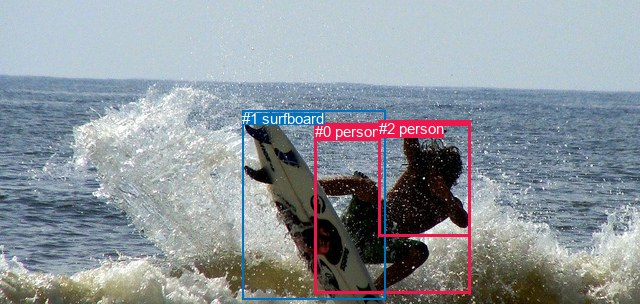
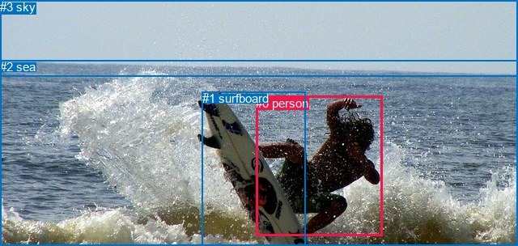

# 图片 0295：2326503.jpg

随机样本序号：6。图片 SHA256：`c4dfa517a468863f42cbd45b5a800b4462e1160f799f47cb84ca413fd8cfa53c`。

红色框表示人，蓝色框表示其他物体。两个模式分别保留自身框编号，可依据位置比较对应对象。

## 自动检测框与输出

人的框编号：`[0, 2]`。状态：`ok`。

### 自动检测全部物体框

| 编号 | 类别 | 是否为人 | 检测分数 | 像素坐标 xyxy |
|---|---|---|---|---|
| 0 | person | True | 0.9997 | 314.9, 123.3, 470.9, 293.9 |
| 1 | surfboard | False | 0.9980 | 242.4, 110.3, 385.8, 299.6 |
| 2 | person | True | 0.5052 | 378.7, 120.1, 470.7, 236.5 |

### 自动检测 Top50 人相关候选

评分物体对：6；人相关物体对：6；输出关系：12。

| 排名 | 主语编号与类别 | 关系 | 宾语编号与类别 | 类型 | 人与人 | 排序分数 | 原始融合 logit |
|---|---|---|---|---|---|---|---|
| 1 | #0 person | riding | #1 surfboard | semantic | False | 0.99651 | 5.6553 |
| 2 | #2 person | riding | #1 surfboard | semantic | False | 0.99176 | 4.7900 |
| 3 | #0 person | leaning on | #1 surfboard | spatial | False | 0.89163 | 2.1075 |
| 4 | #2 person | leaning on | #1 surfboard | spatial | False | 0.82643 | 1.5605 |
| 5 | #0 person | wearing | #2 person | semantic | True | 0.05285 | -2.8860 |
| 6 | #2 person | on | #0 person | spatial | True | 0.04426 | -3.0723 |
| 7 | #2 person | wearing | #0 person | semantic | True | 0.00899 | -4.7026 |
| 8 | #0 person | in | #2 person | spatial | True | 0.00132 | -6.6273 |
| 9 | #1 surfboard | beside | #2 person | spatial | False | 0.00012 | -9.0106 |
| 10 | #1 surfboard | carrying | #2 person | semantic | False | 0.00007 | -9.5366 |
| 11 | #1 surfboard | beside | #0 person | spatial | False | 0.00005 | -9.8739 |
| 12 | #1 surfboard | carrying | #0 person | semantic | False | 0.00005 | -9.9464 |

### 自动检测逐条人相关 GT 核验

R@50：25.00%；命中 1/4。

| GT 主语编号 | GT 关系 | GT 宾语编号 | 结果阶段 | 匹配预测主语编号 | 匹配预测宾语编号 |
|---|---|---|---|---|---|
| 0 | on | 1 | wrong_predicate | [0] | [1] |
| 0 | playing | 1 | wrong_predicate | [0] | [1] |
| 0 | riding | 1 | hit50 | [0] | [1] |
| 3 | over | 0 | endpoint_missing_or_wrong_class | [] | [0] |

## 真实框与输出

人的框编号：`[0]`。

### 真实框全部物体框

| 编号 | 类别 | 是否为人 | 检测分数 | 像素坐标 xyxy |
|---|---|---|---|---|
| 0 | person | True | GT | 316.0, 119.0, 472.0, 292.0 |
| 1 | surfboard | False | GT | 250.0, 113.0, 378.0, 304.0 |
| 2 | sea | False | GT | 0.0, 74.0, 640.0, 304.0 |
| 3 | sky | False | GT | 0.0, 0.0, 640.0, 94.0 |

### 真实框 Top50 人相关候选

评分物体对：12；人相关物体对：6；输出关系：12。

| 排名 | 主语编号与类别 | 关系 | 宾语编号与类别 | 类型 | 人与人 | 排序分数 | 原始融合 logit |
|---|---|---|---|---|---|---|---|
| 1 | #0 person | riding | #1 surfboard | semantic | False | 0.99884 | 6.7556 |
| 2 | #0 person | on | #1 surfboard | spatial | False | 0.99719 | 5.8710 |
| 3 | #0 person | in | #2 sea | spatial | False | 0.96348 | 3.2727 |
| 4 | #0 person | riding | #2 sea | semantic | False | 0.95961 | 3.1678 |
| 5 | #2 sea | beside | #0 person | spatial | False | 0.82456 | 1.5475 |
| 6 | #3 sky | over | #0 person | spatial | False | 0.81053 | 1.4534 |
| 7 | #0 person | beside | #3 sky | spatial | False | 0.59695 | 0.3928 |
| 8 | #0 person | looking at | #3 sky | semantic | False | 0.30775 | -0.8107 |
| 9 | #2 sea | catching | #0 person | semantic | False | 0.27509 | -0.9690 |
| 10 | #1 surfboard | carrying | #0 person | semantic | False | 0.20597 | -1.3494 |
| 11 | #3 sky | flying over | #0 person | semantic | False | 0.07271 | -2.5458 |
| 12 | #1 surfboard | beside | #0 person | spatial | False | 0.04418 | -3.0742 |

### 真实框逐条人相关 GT 核验

R@50：75.00%；命中 3/4。

| GT 主语编号 | GT 关系 | GT 宾语编号 | 结果阶段 | 匹配预测主语编号 | 匹配预测宾语编号 |
|---|---|---|---|---|---|
| 0 | on | 1 | hit50 | [0] | [1] |
| 0 | playing | 1 | wrong_predicate | [0] | [1] |
| 0 | riding | 1 | hit50 | [0] | [1] |
| 3 | over | 0 | hit50 | [3] | [0] |

## 全部人相关 GT

| 主语编号与类别 | 关系 | 宾语编号与类别 |
|---|---|---|
| #0 person | on | #1 surfboard |
| #0 person | playing | #1 surfboard |
| #0 person | riding | #1 surfboard |
| #3 sky | over | #0 person |

原始记录、全部人相关物体对的两项预测与分项分数见 [逐图证据 JSON](../evidence/cases/0295.json)。全部56类 logits 保留于本机 HOR/output/random500/logits/。

<!-- HOR_COMPLETE_RESULTS -->

## 六组条件的完整输出对照

以下保留同一图片三种框与候选模式、两种谓词输出规则的全部 Top50。框编号各自在所属模式内解释。

### 自动检测框完整枚举：空间与语义各保留一个谓词

| 排名 | 主语编号与类别 | 谓词 | 宾语编号与类别 | 分组 | 排序分数 | predicate logit | pair logit |
|---|---|---|---|---|---|---|---|
| 1 | #0 person | riding | #1 surfboard | semantic | 0.9965133 | 3.1482096 | 2.5070965 |
| 2 | #2 person | riding | #1 surfboard | semantic | 0.9917557 | 3.2086363 | 1.5813175 |
| 3 | #0 person | leaning on | #1 surfboard | spatial | 0.8916283 | -0.3996148 | 2.5070965 |
| 4 | #2 person | leaning on | #1 surfboard | spatial | 0.8264292 | -0.0207887 | 1.5813175 |
| 5 | #0 person | wearing | #2 person | semantic | 0.0528482 | -1.0072739 | -1.8787613 |
| 6 | #2 person | on | #0 person | spatial | 0.0442630 | -1.3042231 | -1.7681108 |
| 7 | #2 person | wearing | #0 person | semantic | 0.0089901 | -2.9344852 | -1.7681108 |
| 8 | #0 person | in | #2 person | spatial | 0.0013220 | -4.7484932 | -1.8787613 |
| 9 | #1 surfboard | beside | #2 person | spatial | 0.0001221 | -5.5643010 | -3.4463189 |
| 10 | #1 surfboard | carrying | #2 person | semantic | 0.0000722 | -6.0902424 | -3.4463189 |
| 11 | #1 surfboard | beside | #0 person | spatial | 0.0000515 | -6.0104194 | -3.8635004 |
| 12 | #1 surfboard | carrying | #0 person | semantic | 0.0000479 | -6.0829020 | -3.8635004 |

GT 命中：1/4，R@50=25.00%。

| GT主语 | GT谓词 | GT宾语 | 结果阶段 | 匹配主语框 | 匹配宾语框 |
|---|---|---|---|---|---|
| 0 | on | 1 | wrong_predicate | [0] | [1] |
| 0 | playing | 1 | wrong_predicate | [0] | [1] |
| 0 | riding | 1 | hit50 | [0] | [1] |
| 3 | over | 0 | endpoint_missing_or_wrong_class | [] | [0] |

### 自动检测框完整枚举：每对只保留一个谓词

| 排名 | 主语编号与类别 | 谓词 | 宾语编号与类别 | 分组 | 排序分数 | predicate logit | pair logit |
|---|---|---|---|---|---|---|---|
| 1 | #0 person | riding | #1 surfboard | single | 0.9965133 | 3.1482096 | 2.5070965 |
| 2 | #2 person | riding | #1 surfboard | single | 0.9917557 | 3.2086363 | 1.5813175 |
| 3 | #0 person | wearing | #2 person | single | 0.0528482 | -1.0072739 | -1.8787613 |
| 4 | #2 person | on | #0 person | single | 0.0442630 | -1.3042231 | -1.7681108 |
| 5 | #1 surfboard | beside | #2 person | single | 0.0001221 | -5.5643010 | -3.4463189 |
| 6 | #1 surfboard | beside | #0 person | single | 0.0000515 | -6.0104194 | -3.8635004 |

GT 命中：1/4，R@50=25.00%。

| GT主语 | GT谓词 | GT宾语 | 结果阶段 | 匹配主语框 | 匹配宾语框 |
|---|---|---|---|---|---|
| 0 | on | 1 | wrong_predicate | [0] | [1] |
| 0 | playing | 1 | wrong_predicate | [0] | [1] |
| 0 | riding | 1 | hit50 | [0] | [1] |
| 3 | over | 0 | endpoint_missing_or_wrong_class | [] | [0] |

### 真实框完整枚举：空间与语义各保留一个谓词

| 排名 | 主语编号与类别 | 谓词 | 宾语编号与类别 | 分组 | 排序分数 | predicate logit | pair logit |
|---|---|---|---|---|---|---|---|
| 1 | #0 person | riding | #1 surfboard | semantic | 0.9988371 | 4.3087831 | 2.4468412 |
| 2 | #0 person | on | #1 surfboard | spatial | 0.9971879 | 3.4241862 | 2.4468412 |
| 3 | #0 person | in | #2 sea | spatial | 0.9634810 | 3.3890986 | -0.1163788 |
| 4 | #0 person | riding | #2 sea | semantic | 0.9596058 | 3.2842135 | -0.1163788 |
| 5 | #2 sea | beside | #0 person | spatial | 0.8245566 | 2.6845403 | -1.1370108 |
| 6 | #3 sky | over | #0 person | spatial | 0.8105252 | 2.4973459 | -1.0439196 |
| 7 | #0 person | beside | #3 sky | spatial | 0.5969467 | 1.3347421 | -0.9419831 |
| 8 | #0 person | looking at | #3 sky | semantic | 0.3077501 | 0.1313243 | -0.9419831 |
| 9 | #2 sea | catching | #0 person | semantic | 0.2750870 | 0.1680465 | -1.1370108 |
| 10 | #1 surfboard | carrying | #0 person | semantic | 0.2059660 | 2.2459641 | -3.5953794 |
| 11 | #3 sky | flying over | #0 person | semantic | 0.0727086 | -1.5018888 | -1.0439196 |
| 12 | #1 surfboard | beside | #0 person | spatial | 0.0441835 | 0.5211654 | -3.5953794 |

GT 命中：3/4，R@50=75.00%。

| GT主语 | GT谓词 | GT宾语 | 结果阶段 | 匹配主语框 | 匹配宾语框 |
|---|---|---|---|---|---|
| 0 | on | 1 | hit50 | [0] | [1] |
| 0 | playing | 1 | wrong_predicate | [0] | [1] |
| 0 | riding | 1 | hit50 | [0] | [1] |
| 3 | over | 0 | hit50 | [3] | [0] |

### 真实框完整枚举：每对只保留一个谓词

| 排名 | 主语编号与类别 | 谓词 | 宾语编号与类别 | 分组 | 排序分数 | predicate logit | pair logit |
|---|---|---|---|---|---|---|---|
| 1 | #0 person | riding | #1 surfboard | single | 0.9988371 | 4.3087831 | 2.4468412 |
| 2 | #0 person | in | #2 sea | single | 0.9634810 | 3.3890986 | -0.1163788 |
| 3 | #2 sea | beside | #0 person | single | 0.8245566 | 2.6845403 | -1.1370108 |
| 4 | #3 sky | over | #0 person | single | 0.8105252 | 2.4973459 | -1.0439196 |
| 5 | #0 person | beside | #3 sky | single | 0.5969467 | 1.3347421 | -0.9419831 |
| 6 | #1 surfboard | carrying | #0 person | single | 0.2059660 | 2.2459641 | -3.5953794 |

GT 命中：2/4，R@50=50.00%。

| GT主语 | GT谓词 | GT宾语 | 结果阶段 | 匹配主语框 | 匹配宾语框 |
|---|---|---|---|---|---|
| 0 | on | 1 | wrong_predicate | [0] | [1] |
| 0 | playing | 1 | wrong_predicate | [0] | [1] |
| 0 | riding | 1 | hit50 | [0] | [1] |
| 3 | over | 0 | hit50 | [3] | [0] |

### 真实框400候选：空间与语义各保留一个谓词

| 排名 | 主语编号与类别 | 谓词 | 宾语编号与类别 | 分组 | 排序分数 | predicate logit | pair logit |
|---|---|---|---|---|---|---|---|
| 1 | #0 person | riding | #1 surfboard | semantic | 0.9988371 | 4.3087831 | 2.4468412 |
| 2 | #0 person | on | #1 surfboard | spatial | 0.9971879 | 3.4241862 | 2.4468412 |
| 3 | #0 person | in | #2 sea | spatial | 0.9634810 | 3.3890986 | -0.1163788 |
| 4 | #0 person | riding | #2 sea | semantic | 0.9596058 | 3.2842135 | -0.1163788 |
| 5 | #2 sea | beside | #0 person | spatial | 0.8245566 | 2.6845403 | -1.1370108 |
| 6 | #3 sky | over | #0 person | spatial | 0.8080768 | 2.4814816 | -1.0439196 |
| 7 | #0 person | beside | #3 sky | spatial | 0.5969536 | 1.3347707 | -0.9419831 |
| 8 | #0 person | looking at | #3 sky | semantic | 0.3076757 | 0.1309752 | -0.9419831 |
| 9 | #2 sea | catching | #0 person | semantic | 0.2748243 | 0.1667290 | -1.1370108 |
| 10 | #1 surfboard | carrying | #0 person | semantic | 0.2105432 | 2.2737250 | -3.5953794 |
| 11 | #3 sky | flying over | #0 person | semantic | 0.0697254 | -1.5469949 | -1.0439196 |
| 12 | #1 surfboard | beside | #0 person | spatial | 0.0454669 | 0.5511408 | -3.5953794 |

GT 命中：3/4，R@50=75.00%。

| GT主语 | GT谓词 | GT宾语 | 结果阶段 | 匹配主语框 | 匹配宾语框 |
|---|---|---|---|---|---|
| 0 | on | 1 | hit50 | [0] | [1] |
| 0 | playing | 1 | wrong_predicate | [0] | [1] |
| 0 | riding | 1 | hit50 | [0] | [1] |
| 3 | over | 0 | hit50 | [3] | [0] |

### 真实框400候选：每对只保留一个谓词

| 排名 | 主语编号与类别 | 谓词 | 宾语编号与类别 | 分组 | 排序分数 | predicate logit | pair logit |
|---|---|---|---|---|---|---|---|
| 1 | #0 person | riding | #1 surfboard | single | 0.9988371 | 4.3087831 | 2.4468412 |
| 2 | #0 person | in | #2 sea | single | 0.9634810 | 3.3890986 | -0.1163788 |
| 3 | #2 sea | beside | #0 person | single | 0.8245566 | 2.6845403 | -1.1370108 |
| 4 | #3 sky | over | #0 person | single | 0.8080768 | 2.4814816 | -1.0439196 |
| 5 | #0 person | beside | #3 sky | single | 0.5969536 | 1.3347707 | -0.9419831 |
| 6 | #1 surfboard | carrying | #0 person | single | 0.2105432 | 2.2737250 | -3.5953794 |

GT 命中：2/4，R@50=50.00%。

| GT主语 | GT谓词 | GT宾语 | 结果阶段 | 匹配主语框 | 匹配宾语框 |
|---|---|---|---|---|---|
| 0 | on | 1 | wrong_predicate | [0] | [1] |
| 0 | playing | 1 | wrong_predicate | [0] | [1] |
| 0 | riding | 1 | hit50 | [0] | [1] |
| 3 | over | 0 | hit50 | [3] | [0] |
