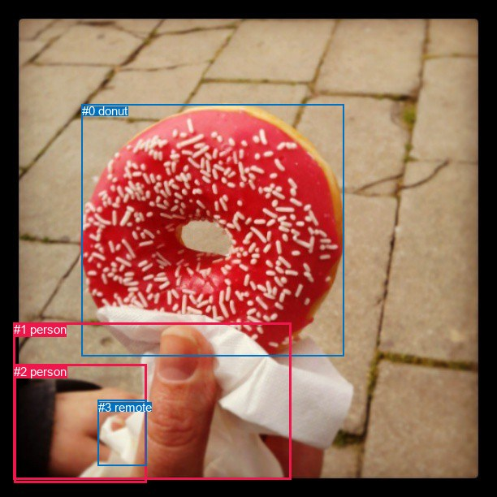
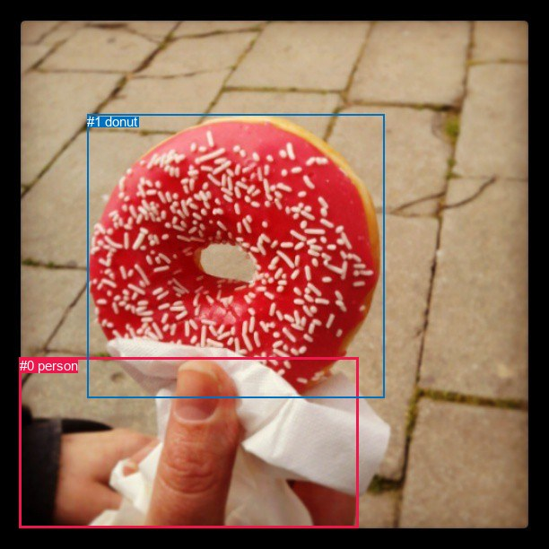

# 图片 0303：2326982.jpg

随机样本序号：335。图片 SHA256：`8749de195b3b7f7f5c59fcca6277e8418332ac925fd4b86c2c19de433e1c3682`。

红色框表示人，蓝色框表示其他物体。两个模式分别保留自身框编号，可依据位置比较对应对象。

## 自动检测框与输出

人的框编号：`[1, 2]`。状态：`ok`。

### 自动检测全部物体框

| 编号 | 类别 | 是否为人 | 检测分数 | 像素坐标 xyxy |
|---|---|---|---|---|
| 0 | donut | False | 0.9994 | 100.6, 128.1, 423.6, 438.5 |
| 1 | person | True | 0.7850 | 16.6, 397.1, 358.6, 590.5 |
| 2 | person | True | 0.6500 | 17.2, 448.9, 180.9, 594.0 |
| 3 | remote | False | 0.4370 | 120.9, 492.9, 180.9, 573.7 |

### 自动检测 Top50 人相关候选

评分物体对：12；人相关物体对：10；输出关系：20。

| 排名 | 主语编号与类别 | 关系 | 宾语编号与类别 | 类型 | 人与人 | 排序分数 | 原始融合 logit |
|---|---|---|---|---|---|---|---|
| 1 | #1 person | holding | #0 donut | semantic | False | 0.98952 | 4.5473 |
| 2 | #2 person | holding | #0 donut | semantic | False | 0.96503 | 3.3178 |
| 3 | #1 person | wearing | #2 person | semantic | True | 0.87875 | 1.9806 |
| 4 | #1 person | holding | #3 remote | semantic | False | 0.81019 | 1.4513 |
| 5 | #3 remote | on | #1 person | spatial | False | 0.77655 | 1.2457 |
| 6 | #2 person | holding | #3 remote | semantic | False | 0.76190 | 1.1631 |
| 7 | #2 person | on | #1 person | spatial | True | 0.72225 | 0.9557 |
| 8 | #3 remote | on | #2 person | spatial | False | 0.70942 | 0.8926 |
| 9 | #1 person | on | #0 donut | spatial | False | 0.59072 | 0.3669 |
| 10 | #1 person | in | #2 person | spatial | True | 0.32697 | -0.7219 |
| 11 | #3 remote | holding | #2 person | semantic | False | 0.30481 | -0.8245 |
| 12 | #3 remote | holding | #1 person | semantic | False | 0.26502 | -1.0201 |
| 13 | #2 person | wearing | #1 person | semantic | True | 0.24259 | -1.1386 |
| 14 | #2 person | on | #0 donut | spatial | False | 0.20165 | -1.3760 |
| 15 | #2 person | in front of | #3 remote | spatial | False | 0.16632 | -1.6119 |
| 16 | #0 donut | on | #1 person | spatial | False | 0.14388 | -1.7834 |
| 17 | #1 person | on | #3 remote | spatial | False | 0.08130 | -2.4248 |
| 18 | #0 donut | in front of | #2 person | spatial | False | 0.06219 | -2.7134 |
| 19 | #0 donut | holding | #1 person | semantic | False | 0.05586 | -2.8275 |
| 20 | #0 donut | holding | #2 person | semantic | False | 0.01472 | -4.2040 |

### 自动检测逐条人相关 GT 核验

R@50：50.00%；命中 1/2。

| GT 主语编号 | GT 关系 | GT 宾语编号 | 结果阶段 | 匹配预测主语编号 | 匹配预测宾语编号 |
|---|---|---|---|---|---|
| 0 | holding | 1 | hit50 | [1] | [0] |
| 1 | attached to | 0 | wrong_predicate | [0] | [1] |

## 真实框与输出

人的框编号：`[0]`。

### 真实框全部物体框

| 编号 | 类别 | 是否为人 | 检测分数 | 像素坐标 xyxy |
|---|---|---|---|---|
| 0 | person | True | GT | 22.0, 399.0, 400.0, 589.0 |
| 1 | donut | False | GT | 97.0, 127.0, 428.0, 444.0 |

### 真实框 Top50 人相关候选

评分物体对：2；人相关物体对：2；输出关系：4。

| 排名 | 主语编号与类别 | 关系 | 宾语编号与类别 | 类型 | 人与人 | 排序分数 | 原始融合 logit |
|---|---|---|---|---|---|---|---|
| 1 | #0 person | holding | #1 donut | semantic | False | 0.98630 | 4.2765 |
| 2 | #0 person | on | #1 donut | spatial | False | 0.48253 | -0.0699 |
| 3 | #1 donut | in | #0 person | spatial | False | 0.00070 | -7.2577 |
| 4 | #1 donut | holding | #0 person | semantic | False | 0.00042 | -7.7707 |

### 真实框逐条人相关 GT 核验

R@50：50.00%；命中 1/2。

| GT 主语编号 | GT 关系 | GT 宾语编号 | 结果阶段 | 匹配预测主语编号 | 匹配预测宾语编号 |
|---|---|---|---|---|---|
| 0 | holding | 1 | hit50 | [0] | [1] |
| 1 | attached to | 0 | wrong_predicate | [1] | [0] |

## 全部人相关 GT

| 主语编号与类别 | 关系 | 宾语编号与类别 |
|---|---|---|
| #0 person | holding | #1 donut |
| #1 donut | attached to | #0 person |

原始记录、全部人相关物体对的两项预测与分项分数见 [逐图证据 JSON](../evidence/cases/0303.json)。全部56类 logits 保留于本机 HOR/output/random500/logits/。

<!-- HOR_COMPLETE_RESULTS -->

## 六组条件的完整输出对照

以下保留同一图片三种框与候选模式、两种谓词输出规则的全部 Top50。框编号各自在所属模式内解释。

### 自动检测框完整枚举：空间与语义各保留一个谓词

| 排名 | 主语编号与类别 | 谓词 | 宾语编号与类别 | 分组 | 排序分数 | predicate logit | pair logit |
|---|---|---|---|---|---|---|---|
| 1 | #1 person | holding | #0 donut | semantic | 0.9895159 | 3.2017694 | 1.3455794 |
| 2 | #2 person | holding | #0 donut | semantic | 0.9650347 | 2.8860855 | 0.4317198 |
| 3 | #1 person | wearing | #2 person | semantic | 0.8787493 | 2.5178757 | -0.5372365 |
| 4 | #1 person | holding | #3 remote | semantic | 0.8101925 | 1.8995318 | -0.4482703 |
| 5 | #3 remote | on | #1 person | spatial | 0.7765522 | 1.7909756 | -0.5452895 |
| 6 | #2 person | holding | #3 remote | semantic | 0.7618978 | 1.5781493 | -0.4150370 |
| 7 | #2 person | on | #1 person | spatial | 0.7222523 | 1.4671259 | -0.5114645 |
| 8 | #3 remote | on | #2 person | spatial | 0.7094244 | 1.6923895 | -0.7997989 |
| 9 | #1 person | on | #0 donut | spatial | 0.5907206 | -0.9786344 | 1.3455794 |
| 10 | #1 person | in | #2 person | spatial | 0.3269672 | -0.1846976 | -0.5372365 |
| 11 | #3 remote | holding | #2 person | semantic | 0.3048069 | -0.0247121 | -0.7997989 |
| 12 | #3 remote | holding | #1 person | semantic | 0.2650152 | -0.4747729 | -0.5452895 |
| 13 | #2 person | wearing | #1 person | semantic | 0.2425867 | -0.6270857 | -0.5114645 |
| 14 | #2 person | on | #0 donut | spatial | 0.2016518 | -1.8077221 | 0.4317198 |
| 15 | #2 person | in front of | #3 remote | spatial | 0.1663181 | -1.1969123 | -0.4150370 |
| 16 | #0 donut | on | #1 person | spatial | 0.1438849 | 0.1880884 | -1.9714795 |
| 17 | #1 person | on | #3 remote | spatial | 0.0813003 | -1.9765399 | -0.4482703 |
| 18 | #0 donut | in front of | #2 person | spatial | 0.0621886 | -1.3382251 | -1.3751526 |
| 19 | #0 donut | holding | #1 person | semantic | 0.0558572 | -0.8559990 | -1.9714795 |
| 20 | #0 donut | holding | #2 person | semantic | 0.0147156 | -2.8288717 | -1.3751526 |

GT 命中：1/2，R@50=50.00%。

| GT主语 | GT谓词 | GT宾语 | 结果阶段 | 匹配主语框 | 匹配宾语框 |
|---|---|---|---|---|---|
| 0 | holding | 1 | hit50 | [1] | [0] |
| 1 | attached to | 0 | wrong_predicate | [0] | [1] |

### 自动检测框完整枚举：每对只保留一个谓词

| 排名 | 主语编号与类别 | 谓词 | 宾语编号与类别 | 分组 | 排序分数 | predicate logit | pair logit |
|---|---|---|---|---|---|---|---|
| 1 | #1 person | holding | #0 donut | single | 0.9895159 | 3.2017694 | 1.3455794 |
| 2 | #2 person | holding | #0 donut | single | 0.9650347 | 2.8860855 | 0.4317198 |
| 3 | #1 person | wearing | #2 person | single | 0.8787493 | 2.5178757 | -0.5372365 |
| 4 | #1 person | holding | #3 remote | single | 0.8101925 | 1.8995318 | -0.4482703 |
| 5 | #3 remote | on | #1 person | single | 0.7765522 | 1.7909756 | -0.5452895 |
| 6 | #2 person | holding | #3 remote | single | 0.7618978 | 1.5781493 | -0.4150370 |
| 7 | #2 person | on | #1 person | single | 0.7222523 | 1.4671259 | -0.5114645 |
| 8 | #3 remote | on | #2 person | single | 0.7094244 | 1.6923895 | -0.7997989 |
| 9 | #0 donut | on | #1 person | single | 0.1438849 | 0.1880884 | -1.9714795 |
| 10 | #0 donut | in front of | #2 person | single | 0.0621886 | -1.3382251 | -1.3751526 |

GT 命中：1/2，R@50=50.00%。

| GT主语 | GT谓词 | GT宾语 | 结果阶段 | 匹配主语框 | 匹配宾语框 |
|---|---|---|---|---|---|
| 0 | holding | 1 | hit50 | [1] | [0] |
| 1 | attached to | 0 | wrong_predicate | [0] | [1] |

### 真实框完整枚举：空间与语义各保留一个谓词

| 排名 | 主语编号与类别 | 谓词 | 宾语编号与类别 | 分组 | 排序分数 | predicate logit | pair logit |
|---|---|---|---|---|---|---|---|
| 1 | #0 person | holding | #1 donut | semantic | 0.9862990 | 2.9344511 | 1.3420393 |
| 2 | #0 person | on | #1 donut | spatial | 0.4825270 | -1.4119599 | 1.3420393 |
| 3 | #1 donut | in | #0 person | spatial | 0.0007042 | -5.4068685 | -1.8508735 |
| 4 | #1 donut | holding | #0 person | semantic | 0.0004217 | -5.9198556 | -1.8508735 |

GT 命中：1/2，R@50=50.00%。

| GT主语 | GT谓词 | GT宾语 | 结果阶段 | 匹配主语框 | 匹配宾语框 |
|---|---|---|---|---|---|
| 0 | holding | 1 | hit50 | [0] | [1] |
| 1 | attached to | 0 | wrong_predicate | [1] | [0] |

### 真实框完整枚举：每对只保留一个谓词

| 排名 | 主语编号与类别 | 谓词 | 宾语编号与类别 | 分组 | 排序分数 | predicate logit | pair logit |
|---|---|---|---|---|---|---|---|
| 1 | #0 person | holding | #1 donut | single | 0.9862990 | 2.9344511 | 1.3420393 |
| 2 | #1 donut | in | #0 person | single | 0.0007042 | -5.4068685 | -1.8508735 |

GT 命中：1/2，R@50=50.00%。

| GT主语 | GT谓词 | GT宾语 | 结果阶段 | 匹配主语框 | 匹配宾语框 |
|---|---|---|---|---|---|
| 0 | holding | 1 | hit50 | [0] | [1] |
| 1 | attached to | 0 | wrong_predicate | [1] | [0] |

### 真实框400候选：空间与语义各保留一个谓词

| 排名 | 主语编号与类别 | 谓词 | 宾语编号与类别 | 分组 | 排序分数 | predicate logit | pair logit |
|---|---|---|---|---|---|---|---|
| 1 | #0 person | holding | #1 donut | semantic | 0.9862990 | 2.9344511 | 1.3420393 |
| 2 | #0 person | on | #1 donut | spatial | 0.4825270 | -1.4119599 | 1.3420393 |
| 3 | #1 donut | in | #0 person | spatial | 0.0007167 | -5.3892779 | -1.8508735 |
| 4 | #1 donut | holding | #0 person | semantic | 0.0004237 | -5.9151840 | -1.8508735 |

GT 命中：1/2，R@50=50.00%。

| GT主语 | GT谓词 | GT宾语 | 结果阶段 | 匹配主语框 | 匹配宾语框 |
|---|---|---|---|---|---|
| 0 | holding | 1 | hit50 | [0] | [1] |
| 1 | attached to | 0 | wrong_predicate | [1] | [0] |

### 真实框400候选：每对只保留一个谓词

| 排名 | 主语编号与类别 | 谓词 | 宾语编号与类别 | 分组 | 排序分数 | predicate logit | pair logit |
|---|---|---|---|---|---|---|---|
| 1 | #0 person | holding | #1 donut | single | 0.9862990 | 2.9344511 | 1.3420393 |
| 2 | #1 donut | in | #0 person | single | 0.0007167 | -5.3892779 | -1.8508735 |

GT 命中：1/2，R@50=50.00%。

| GT主语 | GT谓词 | GT宾语 | 结果阶段 | 匹配主语框 | 匹配宾语框 |
|---|---|---|---|---|---|
| 0 | holding | 1 | hit50 | [0] | [1] |
| 1 | attached to | 0 | wrong_predicate | [1] | [0] |
