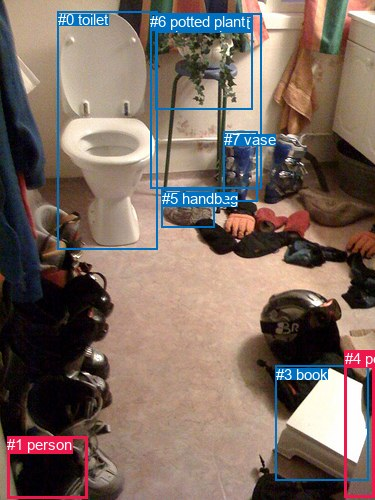
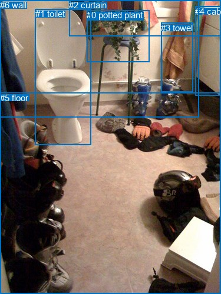

# 图片 0304：2327041.jpg

随机样本序号：355。图片 SHA256：`756af170de5d32112b9c0cf5af399dc4dd19a2c455e4d352c3c60577d1ebe3a6`。

红色框表示人，蓝色框表示其他物体。两个模式分别保留自身框编号，可依据位置比较对应对象。

## 自动检测框与输出

人的框编号：`[1, 4]`。状态：`ok`。

### 自动检测全部物体框

| 编号 | 类别 | 是否为人 | 检测分数 | 像素坐标 xyxy |
|---|---|---|---|---|
| 0 | toilet | False | 0.9932 | 57.7, 11.1, 157.7, 249.1 |
| 1 | person | True | 0.7490 | 7.4, 436.2, 87.3, 498.5 |
| 2 | potted plant | False | 0.7157 | 155.0, 15.5, 252.2, 109.5 |
| 3 | book | False | 0.5850 | 276.0, 365.6, 368.7, 480.0 |
| 4 | person | True | 0.5771 | 344.9, 350.4, 374.3, 497.1 |
| 5 | handbag | False | 0.4823 | 161.7, 189.9, 214.8, 227.2 |
| 6 | potted plant | False | 0.4771 | 150.0, 13.3, 261.5, 188.8 |
| 7 | vase | False | 0.4405 | 223.9, 131.2, 257.7, 201.9 |

### 自动检测 Top50 人相关候选

评分物体对：56；人相关物体对：26；输出关系：50。

| 排名 | 主语编号与类别 | 关系 | 宾语编号与类别 | 类型 | 人与人 | 排序分数 | 原始融合 logit |
|---|---|---|---|---|---|---|---|
| 1 | #3 book | on | #4 person | spatial | False | 0.96949 | 3.4586 |
| 2 | #4 person | holding | #3 book | semantic | False | 0.93233 | 2.6230 |
| 3 | #4 person | beside | #3 book | spatial | False | 0.92997 | 2.5862 |
| 4 | #3 book | sitting on | #4 person | semantic | False | 0.84769 | 1.7166 |
| 5 | #1 person | beside | #0 toilet | spatial | False | 0.76887 | 1.2020 |
| 6 | #1 person | on | #4 person | spatial | True | 0.76612 | 1.1865 |
| 7 | #1 person | on | #3 book | spatial | False | 0.58062 | 0.3253 |
| 8 | #1 person | lying on | #4 person | semantic | True | 0.49996 | -0.0001 |
| 9 | #0 toilet | beside | #1 person | spatial | False | 0.38471 | -0.4696 |
| 10 | #1 person | lying on | #3 book | semantic | False | 0.35125 | -0.6135 |
| 11 | #1 person | holding | #0 toilet | semantic | False | 0.22188 | -1.2547 |
| 12 | #5 handbag | on | #4 person | spatial | False | 0.19709 | -1.4046 |
| 13 | #4 person | holding | #1 person | semantic | True | 0.17316 | -1.5634 |
| 14 | #4 person | looking at | #0 toilet | semantic | False | 0.10105 | -2.1856 |
| 15 | #0 toilet | holding | #1 person | semantic | False | 0.09771 | -2.2230 |
| 16 | #4 person | in | #1 person | spatial | True | 0.09621 | -2.2401 |
| 17 | #4 person | in front of | #0 toilet | spatial | False | 0.09379 | -2.2682 |
| 18 | #0 toilet | in | #4 person | spatial | False | 0.08907 | -2.3251 |
| 19 | #3 book | in | #1 person | spatial | False | 0.08082 | -2.4313 |
| 20 | #5 handbag | lying on | #4 person | semantic | False | 0.08042 | -2.4367 |
| 21 | #1 person | on | #6 potted plant | spatial | False | 0.07674 | -2.4874 |
| 22 | #3 book | holding | #1 person | semantic | False | 0.07375 | -2.5304 |
| 23 | #1 person | in | #5 handbag | spatial | False | 0.07300 | -2.5415 |
| 24 | #4 person | in front of | #6 potted plant | spatial | False | 0.05034 | -2.9373 |
| 25 | #1 person | in | #2 potted plant | spatial | False | 0.04116 | -3.1482 |
| 26 | #7 vase | on | #4 person | spatial | False | 0.02618 | -3.6163 |
| 27 | #6 potted plant | beside | #4 person | spatial | False | 0.02332 | -3.7349 |
| 28 | #1 person | in | #7 vase | spatial | False | 0.02310 | -3.7445 |
| 29 | #1 person | lying on | #5 handbag | semantic | False | 0.02193 | -3.7976 |
| 30 | #2 potted plant | in | #4 person | spatial | False | 0.02014 | -3.8849 |
| 31 | #5 handbag | on | #1 person | spatial | False | 0.01592 | -4.1240 |
| 32 | #1 person | lying on | #6 potted plant | semantic | False | 0.01352 | -4.2903 |
| 33 | #2 potted plant | in | #1 person | spatial | False | 0.00919 | -4.6805 |
| 34 | #0 toilet | holding | #4 person | semantic | False | 0.00866 | -4.7400 |
| 35 | #4 person | in front of | #7 vase | spatial | False | 0.00641 | -5.0436 |
| 36 | #4 person | in front of | #2 potted plant | spatial | False | 0.00627 | -5.0661 |
| 37 | #5 handbag | lying on | #1 person | semantic | False | 0.00559 | -5.1813 |
| 38 | #7 vase | sitting on | #4 person | semantic | False | 0.00531 | -5.2337 |
| 39 | #4 person | in front of | #5 handbag | spatial | False | 0.00487 | -5.3194 |
| 40 | #6 potted plant | beside | #1 person | spatial | False | 0.00473 | -5.3488 |
| 41 | #1 person | holding | #2 potted plant | semantic | False | 0.00462 | -5.3719 |
| 42 | #2 potted plant | sitting on | #4 person | semantic | False | 0.00450 | -5.3998 |
| 43 | #1 person | holding | #7 vase | semantic | False | 0.00426 | -5.4536 |
| 44 | #4 person | sitting on | #6 potted plant | semantic | False | 0.00397 | -5.5247 |
| 45 | #4 person | holding | #7 vase | semantic | False | 0.00397 | -5.5258 |
| 46 | #7 vase | in | #1 person | spatial | False | 0.00372 | -5.5916 |
| 47 | #4 person | holding | #5 handbag | semantic | False | 0.00354 | -5.6388 |
| 48 | #6 potted plant | holding | #4 person | semantic | False | 0.00277 | -5.8868 |
| 49 | #4 person | holding | #2 potted plant | semantic | False | 0.00249 | -5.9921 |
| 50 | #6 potted plant | holding | #1 person | semantic | False | 0.00197 | -6.2300 |

### 自动检测逐条人相关 GT 核验

本图没有人相关 GT，R@50 无分母；预测候选继续展示。

## 真实框与输出

人的框编号：`[]`。

### 真实框全部物体框

| 编号 | 类别 | 是否为人 | 检测分数 | 像素坐标 xyxy |
|---|---|---|---|---|
| 0 | potted plant | False | GT | 147.0, 17.0, 253.0, 105.0 |
| 1 | toilet | False | GT | 60.0, 15.0, 154.0, 247.0 |
| 2 | curtain | False | GT | 117.0, 0.0, 375.0, 61.0 |
| 3 | towel | False | GT | 273.0, 39.0, 327.0, 157.0 |
| 4 | cabinet | False | GT | 331.0, 11.0, 375.0, 163.0 |
| 5 | floor | False | GT | 0.0, 158.0, 375.0, 500.0 |
| 6 | wall | False | GT | 0.0, 0.0, 338.0, 199.0 |

### 真实框 Top50 人相关候选

评分物体对：0；人相关物体对：0；输出关系：0。

| 排名 | 主语编号与类别 | 关系 | 宾语编号与类别 | 类型 | 人与人 | 排序分数 | 原始融合 logit |
|---|---|---|---|---|---|---|---|

### 真实框逐条人相关 GT 核验

本图没有人相关 GT，R@50 无分母；预测候选继续展示。

## 全部人相关 GT

| 主语编号与类别 | 关系 | 宾语编号与类别 |
|---|---|---|

原始记录、全部人相关物体对的两项预测与分项分数见 [逐图证据 JSON](../evidence/cases/0304.json)。全部56类 logits 保留于本机 HOR/output/random500/logits/。

<!-- HOR_COMPLETE_RESULTS -->

## 六组条件的完整输出对照

以下保留同一图片三种框与候选模式、两种谓词输出规则的全部 Top50。框编号各自在所属模式内解释。

### 自动检测框完整枚举：空间与语义各保留一个谓词

| 排名 | 主语编号与类别 | 谓词 | 宾语编号与类别 | 分组 | 排序分数 | predicate logit | pair logit |
|---|---|---|---|---|---|---|---|
| 1 | #3 book | on | #4 person | spatial | 0.9694877 | 3.3491168 | 0.1095214 |
| 2 | #4 person | holding | #3 book | semantic | 0.9323294 | 2.7233429 | -0.1003088 |
| 3 | #4 person | beside | #3 book | spatial | 0.9299680 | 2.6865063 | -0.1003088 |
| 4 | #3 book | sitting on | #4 person | semantic | 0.8476909 | 1.6070828 | 0.1095214 |
| 5 | #1 person | beside | #0 toilet | spatial | 0.7688741 | 2.0928926 | -0.8909279 |
| 6 | #1 person | on | #4 person | spatial | 0.7661178 | 2.1130881 | -0.9265701 |
| 7 | #1 person | on | #3 book | spatial | 0.5806248 | 1.3840055 | -1.0586667 |
| 8 | #1 person | lying on | #4 person | semantic | 0.4999629 | 0.9264216 | -0.9265701 |
| 9 | #0 toilet | beside | #1 person | spatial | 0.3847081 | 0.8223233 | -1.2919351 |
| 10 | #1 person | lying on | #3 book | semantic | 0.3512526 | 0.4451289 | -1.0586667 |
| 11 | #1 person | holding | #0 toilet | semantic | 0.2218793 | -0.3638201 | -0.8909279 |
| 12 | #5 handbag | on | #4 person | spatial | 0.1970948 | 0.1676121 | -1.5721639 |
| 13 | #4 person | holding | #1 person | semantic | 0.1731621 | -0.5129085 | -1.0504724 |
| 14 | #4 person | looking at | #0 toilet | semantic | 0.1010486 | -0.9589775 | -1.2266495 |
| 15 | #0 toilet | holding | #1 person | semantic | 0.0977069 | -0.9310319 | -1.2919351 |
| 16 | #4 person | in | #1 person | spatial | 0.0962051 | -1.1896479 | -1.0504724 |
| 17 | #4 person | in front of | #0 toilet | spatial | 0.0937898 | -1.0415654 | -1.2266495 |
| 18 | #0 toilet | in | #4 person | spatial | 0.0890672 | -1.0440080 | -1.2810705 |
| 19 | #3 book | in | #1 person | spatial | 0.0808157 | -1.4599631 | -0.9713523 |
| 20 | #5 handbag | lying on | #4 person | semantic | 0.0804187 | -0.8645077 | -1.5721639 |
| 21 | #1 person | on | #6 potted plant | spatial | 0.0767437 | -0.7592790 | -1.7281562 |
| 22 | #3 book | holding | #1 person | semantic | 0.0737517 | -1.5590856 | -0.9713523 |
| 23 | #1 person | in | #5 handbag | spatial | 0.0730028 | -0.7801478 | -1.7613053 |
| 24 | #4 person | in front of | #6 potted plant | spatial | 0.0503405 | -1.4284632 | -1.5088294 |
| 25 | #1 person | in | #2 potted plant | spatial | 0.0411605 | -1.3956323 | -1.7526114 |
| 26 | #7 vase | on | #4 person | spatial | 0.0261792 | -1.5313411 | -2.0849197 |
| 27 | #6 potted plant | beside | #4 person | spatial | 0.0233185 | -1.9951115 | -1.7398036 |
| 28 | #1 person | in | #7 vase | spatial | 0.0231002 | -1.7704477 | -1.9740965 |
| 29 | #1 person | lying on | #5 handbag | semantic | 0.0219325 | -2.0363023 | -1.7613053 |
| 30 | #2 potted plant | in | #4 person | spatial | 0.0201359 | -2.3031254 | -1.5817853 |
| 31 | #5 handbag | on | #1 person | spatial | 0.0159221 | -2.1393347 | -1.9846601 |
| 32 | #1 person | lying on | #6 potted plant | semantic | 0.0135151 | -2.5621843 | -1.7281562 |
| 33 | #2 potted plant | in | #1 person | spatial | 0.0091889 | -2.9318342 | -1.7486917 |
| 34 | #0 toilet | holding | #4 person | semantic | 0.0086626 | -3.4589713 | -1.2810705 |
| 35 | #4 person | in front of | #7 vase | spatial | 0.0064090 | -2.9152765 | -2.1283388 |
| 36 | #4 person | in front of | #2 potted plant | spatial | 0.0062672 | -3.3132198 | -1.7529120 |
| 37 | #5 handbag | lying on | #1 person | semantic | 0.0055895 | -3.1966033 | -1.9846601 |
| 38 | #7 vase | sitting on | #4 person | semantic | 0.0053052 | -3.1488285 | -2.0849197 |
| 39 | #4 person | in front of | #5 handbag | spatial | 0.0048719 | -3.4888659 | -1.8305303 |
| 40 | #6 potted plant | beside | #1 person | spatial | 0.0047312 | -3.6676388 | -1.6811874 |
| 41 | #1 person | holding | #2 potted plant | semantic | 0.0046240 | -3.6192436 | -1.7526114 |
| 42 | #2 potted plant | sitting on | #4 person | semantic | 0.0044973 | -3.8179755 | -1.5817853 |
| 43 | #1 person | holding | #7 vase | semantic | 0.0042626 | -3.4795065 | -1.9740965 |
| 44 | #4 person | sitting on | #6 potted plant | semantic | 0.0039711 | -4.0159116 | -1.5088294 |
| 45 | #4 person | holding | #7 vase | semantic | 0.0039670 | -3.3974419 | -2.1283388 |
| 46 | #7 vase | in | #1 person | spatial | 0.0037151 | -3.5931838 | -1.9984429 |
| 47 | #4 person | holding | #5 handbag | semantic | 0.0035445 | -3.8082745 | -1.8305303 |
| 48 | #6 potted plant | holding | #4 person | semantic | 0.0027680 | -4.1470394 | -1.7398036 |
| 49 | #4 person | holding | #2 potted plant | semantic | 0.0024921 | -4.2392058 | -1.7529120 |
| 50 | #6 potted plant | holding | #1 person | semantic | 0.0019657 | -4.5487714 | -1.6811874 |

没有人相关 GT，本条件的召回率无分母。

### 自动检测框完整枚举：每对只保留一个谓词

| 排名 | 主语编号与类别 | 谓词 | 宾语编号与类别 | 分组 | 排序分数 | predicate logit | pair logit |
|---|---|---|---|---|---|---|---|
| 1 | #3 book | on | #4 person | single | 0.9694877 | 3.3491168 | 0.1095214 |
| 2 | #4 person | holding | #3 book | single | 0.9323294 | 2.7233429 | -0.1003088 |
| 3 | #1 person | beside | #0 toilet | single | 0.7688741 | 2.0928926 | -0.8909279 |
| 4 | #1 person | on | #4 person | single | 0.7661178 | 2.1130881 | -0.9265701 |
| 5 | #1 person | on | #3 book | single | 0.5806248 | 1.3840055 | -1.0586667 |
| 6 | #0 toilet | beside | #1 person | single | 0.3847081 | 0.8223233 | -1.2919351 |
| 7 | #5 handbag | on | #4 person | single | 0.1970948 | 0.1676121 | -1.5721639 |
| 8 | #4 person | holding | #1 person | single | 0.1731621 | -0.5129085 | -1.0504724 |
| 9 | #4 person | looking at | #0 toilet | single | 0.1010486 | -0.9589775 | -1.2266495 |
| 10 | #0 toilet | in | #4 person | single | 0.0890672 | -1.0440080 | -1.2810705 |
| 11 | #3 book | in | #1 person | single | 0.0808157 | -1.4599631 | -0.9713523 |
| 12 | #1 person | on | #6 potted plant | single | 0.0767437 | -0.7592790 | -1.7281562 |
| 13 | #1 person | in | #5 handbag | single | 0.0730028 | -0.7801478 | -1.7613053 |
| 14 | #4 person | in front of | #6 potted plant | single | 0.0503405 | -1.4284632 | -1.5088294 |
| 15 | #1 person | in | #2 potted plant | single | 0.0411605 | -1.3956323 | -1.7526114 |
| 16 | #7 vase | on | #4 person | single | 0.0261792 | -1.5313411 | -2.0849197 |
| 17 | #6 potted plant | beside | #4 person | single | 0.0233185 | -1.9951115 | -1.7398036 |
| 18 | #1 person | in | #7 vase | single | 0.0231002 | -1.7704477 | -1.9740965 |
| 19 | #2 potted plant | in | #4 person | single | 0.0201359 | -2.3031254 | -1.5817853 |
| 20 | #5 handbag | on | #1 person | single | 0.0159221 | -2.1393347 | -1.9846601 |
| 21 | #2 potted plant | in | #1 person | single | 0.0091889 | -2.9318342 | -1.7486917 |
| 22 | #4 person | in front of | #7 vase | single | 0.0064090 | -2.9152765 | -2.1283388 |
| 23 | #4 person | in front of | #2 potted plant | single | 0.0062672 | -3.3132198 | -1.7529120 |
| 24 | #4 person | in front of | #5 handbag | single | 0.0048719 | -3.4888659 | -1.8305303 |
| 25 | #6 potted plant | beside | #1 person | single | 0.0047312 | -3.6676388 | -1.6811874 |
| 26 | #7 vase | in | #1 person | single | 0.0037151 | -3.5931838 | -1.9984429 |

没有人相关 GT，本条件的召回率无分母。

### 真实框完整枚举：空间与语义各保留一个谓词

| 排名 | 主语编号与类别 | 谓词 | 宾语编号与类别 | 分组 | 排序分数 | predicate logit | pair logit |
|---|---|---|---|---|---|---|---|

没有人相关 GT，本条件的召回率无分母。

### 真实框完整枚举：每对只保留一个谓词

| 排名 | 主语编号与类别 | 谓词 | 宾语编号与类别 | 分组 | 排序分数 | predicate logit | pair logit |
|---|---|---|---|---|---|---|---|

没有人相关 GT，本条件的召回率无分母。

### 真实框400候选：空间与语义各保留一个谓词

| 排名 | 主语编号与类别 | 谓词 | 宾语编号与类别 | 分组 | 排序分数 | predicate logit | pair logit |
|---|---|---|---|---|---|---|---|

没有人相关 GT，本条件的召回率无分母。

### 真实框400候选：每对只保留一个谓词

| 排名 | 主语编号与类别 | 谓词 | 宾语编号与类别 | 分组 | 排序分数 | predicate logit | pair logit |
|---|---|---|---|---|---|---|---|

没有人相关 GT，本条件的召回率无分母。
