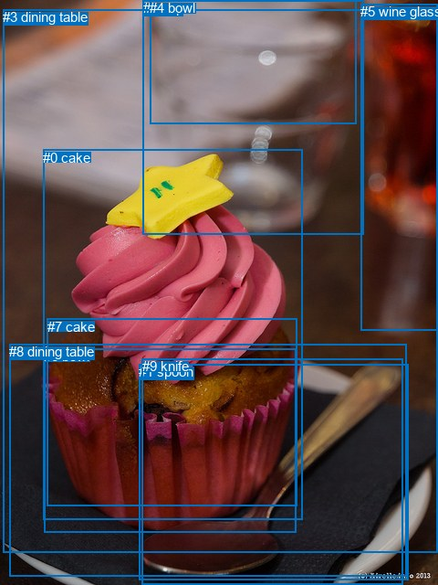
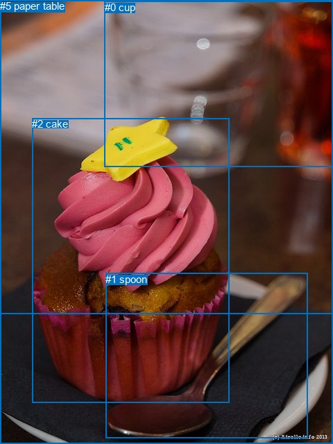

# 图片 0311：2327461.jpg

随机样本序号：15。图片 SHA256：`7914cb3ee5899cfe9e41bef669723e4b8e85da3428c2381413f5791bf5c640ba`。

红色框表示人，蓝色框表示其他物体。两个模式分别保留自身框编号，可依据位置比较对应对象。

## 自动检测框与输出

人的框编号：`[]`。状态：`no_person`。

### 自动检测全部物体框

| 编号 | 类别 | 是否为人 | 检测分数 | 像素坐标 xyxy |
|---|---|---|---|---|
| 0 | cake | False | 0.9967 | 47.1, 163.8, 331.5, 568.9 |
| 1 | spoon | False | 0.9786 | 152.4, 398.3, 447.8, 634.8 |
| 2 | cup | False | 0.8114 | 156.9, 0.1, 398.9, 256.8 |
| 3 | dining table | False | 0.7424 | 3.2, 10.5, 480.0, 604.3 |
| 4 | bowl | False | 0.6634 | 164.4, 0.0, 390.8, 135.8 |
| 5 | wine glass | False | 0.5021 | 395.1, 4.0, 480.0, 361.9 |
| 6 | bowl | False | 0.4955 | 48.0, 381.3, 324.2, 582.1 |
| 7 | cake | False | 0.4287 | 51.9, 348.8, 325.1, 553.0 |
| 8 | dining table | False | 0.4160 | 10.4, 376.4, 445.8, 630.1 |
| 9 | knife | False | 0.3620 | 155.8, 392.2, 441.7, 640.0 |

### 自动检测 Top50 人相关候选

评分物体对：0；人相关物体对：0；输出关系：0。

| 排名 | 主语编号与类别 | 关系 | 宾语编号与类别 | 类型 | 人与人 | 排序分数 | 原始融合 logit |
|---|---|---|---|---|---|---|---|

### 自动检测逐条人相关 GT 核验

本图没有人相关 GT，R@50 无分母；预测候选继续展示。

## 真实框与输出

人的框编号：`[]`。

### 真实框全部物体框

| 编号 | 类别 | 是否为人 | 检测分数 | 像素坐标 xyxy |
|---|---|---|---|---|
| 0 | cup | False | GT | 151.0, 2.0, 480.0, 241.0 |
| 1 | spoon | False | GT | 152.0, 394.0, 443.0, 632.0 |
| 2 | cake | False | GT | 46.0, 170.0, 330.0, 580.0 |
| 3 | dining table | False | GT | 0.0, 0.0, 480.0, 453.0 |
| 4 | table | False | GT | 0.0, 0.0, 480.0, 640.0 |
| 5 | paper | False | GT | 0.0, 0.0, 480.0, 640.0 |

### 真实框 Top50 人相关候选

评分物体对：0；人相关物体对：0；输出关系：0。

| 排名 | 主语编号与类别 | 关系 | 宾语编号与类别 | 类型 | 人与人 | 排序分数 | 原始融合 logit |
|---|---|---|---|---|---|---|---|

### 真实框逐条人相关 GT 核验

本图没有人相关 GT，R@50 无分母；预测候选继续展示。

## 全部人相关 GT

| 主语编号与类别 | 关系 | 宾语编号与类别 |
|---|---|---|

原始记录、全部人相关物体对的两项预测与分项分数见 [逐图证据 JSON](../evidence/cases/0311.json)。全部56类 logits 保留于本机 HOR/output/random500/logits/。

<!-- HOR_COMPLETE_RESULTS -->

## 六组条件的完整输出对照

以下保留同一图片三种框与候选模式、两种谓词输出规则的全部 Top50。框编号各自在所属模式内解释。

### 自动检测框完整枚举：空间与语义各保留一个谓词

| 排名 | 主语编号与类别 | 谓词 | 宾语编号与类别 | 分组 | 排序分数 | predicate logit | pair logit |
|---|---|---|---|---|---|---|---|

没有人相关 GT，本条件的召回率无分母。

### 自动检测框完整枚举：每对只保留一个谓词

| 排名 | 主语编号与类别 | 谓词 | 宾语编号与类别 | 分组 | 排序分数 | predicate logit | pair logit |
|---|---|---|---|---|---|---|---|

没有人相关 GT，本条件的召回率无分母。

### 真实框完整枚举：空间与语义各保留一个谓词

| 排名 | 主语编号与类别 | 谓词 | 宾语编号与类别 | 分组 | 排序分数 | predicate logit | pair logit |
|---|---|---|---|---|---|---|---|

没有人相关 GT，本条件的召回率无分母。

### 真实框完整枚举：每对只保留一个谓词

| 排名 | 主语编号与类别 | 谓词 | 宾语编号与类别 | 分组 | 排序分数 | predicate logit | pair logit |
|---|---|---|---|---|---|---|---|

没有人相关 GT，本条件的召回率无分母。

### 真实框400候选：空间与语义各保留一个谓词

| 排名 | 主语编号与类别 | 谓词 | 宾语编号与类别 | 分组 | 排序分数 | predicate logit | pair logit |
|---|---|---|---|---|---|---|---|

没有人相关 GT，本条件的召回率无分母。

### 真实框400候选：每对只保留一个谓词

| 排名 | 主语编号与类别 | 谓词 | 宾语编号与类别 | 分组 | 排序分数 | predicate logit | pair logit |
|---|---|---|---|---|---|---|---|

没有人相关 GT，本条件的召回率无分母。
